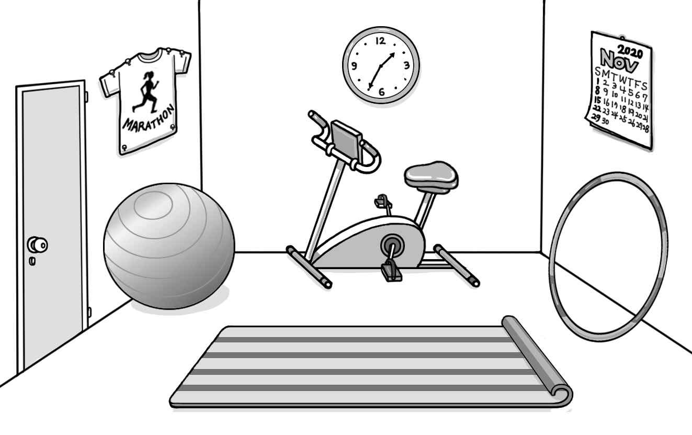

1. 다음을 듣고, 남자가 하는 말의 목적으로 가장 적절한 것을 고르시오.

① 교통사고 발생 시 대처 요령을 안내하려고
② 자전거 투어 시 안전 규칙을 설명하려고
③ 자전거 전용 도로 확충을 요청하려고
④ 단체 관광 일정 변경을 공지하려고
⑤ 자전거 대회 참가를 독려하려고

2. 대화를 듣고, 여자의 의견으로 가장 적절한 것을 고르시오.

① 잠들기 직전의 운동은 수면을 방해할 수 있다.
② 운동은 규칙적으로 하는 것이 효과적이다.
③ 과격한 운동은 심장에 무리를 줄 수 있다.
④ 충분한 수면은 건강 관리에 도움이 된다.
⑤ 지나친 스트레스는 건강을 해친다.

3. 대화를 듣고, 두 사람의 관계를 가장 잘 나타낸 것을 고르시오.

① 구급 대원 – 간호사
② 피부과 의사 – 환자
③ 화장품 판매원 – 손님
④ 제약 회사 직원 – 약사
⑤ 물리 치료사 – 운동선수

4. 대화를 듣고, 그림에서 대화의 내용과 일치하지 않는 것을 고르시오.

①
②
④

5. 대화를 듣고, 여자가 할 일로 가장 적절한 것을 고르시오.

① 모금함 만들기
② 물품 배치하기
③ 가격표 붙이기
④ 스피커 점검하기
⑤ 동영상 제작하기

6. 대화를 듣고, 남자가 지불할 금액을 고르시오. [3점]

① $41
② $45
③ $46
④ $50
⑤ $54

7. 대화를 듣고, 남자가 학생 패션쇼에 갈 수 없는 이유를 고르시오.

① 친구 생일 선물을 사야 해서
② 가족과 식사를 하기로 해서
③ 집수리를 도와줘야 해서
④ 회의에 참석해야 해서
⑤ 콘서트에 가기로 해서

8. 대화를 듣고, World Dinosaur Exhibition에 관해 언급되지 않은 것을 고르시오.

① 장소
② 프로그램
③ 운영 시간
④ 입장료
⑤ 교통편

9. Greenville Animation Film Festival에 관한 다음 내용을 듣고, 일치하지 않는 것을 고르시오.

① 1995년에 시작된 행사이다.
② 일주일 동안 열린다.
③ 올해의 주제는 우정이다.
④ 영화 스케줄은 웹사이트에 게시될 것이다.
⑤ 근처에 주차장이 있다.

10. 다음 표를 보면서 대화를 듣고, 여자가 등록할 그리기 강좌를 고르시오.

One-day Drawing Lessons

|  | Class | Material | Lesson Type | Day | Time |
| --- | --- | --- | --- | --- | --- |
| ① | A | Oil paint | Group | Monday | 11 a.m. |
| ② | B | Acrylic paint | Private | Wednesday | 11 a.m. |
| ③ | C | Crayon | Group | Wednesday | 6 p.m. |
| ④ | D | Colored pencil | Group | Friday | 11 a.m. |
| ⑤ | E | Pastel | Private | Friday | 6 p.m. |

11. 대화를 듣고, 남자의 마지막 말에 대한 여자의 응답으로 가장 적절한 것을 고르시오.

① Bulgogi is already sold out.
② You can choose what to eat.
③ We’ll meet at the restaurant.
④ I’ll order the food for tomorrow.
⑤ I got the recipe from the Internet.

12. 대화를 듣고, 여자의 마지막 말에 대한 남자의 응답으로 가장 적절한 것을 고르시오.

① No problem. Your car is repaired.
② Sorry. I can’t go camping with you.
③ Of course. You can borrow my tent.
④ Okay. I’ll bring you the speakers now.
⑤ Don’t worry. I already turned them off.

13. 대화를 듣고, 남자의 마지막 말에 대한 여자의 응답으로 가장 적절한 것을 고르시오.

Woman:
① Then, you should sell the items using this app.
② Good. Let’s buy a sweater in the marketplace.
③ All right. It’s easy to order this bag online.
④ No worries. I’ll lend you some money.
⑤ Well, you’d better buy new clothes.

14. 대화를 듣고, 여자의 마지막 말에 대한 남자의 응답으로 가장 적절한 것을 고르시오. [3점]

Man:
① Don’t worry. I’ll send you a notice by email.
② Great. Let me know how to use your services.
③ I don’t agree. You can get a refund without a receipt.
④ Good. I’m looking forward to watching a movie tonight.
⑤ Okay. I’ll call customer service to cancel the membership.

15. 다음 상황 설명을 듣고, Ms. Brown이 Chris에게 할 말로 가장 적절한 것을 고르시오. [3점]

Ms. Brown:

① You should stop worrying about your major.
② You’d better read an English book every day.
③ Why don’t you start writing a diary in English?
④ I think you need to learn a lot of English words.
⑤ How about having conversations with foreigners?

16. 여자가 하는 말의 주제로 가장 적절한 것은?

① positive effects of raising animals
② useful tips for recording animal behavior
③ common characteristics sea animals have
④ different ways animals use to communicate
⑤ importance of protecting endangered species

17. 언급된 동물이 아닌 것은?

따라 답을 하시기 바랍니다.

① 개
② 돌고래
③ 고릴라
④ 코끼리
⑤ 기린

18. 다음 글의 목적으로 가장 적절한 것은?

To whom it may concern: I was born and raised in the city of Boulder and have enjoyed our scenic natural spaces for my whole life. The land through which the proposed Pine Hill walking trail would cut is home to a variety of species. Wildlife faces pressure from development, and these animals need space where they can hide from human activity. Although trails serve as a wonderful source for us to access the natural world and appreciate the wildlife within it, if we continue to destroy habitats with excess trails, the wildlife will stop using these areas. Please reconsider whether the proposed trail is absolutely necessary. Sincerely, Tyler Stuart

19. 다음 글에 드러난 ‘I’의 심경 변화로 가장 적절한 것은?

On my seventh birthday, my mom surprised me with a puppy waiting on a leash. It had beautiful golden fur and an adorable tail. It was exactly what I had always dreamed of. I took the dog everywhere and slept with it every night. A few months later, the dog got out of the backyard and was lost. I sat on my bed and cried for hours while my mother watched me silently from the doorway of my room. I finally fell asleep, exhausted from my grief. My mother never said a word to me about my loss, but I knew she felt the same as I did.

20. 다음 글에서 필자가 주장하는 바로 가장 적절한 것은?

When I was in high school, we had students who could study in the coffee shop and not get distracted by the noise or everything happening around them. We also had students who could not study if the library was not super quiet. The latter students suffered because even in the library, it was impossible to get the type of complete silence they sought. These students were victims of distractions who found it very difficult to study anywhere except in their private bedrooms. In today’s world, it is impossible to run away from distractions. Distractions are everywhere, but if you want to achieve your goals, you must learn how to tackle distractions. You cannot eliminate distractions, but you can learn to live with them in a way that ensures they do not limit you.

21. 밑줄 친 popped out of the box가 다음 글에서 의미하는 바로 가장 적절한 것은?

With the Internet, everything changed. Product problems, overpromises, the lack of customer support, differential pricing ― all of the issues that customers actually experienced from a marketing organization suddenly popped out of the box. No longer were there any controlled communications or even business systems. Consumers could generally learn through the Web whatever they wanted to know about a company, its products, its competitors, its distribution systems, and, most of all, its truthfulness when talking about its products and services. Just as important, the Internet opened up a forum for customers to compare products, experiences, and values with other customers easily and quickly. Now the customer had a way to talk back to the marketer and to do so through public forums instantly.

22. 다음 글의 요지로 가장 적절한 것은?

FOBO, or Fear of a Better Option, is the anxiety that something better will come along, which makes it undesirable to commit to existing choices when making a decision. It’s an affliction of abundance that drives you to keep all of your options open and to avoid risks. Rather than assessing your options, choosing one, and moving on with your day, you delay the inevitable. It’s not unlike hitting the snooze button on your alarm clock only to pull the covers over your head and fall back asleep. As you probably found out the hard way, if you hit snooze enough times, you’ll end up being late and racing for the office, your day and mood ruined. While pressing snooze feels so good at the moment, it ultimately demands a price.

23. 다음 글의 주제로 가장 적절한 것은?

The use of renewable sources of energy to produce electricity has increasingly been encouraged as a way to harmonize the need to secure electricity supply with environmental protection objectives. But the use of renewable sources also comes with its own consequences, which require consideration. Renewable sources of energy include a variety of sources such as hydropower and ocean-based technologies. Additionally, solar, wind, geothermal and biomass renewable sources also have their own impact on the environment. Hydropower dams, for example, have an impact on aquatic ecosystems and, more recently, have been identified as significant sources of greenhouse emissions. Wind, solar, and biomass also cause negative environmental impacts, such as visual pollution, intensive land occupation and negative effects on bird populations.

24. 다음 글의 제목으로 가장 적절한 것은?

Chewing leads to smaller particles for swallowing, and more exposed surface area for digestive enzymes to act on. In other words, it means the extraction of more fuel and raw materials from a mouthful of food. This is especially important for mammals because they heat their bodies from within. Chewing gives mammals the energy needed to be active not only during the day but also the cool night, and to live in colder climates or places with changing temperatures. It allows them to sustain higher levels of activity and travel speeds to cover larger distances, avoid predators, capture prey, and make and care for their young. Mammals are able to live in an incredible variety of habitats, from Arctic tundra to Antarctic pack ice, deep open waters to high-altitude mountaintops, and rainforests to deserts, in no small measure because of their teeth.

25. 다음 표의 내용과 일치하지 않는 것은?

Age Children Quit Regularly Playing a Sport

| Sport | Average Age of Last Regular Participation | Average Length in Years of Participation |
| --- | --- | --- |
| Soccer | 9.1 | 3.0 |
| Ice Hockey | 10.9 | 3.1 |
| Tennis | 10.9 | 1.9 |
| Basketball | 11.2 | 3.2 |
| Field Hockey | 11.4 | 5.1 |
| Golf | 11.8 | 2.8 |
| Skateboarding | 12.0 | 2.8 |
| Track and Field | 13.0 | 2.0 |

The above table shows the average age of last regular participation of children in a sport and the average length of participation based on a 2019 survey.

26. Sarah Breedlove에 관한 다음 글의 내용과 일치하지 않는 것은?

Born in 1867, Sarah Breedlove was an American businesswoman and social activist. Orphaned at the age of seven, her early life was marked by hardship. In 1888, she moved to St. Louis, where she worked as a washerwoman for more than a decade, earning barely more than a dollar a day. During this time, long hours of backbreaking labor and a poor diet caused her hair to fall out. She tried everything that was available but had no success. After working as a maid for a chemist, she invented a successful hair care product and sold it across the country. Not only did she sell, she also recruited and trained lots of women as sales agents for a share of the profits. In the process she became America’s first self-made female millionaire and she gave Black women everywhere an opportunity for financial independence.

27. 2020 Student Building Block Competition에 관한 다음 안내문의 내용과 일치하지 않는 것은?

2020 Student Building Block Competition

Students in every grade will compete to build the most creative and livable structure made out of blocks! When & Where
2 p.m. - 4 p.m. Saturday, November 21
Green Valley Elementary School Gym Rules
All building projects must be completed on site with supplied blocks only.
Participants are not allowed to receive outside assistance. Gifts & Prizes
All the participants receive a T-shirt.
One winner from each grade group wins $100 and a medal. Sign up
Participation is FREE!
Email jeremywilson@greenvalley.org by November 15. (Registration on site is not available.)

28. Crystal Castle Fireworks에 관한 다음 안내문의 내용과 일치하는 것은?

Crystal Castle Fireworks

Come and enjoy the biggest fireworks display in the South West of England! Dates: 5th & 6th December, 2020
Location
Crystal Castle, 132 Oak Street Time: 15:00 – 16:00 Live Music Show 16:30 – 17:30 Maze Garden 18:00 – 18:30 Fireworks Display Parking: Free car park opens at 13:00.
Note
Any child aged 12 or under must be accompanied by an adult. All tickets must be reserved beforehand on our website www.crystalcastle.com.

29. 다음 글의 밑줄 친 부분 중, 어법상 틀린 것은? [3점]

Each species of animals can detect a different range of odours. No species can detect all the molecules that are present in the environment in which it lives ― there are some things that we cannot smell but which some other animals can, and vice versa. There are also differences between individuals, relating to the ability to smell an odour, or how pleasantly it seems. For example, some people like the taste of coriander ― known as cilantro in the USA ― while others find it soapy and unpleasant. This effect has an underlying genetic component due to differences in the genes controlling our sense of smell. Ultimately, the selection of scents detected by a given species, and how that odour is perceived, will depend upon the animal’s ecology. The response profile of each species will enable it to locate sources of smell that are relevant to it and to respond accordingly.

30. (A), (B), (C)의 각 네모 안에서 문맥에 맞는 낱말로 가장 적절한 것은? [3점]

Recent research suggests that evolving humans’ relationship with dogs changed the structure of both species’ brains. One of the various physical / psychological changes caused by domestication is a reduction in the size of the brain: 16 percent for horses, 34 percent for pigs, and 10 to 30 percent for dogs. This is because once humans started to take care of these animals, they no longer needed various brain functions in order to survive. Animals who were fed and protected by humans did not need many of the skills required by their wild ancestors and developed / lost the parts of the brain related to those capacities. A similar process occurred for humans, who seem to have been domesticated by wolves. About 10,000 years ago, when the role of dogs was firmly established in most human societies, the human brain also expanded / shrank by about 10 percent.

31. 다음 빈칸에 들어갈 말로 가장 적절한 것을 고르시오.

There is nothing more fundamental to the human spirit than the need to be mobile. It is the intuitive force that sparks our imaginations and opens pathways to life-changing opportunities. It is the catalyst for progress and personal freedom. Public transportation has been vital to that progress and freedom for more than two centuries. The transportation industry has always done more than carry travelers from one destination to another. It connects people, places, and possibilities. It provides access to what people need, what they love, and what they aspire to become. In so doing, it grows communities, creates jobs, strengthens the economy, expands social and commercial networks, saves time and energy, and helps millions of people achieve a better life.

32. 다음 빈칸에 들어갈 말로 가장 적절한 것을 고르시오. [3점]

Business consultant Frans Johansson describes the Medici effect as the emergence of new ideas and creative solutions when different backgrounds and disciplines come together. The term is derived from the 15th-century Medici family, who helped usher in the Renaissance by bringing together artists, writers, and other creatives from all over the world. Arguably, the Renaissance was a result of the exchange of ideas between these different groups in close contact with each other. Sound familiar? If you are unable to diversify your own talent and skill, then having others around you to compensate might very well just do the trick. Believing that all new ideas come from combining existing notions in creative ways, Johansson recommends utilizing a mix of backgrounds, experiences, and expertise in staffing to bring about the best possible solutions, perspectives, and innovations in business.

33. 다음 빈칸에 들어갈 말로 가장 적절한 것을 고르시오. [3점]

As much as we can learn by examining fossils, it is important to remember that they seldom tell the entire story. Things only fossilize under certain sets of conditions. Modern insect communities are highly diverse in tropical forests, but the recent fossil record captures little of that diversity. Many creatures are consumed entirely or decompose rapidly when they die, so there may be no fossil record at all for important groups. It’s a bit similar to a family photo album. Maybe when you were born your parents took lots of pictures, but over the years they took photographs occasionally, and sometimes they got busy and forgot to take pictures at all. Very few of us have a complete photo record of our life. Fossils are just like that. Sometimes you get very clear pictures of the past, while at other times there are big gaps, and you need to notice what they are.

34. 다음 빈칸에 들어갈 말로 가장 적절한 것을 고르시오. [3점]

Back in 1996, an American airline was faced with an interesting problem. At a time when most other airlines were losing money or going under, over 100 cities were begging the company to service their locations. However, that’s not the interesting part. What’s interesting is that the company turned down over 95 percent of those offers and began serving only four new locations. It turned down tremendous growth because company leadership had set an upper limit for growth. Sure, its executives wanted to grow each year, but they didn’t want to grow too much. Unlike other famous companies, they wanted to set their own pace, one that could be sustained in the long term. By doing this, they established a safety margin for growth that helped them continue to thrive at a time when the other airlines were flailing.

35. 다음 글에서 전체 흐름과 관계 없는 문장은?

The Barnum Effect is the phenomenon where someone reads or hears something very general but believes that it applies to them.

36. 주어진 글 다음에 이어질 글의 순서로 가장 적절한 것을 고르시오.

Imagine yourself at a party. It is dark and a group of friends ask you to take a picture of them. You grab your camera, point, and shoot your friends. The camera automatically turns on the flash as there is not enough light available to produce a correct exposure. The result is half of your friends appear in the picture with two bright red circles instead of their eyes. This is a common problem called the red-eye effect. It is caused because the light from the flash penetrates the eyes through the pupils, and then gets reflected to the camera from the back of the eyes where a large amount of blood is present. This blood is the reason why the eyes look red in the photograph. This effect is more noticeable when there is not much light in the environment. This is because pupils dilate when it is dark, allowing more light to get inside the eye and producing a larger red-eye effect.

37. 주어진 글 다음에 이어질 글의 순서로 가장 적절한 것을 고르시오.

Even though two variables seem to be related, there may not be a causal relationship. In fact, the two variables may merely seem to be associated with each other due to the effect of some third variable. Sociologists call such misleading relationships spurious. A classic example is the apparent association between children’s shoe size and reading ability. It seems that as shoe size increases, reading ability improves. Does this mean that the size of one’s feet (independent variable) causes an improvement in reading skills (dependent variable)? Certainly not. This false relationship is caused by a third factor, age, that is related to shoe size as well as reading ability. Hence, when researchers attempt to make causal claims about the relationship between an independent and a dependent variable, they must control for ― or rule out ― other variables that may be creating a spurious relationship.

38. 글의 흐름으로 보아, 주어진 문장이 들어가기에 가장 적절한 곳을 고르시오.

Daylight isn’t the only signal that the brain can use for the purpose of biological clock resetting, though it is the principal and preferential signal, when present. So long as they are reliably repeating, the brain can also use other external cues, such as food, exercise, and even regularly timed social interaction. All of these events have the ability to reset the biological clock, allowing it to strike a precise twenty-four-hour note. It is the reason that individuals with certain forms of blindness do not entirely lose their circadian rhythm. Despite not receiving light cues due to their blindness, other phenomena act as their resetting triggers. Any signal that the brain uses for the purpose of clock resetting is termed a zeitgeber, from the German “time giver” or “synchronizer.” Thus, while light is the most reliable and thus the primary zeitgeber, there are many factors that can be used in addition to, or in the absence of, daylight.

39. 글의 흐름으로 보아, 주어진 문장이 들어가기에 가장 적절한 곳을 고르시오. [3점]

Earlier agricultural systems were integrated with and co-evolved with technologies, beliefs, myths and traditions as part of an integrated social system. Generally, people planted a variety of crops in different areas, in the hope of obtaining a reasonably stable food supply. These systems could only be maintained at low population levels, and were relatively non-destructive (but not always). More recently, agriculture has in many places lost its local character, and has become incorporated into the global economy. This has led to increased pressure on agricultural land for exchange commodities and export goods.（ ）More land is being diverted from local food production to “cash crops” for export and exchange; fewer types of crops are raised, and each crop is raised in much greater quantities than before. Thus, ever more land is converted from forest (and other natural systems) for agriculture for export, rather than using land for subsistence crops.

40. 다음 글의 내용을 한 문장으로 요약하고자 한다. 빈칸 (A), (B)에 들어갈 말로 가장 적절한 것은?

In their study in 2007 Katherine Kinzler and her colleagues at Harvard showed that our tendency to identify with an in-group to a large degree begins in infancy and may be innate. Kinzler and her team took a bunch of five-month-olds whose families only spoke English and showed the babies two videos. In one video, a woman was speaking English. In the other, a woman was speaking Spanish. Then they were shown a screen with both women side by side, not speaking. In infant psychology research, the standard measure for affinity or interest is attention ― babies will apparently stare longer at the things they like more. In Kinzler’s study, the babies stared at the English speakers longer. In other studies, researchers have found that infants are more likely to take a toy offered by someone who speaks the same language as them. Psychologists routinely cite these and other experiments as evidence of our built-in evolutionary preference for “our own kind.” 

Infants’ more favorable responses to those who use a familiar language show that there can be a(n) inborn tendency to prefer in-group members.

41. 윗글의 제목으로 가장 적절한 것은?

Like all humans, the first Homo species to begin the long difficult process of constructing a language from scratch almost certainly never said entirely what was on their minds. At the same time, these primitive hominins would not have simply made random sounds or gestures. Instead, they would have used means to communicate that they believed others would understand. And they also thought their hearers could “fill in the gaps”, and connect their knowledge of their culture and the world to interpret what was uttered. These are some of the reasons why the origins of human language cannot be effectively discussed unless conversation is placed at the top of the list of things to understand. Every aspect of human language has evolved, as have components of the human brain and body, to engage in conversation and social life. Language did not fully begin when the first hominid uttered the first word or sentence. It began in earnest only with the first conversation, which is both the source and the goal of language. Indeed, language changes lives. It builds society and expresses our highest aspirations, our basest thoughts, our emotions and our philosophies of life. But all language is ultimately at the service of human interaction. Other components of language ― things like grammar and stories ― are crucial to conversation.

42. 밑줄 친 낱말 중에서 문맥상 낱말의 쓰임이 적절하지 않은 것은? [3점]

Like all humans, the first Homo species to begin the long difficult process of constructing a language from scratch almost certainly never said entirely what was on their minds. At the same time, these primitive hominins would not have simply made random sounds or gestures. Instead, they would have used means to communicate that they believed others would understand. And they also thought their hearers could “fill in the gaps”, and connect their knowledge of their culture and the world to interpret what was uttered. These are some of the reasons why the origins of human language cannot be effectively discussed unless conversation is placed at the top of the list of things to understand. Every aspect of human language has evolved, as have components of the human brain and body, to engage in conversation and social life. Language did not fully begin when the first hominid uttered the first word or sentence. It began in earnest only with the first conversation, which is both the source and the goal of language. Indeed, language changes lives. It builds society and expresses our highest aspirations, our basest thoughts, our emotions and our philosophies of life. But all language is ultimately at the service of human interaction. Other components of language ― things like grammar and stories ― are crucial to conversation.

43. 주어진 글에 이어질 내용을 순서에 맞게 배열한 것으로 가장 적절한 것은?

 Everyone was looking around in the crowd when an old man stood up and said with a shaking voice, “I will enter the contest against him.” Everyone burst out laughing thinking that it was a joke. James would crush him in a minute. According to the law, the leader could not stop someone who of his own free will entered the competition, so he allowed the old man to challenge the wrestler. When James saw the old man, he was speechless. Like everyone else, he thought that the old man had a death wish. The old man asked James to come closer since he wanted to say something to him. James moved closer and the old man whispered, “I know it is impossible for me to win but my children are starving at home. Can you lose this competition to me so I can feed them with the prize money?” James thought he had an excellent opportunity to help a man in distress. He did a couple of moves so that no one would suspect that the competition was fixed. However, he did not use his full strength and allowed the old man to win. The old man was overjoyed when he received the prize money. That night James felt the most victorious he had ever felt.

44. 밑줄 친 낱말 중에서 가리키는 대상이 나머지 넷과 다른 것은?

 Everyone was looking around in the crowd when an old man stood up and said with a shaking voice, “I will enter the contest against him.” Everyone burst out laughing thinking that it was a joke. James would crush him in a minute. According to the law, the leader could not stop someone who of his own free will entered the competition, so he allowed the old man to challenge the wrestler. When James saw the old man, he was speechless. Like everyone else, he thought that the old man had a death wish. The old man asked James to come closer since he wanted to say something to him. James moved closer and the old man whispered, “I know it is impossible for me to win but my children are starving at home. Can you lose this competition to me so I can feed them with the prize money?” James thought he had an excellent opportunity to help a man in distress. He did a couple of moves so that no one would suspect that the competition was fixed. However, he did not use his full strength and allowed the old man to win. The old man was overjoyed when he received the prize money. That night James felt the most victorious he had ever felt.

45. 윗글에 관한 내용으로 적절하지 않은 것은?

 Everyone was looking around in the crowd when an old man stood up and said with a shaking voice, “I will enter the contest against him.” Everyone burst out laughing thinking that it was a joke. James would crush him in a minute. According to the law, the leader could not stop someone who of his own free will entered the competition, so he allowed the old man to challenge the wrestler. When James saw the old man, he was speechless. Like everyone else, he thought that the old man had a death wish. The old man asked James to come closer since he wanted to say something to him. James moved closer and the old man whispered, “I know it is impossible for me to win but my children are starving at home. Can you lose this competition to me so I can feed them with the prize money?” James thought he had an excellent opportunity to help a man in distress. He did a couple of moves so that no one would suspect that the competition was fixed. However, he did not use his full strength and allowed the old man to win. The old man was overjoyed when he received the prize money. That night James felt the most victorious he had ever felt.
