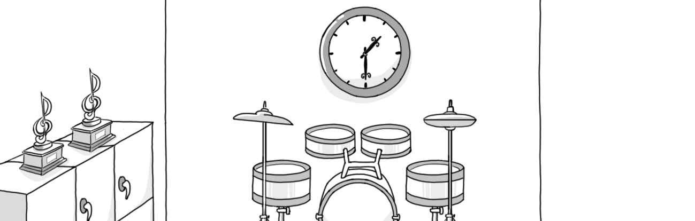
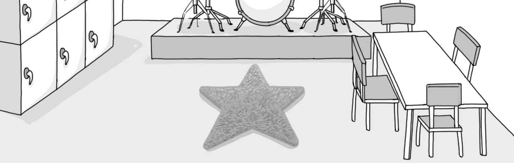
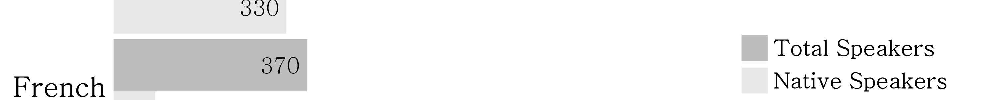
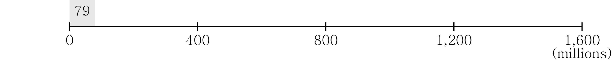
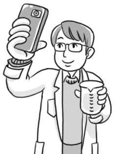
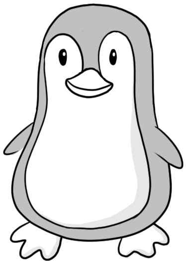

1. 대화를 듣고, 남자의 마지막 말에 대한 여자의 응답으로 가장 적절한 것을 고르시오.

① No thanks. I’m already full.
② Sure. The onion soup is great here.
③ No idea. I’ve never been here before.
④ Yes. I recommend you be there on time.
⑤ I agree. Let’s go to a Mexican restaurant.

2. 대화를 듣고, 여자의 마지막 말에 대한 남자의 응답으로 가장 적절한 것을 고르시오.

① I see. Thank you for letting me know.
② Unfortunately, I got caught in the rain.
③ Well, it’s been raining since yesterday.
④ You’re right. It’ll be sunny this afternoon.
⑤ Yeah. These umbrellas are available online.

3. 다음을 듣고, 남자가 하는 말의 목적으로 가장 적절한 것을 고르시오.
① 미세 먼지 수치가 높을 때 대처 요령을 안내하려고
② 교실 내 공기 정화기 설치 일정을 알리려고
③ 체육 실기 시험 준비 방법을 설명하려고
④ 미세 먼지 방지용 마스크 배부 행사를 홍보하려고
⑤ 미세 먼지 감축을 위해 대중교통 이용을 독려하려고

4. 대화를 듣고, 여자의 의견으로 가장 적절한 것을 고르시오.

① 받는 사람에게 필요한 것을 선물해야 한다.
② 정성 어린 선물 포장은 선물의 가치를 높인다.
③ 선물 포장을 위해 다양한 재료를 활용해야 한다.
④ 선물을 받으면 적절한 감사 인사를 하는 것이 좋다.
⑤ 환경을 위해 선물 포장을 간소하게 할 필요가 있다.

5. 대화를 듣고, 두 사람의 관계를 가장 잘 나타낸 것을 고르시오.

① 정원사 - 집주인
② 출판사 직원 - 작가
③ 가구 판매원 - 손님
④ 관광 가이드 - 관광객
⑤ 인테리어 디자이너 - 잡지 기자

6. 대화를 듣고, 그림에서 대화의 내용과 일치하지 않는 것을 고르시오.

①
③

7. 대화를 듣고, 여자가 할 일로 가장 적절한 것을 고르시오.

① 악기 점검하기
② 연습 시간 확인하기
③ 단원들에게 연락하기
④ 관객용 의자 배치하기
⑤ 콘서트 포스터 붙이기

8. 대화를 듣고, 남자가 이번 주말에 캠핑하러 갈 수 없는 이유를 고르시오.

① 계단을 수리해야 해서
② 캠프장을 예약할 수 없어서
③ 폭우로 인해 캠프장이 폐쇄되어서
④ 프로젝트를 마무리해야 해서
⑤ 어머니를 돌봐야 해서

9. 대화를 듣고, 여자가 지불할 금액을 고르시오. [3점]

① $140
② $180
③ $200
④ $220
⑤ $280

10. 대화를 듣고, Pinewood Bake Sale에 관해 언급되지 않은 것을 고르시오.

① 개최 요일
② 시작 시간
③ 판매 제품
④ 수익금 기부처
⑤ 개최 장소

11. 2020 Global Village Festival에 관한 다음 내용을 듣고, 일치하지 않는 것을 고르시오. [3점]

① 이틀간 Green City Park에서 열린다.
② 음악 공연과 미술 전시회를 포함한다.
③ 현금이나 신용 카드로 음식을 구입할 수 있다.
④ 선착순 100명에게 특별 선물을 준다.
⑤ 차량당 주차비는 10달러이다.

12. 다음 표를 보면서 대화를 듣고, 두 사람이 예약할 방을 고르시오. Wayne Island Hotel Rooms Room View Breakfast Price

Wayne Island Hotel Rooms

|  | Room | View | Breakfast | Price |
| --- | --- | --- | --- | --- |
| ① | A | City | × | $70 |
| ② | B | Mountain | × | $80 |
| ③ | C | Mountain | ○ | $95 |
| ④ | D | Ocean | × | $105 |
| ⑤ | E | Ocean | ○ | $120 |

13. 대화를 듣고, 여자의 마지막 말에 대한 남자의 응답으로 가장 적절한 것을 고르시오. [3점]

Man:
① I have, but he didn’t take it seriously.
② Don’t worry. I have no problem with him.
③ Well, he always keeps the bathroom clean.
④ Sorry. I delayed moving out of the apartment.
⑤ Of course. I’ll help you move into a new apartment.

14. 대화를 듣고, 남자의 마지막 말에 대한 여자의 응답으로 가장 적절한 것을 고르시오.

Woman:
① I’ll text you how much it costs to fix the floor.
② Right. I don’t think you can enter the competition.
③ Okay. I’ll let you know as soon as the date is set.
④ But the auditorium was already repaired last week.
⑤ The competition will be held in the school gym instead.

15. 다음 상황 설명을 듣고, Billy의 어머니가 Billy에게 할 말로 가장 적절한 것을 고르시오.

Billy’s mother:
① Make sure to answer the letters.
② Try to participate in school events often.
③ I’m sure you can make some good friends.
④ You need to prepare for the meeting.
⑤ Don’t forget to bring me the letters.

16. 여자가 하는 말의 주제로 가장 적절한 것은?

① major exporting countries of dairy products
② health benefits of drinking milk regularly
③ unique food cultures around the world
④ suitable environments for dairy animals
⑤ various milk sources in different countries

17. 언급된 나라가 아닌 것은?

① Canada
② India
③ Finland
④ Norway
⑤ Romania

18. 다음 글의 목적으로 가장 적절한 것은?

Dear Ms. Spadler, You’ve written to our company complaining that your toaster, which you bought only three weeks earlier, doesn’t work. You were asking for a new toaster or a refund. Since the toaster has a year’s warranty, our company is happy to replace your faulty toaster with a new toaster. To get your new toaster, simply take your receipt and the faulty toaster to the dealer from whom you bought it. The dealer will give you a new toaster on the spot. Nothing is more important to us than the satisfaction of our customers. If there is anything else we can do for you, please do not hesitate to ask. Yours sincerely, Betty Swan

19. 다음 글에 드러난 ‘I’의 심경 변화로 가장 적절한 것은?

I was diving alone in about 40 feet of water when I got a terrible stomachache. I was sinking and hardly able to move. I could see my watch and knew there was only a little more time on the tank before I would be out of air. It was hard for me to remove my weight belt. Suddenly I felt a prodding from behind me under the armpit. My arm was being lifted forcibly. Around into my field of vision came an eye. It seemed to be smiling. It was the eye of a big dolphin. Looking into that eye, I knew I was safe. I felt that the animal was protecting me, lifting me toward the surface.

20. 다음 글에서 필자가 주장하는 바로 가장 적절한 것은?

Keeping good ideas floating around in your head is a great way to ensure that they won’t happen. Take a tip from writers, who know that the only good ideas that come to life are the ones that get written down. Take out a piece of paper and record everything you’d love to do someday — aim to hit one hundred dreams. You’ll have a reminder and motivator to get going on those things that are calling you, and you also won’t have the burden of remembering all of them. When you put your dreams into words you begin putting them into action.

21. 밑줄 친 “rise to the bait”가 다음 글에서 의미하는 바로 가장 적절한 것은? [3점]

We all know that tempers are one of the first things lost in many arguments. It’s easy to say one should keep cool, but how do you do it? The point to remember is that sometimes in arguments the other person is trying to get you to be angry. They may be saying things that are intentionally designed to annoy you. They know that if they get you to lose your cool you’ll say something that sounds foolish; you’ll simply get angry and then it will be impossible for you to win the argument. So don’t fall for it. A remark may be made to cause your anger, but responding with a cool answer that focuses on the issue raised is likely to be most effective. Indeed, any attentive listener will admire the fact that you didn’t “rise to the bait.”

22. 다음 글의 요지로 가장 적절한 것은?

Practically anything of value requires that we take a risk of failure or being rejected. This is the price we all must pay for achieving the greater rewards lying ahead of us. To take risks means you will succeed sometime but never to take a risk means that you will never succeed. Life is filled with a lot of risks and challenges and if you want to get away from all these, you will be left behind in the race of life. A person who can never take a risk can’t learn anything. For example, if you never take the risk to drive a car, you can never learn to drive. If you never take the risk of being rejected, you can never have a friend or partner. Similarly, by not taking the risk of attending an interview, you will never get a job.

23. 다음 글의 주제로 가장 적절한 것은?

Although individual preferences vary, touch (both what we touch with our fingers and the way things feel as they come in contact with our skin) is an important aspect of many products. Consumers like some products because of their feel. Some consumers buy skin creams and baby products for their soothing effect on the skin. In fact, consumers who have a high need for touch tend to like products that provide this opportunity. When considering products with material properties, such as clothing or carpeting, consumers like goods they can touch in stores more than products they only see and read about online or in catalogs.

24. 다음 글의 제목으로 가장 적절한 것은?

In life, they say that too much of anything is not good for you. In fact, too much of certain things in life can kill you. For example, they say that water has no enemy, because water is essential to all life. But if you take in too much water, like one who is drowning, it could kill you. Education is the exception to this rule. You can never have too much education or knowledge. The reality is that most people will never have enough education in their lifetime. I am yet to find that one person who has been hurt in life by too much education. Rather, we see lots of casualties every day, worldwide, resulting from the lack of education. You must keep in mind that education is a long-term investment of time, money, and effort into humans.

25. 다음 도표의 내용과 일치하지 않는 것은?

The Most Spoken Languages Worldwide in 2015

| Language | Total Speakers (millions) | Native Speakers (millions) |
| --- | --- | --- |
| English | 1,500 | 375 |
| Chinese | 1,100 | 982 |
| Hindi | 650 | 460 |
| Spanish | 420 | 330 |
| French | 370 | 79 |

Note: Total Speakers = Native Speakers + Non-native Speakers.

26. Ellen Church에 관한 다음 글의 내용과 일치하지 않는 것은?

Ellen Church was born in Iowa in 1904. After graduating from Cresco High School, she studied nursing and worked as a nurse in San Francisco. She suggested to Boeing Air Transport that nurses should take care of passengers during flights because most people were frightened of flying. In 1930, she became the first female flight attendant in the U.S. and worked on a Boeing 80A from Oakland, California to Chicago, Illinois. Unfortunately, a car accident injury forced her to end her career after only eighteen months. Church started nursing again at Milwaukee County Hospital after she graduated from the University of Minnesota with a degree in nursing education. During World War II, she served as a captain in the Army Nurse Corps and received an Air Medal. Ellen Church Field Airport in her hometown, Cresco, was named after her.

27. Science Selfie Competition에 관한 다음 안내문의 내용과 일치하지 않는 것은?

Science Selfie Competition

For a chance to win science goodies, just submit a selfie of yourself enjoying science outside of school! Deadline: Friday, March 20, 2020, 6 p.m.
Details
Your selfie should include a visit to any science museum or a science activity at home.
Be as creative as you like, and write one short sentence about the selfie.
Only one entry per person!
Email your selfie with your name and class to mclara@oldfold.edu. Winners will be announced on March 27, 2020. Please visit www.oldfold.edu to learn more about the competition.

28. Toy & Gift Warehouse Sale에 관한 다음 안내문의 내용과 일치하는 것은?

Toy & Gift Warehouse Sale

at Wilson Square from April 3 to April 16 We carry items that are in stock at bigger retailers for a cheaper price. You can expect to find toys for children from birth to teens. Ten toy companies will participate in the sale. Wednesday – Friday: 10 a.m. – 6 p.m. Saturday & Sunday: 11 a.m. – 5 p.m. Closed on Monday & Tuesday Returns must be made within one week of purchase. For more information, please visit us at www.poptoy.com.

29. 다음 글의 밑줄 친 부분 중, 어법상 틀린 것은? [3점]

“You are what you eat.” That phrase is often used to show the relationship between the foods you eat and your physical health. But do you really know what you are eating when you buy processed foods, canned foods, and packaged goods? Many of the manufactured products made today contain so many chemicals and artificial ingredients that it is sometimes difficult to know exactly what is inside them. Fortunately, now there are food labels. Food labels are a good way to find the information about the foods you eat. Labels on food are like the table of contents found in books. The main purpose of food labels is to inform you what is inside the food you are purchasing.

30. 다음 글의 밑줄 친 부분 중, 문맥상 낱말의 쓰임이 적절하지 않은 것은? [3점]

We often ignore small changes because they don’t seem to matter very much in the moment. If you save a little money now, you’re still not a millionaire. If you study Spanish for an hour tonight, you still haven’t learned the language. We make a few changes, but the results never seem to come quickly and so we slide back into our previous routines. The slow pace of transformation also makes it difficult to break a bad habit. If you eat an unhealthy meal today, the scale doesn’t move much. A single decision is easy to ignore. But when we repeat small errors, day after day, by following poor decisions again and again, our small choices add up to bad results. Many missteps eventually lead to a problem.

31. 다음 빈칸에 들어갈 말로 가장 적절한 것을 고르시오.

Remember that patience is always of the essence. If an apology is not accepted, thank the individual for hearing you out and leave the door open for if and when he wishes to reconcile. Be conscious of the fact that just because someone accepts your apology does not mean she has fully forgiven you. It can take time, maybe a long time, before the injured party can completely let go and fully trust you again. There is little you can do to speed this process up. If the person is truly important to you, it is worthwhile to give him or her the time and space needed to heal. Do not expect the person to go right back to acting normally immediately.

32. 다음 빈칸에 들어갈 말로 가장 적절한 것을 고르시오.

Although many small businesses have excellent websites, they typically can’t afford aggressive online campaigns. One way to get the word out is through an advertising exchange, in which advertisers place banners on each other’s websites for free. For example, a company selling beauty products could place its banner on a site that sells women’s shoes, and in turn, the shoe company could put a banner on the beauty product site. Neither company charges the other; they simply exchange ad space. Advertising exchanges are gaining in popularity, especially among marketers who do not have much money and who don’t have a large sales team. By trading space, advertisers find new outlets that reach their target audiences that they would not otherwise be able to afford.

33. 다음 빈칸에 들어갈 말로 가장 적절한 것을 고르시오.

Motivation may come from several sources. It may be the respect I give every student, the daily greeting I give at my classroom door, the undivided attention when I listen to a student, a pat on the shoulder whether the job was done well or not, an accepting smile, or simply “I love you” when it is most needed. It may simply be asking how things are at home. For one student considering dropping out of school, it was a note from me after one of his frequent absences saying that he made my day when I saw him in school. He came to me with the note with tears in his eyes and thanked me. He will graduate this year. Whatever technique is used, the students must know that you care about them. But the concern must be genuine — the students can’t be fooled.

34. 다음 빈칸에 들어갈 말로 가장 적절한 것을 고르시오. [3점]

Say you normally go to a park to walk or work out. Maybe today you should choose a different park. Why? Well, who knows? Maybe it’s because you need the connection to the different energy in the other park. Maybe you’ll run into people there that you’ve never met before. You could make a new best friend simply by visiting a different park. You never know what great things will happen to you until you step outside the zone where you feel comfortable. If you’re staying in your comfort zone and you’re not pushing yourself past that same old energy, then you’re not going to move forward on your path. By forcing yourself to do something different, you’re awakening yourself on a spiritual level and you’re forcing yourself to do something that will benefit you in the long run. As they say, variety is the spice of life.

35. 주어진 글 다음에 이어질 글의 순서로 가장 적절한 것을 고르시오. [3점]

Ideas about how much disclosure is appropriate vary among cultures. Those born in the United States tend to be high disclosers, even showing a willingness to disclose information about themselves to strangers. This may explain why Americans seem particularly easy to meet and are good at cocktail-party conversation. On the other hand, Japanese tend to do little disclosing about themselves to others except to the few people with whom they are very close. In general, Asians do not reach out to strangers. They do, however, show great care for each other, since they view harmony as essential to relationship improvement. They work hard to prevent those they view as outsiders from getting information they believe to be unfavorable.

36. 주어진 글 다음에 이어질 글의 순서로 가장 적절한 것을 고르시오.

A god called Moinee was defeated by a rival god called Dromerdeener in a terrible battle up in the stars. Moinee fell out of the stars down to Tasmania to die.

Before he died, he wanted to give a last blessing to his final resting place, so he decided to create humans. But he was in such a hurry, knowing he was dying, that he forgot to give them knees; and he absent-mindedly gave them big tails like kangaroos, which meant they couldn’t sit down

Then he died. The people hated having kangaroo tails and no knees, and they cried out to the heavens for help. Dromerdeener heard their cry and came down to Tasmania to see what the matter was

He took pity on the people, gave them bendable knees and cut off their inconvenient kangaroo tails so they could all sit down at last. Then they lived happily ever after

37. 글의 흐름으로 보아, 주어진 문장이 들어가기에 가장 적절한 곳을 고르시오. [3점]

There are some cultures that can be referred to as “people who live outside of time.” The Amondawa tribe, living in Brazil, does not have a concept of time that can be measured or counted. Rather they live in a world of serial events, rather than seeing events as being rooted in time. Researchers also found that no one had an age. Instead, they change their names to reflect their stage of life and position within their society, so a little child will give up their name to a newborn sibling and take on a new one. In the U.S. we have so many metaphors for time and its passing that we think of time as “a thing,” that is “the weekend is almost gone,” or “I haven’t got the time.” We think such statements are objective, but they aren’t. We create these metaphors, but the Amondawa don’t talk or think in metaphors for time.

38. 글의 흐름으로 보아, 주어진 문장이 들어가기에 가장 적절한 곳을 고르시오.

The natural world provides a rich source of symbols used in art and literature. Plants and animals are central to mythology, dance, song, poetry, rituals, festivals, and holidays around the world. Different cultures can exhibit opposite attitudes toward a given species. Snakes, for example, are honored by some cultures and hated by others. Rats are considered pests in much of Europe and North America and greatly respected in some parts of India. Of course, within cultures individual attitudes can vary dramatically. For instance, in Britain many people dislike rodents, and yet there are several associations devoted to breeding them, including the National Mouse Club and the National Fancy Rat Club.

39. 다음 글에서 전체 흐름과 관계 없는 문장은?

Paying attention to some people and not others doesn’t mean you’re being dismissive or arrogant. It just reflects a hard fact: there are limits on the number of people we can possibly pay attention to or develop a relationship with. Some scientists even believe that the number of people with whom we can continue stable social relationships might be limited naturally by our brains. The more people you know of different backgrounds, the more colorful your life becomes. Professor Robin Dunbar has explained that our minds are only really capable of forming meaningful relationships with a maximum of about a hundred and fifty people. Whether that’s true or not, it’s safe to assume that we can’t be real friends with everyone.

40. 다음 글의 내용을 한 문장으로 요약하고자 한다. 빈칸 (A), (B)에 들어갈 말로 가장 적절한 것은?

While there are many evolutionary or cultural reasons for cooperation, the eyes are one of the most important means of cooperation, and eye contact may be the most powerful human force we lose in traffic. It is, arguably, the reason why humans, normally a quite cooperative species, can become so noncooperative on the road. Most of the time we are moving too fast — we begin to lose the ability to keep eye contact around 20 miles per hour — or it is not safe to look. Maybe our view is blocked. Often other drivers are wearing sunglasses, or their car may have tinted windows. (And do you really want to make eye contact with those drivers?) Sometimes we make eye contact through the rearview mirror, but it feels weak, not quite believable at first, as it is not “face-to-face.” 

While driving, people become uncooperative, because they make little eye contact.

41. 윗글의 제목으로 가장 적절한 것은?

Many high school students study and learn inefficiently because they insist on doing their homework while watching TV or listening to loud music. These same students also typically interrupt their studying with repeated phone calls, trips to the kitchen, video games, and Internet surfing. Ironically, students with the greatest need to concentrate when studying are often the ones who surround themselves with the most distractions. These teenagers argue that they can study better with the TV or radio playing. Some professionals actually oppose their position. They argue that many teenagers can actually study productively under less-than-ideal conditions because they’ve been exposed repeatedly to “background noise” since early childhood. These educators argue that children have become used to the sounds of the TV, video games, and loud music. They also argue that insisting students turn off the TV or radio when doing homework will not necessarily improve their academic performance. This position is certainly not generally shared, however. Many teachers and learning experts are convinced by their own experiences that students who study in a noisy environment often learn inefficiently.

42. 밑줄 친 낱말 중에서 문맥상 낱말의 쓰임이 적절하지 않은 것은? [3점]

Many high school students study and learn inefficiently because they insist on doing their homework while watching TV or listening to loud music. These same students also typically interrupt their studying with repeated phone calls, trips to the kitchen, video games, and Internet surfing. Ironically, students with the greatest need to concentrate when studying are often the ones who surround themselves with the most distractions. These teenagers argue that they can study better with the TV or radio playing. Some professionals actually support their position. They argue that many teenagers can actually study productively under less-than-ideal conditions because they’ve been exposed repeatedly to “background noise” since early childhood. These educators argue that children have become used to the sounds of the TV, video games, and loud music. They also argue that insisting students turn off the TV or radio when doing homework will not necessarily improve their academic performance. This position is certainly not generally shared, however. Many teachers and learning experts are convinced by their own experiences that students who study in a noisy environment often learn inefficiently.

43. 주어진 글에 이어질 내용을 순서에 맞게 배열한 것으로 가장 적절한 것은?

 Dorothy dropped the phone and rushed to the kitchen. The oil was on fire. “Chill! Take a deep breath,” she said to herself. What did they teach us not to do in a situation like this? Don’t try to put it out by throwing water on it, because it will cause an explosion, she remembered. She picked up the pot’s lid and covered the pot with it to put out the flames. In the process she burned her hands. Dorothy felt dizzy and sat down at the kitchen table. A couple of minutes later, her parents came rushing into the house. Samantha had suspected that something might be wrong after Dorothy dropped the phone just like that, and she had phoned Dorothy’s parents. Dorothy started to cry. Her mother hugged her tightly and looked at the wound. “Tell me what happened,” she said. Dorothy told her, sobbing and sniffing. “Aren’t you going to yell at me?” she asked them through the tears. Her father answered with a smile, “I also put my lid on to keep me from exploding.” Dorothy looked at him, relieved. “But be careful not to be so irresponsible again.” A while later, after the wound had been treated, the family sat around the kitchen table and talked. “I learned a big lesson today,” Dorothy said. Her parents expected her to say something about the fire. But she talked about something different. “I have decided to use kind words more just like you.” Her parents were very grateful, because Dorothy had quite a temper. 

44. 밑줄 친 낱말 중에서 가리키는 대상이 나머지 넷과 다른 것은?

 Dorothy dropped the phone and rushed to the kitchen. The oil was on fire. “Chill! Take a deep breath,” she said to herself. What did they teach us not to do in a situation like this? Don’t try to put it out by throwing water on it, because it will cause an explosion, she remembered. She picked up the pot’s lid and covered the pot with it to put out the flames. In the process she burned her hands. Dorothy felt dizzy and sat down at the kitchen table. A couple of minutes later, her parents came rushing into the house. Samantha had suspected that something might be wrong after Dorothy dropped the phone just like that, and she had phoned Dorothy’s parents. Dorothy started to cry. Her mother hugged her tightly and looked at the wound. “Tell me what happened,” she said. Dorothy told her, sobbing and sniffing. “Aren’t you going to yell at me?” she asked them through the tears. Her father answered with a smile, “I also put my lid on to keep me from exploding.” Dorothy looked at him, relieved. “But be careful not to be so irresponsible again.” A while later, after the wound had been treated, the family sat around the kitchen table and talked. “I learned a big lesson today,” Dorothy said. Her parents expected her to say something about the fire. But she talked about something different. “I have decided to use kind words more just like you.” Her parents were very grateful, because Dorothy had quite a temper. 

45. 윗글의 Dorothy에 관한 내용으로 적절하지 않은 것은?

 Dorothy dropped the phone and rushed to the kitchen. The oil was on fire. “Chill! Take a deep breath,” she said to herself. What did they teach us not to do in a situation like this? Don’t try to put it out by throwing water on it, because it will cause an explosion, she remembered. She picked up the pot’s lid and covered the pot with it to put out the flames. In the process she burned her hands. Dorothy felt dizzy and sat down at the kitchen table. A couple of minutes later, her parents came rushing into the house. Samantha had suspected that something might be wrong after Dorothy dropped the phone just like that, and she had phoned Dorothy’s parents. Dorothy started to cry. Her mother hugged her tightly and looked at the wound. “Tell me what happened,” she said. Dorothy told her, sobbing and sniffing. “Aren’t you going to yell at me?” she asked them through the tears. Her father answered with a smile, “I also put my lid on to keep me from exploding.” Dorothy looked at him, relieved. “But be careful not to be so irresponsible again.” A while later, after the wound had been treated, the family sat around the kitchen table and talked. “I learned a big lesson today,” Dorothy said. Her parents expected her to say something about the fire. But she talked about something different. “I have decided to use kind words more just like you.” Her parents were very grateful, because Dorothy had quite a temper.
