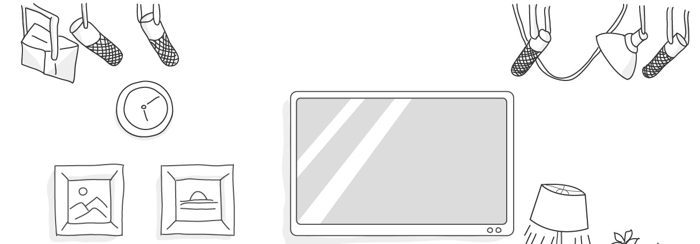
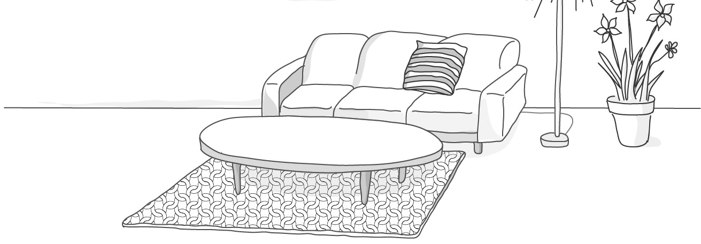
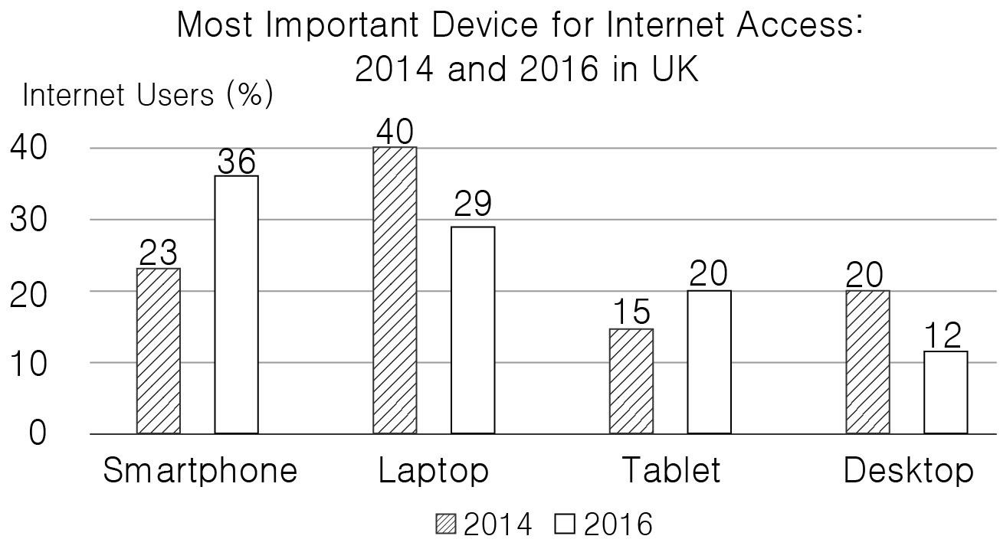
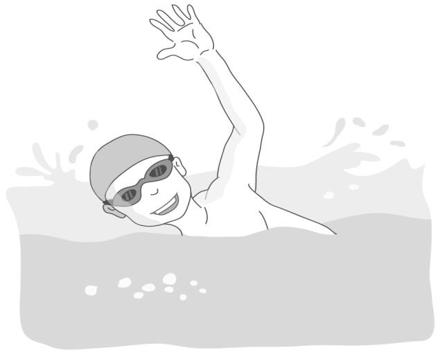
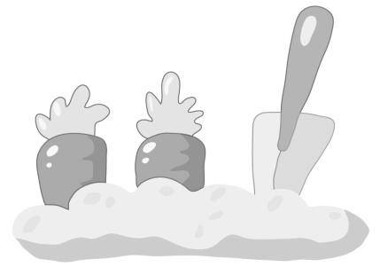

1. 대화를 듣고, 여자의 마지막 말에 대한 남자의 응답으로 가장 적절한 것을 고르시오.

① I already did, but I couldn’t find it.
② Okay, I’ll wait in the living room.
③ You need to fix the cellphone.
④ I called the Lost and Found.
⑤ Wi–Fi is not available here.

2. 대화를 듣고, 남자의 마지막 말에 대한 여자의 응답으로 가장 적절한 것을 고르시오.

① Visiting a sunflower festival would be nice.
② You can’t send her a birthday card.
③ Your kindness is always repaid.
④ I’ll wrap the flowers for free.
⑤ White roses are nice at this time of year.

3. 다음을 듣고, 여자가 하는 말의 목적으로 가장 적절한 것을 고르시오.

① 축제 관련자 안전 교육 참석을 공지하려고
② 정해진 장소에서 활동할 것을 요청하려고
③ 다양한 공연을 준비할 것을 독려하려고
④ 동아리 담당 교사 변경을 안내하려고
⑤ 적극적인 동아리 활동을 부탁하려고

4. 대화를 듣고, 남자의 의견으로 가장 적절한 것을 고르시오.

① 땀을 많이 흘린 후에는 수분 보충이 중요하다.
② 운동 전 음식 섭취가 운동을 위한 힘을 준다.
③ 운동은 땀을 흘릴 만큼 충분히 해야 한다.
④ 달리기 전 충분한 준비 운동을 해야 한다.
⑤ 꾸준한 운동이 건강한 신체를 만든다.

5. 대화를 듣고, 두 사람의 관계를 가장 잘 나타낸 것을 고르시오.

① 구직자 - 채용 담당 직원
② 소설가 - 영화감독
③ 배우 - 방송 작가
④ 서점 직원 - 출판업자
⑤ 뮤지컬 배우 - 무대 감독

6. 대화를 듣고, 그림에서 대화의 내용과 일치하지 않는 것을 고르시오.

⑤
③

7. 대화를 듣고, 여자가 할 일로 가장 적절한 것을 고르시오.

① 사진 앨범 만들기
② 파티 초대장 보내기
③ 생일 케이크 만들기
④ 풍선으로 거실 장식하기
⑤ TV로 사진 영상 재생하기

8. 대화를 듣고, 남자가 수영장에 갈 수 없는 이유로 가장 적절한 것을 고르시오.

① 감기에 걸려서
② 취업 면접이 있어서
③ 친구와 약속이 있어서
④ 봉사 활동을 가야 해서
⑤ 저녁에 일을 해야 해서

9. 대화를 듣고, 여자가 지불할 금액을 고르시오. [3점]

① $15
② $23
③ $27
④ $30
⑤ $33

10. 대화를 듣고, Rock Music Festival에 관해 언급되지 않은 것을 고르시오.

① 개최 일시
② 입장료
③ 개최 장소
④ 주차 요금
⑤ 참여 음악가

11. Westbank High School Science Fair에 관한 다음 내용을 듣고, 일치하지 않는 것을 고르시오.

① 7월 21일에 열린다.
② 평가자와 방문객 앞에서 과제 발표가 이루어진다.
③ 각 팀에게 피드백이 주어진다.
④ 세 분야에 상이 주어진다.
⑤ 모든 방문객에게 무료로 티셔츠를 준다.

12. 다음 표를 보면서 대화를 듣고, 여자가 수강할 수업을 고르시오.

Summer Program Time Table

|  | Class | Day | Time | Monthly Fee |
| --- | --- | --- | --- | --- |
| ① | English Conversation | Mon. | 9:00 a.m. | $50 |
| ② | Cartoon Creating | Tue. | 10:00 a.m. | $60 |
| ③ | Aquarobics | Wed. | 10:00 a.m. | $75 |
| ④ | Soccer | Thu. | 6:00 p.m. | $80 |
| ⑤ | Drawing | Fri. | 3:00 p.m. | $75 |

13. 대화를 듣고, 여자의 마지막 말에 대한 남자의 응답으로 가장 적절한 것을 고르시오.

Man:
① No. Just once a week.
② Sure. Drink it every day.
③ Sorry. I’m afraid I can’t.
④ Yes. Not far from here.
⑤ Exactly. You’ll join the trip.

14. 대화를 듣고, 남자의 마지막 말에 대한 여자의 응답으로 가장 적절한 것을 고르시오. [3점]

Woman:
① Sure. You should submit your homework on time.
② Right. Students should have proper Internet etiquette.
③ Good idea. It will introduce Korean culture to the world.
④ Thanks. I really appreciate your inviting us to Korea.
⑤ Okay. I’ll go and buy some tickets for them.

15. 다음 상황 설명을 듣고, Olivia가 온라인 쇼핑몰 고객센터 직원에게 할 말로 가장 적절한 것을 고르시오. [3점]

Olivia:
① I’d like to send the pants back and get a refund.
② Could you deliver the pants by tomorrow?
③ Let me know when you have blue pants.
④ Can I exchange them for blue pants?
⑤ I want to check the delivery status.

16. 남자가 하는 말의 주제로 가장 적절한 것은?

① various aerobic workouts for losing weight
② effective exercises for reducing back pain
③ activities to make your body flexible
④ importance of having correct posture
⑤ common symptoms of muscle pain

17. 언급된 운동이 아닌 것은?

따라 답을 하시기 바랍니다.

① biking
② swimming
③ yoga
④ climbing
⑤ walking

18. 다음 글의 목적으로 가장 적절한 것은?

Dear Mr. Anderson On behalf of Jeperson High School, I am writing this letter to request permission to conduct an industrial field trip in your factory. We hope to give some practical education to our students in regard to industrial procedures. With this purpose in mind, we believe your firm is ideal to carry out such a project. But of course, we need your blessing and support. 35 students would be accompanied by two teachers. And we would just need a day for the trip. I would really appreciate your cooperation. Sincerely, Mr. Ray Feynman

19. 다음 글에 드러난 Erda의 심경으로 가장 적절한 것은?

Erda lay on her back in a clearing, watching drops of sunlight slide through the mosaic of leaves above her. She joined them for a little, moving with the gentle breeze, feeling the warm sun feed her. A slight smile was spreading over her face. She slowly turned over and pushed her face into the grass, smelling the green pleasant scent from the fresh wild flowers. Free from her daily burden, she got to her feet and went on. Erda walked between the warm trunks of the trees. She felt all her concerns had gone away.

20. 다음 글에서 필자가 주장하는 바로 가장 적절한 것은?

The dish you start with serves as an anchor food for your entire meal. Experiments show that people eat nearly 50 percent greater quantity of the food they eat first. If you start with a dinner roll, you will eat more starches, less protein, and fewer vegetables. Eat the healthiest food on your plate first. As age‒old wisdom suggests, this usually means starting with your vegetables or salad. If you are going to eat something unhealthy, at least save it for last. This will give your body the opportunity to fill up on better options before you move on to starches or sugary desserts.

21. 밑줄 친 by reading a body language dictionary가 의미하는 바로 가장 적절한 것은? [3점]

Authentic, effective body language is more than the sum of individual signals. When people work from this rote‒ memory, dictionary approach, they stop seeing the bigger picture, all the diverse aspects of social perception. Instead, they see a person with crossed arms and think, “Reserved, angry.” They see a smile and think, “Happy.” They use a firm handshake to show other people “who is boss.” Trying to use body language by reading a body language dictionary is like trying to speak French by reading a French dictionary. Things tend to fall apart in an inauthentic mess. Your actions seem robotic; your body language signals are disconnected from one another. You end up confusing the very people you’re trying to attract because your body language just rings false.

22. 다음 글의 요지로 가장 적절한 것은?

A goal‒oriented mind‒set can create a “yo‒yo” effect. Many runners work hard for months, but as soon as they cross the finish line, they stop training. The race is no longer there to motivate them. When all of your hard work is focused on a particular goal, what is left to push you forward after you achieve it? This is why many people find themselves returning to their old habits after accomplishing a goal. The purpose of setting goals is to win the game. The purpose of building systems is to continue playing the game. True long‒term thinking is goal‒less thinking. It’s not about any single accomplishment. It is about the cycle of endless refinement and continuous improvement. Ultimately, it is your commitment to the process that will determine your progress.

23. 다음 글의 주제로 가장 적절한 것은?

Like anything else involving effort, compassion takes practice. We have to work at getting into the habit of standing with others in their time of need. Sometimes offering help is a simple matter that does not take us far out of our way ― remembering to speak a kind word to someone who is down, or spending an occasional Saturday morning volunteering for a favorite cause. At other times, helping involves some real sacrifice. “A bone to the dog is not charity,” Jack London observed. “Charity is the bone shared with the dog, when you are just as hungry as the dog.” If we practice taking the many small opportunities to help others, we’ll be in shape to act when those times requiring real, hard sacrifice come along.

24. 다음 글의 제목으로 가장 적절한 것은?

Every event that causes you to smile makes you feel happy and produces feel‒good chemicals in your brain. Force your face to smile even when you are stressed or feel unhappy. The facial muscular pattern produced by the smile is linked to all the “happy networks” in your brain and will in turn naturally calm you down and change your brain chemistry by releasing the same feel‒good chemicals. Researchers studied the effects of a genuine and forced smile on individuals during a stressful event. The researchers had participants perform stressful tasks while not smiling, smiling, or holding chopsticks crossways in their mouths (to force the face to form a smile). The results of the study showed that smiling, forced or genuine, during stressful events reduced the intensity of the stress response in the body and lowered heart rate levels after recovering from the stress.

25. 다음 도표의 내용과 일치하지 않는 것은?

Most Important Device for Internet Access: 2014 and 2016 in UK

| Device | 2014 | 2016 |
| --- | --- | --- |
| Smartphone | 23% | 36% |
| Laptop | 40% | 29% |
| Tablet | 15% | 20% |
| Desktop | 20% | 12% |

26. Sigrid Undset에 관한 다음 글의 내용과 일치하지 않는 것은?

Sigrid Undset was born on May 20, 1882, in Kalundborg, Denmark. She was the eldest of three daughters. She moved to Norway at the age of two. Her early life was strongly influenced by her father’s historical knowledge. At the age of sixteen, she got a job at an engineering company to support her family. She read a lot, acquiring a good knowledge of Nordic as well as foreign literature, English in particular. She wrote thirty six books. None of her books leaves the reader unconcerned. She received the Nobel Prize for Literature in 1928. One of her novels has been translated into more than eighty languages. She escaped Norway during the German occupation, but she returned after the end of World War Ⅱ.

27. Swimming Summer Camp 2020에 관한 다음 안내문의 내용과 일치하지 않는 것은?

Swimming Summer Camp 2020

Great opportunity to learn basic swimming techniques with certified swimming coaches! PARTICIPANTS & PERIOD
Age 16 - 18 years
July 27 - 31 (Monday - Friday) DAILY SCHEDULE 11:00 a.m. - 12:00 p.m. Swimming Lesson 12:30 p.m. - 13:30 p.m. Lunch PRICE
$30 (lunch included)
A free swimming cap will be provided to all participants. REGISTRATION
Online only: www.friendlycoaches.ca

28. Rode Farmers Market에 관한 다음 안내문의 내용과 일치하는 것은?

Rode Farmers Market

This lively market is held every Saturday in July from 9:00 a.m. until 11:30 a.m. Where What to Do Open Garden Buy Local Organic Food Enjoy Fun Family Events and Picnic Area Local Music Farmers’ House Learn Basic Farming Techniques
In case of rain, some events may be cancelled. Location Village of Scholar Green on A34, Cheshire
Free Parking

29. 다음 글의 밑줄 친 부분 중, 어법상 틀린 것은? [3점]

Positively or negatively, our parents and families are powerful influences on us. But even stronger, especially when we’re young, are our friends. We often choose friends as a way of expanding our sense of identity beyond our families. As a result, the pressure to conform to the standards and expectations of friends and other social groups is likely to be intense. Judith Rich Harris, who is a developmental psychologist, arguing that three main forces shape our development: personal temperament, our parents, and our peers. The influence of peers, she argues, is much stronger than that of parents. “The world that children share with their peers,” she says, “is what shapes their behavior and modifies the characteristics they were born with, and hence determines the sort of people they will be when they grow up.”

30. (A), (B), (C)의 각 네모 안에서 문맥에 맞는 낱말로 가장 적절한 것은?

The brain makes up just two percent of our body weight but uses 20 percent of our energy. In newborns, it’s no less than 65 percent. That’s partly why babies sleep all the time — their growing brains warn / exhaust them — and have a lot of body fat, to use as an energy reserve when needed. Our muscles use even more of our energy, about a quarter of the total, but we have a lot of muscle. Actually, per unit of matter, the brain uses by far more / less energy than our other organs. That means that the brain is the most expensive of our organs. But it is also marvelously creative / efficient. Our brains require only about four hundred calories of energy a day — about the same as we get from a blueberry muffin. Try running your laptop for twenty‒four hours on a muffin and see how far you get.

31. 다음 빈칸에 들어갈 말로 가장 적절한 것을 고르시오.

When reading another scientist’s findings, think critically about the experiment. Ask yourself: Were observations recorded during or after the experiment? Do the conclusions make sense? Can the results be repeated? Are the sources of information reliable? You should also ask if the scientist or group conducting the experiment was unbiased. Being unbiased means that you have no special interest in the outcome of the experiment. For example, if a drug company pays for an experiment to test how well one of its new products works, there is a special interest involved: The drug company profits if the experiment shows that its product is effective. Therefore, the experimenters aren’t objective. They might ensure the conclusion is positive and benefits the drug company. When assessing results, think about any biases that may be present!

32. 다음 빈칸에 들어갈 말로 가장 적절한 것을 고르시오.

Humans are champion long‒distance runners. As soon as a person and a chimp start running they both get hot. Chimps quickly overheat; humans do not, because they are much better at shedding body heat. According to one leading theory, ancestral humans lost their hair over successive generations because less hair meant cooler, more effective long‒distance running. That ability let our ancestors outmaneuver and outrun prey. Try wearing a couple of extra jackets — or better yet, fur coats — on a hot humid day and run a mile. Now, take those jackets off and try it again. You’ll see what a difference a lack of fur makes.

33. 다음 빈칸에 들어갈 말로 가장 적절한 것을 고르시오. [3점]

Recently I was with a client who had spent almost five hours with me. As we were parting for the evening, we reflected on what we had covered that day. Even though our conversation was very collegial, I noticed that my client was holding one leg at a right angle to his body, seemingly wanting to take off on its own. At that point I said, “You really do have to leave now, don’t you?” “Yes,” he admitted. “I am so sorry. I didn’t want to be rude but I have to call London and I only have five minutes!” Here was a case where my client’s language and most of his body revealed nothing but positive feelings. His feet, however, were the most honest communicators, and they clearly told me that as much as he wanted to stay, duty was calling.

34. 다음 빈칸에 들어갈 말로 가장 적절한 것을 고르시오. [3점]

One of the main reasons that students may think they know the material, even when they don’t, is that they mistake familiarity for understanding. Here is how it works: You read the chapter once, perhaps highlighting as you go. Then later, you read the chapter again, perhaps focusing on the highlighted material. As you read it over, the material is familiar because you remember it from before, and this familiarity might lead you to think, “Okay, I know that.” The problem is that this feeling of familiarity is not necessarily equivalent to knowing the material and may be of no help when you have to come up with an answer on the exam. In fact, familiarity can often lead to errors on multiple‒choice exams because you might pick a choice that looks familiar, only to find later that it was something you had read, but it wasn’t really the best answer to the question.

35. 다음 글에서 전체 흐름과 관계 없는 문장은?

Given the widespread use of emoticons in electronic communication, an important question is whether they help Internet users to understand emotions in online communication.

36. 주어진 글 다음에 이어질 글의 순서로 가장 적절한 것을 고르시오.

Students work to get good grades even when they have no interest in their studies. People seek job advancement even when they are happy with the jobs they already have. It’s like being in a crowded football stadium, watching the crucial play. A spectator several rows in front stands up to get a better view, and a chain reaction follows. Soon everyone is standing, just to be able to see as well as before. Everyone is on their feet rather than sitting, but no one’s position has improved. And if someone refuses to stand, he might just as well not be at the game at all. When people pursue goods that are positional, they can’t help being in the rat race. To choose not to run is to lose.

37. 주어진 글 다음에 이어질 글의 순서로 가장 적절한 것을 고르시오.

When we compare human and animal desire we find many extraordinary differences. Animals tend to eat with their stomachs, and humans with their brains. When animals’ stomachs are full, they stop eating, but humans are never sure when to stop. When they have eaten as much as their bellies can take, they still feel empty, they still feel an urge for further gratification. This is largely due to anxiety, to the knowledge that a constant supply of food is uncertain. Therefore, they eat as much as possible while they can. It is due, also, to the knowledge that, in an insecure world, pleasure is uncertain. Therefore, the immediate pleasure of eating must be exploited to the full, even though it does violence to the digestion.

38. 글의 흐름으로 보아, 주어진 문장이 들어가기에 가장 적절한 곳을 고르시오.

Currently, we cannot send humans to other planets. One obstacle is that such a trip would take years. A spacecraft would need to carry enough air, water, and other supplies needed for survival on the long journey. Another obstacle is the harsh conditions on other planets, such as extreme heat and cold. Some planets do not even have surfaces to land on. Because of these obstacles, most research missions in space are accomplished through the use of spacecraft without crews aboard. These explorations pose no risk to human life and are less expensive than ones involving astronauts. The spacecraft carry instruments that test the compositions and characteristics of planets.

39. 글의 흐름으로 보아, 주어진 문장이 들어가기에 가장 적절한 곳을 고르시오. [3점]

Our brains are constantly solving problems. Every time we learn, or remember, or make sense of something, we solve a problem. Some psychologists have characterized all infant language‒learning as problem‒solving, extending to children such scientific procedures as “learning by experiment,” or “hypothesis‒testing.” Grown‒ups rarely explain the meaning of new words to children, let alone how grammatical rules work. Instead they use the words or the rules in conversation and leave it to children to figure out what is going on. In order to learn language, an infant must make sense of the contexts in which language occurs; problems must be solved. We have all been solving problems of this kind since childhood, usually without awareness of what we are doing.

40. 다음 글의 내용을 한 문장으로 요약하고자 한다. 빈칸 (A), (B)에 들어갈 말로 가장 적절한 것은? [3점]

Have you noticed that some coaches get the most out of their athletes while others don’t? A poor coach will tell you what you did wrong and then tell you not to do it again: “Don’t drop the ball!” What happens next? The images you see in your head are images of you dropping the ball! Naturally, your mind recreates what it just “saw” based on what it’s been told. Not surprisingly, you walk on the court and drop the ball. What does the good coach do? He or she points out what could be improved, but will then tell you how you could or should perform: “I know you’ll catch the ball perfectly this time.” Sure enough, the next image in your mind is you catching the ball and scoring a goal. Once again, your mind makes your last thoughts part of reality — but this time, that “reality” is positive, not negative. 

Unlike ineffective coaches, who focus on players’ mistakes, effective coaches help players improve by encouraging them to picture successful plays.

41. 윗글의 제목으로 가장 적절한 것은?

Marketers have known for decades that you buy what you see first. You are far more likely to purchase items placed at eye level in the grocery store, for example, than items on the bottom shelf. There is an entire body of research about the way “product placement” in stores influences your buying behavior. This gives you a chance to use product placement to your advantage. Healthy items like produce are often the least visible foods at home. You won’t think to eat what you don’t see. This may be part of the reason why 85 percent of Americans do not eat enough fruits and vegetables. If produce is hidden in a drawer at the bottom of your refrigerator, these good foods are out of sight and mind. The same holds true for your pantry. I used to have a shelf lined with salty crackers and chips at eye level. When these were the first things I noticed, they were my primary snack foods. That same shelf is now filled with healthy snacks, which makes good decisions easy. Foods that sit out on tables are even more critical. When you see food every time you walk by, you are likely to avoid it. So to improve your choices, leave good foods like apples and pistachios sitting out instead of crackers and candy.

42. 밑줄 친 낱말 중에서 문맥상 낱말의 쓰임이 적절하지 않은 것은? [3점]

Marketers have known for decades that you buy what you see first. You are far more likely to purchase items placed at eye level in the grocery store, for example, than items on the bottom shelf. There is an entire body of research about the way “product placement” in stores influences your buying behavior. This gives you a chance to use product placement to your advantage. Healthy items like produce are often the least visible foods at home. You won’t think to eat what you don’t see. This may be part of the reason why 85 percent of Americans do not eat enough fruits and vegetables. If produce is hidden in a drawer at the bottom of your refrigerator, these good foods are out of sight and mind. The same holds true for your pantry. I used to have a shelf lined with salty crackers and chips at eye level. When these were the first things I noticed, they were my primary snack foods. That same shelf is now filled with healthy snacks, which makes good decisions easy. Foods that sit out on tables are even more critical. When you see food every time you walk by, you are likely to avoid it. So to improve your choices, leave good foods like apples and pistachios sitting out instead of crackers and candy.

43. 주어진 글에 이어질 내용을 순서에 맞게 배열한 것으로 가장 적절한 것은?

 So they started, Amy leaping and running. Then, she saw a horse coming towards them. On the horse sat a wonderful lady. When Amy saw her, the woman sparkled with jewels and gold, and her eyes were brighter than diamonds. “Are you an angel?” asked Amy. The lady gave no reply, but stared coldly at her, leaving without saying a word. “That was not an angel!” said Amy. “No, indeed!” said Grandmother. So Amy walked ahead again. Then, she met a beautiful woman who wore a dress as white as snow. “You must be an angel!” cried Amy. “You dear little girl, do I really look like an angel?” she asked. “You are an angel!” replied Amy. But suddenly the woman’s face changed when Amy stepped on her dress by mistake. “Go away, and go back to your home!” she shouted. As Amy stepped back from the woman, she stumbled and fell. She lay in the dusty road and sobbed. “I am tired! Will you take me home, Grandma?” she asked. “Sure! That is what I came for,” Grandmother said in a warm voice. They started to walk along the road. Suddenly Amy looked up and said, “Grandma, you are not an angel, are you?” “Oh, honey,” said Grandmother, “I’m not an angel.” “Well, Grandma, you are an angel to me because you always stay by my side,” said Amy.

44. 밑줄 친 낱말 중에서 가리키는 대상이 나머지 넷과 다른 것은?

 So they started, Amy leaping and running. Then, she saw a horse coming towards them. On the horse sat a wonderful lady. When Amy saw her, the woman sparkled with jewels and gold, and her eyes were brighter than diamonds. “Are you an angel?” asked Amy. The lady gave no reply, but stared coldly at her, leaving without saying a word. “That was not an angel!” said Amy. “No, indeed!” said Grandmother. So Amy walked ahead again. Then, she met a beautiful woman who wore a dress as white as snow. “You must be an angel!” cried Amy. “You dear little girl, do I really look like an angel?” she asked. “You are an angel!” replied Amy. But suddenly the woman’s face changed when Amy stepped on her dress by mistake. “Go away, and go back to your home!” she shouted. As Amy stepped back from the woman, she stumbled and fell. She lay in the dusty road and sobbed. “I am tired! Will you take me home, Grandma?” she asked. “Sure! That is what I came for,” Grandmother said in a warm voice. They started to walk along the road. Suddenly Amy looked up and said, “Grandma, you are not an angel, are you?” “Oh, honey,” said Grandmother, “I’m not an angel.” “Well, Grandma, you are an angel to me because you always stay by my side,” said Amy.

45. 윗글의 Amy에 관한 내용으로 적절하지 않은 것은?

 So they started, Amy leaping and running. Then, she saw a horse coming towards them. On the horse sat a wonderful lady. When Amy saw her, the woman sparkled with jewels and gold, and her eyes were brighter than diamonds. “Are you an angel?” asked Amy. The lady gave no reply, but stared coldly at her, leaving without saying a word. “That was not an angel!” said Amy. “No, indeed!” said Grandmother. So Amy walked ahead again. Then, she met a beautiful woman who wore a dress as white as snow. “You must be an angel!” cried Amy. “You dear little girl, do I really look like an angel?” she asked. “You are an angel!” replied Amy. But suddenly the woman’s face changed when Amy stepped on her dress by mistake. “Go away, and go back to your home!” she shouted. As Amy stepped back from the woman, she stumbled and fell. She lay in the dusty road and sobbed. “I am tired! Will you take me home, Grandma?” she asked. “Sure! That is what I came for,” Grandmother said in a warm voice. They started to walk along the road. Suddenly Amy looked up and said, “Grandma, you are not an angel, are you?” “Oh, honey,” said Grandmother, “I’m not an angel.” “Well, Grandma, you are an angel to me because you always stay by my side,” said Amy.
