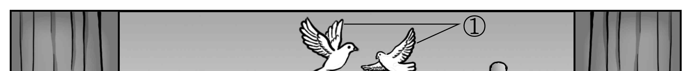
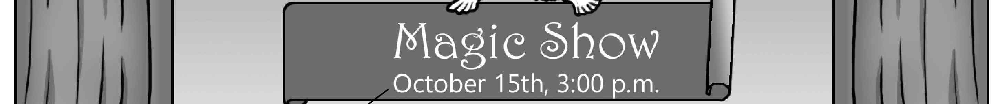
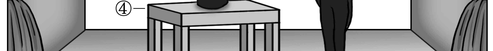
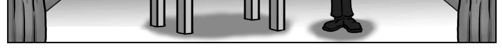
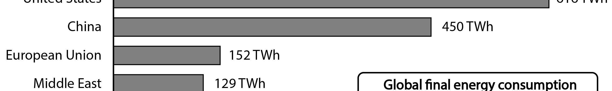
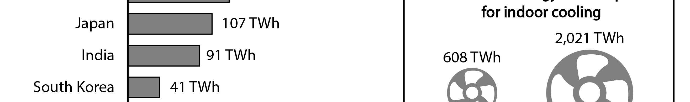
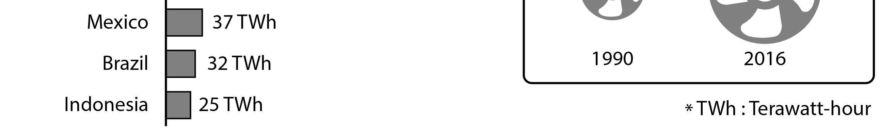
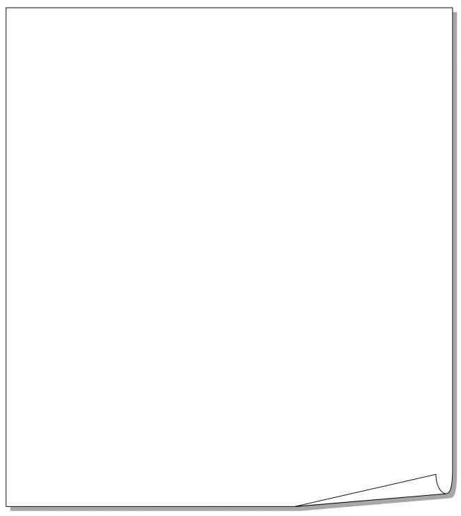

1. 대화를 듣고, 여자의 마지막 말에 대한 남자의 응답으로 가장 적절한 것을 고르시오.

① Really? I should have seen her.
② No way. I’m going to miss you a lot.
③ No. I didn’t go to the bookstore that day.
④ I’m sorry. I’m not interested in her writing.
⑤ Yes. I can’t believe I’m going to see her in person.

2. 대화를 듣고, 남자의 마지막 말에 대한 여자의 응답으로 가장 적절한 것을 고르시오.

① Good idea! I’ll look for some videos online.
② Great! Teach me how to make a video clip.
③ Wow! You’re good at controlling the drone.
④ Okay. Let’s go buy a new drone together.
⑤ Right. I should read the instructions.

3. 다음을 듣고, 여자가 하는 말의 목적으로 가장 적절한 것을 고르시오.

① 놀이공원의 개장을 홍보하려고
② 어린이 뮤지컬 배우를 모집하려고
③ 뮤지컬 시상식 일정을 공지하려고
④ 어린이 안전사고 예방을 당부하려고
⑤ 어린이 뮤지컬 특별 공연을 안내하려고

4. 대화를 듣고, 두 사람이 하는 말의 주제로 가장 적절한 것을 고르시오.

① 코딩 학습의 이점
② 코딩 시 주의할 점
③ 코딩 기술이 필요한 직업
④ 조기 코딩 교육의 문제점
⑤ 코딩 초보자를 위한 학습법

5. 대화를 듣고, 두 사람의 관계를 가장 잘 나타낸 것을 고르시오.

① 출판사 직원 - 번역가
② 여행 가이드 - 관광객
③ 도서관 사서 - 학생
④ 서점 직원 - 고객
⑤ 잡지 기자 - 배우

6. 대화를 듣고, 그림에서 대화의 내용과 일치하지 않는 것을 고르시오.

7. 대화를 듣고, 여자가 할 일로 가장 적절한 것을 고르시오.

① Tom에게 전화하기
② 화학 과제 제출하기
③ 인터뷰 사진 촬영하기
④ Cindy와 발표 준비하기
⑤ 인터뷰 질문지 작성하기

8. 대화를 듣고, 남자가 Winter Sports Camp에 참가할 수 없는 이유를 고르시오.

① 다른 캠프 일정과 겹쳐서
② 발목 통증이 낫지 않아서
③ 가족 여행이 예정되어 있어서
④ 과학 보고서를 제출하지 못해서
⑤ 전국 과학 대회 참가를 준비해야 해서

9. 대화를 듣고, 여자가 지불할 금액을 고르시오. [3점]

① $40
② $45
③ $50
④ $56
⑤ $63

10. 대화를 듣고, Mind-Up Program에 관해 언급되지 않은 것을 고르시오.

① 목적
② 특별 강연
③ 개최 장소
④ 시작 시간
⑤ 입장료

11. Plata Tea Festival에 관한 다음 내용을 듣고, 일치하지 않는 것을 고르시오.

① 시청에서 개최되는 행사이다.
② 20개가 넘는 차 회사가 참여할 것이다.
③ 전문가로부터 차 예절을 배울 수 있다.
④ 5세 미만 어린이의 입장료는 무료이다.
⑤ 예약을 해야만 참가할 수 있다.

12. 다음 표를 보면서 대화를 듣고, 여자가 구입할 휴대용 선풍기를 고르시오.

Handheld Fans

|  | Model | Price | Battery Run Time | Fan Speed Level | Foldable |
| --- | --- | --- | --- | --- | --- |
| ① | A | $20 | 6 hours | 2 | × |
| ② | B | $23 | 9 hours | 3 | × |
| ③ | C | $25 | 9 hours | 3 | ○ |
| ④ | D | $28 | 12 hours | 4 | ○ |
| ⑤ | E | $33 | 12 hours | 4 | ○ |

13. 대화를 듣고, 여자의 마지막 말에 대한 남자의 응답으로 가장 적절한 것을 고르시오. [3점]

Man:
① Your sister had difficulty booking them.
② I’m sure the construction will be done soon.
③ The community center will be available tomorrow.
④ I hope I can reserve a court to continue practicing.
⑤ I don’t think they’ll allow us to practice in the gym.

14. 대화를 듣고, 남자의 마지막 말에 대한 여자의 응답으로 가장 적절한 것을 고르시오. [3점]

Woman:
① Sure. Write as many activities as possible.
② Of course. The more specific, the better.
③ Thanks. But I’ll do it my way this time.
④ Great. You’ve finally made it to college.
⑤ That’s right. First come, first served.

15. 다음 상황 설명을 듣고, Cathy가 Brian에게 할 말로 가장 적절한 것을 고르시오.

Cathy:
① Let me show you how to play better.
② You should practice more after school.
③ Will you come to the concert with me?
④ You need to follow the doctor’s instructions.
⑤ Why don’t you try yoga for your back pain?

16. 여자가 하는 말의 주제로 가장 적절한 것은?

① benefits of using LEDs
② how the LED was invented
③ misunderstandings about LEDs
④ competition in the LED market
⑤ ways to advance LED technology

17. 언급된 물건이 아닌 것은?

답을 하시기 바랍니다.

① lamps
② clocks
③ a television
④ traffic lights
⑤ a computer keyboard

18. 다음 글의 목적으로 가장 적절한 것은?

Dear Wildwood residents, Wildwood Academy is a local school that seeks to help children with disabilities and learning challenges. We currently have over 200 students enrolled. This year we’d like to add a music class in the hope that each of our students will have the opportunity to develop their musical abilities. To get the class started, we need more instruments than we have now. We are asking you to look around your house and donate any instruments that you may no longer use. Each one donated will be assigned to a student in need. Simply call us and we will be happy to drop by and pick up the instrument. Sincerely, Karen Hansen, Principal

19. 다음 글에 드러난 Salva의 심경 변화로 가장 적절한 것은?

Salva had to raise money for a project to help southern Sudan. It was the first time that Salva spoke in front of an audience. There were more than a hundred people. Salva’s knees were shaking as he walked to the microphone. “H-h-hello,” he said. His hands trembling, he looked out at the audience. Everyone was looking at him. At that moment, he noticed that every face looked interested in what he had to say. People were smiling and seemed friendly. That made him feel a little better, so he spoke into the microphone again. “Hello,” he repeated. He smiled, feeling at ease, and went on. “I am here to talk to you about a project for southern Sudan.”

20. 다음 글에서 필자가 주장하는 바로 가장 적절한 것은?

Any goal you set is going to be difficult to achieve, and you will certainly be disappointed at some points along the way. So why not set your goals much higher than you consider worthy from the beginning? If they are going to require work, effort, and energy, then why not exert 10 times as much of each? What if you are underestimating your capabilities? You might be protesting, saying, “What of the disappointment that comes from setting unrealistic goals?” However, take just a few moments to look back over your life. Chances are that you have more often been disappointed by setting targets that are too low and achieving them ― only to be shocked that you still didn’t get what you wanted.

21. 밑줄 친 have that same scenario가 다음 글에서 의미하는 바로 가장 적절한 것은? [3점]

There are more than 700 million cell phones used in the US today and at least 140 million of those cell phone users will abandon their current phone for a new phone every 14-18 months. I’m not one of those people who just “must” have the latest phone. Actually, I use my cell phone until the battery no longer holds a good charge. At that point, it’s time. So I figure I’ll just get a replacement battery. But I’m told that battery is no longer made and the phone is no longer manufactured because there’s newer technology and better features in the latest phones. That’s a typical justification. The phone wasn’t even that old; maybe a little over one year? I’m just one example. Can you imagine how many countless other people have that same scenario? No wonder cell phones take the lead when it comes to “e-waste.”

22. 다음 글의 요지로 가장 적절한 것은?

Learners function within complex developmental, cognitive, physical, social, and cultural systems. Research and theory from diverse fields have contributed to an evolving understanding that all learners grow and learn in culturally defined ways in culturally defined contexts. While humans share basic brain structures and processes, as well as fundamental experiences such as relationships with family, age-related stages, and many more, each of these phenomena is shaped by an individual’s precise experiences. Learning does not happen in the same way for all people because cultural influences are influential from the beginning of life. These ideas about the intertwining of learning and culture have been supported by research on many aspects of learning and development.

23. 다음 글의 주제로 가장 적절한 것은?

Animals as well as humans engage in play activities. In animals, play has long been seen as a way of learning and practicing skills and behaviors that are necessary for future survival. In children, too, play has important functions during development. From its earliest beginnings in infancy, play is a way in which children learn about the world and their place in it. Children’s play serves as a training ground for developing physical abilities ― skills like walking, running, and jumping that are necessary for everyday living. Play also allows children to try out and learn social behaviors and to acquire values and personality traits that will be important in adulthood. For example, they learn how to compete and cooperate with others, how to lead and follow, how to make decisions, and so on.

24. 다음 글의 제목으로 가장 적절한 것은?

The loss of many traditional jobs in everything from art to healthcare will partly be offset by the creation of new human jobs. Primary care doctors who focus on diagnosing known diseases and giving familiar treatments will probably be replaced by AI doctors. But precisely because of that, there will be much more money to pay human doctors and lab assistants to do groundbreaking research and develop new medicines or surgical procedures. AI might help create new human jobs in another way. Instead of humans competing with AI, they could focus on servicing and using AI. For example, the replacement of human pilots by drones has eliminated some jobs but created many new opportunities in maintenance, remote control, data analysis, and cyber security.

25. 다음 도표의 내용과 일치하지 않는 것은?

Final Energy Consumption for Indoor Cooling by Country/Region in 2016

| Country/Region | Final Energy Consumption (TWh) |
| --- | --- |
| United States | 616 |
| China | 450 |
| European Union | 152 |
| Middle East | 129 |
| Japan | 107 |
| India | 91 |
| South Korea | 41 |
| Mexico | 37 |
| Brazil | 32 |
| Indonesia | 25 |

Global Final Energy Consumption for Indoor Cooling

| Year | Global Final Energy Consumption (TWh) |
| --- | --- |
| 1990 | 608 |
| 2016 | 2,021 |

*TWh: Terawatt-hour

26. Jessie Redmon Fauset에 관한 다음 글의 내용과 일치하지 않는 것은?

Jessie Redmon Fauset was born in Snow Hill, New Jersey, in 1884. She was the first black woman to graduate from Cornell University. In addition to writing novels, poetry, short stories, and essays, Fauset taught French in public schools in Washington, D.C. and worked as a journal editor. While working as an editor, she encouraged many well-known writers of the Harlem Renaissance. Though she is more famous for being an editor than for being a fiction writer, many critics consider her novel Plum Bun Fauset’s strongest work. In it, she tells the story of a black girl who could pass for white but ultimately claims her racial identity and pride. Fauset died of heart disease April 30, 1961, in Philadelphia.

27. Greenville Community Cleanup Day에 관한 다음 안내문의 내용과 일치하지 않는 것은?

Greenville Community Cleanup Day

The 6th annual Greenville Community Cleanup Day is just around the corner! Show your community you care.
When
Saturday, October 17, 2020
Where
North Strand Recreation Center
Participants will be transported by bus to clean up litter.
Who:
Any residents who want to join
Children under 10 must be accompanied by an adult.
Cleanup
Schedule
9:00 a.m.: Registration
9:30 a.m. - 11:30 a.m.: Cleanup at various locations
Safety vests and gloves will be provided.
Don’t forget to wear closed-toe shoes.
All participants will get a free T-shirt and snack. To sign up for the event, email your name and phone number to info@gvcommunity.org.

28. Springfield High School Book Fair에 관한 다음 안내문의 내용과 일치하는 것은?

Springfield High School Book Fair

For all book lovers! Come and enjoy the Springfield High School Book Fair. Date & Time:
November 9 - 13, 2020
9:00 a.m. - 3:00 p.m. Place: School Library Special Programs:
Book Cover Design Contest
November 10, 11:00 a.m.
Winners will get a gift certificate that can be used at the book fair.
Closing Ceremony
November 13, 2:00 p.m.
Don’t miss the opportunity to meet Rosa Park, this year’s best-selling author.
Anyone who wants to volunteer at the book fair must sign up online in advance.

29. 다음 글의 밑줄 친 부분 중, 어법상 틀린 것은? [3점]

Although it is obvious that part of our assessment of food is its visual appearance, it is perhaps surprising how visual input can override taste and smell. People find it very difficult to correctly identify fruit-flavoured drinks if the colour is wrong, for instance an orange drink that is coloured green. Perhaps even more striking is the experience of wine tasters. One study of Bordeaux University students of wine and wine making revealed that they chose tasting notes appropriate for red wines, such as ‘prune and chocolate’, when they were given white wine coloured with a red dye. Experienced New Zealand wine experts were similarly tricked into thinking that the white wine Chardonnay was in fact a red wine, when it had been coloured with a red dye.

30. (A), (B), (C)의 각 네모 안에서 문맥에 맞는 낱말로 가장 적절한 것은? [3점]

Social connections are so essential for our survival and well-being that we not only cooperate with others to build relationships, we also compete with others for friends. And often we do both at the same time. Take gossip. Through gossip, we bond with our friends, sharing interesting details. But at the same time, we are creating / forgiving potential enemies in the targets of our gossip. Or consider rival holiday parties where people compete to see who will attend their party. We can even see this harmony / tension in social media as people compete for the most friends and followers. At the same time, competitive exclusion can also generate / prevent cooperation. High school social clubs and country clubs use this formula to great effect: It is through selective inclusion and exclusion that they produce loyalty and lasting social bonds. 

31. 다음 빈칸에 들어갈 말로 가장 적절한 것을 고르시오.

As the tenth anniversary of the terrorist attacks of September 11, 2001, approached, 9/11-related media stories peaked in the days immediately surrounding the anniversary date and then dropped off rapidly in the weeks thereafter. Surveys conducted during those times asked citizens to choose two “especially important” events from the past seventy years. Two weeks prior to the anniversary, before the media blitz began, about 30 percent of respondents named 9/11. But as the anniversary drew closer, and the media treatment intensified, survey respondents started identifying 9/11 in increasing numbers ― to a high of 65 percent. Two weeks later, though, after reportage had decreased to earlier levels, once again only about 30 percent of the participants placed it among their two especially important events of the past seventy years. Clearly, the amount of news coverage can make a big difference in the perceived significance of an issue among observers as they are exposed to the coverage.

32. 다음 빈칸에 들어갈 말로 가장 적절한 것을 고르시오.

Here’s the unpleasant truth: we are all biased. Every human being is affected by unconscious biases that lead us to make incorrect assumptions about other people. Everyone. To a certain extent, bias is a(n) necessary survival skill. If you’re an early human, perhaps Homo Erectus, walking around the jungles, you may see an animal approaching. You have to make very fast assumptions about whether that animal is safe or not, based solely on its appearance. The same is true of other humans. You make split-second decisions about threats in order to have plenty of time to escape, if necessary. This could be one root of our tendency to categorize and label others based on their looks and their clothes.

33. 다음 빈칸에 들어갈 말로 가장 적절한 것을 고르시오. [3점]

In Dutch bicycle culture, it is common to have a passenger on the backseat. So as to follow the rider’s movements, the person on the backseat needs to hold on tightly. Bicycles turn not just by steering but also by leaning, so the passenger needs to lean the same way as the rider. A passenger who would keep sitting up straight would literally be a pain in the behind. On motorcycles, this is even more critical. Their higher speed requires more leaning on turns, and lack of coordination can be disastrous. The passenger is a true partner in the ride, expected to mirror the rider’s every move.

34. 다음 빈칸에 들어갈 말로 가장 적절한 것을 고르시오. [3점]

We’re often told that newborns and infants are comforted by rocking because this motion is similar to what they experienced in the womb, and that they must take comfort in this familiar feeling. This may be true; however, to date there are no convincing data that demonstrate a significant relationship between the amount of time a mother moves during pregnancy and her newborn’s response to rocking. Just as likely is the idea that newborns come to associate gentle rocking with being fed. Parents understand that rocking quiets a newborn, and they very often provide gentle, repetitive movement during feeding. Since the appearance of food is a primary reinforcer, newborns may acquire a fondness for motion because they have been conditioned through a process of associative learning.

35. 다음 글에서 전체 흐름과 관계 없는 문장은?

In a single week, the sun delivers more energy to our planet than humanity has used through the burning of coal, oil, and natural gas through all of human history. And the sun will keep shining on our planet for billions of years.

36. 주어진 글 다음에 이어질 글의 순서로 가장 적절한 것을 고르시오.

We make decisions based on what we think we know. It wasn’t too long ago that the majority of people believed the world was flat. This perceived truth impacted behavior. During this period, there was very little exploration. People feared that if they traveled too far they might fall off the edge of the earth. So for the most part they didn’t dare to travel. It wasn’t until that minor detail was revealed ─ the world is round ─ that behaviors changed on a massive scale. Upon this discovery, societies began to travel across the planet. Trade routes were established; spices were traded. New ideas, like mathematics, were shared between societies which allowed for all kinds of innovations and advancements. The correction of a simple false assumption moved the human race forward.

37. 주어진 글 다음에 이어질 글의 순서로 가장 적절한 것을 고르시오.

Mirrors and other smooth, shiny surfaces reflect light. We see reflections from such surfaces because the rays of light form an image on the retina of our eyes. Such images are always reversed. Look at yourself in a mirror, wink your right eye and your left eye seems to wink back at you. You can use a mirror to send a coded message to a friend. Stand a mirror upright on the table, so that a piece of paper on the table can be clearly seen in the mirror. Now write a message that looks right when you look in the mirror. Keep your eyes on the reflected image while you are writing and not on your paper. After a little practice, it will be easier to write “backwards.” When your friend receives such a message he will be able to read it by holding the paper up to a mirror.

38. 글의 흐름으로 보아, 주어진 문장이 들어가기에 가장 적절한 곳을 고르시오. [3점]

Reciprocity can be explored in captivity by handing one chimpanzee a large amount of food, such as a watermelon or leafy branch, and then observing what follows. The owner will be center stage, with a group of others around him or her, soon to be followed by newly formed groups around those who obtained a sizable share, until all food has been distributed. Beggars may complain and cry, but aggressive conflicts are rare. The few times that they do occur, it is the possessor who tries to make someone leave the circle. She will hit them over their head with her branch or bark at them in a high-pitched voice until they leave her alone. Whatever their rank, possessors control the food flow. Once chimpanzees enter reciprocity mode, their social rank no longer matters.

39. 글의 흐름으로 보아, 주어진 문장이 들어가기에 가장 적절한 곳을 고르시오.

Gender research shows a complex relationship between gender and conflict styles. Some research suggests that women from Western cultures tend to be more caring than men. This tendency may result from socialization processes in which women are encouraged to care for their families and men are encouraged to be successful in competitive work environments. However, we live in a society where gender roles and boundaries are not as strict as in prior generations. There is significant variability in assertiveness and cooperation among women, as well as among men. Although conflict resolution experts should be able to recognize cultural and gender differences, they should also be aware of within-group variations and the risks of stereotyping. Culture and gender may affect the way people perceive, interpret, and respond to conflict; however, we must be careful to avoid overgeneralizations and to consider individual differences.

40. 다음 글의 내용을 한 문장으로 요약하고자 한다. 빈칸 (A), (B)에 들어갈 말로 가장 적절한 것은?

One way that music could express emotion is simply through a learned association. Perhaps there is nothing naturally sad about a piece of music in a minor key, or played slowly with low notes. Maybe we have just come to hear certain kinds of music as sad because we have learned to associate them in our culture with sad events like funerals. If this view is correct, we should have difficulty interpreting the emotions expressed in culturally unfamiliar music. Totally opposed to this view is the position that the link between music and emotion is one of resemblance. For example, when we feel sad we move slowly and speak slowly and in a low-pitched voice. Thus when we hear slow, low music, we hear it as sad. If this view is correct, we should have little difficulty understanding the emotion expressed in culturally unfamiliar music. It is believed that emotion expressed in music can be understood through a(n) culturally learned association or it can be understood due to the similarity between music and emotion.

41. 윗글의 제목으로 가장 적절한 것은?

A bedroom temperature of around 65 degrees Fahrenheit (18.3°C) is ideal for the sleep of most people, assuming standard bedding and clothing. This surprises many, as it sounds just a little too cold for comfort. Of course, that specific temperature will vary depending on the individual in question and their gender and age. But like calorie recommendations, it’s a good target for the average human being. Most of us set bedroom temperatures higher than are ideal for good sleep and this likely contributes to lower quantity and quality of sleep than you are otherwise capable of getting. Lower than 55 degrees Fahrenheit can be harmful rather than helpful to sleep, unless warm bedding or nightclothes are used. However, most of us fall into the opposite category of setting a controlled bedroom temperature that is too high: 70 or 72 degrees. Sleep clinicians treating patients who can’t sleep at night will often ask about room temperature, and will advise patients to raise their current thermostat set-point by 3 to 5 degrees from that which they currently use. Anyone disbelieving of the influence of temperature on sleep can explore some related experiments on this topic. Scientists have, for example, gently warmed the feet or the body of rats to encourage blood to rise to the surface of the skin and release heat, thereby decreasing core body temperature. The rats fell asleep far faster than was otherwise normal.

42. 밑줄 친 낱말 중에서 문맥상 낱말의 쓰임이 적절하지 않은 것은? [3점]

A bedroom temperature of around 65 degrees Fahrenheit (18.3°C) is ideal for the sleep of most people, assuming standard bedding and clothing. This surprises many, as it sounds just a little too cold for comfort. Of course, that specific temperature will vary depending on the individual in question and their gender and age. But like calorie recommendations, it’s a good target for the average human being. Most of us set bedroom temperatures higher than are ideal for good sleep and this likely contributes to lower quantity and quality of sleep than you are otherwise capable of getting. Lower than 55 degrees Fahrenheit can be harmful rather than helpful to sleep, unless warm bedding or nightclothes are used. However, most of us fall into the opposite category of setting a controlled bedroom temperature that is too high: 70 or 72 degrees. Sleep clinicians treating patients who can’t sleep at night will often ask about room temperature, and will advise patients to raise their current thermostat set-point by 3 to 5 degrees from that which they currently use. Anyone disbelieving of the influence of temperature on sleep can explore some related experiments on this topic. Scientists have, for example, gently warmed the feet or the body of rats to encourage blood to rise to the surface of the skin and release heat, thereby decreasing core body temperature. The rats fell asleep far faster than was otherwise normal.

43. 주어진 글에 이어질 내용을 순서에 맞게 배열한 것으로 가장 적절한 것은?

 His older brother replied that he had not. But the young man kept questioning him. “Twenty-dollar bills just don’t get up and walk away! Surely you must have seen it!” There was subtle accusation in his voice. Anger began to rise. Hatred set in. Before long, bitterness divided the twins. They refused to speak. They finally decided they could no longer work together and a dividing wall was built down the center of the store. For twenty years the hostility grew, spreading to their families and the community. Then one day a man from another state stopped by the store. He walked in and asked the younger brother, “How long have you been here?” He replied that he’d been there all his life. The customer said, “Twenty years ago I came into this town in a boxcar. I hadn’t eaten for three days. I came into this store and saw a twenty-dollar bill on the counter. I put it in my pocket and walked out. All these years I haven’t been able to forgive myself. So I had to come back to return it.” The customer was amazed to see tears well up in the eyes of the man. “Would you please go next door and tell that same story to the man in the store?” the younger brother said. Then the customer was even more amazed to see the two middle-aged men hugging each other and weeping together in the front of the store. After twenty years, the brokenness was repaired. The wall of anger that divided them came down.

44. 밑줄 친 낱말 중에서 가리키는 대상이 나머지 넷과 다른 것은?

 His older brother replied that he had not. But the young man kept questioning him. “Twenty-dollar bills just don’t get up and walk away! Surely you must have seen it!” There was subtle accusation in his voice. Anger began to rise. Hatred set in. Before long, bitterness divided the twins. They refused to speak. They finally decided they could no longer work together and a dividing wall was built down the center of the store. For twenty years the hostility grew, spreading to their families and the community. Then one day a man from another state stopped by the store. He walked in and asked the younger brother, “How long have you been here?” He replied that he’d been there all his life. The customer said, “Twenty years ago I came into this town in a boxcar. I hadn’t eaten for three days. I came into this store and saw a twenty-dollar bill on the counter. I put it in my pocket and walked out. All these years I haven’t been able to forgive myself. So I had to come back to return it.” The customer was amazed to see tears well up in the eyes of the man. “Would you please go next door and tell that same story to the man in the store?” the younger brother said. Then the customer was even more amazed to see the two middle-aged men hugging each other and weeping together in the front of the store. After twenty years, the brokenness was repaired. The wall of anger that divided them came down.

45. 윗글에 관한 내용으로 적절하지 않은 것은?

 His older brother replied that he had not. But the young man kept questioning him. “Twenty-dollar bills just don’t get up and walk away! Surely you must have seen it!” There was subtle accusation in his voice. Anger began to rise. Hatred set in. Before long, bitterness divided the twins. They refused to speak. They finally decided they could no longer work together and a dividing wall was built down the center of the store. For twenty years the hostility grew, spreading to their families and the community. Then one day a man from another state stopped by the store. He walked in and asked the younger brother, “How long have you been here?” He replied that he’d been there all his life. The customer said, “Twenty years ago I came into this town in a boxcar. I hadn’t eaten for three days. I came into this store and saw a twenty-dollar bill on the counter. I put it in my pocket and walked out. All these years I haven’t been able to forgive myself. So I had to come back to return it.” The customer was amazed to see tears well up in the eyes of the man. “Would you please go next door and tell that same story to the man in the store?” the younger brother said. Then the customer was even more amazed to see the two middle-aged men hugging each other and weeping together in the front of the store. After twenty years, the brokenness was repaired. The wall of anger that divided them came down.
