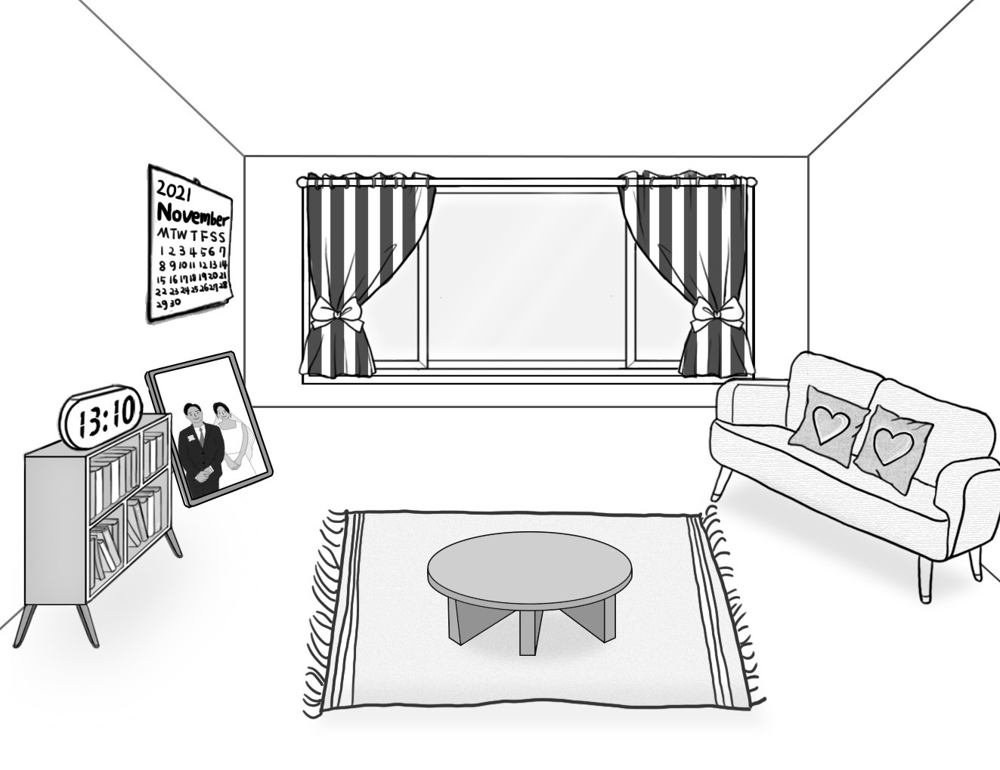
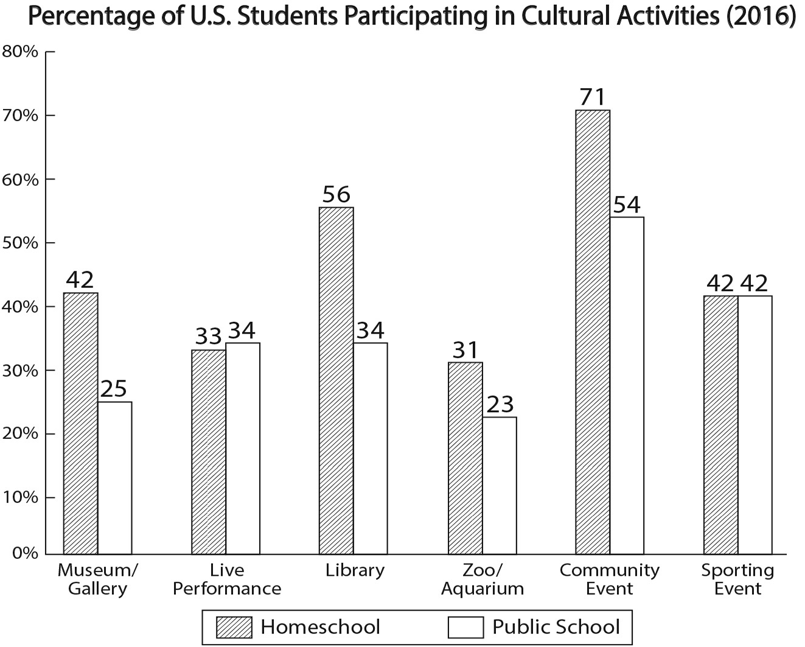

1. 다음을 듣고, 남자가 하는 말의 목적으로 가장 적절한 것을 고르시오.

① 지하철 앱 출시를 홍보하려고
② 지하철 연장 운행을 안내하려고
③ 지하철 운행 지연에 대해 사과하려고
④ 지하철 시설 보수 공사 일정을 공지하려고
⑤ 지하철 내 영화 촬영에 대한 양해를 구하려고

2. 대화를 듣고, 여자의 의견으로 가장 적절한 것을 고르시오.

① 날씨가 더울수록 수분 보충이 중요하다.
② 적당한 준비 운동이 부상 위험을 줄인다.
③ 흐린 날에도 자외선 차단제를 발라야 한다.
④ 햇빛이 강한 날에는 야외 활동을 자제해야 한다.
⑤ 화상을 입었을 때 신속하게 응급 처치를 해야 한다.

3. 대화를 듣고, 두 사람의 관계를 가장 잘 나타낸 것을 고르시오.

① 세차장 직원 – 고객
② 청소 업체 직원 – 집주인
③ 중고차 판매원 – 구매자
④ 분실물 센터 직원 – 방문자
⑤ 액세서리 디자이너 – 의뢰인

4. 대화를 듣고, 그림에서 대화의 내용과 일치하지 않는 것을 고르시오.

5. 대화를 듣고, 남자가 할 일로 가장 적절한 것을 고르시오.

① 가방 준비하기
② 배지 가져오기
③ 스크린 점검하기
④ 동영상 편집하기
⑤ 포스터 업로드하기

6. 대화를 듣고, 여자가 지불할 금액을 고르시오. [3점]

① $45
② $50
③ $54
④ $55
⑤ $60

7. 대화를 듣고, 남자가 London Walking Tour에 참여하지 못한 이유를 고르시오.

① 발목에 통증이 있어서
② 뮤지컬을 관람해야 해서
③ 투어 예약을 하지 못해서
④ 기념품을 사러 가야 해서
⑤ 날씨로 인해 투어가 취소되어서

8. 대화를 듣고, Winter Lake Festival에 관해 언급되지 않은 것을 고르시오.

① 기간
② 장소
③ 입장료
④ 기념품
⑤ 활동 종류

9. Mascot Design Contest에 관한 다음 내용을 듣고, 일치하지 않는 것을 고르시오.

① 팀을 사랑하는 누구든 참여할 수 있다.
② 디자인은 팀 슬로건과 관련되어야 한다.
③ 수상작은 팬 투표로 선정될 것이다.
④ 수상자는 상으로 시즌 티켓을 받게 될 것이다.
⑤ 참가 희망자는 디자인을 이메일로 보내야 한다.

10. 다음 표를 보면서 대화를 듣고, 두 사람이 예약할 캠핑장을 고르시오.

2021 Best Campsites

|  | Campsite | Location | Price (per night) | Type | Kids’ Playground |
| --- | --- | --- | --- | --- | --- |
| ① | A | Seaside | $65 | tent | X |
| ② | B | Jungle Hut | $70 | tent | O |
| ③ | C | Rose Valley | $85 | camping car | O |
| ④ | D | Blue Forest | $90 | camping car | X |
| ⑤ | E | Pine Island | $110 | camping car | O |

11. 대화를 듣고, 남자의 마지막 말에 대한 여자의 응답으로 가장 적절한 것을 고르시오.

① It takes an hour by bus.
② It’s bigger than your office.
③ You should’ve left home earlier.
④ The company moved last month.
⑤ I had a hard time getting the job.

12. 대화를 듣고, 여자의 마지막 말에 대한 남자의 응답으로 가장 적절한 것을 고르시오.

① Okay. I’ll order a shrimp pizza.
② Thanks. You’re good at cooking.
③ No. The pizza isn’t delivered yet.
④ Sure. You can come over anytime.
⑤ Yes. Skipping meals is bad for your health.

13. 대화를 듣고, 남자의 마지막 말에 대한 여자의 응답으로 가장 적절한 것을 고르시오.

Woman:

① Too late. The meeting is already over.
② Sure. There are lots of French cookbooks.
③ I agree. You spend too much time reading.
④ No. We’re not allowed to eat in the library.
⑤ You’re right. I’ll change the reservation now.

14. 대화를 듣고, 여자의 마지막 말에 대한 남자의 응답으로 가장 적절한 것을 고르시오. [3점]

Man:

① Sorry. I forgot to bring my laptop.
② Then, I’d like to replace the battery.
③ Well, the screen still doesn’t work well.
④ Good. A new repair shop opened yesterday.
⑤ Actually, I don’t have a receipt for a refund.

15. 다음 상황 설명을 듣고, Amy가 Terry에게 할 말로 가장 적절한 것을 고르시오. [3점]

Amy:

① How about using a colorful font on the poster?
② You’d better inform your friends of the concert.
③ Can you make the letter size bigger on the poster?
④ Why don’t we hold a concert in the school festival?
⑤ You should put important information on the poster.

16. 여자가 하는 말의 주제로 가장 적절한 것은?

① ways to prevent plant diseases
② factors that affect plant growth
③ benefits of growing plants at home
④ plants that can grow in shaded areas
⑤ materials that help plants grow in shade

17. 언급된 식물이 아닌 것은?

따라 답을 하시기 바랍니다.

① lemon balm
② ivy
③ mint
④ camellia
⑤ lavender

18. 다음 글의 목적으로 가장 적절한 것은?

To the school librarian, I am Kyle Thomas, the president of the school’s English writing club. I have planned activities that will increase the writing skills of our club members. One of the aims of these activities is to make us aware of various types of news media and the language used in printed newspaper articles. However, some old newspapers are not easy to access online. It is, therefore, my humble request to you to allow us to use old newspapers that have been stored in the school library. I would really appreciate it if you grant us permission. Yours truly, Kyle Thomas

19. 다음 글에 드러난 “I”의 심경 변화로 가장 적절한 것은?

When my mom came home from the mall with a special present for me I was pretty sure I knew what it was. I was absolutely thrilled because I would soon communicate with a new cell phone! I was daydreaming about all of the cool apps and games I was going to download. But my mom smiled really big and handed me a book. I flipped through the pages, figuring that maybe she had hidden my new phone inside. But I slowly realized that my mom had not got me a phone and my present was just a little book, which was so different from what I had wanted.

20. 다음 글에서 필자가 주장하는 바로 가장 적절한 것은?

Some experts estimate that as much as half of what we communicate is done through the way we move our bodies. Paying attention to the nonverbal messages you send can make a significant difference in your relationship with students. In general, most students are often closely tuned in to their teacher’s body language. For example, when your students first enter the classroom, their initial action is to look for their teacher. Think about how encouraging and empowering it is for a student when that teacher has a friendly greeting and a welcoming smile. Smiling at students ― to let them know that you are glad to see them ― does not require a great deal of time or effort, but it can make a significant difference in the classroom climate right from the start of class.

21. 밑줄 친 a slap in our own face가 다음 글에서 의미하는 바로 가장 적절한 것은? [3점]

When it comes to climate change, many blame the fossil fuel industry for pumping greenhouse gases, the agricultural sector for burning rainforests, or the fashion industry for producing excessive clothes. But wait, what drives these industrial activities? Our consumption. Climate change is a summed product of each person’s behavior. For example, the fossil fuel industry is a popular scapegoat in the climate crisis. But why do they drill and burn fossil fuels? We provide them strong financial incentives: some people regularly travel on airplanes and cars that burn fossil fuels. Some people waste electricity generated by burning fuel in power plants. Some people use and throw away plastic products derived from crude oil every day. Blaming the fossil fuel industry while engaging in these behaviors is a slap in our own face.

22. 다음 글의 요지로 가장 적절한 것은?

Information is worthless if you never actually use it. Far too often, companies collect valuable customer information that ends up buried and never used. They must ensure their data is accessible for use at the appropriate times. For a hotel, one appropriate time for data usage is check-in at the front desk. I often check in at a hotel I’ve visited frequently, only for the people at the front desk to give no indication that they recognize me as a customer. The hotel must have stored a record of my visits, but they don’t make that information accessible to the front desk clerks. They are missing a prime opportunity to utilize data to create a better experience focused on customer loyalty. Whether they have ten customers, ten thousand, or even ten million, the goal is the same: create a delightful customer experience that encourages loyalty.

23. 다음 글의 주제로 가장 적절한 것은?

We used to think that the brain never changed, but according to the neuroscientist Richard Davidson, we now know that this is not true ― specific brain circuits grow stronger through regular practice. He explains, “Well-being is fundamentally no different than learning to play the cello. If one practices the skills of well-being, one will get better at it.” What this means is that you can actually train your brain to become more grateful, relaxed, or confident, by repeating experiences that evoke gratitude, relaxation, or confidence. Your brain is shaped by the thoughts you repeat. The more neurons fire as they are activated by repeated thoughts and activities, the faster they develop into neural pathways, which cause lasting changes in the brain. Or in the words of Donald Hebb, “Neurons that fire together wire together.” This is such an encouraging premise: bottom line ― we can intentionally create the habits for the brain to be happier.

24. 다음 글의 제목으로 가장 적절한 것은?

In modern times, society became more dynamic. Social mobility increased, and people began to exercise a higher degree of choice regarding, for instance, their profession, their marriage, or their religion. This posed a challenge to traditional roles in society. It was less evident that one needed to commit to the roles one was born into when alternatives could be realized. Increasing control over one’s life choices became not only possible but desired. Identity then became a problem. It was no longer almost ready-made at birth but something to be discovered. Traditional role identities prescribed by society began to appear as masks imposed on people whose real self was to be found somewhere underneath.

25. 다음 도표의 내용과 일치하지 않는 것은?

Percentage of U.S. Students Participating in Cultural Activities (2016)

| Cultural Activity | Homeschooled | Public School |
| --- | --- | --- |
| Museum/Gallery | 42% | 25% |
| Live Performance | 33% | 34% |
| Library | 56% | 34% |
| Zoo/Aquarium | 31% | 23% |
| Community Event | 71% | 54% |
| Sporting Event | 42% | 42% |

26. Bessie Coleman에 관한 다음 글의 내용과 일치하지 않는 것은?

Bessie Coleman was born in Texas in 1892. When she was eleven, she was told that the Wright brothers had flown their first plane. Since that moment, she dreamed about the day she would soar through the sky. At the age of 23, Coleman moved to Chicago, where she worked at a restaurant to save money for flying lessons. However, she had to travel to Paris to take flying lessons because American flight schools at the time admitted neither women nor Black people. In 1921, she finally became the first Black woman to earn an international pilot’s license. She also studied flying acrobatics in Europe and made her first appearance in an airshow in New York in 1922. As a female pioneer of flight, she inspired the next generation to pursue their dreams of flying.

27. 2021 Camptonville Nature Photo Contest에 관한 다음 안내문의 내용과 일치하지 않는 것은?

2021 Camptonville Nature Photo Contest

This is the fourth year of the annual Camptonville Nature Photo Contest. You can show the beauty of nature in Camptonville by sharing your most amazing photos!
Submission
Upload a maximum of 20 photos onto our website www.camptonvillephotocontest.org. - Deadline is December 1. Prizes
1st Place: $500
2nd Place: $200
3rd Place: $100 (Winners will be posted on our website on December 31.)
Details
All winning photos will be exhibited at City Hall. - Please contact us at 122-861-3971 for further information.

28. Willow Valley Hot Air Balloon Ride에 관한 다음 안내문의 내용과 일치하는 것은?

Willow Valley Hot Air Balloon Ride

Enjoy the best views of Willow Valley from the sky with our hot air balloon ride!
Capacity
up to 8 people including a pilot
Time Schedule Spring & Summer 5:00 a.m. - 7:00 a.m. (from April to September) Autumn & Winter 6:00 a.m. - 8:00 a.m. (from October to March)
Duration of Flight
about 1 hour
Fee
$150 per person (insurance not included)
Note
Reservations are required and must be made online. - You can get a full refund up to 24 hours in advance. - Visit www.willowvalleyballoon.com for more information.

29. 다음 글의 밑줄 친 부분 중, 어법상 틀린 것은? [3점]

The reduction of minerals in our food is the result of using pesticides and fertilizers that kill off beneficial bacteria, earthworms, and bugs in the soil that create many of the essential nutrients in the first place and prevent the uptake of nutrients into the plant. Fertilizing crops with nitrogen and potassium has led to declines in magnesium, zinc, iron and iodine. For example, there has been on average about a 30% decline in the magnesium content of wheat. This is partly due to potassium being a blocker against magnesium absorption by plants. Lower magnesium levels in soil also occurring with acidic soils and around 70% of the farmland on earth is now acidic. Thus, the overall characteristics of soil determine the accumulation of minerals in plants. Indeed, nowadays our soil is less healthy and so are the plants grown on it.

30. 다음 글의 밑줄 친 부분 중, 문맥상 낱말의 쓰임이 적절하지 않은 것은?

For species approaching extinction, zoos can act as a last chance for survival. Recovery programs are established to coordinate the efforts of field conservationists and wildlife authorities. As populations of those species diminish it is not unusual for zoos to start captive breeding programs. Captive breeding acts to protect against extinction. In some cases captive-bred individuals may be released back into the wild, supplementing wild populations. This is most successful in situations where individuals are at greatest threat during a particular life stage. For example, turtle eggs may be removed from high-risk locations until after they hatch. This may increase the number of turtles that survive to adulthood. Crocodile programs have also been successful in protecting eggs and hatchlings, capturing hatchlings once they are better equipped to protect themselves.

31. 다음 빈칸에 들어갈 말로 가장 적절한 것을 고르시오.

We don’t send telegraphs to communicate anymore, but it’s a great metaphor for giving advance notice. Sometimes, you must inform those close to you of upcoming change by conveying important information well in advance. There’s a huge difference between saying, “From now on, we will do things differently,” which doesn’t give people enough time to understand and accept the change, and saying something like, “Starting next month, we’re going to approach things differently.” Telegraphing empowers people to adapt. Telegraphing involves the art of seeing an upcoming event or circumstance and giving others enough time to process and accept the change. Telegraph anything that will take people out of what is familiar and comfortable to them. This will allow processing time for them to accept the circumstances and make the most of what’s happening.

32. 다음 빈칸에 들어갈 말로 가장 적절한 것을 고르시오.

Not only does memory underlie our ability to think at all, it defines the content of our experiences and how we preserve them for years to come. Memory makes us who we are. If I were to suffer from heart failure and depend upon an artificial heart, I would be no less myself. If I lost an arm in an accident and had it replaced with an artificial arm, I would still be essentially me. As long as my mind and memories remain intact, I will continue to be the same person, no matter which part of my body (other than the brain) is replaced. On the other hand, when someone suffers from advanced Alzheimer’s disease and his memories fade, people often say that he “is not himself anymore,” or that it is as if the person “is no longer there,” though his body remains unchanged.

33. 다음 빈칸에 들어갈 말로 가장 적절한 것을 고르시오. [3점]

Over time, babies construct expectations about what sounds they will hear when. They hold in memory the sound patterns that occur on a regular basis. They make hypotheses like, “If I hear this sound first, it probably will be followed by that sound.” Scientists conclude that much of babies’ skill in learning language is due to their ability to calculate statistics. For babies, this means that they appear to pay close attention to the patterns that repeat in language. They remember, in a systematic way, how often sounds occur, in what order, with what intervals, and with what changes of pitch. This memory store allows them to track, within the neural circuits of their brains, the frequency of sound patterns and to use this knowledge to make predictions about the meaning in patterns of sounds.

34. 다음 빈칸에 들어갈 말로 가장 적절한 것을 고르시오. [3점]

Some deep-sea organisms are known to use bioluminescence as a lure, to attract prey with a little glow imitating the movements of their favorite fish, or like fireflies, as a sexual attractant to find mates. While there are many possible evolutionary theories for the survival value of bioluminescence, one of the most fascinating is to create a cloak of invisibility. The color of almost all bioluminescent molecules is blue-green, the same color as the ocean above. By self-glowing blue-green, the creatures no longer cast a shadow or create a silhouette, especially when viewed from below against the brighter waters above. Rather, by glowing themselves, they can blend into the sparkles, reflections, and scattered blue-green glow of sunlight or moonlight. Thus, they are most likely making their own light not to see, but to be un-seen.

35. 다음 글에서 전체 흐름과 관계 없는 문장은?

Internet activist Eli Pariser noticed how online search algorithms encourage our human tendency to grab hold of everything that confirms the beliefs we already hold, while quietly ignoring information that doesn’t match those beliefs.

36. 주어진 글 다음에 이어질 글의 순서로 가장 적절한 것을 고르시오.

Roughly twenty years ago, brick-and-mortar stores began to give way to electronic commerce. For good or bad, the shift fundamentally changed consumers’ perception of the shopping experience.

Nowhere was the shift more obvious than with book sales, which is how online bookstores got their start. Physical bookstores simply could not stock as many titles as a virtual bookstore could. There is only so much space available on a shelf

In addition to greater variety, online bookstores were also able to offer aggressive discounts thanks to their lower operating costs. The combination of lower prices and greater selection led to the slow, steady rise of online bookstores

Before long, the e-commerce book market naturally expanded to include additional categories, like CDs and DVDs. E-commerce soon snowballed into the enormous industry it is today, where you can buy everything from toilet paper to cars online

37. 주어진 글 다음에 이어질 글의 순서로 가장 적절한 것을 고르시오. [3점]

Literary works, by their nature, suggest rather than explain; they imply rather than state their claims boldly and directly.

This broad generalization, however, does not mean that works of literature do not include direct statements. Depending on when they were written and by whom, literary works may contain large amounts of direct telling and lesser amounts of suggestion and implication

But whatever the proportion of a work’s showing to telling, there is always something for readers to interpret. Thus we ask the question “What does the text suggest?” as a way to approach literary interpretation, as a way to begin thinking about a text’s implications

What a text implies is often of great interest to us. And our work of figuring out a text’s implications tests our analytical powers. In considering what a text suggests, we gain practice in making sense of texts

38. 글의 흐름으로 보아, 주어진 문장이 들어가기에 가장 적절한 곳을 고르시오.

Worse, some are contaminated with other substances and contain ingredients not listed on the label. According to top nutrition experts, most nutrients are better absorbed and used by the body when consumed from a whole food instead of a supplement. However, many people feel the need to take pills, powders, and supplements in an attempt to obtain nutrients and fill the gaps in their diets. We hope these will give us more energy, prevent us from catching a cold in the winter, or improve our skin and hair. But in reality, the large majority of supplements are artificial and may not even be completely absorbed by your body. For example, a recent investigative report found heavy metals in 40 percent of 134 brands of protein powders on the market. With little control and regulation, taking supplements is a gamble and often costly.

39. 글의 흐름으로 보아, 주어진 문장이 들어가기에 가장 적절한 곳을 고르시오. [3점]

But after this brief moment of rest, the pendulum swings back again and therefore part of the total energy is then given in the form of kinetic energy. In general, kinetic energy is the energy associated with motion, while potential energy represents the energy which is “stored” in a physical system. Moreover, the total energy is always conserved. But while the total energy remains unchanged, the kinetic and potential parts of the total energy can change all the time. Imagine, for example, a pendulum which swings back and forth. When it swings, it sweeps out an arc and then slows down as it comes closer to its highest point, where the pendulum does not move at all. So at this point, the energy is completely given in terms of potential energy. So as the pendulum swings, kinetic and potential energy constantly change into each other.

40. 다음 글의 내용을 한 문장으로 요약하고자 한다. 빈칸 (A), (B)에 들어갈 말로 가장 적절한 것은?

There is often a lot of uncertainty in the realm of science, which the general public finds uncomfortable. They don’t want “informed guesses,” they want certainties that make their lives easier, and science is often unequipped to meet these demands. In particular, the human body is fantastically complex, and some scientific answers can never be provided in black-or-white terms. All this is why the media tends to oversimplify scientific research when presenting it to the public. In their eyes, they’re just “giving people what they want” as opposed to offering more accurate but complex information that very few people will read or understand. A perfect example of this is how people want definitive answers as to which foods are “good” and “bad.” Scientifically speaking, there are no “good” and “bad” foods; rather, food quality exists on a continuum, meaning that some foods are better than others when it comes to general health and well-being. With regard to general health, science, by its nature, does not satisfy the public’s demands for certainty, which leads to the media giving less complicated answers to the public.

41. 윗글의 제목으로 가장 적절한 것은?

Since the turn of the twentieth century we’ve believed in genetic causes of diagnoses — a theory called genetic determinism. Under this model, our genes (and subsequent health) are determined at birth. We are “destined” to inherit certain diseases based on the misfortune of our DNA. Genetic determinism doesn’t consider the role of family backgrounds, traumas, habits, or anything else within the environment. In this dynamic we are not active participants in our own health and wellness. Why would we be? If something is predetermined, it’s not necessary to look at anything beyond our DNA. But the more science has learned about the body and its interaction with the environment around it (in its various forms, from our nutrition to our relationships to our racially oppressive systems), the more simplistic the story becomes. We are not merely expressions of coding but products of a remarkable variety of interactions that are both within and outside of our control. Once we see beyond the narrative that genetics are destiny, we can take ownership of our health. This allows us to see how “choiceless” we once were and empowers us with the ability to create real and lasting change.

42. 밑줄 친 낱말 중에서 문맥상 낱말의 쓰임이 적절하지 않은 것은? [3점]

Since the turn of the twentieth century we’ve believed in genetic causes of diagnoses — a theory called genetic determinism. Under this model, our genes (and subsequent health) are determined at birth. We are “destined” to inherit certain diseases based on the misfortune of our DNA. Genetic determinism doesn’t consider the role of family backgrounds, traumas, habits, or anything else within the environment. In this dynamic we are not active participants in our own health and wellness. Why would we be? If something is predetermined, it’s not necessary to look at anything beyond our DNA. But the more science has learned about the body and its interaction with the environment around it (in its various forms, from our nutrition to our relationships to our racially oppressive systems), the more simplistic the story becomes. We are not merely expressions of coding but products of a remarkable variety of interactions that are both within and outside of our control. Once we see beyond the narrative that genetics are destiny, we can take ownership of our health. This allows us to see how “choiceless” we once were and empowers us with the ability to create real and lasting change.

43. 주어진 글에 이어질 내용을 순서에 맞게 배열한 것으로 가장 적절한 것은?

 One day a poor man brought a bunch of grapes to a prince as a gift. He was very excited to be able to bring a gift for him because he was too poor to afford more. He placed the grapes beside the prince and said, “Oh, Prince, please accept this small gift from me.” His face beamed with happiness as he offered his small gift. If the prince had offered the grapes to them, they might have made funny faces and shown their distaste for the grapes. That would have hurt the feelings of that poor man. He thought to himself that it would be better to eat all of them cheerfully and please him. He did not want to hurt the feelings of that poor man. Everyone around him was moved by his thoughtfulness. The prince thanked him politely. As the man looked at him expectantly, the prince ate one grape. Then he ate another one. Slowly the prince finished the whole bunch of grapes by himself. He did not offer grapes to anyone near him. The man who brought those grapes to him was very pleased and left. The close friends of the prince who were around him were very surprised. Usually the prince shared whatever he had with others. He would offer them whatever he was given and they would eat it together. This time was different. Without offering it to anyone, he finished the bunch of grapes by himself. One of the friends asked, “Prince! How come you ate all the grapes by yourself and did not offer them to any one of us?” He smiled and said that he ate all the grapes by himself because the grapes were too sour.

44. 밑줄 친 낱말 중에서 가리키는 대상이 나머지 넷과 다른 것은?

 One day a poor man brought a bunch of grapes to a prince as a gift. He was very excited to be able to bring a gift for him because he was too poor to afford more. He placed the grapes beside the prince and said, “Oh, Prince, please accept this small gift from me.” His face beamed with happiness as he offered his small gift. If the prince had offered the grapes to them, they might have made funny faces and shown their distaste for the grapes. That would have hurt the feelings of that poor man. He thought to himself that it would be better to eat all of them cheerfully and please him. He did not want to hurt the feelings of that poor man. Everyone around him was moved by his thoughtfulness. The prince thanked him politely. As the man looked at him expectantly, the prince ate one grape. Then he ate another one. Slowly the prince finished the whole bunch of grapes by himself. He did not offer grapes to anyone near him. The man who brought those grapes to him was very pleased and left. The close friends of the prince who were around him were very surprised. Usually the prince shared whatever he had with others. He would offer them whatever he was given and they would eat it together. This time was different. Without offering it to anyone, he finished the bunch of grapes by himself. One of the friends asked, “Prince! How come you ate all the grapes by yourself and did not offer them to any one of us?” He smiled and said that he ate all the grapes by himself because the grapes were too sour.

45. 윗글의 왕자에 관한 내용으로 적절하지 않은 것은?

 One day a poor man brought a bunch of grapes to a prince as a gift. He was very excited to be able to bring a gift for him because he was too poor to afford more. He placed the grapes beside the prince and said, “Oh, Prince, please accept this small gift from me.” His face beamed with happiness as he offered his small gift. If the prince had offered the grapes to them, they might have made funny faces and shown their distaste for the grapes. That would have hurt the feelings of that poor man. He thought to himself that it would be better to eat all of them cheerfully and please him. He did not want to hurt the feelings of that poor man. Everyone around him was moved by his thoughtfulness. The prince thanked him politely. As the man looked at him expectantly, the prince ate one grape. Then he ate another one. Slowly the prince finished the whole bunch of grapes by himself. He did not offer grapes to anyone near him. The man who brought those grapes to him was very pleased and left. The close friends of the prince who were around him were very surprised. Usually the prince shared whatever he had with others. He would offer them whatever he was given and they would eat it together. This time was different. Without offering it to anyone, he finished the bunch of grapes by himself. One of the friends asked, “Prince! How come you ate all the grapes by yourself and did not offer them to any one of us?” He smiled and said that he ate all the grapes by himself because the grapes were too sour.
