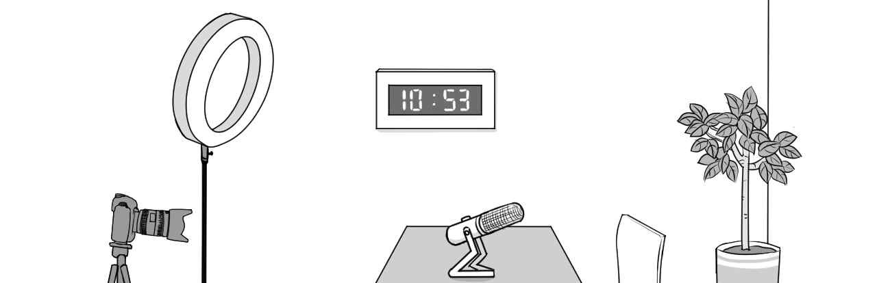
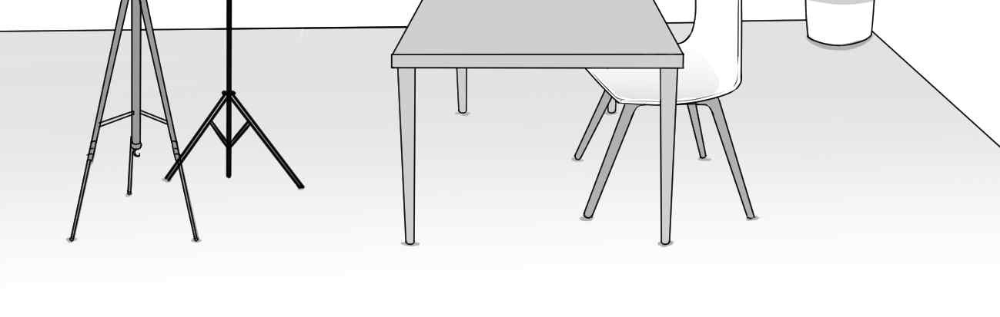
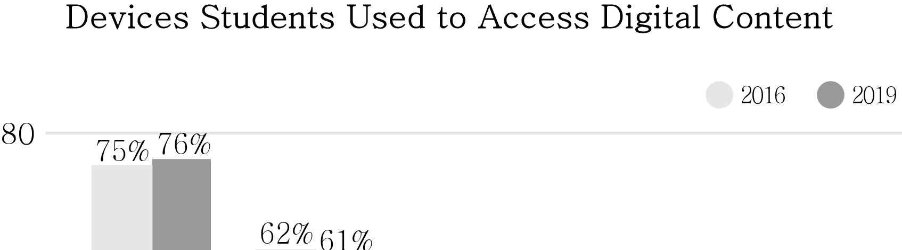
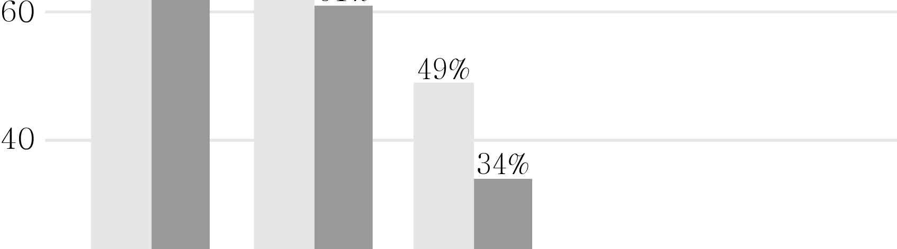
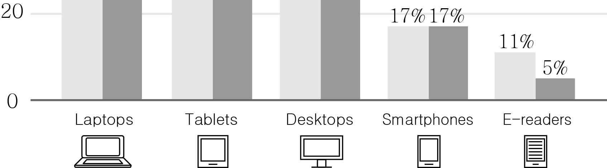
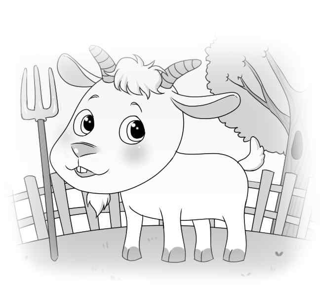

1. 다음을 듣고, 남자가 하는 말의 목적으로 가장 적절한 것을 고르시오.
① 교내 청소 일정을 공지하려고
② 학교 시설 공사의 지연에 대해 사과하려고
③ 하교 시 교실 창문을 닫을 것을 요청하려고
④ 교내의 젖은 바닥을 걸을 때 조심하도록 당부하려고
⑤ 깨끗한 교실 환경 조성을 위한 아이디어를 공모하려고

2. 대화를 듣고, 여자의 의견으로 가장 적절한 것을 고르시오.

① 짧은 낮잠은 업무 효율을 높인다.
② 야식은 숙면에 방해가 될 수 있다.
③ 사람마다 최적의 수면 시간이 다르다.
④ 베개를 바꾸면 숙면에 도움이 될 수 있다.
⑤ 숙면을 위해 침실을 서늘하게 하는 것이 좋다.

3. 대화를 듣고, 두 사람의 관계를 가장 잘 나타낸 것을 고르시오.

① 파티 주최자 - 요리사
② 슈퍼마켓 점원 - 손님
③ 배달 기사 - 음식점 주인
④ 영양학자 - 식품 제조업자
⑤ 인테리어 디자이너 - 의뢰인

4. 대화를 듣고, 그림에서 대화의 내용과 일치하지 않는 것을 고르시오.

①
④

5. 대화를 듣고, 남자가 할 일로 가장 적절한 것을 고르시오.

① 영화 예매하기
② 지갑 가져오기
③ 시간표 출력하기
④ 학생증 재발급받기
⑤ 영화 감상문 제출하기

6. 대화를 듣고, 여자가 지불할 금액을 고르시오. [3점]

① $72
② $80
③ $90
④ $100
⑤ $110

7. 대화를 듣고, 남자가 보고서를 완성하지 못한 이유를 고르시오.

① 실험을 다시 해서
② 제출일을 착각해서
③ 주제가 변경되어서
④ 컴퓨터가 고장 나서
⑤ 심한 감기에 걸려서

8. 대화를 듣고, Spring Virtual Run에 관해 언급되지 않은 것을 고르시오.

① 달리는 거리
② 참가 인원
③ 달리는 장소
④ 참가비
⑤ 기념품

9. Family Night at the Museum에 관한 다음 내용을 듣고, 일치하지 않는 것을 고르시오.

① 박물관 정규 운영 시간 종료 후에 열린다.
② 행성과 별 모형 아래에서 잠을 잔다.
③ 참가자들에게 침낭이 제공된다.
④ 6세부터 13세까지를 위한 프로그램이다.
⑤ 사전 등록 없이 현장에서 참가할 수 있다.

10. 다음 표를 보면서 대화를 듣고, 여자가 구매할 스마트 워치를 고르시오.

Smart Watches

|  | Model | Waterproof | Warranty | Price |
| --- | --- | --- | --- | --- |
| ① | A | × | 2 years | $90 |
| ② | B | ○ | 3 years | $110 |
| ③ | C | ○ | 1 year | $115 |
| ④ | D | × | 2 years | $120 |
| ⑤ | E | ○ | 4 years | $125 |

11. 대화를 듣고, 여자의 마지막 말에 대한 남자의 응답으로 가장 적절한 것을 고르시오.

① Oh, I should get it exchanged.
② Sure. I’ll order a shirt for you.
③ Well, it’s too expensive for me.
④ No. Please find me a smaller size.
⑤ Sorry, but this shirt is not on sale.

12. 대화를 듣고, 남자의 마지막 말에 대한 여자의 응답으로 가장 적절한 것을 고르시오.

① Good. Let’s meet around six.
② That’s okay. I don’t like donuts.
③ I want to open my own donut shop.
④ Don’t worry. I can do that by myself.
⑤ Thanks for sharing your donut recipe.

13. 대화를 듣고, 여자의 마지막 말에 대한 남자의 응답으로 가장 적절한 것을 고르시오. [3점]

Man:
① This coffee place is very popular.
② You can stop using plastic straws.
③ I’ll order drinks when you’re ready.
④ Your drink will be ready in a minute.
⑤ The cups come in various colors and shapes.

14. 대화를 듣고, 남자의 마지막 말에 대한 여자의 응답으로 가장 적절한 것을 고르시오. [3점]

Woman:
① Luckily, I didn’t get hurt in the accident.
② I have enough money to get a new bike.
③ You really need one for your own safety.
④ You may feel sleepy after biking to school.
⑤ We can put our bikes in the school parking lot.

15. 다음 상황 설명을 듣고, Jasper가 Mary에게 할 말로 가장 적절한 것을 고르시오.

Jasper:
① Where is the audition being held?
② How about writing your own song?
③ Let’s play a different song this time.
④ I think you should be our lead singer.
⑤ Don’t you think we need more practice?

16. 남자가 하는 말의 주제로 가장 적절한 것은?

① eco-friendly toys for pets
② roles of toys in pets’ well-being
③ types of pets’ unusual behaviors
④ foods that are dangerous to pets
⑤ difficulties in raising children with pets

17. 언급된 동물이 아닌 것은?

① cat
② hamster
③ dog
④ turtle
⑤ parrot

18. 다음 글의 목적으로 가장 적절한 것은?

Dear members of Eastwood Library, Thanks to the Friends of Literature group, we’ve successfully raised enough money to remodel the library building. John Baker, our local builder, has volunteered to help us with the remodelling but he needs assistance. By grabbing a hammer or a paint brush and donating your time, you can help with the construction. Join Mr. Baker in his volunteering team and become a part of making Eastwood Library a better place! Please call 541-567-1234 for more information. Sincerely, Mark Anderson

19. 다음 글에 드러난 Shirley의 심경으로 가장 적절한 것은?

On the way home, Shirley noticed a truck parked in front of the house across the street. New neighbors! Shirley was dying to know about them. “Do you know anything about the new neighbors?” she asked Pa at dinner. He said, “Yes, and there’s one thing that may be interesting to you.” Shirley had a billion more questions. Pa said joyfully, “They have a girl just your age. Maybe she wants to be your playmate.” Shirley nearly dropped her fork on the floor. How many times had she prayed for a friend? Finally, her prayers were answered! She and the new girl could go to school together, play together, and become best friends.

20. 다음 글에서 필자가 주장하는 바로 가장 적절한 것은?

At a publishing house and at a newspaper you learn the following: It’s not a mistake if it doesn’t end up in print. It’s the same for email. Nothing bad can happen if you haven’t hit the Send key. What you’ve written can have misspellings, errors of fact, rude comments, obvious lies, but it doesn’t matter. If you haven’t sent it, you still have time to fix it. You can correct any mistake and nobody will ever know the difference. This is easier said than done, of course. Send is your computer’s most attractive command. But before you hit the Send key, make sure that you read your document carefully one last time.

21. 밑줄 친 translate it from the past tense to the future tense가 다음 글에서 의미하는 바로 가장 적절한 것은? [3점]

Get past the ‘I wish I hadn’t done that!’ reaction. If the disappointment you’re feeling is linked to an exam you didn’t pass because you didn’t study for it, or a job you didn’t get because you said silly things at the interview, or a person you didn’t impress because you took entirely the wrong approach, accept that it’s happened now. The only value of ‘I wish I hadn’t done that!’ is that you’ll know better what to do next time. The learning pay-off is useful and significant. This ‘if only I...’ agenda is virtual. Once you have worked that out, it’s time to translate it from the past tense to the future tense: ‘Next time I’m in this situation, I’m going to try to...’.

22. 다음 글의 요지로 가장 적절한 것은?

If you care deeply about something, you may place greater value on your ability to succeed in that area of concern. The internal pressure you place on yourself to achieve or do well socially is normal and useful, but when you doubt your ability to succeed in areas that are important to you, your self-worth suffers. Situations are uniquely stressful for each of us based on whether or not they activate our doubt. It’s not the pressure to perform that creates your stress. Rather, it’s the self-doubt that bothers you. Doubt causes you to see positive, neutral, and even genuinely negative experiences more negatively and as a reflection of your own shortcomings. When you see situations and your strengths more objectively, you are less likely to have doubt as the source of your distress.

23. 다음 글의 주제로 가장 적절한 것은?

When two people are involved in an honest and open conversation, there is a back and forth flow of information. It is a smooth exchange. Since each one is drawing on their past personal experiences, the pace of the exchange is as fast as memory. When one person lies, their responses will come more slowly because the brain needs more time to process the details of a new invention than to recall stored facts. As they say, “Timing is everything.” You will notice the time lag when you are having a conversation with someone who is making things up as they go. Don’t forget that the other person may be reading your body language as well, and if you seem to be disbelieving their story, they will have to pause to process that information, too.

24. 다음 글의 제목으로 가장 적절한 것은?

Think, for a moment, about something you bought that you never ended up using. An item of clothing you never ended up wearing? A book you never read? Some piece of electronic equipment that never even made it out of the box? It is estimated that Australians alone spend on average $10.8 billion AUD (approximately $9.99 billion USD) every year on goods they do not use — more than the total government spending on universities and roads. That is an average of $1,250 AUD (approximately $1,156 USD) for each household. All the things we buy that then just sit there gathering dust are waste — a waste of money, a waste of time, and waste in the sense of pure rubbish. As the author Clive Hamilton observes, ‘The difference between the stuff we buy and what we use is waste.’

25. 다음 도표의 내용과 일치하지 않는 것은?

Devices Students Used to Access Digital Content

| Device | 2016 | 2019 |
| --- | --- | --- |
| Laptops | 75% | 76% |
| Tablets | 62% | 61% |
| Desktops | 49% | 34% |
| Smartphones | 17% | 17% |
| E-readers | 11% | 5% |

26. Elizabeth Catlett에 관한 다음 글의 내용과 일치하지 않는 것은?

Elizabeth Catlett was born in Washington, D.C. in 1915. As a granddaughter of slaves, Catlett heard the stories of slaves from her grandmother. After being disallowed entrance from the Carnegie Institute of Technology because she was black, Catlett studied design and drawing at Howard University. She became one of the first three students to earn a master’s degree in fine arts at the University of Iowa. Throughout her life, she created art representing the voices of people suffering from social injustice. She was recognized with many prizes and honors both in the United States and in Mexico. She spent over fifty years in Mexico, and she took Mexican citizenship in 1962. Catlett died in 2012 at her home in Mexico.

27. Spring Farm Camp에 관한 다음 안내문의 내용과 일치하지 않는 것은?

Spring Farm Camp

Our one-day spring farm camp gives your kids true, hands-on farm experience.
When
Monday, April 19 - Friday, May 14 Time: 9 a.m. - 4 p.m. Ages: 6 - 10
Participation Fee
$70 per person (lunch and snacks included)
Activities
making cheese from goat’s milk
picking strawberries
making strawberry jam to take home We are open rain or shine. For more information, go to www.b_orchard.com.

28. Great Aquarium에 관한 다음 안내문의 내용과 일치하는 것은?

Great Aquarium

Opening Hours
10 a.m. - 6 p.m., daily Last entry is at 5 p.m. Events Fish Feeding 10 a.m. - 11 a.m. Penguin Feeding 1 p.m. - 2 p.m. Ticket Prices Age Price Kids (12 and under) $25 Adults (20 - 59) $33 Teens (13 - 19) $30 Seniors (60 and above) * Ticket holders will receive a free drink coupon. Booking Tickets
ALL visitors are required to book online.
Booking will be accepted up to 1 hour before entry.

29. 다음 글의 밑줄 친 부분 중, 어법상 틀린 것은? [3점]

Although there is usually a correct way of holding and playing musical instruments, the most important instruction to begin with is that they are not toys and that they must be looked after. Allow children time to explore ways of handling and playing the instruments for themselves before showing them. Finding different ways to produce sounds are an important stage of musical exploration. Correct playing comes from the desire to find the most appropriate sound quality and find the most comfortable playing position so that one can play with control over time. As instruments and music become more complex, learning appropriate playing techniques becomes increasingly relevant.

30. 다음 글의 밑줄 친 부분 중, 문맥상 낱말의 쓰임이 적절하지 않은 것은? [3점]

When the price of something fundamental drops greatly, the whole world can change. Consider light. Chances are you are reading this sentence under some kind of artificial light. Moreover, you probably never thought about whether using artificial light for reading was worth it. Light is so cheap that you use it without thinking. But in the early 1800s, it would have cost you four hundred times what you are paying now for the same amount of light. At that price, you would notice the cost and would think twice before using artificial light to read a book. The drop in the price of light lit up the world. Not only did it turn night into day, but it allowed us to live and work in big buildings that natural light could not enter. Nearly nothing we have today would be possible if the cost of artificial light had not dropped to almost nothing.

31. 다음 빈칸에 들어갈 말로 가장 적절한 것을 고르시오.

One of the most important aspects of providing good care is making sure that an animal’s needs are being met consistently and predictably. Like humans, animals need a sense of control. So an animal who may get enough food but doesn’t know when the food will appear and can see no consistent schedule may experience distress. We can provide a sense of control by ensuring that our animal’s environment is predictable: there is always water available and always in the same place. There is always food when we get up in the morning and after our evening walk. There will always be a time and place to eliminate, without having to hold things in to the point of discomfort. Human companions can display consistent emotional support, rather than providing love one moment and withholding love the next. When animals know what to expect, they can feel more confident and calm.

32. 다음 빈칸에 들어갈 말로 가장 적절한 것을 고르시오.

When a child is upset, the easiest and quickest way to calm them down is to give them food. This acts as a distraction from the feelings they are having, gives them something to do with their hands and mouth and shifts their attention from whatever was upsetting them. If the food chosen is also seen as a treat such as sweets or a biscuit, then the child will feel ‘treated’ and happier. In the shorter term using food like this is effective. But in the longer term it can be harmful as we quickly learn that food is a good way to manage emotions. Then as we go through life, whenever we feel annoyed, anxious or even just bored, we turn to food to make ourselves feel better.

33. 다음 빈칸에 들어갈 말로 가장 적절한 것을 고르시오. [3점]

Scientists believe that the frogs’ ancestors were water-dwelling, fishlike animals. The first frogs and their relatives gained the ability to come out on land and enjoy the opportunities for food and shelter there. But they still kept many ties to the water. A frog’s lungs do not work very well, and it gets part of its oxygen by breathing through its skin. But for this kind of “breathing” to work properly, the frog’s skin must stay moist. And so the frog must remain near the water where it can take a dip every now and then to keep from drying out. Frogs must also lay their eggs in water, as their fishlike ancestors did. And eggs laid in the water must develop into water creatures, if they are to survive. For frogs, metamorphosis thus provides the bridge between the water-dwelling young forms and the land-dwelling adults.

34. 다음 빈칸에 들어갈 말로 가장 적절한 것을 고르시오. [3점]

It is important to distinguish between being legally allowed to do something, and actually being able to go and do it. A law could be passed allowing everyone, if they so wish, to run a mile in two minutes. That would not, however, increase their effective freedom, because, although allowed to do so, they are physically incapable of it. Having a minimum of restrictions and a maximum of possibilities is fine. But in the real world most people will never have the opportunity either to become all that they are allowed to become, or to need to be restrained from doing everything that is possible for them to do. Their effective freedom depends on actually having the means and ability to do what they choose.

35. 다음 글에서 전체 흐름과 관계 없는 문장은?

Today’s music business has allowed musicians to take matters into their own hands. Gone are the days of musicians waiting for a gatekeeper (someone who holds power and prevents you from being let in) at a label or TV show to say they are worthy of the spotlight. In today’s music business, you don’t need to ask for permission to build a fanbase and you no longer need to pay thousands of dollars to a company to do it. There are rising concerns over the marketing of child musicians using TV auditions. Every day, musicians are getting their music out to thousands of listeners without any outside help. They simply deliver it to the fans directly, without asking for permission or outside help to receive exposure or connect with thousands of listeners.

36. 주어진 글 다음에 이어질 글의 순서로 가장 적절한 것을 고르시오.

Almost all major sporting activities are played with a ball. The rules of the game always include rules about the type of ball that is allowed, starting with the size and weight of the ball. The ball must also have a certain stiffness. A ball might have the correct size and weight but if it is made as a hollow ball of steel it will be too stiff and if it is made from light foam rubber with a heavy center it will be too soft. Similarly, along with stiffness, a ball needs to bounce properly. A solid rubber ball would be too bouncy for most sports, and a solid ball made of clay would not bounce at all.

37. 주어진 글 다음에 이어질 글의 순서로 가장 적절한 것을 고르시오. [3점]

If you had to write a math equation, you probably wouldn’t write, “Twenty-eight plus fourteen equals forty-two.” It would take too long to write and it would be hard to read quickly. You would write, “28 + 14 = 42.” Chemistry is the same way. Chemists have to write chemical equations all the time, and it would take too long to write and read if they had to spell everything out. So chemists use symbols, just like we do in math. A chemical formula lists all the elements that form each molecule and uses a small number to the bottom right of an element’s symbol to stand for the number of atoms of that element. For example, the chemical formula for water is H2O. That tells us that a water molecule is made up of two hydrogen (“H” and “2”) atoms and one oxygen (“O”) atom.

38. 글의 흐름으로 보아, 주어진 문장이 들어가기에 가장 적절한 곳을 고르시오.

It is so easy to overestimate the importance of one defining moment and underestimate the value of making small improvements on a daily basis. Too often, we convince ourselves that massive success requires massive action. Whether it is losing weight, winning a championship, or achieving any other goal, we put pressure on ourselves to make some earthshaking improvement that everyone will talk about. Meanwhile, improving by 1 percent isn’t particularly notable, but it can be far more meaningful in the long run. The difference this tiny improvement can make over time is surprising. Here’s how the math works out: if you can get 1 percent better each day for one year, you’ll end up thirty-seven times better by the time you’re done. Conversely, if you get 1 percent worse each day for one year, you’ll decline nearly down to zero. What starts as a small win or a minor failure adds up to something much more.

39. 글의 흐름으로 보아, 주어진 문장이 들어가기에 가장 적절한 곳을 고르시오. [3점]

The continued survival of the human race can be explained by our ability to adapt to our environment. While we may have lost some of our ancient ancestors’ survival skills, we have learned new skills as they have become necessary. Today, the gap between the skills we once had and the skills we now have grows ever wider as we rely more heavily on modern technology. Therefore, when you head off into the wilderness, it is important to fully prepare for the environment. Before a trip, research how the native inhabitants dress, work, and eat. How they have adapted to their way of life will help you to understand the environment and allow you to select the best gear and learn the correct skills. This is crucial because most survival situations arise as a result of a series of events that could have been avoided.

40. 다음 글의 내용을 한 문장으로 요약하고자 한다. 빈칸 (A), (B)에 들어갈 말로 가장 적절한 것은?

In one study, researchers asked pairs of strangers to sit down in a room and chat. In half of the rooms, a cell phone was placed on a nearby table; in the other half, no phone was present. After the conversations had ended, the researchers asked the participants what they thought of each other. Here’s what they learned: when a cell phone was present in the room, the participants reported the quality of their relationship was worse than those who’d talked in a cell phone-free room. The pairs who talked in the rooms with cell phones thought their partners showed less empathy. Think of all the times you’ve sat down to have lunch with a friend and set your phone on the table. You might have felt good about yourself because you didn’t pick it up to check your messages, but your unchecked messages were still hurting your connection with the person sitting across from you. 

The presence of a cell phone weakens the connection between people involved in conversations, even when the phone is being ignored.

41. 윗글의 제목으로 가장 적절한 것은?

As kids, we worked hard at learning to ride a bike; when we fell off, we got back on again, until it became second nature to us. But when we try something new in our adult lives we’ll usually make just one attempt before judging whether it’s worked. If we don’t succeed the first time, or if it feels a little awkward, we’ll tell ourselves it wasn’t a success rather than giving it another shot. That’s a shame, because repetition is central to the process of rewiring our brains. Consider the idea that your brain has a network of neurons. They will connect with each other whenever you remember to use a brain-friendly feedback technique. Those connections aren’t very reliable at first, which may make your first efforts a little hit-and-miss. You might remember one of the steps involved, and not the others. But scientists have a saying: “neurons that fire together, wire together.” In other words, repetition of an action blocks the connections between the neurons involved in that action. That means the more times you try using that new feedback technique, the more easily it will come to you when you need it.

42. 밑줄 친 낱말 중에서 문맥상 낱말의 쓰임이 적절하지 않은 것은?

As kids, we worked hard at learning to ride a bike; when we fell off, we got back on again, until it became second nature to us. But when we try something new in our adult lives we’ll usually make just one attempt before judging whether it’s worked. If we don’t succeed the first time, or if it feels a little awkward, we’ll tell ourselves it wasn’t a success rather than giving it another shot. That’s a shame, because repetition is central to the process of rewiring our brains. Consider the idea that your brain has a network of neurons. They will connect with each other whenever you remember to use a brain-friendly feedback technique. Those connections aren’t very reliable at first, which may make your first efforts a little hit-and-miss. You might remember one of the steps involved, and not the others. But scientists have a saying: “neurons that fire together, wire together.” In other words, repetition of an action blocks the connections between the neurons involved in that action. That means the more times you try using that new feedback technique, the more easily it will come to you when you need it.

43. 주어진 글에 이어질 내용을 순서에 맞게 배열한 것으로 가장 적절한 것은?

 Like all other years, the hunting season had arrived. Preparations began in the palace and the king got ready for his hunting trip. Deep in the forest, he spotted a beautiful wild deer. It was a large stag. His aim was perfect. When he killed the deer with just one shot of his arrow, the king was filled with pride. The proud hunter ordered a hunting drum to be made out of the skin of the deer. Seasons changed. A year passed by. And it was time to go hunting once again. The king went to the same forest as the previous year. He used his beautiful deerskin drum to round up animals. But none came. All the animals ran for safety, except one doe. She came closer and closer to the drummer. Suddenly, she started fearlessly licking the deerskin drum. The king was surprised by this sight. An old servant had an answer to this strange behavior. “The deerskin used to make this drum belonged to her mate, the deer who we hunted last year. This doe is mourning the death of her mate,” the man said. Upon hearing this, the king had a change of heart. He had never realized that an animal, too, felt the pain of loss. He made a promise, from that day on, to never again hunt wild animals.

44. 밑줄 친 낱말 중에서 가리키는 대상이 나머지 넷과 다른 것은?

 Like all other years, the hunting season had arrived. Preparations began in the palace and the king got ready for his hunting trip. Deep in the forest, he spotted a beautiful wild deer. It was a large stag. His aim was perfect. When he killed the deer with just one shot of his arrow, the king was filled with pride. The proud hunter ordered a hunting drum to be made out of the skin of the deer. Seasons changed. A year passed by. And it was time to go hunting once again. The king went to the same forest as the previous year. He used his beautiful deerskin drum to round up animals. But none came. All the animals ran for safety, except one doe. She came closer and closer to the drummer. Suddenly, she started fearlessly licking the deerskin drum. The king was surprised by this sight. An old servant had an answer to this strange behavior. “The deerskin used to make this drum belonged to her mate, the deer who we hunted last year. This doe is mourning the death of her mate,” the man said. Upon hearing this, the king had a change of heart. He had never realized that an animal, too, felt the pain of loss. He made a promise, from that day on, to never again hunt wild animals.

45. 윗글에 관한 내용으로 적절하지 않은 것은?

 Like all other years, the hunting season had arrived. Preparations began in the palace and the king got ready for his hunting trip. Deep in the forest, he spotted a beautiful wild deer. It was a large stag. His aim was perfect. When he killed the deer with just one shot of his arrow, the king was filled with pride. The proud hunter ordered a hunting drum to be made out of the skin of the deer. Seasons changed. A year passed by. And it was time to go hunting once again. The king went to the same forest as the previous year. He used his beautiful deerskin drum to round up animals. But none came. All the animals ran for safety, except one doe. She came closer and closer to the drummer. Suddenly, she started fearlessly licking the deerskin drum. The king was surprised by this sight. An old servant had an answer to this strange behavior. “The deerskin used to make this drum belonged to her mate, the deer who we hunted last year. This doe is mourning the death of her mate,” the man said. Upon hearing this, the king had a change of heart. He had never realized that an animal, too, felt the pain of loss. He made a promise, from that day on, to never again hunt wild animals.
