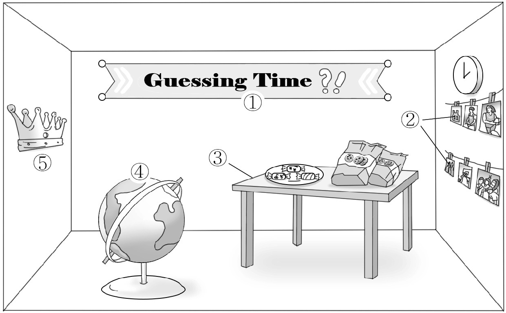
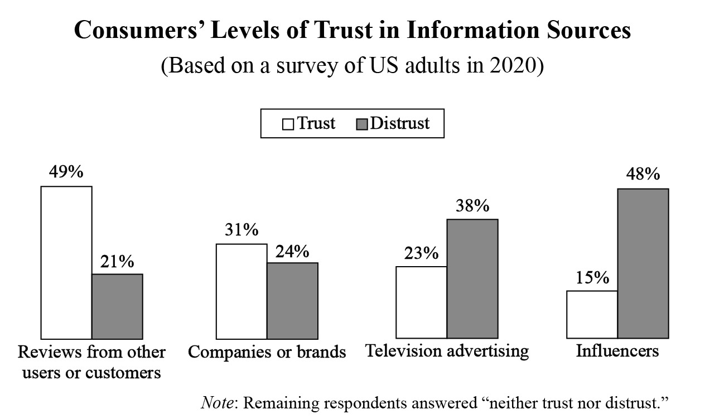
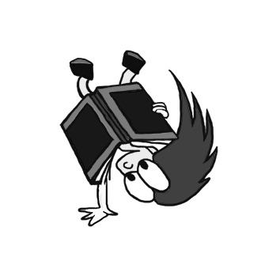

1. 다음을 듣고, 남자가 하는 말의 목적으로 가장 적절한 것을 고르시오.

① 시민 자율 방범 단원을 모집하려고
② 어린이 안전 교육 장소를 안내하려고
③ 초등학교 개교 기념행사를 홍보하려고
④ 학교 주변 제한 속도 준수를 독려하려고
⑤ 시청에서 열리는 공청회 일정을 공지하려고

2. 대화를 듣고, 남자의 의견으로 가장 적절한 것을 고르시오.

① 고민이 있을 때는 가족이나 친구와 대화해야 한다.
② 가까운 사람일수록 말을 신중하게 하는 것이 좋다.
③ 사과를 받아들일 수 있는 넓은 마음이 필요하다.
④ 일어나지 않은 일을 미리 걱정할 필요는 없다.
⑤ 가족이라도 개인 공간을 존중해야 한다.

3. 대화를 듣고, 두 사람의 관계를 가장 잘 나타낸 것을 고르시오.

① 교사 - 학생
② 방송 작가 - 배우
③ 라디오 진행자 - 청취자
④ 이벤트 업체 직원 - 고객
⑤ 설문 조사원 - 설문 응답자

4. 대화를 듣고, 그림에서 대화의 내용과 일치하지 않는 것을 고르시오.

5. 대화를 듣고, 남자가 할 일로 가장 적절한 것을 고르시오.

① 생일 카드 쓰기
② 스웨터 구매하기
③ 거실 장식하기
④ 케이크 찾아오기
⑤ 샌드위치 재료 주문하기

6. 대화를 듣고, 여자가 지불할 금액을 고르시오. [3점]

① $16
② $20
③ $21
④ $23
⑤ $26

7. 대화를 듣고, 남자가 헬스장 회원권을 연장하지 않은 이유를 고르시오.

① 어깨 부상이 회복되지 않아서
② 운동에 흥미를 잃어서
③ 샤워 시설이 낡고 좁아서
④ 가격이 인상되어서
⑤ 방과후 수업에 참여해야 해서

8. 대화를 듣고, Tour of Liberty University에 관해 언급되지 않은 것을 고르시오.

① 날짜
② 활동 내용
③ 참가 가능 인원수
④ 기념품
⑤ 신청 방법

9. Green Action Photo Contest에 관한 다음 내용을 듣고, 일치하지 않는 것을 고르시오.

① 9월 한 달간 사진을 업로드 할 수 있다.
② 정해진 해시태그를 붙이면 자동으로 참가하게 된다.
③ 사진은 5장까지 올릴 수 있다.
④ 우승 상품은 10월 11일까지 직접 찾아가야 한다.
⑤ 우승 사진은 연말까지 마을 웹 사이트에 게시된다.

10. 다음 표를 보면서 대화를 듣고, 여자가 주문할 Rolling Cart를 고르시오.

Rolling Cart

|  | Model | Material | Number of Shelf | Lockable Wheel | Price |
| --- | --- | --- | --- | --- | --- |
| ① | A | Metal | 2 | ○ | $80 |
| ② | B | Metal | 3 | ○ | $95 |
| ③ | C | Wood | 3 | ○ | $105 |
| ④ | D | Wood | 4 | × | $110 |
| ⑤ | E | Plastic | 4 | × | $75 |

11. 대화를 듣고, 여자의 마지막 말에 대한 남자의 응답으로 가장 적절한 것을 고르시오.

① Okay. Then let’s ask them if they lost their dog.
② Take it easy. This dog is not dangerous at all.
③ Sorry. I tried my best, but I couldn’t find it.
④ What a relief! I thought I had lost my dog forever.
⑤ Right! Dog owners must walk their pets twice a day.

12. 대화를 듣고, 남자의 마지막 말에 대한 여자의 응답으로 가장 적절한 것을 고르시오.

① We’re open from 11 o’clock in the morning.
② Sorry, but all the tables are full right now.
③ Our special for today is barbecue chicken.
④ Thank you for visiting our restaurant.
⑤ I don’t have enough time to cook.

13. 대화를 듣고, 여자의 마지막 말에 대한 남자의 응답으로 가장 적절한 것을 고르시오. [3점]

Man:

① Don’t worry. You can book another hotel.
② That’s right. You have already paid your bill.
③ Yes. But you don’t have to pay for a full day.
④ Sorry. You should have cancelled your reservation.
⑤ Of course. You can stay in the lobby till the afternoon.

14. 대화를 듣고, 남자의 마지막 말에 대한 여자의 응답으로 가장 적절한 것을 고르시오. [3점]

Woman:

① Oh, no! I can come over today to help you clear it out.
② Never mind. Everyone needs time to make a decision.
③ Okay. We can go to the basement if we’re in danger.
④ Yes. Why don’t you water your trees more often?
⑤ Sorry. I don’t know how to change a light bulb.

15. 다음 상황 설명을 듣고, Emily가 Chris에게 할 말로 가장 적절한 것을 고르시오.

Emily:

① Luckily, I have finished my homework.
② May I watch the movie with my brother?
③ Thanks, and I’ll gratefully enjoy your cookies.
④ I’m sorry, but I need to take care of my brother.
⑤ Will you watch over my brother for just a minute?

16. 여자가 하는 말의 주제로 가장 적절한 것은?

① different animals that are popular in different cultures
② unique sleeping habits that animals use for survival
③ wild animals that are becoming endangered species
④ how animals have changed their ways of eating
⑤ animals that bring people good luck

17. 언급된 동물이 아닌 것은?

답을 하시기 바랍니다.

① bats
② ducks
③ chimpanzees
④ giraffes
⑤ dolphins

18. 다음 글의 목적으로 가장 적절한 것은?

Dear Mr. Dennis Brown, We at G&D Restaurant are honored and delighted to invite you to our annual Fall Dinner. The annual event will be held on October 1st, 2021 at our restaurant. At the event, we will be introducing new wonderful dishes that our restaurant will be offering soon. These delicious dishes will showcase the amazing talents of our gifted chefs. Also, our chefs will be providing cooking tips, ideas on what to buy for your kitchen, and special recipes. We at G&D Restaurant would be more than grateful if you can make it to this special occasion and be part of our celebration. We look forward to seeing you. Thank you so much. Regards, Marcus Lee, Owner ‐ G&D Restaurant

19. 다음 글의 상황에 나타난 분위기로 가장 적절한 것은?

In the middle of the night, Matt suddenly awakened. He glanced at his clock. It was 3:23. For just an instant he wondered what had wakened him. Then he remembered. He had heard someone come into his room. Matt sat up in bed, rubbed his eyes, and looked around the small room. “Mom?” he said quietly, hoping he would hear his mother’s voice assuring him that everything was all right. But there was no answer. Matt tried to tell himself that he was just hearing things. But he knew he wasn’t. There was someone in his room. He could hear rhythmic, scratchy breathing and it wasn’t his own. He lay awake for the rest of the night.

20. 다음 글에서 필자가 주장하는 바로 가장 적절한 것은?

As you set about to write, it is worth reminding yourself that while you ought to have a point of view, you should avoid telling your readers what to think. Try to hang a question mark over it all. This way you allow your readers to think for themselves about the points and arguments you’re making. As a result, they will feel more involved, finding themselves just as committed to the arguments you’ve made and the insights you’ve exposed as you are. You will have written an essay that not only avoids passivity in the reader, but is interesting and gets people to think.

21. 밑줄 친 “matter out of place”가 다음 글에서 의미하는 바로 가장 적절한 것은?

Nothing is trash by nature. Anthropologist Mary Douglas brings back and analyzes the common saying that dirt is “matter out of place.” Dirt is relative, she emphasizes. “Shoes are not dirty in themselves, but it is dirty to place them on the dining-table; food is not dirty in itself, but it is dirty to leave pots and pans in the bedroom, or food all over clothing; similarly, bathroom items in the living room; clothing lying on chairs; outdoor things placed indoors; upstairs things downstairs, and so on.” Sorting the dirty from the clean ― removing the shoes from the table, putting the dirty clothing in the washing machine ― involves systematic ordering and classifying. Eliminating dirt is thus a positive process.

22. 다음 글의 요지로 가장 적절한 것은?

It’s important that you think independently and fight for what you believe in, but there comes a time when it’s wiser to stop fighting for your view and move on to accepting what a trustworthy group of people think is best. This can be extremely difficult. But it’s smarter, and ultimately better for you to be open-minded and have faith that the conclusions of a trustworthy group of people are better than whatever you think. If you can’t understand their view, you’re probably just blind to their way of thinking. If you continue doing what you think is best when all the evidence and trustworthy people are against you, you’re being dangerously confident. The truth is that while most people can become incredibly open-minded, some can’t, even after they have repeatedly encountered lots of pain from betting that they were right when they were not.

23. 다음 글의 주제로 가장 적절한 것은?

Vegetarian eating is moving into the mainstream as more and more young adults say no to meat, poultry, and fish. According to the American Dietetic Association, “approximately planned vegetarian diets are healthful, are nutritionally adequate, and provide health benefits in the prevention and treatment of certain diseases.” But health concerns are not the only reason that young adults give for changing their diets. Some make the choice out of concern for animal rights. When faced with the statistics that show the majority of animals raised as food live in confinement, many teens give up meat to protest those conditions. Others turn to vegetarianism to support the environment. Meat production uses vast amounts of water, land, grain, and energy and creates problems with animal waste and resulting pollution.

24. 다음 글의 제목으로 가장 적절한 것은?

Diversity, challenge, and conflict help us maintain our imagination. Most people assume that conflict is bad and that being in one’s “comfort zone” is good. That is not exactly true. Of course, we don’t want to find ourselves without a job or medical insurance or in a fight with our partner, family, boss, or coworkers. One bad experience can be sufficient to last us a lifetime. But small disagreements with family and friends, trouble with technology or finances, or challenges at work and at home can help us think through our own capabilities. Problems that need solutions force us to use our brains in order to develop creative answers. Navigating landscapes that are varied, that offer trials and occasional conflicts, is more helpful to creativity than hanging out in landscapes that pose no challenge to our senses and our minds. Our two million-year history is packed with challenges and conflicts.

25. 다음 도표의 내용과 일치하지 않는 것은?

Consumers’ Levels of Trust in Information Sources (Based on a survey of US adults in 2020)

| Information Source | Trust | Distrust |
| --- | --- | --- |
| Reviews from other users or customers | 49% | 21% |
| Companies or brands | 31% | 24% |
| Television advertising | 23% | 38% |
| Influencers | 15% | 48% |

Note: Remaining respondents answered “neither trust nor distrust.”

26. Paul Laurence Dunbar에 관한 다음 글의 내용과 일치하지 않는 것은?

Paul Laurence Dunbar, an African-American poet, was born on June 27, 1872. By the age of fourteen, Dunbar had poems published in the Dayton Herald. While in high school he edited his high school newspaper. Despite being a fine student, Dunbar was financially unable to attend college and took a job as an elevator operator. In 1893, Dunbar published his first book, Oak and Ivy, at his own expense. In 1895, he published the second book, Majors and Minors, which brought him national and international recognition. The poems written in standard English were called “majors,” and those in dialect were termed “minors.” Although the “major” poems in standard English outnumber those written in dialect, it was the dialect poems that brought Dunbar the most attention.

27. Premier Reading Challenge에 관한 다음 안내문의 내용과 일치하지 않는 것은?

Premier Reading Challenge

This is not a competition, but rather a challenge to inspire students with the love of reading.
Participants
Students from 6th grade to 9th grade
Dates ‐ From June 1st to December 31st
Challenge
Each student in 6th and 7th grade must read 15 books. ‐ Each student in 8th and 9th grade must read 20 books.
Prize
A bookmark for every participant ‐ A Certificate of Achievement for students who complete the challenge
Registration
Online only ― www.edu.prc.com
For more information, see the school librarian or visit the website above.

28. Wolf Howls in Algonquin Park에 관한 다음 안내문의 내용과 일치하는 것은?

Wolf Howls in Algonquin Park

Wolf Howls in Algonquin Park is offering you a once-in-a-lifetime experience tonight! Don’t miss the chance to hear the wolves communicate with our staff. When & Where
8 p.m. Wednesday, August 25th, 2021 (Only if the weather permits and a wolf pack is nearby.)
Meet our staff at the outdoor theater and travel with them to the wolf howling location. Fee
$18.00 per person (Free for Ontario residents 65 and older) Note
Dress warmly for this special program which will last longer than three hours.
No dogs are allowed during the event.
If there are less than 5 people for the event, it will be cancelled.
Visit our website at www.algonquinpark.on for more information.

29. 다음 글의 밑줄 친 부분 중, 어법상 틀린 것은? [3점]

An economic theory of Say’s Law holds that everything that’s made will get sold. The money from anything that’s produced is used to buy something else. There can never be a situation in which a firm finds that it can’t sell its goods and so has to dismiss workers and close its factories. Therefore, recessions and unemployment are impossible. Picture the level of spending like the level of water in a bath. Say’s Law applies because people use all their earnings to buy things. But what happens if people don’t spend all their money, saving some of it instead? Savings are a ‘leakage’ of spending from the economy. You’re probably imagining the water level now falling, so there’s less spending in the economy. That would mean firms producing less and dismissing some of their workers.

30. 다음 글의 밑줄 친 부분 중, 문맥상 낱말의 쓰임이 적절하지 않은 것은? [3점]

Hunting can explain how humans developed reciprocal altruism and social exchange. Humans seem to be unique among primates in showing extensive reciprocal relationships that can last years, decades, or a lifetime. Meat from a large game animal comes in quantities that exceed what a single hunter and his immediate family could possibly consume. Furthermore, hunting success is highly variable; a hunter who is successful one week might fail the next. These conditions encourage food sharing from hunting. The costs to a hunter of giving away meat he cannot eat immediately are high because he cannot consume all the meat himself and leftovers will soon spoil. The benefits can be large, however, when those who are given his food return the generous favor later on when he has failed to get food for himself. In essence, hunters can store extra meat in the bodies of their friends and neighbors.

31. 다음 빈칸에 들어갈 말로 가장 적절한 것을 고르시오.

Sometimes it is the simpler product that gives a business a competitive advantage. Until recently, bicycles had to have many gears, often 15 or 20, for them to be considered high-end. But fixed-gear bikes with minimal features have become more popular, as those who buy them are happy to pay more for much less. The overall profitability of these bikes is much higher than the more complex ones because they do a single thing really well without the cost of added complexity. Companies should be careful of getting into a war over adding more features with their competitors, as this will increase cost and almost certainly reduce profitability because of competitive pressure on price.

32. 다음 빈칸에 들어갈 말로 가장 적절한 것을 고르시오.

Many evolutionary biologists argue that humans developed language for economic reasons. We needed to trade, and we needed to establish trust in order to trade. Language is very handy when you are trying to conduct business with someone. Two early humans could not only agree to trade three wooden bowls for six bunches of bananas but establish rules as well. What wood was used for the bowls? Where did you get the bananas? That business deal would have been nearly impossible using only gestures and confusing noises, and carrying it out according to terms agreed upon creates a bond of trust. Language allows us to be specific, and this is where conversation plays a key role.

33. 다음 빈칸에 들어갈 말로 가장 적절한 것을 고르시오.

One big difference between science and stage magic is that while magicians hide their mistakes from the audience, in science you make your mistakes in public. You show them off so that everybody can learn from them. This way, you get the advantage of everybody else’s experience, and not just your own idiosyncratic path through the space of mistakes. This, by the way, is another reason why we humans are so much smarter than every other species. It is not that our brains are bigger or more powerful, or even that we have the ability to reflect on our own past errors, but that we share the benefits that our individual brains have earned from their individual histories of trial and error.

34. 다음 빈칸에 들어갈 말로 가장 적절한 것을 고르시오. [3점]

The last two decades of research on the science of learning have shown conclusively that we remember things better, and longer, if we discover them ourselves rather than being told them. This is the teaching method practiced by physics professor Eric Mazur. He doesn’t lecture in his classes at Harvard. Instead, he asks students difficult questions, based on their homework reading, that require them to pull together sources of information to solve a problem. Mazur doesn’t give them the answer; instead, he asks the students to break off into small groups and discuss the problem among themselves. Eventually, nearly everyone in the class gets the answer right, and the concepts stick with them because they had to find their own way to the answer.

35. 다음 글에서 전체 흐름과 관계 없는 문장은?

The Zeigarnik effect is commonly referred to as the tendency of the subconscious mind to remind you of a task that is incomplete until that task is complete. Bluma Zeigarnik was a Lithuanian psychologist who wrote in the 1920s about the effects of leaving tasks incomplete.

36. 주어진 글 다음에 이어질 글의 순서로 가장 적절한 것을 고르시오. [3점]

Understanding how to develop respect for and a knowledge of other cultures begins with reexamining the golden rule: “I treat others in the way I want to be treated.” This rule makes sense on some level; if we treat others as well as we want to be treated, we will be treated well in return. This rule works well in a monocultural setting, where everyone is working within the same cultural framework. In a multicultural setting, however, where words, gestures, beliefs, and views may have different meanings, this rule has an unintended result; it can send a message that my culture is better than yours. It can also create a frustrating situation where we believe we are doing what is right, but what we are doing is not being interpreted in the way in which it was meant. This miscommunication can lead to problems.

37. 주어진 글 다음에 이어질 글의 순서로 가장 적절한 것을 고르시오. [3점]

In a study, a researcher pretending to be a volunteer surveyed a California neighborhood, asking residents if they would allow a large sign reading ‘‘Drive Carefully’’ to be displayed on their front lawns. To help them understand what it would look like, the volunteer showed his participants a picture of the large sign blocking the view of a beautiful house. Naturally, most people refused, but in one particular group, an incredible 76 percent actually approved. The reason that they agreed was this: two weeks earlier, these residents had been asked by another volunteer to make a small commitment to display a tiny sign that read ‘‘Be a Safe Driver’’ in their windows. Since it was such a small and simple request, nearly all of them agreed. The astonishing result was that the initial small commitment deeply influenced their willingness to accept the much larger request two weeks later.

38. 글의 흐름으로 보아, 주어진 문장이 들어가기에 가장 적절한 곳을 고르시오.

Studies have consistently shown caffeine to be effective when used together with a pain reliever to treat headaches. The positive correlation between caffeine intake and staying alert throughout the day has also been well established. As little as 60 mg (the amount typically in one cup of tea) can lead to a faster reaction time. However, using caffeine to improve alertness and mental performance doesn’t replace getting a good night’s sleep. One study from 2018 showed that coffee improved reaction times in those with or without poor sleep, but caffeine seemed to increase errors in the group with little sleep. Additionally, this study showed that even with caffeine, the group with little sleep did not score as well as those with adequate sleep. It suggests that caffeine does not fully make up for inadequate sleep.

39. 글의 흐름으로 보아, 주어진 문장이 들어가기에 가장 적절한 곳을 고르시오.

Rewarding business success doesn’t always have to be done in a material way. A software company I once worked for had a great way of recognizing sales success. The sales director kept an air horn outside his office and would come out and blow the horn every time a salesperson settled a deal. The noise, of course, interrupted anything and everything happening in the office because it was unbelievably loud. However, it had an amazingly positive impact on everyone. Sometimes rewarding success can be as easy as that, especially when peer recognition is important. You should have seen the way the rest of the sales team wanted the air horn blown for them.

40. 다음 글의 내용을 한 문장으로 요약하고자 한다. 빈칸 (A), (B)에 들어갈 말로 가장 적절한 것은? [3점]

Nancy Lowry and David Johnson conducted an experiment to study a teaching environment where fifth and sixth graders were assigned to interact on a topic. With one group, the discussion was led in a way that built an agreement. With the second group, the discussion was designed to produce disagreements about the right answer. Students who easily reached an agreement were less interested in the topic, studied less, and were less likely to visit the library to get additional information. The most noticeable difference, though, was revealed when teachers showed a special film about the discussion topic — during lunch time! Only 18 percent of the agreement group missed lunch time to see the film, but 45 percent of the students from the disagreement group stayed for the film. The thirst to fill a knowledge gap — to find out who was right within the group — can be more powerful than the thirst for slides and jungle gyms. 

According to the experiment above, students’ interest in a topic increases when they are encouraged to differ.

41. 윗글의 제목으로 가장 적절한 것은?

The market’s way of telling a firm about its failures is harsh and brief. Not only are complaints less expensive to handle but they also can cause the seller to improve. The seller may learn something as well. I remember a cosmetics company that received complaints about sticky sunblock lotion. At the time, all such lotions were more or less sticky, so the risk of having customers buy products from a rival company was not great. But this was also an opportunity. The company managed to develop a product that was not sticky and captured 20 percent of the market in its first year. Another company had the opposite problem. Its products were not sticky enough. The company was a Royal Post Office in Europe and the product was a stamp. The problem was that the stamp didn’t stick to the envelope. Management contacted the stamp producer who made it clear that if people just moistened the stamps properly, they would stick to any piece of paper. What to do? Management didn’t take long to come to the conclusion that it would be less costly to try to educate its customers to wet each stamp rather than to add more glue. The stamp producer was told to add more glue and the problem didn’t occur again. Since it is better for the firm to have buyers complain rather than go elsewhere, it is important to make it easier for dissatisfied customers to complain.

42. 밑줄 친 낱말 중에서 문맥상 낱말의 쓰임이 적절하지 않은 것은? [3점]

The market’s way of telling a firm about its failures is harsh and brief. Not only are complaints less expensive to handle but they also can cause the seller to improve. The seller may learn something as well. I remember a cosmetics company that received complaints about sticky sunblock lotion. At the time, all such lotions were more or less sticky, so the risk of having customers buy products from a rival company was not great. But this was also an opportunity. The company managed to develop a product that was not sticky and captured 20 percent of the market in its first year. Another company had the opposite problem. Its products were not sticky enough. The company was a Royal Post Office in Europe and the product was a stamp. The problem was that the stamp didn’t stick to the envelope. Management contacted the stamp producer who made it clear that if people just moistened the stamps properly, they would stick to any piece of paper. What to do? Management didn’t take long to come to the conclusion that it would be less costly to try to educate its customers to wet each stamp rather than to add more glue. The stamp producer was told to add more glue and the problem didn’t occur again. Since it is better for the firm to have buyers complain rather than go elsewhere, it is important to make it easier for dissatisfied customers to complain.

43. 주어진 글에 이어질 내용을 순서에 맞게 배열한 것으로 가장 적절한 것은?

 He spread it out on the floor with the idea of putting all the stolen valuables into it, tying it, and carrying it away. While he was busy gathering expensive-looking items from the merchant’s luxurious house, the merchant quickly got out of the bed. Then he replaced the new white sheet with a similar looking white sheet, which was much weaker and much cheaper than the thief’s one. He then lay down and pretended to be asleep. When the thief had finished collecting as many valuables as he could, he hurriedly tied a knot in the white sheet which he thought was his. The merchant meanwhile ran out into the garden and yelled ― “Thief! Thief!” with all the air in his lungs. The thief got nervous and quickly lifted the sheet. To his surprise, the thin white sheet, filled with stolen goods, was torn apart. All the stolen goods fell down on the floor creating a very loud and unpleasant noise. Seeing many people run towards him, the thief had to give up on all of the stolen goods. Leaving the goods behind in the house, he ran away in a hurry saying under his breath: “This man is such a skillful merchant; he is a businessman to the core. He has not only managed to save his valuables but has also taken away my new sheet. He has stolen from a thief!” As he said that to himself, he ran away from the house. 

44. 밑줄 친 낱말 중에서 가리키는 대상이 나머지 넷과 다른 것은?

 He spread it out on the floor with the idea of putting all the stolen valuables into it, tying it, and carrying it away. While he was busy gathering expensive-looking items from the merchant’s luxurious house, the merchant quickly got out of the bed. Then he replaced the new white sheet with a similar looking white sheet, which was much weaker and much cheaper than the thief’s one. He then lay down and pretended to be asleep. When the thief had finished collecting as many valuables as he could, he hurriedly tied a knot in the white sheet which he thought was his. The merchant meanwhile ran out into the garden and yelled ― “Thief! Thief!” with all the air in his lungs. The thief got nervous and quickly lifted the sheet. To his surprise, the thin white sheet, filled with stolen goods, was torn apart. All the stolen goods fell down on the floor creating a very loud and unpleasant noise. Seeing many people run towards him, the thief had to give up on all of the stolen goods. Leaving the goods behind in the house, he ran away in a hurry saying under his breath: “This man is such a skillful merchant; he is a businessman to the core. He has not only managed to save his valuables but has also taken away my new sheet. He has stolen from a thief!” As he said that to himself, he ran away from the house. 

45. 윗글에 관한 내용으로 적절하지 않은 것은?

 He spread it out on the floor with the idea of putting all the stolen valuables into it, tying it, and carrying it away. While he was busy gathering expensive-looking items from the merchant’s luxurious house, the merchant quickly got out of the bed. Then he replaced the new white sheet with a similar looking white sheet, which was much weaker and much cheaper than the thief’s one. He then lay down and pretended to be asleep. When the thief had finished collecting as many valuables as he could, he hurriedly tied a knot in the white sheet which he thought was his. The merchant meanwhile ran out into the garden and yelled ― “Thief! Thief!” with all the air in his lungs. The thief got nervous and quickly lifted the sheet. To his surprise, the thin white sheet, filled with stolen goods, was torn apart. All the stolen goods fell down on the floor creating a very loud and unpleasant noise. Seeing many people run towards him, the thief had to give up on all of the stolen goods. Leaving the goods behind in the house, he ran away in a hurry saying under his breath: “This man is such a skillful merchant; he is a businessman to the core. He has not only managed to save his valuables but has also taken away my new sheet. He has stolen from a thief!” As he said that to himself, he ran away from the house.
