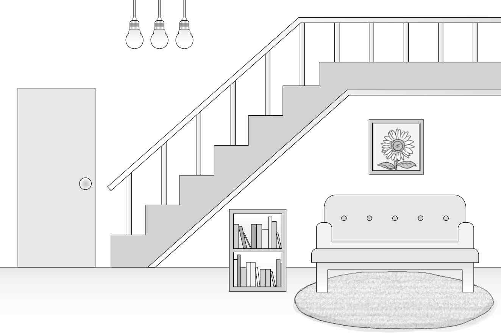
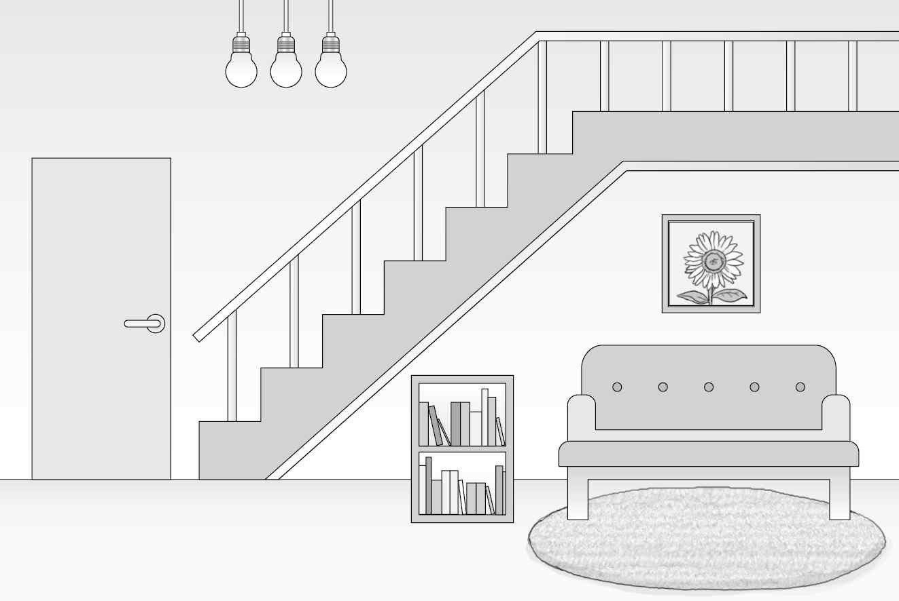
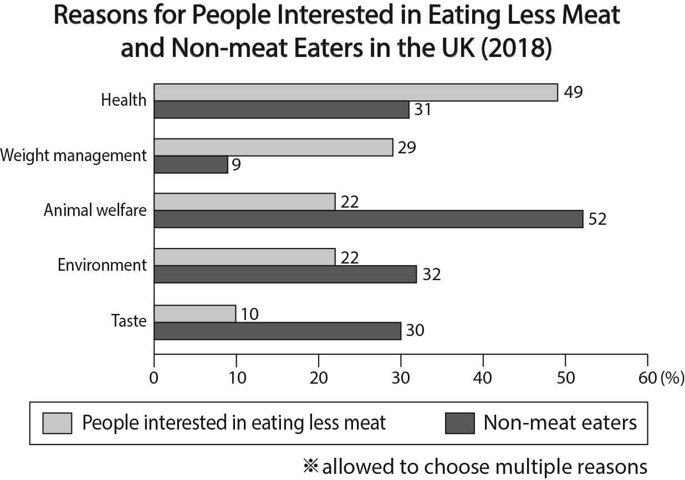
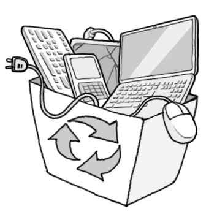
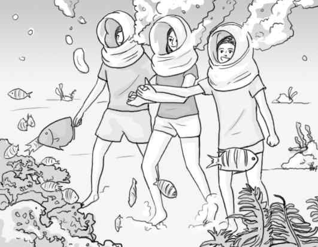

1. 다음을 듣고, 남자가 하는 말의 목적으로 가장 적절한 것을 고르시오.

① 얼음으로 덮인 일부 등산로 폐쇄를 공지하려고
② 등산객에게 야간 산행의 위험성을 경고하려고
③ 겨울 산행을 위한 안전 장비를 안내하려고
④ 긴급 제설에 필요한 작업자를 모집하려고
⑤ 일출 명소인 전망대를 소개하려고

2. 대화를 듣고, 남자의 의견으로 가장 적절한 것을 고르시오.

① 조리법을 있는 그대로 따를 필요는 없다.
② 요리 도구를 정기적으로 소독해야 한다.
③ 설탕 섭취는 단기 기억력을 향상시킨다.
④ 열량이 높은 음식은 건강에 좋지 않다.
⑤ 신선한 재료는 요리의 풍미를 높인다.

3. 대화를 듣고, 두 사람의 관계를 가장 잘 나타낸 것을 고르시오.

① 음악 평론가 – 방송 연출가
② 작곡가 – 게임 제작자
③ 독자 – 웹툰 작가
④ 삽화가 – 소설가
⑤ 영화감독 – 배우

4. 대화를 듣고, 그림에서 대화의 내용과 일치하지 않는 것을 고르시오.

5. 대화를 듣고, 남자가 할 일로 가장 적절한 것을 고르시오.

① 음료 구매하기
② 연필 준비하기
③ 의자 설치하기
④ 마이크 점검하기
⑤ 스케치북 가져오기

6. 대화를 듣고, 여자가 지불할 금액을 고르시오. [3점]

① $17
② $22
③ $35
④ $37
⑤ $39

7. 대화를 듣고, 남자가 얼음낚시를 갈 수 없는 이유를 고르시오.

① 손목을 다쳐서
② 병원에 입원해야 해서
③ 직장에 출근해야 해서
④ 기상 여건이 나빠져서
⑤ 친구와 농구를 해야 해서

8. 대화를 듣고, Kids’ Pottery Class에 관해 언급되지 않은 것을 고르시오.

① 날짜
② 장소
③ 수강 인원
④ 수강료
⑤ 등록 방법

9. 2022 Online Whistling Championship에 관한 다음 내용을 듣고, 일치하지 않는 것을 고르시오.

① 좋아하는 어떤 노래든 선택할 수 있다.
② 12월 4일까지 동영상을 업로드해야 한다.
③ 녹음 시 마이크의 에코 효과를 반드시 꺼야 한다.
④ 운영진의 심사에 의해 수상자들이 결정될 것이다.
⑤ 결과는 웹사이트에 발표될 것이다.

10. 다음 표를 보면서 대화를 듣고, 두 사람이 선택할 커튼을 고르시오.

Curtains

|  | Product | Price | Care Instruction | Blackout | Color |
| --- | --- | --- | --- | --- | --- |
| ① | A | $70 | machine washable | X | navy |
| ② | B | $80 | machine washable | O | brown |
| ③ | C | $90 | dry cleaning only | O | ivory |
| ④ | D | $95 | machine washable | O | gray |
| ⑤ | E | $110 | dry cleaning only | X | white |

11. 대화를 듣고, 남자의 마지막 말에 대한 여자의 응답으로 가장 적절한 것을 고르시오.

① I’ve been waiting for 30 minutes.
② I’ve enjoyed this ride very much.
③ You’re standing in the correct line.
④ I have enough time to wait for you.
⑤ You may end the construction in a year.

12. 대화를 듣고, 여자의 마지막 말에 대한 남자의 응답으로 가장 적절한 것을 고르시오.

① No way. I don’t know who’s lost.
② Okay. Let’s see if he needs our help.
③ Exactly. Just stop crying like a child.
④ Sure. He loves walking around the park.
⑤ Thanks. We were worried about our son.

13. 대화를 듣고, 남자의 마지막 말에 대한 여자의 응답으로 가장 적절한 것을 고르시오. [3점]

Woman:

① Great. I believe my previous offer will benefit your company.
② I’m sorry. Your interview has been delayed to next Wednesday.
③ Good. Your effort will give a good impression on the interviewer.
④ Excellent. The second candidate’s work experience caught my eye.
⑤ No worries. You can purchase nice clothes for the upcoming party.

14. 대화를 듣고, 여자의 마지막 말에 대한 남자의 응답으로 가장 적절한 것을 고르시오.

Man:

① Please wait. I’ll be back with the shoes in a minute.
② Hurry up. You don’t have enough time to do this.
③ Of course. You can get a refund for these shoes.
④ Don’t worry. The color doesn’t matter to me.
⑤ Sorry. The red ones are already sold out.

15. 다음 상황 설명을 듣고, Amelia가 Jacob 교수에게 할 말로 가장 적절한 것을 고르시오. [3점]

Amelia:

① Could you extend the deadline for the assignment?
② Would it be possible to change our appointment?
③ Why don’t you join my final psychology project?
④ Do you want to meet at the information center?
⑤ How about visiting the doctor for a checkup?

16. 여자가 하는 말의 주제로 가장 적절한 것은?

① ways to stop the spread of false information
② methods of delivering messages in the past
③ modes of communication in modern times
④ types of speeches according to purposes
⑤ means to survive in prehistoric times

17. 언급된 수단이 아닌 것은?

따라 답을 하시기 바랍니다.

① drum
② smoke
③ pigeon
④ flag
⑤ horse

18. 다음 글의 목적으로 가장 적절한 것은?

Dear Mr. Krull, I have greatly enjoyed working at Trincom Enterprises as a sales manager. Since I joined in 2015, I have been a loyal and essential member of this company, and have developed innovative ways to contribute to the company. Moreover, in the last year alone, I have brought in two new major clients to the company, increasing the company’s total sales by 5%. Also, I have ​voluntarily trained 5 new members of staff, totaling 35 hours. I would therefore request your consideration in raising my salary, which I believe reflects my performance as well as the industry average. I look forward to speaking with you soon. Kimberly Morss

19. 다음 글에 드러난 ‘I’의 심경 변화로 가장 적절한 것은?

On one beautiful spring day, I was fully enjoying my day off. I arrived at the nail salon, and muted my cellphone so that I would be disconnected for the hour and feel calm and peaceful. I was so comfortable while I got a manicure. As I left the place, I checked my cellphone and saw four missed calls from a strange number. I knew immediately that something bad was coming, and I called back. A young woman answered and said that my father had fallen over a stone and was injured, now seated on a bench. I was really concerned since he had just recovered from his knee surgery. I rushed getting into my car to go see him.

20. 다음 글에서 필자가 주장하는 바로 가장 적절한 것은?

You already have a business and you’re about to launch your blog so that you can sell your product. Unfortunately, here is where a ‘business mind’ can be a bad thing. Most people believe that to have a successful business blog promoting a product, they have to stay strictly ‘on the topic.’ If all you’re doing is shamelessly promoting your product, then who is going to want to read the latest thing you’re writing about? Instead, you need to give some useful or entertaining information away for free so that people have a reason to keep coming back. Only by doing this can you create an interested audience that you will then be able to sell to. So, the best way to be successful with a business blog is to write about things that your audience will be interested in.

21. 밑줄 친 challenge this sacred cow가 다음 글에서 의미하는 바로 가장 적절한 것은? [3점]

Our language helps to reveal our deeper assumptions. Think of these revealing phrases: When we accomplish something important, we say it took “blood, sweat, and tears.” We say important achievements are “hard-earned.” We recommend a “hard day’s work” when “day’s work” would be enough. When we talk of “easy money,” we are implying it was obtained through illegal or questionable means. We use the phrase “That’s easy for you to say” as a criticism, usually when we are seeking to invalidate someone’s opinion. It’s like we all automatically accept that the “right” way is, inevitably, the harder one. In my experience this is hardly ever questioned. What would happen if you do challenge this sacred cow? We don’t even pause to consider that something important and valuable could be made easy. What if the biggest thing keeping us from doing what matters is the false assumption that it has to take huge effort?

22. 다음 글의 요지로 가장 적절한 것은?

The old saying is that “knowledge is power,” but when it comes to scary, threatening news, research suggests the exact opposite. Frightening news can actually rob people of their inner sense of control, making them less likely to take care of themselves and other people. Public health research shows that when the news presents health-related information in a pessimistic way, people are actually less likely to take steps to protect themselves from illness as a result. A news article that’s intended to warn people about increasing cancer rates, for example, can result in fewer people choosing to get screened for the disease because they’re so terrified of what they might find. This is also true for issues such as climate change. When a news story is all doom and gloom, people feel depressed and become less interested in taking small, personal steps to fight ecological collapse.

23. 다음 글의 주제로 가장 적절한 것은?

The most remarkable and unbelievable consequence of melting ice and rising seas is that together they are a kind of time machine, so real that they are altering the duration of our day. It works like this: As the glaciers melt and the seas rise, gravity forces more water toward the equator. This changes the shape of the Earth ever so slightly, making it fatter around the middle, which in turns slows the rotation of the planet similarly to the way a ballet dancer slows her spin by spreading out her arms. The slowdown isn’t much, just a few thousandths of a second each year, but like the barely noticeable jump of rising seas every year, it adds up. When dinosaurs lived on the Earth, a day lasted only about twenty-three hours.

24. 다음 글의 제목으로 가장 적절한 것은?

Have you ever brought up an idea or suggestion to someone and heard them immediately say “No, that won’t work.”? You may have thought, “He/she didn’t even give it a chance. How do they know it won’t work?” When you are right about something, you close off the possibility of another viewpoint or opportunity. Being right about something means that “it is the way it is, period.” You may be correct. Your particular way of seeing it may be true with the facts. However, considering the other option or the other person’s point of view can be beneficial. If you see their side, you will see something new or, at worse, learn something about how the other person looks at life. Why would you think everyone sees and experiences life the way you do? Besides how boring that would be, it would eliminate all new opportunities, ideas, invention, and creativity.

25. 다음 도표의 내용과 일치하지 않는 것은?

Reasons for People Interested in Eating Less Meat and Non-meat Eaters in the UK (2018)

| Reason | People Interested in Eating Less Meat | Non-meat Eaters |
| --- | --- | --- |
| Health | 49% | 31% |
| Weight management | 29% | 9% |
| Animal welfare | 22% | 52% |
| Environment | 22% | 32% |
| Taste | 10% | 30% |

26. Margaret Knight에 관한 다음 글의 내용과 일치하지 않는 것은?

Margaret Knight was an exceptionally prolific inventor in the late 19th century; journalists occasionally compared her to Thomas Edison by nicknaming her “a woman Edison.” From a young age, she built toys for her older brothers. After her father died, Knight’s family moved to Manchester. Knight left school in 1850, at age 12, to earn money for her family at a nearby textile factory, where she witnessed a fellow worker injured by faulty equipment. That led her to create her first invention, a safety device for textile equipment, but she never earned money from the invention. She also invented a machine that cut, folded and glued flat-bottomed paper bags and was awarded her first patent in 1871 for it. It eliminated the need for workers to assemble them slowly by hand. Knight received 27 patents in her lifetime and entered the National Inventors Hall of Fame in 2006.

27. E-Waste Recycling Day에 관한 다음 안내문의 내용과 일치하지 않는 것은?

E-Waste Recycling Day

E-Waste Recycling Day is an annual event in our city. Bring your used electronics such as cell phones, tablets, and laptops to recycle. Go green! When Saturday, December 17, 2022 8:00 a.m. - 11:00 a.m. Where Lincoln Sports Center Notes
Items NOT accepted: light bulbs, batteries, and microwaves
All personal data on the devices must be wiped out in advance.
This event is free but open only to local residents. Please contact us at 986-571-0204 for more information.

28. Undersea Walking Activity에 관한 다음 안내문의 내용과 일치하는 것은?

Undersea Walking Activity

Enjoy a fascinating underwater walk on the ocean floor. Witness wonderful marine life on foot! Age Requirement 10 years or older Operating Hours from Tuesday to Sunday 9:00 a.m. - 4:00 p.m. Price $30 (insurance fee included) What to Bring swim suit and towel Notes
Experienced lifeguards accompany you throughout the activity.
With a special underwater helmet, you can wear glasses during the activity.
Reservations can be made on-site or online at www.seawalkwonder.com.

29. 다음 글의 밑줄 친 부분 중, 어법상 틀린 것은? [3점]

You may have seen headlines in the news about some of the things machines powered by artificial intelligence can do. However, if you were to consider all the tasks that AI-powered machines could actually perform, it would be quite mind-blowing! One of the key features of artificial intelligence is that it enables machines to learn new things, rather than requiring programming specific to new tasks. Therefore, the core difference between computers of the future and those of the past is that future computers will be able to learn and self-improve. In the near future, smart virtual assistants will know more about you than your closest friends and family members are. Can you imagine how that might change our lives? These kinds of changes are exactly why it is so important to recognize the implications that new technologies will have for our world.

30. 다음 글의 밑줄 친 부분 중, 문맥상 낱말의 쓰임이 적절하지 않은 것은? [3점]

Plant growth is controlled by a group of hormones called auxins found at the tips of stems and roots of plants. Auxins produced at the tips of stems tend to accumulate on the side of the stem that is in the shade. Accordingly, the auxins stimulate growth on the shaded side of the plant. Therefore, the shaded side grows faster than the side facing the sunlight. This phenomenon causes the stem to bend and appear to be growing towards the light. Auxins have the opposite effect on the roots of plants. Auxins in the tips of roots tend to limit growth. If a root is horizontal in the soil, the auxins will accumulate on the lower side and interfere with its development. Therefore, the lower side of the root will grow faster than the upper side. This will, in turn, cause the root to bend downwards, with the tip of the root growing in that direction.

31. 다음 빈칸에 들어갈 말로 가장 적절한 것을 고르시오.

To demonstrate how best to defeat the habit of delaying, Dan Ariely, a professor of psychology and behavioral economics, performed an experiment on students in three of his classes at MIT. He assigned all classes three reports over the course of the semester. The first class had to choose three due dates for themselves, up to and including the last day of class. The second had no deadlines — all three papers just had to be submitted by the last day of class. In his third class, he gave students three set deadlines over the course of the semester. At the end of the semester, he found that students with set deadlines received the best grades, the students with no deadlines had the worst, and those who could choose their own deadlines fell somewhere in the middle. Ariely concludes that restricting freedom — whether by the professor or by students who recognize their own tendencies to delay things — improves self-control and performance.

32. 다음 빈칸에 들어갈 말로 가장 적절한 것을 고르시오. [3점]

The best way in which innovation changes our lives is by enabling people to work for each other. The main theme of human history is that we become steadily more specialized in what we produce, and steadily more diversified in what we consume: we move away from unstable self-sufficiency to safer mutual interdependence. By concentrating on serving other people’s needs for forty hours a week — which we call a job — you can spend the other seventy-two hours (not counting fifty-six hours in bed) relying on the services provided to you by other people. Innovation has made it possible to work for a fraction of a second in order to be able to afford to turn on an electric lamp for an hour, providing the quantity of light that would have required a whole day’s work if you had to make it yourself by collecting and refining sesame oil or lamb fat to burn in a simple lamp, as much of humanity did in the not so distant past.

33. 다음 빈칸에 들어갈 말로 가장 적절한 것을 고르시오.

If you’ve ever made a poor choice, you might be interested in learning how to break that habit. One great way to trick your brain into doing so is to sign a “Ulysses Contract.” The name of this life tip comes from the Greek myth about Ulysses, a captain whose ship sailed past the island of the Sirens, a tribe of dangerous women who lured victims to their death with their irresistible songs. Knowing that he would otherwise be unable to resist, Ulysses instructed his crew to stuff their ears with cotton and tie him to the ship’s mast to prevent him from turning their ship towards the Sirens. It worked for him and you can do the same thing by locking yourself out of your temptations. For example, if you want to stay off your cellphone and concentrate on your work, delete the apps that distract you or ask a friend to change your password!

34. 다음 빈칸에 들어갈 말로 가장 적절한 것을 고르시오. [3점]

Our homes aren’t just ecosystems, they’re unique ones, hosting species that are adapted to indoor environments and pushing evolution in new directions. Indoor microbes, insects, and rats have all evolved the ability to survive our chemical attacks, developing resistance to antibacterials, insecticides, and poisons. German cockroaches are known to have developed a distaste for glucose, which is commonly used as bait in roach traps. Some indoor insects, which have fewer opportunities to feed than their outdoor counterparts, seem to have developed the ability to survive when food is limited. Dunn and other ecologists have suggested that as the planet becomes more developed and more urban, more species will evolve the traits they need to thrive indoors. Over a long enough time period, indoor living could drive our evolution, too. Perhaps my indoorsy self represents the future of humanity.

35. 다음 글에서 전체 흐름과 관계 없는 문장은?

Developing a personal engagement with poetry brings a number of benefits to you as an individual, in both a personal and a professional capacity.

36. 주어진 글 다음에 이어질 글의 순서로 가장 적절한 것을 고르시오.

Things are changing. It has been reported that 42 percent of jobs in Canada are at risk, and 62 percent of jobs in America will be in danger due to advances in automation. You might say that the numbers seem a bit unrealistic, but the threat is real. One fast food franchise has a robot that can flip a burger in ten seconds. It is just a simple task but the robot could replace an entire crew. Highly skilled jobs are also at risk. A supercomputer, for instance, can suggest available treatments for specific illnesses in an automated way, drawing on the body of medical research and data on diseases. However, what’s difficult to automate is the ability to creatively solve problems. Whereas workers in “doing” roles can be replaced by robots, the role of creatively solving problems is more dependent on an irreplaceable individual.

37. 주어진 글 다음에 이어질 글의 순서로 가장 적절한 것을 고르시오. [3점]

Each beech tree grows in a particular location and soil conditions can vary greatly in just a few yards. The soil can have a great deal of water or almost no water. It can be full of nutrients or not. Accordingly, each tree grows more quickly or more slowly and produces more or less sugar, and thus you would expect every tree to be photosynthesizing at a different rate. However, the rate is the same. Whether they are thick or thin, all the trees of the same species are using light to produce the same amount of sugar per leaf. Some trees have plenty of sugar and some have less, but the trees equalize this difference between them by transferring sugar. This is taking place underground through the roots. Whoever has an abundance of sugar hands some over; whoever is running short gets help. Their network acts as a system to make sure that no trees fall too far behind.

38. 글의 흐름으로 보아, 주어진 문장이 들어가기에 가장 적절한 곳을 고르시오. [3점]

Should we use language to understand mind or mind to understand language? Analytic philosophy historically assumes that language is basic and that mind would make sense if proper use of language was appreciated. Modern cognitive science, however, rightly judges that language is just one aspect of mind of great importance in human beings but not fundamental to all kinds of thinking. Countless species of animals manage to navigate the world, solve problems, and learn without using language, through brain mechanisms that are largely preserved in the minds of humans. There is no reason to assume that language is fundamental to mental operations. Nevertheless, language is enormously important in human life and contributes largely to our ability to cooperate with each other in dealing with the world. Our species homo sapiens has been astonishingly successful, which depended in part on language, first as an effective contributor to collaborative problem solving and much later, as collective memory through written records.

39. 글의 흐름으로 보아, 주어진 문장이 들어가기에 가장 적절한 곳을 고르시오.

Take two glasses of water. Put a little bit of orange juice into one and a little bit of lemon juice into the other. What you have are essentially two glasses of water but with a completely different chemical makeup. If we take the glass containing orange juice and heat it, we will still have two different glasses of water with different chemical makeups, but now they will also have different temperatures. If we could magically remove the glasses, we would find the two water bodies would not mix well. Perhaps they would mix a little where they met; however, they would remain separate because of their different chemical makeups and temperatures. The warmer water would float on the surface of the cold water because of its lighter weight. In the ocean we have bodies of water that differ in temperature and salt content; for this reason, they do not mix.

40. 다음 글의 내용을 한 문장으로 요약하고자 한다. 빈칸 (A), (B)에 들어갈 말로 가장 적절한 것은?

One of the most powerful tools to find meaning in our lives is reflective journaling — thinking back on and writing about what has happened to us. In the 1990s, Stanford University researchers asked undergraduate students on spring break to journal about their most important personal values and their daily activities; others were asked to write about only the good things that happened to them in the day. Three weeks later, the students who had written about their values were happier, healthier, and more confident about their ability to handle stress than the ones who had only focused on the good stuff. By reflecting on how their daily activities supported their values, students had gained a new perspective on those activities and choices. Little stresses and hassles were now demonstrations of their values in action. Suddenly, their lives were full of meaningful activities. And all they had to do was reflect and write about it ― positively reframing their experiences with their personal values. 

Journaling about daily activities based on what we believe to be worthwhile can make us feel that our life is meaningful by rethinking our experiences in a new way.

41. 윗글의 제목으로 가장 적절한 것은?

Mike May lost his sight at the age of three. Because he had spent the majority of his life adapting to being blind — and even cultivating a skiing career in this state — his other senses compensated by growing stronger. However, when his sight was restored through a surgery in his forties, his entire perception of reality was disrupted. Instead of being thrilled that he could see now, as he’d expected, his brain was so overloaded with new visual stimuli that the world became a frightening and overwhelming place. After he’d learned to know his family through touch and smell, he found that he couldn’t recognize his children with his eyes, and this left him puzzled. Skiing also became a lot harder as he struggled to adapt to the visual stimulation. This confusion occurred because his brain hadn’t yet learned to see. Though we often tend to assume our eyes function as video cameras which relay information to our brain, advances in neuroscientific research have proven that this is actually not the case. Instead, sight is a collaborative effort between our eyes and our brains, and the way we process visual reality depends on the way these two communicate. If communication between our eyes and our brains is disturbed, our perception of reality is altered accordingly. And because other areas of May’s brain had adapted to process information primarily through his other senses, the process of learning how to see was easier than he’d anticipated.

42. 밑줄 친 낱말 중에서 문맥상 낱말의 쓰임이 적절하지 않은 것은?

Mike May lost his sight at the age of three. Because he had spent the majority of his life adapting to being blind — and even cultivating a skiing career in this state — his other senses compensated by growing stronger. However, when his sight was restored through a surgery in his forties, his entire perception of reality was disrupted. Instead of being thrilled that he could see now, as he’d expected, his brain was so overloaded with new visual stimuli that the world became a frightening and overwhelming place. After he’d learned to know his family through touch and smell, he found that he couldn’t recognize his children with his eyes, and this left him puzzled. Skiing also became a lot harder as he struggled to adapt to the visual stimulation. This confusion occurred because his brain hadn’t yet learned to see. Though we often tend to assume our eyes function as video cameras which relay information to our brain, advances in neuroscientific research have proven that this is actually not the case. Instead, sight is a collaborative effort between our eyes and our brains, and the way we process visual reality depends on the way these two communicate. If communication between our eyes and our brains is disturbed, our perception of reality is altered accordingly. And because other areas of May’s brain had adapted to process information primarily through his other senses, the process of learning how to see was easier than he’d anticipated.

43. 주어진 글에 이어질 내용을 순서에 맞게 배열한 것으로 가장 적절한 것은?

 The server mentioned during the conversation that her daughter was in the hospital with a broken leg. She also said that Marie looked about the same age as her daughter. She was so kind and attentive all evening, and even gave Marie cookies for free. After we finished our meal, we paid the bill and began to walk to our car when unexpectedly Marie asked me to wait and ran back into the restaurant. When Marie came back out, I asked her what she had been doing. She said that she gave her teddy bear to our server so that she could give it to her daughter. I was surprised at her sudden action because I could see how much she loved that bear already. She must have seen the look on my face, because she said, “I can’t imagine being stuck in a hospital bed. I just want her to get better soon.” I felt moved by Marie’s words as we walked toward the car. Then, our server ran out to our car and thanked Marie for her generosity. The server said that she had never had anyone doing anything like that for her family before. Later, Marie said it was her best birthday ever. I was so proud of her empathy and warmth, and this was an unforgettable experience for our family. 

44. 밑줄 친 낱말 중에서 가리키는 대상이 나머지 넷과 다른 것은?

 The server mentioned during the conversation that her daughter was in the hospital with a broken leg. She also said that Marie looked about the same age as her daughter. She was so kind and attentive all evening, and even gave Marie cookies for free. After we finished our meal, we paid the bill and began to walk to our car when unexpectedly Marie asked me to wait and ran back into the restaurant. When Marie came back out, I asked her what she had been doing. She said that she gave her teddy bear to our server so that she could give it to her daughter. I was surprised at her sudden action because I could see how much she loved that bear already. She must have seen the look on my face, because she said, “I can’t imagine being stuck in a hospital bed. I just want her to get better soon.” I felt moved by Marie’s words as we walked toward the car. Then, our server ran out to our car and thanked Marie for her generosity. The server said that she had never had anyone doing anything like that for her family before. Later, Marie said it was her best birthday ever. I was so proud of her empathy and warmth, and this was an unforgettable experience for our family. 

45. 윗글에 관한 내용으로 적절하지 않은 것은?

 The server mentioned during the conversation that her daughter was in the hospital with a broken leg. She also said that Marie looked about the same age as her daughter. She was so kind and attentive all evening, and even gave Marie cookies for free. After we finished our meal, we paid the bill and began to walk to our car when unexpectedly Marie asked me to wait and ran back into the restaurant. When Marie came back out, I asked her what she had been doing. She said that she gave her teddy bear to our server so that she could give it to her daughter. I was surprised at her sudden action because I could see how much she loved that bear already. She must have seen the look on my face, because she said, “I can’t imagine being stuck in a hospital bed. I just want her to get better soon.” I felt moved by Marie’s words as we walked toward the car. Then, our server ran out to our car and thanked Marie for her generosity. The server said that she had never had anyone doing anything like that for her family before. Later, Marie said it was her best birthday ever. I was so proud of her empathy and warmth, and this was an unforgettable experience for our family.
