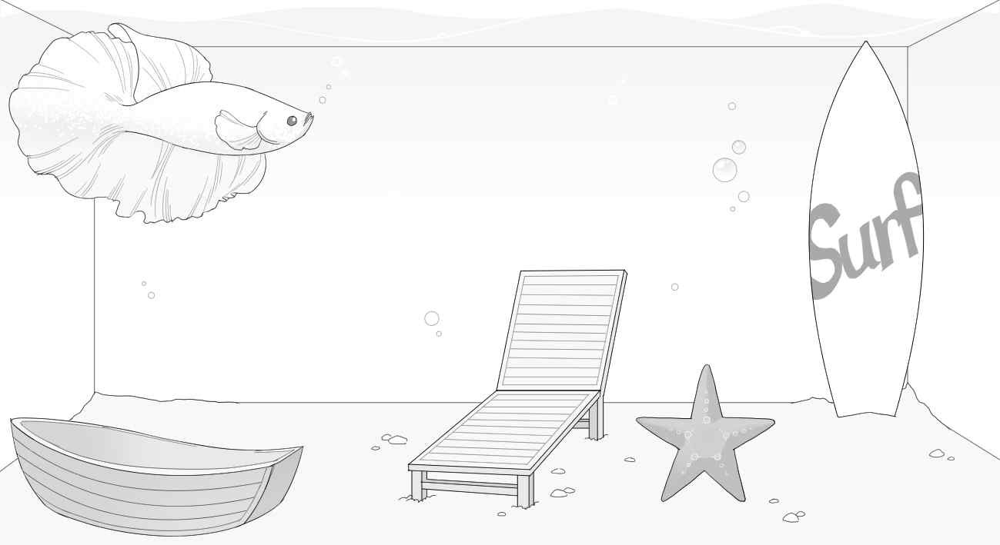
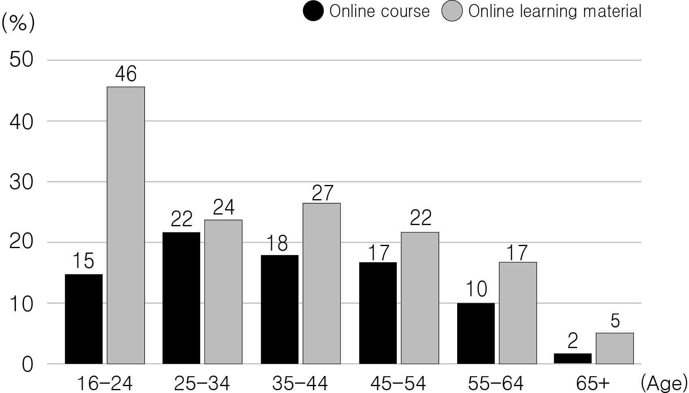
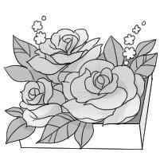
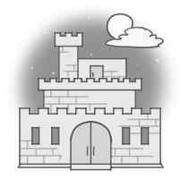
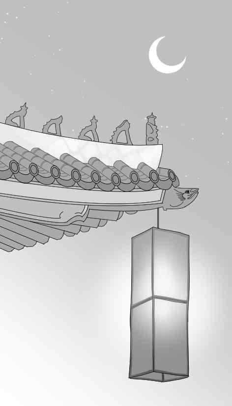

1. 다음을 듣고, 남자가 하는 말의 목적으로 가장 적절한 것을 고르시오.
① 농구 리그 참가 등록 방법의 변경을 알리려고
② 확정된 농구 리그 시합 일정을 발표하려고
③ 농구 리그의 심판을 추가 모집하려고
④ 농구 리그 경기 관람을 권장하려고
⑤ 농구 리그 우승 상품을 안내하려고

2. 대화를 듣고, 여자의 의견으로 가장 적절한 것을 고르시오.

① 평소에 피부 상태를 잘 관찰할 필요가 있다.
② 여드름을 치료하려면 피부과 병원에 가야 한다.
③ 얼굴을 손으로 만지는 것은 얼굴 피부에 해롭다.
④ 지성 피부를 가진 사람은 자주 세수를 해야 한다.
⑤ 손을 자주 씻는 것은 감염병 예방에 도움이 된다.

3. 대화를 듣고, 두 사람의 관계를 가장 잘 나타낸 것을 고르시오.

① 방송 작가 - 연출자
② 만화가 - 환경 운동가
③ 촬영 감독 - 동화 작가
④ 토크쇼 진행자 - 기후학자
⑤ 제품 디자이너 - 영업 사원

4. 대화를 듣고, 그림에서 대화의 내용과 일치하지 않는 것을 고르시오.

5. 대화를 듣고, 여자가 남자에게 부탁한 일로 가장 적절한 것을 고르시오.

① 장난감 사 오기
② 풍선 달기
③ 케이크 가져오기
④ 탁자 옮기기
⑤ 아이들 데려오기

6. 대화를 듣고, 남자가 지불할 금액을 고르시오. [3점]

① $14
② $16
③ $18
④ $20
⑤ $22

7. 대화를 듣고, 두 사람이 오늘 실험을 할 수 없는 이유를 고르시오.
① 실험용 키트가 배달되지 않아서
② 실험 주제를 변경해야 해서
③ 과학실을 예약하지 못해서
④ 보고서를 작성해야 해서
⑤ 남자가 감기에 걸려서

8. 대화를 듣고, Stanville Free-cycle에 관해 언급되지 않은 것을 고르시오.

① 참가 대상
② 행사 장소
③ 주차 가능 여부
④ 행사 시작일
⑤ 금지 품목

9. River Valley Music Camp에 관한 다음 내용을 듣고, 일치하지 않는 것을 고르시오.

① 4월 11일부터 5일 동안 진행된다.
② 학교 오케스트라 단원이 아니어도 참가할 수 있다.
③ 자신의 악기를 가져오거나 학교에서 빌릴 수 있다.
④ 마지막 날에 공연을 촬영한다.
⑤ 참가 인원에는 제한이 없다.

10. 다음 표를 보면서 대화를 듣고, 여자가 주문할 소형 진공청소기를 고르시오.

Handheld Vacuum Cleaners

|  | Model | Price | Working Time | Weight | Washable Filter |
| --- | --- | --- | --- | --- | --- |
| ① | A | $50 | 8 minutes | 2.5 kg | × |
| ② | B | $80 | 12 minutes | 2.0 kg | ○ |
| ③ | C | $100 | 15 minutes | 1.8 kg | ○ |
| ④ | D | $120 | 20 minutes | 1.8 kg | × |
| ⑤ | E | $150 | 25 minutes | 1.6 kg | ○ |

11. 대화를 듣고, 남자의 마지막 말에 대한 여자의 응답으로 가장 적절한 것을 고르시오.

① Why don’t you rinse your eyes with clean water?
② Can you explain more about the air pollution?
③ I need to get myself a new pair of glasses.
④ I agree that fine dust is a serious problem.
⑤ We should go outside and take a walk.

12. 대화를 듣고, 여자의 마지막 말에 대한 남자의 응답으로 가장 적절한 것을 고르시오.

① That’s not fair. I booked this seat first.
② Thank you. My friend will be glad to know it.
③ You’re welcome. Feel free to ask me anything.
④ Not at all. I don’t mind changing seats with you.
⑤ That’s okay. I think the seat next to it is available.

13. 대화를 듣고, 남자의 마지막 말에 대한 여자의 응답으로 가장 적절한 것을 고르시오.

Woman:
① Smells good. Can I try the pizza?
② Great. I’ll bring chips and popcorn.
③ No problem. I’ll cancel the tickets.
④ Sorry. I don’t like watching baseball.
⑤ Sure. Here’s the hammer I borrowed.

14. 대화를 듣고, 여자의 마지막 말에 대한 남자의 응답으로 가장 적절한 것을 고르시오. [3점]

Man:
① Exactly. This is a best-selling novel.
② Sounds cool. I’ll join a book club, too.
③ Not really. Books make good presents.
④ New year’s resolutions are hard to keep.
⑤ Let’s buy some books for your book club.

15. 다음 상황 설명을 듣고, Brian이 Sally에게 할 말로 가장 적절한 것을 고르시오. [3점]

Brian:
① You shouldn’t touch a guide dog without permission.
② The dog would be happy if we give it some food.
③ I’m sure it’s smart enough to be a guide dog.
④ I suggest that you walk your dog every day.
⑤ I’m afraid that dogs are not allowed in here.

16. 여자가 하는 말의 주제로 가장 적절한 것은?

① activities that help build muscles
② ways to control stress in daily life
③ types of joint problems in elderly people
④ low-impact exercises for people with bad joints
⑤ importance of daily exercise for controlling weight

17. 언급된 운동이 아닌 것은?

① swimming
② cycling
③ horseback riding
④ bowling
⑤ walking

18. 다음 글의 목적으로 가장 적절한 것은?

Dear Ms. Robinson, The Warblers Choir is happy to announce that we are invited to compete in the International Young Choir Competition. The competition takes place in London on May 20. Though we wish to participate in the event, we do not have the necessary funds to travel to London. So we are kindly asking you to support us by coming to our fundraising concert. It will be held on March 26. In this concert, we shall be able to show you how big our passion for music is. Thank you in advance for your kind support and help. Sincerely, Arnold Reynolds

19. 다음 글에 드러난 Zoe의 심경 변화로 가장 적절한 것은?

The principal stepped on stage. “Now, I present this year’s top academic award to the student who has achieved the highest placing.” He smiled at the row of seats where twelve finalists had gathered. Zoe wiped a sweaty hand on her handkerchief and glanced at the other finalists. They all looked as pale and uneasy as herself. Zoe and one of the other finalists had won first placing in four subjects so it came down to how teachers ranked their hard work and confidence. “The Trophy for General Excellence is awarded to Miss Zoe Perry,” the principal declared. “Could Zoe step this way, please?” Zoe felt as if she were in heaven. She walked into the thunder of applause with a big smile.

20. 다음 글에서 필자가 주장하는 바로 가장 적절한 것은?

When I was in the army, my instructors would show up in my barracks room, and the first thing they would inspect was our bed. It was a simple task, but every morning we were required to make our bed to perfection. It seemed a little ridiculous at the time, but the wisdom of this simple act has been proven to me many times over. If you make your bed every morning, you will have accomplished the first task of the day. It will give you a small sense of pride and it will encourage you to do another task and another. By the end of the day, that one task completed will have turned into many tasks completed. If you can’t do little things right, you will never do the big things right.

21. 밑줄 친 Leave those activities to the rest of the sheep이 다음 글에서 의미하는 바로 가장 적절한 것은? [3점]

A job search is not a passive task. When you are searching, you are not browsing, nor are you “just looking”. Browsing is not an effective way to reach a goal you claim to want to reach. If you are acting with purpose, if you are serious about anything you chose to do, then you need to be direct, focused and whenever possible, clever. Everyone else searching for a job has the same goal, competing for the same jobs. You must do more than the rest of the herd. Regardless of how long it may take you to find and get the job you want, being proactive will logically get you results faster than if you rely only on browsing online job boards and emailing an occasional resume. Leave those activities to the rest of the sheep.

22. 다음 글의 요지로 가장 적절한 것은?

Many people view sleep as merely a “down time” when their brain shuts off and their body rests. In a rush to meet work, school, family, or household responsibilities, people cut back on their sleep, thinking it won’t be a problem, because all of these other activities seem much more important. But research reveals that a number of vital tasks carried out during sleep help to maintain good health and enable people to function at their best. While you sleep, your brain is hard at work forming the pathways necessary for learning and creating memories and new insights. Without enough sleep, you can’t focus and pay attention or respond quickly. A lack of sleep may even cause mood problems. In addition, growing evidence shows that a continuous lack of sleep increases the risk for developing serious diseases.

23. 다음 글의 주제로 가장 적절한 것은? [3점]

The whole of human society operates on knowing the future weather. For example, farmers in India know when the monsoon rains will come next year and so they know when to plant the crops. Farmers in Indonesia know there are two monsoon rains each year, so next year they can have two harvests. This is based on their knowledge of the past, as the monsoons have always come at about the same time each year in living memory. But the need to predict goes deeper than this; it influences every part of our lives. Our houses, roads, railways, airports, offices, and so on are all designed for the local climate. For example, in England all the houses have central heating, as the outside temperature is usually below 20°C, but no air-conditioning, as temperatures rarely go beyond 26°C, while in Australia the opposite is true: most houses have air-conditioning but rarely central heating.

24. 다음 글의 제목으로 가장 적절한 것은?

Our ability to accurately recognize and label emotions is often referred to as emotional granularity. In the words of Harvard psychologist Susan David, “Learning to label emotions with a more nuanced vocabulary can be absolutely transformative.” David explains that if we don’t have a rich emotional vocabulary, it is difficult to communicate our needs and to get the support that we need from others. But those who are able to distinguish between a range of various emotions “do much, much better at managing the ups and downs of ordinary existence than those who see everything in black and white.” In fact, research shows that the process of labeling emotional experience is related to greater emotion regulation and psychosocial well-being.

25. 다음 도표의 내용과 일치하지 않는 것은?

Percentage of UK People Who Used Online Course and Online Learning Material (in 2020, by age group)

| Age Group | Online Course | Online Learning Material |
| --- | --- | --- |
| 16-24 | 15% | 46% |
| 25-34 | 22% | 24% |
| 35-44 | 18% | 27% |
| 45-54 | 17% | 22% |
| 55-64 | 10% | 17% |
| 65+ | 2% | 5% |

26. Antonie van Leeuwenhoek에 관한 다음 글의 내용과 일치하지 않는 것은?

Antonie van Leeuwenhoek was a scientist well known for his cell research. He was born in Delft, the Netherlands, on October 24, 1632. At the age of 16, he began to learn job skills in Amsterdam. At the age of 22, Leeuwenhoek returned to Delft. It wasn’t easy for Leeuwenhoek to become a scientist. He knew only one language — Dutch — which was quite unusual for scientists of his time. But his curiosity was endless, and he worked hard. He had an important skill. He knew how to make things out of glass. This skill came in handy when he made lenses for his simple microscope. He saw tiny veins with blood flowing through them. He also saw living bacteria in pond water. He paid close attention to the things he saw and wrote down his observations. Since he couldn’t draw well, he hired an artist to draw pictures of what he described.

27. Rachel’s Flower Class에 관한 다음 안내문의 내용과 일치하지 않는 것은?

Rachel’s Flower Class

Make Your Life More Beautiful! Class Schedule (Every Monday to Friday) Flower Arrangement 11 a.m. - 12 p.m. Flower Box Making 01 p.m. - 02 p.m. Price
$50 for each class (flowers and other materials included)
Bring your own scissors and a bag. Other Info.
You can sign up for classes either online or by phone.
No refund for cancellations on the day of your class To contact, visit www.rfclass.com or call 03-221-2131.

28. Nighttime Palace Tour에 관한 다음 안내문의 내용과 일치하는 것은?

Nighttime Palace Tour

Date: Friday, April 29 - Sunday, May 15 Time Friday 7 p.m. - 8:30 p.m. 6 p.m. - 7:30 p.m. Saturday & Sunday 8 p.m. - 9:30 p.m. Tickets & Booking
$15 per person (free for kids under 8)
Bookings will be accepted up to 2 hours before the tour starts. Program Activities
Group tour with a tour guide (1 hour)
Trying traditional foods and drinks (30 minutes)
You can try on traditional clothes with no extra charge.
For more information, please visit our website, www.palacenighttour.com.

29. 다음 글의 밑줄 친 부분 중, 어법상 틀린 것은?

We usually get along best with people who we think are like us. In fact, we seek them out. It’s why places like Little Italy, Chinatown, and Koreatown exist. But I’m not just talking about race, skin color, or religion. I’m talking about people who share our values and look at the world the same way we do. As the saying goes, birds of a feather flock together. This is a very common human tendency that is rooted in how our species developed. Imagine you are walking out in a forest. You would be conditioned to avoid something unfamiliar or foreign because there is a high likelihood that it would be interested in killing you. Similarities make us relate better to other people because we think they’ll understand us on a deeper level than other people.

30. 다음 글의 밑줄 친 부분 중, 문맥상 낱말의 쓰임이 적절하지 않은 것은? [3점]

Rejection is an everyday part of our lives, yet most people can’t handle it well. For many, it’s so painful that they’d rather not ask for something at all than ask and risk rejection. Yet, as the old saying goes, if you don’t ask, the answer is always no. Avoiding rejection negatively affects many aspects of your life. All of that happens only because you’re not tough enough to handle it. For this reason, consider rejection therapy. Come up with a request or an activity that usually results in a rejection. Working in sales is one such example. Asking for discounts at the stores will also work. By deliberately getting yourself rejected you’ll grow a thicker skin that will allow you to take on much more in life, thus making you more successful at dealing with unfavorable circumstances.

31. 다음 빈칸에 들어갈 말로 가장 적절한 것을 고르시오.

Generalization without specific examples that humanize writing is boring to the listener and to the reader. Who wants to read platitudes all day? Who wants to hear the words great, greater, best, smartest, finest, humanitarian, on and on and on without specific examples? Instead of using these ‘nothing words,’ leave them out completely and just describe the particulars. There is nothing worse than reading a scene in a novel in which a main character is described up front as heroic or brave or tragic or funny, while thereafter, the writer quickly moves on to something else. That’s no good, no good at all. You have to use less one word descriptions and more detailed, engaging descriptions if you want to make something real.

32. 다음 빈칸에 들어갈 말로 가장 적절한 것을 고르시오.

Face-to-face interaction is a uniquely powerful ― and sometimes the only ― way to share many kinds of knowledge, from the simplest to the most complex. It is one of the best ways to stimulate new thinking and ideas, too. Most of us would have had difficulty learning how to tie a shoelace only from pictures, or how to do arithmetic from a book. Psychologist Mihàly Csikszentmihàlyi found, while studying high achievers, that a large number of Nobel Prize winners were the students of previous winners: they had access to the same literature as everyone else, but personal contact made a crucial difference to their creativity. Within organisations this makes conversation both a crucial factor for high-level professional skills and the most important way of sharing everyday information.

33. 다음 빈칸에 들어갈 말로 가장 적절한 것을 고르시오. [3점]

Most times a foreign language is spoken in film, subtitles are used to translate the dialogue for the viewer. However, there are occasions when foreign dialogue is left unsubtitled (and thus incomprehensible to most of the target audience). This is often done if the movie is seen mainly from the viewpoint of a particular character who does not speak the language. Such absence of subtitles allows the audience to feel a similar sense of incomprehension and alienation that the character feels. An example of this is seen in Not Without My Daughter. The Persian language dialogue spoken by the Iranian characters is not subtitled because the main character Betty Mahmoody does not speak Persian and the audience is seeing the film from her viewpoint.

34. 다음 빈칸에 들어갈 말로 가장 적절한 것을 고르시오. [3점]

One dynamic that can change dramatically in sport is the concept of the home-field advantage, in which perceived demands and resources seem to play a role. Under normal circumstances, the home ground would appear to provide greater perceived resources (fans, home field, and so on). However, researchers Roy Baumeister and Andrew Steinhilber were among the first to point out that these competitive factors can change; for example, the success percentage for home teams in the final games of a playoff or World Series seems to drop. Fans can become part of the perceived demands rather than resources under those circumstances. This change in perception can also explain why a team that’s struggling at the start of the year will often welcome a road trip to reduce perceived demands and pressures.

35. 다음 글에서 전체 흐름과 관계 없는 문장은?

Who hasn’t used a cup of coffee to help themselves stay awake while studying? Mild stimulants commonly found in tea, coffee, or sodas possibly make you more attentive and, thus, better able to remember.

36. 주어진 글 다음에 이어질 글의 순서로 가장 적절한 것을 고르시오.

Toward the end of the 19th century, a new architectural attitude emerged. Industrial architecture, the argument went, was ugly and inhuman; past styles had more to do with pretension than what people needed in their homes. Instead of these approaches, why not look at the way ordinary country builders worked in the past? They developed their craft skills over generations, demonstrating mastery of both tools and materials. Those materials were local, and used with simplicity — houses built this way had plain wooden floors and whitewashed walls inside. But they supplied people’s needs perfectly and, at their best, had a beauty that came from the craftsman’s skill and the rootedness of the house in its locality.

37. 주어진 글 다음에 이어질 글의 순서로 가장 적절한 것을 고르시오. [3점]

Robert Schumann once said, “The laws of morals are those of art.” What the great man is saying here is that there is good music and bad music. The greatest music, even if it’s tragic in nature, takes us to a world higher than ours; somehow the beauty uplifts us. Bad music, on the other hand, degrades us. It’s the same with performances: a bad performance isn’t necessarily the result of incompetence. Some of the worst performances occur when the performers, no matter how accomplished, are thinking more of themselves than of the music they’re playing. These doubtful characters aren’t really listening to what the composer is saying — they’re just showing off, hoping that they’ll have a great ‘success’ with the public. The performer’s basic task is to try to understand the meaning of the music, and then to communicate it honestly to others.

38. 글의 흐름으로 보아, 주어진 문장이 들어가기에 가장 적절한 곳을 고르시오. [3점]

When an ecosystem is biodiverse, wildlife have more opportunities to obtain food and shelter. Different species react and respond to changes in their environment differently. For example, imagine a forest with only one type of plant in it, which is the only source of food and habitat for the entire forest food web. Now, there is a sudden dry season and this plant dies. Plant-eating animals completely lose their food source and die out, and so do the animals that prey upon them. But, when there is biodiversity, the effects of a sudden change are not so dramatic. Different species of plants respond to the drought differently, and many can survive a dry season. Many animals have a variety of food sources and don’t just rely on one plant; now our forest ecosystem is no longer at the death!

39. 글의 흐름으로 보아, 주어진 문장이 들어가기에 가장 적절한 곳을 고르시오.

We are connected to the night sky in many ways. It has always inspired people to wonder and to imagine. Since the dawn of civilization, our ancestors created myths and told legendary stories about the night sky. Elements of those narratives became embedded in the social and cultural identities of many generations. On a practical level, the night sky helped past generations to keep track of time and create calendars — essential to developing societies as aids to farming and seasonal gathering. For many centuries, it also provided a useful navigation tool, vital for commerce and for exploring new worlds. Even in modern times, many people in remote areas of the planet observe the night sky for such practical purposes.

40. 다음 글의 내용을 한 문장으로 요약하고자 한다. 빈칸 (A), (B)에 들어갈 말로 가장 적절한 것은?

The common blackberry (Rubus allegheniensis) has an amazing ability to move manganese from one layer of soil to another using its roots. This may seem like a funny talent for a plant to have, but it all becomes clear when you realize the effect it has on nearby plants. Manganese can be very harmful to plants, especially at high concentrations. Common blackberry is unaffected by damaging effects of this metal and has evolved two different ways of using manganese to its advantage. First, it redistributes manganese from deeper soil layers to shallow soil layers using its roots as a small pipe. Second, it absorbs manganese as it grows, concentrating the metal in its leaves. When the leaves drop and decay, their concentrated manganese deposits further poison the soil around the plant. For plants that are not immune to the toxic effects of manganese, this is very bad news. Essentially, the common blackberry eliminates competition by poisoning its neighbors with heavy metals. 

The common blackberry has an ability to increase the amount of manganese in the surrounding upper soil, which makes the nearby soil quite deadly for other plants.

41. 윗글의 제목으로 가장 적절한 것은?

The longest journey we will make is the eighteen inches between our head and heart. If we take this journey, it can shorten our misery in the world. Impatience, judgment, frustration, and anger reside in our heads. When we live in that place too long, it makes us unhappy. But when we take the journey from our heads to our hearts, something shifts inside. What if we were able to love everything that gets in our way? What if we tried loving the shopper who unknowingly steps in front of us in line, the driver who cuts us off in traffic, the swimmer who splashes us with water during a belly dive, or the reader who pens a bad online review of our writing? Every person who makes us miserable is like us — a human being, most likely doing the best they can, deeply loved by their parents, a child, or a friend. And how many times have we unknowingly stepped in front of someone in line? Cut someone off in traffic? Splashed someone in a pool? Or made a negative statement about something we’ve read? It helps to remember that a piece of us resides in every person we meet.

42. 밑줄 친 낱말 중에서 문맥상 낱말의 쓰임이 적절하지 않은 것은?

The longest journey we will make is the eighteen inches between our head and heart. If we take this journey, it can shorten our misery in the world. Impatience, judgment, frustration, and anger reside in our heads. When we live in that place too long, it makes us unhappy. But when we take the journey from our heads to our hearts, something shifts inside. What if we were able to love everything that gets in our way? What if we tried loving the shopper who unknowingly steps in front of us in line, the driver who cuts us off in traffic, the swimmer who splashes us with water during a belly dive, or the reader who pens a bad online review of our writing? Every person who makes us miserable is like us — a human being, most likely doing the best they can, deeply loved by their parents, a child, or a friend. And how many times have we unknowingly stepped in front of someone in line? Cut someone off in traffic? Splashed someone in a pool? Or made a negative statement about something we’ve read? It helps to remember that a piece of us resides in every person we meet.

43. 주어진 글에 이어질 내용을 순서에 맞게 배열한 것으로 가장 적절한 것은?

 “I am traveling from the village in the mountains to the village in the valley and I was wondering if you knew what it is like in the village in the valley.” “Tell me,” said the monk, “what was your experience of the village in the mountains?” “Terrible,” replied the young man. “I am glad to be away from there. I found the people most unwelcoming. So tell me, what can I expect in the village in the valley?” “I am sorry to tell you,” said the monk, “but I think your experience will be much the same there.” The young man lowered his head helplessly and walked on. A while later a middle-aged man journeyed down the same road and came upon the monk. “I am going to the village in the valley,” said the man. “Do you know what it is like?” “I do,” replied the monk, “but first tell me about the village where you came from.” “I’ve come from the village in the mountains,” said the man. “It was a wonderful experience. I felt as though I was a member of the family in the village.” “Why did you feel like that?” asked the monk. “The elders gave me much advice, and people were kind and generous. I am sad to have left there. And what is the village in the valley like?” he asked again. “ I think you will find it much the same,” replied the monk. “I’m glad to hear that,” the middle-aged man said smiling and journeyed on.

44. 밑줄 친 낱말 중에서 가리키는 대상이 나머지 넷과 다른 것은?

 “I am traveling from the village in the mountains to the village in the valley and I was wondering if you knew what it is like in the village in the valley.” “Tell me,” said the monk, “what was your experience of the village in the mountains?” “Terrible,” replied the young man. “I am glad to be away from there. I found the people most unwelcoming. So tell me, what can I expect in the village in the valley?” “I am sorry to tell you,” said the monk, “but I think your experience will be much the same there.” The young man lowered his head helplessly and walked on. A while later a middle-aged man journeyed down the same road and came upon the monk. “I am going to the village in the valley,” said the man. “Do you know what it is like?” “I do,” replied the monk, “but first tell me about the village where you came from.” “I’ve come from the village in the mountains,” said the man. “It was a wonderful experience. I felt as though I was a member of the family in the village.” “Why did you feel like that?” asked the monk. “The elders gave me much advice, and people were kind and generous. I am sad to have left there. And what is the village in the valley like?” he asked again. “ I think you will find it much the same,” replied the monk. “I’m glad to hear that,” the middle-aged man said smiling and journeyed on.

45. 윗글에 관한 내용으로 적절하지 않은 것은?

 “I am traveling from the village in the mountains to the village in the valley and I was wondering if you knew what it is like in the village in the valley.” “Tell me,” said the monk, “what was your experience of the village in the mountains?” “Terrible,” replied the young man. “I am glad to be away from there. I found the people most unwelcoming. So tell me, what can I expect in the village in the valley?” “I am sorry to tell you,” said the monk, “but I think your experience will be much the same there.” The young man lowered his head helplessly and walked on. A while later a middle-aged man journeyed down the same road and came upon the monk. “I am going to the village in the valley,” said the man. “Do you know what it is like?” “I do,” replied the monk, “but first tell me about the village where you came from.” “I’ve come from the village in the mountains,” said the man. “It was a wonderful experience. I felt as though I was a member of the family in the village.” “Why did you feel like that?” asked the monk. “The elders gave me much advice, and people were kind and generous. I am sad to have left there. And what is the village in the valley like?” he asked again. “ I think you will find it much the same,” replied the monk. “I’m glad to hear that,” the middle-aged man said smiling and journeyed on.
