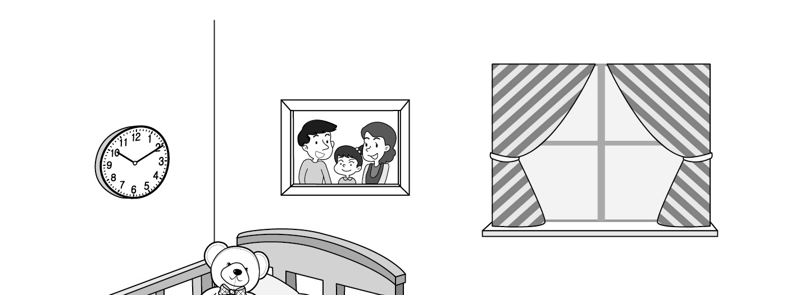
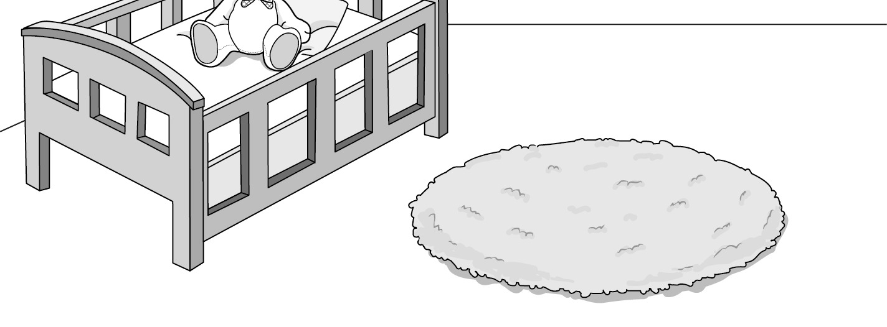

1. 다음을 듣고, 남자가 하는 말의 목적으로 가장 적절한 것을 고르시오.

① 사생활 보호의 중요성을 강조하려고
② 건물 벽 페인트 작업을 공지하려고
③ 회사 근무시간 변경을 안내하려고
④ 새로운 직원 채용을 공고하려고
⑤ 친환경 제품 출시를 홍보하려고

2. 대화를 듣고, 여자의 의견으로 가장 적절한 것을 고르시오.

① 운전자는 제한 속도를 지켜야 한다.
② 교통경찰을 더 많이 배치해야 한다.
③ 보행자의 부주의가 교통사고를 유발한다.
④ 교통사고를 목격하면 즉시 신고해야 한다.
⑤ 대중교통을 이용하면 이동시간을 줄일 수 있다.

3. 대화를 듣고, 두 사람의 관계를 가장 잘 나타낸 것을 고르시오.

① 작가 - 출판사 직원
② 관람객 - 박물관 해설사
③ 손님 - 주방장
④ 탑승객 - 항공 승무원
⑤ 학생 - 사서

4. 대화를 듣고, 그림에서 대화의 내용과 일치하지 않는 것을 고르시오.

5. 대화를 듣고, 남자가 할 일로 가장 적절한 것을 고르시오.

① 보고서 제출하기
② 티켓 예매하기
③ 자전거 수리하기
④ 축구 연습하기
⑤ 팝콘 구입하기

6. 대화를 듣고, 여자가 지불할 금액을 고르시오. [3점]

① $40
② $60
③ $80
④ $100
⑤ $120

7. 대화를 듣고, 남자가 음식 부스에 갈 수 없는 이유로 가장 적절한 것을 고르시오.

① 밴드 오디션 연습을 해야 해서
② 보드게임 부스를 설치해야 해서
③ 영어 프로젝트를 끝내야 해서
④ 샌드위치를 준비해야 해서
⑤ 친구를 만나러 가야 해서

8. 대화를 듣고, Spanish culture class에 관해 언급되지 않은 것을 고르시오.

① 강사
② 활동 종류
③ 수업 요일
④ 준비물
⑤ 수강료

9. Summer Flea Market에 관한 다음 내용을 듣고, 일치하지 않는 것을 고르시오. [3점]

① 일주일 동안 진행된다.
② 학교 주차장에서 열린다.
③ 장난감, 양초와 같은 물품을 살 수 있다.
④ 상태가 좋은 중고 물품을 판매할 수 있다.
⑤ 첫날 방문하면 할인 쿠폰을 선물로 받는다.

10. 다음 표를 보면서 대화를 듣고, 여자가 구입할 운동화를 고르시오.

Sneakers

|  | Model | Price | Style | Waterproof | Color |
| --- | --- | --- | --- | --- | --- |
| ① | A | $50 | casual | × | black |
| ② | B | $60 | active | × | white |
| ③ | C | $65 | casual | ○ | black |
| ④ | D | $70 | casual | ○ | white |
| ⑤ | E | $85 | active | ○ | white |

11. 대화를 듣고, 여자의 마지막 말에 대한 남자의 응답으로 가장 적절한 것을 고르시오.

① All children’s books are 20% off.
② It takes time to write a good article.
③ I like to read action adventure books.
④ There are too many advertisements on TV.
⑤ The store has been closed since last month.

12. 대화를 듣고, 남자의 마지막 말에 대한 여자의 응답으로 가장 적절한 것을 고르시오.

① You’re welcome. I’m happy to help you.
② That’s not true. I made it with your help.
③ Okay. Good food always makes me feel better.
④ Really? You should definitely visit the theater later.
⑤ Never mind. You’ll do better on the next presentation.

13. 대화를 듣고, 여자의 마지막 말에 대한 남자의 응답으로 가장 적절한 것을 고르시오.

Man:
① I’m excited to buy a new guitar.
② Summer vacation starts on Friday.
③ You can find it on the school website.
④ Let’s go to the school festival together.
⑤ You can get some rest during the vacation.

14. 대화를 듣고, 남자의 마지막 말에 대한 여자의 응답으로 가장 적절한 것을 고르시오.

Woman:
① I agree. There are many benefits of exercising at the gym.
② You’re right. Not all exercise is helpful for your brain.
③ Don’t worry. It’s not too difficult for me to exercise.
④ That sounds great. Can I join the course, too?
⑤ That’s too bad. I hope you get well soon.

15. 다음 상황 설명을 듣고, Ted가 Monica에게 할 말로 가장 적절한 것을 고르시오. [3점]

① Can I draw your club members on the poster?
② Are you interested in joining my drawing club?
③ Could you tell me how to vote in the election?
④ Can you help me make posters for the election?
⑤ Would you run in the next school president election?

16. 여자가 하는 말의 주제로 가장 적절한 것은?

① downsides of fatty food
② healthy foods for breakfast
③ ways to avoid eating snacks
④ easy foods to cook in 5 minutes
⑤ the importance of a balanced diet

17. 언급된 음식이 아닌 것은?

따라 답을 하시기 바랍니다.

① eggs
② cheese
③ potatoes
④ yogurt
⑤ berries

18. 다음 글의 목적으로 가장 적절한 것은?

Dear Boat Tour Manager, On March 15, my family was on one of your Glass Bottom Boat Tours. When we returned to our hotel, I discovered that I left behind my cell phone case. The case must have fallen off my lap and onto the floor when I took it off my phone to clean it. I would like to ask you to check if it is on your boat. Its color is black and it has my name on the inside. If you find the case, I would appreciate it if you would let me know. Sincerely, Sam Roberts

19. 다음 글에 드러난 Matthew의 심경 변화로 가장 적절한 것은?

One Saturday morning, Matthew’s mother told Matthew that she was going to take him to the park. A big smile came across his face. As he loved to play outside, he ate his breakfast and got dressed quickly so they could go. When they got to the park, Matthew ran all the way over to the swing set. That was his favorite thing to do at the park. But the swings were all being used. His mother explained that he could use the slide until a swing became available, but it was broken. Suddenly, his mother got a phone call and she told Matthew they had to leave. His heart sank.

20. 다음 글에서 필자가 주장하는 바로 가장 적절한 것은?

Meetings encourage creative thinking and can give you ideas that you may never have thought of on your own. However, on average, meeting participants consider about one third of meeting time to be unproductive. But you can make your meetings more productive and more useful by preparing well in advance. You should create a list of items to be discussed and share your list with other participants before a meeting. It allows them to know what to expect in your meeting and prepare to participate.

21. 밑줄 친 put the glass down이 다음 글에서 의미하는 바로 가장 적절한 것은? [3점]

A psychology professor raised a glass of water while teaching stress management principles to her students, and asked them, “How heavy is this glass of water I’m holding?” Students shouted out various answers. The professor replied, “The absolute weight of this glass doesn’t matter. It depends on how long I hold it. If I hold it for a minute, it’s quite light. But, if I hold it for a day straight, it will cause severe pain in my arm, forcing me to drop the glass to the floor. In each case, the weight of the glass is the same, but the longer I hold it, the heavier it feels to me.” As the class nodded their heads in agreement, she continued, “Your stresses in life are like this glass of water. If you still feel the weight of yesterday’s stress, it’s a strong sign that it’s time to put the glass down.”

22. 다음 글의 요지로 가장 적절한 것은?

Your emotions deserve attention and give you important pieces of information. However, they can also sometimes be an unreliable, inaccurate source of information. You may feel a certain way, but that does not mean those feelings are reflections of the truth. You may feel sad and conclude that your friend is angry with you when her behavior simply reflects that she’s having a bad day. You may feel depressed and decide that you did poorly in an interview when you did just fine. Your feelings can mislead you into thinking things that are not supported by facts.

23. 다음 글의 주제로 가장 적절한 것은?

Every day, children explore and construct relationships among objects. Frequently, these relationships focus on how much or how many of something exists. Thus, children count ― “One cookie, two shoes, three candles on the birthday cake, four children in the sandbox.” Children compare ― “Which has more? Which has fewer? Will there be enough?” Children calculate ― “How many will fit? Now, I have five. I need one more.” In all of these instances, children are developing a notion of quantity. Children reveal and investigate mathematical concepts through their own activities or experiences, such as figuring out how many crackers to take at snack time or sorting shells into piles.

24. 다음 글의 제목으로 가장 적절한 것은?

Only a generation or two ago, mentioning the word algorithms would have drawn a blank from most people. Today, algorithms appear in every part of civilization. They are connected to everyday life. They’re not just in your cell phone or your laptop but in your car, your house, your appliances, and your toys. Your bank is a huge web of algorithms, with humans turning the switches here and there. Algorithms schedule flights and then fly the airplanes. Algorithms run factories, trade goods, and keep records. If every algorithm suddenly stopped working, it would be the end of the world as we know it.

25. 다음 도표의 내용과 일치하지 않는 것은?

Percent of U.S. Households with Pets (%)

| Year | Percent of U.S. Households with Pets |
| --- | --- |
| 1988 | 56% |
| 2008 | 62% |
| 2013 | 68% |
| 2015 | 65% |
| 2017 | 68% |
| 2020 | 67% |

26. Claude Bolling에 관한 다음 글의 내용과 일치하지 않는 것은?

Pianist, composer, and big band leader, Claude Bolling, was born on April 10, 1930, in Cannes, France, but spent most of his life in Paris. He began studying classical music as a youth. He was introduced to the world of jazz by a schoolmate. Later, Bolling became interested in the music of Fats Waller, one of the most excellent jazz musicians. Bolling became famous as a teenager by winning the Best Piano Player prize at an amateur contest in France. He was also a successful film music composer, writing the music for more than one hundred films. In 1975, he collaborated with flutist Rampal and published Suite for Flute and Jazz Piano Trio, which he became most well-known for. He died in 2020, leaving two sons, David and Alexandre.

27. Kids Taekwondo Program에 관한 다음 안내문의 내용과 일치하지 않는 것은?

Kids Taekwondo Program

Enjoy our taekwondo program this summer vacation. □ Schedule
Dates: August 8th - August 10th
Time: 9:00 a.m. - 11:00 a.m. □ Participants
Any child aged 5 and up □ Activities
Self-defense training
Team building games to develop social skills □ Participation Fee
$50 per child (includes snacks) □ Notice
What to bring: water bottle, towel
What not to bring: chewing gum, expensive items

28. Moonlight Chocolate Factory Tour에 관한 다음 안내문의 내용과 일치하는 것은?

Moonlight Chocolate Factory Tour

Take this special tour and have a chance to enjoy our most popular chocolate bars. □ Operating Hours
Monday - Friday, 2:00 p.m. - 5:00 p.m. □ Activities
Watching our chocolate-making process
Tasting 3 types of chocolate (dark, milk, and mint chocolate) □ Notice
Ticket price: $30
Wearing a face mask is required.
Taking pictures is not allowed inside the factory.

29. 다음 글의 밑줄 친 부분 중, 어법상 틀린 것은?

Despite all the high-tech devices that seem to deny the need for paper, paper use in the United States has nearly doubled recently. We now consume more paper than ever: 400 million tons globally and growing. Paper is not the only resource that we are using more of. Technological advances often come with the promise of using fewer materials. However, the reality is that they have historically caused more materials use, making us dependent on more natural resources. The world now consumes far more “stuff” than it ever has. We use twenty-seven times more industrial minerals, such as gold, copper, and rare metals, than we did just over a century ago. We also each individually use more resources. Much of that is due to our high-tech lifestyle.

30. 다음 글의 밑줄 친 부분 중, 문맥상 낱말의 쓰임이 적절하지 않은 것은? [3점]

Do you sometimes feel like you don’t love your life? Like, deep inside, something is missing? That’s because we are living someone else’s life. We allow other people to influence our choices. We are trying to meet their expectations. Social pressure is deceiving ― we are all impacted without noticing it. Before we realize we are losing ownership of our lives, we end up ignoring how other people live. Then, we can only see the greener grass ― ours is never good enough. To regain that passion for the life you want, you must recover control of your choices. No one but yourself can choose how you live. But, how? The first step to getting rid of expectations is to treat yourself kindly. You can’t truly love other people if you don’t love yourself first. When we accept who we are, there’s no room for other’s expectations.

31. 다음 빈칸에 들어갈 말로 가장 적절한 것을 고르시오.

One of the big questions faced this past year was how to keep innovation rolling when people were working entirely virtually. But experts say that digital work didn’t have a negative effect on innovation and creativity. Working within limits pushes us to solve problems. Overall, virtual meeting platforms put more constraints on communication and collaboration than face-to-face settings. For instance, with the press of a button, virtual meeting hosts can control the size of breakout groups and enforce time constraints; only one person can speak at a time; nonverbal signals, particularly those below the shoulders, are diminished; “seating arrangements” are assigned by the platform, not by individuals; and visual access to others may be limited by the size of each participant’s screen. Such restrictions are likely to stretch participants beyond their usual ways of thinking, boosting creativity.

32. 다음 빈칸에 들어갈 말로 가장 적절한 것을 고르시오. [3점]

The law of demand is that the demand for goods and services increases as prices fall, and the demand falls as prices increase. Giffen goods are special types of products for which the traditional law of demand does not apply. Instead of switching to cheaper replacements, consumers demand more of giffen goods when the price increases and less of them when the price decreases. Taking an example, rice in China is a giffen good because people tend to purchase less of it when the price falls. The reason for this is, when the price of rice falls, people have more money to spend on other types of products such as meat and dairy and, therefore, change their spending pattern. On the other hand, as rice prices increase, people consume more rice.

33. 다음 빈칸에 들어갈 말로 가장 적절한 것을 고르시오. [3점]

In a study at Princeton University in 1992, research scientists looked at two different groups of mice. One group was made intellectually superior by modifying the gene for the glutamate receptor. Glutamate is a brain chemical that is necessary in learning. The other group was genetically manipulated to be intellectually inferior, also done by modifying the gene for the glutamate receptor. The smart mice were then raised in standard cages, while the inferior mice were raised in large cages with toys and exercise wheels and with lots of social interaction. At the end of the study, although the intellectually inferior mice were genetically handicapped, they were able to perform just as well as their genetic superiors. This was a real triumph for nurture over nature. Genes are turned on or off based on what is around you.

34. 다음 빈칸에 들어갈 말로 가장 적절한 것을 고르시오. [3점]

Researchers are working on a project that asks coastal towns how they are preparing for rising sea levels. Some towns have risk assessments; some towns even have a plan. But it’s a rare town that is actually carrying out a plan. One reason we’ve failed to act on climate change is the common belief that it is far away in time and space. For decades, climate change was a prediction about the future, so scientists talked about it in the future tense. This became a habit ― so that even today many scientists still use the future tense, even though we know that a climate crisis is ongoing. Scientists also often focus on regions most affected by the crisis, such as Bangladesh or the West Antarctic Ice Sheet, which for most Americans are physically remote.

35. 다음 글에서 전체 흐름과 관계 없는 문장은?

According to Marguerite La Caze, fashion contributes to our lives and provides a medium for us to develop and exhibit important social virtues.

36. 주어진 글 다음에 이어질 글의 순서로 가장 적절한 것을 고르시오.

Mrs. Klein told her first graders to draw a picture of something to be thankful for. She thought that most of the class would draw turkeys or Thanksgiving tables. But Douglas drew something different.

Douglas was a boy who usually spent time alone and stayed around her while his classmates went outside together during break time. What the boy drew was a hand. But whose hand? His image immediately attracted the other students’ interest

So, everyone rushed to talk about whose hand it was. “It must be the hand of God that brings us food,” said one student. “A farmer’s,” said a second student, “because they raise the turkeys.” “It looks more like a police officer’s,” added another, “they protect us

The class was so responsive that Mrs. Klein had almost forgotten about Douglas. After she had the others at work on another project, she asked Douglas whose hand it was. He answered softly, “It’s yours. Thank you, Mrs. Klein

37. 주어진 글 다음에 이어질 글의 순서로 가장 적절한 것을 고르시오. [3점]

According to legend, once a vampire bites a person, that person turns into a vampire who seeks the blood of others. A researcher came up with some simple math, which proves that these highly popular creatures can’t exist.

University of Central Florida physics professor Costas Efthimiou’s work breaks down the myth. Suppose that on January 1st, 1600, the human population was just over five hundred million

If the first vampire came into existence that day and bit one person a month, there would have been two vampires by February 1st, 1600. A month later there would have been four, the next month eight, then sixteen, and so on

In just two-and-a-half years, the original human population would all have become vampires with no humans left. But look around you. Have vampires taken over the world? No, because there’s no such thing

38. 글의 흐름으로 보아, 주어진 문장이 들어가기에 가장 적절한 곳을 고르시오.

Friction is a force between two surfaces that are sliding, or trying to slide, across each other. For example, when you try to push a book along the floor, friction makes this difficult. Friction always works in the direction opposite to the direction in which the object is moving, or trying to move. So, friction always slows a moving object down. The amount of friction depends on the surface materials. The rougher the surface is, the more friction is produced. Friction also produces heat. For example, if you rub your hands together quickly, they will get warmer. Friction can be a useful force because it prevents our shoes slipping on the floor when we walk and stops car tires skidding on the road. When you walk, friction is caused between the tread on your shoes and the ground, acting to grip the ground and prevent sliding.

39. 글의 흐름으로 보아, 주어진 문장이 들어가기에 가장 적절한 곳을 고르시오.

Humans born without sight are not able to collect visual experiences, so they understand the world entirely through their other senses. As a result, people with blindness at birth develop an amazing ability to understand the world through the collection of experiences and memories that come from these non-visual senses. The dreams of a person who has been without sight since birth can be just as vivid and imaginative as those of someone with normal vision. They are unique, however, because their dreams are constructed from the non-visual experiences and memories they have collected. A person with normal vision will dream about a familiar friend using visual memories of shape, lighting, and colour. But, a blind person will associate the same friend with a unique combination of experiences from their non-visual senses that act to represent that friend. In other words, people blind at birth have similar overall dreaming experiences even though they do not dream in pictures.

40. 다음 글의 내용을 한 문장으로 요약하고자 한다. 빈칸 (A), (B)에 들어갈 말로 가장 적절한 것은? [3점]

According to a study of Swedish adolescents, an important factor of adolescents’ academic success is how they respond to challenges. The study reports that when facing difficulties, adolescents exposed to an authoritative parenting style are less likely to be passive, helpless, and afraid to fail. Another study of nine high schools in Wisconsin and northern California indicates that children of authoritative parents do well in school, because these parents put a lot of effort into getting involved in their children’s school activities. That is, authoritative parents are significantly more likely to help their children with homework, to attend school programs, to watch their children in sports, and to help students select courses. Moreover, these parents are more aware of what their children do and how they perform in school. Finally, authoritative parents praise academic excellence and the importance of working hard more than other parents do. 

The studies above show that the children of authoritative parents often succeed academically, since they are more willing to deal with their difficulties and are affected by their parents’ active involvement.

41. 윗글의 제목으로 가장 적절한 것은?

U.K. researchers say a bedtime of between 10 p.m. and 11 p.m. is best. They say people who go to sleep between these times have a lower risk of heart disease. Six years ago, the researchers collected data on the sleep patterns of 80,000 volunteers. The volunteers had to wear a special watch for seven days so the researchers could collect data on their sleeping and waking times. The scientists then monitored the health of the volunteers. Around 3,000 volunteers later showed heart problems. They went to bed earlier or later than the ideal 10 p.m. to 11 p.m. timeframe. One of the authors of the study, Dr. David Plans, commented on his research and the effects of bedtimes on the health of our heart. He said the study could not give a certain cause for their results, but it suggests that early or late bedtimes may be more likely to disrupt the body clock, with positive consequences for cardiovascular health. He said that it was important for our body to wake up to the morning light, and that the worst time to go to bed was after midnight because it may reduce the likelihood of seeing morning light which resets the body clock. He added that we risk cardiovascular disease if our body clock is not reset properly.

42. 밑줄 친 낱말 중에서 문맥상 낱말의 쓰임이 적절하지 않은 것은?

U.K. researchers say a bedtime of between 10 p.m. and 11 p.m. is best. They say people who go to sleep between these times have a lower risk of heart disease. Six years ago, the researchers collected data on the sleep patterns of 80,000 volunteers. The volunteers had to wear a special watch for seven days so the researchers could collect data on their sleeping and waking times. The scientists then monitored the health of the volunteers. Around 3,000 volunteers later showed heart problems. They went to bed earlier or later than the ideal 10 p.m. to 11 p.m. timeframe. One of the authors of the study, Dr. David Plans, commented on his research and the effects of bedtimes on the health of our heart. He said the study could not give a certain cause for their results, but it suggests that early or late bedtimes may be more likely to disrupt the body clock, with positive consequences for cardiovascular health. He said that it was important for our body to wake up to the morning light, and that the worst time to go to bed was after midnight because it may reduce the likelihood of seeing morning light which resets the body clock. He added that we risk cardiovascular disease if our body clock is not reset properly.

43. 주어진 글에 이어질 내용을 순서에 맞게 배열한 것으로 가장 적절한 것은?

 However, the tired farmer did not want to give up on the search for his watch and asked a group of children playing outside to help him. He promised an attractive reward for the person who could find it. After hearing about the reward, the children hurried inside the barn and went through and round the entire pile of hay looking for the watch. After a long time searching for it, some of the children got tired and gave up. The number of children looking for the watch slowly decreased and only a few tired children were left. The farmer gave up all hope of finding it and called off the search. Just when the farmer was closing the barn door, a little boy came up to him and asked the farmer to give him another chance. The farmer did not want to lose out on any chance of finding the watch so let him in the barn. After a little while the boy came out with the farmer’s watch in his hand. He was happily surprised and asked how he had succeeded to find the watch while everyone else had failed. He replied “I just sat there and tried listening for the sound of the watch. In silence, it was much easier to hear it and follow the direction of the sound.” He was delighted to get his watch back and rewarded the little boy as promised. 

44. 밑줄 친 낱말 중에서 가리키는 대상이 나머지 넷과 다른 것은?

 However, the tired farmer did not want to give up on the search for his watch and asked a group of children playing outside to help him. He promised an attractive reward for the person who could find it. After hearing about the reward, the children hurried inside the barn and went through and round the entire pile of hay looking for the watch. After a long time searching for it, some of the children got tired and gave up. The number of children looking for the watch slowly decreased and only a few tired children were left. The farmer gave up all hope of finding it and called off the search. Just when the farmer was closing the barn door, a little boy came up to him and asked the farmer to give him another chance. The farmer did not want to lose out on any chance of finding the watch so let him in the barn. After a little while the boy came out with the farmer’s watch in his hand. He was happily surprised and asked how he had succeeded to find the watch while everyone else had failed. He replied “I just sat there and tried listening for the sound of the watch. In silence, it was much easier to hear it and follow the direction of the sound.” He was delighted to get his watch back and rewarded the little boy as promised. 

45. 윗글에 관한 내용으로 적절하지 않은 것은?

 However, the tired farmer did not want to give up on the search for his watch and asked a group of children playing outside to help him. He promised an attractive reward for the person who could find it. After hearing about the reward, the children hurried inside the barn and went through and round the entire pile of hay looking for the watch. After a long time searching for it, some of the children got tired and gave up. The number of children looking for the watch slowly decreased and only a few tired children were left. The farmer gave up all hope of finding it and called off the search. Just when the farmer was closing the barn door, a little boy came up to him and asked the farmer to give him another chance. The farmer did not want to lose out on any chance of finding the watch so let him in the barn. After a little while the boy came out with the farmer’s watch in his hand. He was happily surprised and asked how he had succeeded to find the watch while everyone else had failed. He replied “I just sat there and tried listening for the sound of the watch. In silence, it was much easier to hear it and follow the direction of the sound.” He was delighted to get his watch back and rewarded the little boy as promised.
