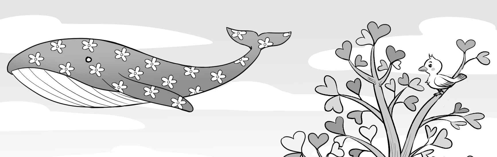
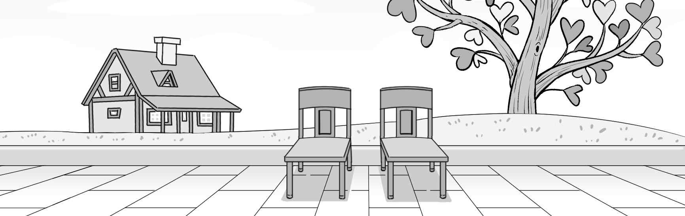
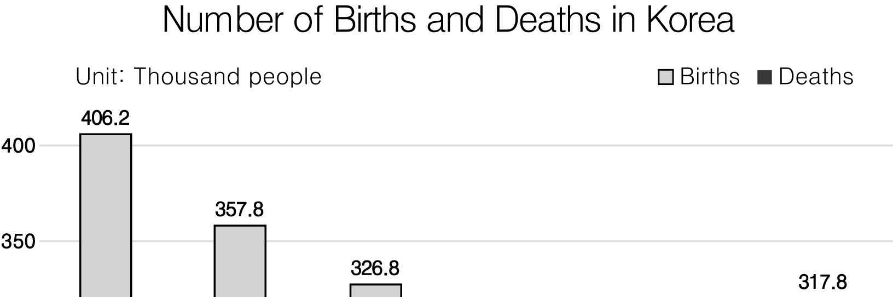
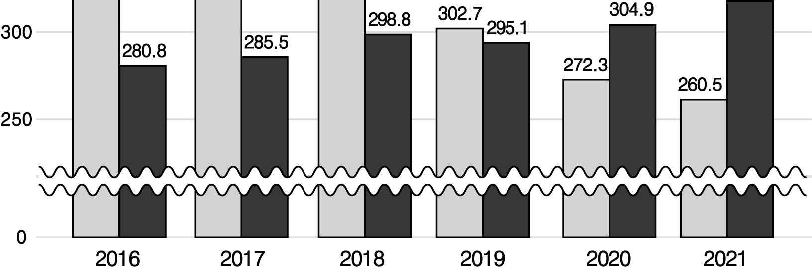
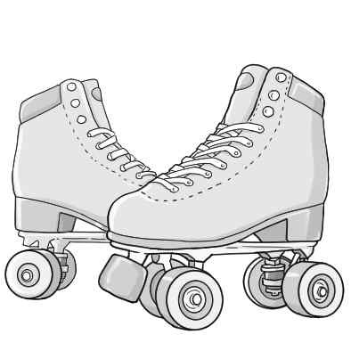

1. 다음을 듣고, 남자가 하는 말의 목적으로 가장 적절한 것을 고르시오.
① 아이스하키부의 우승을 알리려고
② 아이스하키부 훈련 일정을 공지하려고
③ 아이스하키부 신임 감독을 소개하려고
④ 아이스하키부 선수 모집을 안내하려고
⑤ 아이스하키부 경기의 관람을 독려하려고

2. 대화를 듣고, 여자의 의견으로 가장 적절한 것을 고르시오.

① 과다한 항생제 복용을 자제해야 한다.
② 오래된 약을 함부로 폐기해서는 안 된다.
③ 약을 복용할 때는 정해진 시간을 지켜야 한다.
④ 진료 전에 자신의 증상을 정확히 확인해야 한다.
⑤ 다른 사람에게 처방된 약을 복용해서는 안 된다.

3. 대화를 듣고, 두 사람의 관계를 가장 잘 나타낸 것을 고르시오.

① 관람객 - 박물관 관장
② 세입자 - 건물 관리인
③ 화가 - 미술관 직원
④ 고객 - 전기 기사
⑤ 의뢰인 - 건축사

4. 대화를 듣고, 그림에서 대화의 내용과 일치하지 않는 것을 고르시오.

5. 대화를 듣고, 남자가 할 일로 가장 적절한 것을 고르시오.

① 티켓 디자인하기
② 포스터 게시하기
③ 블로그 개설하기
④ 밴드부원 모집하기
⑤ 콘서트 장소 대여하기

6. 대화를 듣고, 여자가 지불할 금액을 고르시오. [3점]

① $70
② $90
③ $100
④ $110
⑤ $120

7. 대화를 듣고, 남자가 지갑을 구매하지 못한 이유를 고르시오.

① 해당 상품이 다 팔려서
② 브랜드명을 잊어버려서
③ 계산대의 줄이 길어서
④ 공항에 늦게 도착해서
⑤ 면세점이 문을 닫아서

8. 대화를 듣고, Youth Choir Audition에 관해 언급되지 않은 것을 고르시오.

① 지원 가능 연령
② 날짜
③ 심사 기준
④ 참가비
⑤ 지원 방법

9. 2023 Career Week에 관한 다음 내용을 듣고, 일치하지 않는 것을 고르시오.

① 5일 동안 열릴 것이다.
② 미래 직업 탐색을 돕는 프로그램이 있을 것이다.
③ 프로그램 참가 인원에 제한이 있다.
④ 특별 강연이 마지막 날에 있을 것이다.
⑤ 등록은 5월 10일에 시작된다.

10. 다음 표를 보면서 대화를 듣고, 여자가 구입할 프라이팬을 고르시오. Frying Pans

Frying Pans

|  | Model | Price | Size (inches) | Material | Lid |
| --- | --- | --- | --- | --- | --- |
| ① | A | $30 | 8 | Aluminum | ○ |
| ② | B | $32 | 9.5 | Aluminum | ○ |
| ③ | C | $35 | 10 | Stainless Steel | × |
| ④ | D | $40 | 11 | Aluminum | × |
| ⑤ | E | $70 | 12.5 | Stainless Steel | ○ |

11. 대화를 듣고, 남자의 마지막 말에 대한 여자의 응답으로 가장 적절한 것을 고르시오.

① I don’t think I can finish editing it by then.
② I learned it by myself through books.
③ This short movie is very interesting.
④ You should make another video clip.
⑤ I got an A+ on the team project.

12. 대화를 듣고, 여자의 마지막 말에 대한 남자의 응답으로 가장 적절한 것을 고르시오.

① All right. I’ll come pick you up now.
② I’m sorry. The library is closed today.
③ No problem. You can borrow my book.
④ Thank you so much. I’ll drop you off now.
⑤ Right. I’ve changed the interior of my office.

13. 대화를 듣고, 남자의 마지막 말에 대한 여자의 응답으로 가장 적절한 것을 고르시오.

Woman:
① Try these tomatoes and cucumbers.
② I didn’t know peppers are good for skin.
③ Just wear comfortable clothes and shoes.
④ You can pick tomatoes when they are red.
⑤ I’ll help you grow vegetables on your farm.

14. 대화를 듣고, 여자의 마지막 말에 대한 남자의 응답으로 가장 적절한 것을 고르시오. [3점]

Man:
① You’re right. I’ll meet her and apologize.
② I agree with you. That’s why I did it.
③ Thank you. I appreciate your apology.
④ Don’t worry. I don’t think it’s your fault.
⑤ Too bad. I hope the two of you get along.

15. 다음 상황 설명을 듣고, John이 Ted에게 할 말로 가장 적절한 것을 고르시오. [3점]

① How can we find the best sunrise spot?
② Why do you go mountain climbing so often?
③ What time should we get up tomorrow morning?
④ When should we come down from the mountain top?
⑤ Where do we have to stay in the mountain at night?

16. 여자가 하는 말의 주제로 가장 적절한 것은?

① indoor sports good for the elderly
② importance of learning rules in sports
③ best sports for families to enjoy together
④ useful tips for winning a sports game
⑤ history of traditional family sports

17. 언급된 스포츠가 아닌 것은?

① badminton
② basketball
③ table tennis
④ soccer
⑤ bowling

18. 다음 글의 목적으로 가장 적절한 것은?

To whom it may concern, I am a resident of the Blue Sky Apartment. Recently I observed that the kid zone is in need of repairs. I want you to pay attention to the poor condition of the playground equipment in the zone. The swings are damaged, the paint is falling off, and some of the bolts on the slide are missing. The facilities have been in this terrible condition since we moved here. They are dangerous to the children playing there. Would you please have them repaired? I would appreciate your immediate attention to solve this matter. Yours sincerely, Nina Davis

19. 다음 글에 드러난 ‘I’의 심경 변화로 가장 적절한 것은?

On a two-week trip in the Rocky Mountains, I saw a grizzly bear in its native habitat. At first, I felt joy as I watched the bear walk across the land. He stopped every once in a while to turn his head about, sniffing deeply. He was following the scent of something, and slowly I began to realize that this giant animal was smelling me! I froze. This was no longer a wonderful experience; it was now an issue of survival. The bear’s motivation was to find meat to eat, and I was clearly on his menu.

20. 다음 글에서 필자가 주장하는 바로 가장 적절한 것은?

It is difficult for any of us to maintain a constant level of attention throughout our working day. We all have body rhythms characterised by peaks and valleys of energy and alertness. You will achieve more, and feel confident as a benefit, if you schedule your most demanding tasks at times when you are best able to cope with them. If you haven’t thought about energy peaks before, take a few days to observe yourself. Try to note the times when you are at your best. We are all different. For some, the peak will come first thing in the morning, but for others it may take a while to warm up.

21. 밑줄 친 The divorce of the hands from the head가 다음 글에서 의미하는 바로 가장 적절한 것은? [3점]

If we adopt technology, we need to pay its costs. Thousands of traditional livelihoods have been pushed aside by progress, and the lifestyles around those jobs removed. Hundreds of millions of humans today work at jobs they hate, producing things they have no love for. Sometimes these jobs cause physical pain, disability, or chronic disease. Technology creates many new jobs that are certainly dangerous. At the same time, mass education and media train humans to avoid low-tech physical work, to seek jobs working in the digital world. The divorce of the hands from the head puts a stress on the human mind. Indeed, the sedentary nature of the best-paying jobs is a health risk ─ for body and mind.

22. 다음 글의 요지로 가장 적절한 것은?

When students are starting their college life, they may approach every course, test, or learning task the same way, using what we like to call “the rubber-stamp approach.” Think about it this way: Would you wear a tuxedo to a baseball game? A colorful dress to a funeral? A bathing suit to religious services? Probably not. You know there’s appropriate dress for different occasions and settings. Skillful learners know that “putting on the same clothes” won’t work for every class. They are flexible learners. They have different strategies and know when to use them. They know that you study for multiple-choice tests differently than you study for essay tests. And they not only know what to do, but they also know how to do it.

23. 다음 글의 주제로 가장 적절한 것은?

As the social and economic situation of countries got better, wage levels and working conditions improved. Gradually people were given more time off. At the same time, forms of transport improved and it became faster and cheaper to get to places. England’s industrial revolution led to many of these changes. Railways, in the nineteenth century, opened up now famous seaside resorts such as Blackpool and Brighton. With the railways came many large hotels. In Canada, for example, the new coast-to-coast railway system made possible the building of such famous hotels as Banff Springs and Chateau Lake Louise in the Rockies. Later, the arrival of air transport opened up more of the world and led to tourism growth.

24. 다음 글의 제목으로 가장 적절한 것은?

Success can lead you off your intended path and into a comfortable rut. If you are good at something and are well rewarded for doing it, you may want to keep doing it even if you stop enjoying it. The danger is that one day you look around and realize you’re so deep in this comfortable rut that you can no longer see the sun or breathe fresh air; the sides of the rut have become so slippery that it would take a superhuman effort to climb out; and, effectively, you’re stuck. And it’s a situation that many working people worry they’re in now. The poor employment market has left them feeling locked in what may be a secure, or even well-paying — but ultimately unsatisfying — job.

25. 다음 도표의 내용과 일치하지 않는 것은?

Number of Births and Deaths in Korea (Unit: Thousand people)

| Year | Births | Deaths |
| --- | --- | --- |
| 2016 | 406.2 | 280.8 |
| 2017 | 357.8 | 285.5 |
| 2018 | 326.8 | 298.8 |
| 2019 | 302.7 | 295.1 |
| 2020 | 272.3 | 304.9 |
| 2021 | 260.5 | 317.8 |

26. Lilian Bland에 관한 다음 글의 내용과 일치하지 않는 것은?

Lilian Bland was born in Kent, England in 1878. Unlike most other girls at the time she wore trousers and spent her time enjoying adventurous activities like horse riding and hunting. Lilian began her career as a sports and wildlife photographer for British newspapers. In 1910 she became the first woman to design, build, and fly her own airplane. In order to persuade her to try a slightly safer activity, Lilian’s dad bought her a car. Soon Lilian was a master driver and ended up working as a car dealer. She never went back to flying but lived a long and exciting life nonetheless. She married, moved to Canada, and had a kid. Eventually, she moved back to England, and lived there for the rest of her life.

27. Call for Articles에 관한 다음 안내문의 내용과 일치하지 않는 것은?

Call for Articles

Do you want to get your stories published? New Dream Magazine is looking for future writers! This event is open to anyone aged 13 to 18. Articles
Length of writing: 300-325 words
Articles should also include high-quality color photos. Rewards
Five cents per word
Five dollars per photo Notes
You should send us your phone number together with your writing.
Please email your writing to us at article@ndmag.com.

28. Greenhill Roller Skating에 관한 다음 안내문의 내용과 일치하는 것은?

Greenhill Roller Skating

Join us for your chance to enjoy roller skating!
Place: Greenhill Park, 351 Cypress Avenue
Dates: Friday, April 7 - Sunday, April 9
Time: 9 a.m. - 6 p.m.
Fee
$8 per person for a 50-minute session
Details
Admission will be on a first-come, first-served basis with no reservations. - Children under the age of 10 must be accompanied by an adult. - We will lend you our roller skates for free. Contact the Community Center for more information at 013-234-6114.

29. 다음 글의 밑줄 친 부분 중, 어법상 틀린 것은? [3점]

The most noticeable human characteristic projected onto animals is that they can talk in human language. Physically, animal cartoon characters and toys made after animals is also most often deformed in such a way as to resemble humans. This is achieved by showing them with humanlike facial features and deformed front legs to resemble human hands. In more recent animated movies the trend has been to show the animals in a more “natural” way. However, they still use their front legs like human hands (for example, lions can pick up and lift small objects with one paw), and they still talk with an appropriate facial expression. A general strategy that is used to make the animal characters more emotionally appealing, both to children and adults, is to give them enlarged and deformed childlike features.

30. 다음 글의 밑줄 친 부분 중, 문맥상 낱말의 쓰임이 적절하지 않은 것은? [3점]

The major philosophical shift in the idea of selling came when industrial societies became more affluent, more competitive, and more geographically spread out during the 1940s and 1950s. This forced business to develop closer relations with buyers and clients, which in turn made business realize that it was not enough to produce a quality product at a reasonable price. In fact, it was equally essential to deliver products that customers actually wanted. Henry Ford produced his best-selling T-model Ford in one color only (black) in 1908, but in modern societies this was no longer possible. The modernization of society led to a marketing revolution that destroyed major the view that production would create its own demand. Customers, and the desire to meet their diverse and often complex needs, became the focus of business.

31. 다음 빈칸에 들어갈 말로 가장 적절한 것을 고르시오.

People differ in how quickly they can reset their biological clocks to overcome jet lag, and the speed of recovery depends on the direction of travel. Generally, it’s easier to fly westward and lengthen your day than it is to fly eastward and shorten it. This east-west difference in jet lag is sizable enough to have an impact on the performance of sports teams. Studies have found that teams flying westward perform significantly better than teams flying eastward in professional baseball and college football. A more recent study of more than 46,000 Major League Baseball games found additional evidence that eastward travel is tougher than westward travel.

32. 다음 빈칸에 들어갈 말로 가장 적절한 것을 고르시오.

If you want the confidence that comes from achieving what you set out to do each day, then it’s important to understand how long things are going to take. Over-optimism about what can be achieved within a certain time frame is a problem. So work on it. Make a practice of estimating the amount of time needed alongside items on your ‘things to do’ list, and learn by experience when tasks take a greater or lesser time than expected. Give attention also to fitting the task to the available time. There are some tasks that you can only set about if you have a significant amount of time available. There is no point in trying to gear up for such a task when you only have a short period available. So schedule the time you need for the longer tasks and put the short tasks into the spare moments in between.

33. 다음 빈칸에 들어갈 말로 가장 적절한 것을 고르시오. [3점]

In Lewis Carroll’s Through the Looking-Glass, the Red Queen takes Alice on a race through the countryside. They run and they run, but then Alice discovers that they’re still under the same tree that they started from. The Red Queen explains to Alice: “here, you see, it takes all the running you can do, to keep in the same place.” Biologists sometimes use this Red Queen Effect to explain an evolutionary principle. If foxes evolve to run faster so they can catch more rabbits, then only the fastest rabbits will live long enough to make a new generation of bunnies that run even faster — in which case, of course, only the fastest foxes will catch enough rabbits to thrive and pass on their genes. Even though they might run, the two species just stay in place.

34. 다음 빈칸에 들어갈 말로 가장 적절한 것을 고르시오. [3점]

Everything in the world around us was finished in the mind of its creator before it was started. The houses we live in, the cars we drive, and our clothing ⸻ all of these began with an idea. Each idea was then studied, refined and perfected before the first nail was driven or the first piece of cloth was cut. Long before the idea was turned into a physical reality, the mind had clearly pictured the finished product. The human being designs his or her own future through much the same process. We begin with an idea about how the future will be. Over a period of time we refine and perfect the vision. Before long, our every thought, decision and activity are all working in harmony to bring into existence what we have mentally concluded about the future.

35. 다음 글에서 전체 흐름과 관계 없는 문장은?

Whose story it is affects what the story is. Change the main character, and the focus of the story must also change. If we look at the events through another character’s eyes, we will interpret them differently.

36. 주어진 글 다음에 이어질 글의 순서로 가장 적절한 것을 고르시오.

In the Old Stone Age, small bands of 20 to 60 people wandered from place to place in search of food. Once people began farming, they could settle down near their farms. As a result, towns and villages grew larger. Living in communities allowed people to organize themselves more efficiently. They could divide up the work of producing food and other things they needed. While some workers grew crops, others built new houses and made tools. Village dwellers also learned to work together to do a task faster. For example, toolmakers could share the work of making stone axes and knives. By working together, they could make more tools in the same amount of time.

37. 주어진 글 다음에 이어질 글의 순서로 가장 적절한 것을 고르시오. [3점]

Natural processes form minerals in many ways. For example, hot melted rock material, called magma, cools when it reaches the Earth’s surface, or even if it’s trapped below the surface. As magma cools, its atoms lose heat energy, move closer together, and begin to combine into compounds. During this process, atoms of the different compounds arrange themselves into orderly, repeating patterns. The type and amount of elements present in a magma partly determine which minerals will form. Also, the size of the crystals that form depends partly on how rapidly the magma cools. When magma cools slowly, the crystals that form are generally large enough to see with the unaided eye. This is because the atoms have enough time to move together and form into larger crystals. When magma cools rapidly, the crystals that form will be small. In such cases, you can’t easily see individual mineral crystals.

38. 글의 흐름으로 보아, 주어진 문장이 들어가기에 가장 적절한 곳을 고르시오.

All carbohydrates are basically sugars. Complex carbohydrates are the good carbohydrates for your body. These complex sugar compounds are very difficult to break down and can trap other nutrients like vitamins and minerals in their chains. As they slowly break down, the other nutrients are also released into your body, and can provide you with fuel for a number of hours. Bad carbohydrates, on the other hand, are simple sugars. Because their structure is not complex, they are easy to break down and hold few nutrients for your body other than the sugars from which they are made. Your body breaks down these carbohydrates rather quickly and what it cannot use is converted to fat and stored in the body.

39. 글의 흐름으로 보아, 주어진 문장이 들어가기에 가장 적절한 곳을 고르시오. [3점]

People commonly make the mistaken assumption that because a person has one type of characteristic, then they automatically have other characteristics which go with it. In one study, university students were given descriptions of a guest lecturer before he spoke to the group. Half the students received a description containing the word ‘warm’, the other half were told the speaker was ‘cold’. The guest lecturer then led a discussion, after which the students were asked to give their impressions of him. As expected, there were large differences between the impressions formed by the students, depending upon their original information of the lecturer. It was also found that those students who expected the lecturer to be warm tended to interact with him more. This shows that different expectations not only affect the impressions we form but also our behaviour and the relationship which is formed.

40. 다음 글의 내용을 한 문장으로 요약하고자 한다. 빈칸 (A), (B)에 들어갈 말로 가장 적절한 것은?

To help decide what’s risky and what’s safe, who’s trustworthy and who’s not, we look for social evidence. From an evolutionary view, following the group is almost always positive for our prospects of survival. “If everyone’s doing it, it must be a sensible thing to do,” explains famous psychologist and best selling writer of Influence, Robert Cialdini. While we can frequently see this today in product reviews, even subtler cues within the environment can signal trustworthiness. Consider this: when you visit a local restaurant, are they busy? Is there a line outside or is it easy to find a seat? It is a hassle to wait, but a line can be a powerful cue that the food’s tasty, and these seats are in demand. More often than not, it’s good to adopt the practices of those around you. 

We tend to feel safe and secure in numbers when we decide how to act, particularly when faced with uncertain conditions.

41. 윗글의 제목으로 가장 적절한 것은?

Chess masters shown a chess board in the middle of a game for 5 seconds with 20 to 30 pieces still in play can immediately reproduce the position of the pieces from memory. Beginners, of course, are able to place only a few. Now take the same pieces and place them on the board randomly and the difference is much reduced. The expert’s advantage is only for familiar patterns — those previously stored in memory. Faced with unfamiliar patterns, even when it involves the same familiar domain, the expert’s advantage disappears. The beneficial effects of familiar structure on memory have been observed for many types of expertise, including music. People with musical training can reproduce short sequences of musical notation more accurately than those with no musical training when notes follow conventional sequences, but the advantage is much reduced when the notes are ordered randomly. Expertise also improves memory for sequences of movements. Experienced ballet dancers are able to repeat longer sequences of steps than less experienced dancers, and they can repeat a sequence of steps making up a routine better than steps ordered randomly. In each case, memory range is increased by the ability to recognize familiar sequences and patterns.

42. 밑줄 친 낱말 중에서 문맥상 낱말의 쓰임이 적절하지 않은 것은?

Chess masters shown a chess board in the middle of a game for 5 seconds with 20 to 30 pieces still in play can immediately reproduce the position of the pieces from memory. Beginners, of course, are able to place only a few. Now take the same pieces and place them on the board randomly and the difference is much reduced. The expert’s advantage is only for familiar patterns — those previously stored in memory. Faced with unfamiliar patterns, even when it involves the same familiar domain, the expert’s advantage disappears. The beneficial effects of familiar structure on memory have been observed for many types of expertise, including music. People with musical training can reproduce short sequences of musical notation more accurately than those with no musical training when notes follow conventional sequences, but the advantage is much reduced when the notes are ordered randomly. Expertise also improves memory for sequences of movements. Experienced ballet dancers are able to repeat longer sequences of steps than less experienced dancers, and they can repeat a sequence of steps making up a routine better than steps ordered randomly. In each case, memory range is increased by the ability to recognize familiar sequences and patterns.

43. 주어진 글에 이어질 내용을 순서에 맞게 배열한 것으로 가장 적절한 것은?

 With each bad word the guards used, the monster grew more ugly and smelly. The guards got even angrier — they began to brandish their swords to scare the monster away from the palace. But he just grew bigger and bigger, eventually taking up the whole room. He grew more ugly and smelly than ever. Eventually the king returned. He was wise and kind and saw what was happening. He knew what to do. He smiled and said to the monster, “Welcome to my palace!” He asked the monster if he wanted a cup of coffee. The monster began to grow smaller as he drank the coffee. The king offered him some take-out pizza and fries. The guards immediately called for pizza. The monster continued to get smaller with the king’s kind gestures. He then offered the monster a full body massage. As the guards helped with the relaxing massage, the monster became tiny. With another act of kindness to the monster, he just disappeared. 

44. 밑줄 친 낱말 중에서 가리키는 대상이 나머지 넷과 다른 것은?

 With each bad word the guards used, the monster grew more ugly and smelly. The guards got even angrier — they began to brandish their swords to scare the monster away from the palace. But he just grew bigger and bigger, eventually taking up the whole room. He grew more ugly and smelly than ever. Eventually the king returned. He was wise and kind and saw what was happening. He knew what to do. He smiled and said to the monster, “Welcome to my palace!” He asked the monster if he wanted a cup of coffee. The monster began to grow smaller as he drank the coffee. The king offered him some take-out pizza and fries. The guards immediately called for pizza. The monster continued to get smaller with the king’s kind gestures. He then offered the monster a full body massage. As the guards helped with the relaxing massage, the monster became tiny. With another act of kindness to the monster, he just disappeared. 

45. 윗글에 관한 내용으로 적절하지 않은 것은?

 With each bad word the guards used, the monster grew more ugly and smelly. The guards got even angrier — they began to brandish their swords to scare the monster away from the palace. But he just grew bigger and bigger, eventually taking up the whole room. He grew more ugly and smelly than ever. Eventually the king returned. He was wise and kind and saw what was happening. He knew what to do. He smiled and said to the monster, “Welcome to my palace!” He asked the monster if he wanted a cup of coffee. The monster began to grow smaller as he drank the coffee. The king offered him some take-out pizza and fries. The guards immediately called for pizza. The monster continued to get smaller with the king’s kind gestures. He then offered the monster a full body massage. As the guards helped with the relaxing massage, the monster became tiny. With another act of kindness to the monster, he just disappeared.
