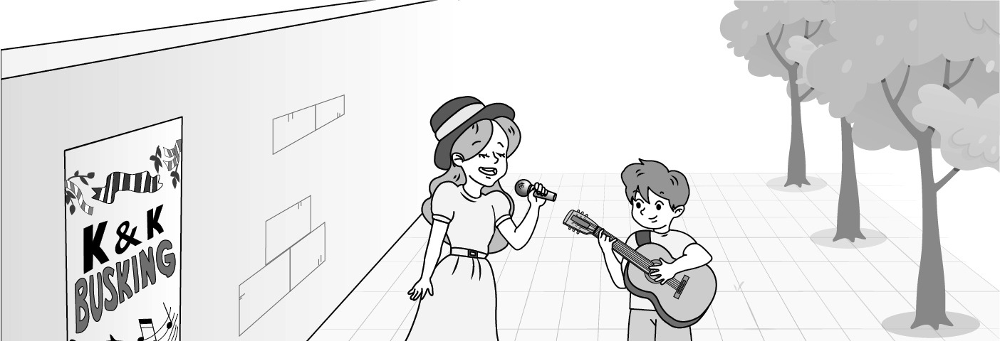
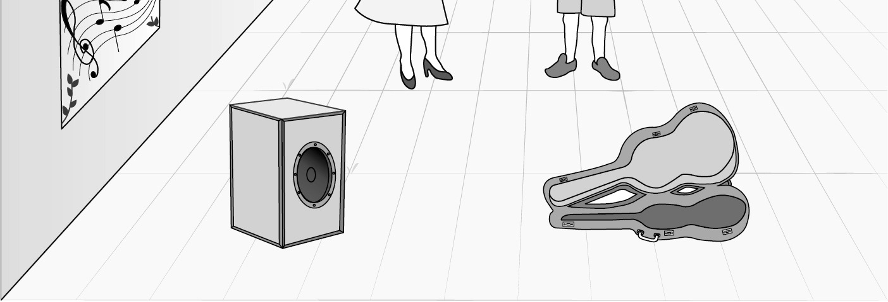
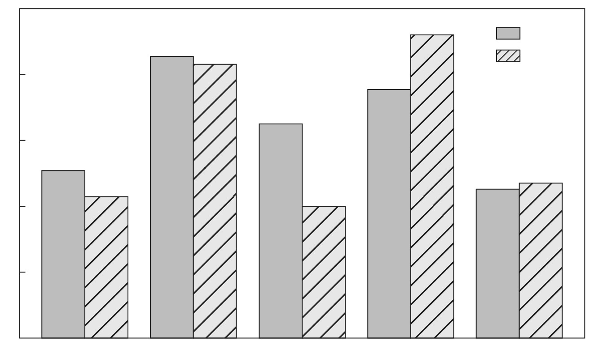

1. 다음을 듣고, 여자가 하는 말의 목적으로 가장 적절한 것을 고르시오.

① 체육대회 종목을 소개하려고
② 대회 자원봉사자를 모집하려고
③ 학생 회장 선거 일정을 공지하려고
④ 경기 관람 규칙 준수를 당부하려고
⑤ 학교 홈페이지 주소 변경을 안내하려고

2. 대화를 듣고, 남자의 의견으로 가장 적절한 것을 고르시오.

① 산책은 창의적인 생각을 할 수 있게 돕는다.
② 식사 후 과격한 운동은 소화를 방해한다.
③ 지나친 스트레스는 집중력을 감소시킨다.
④ 독서를 통해 창의력을 증진할 수 있다.
⑤ 꾸준한 운동은 기초체력을 향상시킨다.

3. 대화를 듣고, 두 사람의 관계를 가장 잘 나타낸 것을 고르시오.

① 고객 - 우체국 직원
② 투숙객 - 호텔 지배인
③ 여행객 - 여행 가이드
④ 아파트 주민 - 경비원
⑤ 손님 - 옷가게 주인

4. 대화를 듣고, 그림에서 대화의 내용과 일치하지 않는 것을 고르시오.

①
⑤
②

5. 대화를 듣고, 남자가 할 일로 가장 적절한 것을 고르시오.

① 초대장 보내기
② 피자 주문하기
③ 거실 청소하기
④ 꽃다발 준비하기
⑤ 스마트폰 사러 가기

6. 대화를 듣고, 여자가 지불할 금액을 고르시오. [3점]

① $54
② $60
③ $72
④ $76
⑤ $80

7. 대화를 듣고, 남자가 록 콘서트에 갈 수 없는 이유를 고르시오.

① 일을 하러 가야 해서
② 피아노 연습을 해야 해서
③ 할머니를 뵈러 가야 해서
④ 친구의 개를 돌봐야 해서
⑤ 과제를 아직 끝내지 못해서

8. 대화를 듣고, Eco Day에 관해 언급되지 않은 것을 고르시오.

① 행사 시간
② 행사 장소
③ 참가비
④ 준비물
⑤ 등록 방법

9. Eastville Dance Contest에 관한 다음 내용을 듣고, 일치하지 않는 것을 고르시오.

① 처음으로 개최되는 경연이다.
② 모든 종류의 춤이 허용된다.
③ 춤 영상을 8월 15일까지 업로드 해야 한다.
④ 학생들은 가장 좋아하는 영상에 투표할 수 있다.
⑤ 우승팀은 상으로 상품권을 받게 될 것이다.

10. 다음 표를 보면서 대화를 듣고, 두 사람이 구입할 정수기를 고르시오.

Water Purifiers

|  | Model | Price | Water Tank Capacity (liters) | Powersaving Mode | Warranty |
| --- | --- | --- | --- | --- | --- |
| ① | A | $570 | 4 | × | 1 year |
| ② | B | $650 | 5 | ○ | 1 year |
| ③ | C | $680 | 5 | × | 3 years |
| ④ | D | $740 | 5 | ○ | 3 years |
| ⑤ | E | $830 | 6 | ○ | 3 years |

11. 대화를 듣고, 남자의 마지막 말에 대한 여자의 응답으로 가장 적절한 것을 고르시오.

① Great. We don’t have to wait in line.
② All right. We can come back later.
③ Good job. Let’s buy the tickets.
④ No worries. I will stand in line.
⑤ Too bad. I can’t buy that car.

12. 대화를 듣고, 여자의 마지막 말에 대한 남자의 응답으로 가장 적절한 것을 고르시오.

① Yes. You can register online.
② Sorry. I can’t see you next week.
③ Right. I should go to his office now.
④ Fantastic! I’ll take the test tomorrow.
⑤ Of course. I can help him if he needs my help.

13. 대화를 듣고, 여자의 마지막 말에 대한 남자의 응답으로 가장 적절한 것을 고르시오. [3점]

Man:
① I agree. You can save a lot by buying secondhand.
② Great idea! Our message would make others smile.
③ Sorry. I forgot to write a message in the book.
④ Exactly. Taking notes during class is important.
⑤ Okay. We can arrive on time if we leave now.

14. 대화를 듣고, 남자의 마지막 말에 대한 여자의 응답으로 가장 적절한 것을 고르시오. [3점]

Woman:
① Why not? I can bring some food when we go camping.
② I’m sorry. That fishing equipment is not for sale.
③ I don’t think so. The price is most important.
④ Really? I’d love to meet your family.
⑤ No problem. You can use my equipment.

15. 다음 상황 설명을 듣고, Violet이 Peter에게 할 말로 가장 적절한 것을 고르시오.

① Will you join the science club together?
② Is it okay to use a card to pay for the drinks?
③ Why don’t we donate our books to the library?
④ How about going to the cafeteria to have lunch?
⑤ Can you borrow the books for me with your card?

16. 남자가 하는 말의 주제로 가장 적절한 것은?

① different causes of sleep disorders
② various ways to keep foods fresh
③ foods to improve quality of sleep
④ reasons for organic foods’ popularity
⑤ origins of popular foods around the world

17. 언급된 음식이 아닌 것은?

따라 답을 하시기 바랍니다.

① kiwi fruits
② milk
③ nuts
④ tomatoes
⑤ honey

18. 다음 글의 목적으로 가장 적절한 것은?

ACC Travel Agency Customers: Have you ever wanted to enjoy a holiday in nature? This summer is the best time to turn your dream into reality. We have a perfect travel package for you. This travel package includes special trips to Lake Madison as well as massage and meditation to help you relax. Also, we provide yoga lessons taught by experienced instructors. If you book this package, you will enjoy all this at a reasonable price. We are sure that it will be an unforgettable experience for you. If you call us, we will be happy to give you more details.

19. 다음 글에 드러난 ‘I’의 심경 변화로 가장 적절한 것은?

When I woke up in our hotel room, it was almost midnight. I didn’t see my husband nor daughter. I called them, but I heard their phones ringing in the room. Feeling worried, I went outside and walked down the street, but they were nowhere to be found. When I decided I should ask someone for help, a crowd nearby caught my attention. I approached, hoping to find my husband and daughter, and suddenly I saw two familiar faces. I smiled, feeling calm. Just then, my daughter saw me and called, “Mom!” They were watching the magic show. Finally, I felt all my worries disappear.

20. 다음 글에서 필자가 주장하는 바로 가장 적절한 것은?

Research shows that people who work have two calendars: one for work and one for their personal lives. Although it may seem sensible, having two separate calendars for work and personal life can lead to distractions. To check if something is missing, you will find yourself checking your to-do lists multiple times. Instead, organize all of your tasks in one place. It doesn’t matter if you use digital or paper media. It’s okay to keep your professional and personal tasks in one place. This will give you a good idea of how time is divided between work and home. This will allow you to make informed decisions about which tasks are most important.

21. 밑줄 친 become unpaid ambassadors가 다음 글에서 의미하는 바로 가장 적절한 것은?

Why do you care how a customer reacts to a purchase? Good question. By understanding post-purchase behavior, you can understand the influence and the likelihood of whether a buyer will repurchase the product (and whether she will keep it or return it). You’ll also determine whether the buyer will encourage others to purchase the product from you. Satisfied customers can become unpaid ambassadors for your business, so customer satisfaction should be on the top of your to-do list. People tend to believe the opinions of people they know. People trust friends over advertisements any day. They know that advertisements are paid to tell the “good side” and that they’re used to persuade them to purchase products and services. By continually monitoring your customer’s satisfaction after the sale, you have the ability to avoid negative word-of-mouth advertising.

22. 다음 글의 요지로 가장 적절한 것은?

The promise of a computerized society, we were told, was that it would pass to machines all of the repetitive drudgery of work, allowing us humans to pursue higher purposes and to have more leisure time. It didn’t work out this way. Instead of more time, most of us have less. Companies large and small have off-loaded work onto the backs of consumers. Things that used to be done for us, as part of the value-added service of working with a company, we are now expected to do ourselves. With air travel, we’re now expected to complete our own reservations and check-in, jobs that used to be done by airline employees or travel agents. At the grocery store, we’re expected to bag our own groceries and, in some supermarkets, to scan our own purchases.

23. 다음 글의 주제로 가장 적절한 것은?

We tend to believe that we possess a host of socially desirable characteristics, and that we are free of most of those that are socially undesirable. For example, a large majority of the general public thinks that they are more intelligent, more fair-minded, less prejudiced, and more skilled behind the wheel of an automobile than the average person. This phenomenon is so reliable and ubiquitous that it has come to be known as the “Lake Wobegon effect,” after Garrison Keillor’s fictional community where “the women are strong, the men are good-looking, and all the children are above average.” A survey of one million high school seniors found that 70% thought they were above average in leadership ability, and only 2% thought they were below average. In terms of ability to get along with others, all students thought they were above average, 60% thought they were in the top 10%, and 25% thought they were in the top 1%!

24. 다음 글의 제목으로 가장 적절한 것은?

Few people will be surprised to hear that poverty tends to create stress: a 2006 study published in the American journal Psychosomatic Medicine, for example, noted that a lower socioeconomic status was associated with higher levels of stress hormones in the body. However, richer economies have their own distinct stresses. The key issue is time pressure. A 1999 study of 31 countries by American psychologist Robert Levine and Canadian psychologist Ara Norenzayan found that wealthier, more industrialized nations had a faster pace of life — which led to a higher standard of living, but at the same time left the population feeling a constant sense of urgency, as well as being more prone to heart disease. In effect, fast-paced productivity creates wealth, but it also leads people to feel time-poor when they lack the time to relax and enjoy themselves.

25. 다음 도표의 내용과 일치하지 않는 것은?

Share of Forest Area in Total Land Area by Region in 1990 and 2019

| Region | 1990 | 2019 |
| --- | --- | --- |
| Africa | 25.3% | 21.4% |
| America | 42.6% | 41.4% |
| Asia | 32.4% | 20% |
| Europe | 37.7% | 46% |
| Oceania | 22.6% | 23.4% |

26. Gary Becker에 관한 다음 글의 내용과 일치하지 않는 것은?

Gary Becker was born in Pottsville, Pennsylvania in 1930 and grew up in Brooklyn, New York City. His father, who was not well educated, had a deep interest in financial and political issues. After graduating from high school, Becker went to Princeton University, where he majored in economics. He was dissatisfied with his economic education at Princeton University because “it didn’t seem to be handling real problems.” He earned a doctor’s degree in economics from the University of Chicago in 1955. His doctoral paper on the economics of discrimination was mentioned by the Nobel Prize Committee as an important contribution to economics. Since 1985, Becker had written a regular economics column in Business Week, explaining economic analysis and ideas to the general public. In 1992, he was awarded the Nobel Prize in economic science.

27. 2023 Drone Racing Championship에 관한 다음 안내문의 내용과 일치하지 않는 것은?

2023 Drone Racing Championship

Are you the best drone racer? Then take the opportunity to prove you are the one! When & Where
6 p.m. - 8 p.m., Sunday, July 9
Lakeside Community Center Requirements
Participants
High school students only
Bring your own drone for the race. Prize
$500 and a medal will be awarded to the winner. Note
The first 10 participants will get souvenirs. For more details, please visit www.droneracing.com or call 313-6745-1189.

28. Summer Scuba Diving One-day Class에 관한 다음 안내문의 내용과 일치하는 것은?

Summer Scuba Diving One-day Class

Join our summer scuba diving lesson for beginners, and become an underwater explorer! Schedule
10:00 - 12:00 Learning the basics
13:00 - 16:00 Practicing diving skills in a pool Price
Private lesson: $150
Group lesson (up to 3 people): $100 per person
Participants can rent our diving equipment for free. Notice
Participants must be 10 years old or over.
Participants must register at least 5 days before the class begins. For more information, please go to www.ssdiver.com.

29. 다음 글의 밑줄 친 부분 중, 어법상 틀린 것은? [3점]

Although praise is one of the most powerful tools available for improving young children’s behavior, it is equally powerful for improving your child’s self-esteem. Preschoolers believe what their parents tell them in a very profound way. They do not yet have the cognitive sophistication to reason analytically and reject false information. If a preschool boy consistently hears from his mother that he is smart and a good helper, he is likely to incorporate that information into his self-image. Thinking of himself as a boy who is smart and knows how to do things is likely to make him endure longer in problem-solving efforts and increase his confidence in trying new and difficult tasks. Similarly, thinking of himself as the kind of boy who is a good helper will make him more likely to volunteer to help with tasks at home and at preschool.

30. 다음 글의 밑줄 친 부분 중, 문맥상 낱말의 쓰임이 적절하지 않은 것은?

Advertisers often displayed considerable facility in adapting their claims to the market status of the goods they promoted. Fleischmann’s yeast, for instance, was used as an ingredient for cooking homemade bread. Yet more and more people in the early 20th century were buying their bread from stores or bakeries, so consumer demand for yeast increased. The producer of Fleischmann’s yeast hired the J. Walter Thompson advertising agency to come up with a different marketing strategy to boost sales. No longer the “Soul of Bread,” the Thompson agency first turned yeast into an important source of vitamins with significant health benefits. Shortly thereafter, the advertising agency transformed yeast into a natural laxative. Repositioning yeast helped increase sales.

31. 다음 빈칸에 들어갈 말로 가장 적절한 것을 고르시오.

Individuals who perform at a high level in their profession often have instant credibility with others. People admire them, they want to be like them, and they feel connected to them. When they speak, others listen ― even if the area of their skill has nothing to do with the advice they give. Think about a world-famous basketball player. He has made more money from endorsements than he ever did playing basketball. Is it because of his knowledge of the products he endorses? No. It’s because of what he can do with a basketball. The same can be said of an Olympic medalist swimmer. People listen to him because of what he can do in the pool. And when an actor tells us we should drive a certain car, we don’t listen because of his expertise on engines. We listen because we admire his talent. Excellence connects. If you possess a high level of ability in an area, others may desire to connect with you because of it.

32. 다음 빈칸에 들어갈 말로 가장 적절한 것을 고르시오. [3점]

Think of the brain as a city. If you were to look out over a city and ask “where is the economy located?” you’d see there’s no good answer to the question. Instead, the economy emerges from the interaction of all the elements ― from the stores and the banks to the merchants and the customers. And so it is with the brain’s operation: it doesn’t happen in one spot. Just as in a city, no neighborhood of the brain operates in isolation. In brains and in cities, everything emerges from the interaction between residents, at all scales, locally and distantly. Just as trains bring materials and textiles into a city, which become processed into the economy, so the raw electrochemical signals from sensory organs are transported along superhighways of neurons. There the signals undergo processing and transformation into our conscious reality.

33. 다음 빈칸에 들어갈 말로 가장 적절한 것을 고르시오. [3점]

Someone else’s body language affects our own body, which then creates an emotional echo that makes us feel accordingly. As Louis Armstrong sang, “When you’re smiling, the whole world smiles with you.” If copying another’s smile makes us feel happy, the emotion of the smiler has been transmitted via our body. Strange as it may sound, this theory states that emotions arise from our bodies. For example, our mood can be improved by simply lifting up the corners of our mouth. If people are asked to bite down on a pencil lengthwise, taking care not to let the pencil touch their lips (thus forcing the mouth into a smile-like shape), they judge cartoons funnier than if they have been asked to frown. The primacy of the body is sometimes summarized in the phrase “I must be afraid, because I’m running.”

34. 다음 빈칸에 들어갈 말로 가장 적절한 것을 고르시오. [3점]

Restricting the number of items customers can buy boosts sales. Brian Wansink, Professor of Marketing at Cornell University, investigated the effectiveness of this tactic in 1998. He persuaded three supermarkets in Sioux City, Iowa, to offer Campbell’s soup at a small discount: 79 cents rather than 89 cents. The discounted soup was sold in one of three conditions: a control, where there was no limit on the volume of purchases, or two tests, where customers were limited to either four or twelve cans. In the unlimited condition shoppers bought 3.3 cans on average, whereas in the scarce condition, when there was a limit, they bought 5.3 on average. This suggests scarcity encourages sales. The findings are particularly strong because the test took place in a supermarket with genuine shoppers. It didn’t rely on claimed data, nor was it held in a laboratory where consumers might behave differently.

35. 다음 글에서 전체 흐름과 관계 없는 문장은?

Although technology has the potential to increase productivity, it can also have a negative impact on productivity. For example, in many office environments workers sit at desks with computers and have access to the internet.

36. 주어진 글 다음에 이어질 글의 순서로 가장 적절한 것을 고르시오. [3점]

Up until about 6,000 years ago, most people were farmers. Many lived in different places throughout the year, hunting for food or moving their livestock to areas with enough food.

There was no need to tell the time because life depended on natural cycles, such as the changing seasons or sunrise and sunset. Gradually more people started to live in larger settlements, and some needed to tell the time

For example, priests wanted to know when to carry out religious ceremonies. This was when people first invented clocks ― devices that show, measure, and keep track of passing time

Clocks have been important ever since. Today, clocks are used for important things such as setting busy airport timetables ― if the time is incorrect, aeroplanes might crash into each other when taking off or landing

37. 주어진 글 다음에 이어질 글의 순서로 가장 적절한 것을 고르시오.

Managers are always looking for ways to increase productivity, which is the ratio of costs to output in production. Adam Smith, writing when the manufacturing industry was new, described a way that production could be made more efficient, known as the “division of labor.” Making most manufactured goods involves several different processes using different skills. Smith’s example was the manufacture of pins: the wire is straightened, sharpened, a head is put on, and then it is polished. One worker could do all these tasks, and make 20 pins in a day. But this work can be divided into its separate processes, with a number of workers each performing one task. Because each worker specializes in one job, he or she can work much faster without changing from one task to another. Now 10 workers can produce thousands of pins in a day — a huge increase in productivity from the 200 they would have produced before.

38. 글의 흐름으로 보아, 주어진 문장이 들어가기에 가장 적절한 곳을 고르시오.

Sometimes the pace of change is far slower. The face you saw reflected in your mirror this morning probably appeared no different from the face you saw the day before ― or a week or a month ago. Yet we know that the face that stares back at us from the glass is not the same, cannot be the same, as it was 10 minutes ago. The proof is in your photo album: Look at a photograph taken of yourself 5 or 10 years ago and you see clear differences between the face in the snapshot and the face in your mirror. If you lived in a world without mirrors for a year and then saw your reflection, you might be surprised by the change. After an interval of 10 years without seeing yourself, you might not at first recognize the person peering from the mirror. Even something as basic as our own face changes from moment to moment.

39. 글의 흐름으로 보아, 주어진 문장이 들어가기에 가장 적절한 곳을 고르시오. [3점]

According to educational psychologist Susan Engel, curiosity begins to decrease as young as four years old. By the time we are adults, we have fewer questions and more default settings. As Henry James put it, “Disinterested curiosity is past, the mental grooves and channels set.” The decline in curiosity can be traced in the development of the brain through childhood. Though smaller than the adult brain, the infant brain contains millions more neural connections. The wiring, however, is a mess; the lines of communication between infant neurons are far less efficient than between those in the adult brain. The baby’s perception of the world is consequently both intensely rich and wildly disordered. As children absorb more evidence from the world around them, certain possibilities become much more likely and more useful and harden into knowledge or beliefs. The neural pathways that enable those beliefs become faster and more automatic, while the ones that the child doesn’t use regularly are pruned away.

40. 다음 글의 내용을 한 문장으로 요약하고자 한다. 빈칸 (A), (B)에 들어갈 말로 가장 적절한 것은?

Nearly eight of ten U.S. adults believe there are “good foods” and “bad foods.” Unless we’re talking about spoiled stew, poison mushrooms, or something similar, however, no foods can be labeled as either good or bad. There are, however, combinations of foods that add up to a healthful or unhealthful diet. Consider the case of an adult who eats only foods thought of as “good” ― for example, raw broccoli, apples, orange juice, boiled tofu, and carrots. Although all these foods are nutrient-dense, they do not add up to a healthy diet because they don’t supply a wide enough variety of the nutrients we need. Or take the case of the teenager who occasionally eats fried chicken, but otherwise stays away from fried foods. The occasional fried chicken isn’t going to knock his or her diet off track. But the person who eats fried foods every day, with few vegetables or fruits, and loads up on supersized soft drinks, candy, and chips for snacks has a bad diet. 

Unlike the common belief, defining foods as good or bad is not appropriate; in fact, a healthy diet is determined largely by what the diet is composed of.

41. 윗글의 제목으로 가장 적절한 것은?

Early hunter-gatherer societies had minimal structure. A chief or group of elders usually led the camp or village. Most of these leaders had to hunt and gather along with the other members because the surpluses of food and other vital resources were seldom sufficient to support a full-time chief or village council. The development of agriculture changed work patterns. Early farmers could reap 3-10 kg of grain from each 1 kg of seed planted. Part of this food/energy surplus was returned to the community and limited support for nonfarmers such as chieftains, village councils, men who practice medicine, priests, and warriors. In return, the nonfarmers provided leadership and security for the farming population, enabling it to continue to increase food/energy yields and provide ever larger surpluses. With improved technology and favorable conditions, agriculture produced consistent surpluses of the basic necessities, and population groups grew in size. These groups concentrated in towns and cities, and human tasks specialized further. Specialists such as carpenters, blacksmiths, merchants, traders, and sailors developed their skills and became more efficient in their use of time and energy. The goods and services they provided brought about an improved quality of life, a higher standard of living, and, for most societies, increased stability.

42. 밑줄 친 낱말 중에서 문맥상 낱말의 쓰임이 적절하지 않은 것은? [3점]

Early hunter-gatherer societies had minimal structure. A chief or group of elders usually led the camp or village. Most of these leaders had to hunt and gather along with the other members because the surpluses of food and other vital resources were seldom sufficient to support a full-time chief or village council. The development of agriculture changed work patterns. Early farmers could reap 3-10 kg of grain from each 1 kg of seed planted. Part of this food/energy surplus was returned to the community and limited support for nonfarmers such as chieftains, village councils, men who practice medicine, priests, and warriors. In return, the nonfarmers provided leadership and security for the farming population, enabling it to continue to increase food/energy yields and provide ever larger surpluses. With improved technology and favorable conditions, agriculture produced consistent surpluses of the basic necessities, and population groups grew in size. These groups concentrated in towns and cities, and human tasks specialized further. Specialists such as carpenters, blacksmiths, merchants, traders, and sailors developed their skills and became more efficient in their use of time and energy. The goods and services they provided brought about an improved quality of life, a higher standard of living, and, for most societies, increased stability.

43. 주어진 글에 이어질 내용을 순서에 맞게 배열한 것으로 가장 적절한 것은?

 The soldier gently wrapped his fingers around the weak hand of the old man. The nurse brought a chair so that the soldier could sit beside the bed. All through the night the young soldier sat there, holding the old man’s hand and offering him words of support and comfort. Occasionally, she suggested that the soldier take a rest for a while. He politely said no. Whenever the nurse came into the room, she heard the soldier say a few gentle words. The old man said nothing, only held tightly to him all through the night. Just before dawn, the old man died. The soldier released the old man’s hand and left the room to find the nurse. After she was told what happened, she went back to the room with him. The soldier hesitated for a while and asked, “Who was this man?” She was surprised and asked, “Wasn’t he your father?” “No, he wasn’t. I’ve never met him before,” the soldier replied. She asked, “Then why didn’t you say something when I took you to him?” He said, “I knew there had been a mistake, but when I realized that he was too sick to tell whether or not I was his son, I could see how much he needed me. So, I stayed.” 

44. 밑줄 친 낱말 중에서 가리키는 대상이 나머지 넷과 다른 것은?

 The soldier gently wrapped his fingers around the weak hand of the old man. The nurse brought a chair so that the soldier could sit beside the bed. All through the night the young soldier sat there, holding the old man’s hand and offering him words of support and comfort. Occasionally, she suggested that the soldier take a rest for a while. He politely said no. Whenever the nurse came into the room, she heard the soldier say a few gentle words. The old man said nothing, only held tightly to him all through the night. Just before dawn, the old man died. The soldier released the old man’s hand and left the room to find the nurse. After she was told what happened, she went back to the room with him. The soldier hesitated for a while and asked, “Who was this man?” She was surprised and asked, “Wasn’t he your father?” “No, he wasn’t. I’ve never met him before,” the soldier replied. She asked, “Then why didn’t you say something when I took you to him?” He said, “I knew there had been a mistake, but when I realized that he was too sick to tell whether or not I was his son, I could see how much he needed me. So, I stayed.” 

45. 윗글에 관한 내용으로 적절하지 않은 것은?

 The soldier gently wrapped his fingers around the weak hand of the old man. The nurse brought a chair so that the soldier could sit beside the bed. All through the night the young soldier sat there, holding the old man’s hand and offering him words of support and comfort. Occasionally, she suggested that the soldier take a rest for a while. He politely said no. Whenever the nurse came into the room, she heard the soldier say a few gentle words. The old man said nothing, only held tightly to him all through the night. Just before dawn, the old man died. The soldier released the old man’s hand and left the room to find the nurse. After she was told what happened, she went back to the room with him. The soldier hesitated for a while and asked, “Who was this man?” She was surprised and asked, “Wasn’t he your father?” “No, he wasn’t. I’ve never met him before,” the soldier replied. She asked, “Then why didn’t you say something when I took you to him?” He said, “I knew there had been a mistake, but when I realized that he was too sick to tell whether or not I was his son, I could see how much he needed me. So, I stayed.”
