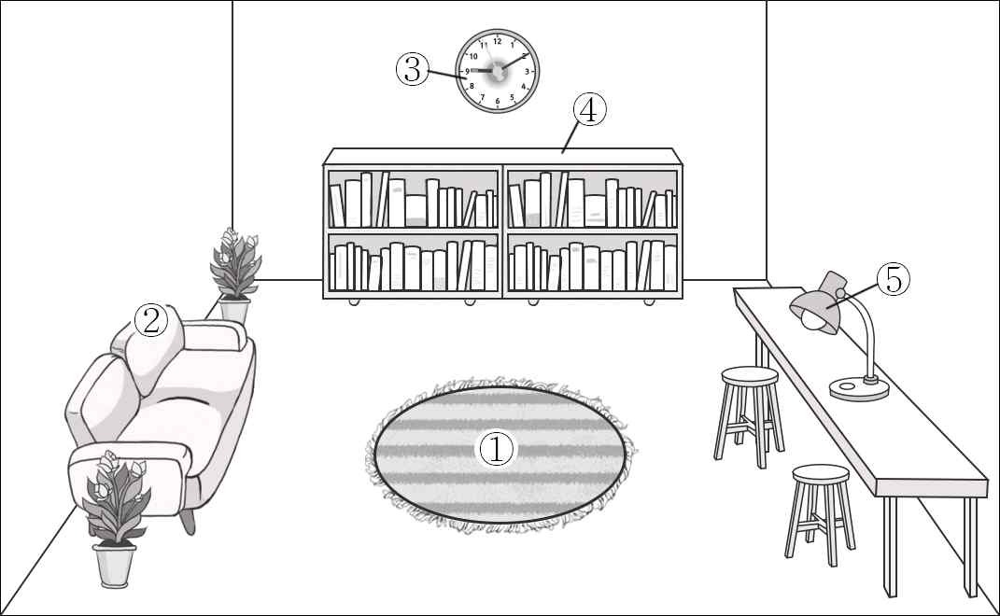
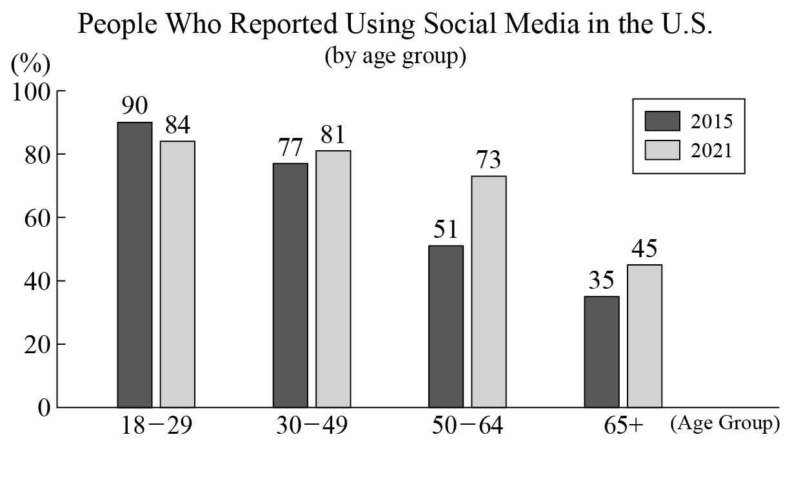

1. 다음을 듣고, 남자가 하는 말의 목적으로 가장 적절한 것을 고르시오.

① 강당의 천장 수리 기간을 공지하려고
② 콘서트 관람 규칙 준수를 요청하려고
③ 학교 축제에서 공연할 동아리를 모집하려고
④ 폭우에 대비한 교실 시설 관리를 당부하려고
⑤ 학교 록 밴드 공연의 장소 변경을 안내하려고

2. 대화를 듣고, 여자의 의견으로 가장 적절한 것을 고르시오.

① 달리기를 할 때 적합한 신발을 신어야 한다.
② 운동을 한 후에 충분한 물을 섭취해야 한다.
③ 야외 활동 전에 일기예보를 확인하는 것이 좋다.
④ 달리기 전 스트레칭은 통증과 부상을 예방해 준다.
⑤ 초보자의 경우 달리는 거리를 점진적으로 늘려야 한다.

3. 대화를 듣고, 두 사람의 관계를 가장 잘 나타낸 것을 고르시오.

① 관객 － 영화감독
② 연극 배우 － 시나리오 작가
③ 잡지 기자 － 의상 디자이너
④ 토크쇼 진행자 － 영화 평론가
⑤ 배우 지망생 － 연기 학원 강사

4. 대화를 듣고, 그림에서 대화의 내용과 일치하지 않는 것을 고르시오.

5. 대화를 듣고, 여자가 할 일로 가장 적절한 것을 고르시오.

① 관객용 의자 배치하기
② 마이크 음향 점검하기
③ 공연 포스터 붙이기
④ 무대 조명 설치하기
⑤ 배터리 구매하기

6. 대화를 듣고, 남자가 지불할 금액을 고르시오. [3점]

① $37
② $45
③ $55
④ $60
⑤ $80

7. 대화를 듣고, 여자가 스키 여행을 갈 수 없는 이유를 고르시오.

① 카페에서 일해야 해서
② 숙소를 예약하지 못해서
③ 역사 시험 공부를 해야 해서
④ 수술받은 고양이를 돌봐야 해서
⑤ 캐나다에 사는 친척을 방문해야 해서

8. 대화를 듣고, Street Photography Contest에 관해 언급되지 않은 것을 고르시오.

① 참가 대상
② 주제
③ 심사 기준
④ 제출 마감일
⑤ 우승 상품

9. Twin Stars Chocolate Day에 관한 다음 내용을 듣고, 일치하지 않는 것을 고르시오.

① 11월 12일 오후에 열린다.
② 초콜릿의 역사에 관한 강의가 진행된다.
③ 초콜릿 5개를 만든다.
④ 사전 등록 없이 참가할 수 있다.
⑤ 등록비에 재료비가 포함된다.

10. 다음 표를 보면서 대화를 듣고, 두 사람이 주문할 실내 사이클링 자전거를 고르시오.

Indoor Cycling Bikes

|  | Model | Price | Color | Foldable | Customer Rating |
| --- | --- | --- | --- | --- | --- |
| ① | A | $100 | White | × | ★★★★ |
| ② | B | $150 | Black | × | ★★★ |
| ③ | C | $190 | Black | ○ | ★★★★ |
| ④ | D | $250 | Black | ○ | ★★★★★ |
| ⑤ | E | $320 | White | × | ★★★★★ |

11. 대화를 듣고, 여자의 마지막 말에 대한 남자의 응답으로 가장 적절한 것을 고르시오.

① Sure. I’ll send you a link to the website.
② It would look better in a different color.
③ Sorry. I forgot to bring your sweater.
④ You need your receipt to return it.
⑤ My brother bought it on sale, too.

12. 대화를 듣고, 남자의 마지막 말에 대한 여자의 응답으로 가장 적절한 것을 고르시오.

① Let’s take the leftovers home.
② I prefer fried chicken over pizza.
③ I don’t want to go out for lunch today.
④ I’ll call the restaurant and check our order.
⑤ The letter was delivered to the wrong address.

13. 대화를 듣고, 여자의 마지막 말에 대한 남자의 응답으로 가장 적절한 것을 고르시오.

Man:
① You’re right. I won’t skip meals anymore.
② Thank you for the lunch you prepared for me.
③ You need to check when the cafeteria is open.
④ Trust me. I can teach you good table manners.
⑤ No problem. We’ll finish the science project on time.

14. 대화를 듣고, 남자의 마지막 말에 대한 여자의 응답으로 가장 적절한 것을 고르시오. [3점]

Woman:
① No. It isn’t difficult for me to learn Spanish.
② I’m glad you finally passed the vocabulary test.
③ Exactly. Learning a language starts with repetition.
④ It’s very helpful to use a dictionary while writing.
⑤ You should turn in your homework by this afternoon.

15. 다음 상황 설명을 듣고, Brian이 Melissa에게 할 말로 가장 적절한 것을 고르시오. [3점]

Brian:
① Let’s clean the classroom after art class.
② Did you remove the stickers from the board?
③ Please turn off the heater when you leave the room.
④ When is the final date to sign up for the design class?
⑤ Will you design stickers that encourage energy saving?

16. 남자가 하는 말의 주제로 가장 적절한 것은?

① advantages of renting houses in cities
② reasons tourists prefer visiting old cities
③ ways cities deal with overtourism problems
④ correlation between cities’ sizes and overtourism
⑤ how cities face their aging transportation systems

17. 언급된 도시가 아닌 것은?

따라 답을 하시기 바랍니다.

① Barcelona
② Amsterdam
③ London
④ Venice
⑤ Paris

18. 다음 글의 목적으로 가장 적절한 것은?

Dear Professor Sanchez, My name is Ellis Wight, and I’m the director of the Alexandria Science Museum. We are holding a Chemistry Fair for local middle school students on Saturday, October 28. The goal of the fair is to encourage them to be interested in science through guided experiments. We are looking for college students who can help with the experiments during the event. I am contacting you to ask you to recommend some students from the chemistry department at your college who you think are qualified for this job. With their help, I’m sure the participants will have a great experience. I look forward to hearing from you soon. Sincerely, Ellis Wight

19. 다음 글에 나타난 ‘I’의 심경 변화로 가장 적절한 것은?

Gregg and I had been rock climbing since sunrise and had had no problems. So we took a risk. “Look, the first bolt is right there. I can definitely climb out to it. Piece of cake,” I persuaded Gregg, minutes before I found myself pinned. It wasn’t a piece of cake. The rock was deceptively barren of handholds. I clumsily moved back and forth across the cliff face and ended up with nowhere to go...but down. The bolt that would save my life, if I could get to it, was about two feet above my reach. My arms trembled from exhaustion. I looked at Gregg. My body froze with fright from my neck down to my toes. Our rope was tied between us. If I fell, he would fall with me.

20. 다음 글에서 필자가 주장하는 바로 가장 적절한 것은?

We are always teaching our children something by our words and our actions. They learn from seeing. They learn from hearing and from overhearing. Children share the values of their parents about the most important things in life. Our priorities and principles and our examples of good behavior can teach our children to take the high road when other roads look tempting. Remember that children do not learn the values that make up strong character simply by being told about them. They learn by seeing the people around them act on and uphold those values in their daily lives. Therefore show your child good examples of life by your action. In our daily lives, we can show our children that we respect others. We can show them our compassion and concern when others are suffering, and our own self-discipline, courage and honesty as we make difficult decisions.

21. 밑줄 친 fall silently in the woods가 다음 글에서 의미하는 바로 가장 적절한 것은? [3점]

Most people have no doubt heard this question: If a tree falls in the forest and there is no one there to hear it fall, does it make a sound? The correct answer is no. Sound is more than pressure waves, and indeed there can be no sound without a hearer. And similarly, scientific communication is a two-way process. Just as a signal of any kind is useless unless it is perceived, a published scientific paper (signal) is useless unless it is both received and understood by its intended audience. Thus we can restate the axiom of science as follows: A scientific experiment is not complete until the results have been published and understood. Publication is no more than pressure waves unless the published paper is understood. Too many scientific papers fall silently in the woods.

22. 다음 글의 요지로 가장 적절한 것은?

We all negotiate every day, whether we realise it or not. Yet few people ever learn how to negotiate. Those who do usually learn the traditional, win-lose negotiating style rather than an approach that is likely to result in a win-win agreement. This old-school, adversarial approach may be useful in a one-off negotiation where you will probably not deal with that person again. However, such transactions are becoming increasingly rare, because most of us deal with the same people repeatedly — our spouses and children, our friends and colleagues, our customers and clients. In view of this, it’s essential to achieve successful results for ourselves and maintain a healthy relationship with our negotiating partners at the same time. In today’s interdependent world of business partnerships and long-term relationships, a win-win outcome is fast becoming the only acceptable result.

23. 다음 글의 주제로 가장 적절한 것은?

The interaction of workers from different cultural backgrounds with the host population might increase productivity due to positive externalities like knowledge spillovers. This is only an advantage up to a certain degree. When the variety of backgrounds is too large, fractionalization may cause excessive transaction costs for communication, which may lower productivity. Diversity not only impacts the labour market, but may also affect the quality of life in a location. A tolerant native population may value a multicultural city or region because of an increase in the range of available goods and services. On the other hand, diversity could be perceived as an unattractive feature if natives perceive it as a distortion of what they consider to be their national identity. They might even discriminate against other ethnic groups and they might fear that social conflicts between different foreign nationalities are imported into their own neighbourhood.

24. 다음 글의 제목으로 가장 적절한 것은?

We think we are shaping our buildings. But really, our buildings and development are also shaping us. One of the best examples of this is the oldest-known construction: the ornately carved rings of standing stones at Göbekli Tepe in Turkey. Before these ancestors got the idea to erect standing stones some 12,000 years ago, they were hunter-gatherers. It appears that the erection of the multiple rings of megalithic stones took so long, and so many successive generations, that these innovators were forced to settle down to complete the construction works. In the process, they became the first farming society on Earth. This is an early example of a society constructing something that ends up radically remaking the society itself. Things are not so different in our own time.

25. 다음 도표의 내용과 일치하지 않는 것은?

People Who Reported Using Social Media in the U.S. (by age group)

| Age Group | 2015 | 2021 |
| --- | --- | --- |
| 18-29 | 90% | 84% |
| 30-49 | 77% | 81% |
| 50-64 | 51% | 73% |
| 65+ | 35% | 45% |

26. Bill Evans에 관한 다음 글의 내용과 일치하지 않는 것은?

American jazz pianist Bill Evans was born in New Jersey in 1929. His early training was in classical music. At the age of six, he began receiving piano lessons, later adding flute and violin. He earned bachelor’s degrees in piano and music education from Southeastern Louisiana College in 1950. He went on to serve in the army from 1951 to 1954 and played flute in the Fifth Army Band. After serving in the military, he studied composition at the Mannes School of Music in New York. Composer George Russell admired his playing and hired Evans to record and perform his compositions. Evans became famous for recordings made from the late-1950s through the 1960s. He won his first Grammy Award in 1964 for his album Conversations with Myself. Evans’ expressive piano works and his unique harmonic approach inspired a whole generation of musicians.

27. Silversmithing Class에 관한 다음 안내문의 내용과 일치하지 않는 것은?

Silversmithing Class

Kingston Club is offering a fine jewelry making class. Don’t miss this great chance to make your own jewelry! When & Where · Saturday, October 21, 2023 (2 p.m. to 4 p.m.) · Kingston Club studio Registration · Available only online · Dates: October 1-14, 2023 ·
Fee
$40 (This includes all tools and materials.) · Registration is limited to 6 people. Note · Participants must be at least 16 years old. · No refund for cancellation on the day of the class

28. 2023 Ocean Awareness Film Contest에 관한 다음 안내문의 내용과 일치하는 것은?

2023 Ocean Awareness Film Contest

Join our 7th annual film contest and show your knowledge of marine conservation. □ Theme - Ocean Wildlife / Ocean Pollution (Choose one of the above.) □
Guidelines
Participants
High school students - Submission deadline: September 22, 2023 - The video must be between 10 and 15 minutes. - All entries must be uploaded to our website. - Only one entry per person □ Prizes · 1st place: $100 · 2nd place: $70 · 3rd place: $50 (Winners will be announced on our website.) For more information, please visit www.oceanawareFC.com.

29. 다음 글의 밑줄 친 부분 중, 어법상 틀린 것은?

There is a reason the title “Monday Morning Quarterback” exists. Just read the comments on social media from fans discussing the weekend’s games, and you quickly see how many people believe they could play, coach, and manage sport teams more successfully than those on the field. This goes for the boardroom as well. Students and professionals with years of training and specialized degrees in sport business may also find them being given advice on how to do their jobs from friends, family, or even total strangers without any expertise. Executives in sport management have decades of knowledge and experience in their respective fields. However, many of them face criticism from fans and community members telling them how to run their business. Very few people tell their doctor how to perform surgery or their accountant how to prepare their taxes, but many people provide feedback on how sport organizations should be managed.

30. 다음 글의 밑줄 친 부분 중, 문맥상 낱말의 쓰임이 적절하지 않은 것은? [3점]

While moving is difficult for everyone, it is particularly stressful for children. They lose their sense of security and may feel disoriented when their routine is disrupted and all that is familiar is taken away. Young children, ages 3-6, are particularly affected by a move. Their understanding at this stage is quite literal, and it is difficult for them to imagine beforehand a new home and their new room. Young children may have worries such as “Will I still be me in the new place?” and “Will my toys and bed come with us?” It is important to establish a balance between validating children’s past experiences and focusing on helping them adjust to the new place. Children need to have opportunities to share their backgrounds in a way that respects their past as an important part of who they are. This contributes to building a sense of community, which is essential for all children, especially those in transition.

31. 다음 빈칸에 들어갈 말로 가장 적절한 것을 고르시오.

Many people are terrified to fly in airplanes. Often, this fear stems from a lack of control. The pilot is in control, not the passengers, and this lack of control instills fear. Many potential passengers are so afraid they choose to drive great distances to get to a destination instead of flying. But their decision to drive is based solely on emotion, not logic. Logic says that statistically, the odds of dying in a car crash are around 1 in 5,000, while the odds of dying in a plane crash are closer to 1 in 11 million. If you’re going to take a risk, especially one that could possibly involve your well-being, wouldn’t you want the odds in your favor? However, most people choose the option that will cause them the least amount of anxiety. Pay attention to the thoughts you have about taking the risk and make sure you’re basing your decision on facts, not just feelings.

32. 다음 빈칸에 들어갈 말로 가장 적절한 것을 고르시오. [3점]

The famous primatologist Frans de Waal, of Emory University, says humans downplay similarities between us and other animals as a way of maintaining our spot at the top of our imaginary ladder. Scientists, de Waal points out, can be some of the worst offenders — employing technical language to distance the other animals from us. They call “kissing” in chimps “mouth-to-mouth contact”; they call “friends” between primates “favorite affiliation partners”; they interpret evidence showing that crows and chimps can make tools as being somehow qualitatively different from the kind of toolmaking said to define humanity. If an animal can beat us at a cognitive task — like how certain bird species can remember the precise locations of thousands of seeds — they write it off as instinct, not intelligence. This and so many more tricks of language are what de Waal has termed “linguistic castration.” The way we use our tongues to disempower animals, the way we invent words to maintain our spot at the top.

33. 다음 빈칸에 들어갈 말로 가장 적절한 것을 고르시오.

A key to engagement and achievement is providing students with relevant texts they will be interested in. My scholarly work and my teaching have been deeply influenced by the work of Rosalie Fink. She interviewed twelve adults who were highly successful in their work, including a physicist, a biochemist, and a company CEO. All of them had dyslexia and had had significant problems with reading throughout their school years. While she expected to find that they had avoided reading and discovered ways to bypass it or compensate with other strategies for learning, she found the opposite. “To my surprise, I found that these dyslexics were enthusiastic readers...they rarely avoided reading. On the contrary, they sought out books.” The pattern Fink discovered was that all of her subjects had been passionate in some personal interest. The areas of interest included religion, math, business, science, history, and biography. What mattered was that they read voraciously to find out more.

34. 다음 빈칸에 들어갈 말로 가장 적절한 것을 고르시오. [3점]

For many people, ability refers to intellectual competence, so they want everything they do to reflect how smart they are — writing a brilliant legal brief, getting the highest grade on a test, writing elegant computer code, saying something exceptionally wise or witty in a conversation. You could also define ability in terms of a particular skill or talent, such as how well one plays the piano, learns a language, or serves a tennis ball. Some people focus on their ability to be attractive, entertaining, up on the latest trends, or to have the newest gadgets. However ability may be defined, a problem occurs when it is the sole determinant of one’s self-worth. The performance becomes the only measure of the person; nothing else is taken into account. An outstanding performance means an outstanding person; an average performance means an average person. Period.

35. 다음 글에서 전체 흐름과 관계 없는 문장은? [3점]

Sensory nerves have specialized endings in the tissues that pick up a particular sensation. If, for example, you step on a sharp object such as a pin, nerve endings in the skin will transmit the pain sensation up your leg, up and along the spinal cord to the brain.

36. 주어진 글 다음에 이어질 글의 순서로 가장 적절한 것을 고르시오. [3점]

Maybe you’ve heard this joke: “How do you eat an elephant?” The answer is “one bite at a time.” So, how do you “build” the Earth? That’s simple, too: one atom at a time. Atoms are the basic building blocks of crystals, and since all rocks are made up of crystals, the more you know about atoms, the better. Crystals come in a variety of shapes that scientists call habits. Common crystal habits include squares, triangles, and six-sided hexagons. Usually crystals form when liquids cool, such as when you create ice cubes. Many times, crystals form in ways that do not allow for perfect shapes. If conditions are too cold, too hot, or there isn’t enough source material, they can form strange, twisted shapes. But when conditions are right, we see beautiful displays. Usually, this involves a slow, steady environment where the individual atoms have plenty of time to join and fit perfectly into what’s known as the crystal lattice. This is the basic structure of atoms that is seen time after time.

37. 주어진 글 다음에 이어질 글의 순서로 가장 적절한 것을 고르시오.

When you pluck a guitar string it moves back and forth hundreds of times every second. Naturally, this movement is so fast that you cannot see it — you just see the blurred outline of the moving string. Strings vibrating in this way on their own make hardly any noise because strings are very thin and don’t push much air about. But if you attach a string to a big hollow box (like a guitar body), then the vibration is amplified and the note is heard loud and clear. The vibration of the string is passed on to the wooden panels of the guitar body, which vibrate back and forth at the same rate as the string. The vibration of the wood creates more powerful waves in the air pressure, which travel away from the guitar. When the waves reach your eardrums they flex in and out the same number of times a second as the original string.

38. 글의 흐름으로 보아, 주어진 문장이 들어가기에 가장 적절한 곳을 고르시오. [3점]

Boundaries between work and home are blurring as portable digital technology makes it increasingly possible to work anywhere, anytime. Individuals differ in how they like to manage their time to meet work and outside responsibilities. Some people prefer to separate or segment roles so that boundary crossings are minimized. For example, these people might keep separate email accounts for work and family and try to conduct work at the workplace and take care of family matters only during breaks and non-work time. We’ve even noticed more of these “segmenters” carrying two phones ― one for work and one for personal use. Flexible schedules work well for these individuals because they enable greater distinction between time at work and time in other roles. Other individuals prefer integrating work and family roles all day long. This might entail constantly trading text messages with children from the office, or monitoring emails at home and on vacation, rather than returning to work to find hundreds of messages in their inbox.

39. 글의 흐름으로 보아, 주어진 문장이 들어가기에 가장 적절한 곳을 고르시오.

A “complementary good” is a product that is often consumed alongside another product. For example, popcorn is a complementary good to a movie, while a travel pillow is a complementary good for a long plane journey. When the popularity of one product increases, the sales of its complementary good also increase. By producing goods that complement other products that are already (or about to be) popular, you can ensure a steady stream of demand for your product. Some products enjoy perfect complementary status — they have to be consumed together, such as a lamp and a lightbulb. However, do not assume that a product is perfectly complementary, as customers may not be completely locked in to the product. For example, although motorists may seem required to purchase gasoline to run their cars, they can switch to electric cars.

40. 다음 글의 내용을 한 문장으로 요약하고자 한다. 빈칸 (A), (B)에 들어갈 말로 가장 적절한 것은?

It’s not news to anyone that we judge others based on their clothes. In general, studies that investigate these judgments find that people prefer clothing that matches expectations — surgeons in scrubs, little boys in blue — with one notable exception. A series of studies published in an article in June 2014 in the Journal of Consumer Research explored observers’ reactions to people who broke established norms only slightly. In one scenario, a man at a black-tie affair was viewed as having higher status and competence when wearing a red bow tie. The researchers also found that valuing uniqueness increased audience members’ ratings of the status and competence of a professor who wore red sneakers while giving a lecture. The results suggest that people judge these slight deviations from the norm as positive because they suggest that the individual is powerful enough to risk the social costs of such behaviors. 

A series of studies show that people view an individual positively when the individual only slightly challenges the norm for what people should wear.

41. 윗글의 제목으로 가장 적절한 것은?

Claims that local food production cut greenhouse gas emissions by reducing the burning of transportation fuel are usually not well founded. Transport is the source of only 11 percent of greenhouse gas emissions within the food sector, so reducing the distance that food travels after it leaves the farm is far less important than reducing wasteful energy use on the farm. Food coming from a distance can actually be better for the climate, depending on how it was grown. For example, field-grown tomatoes shipped from Mexico in the winter months will have a smaller carbon footprint than local winter tomatoes grown in a greenhouse. In the United Kingdom, lamb meat that travels 11,000 miles from New Zealand generates only one-quarter the carbon emissions per pound compared to British lamb because farmers in the United Kingdom raise their animals on feed (which must be produced using fossil fuels) rather than on clover pastureland. When food does travel, what matters most is not the distance traveled but the travel mode (surface versus air), and most of all the load size. Bulk loads of food can travel halfway around the world by ocean freight with a smaller carbon footprint, per pound delivered, than foods traveling just a short distance but in much larger loads. For example, 18-wheelers carry much larger loads than pickup trucks so they can move food 100 times as far while burning only one-third as much gas per pound of food delivered.

42. 밑줄 친 낱말 중에서 문맥상 낱말의 쓰임이 적절하지 않은 것은?

Claims that local food production cut greenhouse gas emissions by reducing the burning of transportation fuel are usually not well founded. Transport is the source of only 11 percent of greenhouse gas emissions within the food sector, so reducing the distance that food travels after it leaves the farm is far less important than reducing wasteful energy use on the farm. Food coming from a distance can actually be better for the climate, depending on how it was grown. For example, field-grown tomatoes shipped from Mexico in the winter months will have a smaller carbon footprint than local winter tomatoes grown in a greenhouse. In the United Kingdom, lamb meat that travels 11,000 miles from New Zealand generates only one-quarter the carbon emissions per pound compared to British lamb because farmers in the United Kingdom raise their animals on feed (which must be produced using fossil fuels) rather than on clover pastureland. When food does travel, what matters most is not the distance traveled but the travel mode (surface versus air), and most of all the load size. Bulk loads of food can travel halfway around the world by ocean freight with a smaller carbon footprint, per pound delivered, than foods traveling just a short distance but in much larger loads. For example, 18-wheelers carry much larger loads than pickup trucks so they can move food 100 times as far while burning only one-third as much gas per pound of food delivered.

43. 주어진 글에 이어질 내용을 순서에 맞게 배열한 것으로 가장 적절한 것은?

 Seeing the notice, many people went to the old man. But he returned all the applicants after interviews, telling them, “I need a qualified person for this work.” The old man would sit on the roof of his house every morning, watching people go through the temple doors. One day, he saw a young man come to the temple. When that young man left the temple, the old man called him and asked, “Will you take care of this temple?” The young man was surprised by the offer and replied, “I have no experience caring for a temple. I’m not even educated.” The old man smiled and said, “I don’t want any educated man. I want a qualified person.” Confused, the young man asked, “But why do you consider me a qualified person?” The old man replied, “I buried a brick on the path to the temple. I watched for many days as people tripped over that brick. No one thought to remove it. But you dug up that brick.” The young man said, “I haven’t done anything great. It’s the duty of every human being to think about others. I only did my duty.” The old man smiled and said, “Only people who know their duty and perform it are qualified people.” 

44. 밑줄 친 낱말 중에서 가리키는 대상이 나머지 넷과 다른 것은?

 Seeing the notice, many people went to the old man. But he returned all the applicants after interviews, telling them, “I need a qualified person for this work.” The old man would sit on the roof of his house every morning, watching people go through the temple doors. One day, he saw a young man come to the temple. When that young man left the temple, the old man called him and asked, “Will you take care of this temple?” The young man was surprised by the offer and replied, “I have no experience caring for a temple. I’m not even educated.” The old man smiled and said, “I don’t want any educated man. I want a qualified person.” Confused, the young man asked, “But why do you consider me a qualified person?” The old man replied, “I buried a brick on the path to the temple. I watched for many days as people tripped over that brick. No one thought to remove it. But you dug up that brick.” The young man said, “I haven’t done anything great. It’s the duty of every human being to think about others. I only did my duty.” The old man smiled and said, “Only people who know their duty and perform it are qualified people.” 

45. 윗글에 관한 내용으로 적절하지 않은 것은?

 Seeing the notice, many people went to the old man. But he returned all the applicants after interviews, telling them, “I need a qualified person for this work.” The old man would sit on the roof of his house every morning, watching people go through the temple doors. One day, he saw a young man come to the temple. When that young man left the temple, the old man called him and asked, “Will you take care of this temple?” The young man was surprised by the offer and replied, “I have no experience caring for a temple. I’m not even educated.” The old man smiled and said, “I don’t want any educated man. I want a qualified person.” Confused, the young man asked, “But why do you consider me a qualified person?” The old man replied, “I buried a brick on the path to the temple. I watched for many days as people tripped over that brick. No one thought to remove it. But you dug up that brick.” The young man said, “I haven’t done anything great. It’s the duty of every human being to think about others. I only did my duty.” The old man smiled and said, “Only people who know their duty and perform it are qualified people.”
