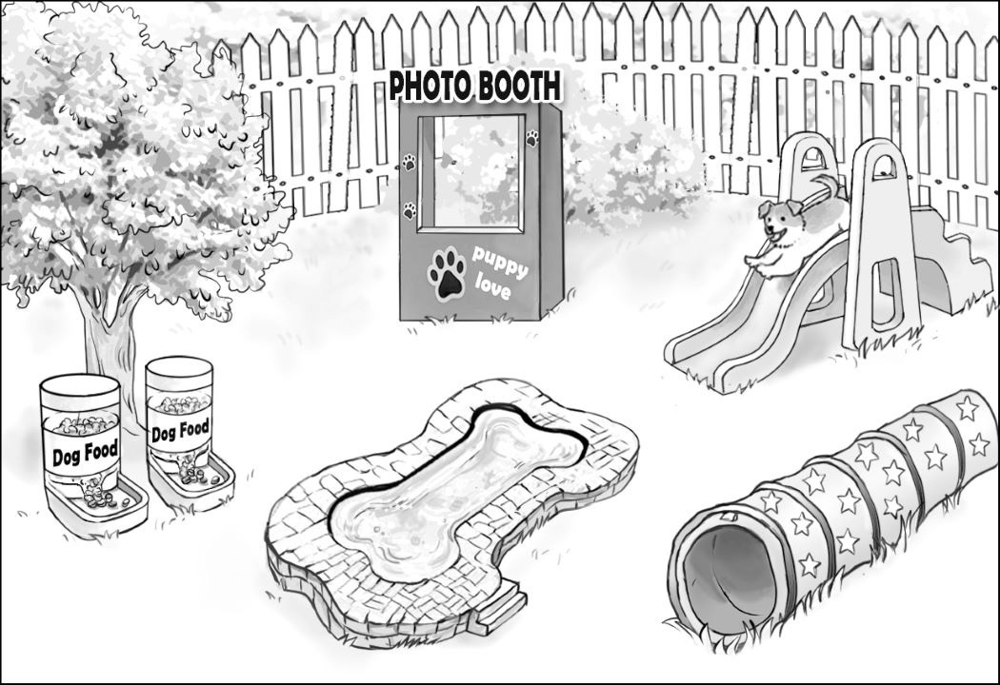
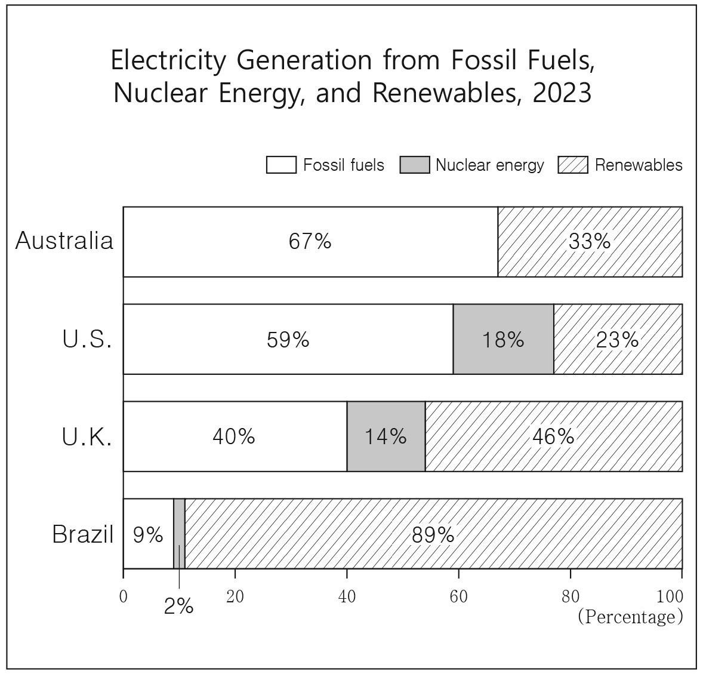
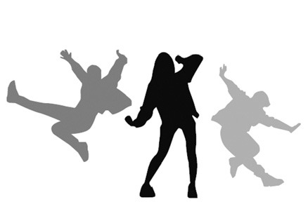
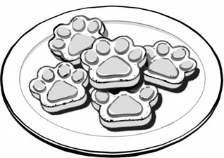

1. 다음을 듣고, 남자가 하는 말의 목적으로 가장 적절한 것을 고르시오.

① 중간고사 실시 일정의 변경을 알리려고
② 시험 문제 이의 제기 기간을 공지하려고
③ 분실한 스마트 시계를 찾아가도록 안내하려고
④ 시험 중 전자 기기를 소지하지 않도록 당부하려고
⑤ 전자 기기를 활용한 시험 방식에 대해 설명하려고

2. 대화를 듣고, 여자의 의견으로 가장 적절한 것을 고르시오.

① 자녀들이 스스로 인터넷 사용 시간을 조절하도록 교육해야 한다.
② 온라인에 자녀의 사진을 올릴 때 그 위험성을 인식해야 한다.
③ 사진을 영구적으로 보존하려면 온라인에 업로드해야 한다.
④ 부모는 자녀의 올바른 소셜 미디어 사용을 지도해야 한다.
⑤ 온라인 범죄에 노출될 경우 경찰에 즉시 신고해야 한다.

3. 다음을 듣고, 여자가 하는 말의 요지로 가장 적절한 것을 고르시오.

① 여러 기관의 통계 자료 활용은 발표의 신뢰도를 높여 준다.
② 좋은 발표의 핵심은 청중의 수준에 맞는 주제 선정에 있다.
③ 대화를 나눌 때 매력적인 화법은 좋은 인상을 남길 수 있다.
④ 청중의 흥미를 유지하기 위해 지속적인 주의 환기가 필요하다.
⑤ 성공적인 발표를 위해 흥미로운 도입부로 시작하는 게 중요하다.

4. 대화를 듣고, 그림에서 대화의 내용과 일치하지 않는 것을 고르시오.

①
②

5. 대화를 듣고, 남자가 할 일로 가장 적절한 것을 고르시오.

① 카메라 빌려 오기
② 영상 촬영하기
③ 단체 티셔츠 주문하기
④ 연습 일정 안내하기
⑤ 구매 사이트 주소 보내기

6. 대화를 듣고, 여자가 지불할 금액을 고르시오. [3점]

① $50
② $55
③ $63
④ $66
⑤ $70

7. 대화를 듣고, 남자가 등산을 갈 수 없는 이유를 고르시오.

① 사전 교육 프로그램에 참여해야 해서
② 등산 스틱을 구매하지 못해서
③ 인턴십 면접 일정과 겹쳐서
④ 감기가 아직 낫지 않아서
⑤ 여동생을 돌봐야 해서

8. 대화를 듣고, Art and Humanities Tour에 관해 언급되지 않은 것을 고르시오.

① 목적
② 운영 프로그램
③ 날짜
④ 모집 인원
⑤ 등록비

9. Sports Complex Opening Ceremony에 관한 다음 내용을 듣고, 일치하지 않는 것을 고르시오.

① 이번 주 금요일에 열릴 것이다.
② 1층에서는 가족 미니 게임이 있을 것이다.
③ 2층에서는 탁구 메달리스트들이 경기를 할 것이다.
④ 연간 회원권의 반값 할인이 행사 당일에만 제공될 것이다.
⑤ 예약은 웹사이트에서만 가능하다.

10. 다음 표를 보면서 대화를 듣고, 두 사람이 구매할 향신료 분쇄기를 고르시오.

Spice Grinder

|  | Model | Price | Operation | Capacity | Adjustability |
| --- | --- | --- | --- | --- | --- |
| ① | A | $20 | Manual | 60g | ☓ |
| ② | B | $25 | Automatic | 65g | ◯ |
| ③ | C | $35 | Automatic | 72g | ◯ |
| ④ | D | $40 | Automatic | 73g | ☓ |
| ⑤ | E | $55 | Manual | 75g | ◯ |

11. 대화를 듣고, 남자의 마지막 말에 대한 여자의 응답으로 가장 적절한 것을 고르시오.

① A DJ unexpectedly mixed and played my requested songs.
② My family and I went camping together once in a while.
③ It wasn’t as good as when you were there last year.
④ The festival will be more exciting than before.
⑤ The food there was too expensive to enjoy.

12. 대화를 듣고, 여자의 마지막 말에 대한 남자의 응답으로 가장 적절한 것을 고르시오.

① Certainly. Delivery food is not preferred due to health issues.
② That’s strange. Check if the address on the app is correct.
③ No worries. I think you can deliver the package tomorrow.
④ I see. I’ll leave the plate outside when we’re done.
⑤ That sounds nice. I’ll go with the cheaper one.

13. 대화를 듣고, 남자의 마지막 말에 대한 여자의 응답으로 가장 적절한 것을 고르시오. [3점]

Woman:

① Absolutely. I’ll start first thing tomorrow.
② Sorry. The pill you’ve taken has a side effect.
③ Good choice. Let’s sign up for the cooking class.
④ Unbelievable. Your smoothies are already sold out.
⑤ Sure. I don’t think carrots ease my stomach issues.

14. 대화를 듣고, 여자의 마지막 말에 대한 남자의 응답으로 가장 적절한 것을 고르시오. [3점]

Man:

① Right. That’s why I always like to pay separately.
② No problem. Tipping more than 10% isn’t too much.
③ Really? I could recommend a nice restaurant in Rome.
④ Exactly. Italy is also a country where tipping is common.
⑤ No way. You should ask politely if the tip could be removed.

15. 다음 상황 설명을 듣고, Mr. Jang이 Mina에게 할 말로 가장 적절한 것을 고르시오.

Mr. Jang:

① I’m here for you to finish the project.
② Believe in yourself and take advanced math.
③ You could set up a booth for a curriculum fair.
④ Advanced math must be a tough choice for you.
⑤ Focus on preparing for the exam to pass advanced math.

16. 여자가 하는 말의 주제로 가장 적절한 것은?

① skills to control AI technology in job fields
② ways to protect job fields from AI invasion
③ effects of AI technology on various job fields
④ newly emerging high-paying job fields due to AI
⑤ integration of job fields in response to the rise of AI

17. 언급된 직업 분야가 아닌 것은?

따라 답을 하시기 바랍니다.

① customer service
② legal fields
③ financial sectors
④ marketing fields
⑤ graphic design

18. 다음 글의 목적으로 가장 적절한 것은?

To the State Education Department, I am writing with regard to the state’s funding for the construction project at Fort Montgomery High School. Our school needs additional spaces to provide a fully functional Art and Library Media Center to serve our students in a more meaningful way. Despite submitting all required documentation for funding to your department in April 2024, we have not yet received any notification from your department. A delay in the process can carry considerable consequences related to the school’s budgetary constraints and schedule. Therefore, in order to proceed with our project, we request you notify us of the review result regarding the submitted documentation. I look forward to hearing from you. Respectfully, Clara Smith Principal, Fort Montgomery High School

19. 다음 글에 드러난 ‘I’의 심경 변화로 가장 적절한 것은?

As I waited outside the locker room after a hard‐fought basketball game, the coach called out to me, “David, walk with me.” I figured he was going to tell me something important. He was going to select me to be the captain of the team, the leader I had always wanted to be. My heart was racing with anticipation. But when his next words hit my ears, everything changed. “We’re going to have to send you home,” he said coldly. “I don’t think you are going to make it.” I couldn’t believe his decision. I tried to hold it together, but inside I was falling apart. A car would be waiting tomorrow morning to take me home. And just like that, it was over.

20. 다음 글에서 필자가 주장하는 바로 가장 적절한 것은?

For many of us, making time for exercise is a continuing challenge. Between work commitments and family obligations, it often feels like there’s no room in our packed schedules for a dedicated workout. But what if the workout came to you, right in the midst of your daily routine? That’s where the beauty of integrating mini-exercises into household chores comes into play. Let’s be realistic; chores are inevitable. Whether it’s washing dishes or taking out the trash, these tasks are an essential part of daily life. But rather than viewing chores as purely obligatory activities, why not seize these moments as opportunities for physical activity? For instance, practice squats or engage in some wall push-ups as you wait for your morning kettle to boil. Incorporating quick exercises into your daily chores can improve your health.

21. 밑줄 친 Seeing is not believing.이 다음 글에서 의미하는 바로 가장 적절한 것은? [3점]

When we see something, we naturally and automatically break it up into shapes, colors, and concepts that we have learned through education. We recode what we see through the lens of everything we know. We reconstruct memories rather than retrieving the video from memory. This is a useful trait. It’s a more efficient way to store information ― a bit like an optimal image compression algorithm such as JPG, rather than storing a raw bitmap image file. People who lack this ability and remember everything in perfect detail struggle to generalize, learn, and make connections between what they have learned. But representing the world as abstract ideas and features comes at a cost of seeing the world as it is. Instead, we see the world through our assumptions, motivations, and past experiences. The discovery that our memories are reconstructed through abstract representations rather than played back like a movie completely undermined the legal primacy of eyewitness testimony. Seeing is not believing.

22. 다음 글의 요지로 가장 적절한 것은?

In his Cornell laboratory, David Dunning conducted experimental tests of eyewitness testimony and found evidence that a careful deliberation of facial features and a detailed discussion of selection procedures can actually be a sign of an inaccurate identification. It’s when people find themselves unable to explain why they recognize the person, saying things like “his face just popped out at me,” that they tend to be accurate more often. Sometimes our first, immediate, automatic reaction to a situation is the truest interpretation of what our mind is telling us. That very first impression can also be more accurate about the world than the deliberative, reasoned self-narrative can be. In his book Blink, Malcolm Gladwell describes a variety of studies in psychology and behavioral economics that demonstrate the superior performance of relatively unconscious first guesses compared to logical step-by-step justifications for a decision.

23. 다음 글의 주제로 가장 적절한 것은?

Many forms of research lead naturally to quantitative data. A study of happiness might measure the number of times someone smiles during an interaction, and a study of memory might measure the number of items an individual can recall after one, five, and ten minutes. Asking people how many times in a year they are sad will also yield quantitative data, but it might not be reliable. Respondents’ recollections may be inaccurate, and their definitions of ‘sad’ could vary widely. But asking “How many times in the past year were you sad enough to call in sick to work?” prompts a concrete answer. Similarly, instead of asking people to rate how bad a procrastinator they are, ask, “How many of your utility bills are you currently late in paying, even though you can afford to pay them?” Questions that seek concrete responses help make abstract concepts clearer and ensure consistency from one study to the next.

24. 다음 글의 제목으로 가장 적절한 것은?

The evolution of AI is often associated with the concept of singularity. Singularity refers to the point at which AI exceeds human intelligence. After that point, it is predicted that AI will repeatedly improve itself and evolve at an accelerated pace. When AI becomes self-aware and pursues its own goals, it will be a conscious being, not just a machine. AI and human consciousness will then begin to evolve together. Our consciousness will evolve to new dimensions through our interactions with AI, which will provide us with intellectual stimulation and inspire new insights and creativity. Conversely, our consciousness also has a significant impact on the evolution of AI. The direction of AI’s evolution will depend greatly on what values and ethics we incorporate into AI. We need to see our relationship with AI as a mutual coexistence of conscious beings, recognizing its rights and supporting the evolution of its consciousness.

25. 다음 도표의 내용과 일치하지 않는 것은?

Electricity Generation from Fossil Fuels, Nuclear Energy, and Renewables, 2023

| Country | Fossil Fuels | Nuclear Energy | Renewables |
| --- | --- | --- | --- |
| Australia | 67% | 0% | 33% |
| U.S. | 59% | 18% | 23% |
| U.K. | 40% | 14% | 46% |
| Brazil | 9% | 2% | 89% |

26. Douglas Kirkland에 관한 다음 글의 내용과 일치하지 않는 것은?

Douglas Kirkland, known for his highly artistic portraits of Hollywood celebrities, was born in Toronto, Canada. When he was young, he eagerly awaited the weekly arrival of Life magazine and discussed the photographs the magazine contained with his father. Believing that he would have better career prospects, Kirkland moved to the United States after graduating from high school and found work at a photography studio. When Look magazine hired him at age 24, he became their second-youngest photographer ever. His photos taken of Marilyn Monroe in 1961 became iconic almost instantly. Kirkland spent his weeks shooting day-to-day life across the United States and his weekends in exotic locations. His photo essays could run up to a dozen pages and were seen by more than half of all Americans.

27. Yummy Paws: Pet Food Cooking Class에 관한 다음 안내문의 내용과 일치하지 않는 것은?

Yummy Paws: Pet Food Cooking Class

Join us for an exciting pet food cooking class where you will learn how to create healthy and delicious pumpkin biscuits for your furry friends!
When
2:00 p.m. - 4:00 p.m., Every Sunday, December, 2024
Where
Green Park Community Center, Room 5 Registration
Register online at www.yummypawsclass.com.
Limited to 10 participants for each class Fee
$30 per participant (Full payment is required when registering.)
The fee includes all ingredients. Note
Additional recipes available for free
For safety reasons, no pets are allowed.
For a refund, cancel at least 48 hours before the class.

28. 2024 K-Pop Cover Dance Contest에 관한 다음 안내문의 내용과 일치하는 것은?

2024 K-Pop Cover Dance Contest

Good news for K-Pop fans in Canada! It’s time for your dance team to show your talents at this contest! When & Where Date: November 29th, 2024 Time: 7 p.m. - 9 p.m.
Location
So Merry Theatre
Judging Criteria
Cooperation, Artistic Skill, Costume Prize Top 3 teams will receive a $200 gift certificate. The winning team will have the chance to visit Korea’s top management agencies. Application A cover dance video should not be more than 4 minutes long. Submit the video, along with your application, via our website by November 3rd. For more information, visit www.2024kpopcontest.com.

29. 다음 글의 밑줄 친 부분 중, 어법상 틀린 것은?

Digital technologies are essentially related to metaphors, but digital metaphors are different from linguistic ones in important ways. Linguistic metaphors are passive, in the sense that the audience needs to choose to actively enter the world proposed by metaphor. In the Shakespearean metaphor “time is a beggar,” the audience is unlikely to understand the metaphor without cognitive effort and without further engaging Shakespeare’s prose. Technological metaphors, on the other hand, are active (and often imposing) in the sense that they are realized in digital artifacts that are actively doing things, forcefully changing a user’s meaning horizon. Technological creators cannot generally afford to require their potential audience to wonder how the metaphor works; normally the selling point is what the usefulness of the technology is obvious at first glance. Shakespeare, on the other hand, is beloved in part because the meaning of his works is not immediately obvious and requires some thought on the part of the audience.

30. 다음 글의 밑줄 친 부분 중, 문맥상 낱말의 쓰임이 적절하지 않은 것은? [3점]

Herbert Simon won his Nobel Prize for recognizing our limitations in information, time, and cognitive capacity. As we lack the resources to compute answers independently, we distribute the computation across the population and solve the answer slowly, generation by generation. Then all we have to do is socially learn the right answers. You don’t need to understand how your computer or toilet works; you just need to be able to use the interface and flush. All that needs to be transmitted is which button to push ― essentially how to interact with technologies rather than how they work. And so instead of holding less information than we have mental capacity for and indeed need to know, we could dedicate our large brains to a small piece of a giant calculation. We understand things well enough to benefit from them, but all the while we are making small calculations that contribute to a larger whole. We are just doing our part in a larger computation for our societies’ collective brains.

31. 다음 빈칸에 들어갈 말로 가장 적절한 것을 고르시오.

The best defence most species of octopus have is to stay hidden as much as possible and do their own hunting at night. So to find one in full view in the shallows in daylight was a surprise for two Australian underwater photographers. Actually, what they saw at first was a flounder. It was only when they looked again that they saw a medium-sized octopus, with all eight of its arms folded and its two eyes staring upwards to create the illusion. An octopus has a big brain, excellent eyesight and the ability to change colour and pattern, and this one was using these assets to turn itself into a completely different creature. Many more of this species have been found since then, and there are now photographs of octopuses that could be said to be transforming into sea snakes. And while they mimic, they hunt ― producing the spectacle of, say, a flounder suddenly developing an octopodian arm, sticking it down a hole and grabbing whatever’s hiding there.

32. 다음 빈칸에 들어갈 말로 가장 적절한 것을 고르시오.

How much we suffer relates to how we frame the pain in our mind. When 1500m runners push themselves into extreme pain to win a race ― their muscles screaming and their lungs exploding with oxygen deficit, they don’t psychologically suffer much. In fact, ultra-marathon runners ― those people who are crazy enough to push themselves beyond the normal boundaries of human endurance, covering distances of 50 - 100km or more over many hours, talk about making friends with their pain. When a patient has paid for some form of passive back pain therapy and the practitioner pushes deeply into a painful part of a patient’s back to mobilise it, the patient calls that good pain if he or she believes this type of deep pressure treatment will be of value, even though the practitioner is pushing right into the patient’s sore tissues.

33. 다음 빈칸에 들어갈 말로 가장 적절한 것을 고르시오. [3점]

When I worked for a large electronics company that manufactured laser and ink-jet printers, I soon discovered why there are often three versions of many consumer goods. If the manufacturer makes only one version of its product, people who bought it might have been willing to spend more money, so the company is losing some income. If the company offers two versions, one with more features and more expensive than the other, people will compare the two models and still buy the less expensive one. But if the company introduces a third model with even more features and more expensive than the other two, sales of the second model go up; many people like the features of the most expensive model, but not the price. The middle item has more features than the least expensive one, and it is less expensive than the fanciest model. They buy the middle item, unaware that they have been manipulated by the presence of the higher-priced item.

34. 다음 빈칸에 들어갈 말로 가장 적절한 것을 고르시오. [3점]

On-screen, climate disaster is everywhere you look, but the scope of the world’s climate transformation may just as quickly eliminate the climate-fiction genre ― indeed eliminate any effort to tell the story of warming, which could grow too large and too obvious even for Hollywood. You can tell stories ‘about’ climate change while it still seems a marginal feature of human life. But when the temperature rises by three or four more degrees, hardly anyone will be able to feel isolated from its impacts. And so as climate change expands across the horizon, it may cease to be a story. Why watch or read climate fiction about the world you can see plainly out your own window? At the moment, stories illustrating global warming can still offer an escapist pleasure, even if that pleasure often comes in the form of horror. But when we can no longer pretend that climate suffering is distant — in time or in place ― we will stop pretending about it and start pretending within it.

35. 다음 글에서 전체 흐름과 관계 없는 문장은?

Today, the water crisis is political ― which is to say, not inevitable or beyond our capacity to fix ― and, therefore, functionally elective.

36. 주어진 글 다음에 이어질 글의 순서로 가장 적절한 것을 고르시오. [3점]

As individuals, our ability to thrive depended on how well we navigated relationships in a group. If the group valued us, we could count on support, resources, and probably a mate. If it didn’t, we might get none of these merits. It was a matter of survival, physically and genetically. Over millions of years, the pressure selected for people who are sensitive to and skilled at maximizing their standing. The result was the development of a tendency to unconsciously monitor how other people in our community perceive us. We process that information in the form of self-esteem and such related emotions as pride, shame, or insecurity. These emotions compel us to do more of what makes our community value us and less of what doesn’t. And, crucially, they are meant to make that motivation feel like it is coming from within. If we realized, on a conscious level, that we were responding to social pressure, our performance might come off as grudging or cynical, making it less persuasive.

37. 주어진 글 다음에 이어질 글의 순서로 가장 적절한 것을 고르시오.

Conventional medicine has long believed that depression is caused by an imbalance of neurotransmitters in the brain. However, there is a major problem with this explanation. This is because the imbalance of substances in the brain is a consequence of depression, not its cause. In other words, depression causes a decrease in brain substances such as serotonin and noradrenaline, not a decrease in brain substances causes depression. In this revised cause-and-effect, the key is to reframe depression as a problem of consciousness. Our consciousness is a more fundamental entity that goes beyond the functioning of the brain. The brain is no more than an organ of consciousness. If it is not consciousness itself, then the root cause of depression is also a distortion of our state of consciousness: a consciousness that has lost its sense of self and the meaning of life. Such a disease of consciousness may manifest itself in the form of depression.

38. 글의 흐름으로 보아, 주어진 문장이 들어가기에 가장 적절한 곳을 고르시오.

The common accounts of human nature that float around in society are generally a mixture of assumptions, tales and sometimes plain silliness. However, psychology is different. It is the branch of science that is devoted to understanding people: how and why we act as we do; why we see things as we do; and how we interact with one another. The key word here is ‘science.’ Psychologists don’t depend on opinions and hearsay, or the generally accepted views of society at the time, or even the considered opinions of deep thinkers. Instead, they look for evidence, to make sure that psychological ideas are firmly based, and not just derived from generally held beliefs or assumptions. In addition to this evidence-based approach, psychology deals with fundamental processes and principles that generate our rich cultural and social diversity, as well as those shared by all human beings. These are what modern psychology is all about.

39. 글의 흐름으로 보아, 주어진 문장이 들어가기에 가장 적절한 곳을 고르시오. [3점]

Life is what physicists might call a ‘high-dimensional system,’ which is their fancy way of saying that there’s a lot going on. In just a single cell, the number of possible interactions between different molecules is enormous. Such a system can only hope to be stable if only a smaller number of collective ways of being may emerge. For example, it is only a limited number of tissues and body shapes that may result from the development of a human embryo. In 1942, the biologist Conrad Waddington called this drastic narrowing of outcomes canalization. The organism may switch between a small number of well-defined possible states, but can’t exist in random states in between them, rather as a ball in a rough landscape must roll to the bottom of one valley or another. We’ll see that this is true also of health and disease: there are many causes of illness, but their manifestations at the physiological and symptomatic levels are often strikingly similar.

40. 다음 글의 내용을 한 문장으로 요약하고자 한다. 빈칸 (A), (B)에 들어갈 말로 가장 적절한 것은?

Punishing a child may not be effective due to what Álvaro Bilbao, a neuropsychologist, calls ‘trick-punishments.’ A trick-punishment is a scolding, a moment of anger or a punishment in the most classic sense of the word. Instead of discouraging the child from doing something, it encourages them to do it. For example, Hugh learns that when he hits his little brother, his mother scolds him. For a child who feels lonely, being scolded is much better than feeling invisible, so he will continue to hit his brother. In this case, his mother would be better adopting a different strategy. For instance, she could congratulate Hugh when he has not hit his brother for a certain length of time. The mother clearly cannot allow the child to hit his little brother, but instead of constantly pointing out the negatives, she can choose to reward the positives. In this way, any parent can avoid trick-punishments. A trick-punishment reinforces the unwanted behavior of a child, which implies that parents should focus on reducing the attention to negatives while rewarding positive behaviors.

41. 윗글의 제목으로 가장 적절한 것은? [3점]

From an early age, we assign purpose to objects and events, preferring this reasoning to random chance. Children assume, for instance, that pointy rocks are that way because they don’t want you to sit on them. When we encounter something, we first need to determine what sort of thing it is. Inanimate objects and plants generally do not move and can be evaluated from physics alone. However, by attributing intention to animals and even objects, we are able to make fast decisions about the likely behaviour of that being. This was essential in our hunter-gatherer days to avoid being eaten by predators. The anthropologist Stewart Guthrie made the point that survival in our evolutionary past meant that we interpret ambiguous objects as agents with human mental characteristics, as those are the mental processes which we understand. Ambiguous events are caused by such agents. This results in a perceptual system strongly resistant towards anthropomorphism. Therefore, we tend to assume intention even where there is none. This would have arisen as a survival mechanism. If a lion is about to attack you, you need to react quickly, given its probable intention to kill you. By the time you have realized that the design of its teeth and claws could kill you, you are dead. So, assuming intent, without detailed design analysis or understanding of the physics, has saved your life.

42. 밑줄 친 낱말 중에서 문맥상 낱말의 쓰임이 적절하지 않은 것은?

From an early age, we assign purpose to objects and events, preferring this reasoning to random chance. Children assume, for instance, that pointy rocks are that way because they don’t want you to sit on them. When we encounter something, we first need to determine what sort of thing it is. Inanimate objects and plants generally do not move and can be evaluated from physics alone. However, by attributing intention to animals and even objects, we are able to make fast decisions about the likely behaviour of that being. This was essential in our hunter-gatherer days to avoid being eaten by predators. The anthropologist Stewart Guthrie made the point that survival in our evolutionary past meant that we interpret ambiguous objects as agents with human mental characteristics, as those are the mental processes which we understand. Ambiguous events are caused by such agents. This results in a perceptual system strongly resistant towards anthropomorphism. Therefore, we tend to assume intention even where there is none. This would have arisen as a survival mechanism. If a lion is about to attack you, you need to react quickly, given its probable intention to kill you. By the time you have realized that the design of its teeth and claws could kill you, you are dead. So, assuming intent, without detailed design analysis or understanding of the physics, has saved your life.

43. 주어진 글에 이어질 내용을 순서에 맞게 배열한 것으로 가장 적절한 것은?

 Driven by the desire for uniqueness, the little panda sought inspiration from his distant cousin, a giant white panda covered with heavenly black patches. But the cousin revealed the patches were from an unintended encounter with mud, and he disliked them. Disappointed, the little panda walked home. On his way, he met a red-feathered peacock, who explained he turned red from eating wild berries. The little panda changed his path and hurried to the nearest berry bush, greedily eating a mouthful of juicy red berries. However, they were so bitter he couldn’t swallow even one. At dusk, he finally got home and slowly climbed his favorite bamboo tree. There, he discovered a strange black and red flower with a sweet scent that tempted him to eat all its blossoms. The following morning, under sunny skies, the little panda felt remarkably better. During breakfast, he found the other pandas chatting enthusiastically and asked why. They burst into laughter, exclaiming, “Look at yourself!” Glancing down, he discovered his once white fur was now stained jet black and glowing red. He was overjoyed and realized that, rather than by imitating others, his wishes can come true from unexpected places and genuine experiences.

44. 밑줄 친 낱말 중에서 가리키는 대상이 나머지 넷과 다른 것은?

 Driven by the desire for uniqueness, the little panda sought inspiration from his distant cousin, a giant white panda covered with heavenly black patches. But the cousin revealed the patches were from an unintended encounter with mud, and he disliked them. Disappointed, the little panda walked home. On his way, he met a red-feathered peacock, who explained he turned red from eating wild berries. The little panda changed his path and hurried to the nearest berry bush, greedily eating a mouthful of juicy red berries. However, they were so bitter he couldn’t swallow even one. At dusk, he finally got home and slowly climbed his favorite bamboo tree. There, he discovered a strange black and red flower with a sweet scent that tempted him to eat all its blossoms. The following morning, under sunny skies, the little panda felt remarkably better. During breakfast, he found the other pandas chatting enthusiastically and asked why. They burst into laughter, exclaiming, “Look at yourself!” Glancing down, he discovered his once white fur was now stained jet black and glowing red. He was overjoyed and realized that, rather than by imitating others, his wishes can come true from unexpected places and genuine experiences.

45. 윗글의 ‘little panda’에 관한 내용으로 적절하지 않은 것은?

 Driven by the desire for uniqueness, the little panda sought inspiration from his distant cousin, a giant white panda covered with heavenly black patches. But the cousin revealed the patches were from an unintended encounter with mud, and he disliked them. Disappointed, the little panda walked home. On his way, he met a red-feathered peacock, who explained he turned red from eating wild berries. The little panda changed his path and hurried to the nearest berry bush, greedily eating a mouthful of juicy red berries. However, they were so bitter he couldn’t swallow even one. At dusk, he finally got home and slowly climbed his favorite bamboo tree. There, he discovered a strange black and red flower with a sweet scent that tempted him to eat all its blossoms. The following morning, under sunny skies, the little panda felt remarkably better. During breakfast, he found the other pandas chatting enthusiastically and asked why. They burst into laughter, exclaiming, “Look at yourself!” Glancing down, he discovered his once white fur was now stained jet black and glowing red. He was overjoyed and realized that, rather than by imitating others, his wishes can come true from unexpected places and genuine experiences.
