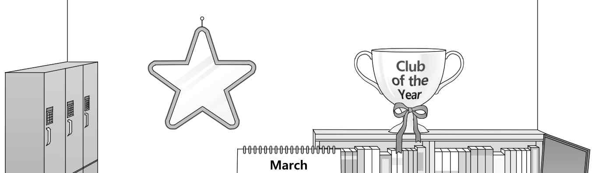
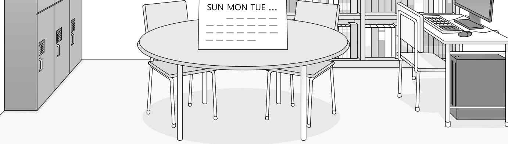
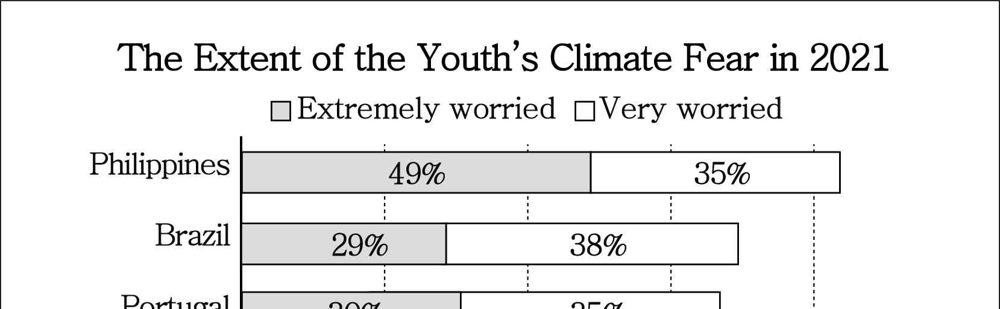
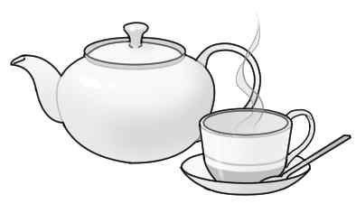
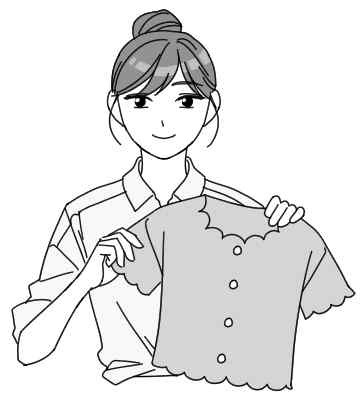

1. 다음을 듣고, 남자가 하는 말의 목적으로 가장 적절한 것을 고르시오.
① 학교 체육관 공사 일정을 알리려고
② 학교 수업 시간표 조정을 안내하려고
③ 학교 통학 시 대중교통 이용을 권장하려고
④ 학교 방과 후 수업 신청 방식을 설명하려고
⑤ 학교 셔틀버스 운행 시간 변경을 공지하려고

2. 대화를 듣고, 여자의 의견으로 가장 적절한 것을 고르시오.

① 전기 자전거 이용 전에 배터리 상태를 점검하여야 한다.
② 전기 자전거 운행에 관한 규정이 더 엄격해야 한다.
③ 전기 자전거의 속도 규정에 대한 논의가 필요하다.
④ 전기 자전거 구입 시 가격을 고려해야 한다.
⑤ 전기 자전거 이용 시 헬멧을 착용해야 한다.

3. 다음을 듣고, 여자가 하는 말의 요지로 가장 적절한 것을 고르시오.
① 학업 목표를 분명히 설정하는 것이 필요하다.
② 친구와의 협력은 학교생활의 중요한 덕목이다.
③ 과제 제출 마감 기한을 확인하고 준수해야 한다.
④ 적절한 휴식은 성공적인 과업 수행의 핵심 요소이다.
⑤ 할 일의 목록을 활용하는 것이 시간 관리에 유용하다.

4. 대화를 듣고, 그림에서 대화의 내용과 일치하지 않는 것을 고르시오.

5. 대화를 듣고, 남자가 할 일로 가장 적절한 것을 고르시오.

① 따뜻한 옷 챙기기
② 체스 세트 가져가기
③ 읽을 책 고르기
④ 간편식 구매하기
⑤ 침낭 준비하기

6. 대화를 듣고, 여자가 지불할 금액을 고르시오. [3점]

① $15
② $20
③ $27
④ $30
⑤ $33

7. 대화를 듣고, 남자가 체육 대회 연습을 할 수 없는 이유를 고르시오.

① 시험공부를 해야 해서
② 동아리 면접이 있어서
③ 축구화를 가져오지 않아서
④ 다리가 완전히 회복되지 않아서
⑤ 가족 식사 모임에 참석해야 해서

8. 대화를 듣고, Science Open Lab Program에 관해 언급되지 않은 것을 고르시오.

① 지원 가능 학년
② 실험 재료 구입 필요성
③ 지원서 제출 기한
④ 참가 인원수
⑤ 시상 여부

9. Triwood High School Volunteer Program에 관한 다음 내용을 듣고, 일치하지 않는 것을 고르시오.

① 노인을 도와주는 봉사 활동이다.
② 봉사자는 대면으로 활동한다.
③ 스마트폰 사용 방법 교육을 한다.
④ 봉사자는 매주 토요일에 세 시간씩 참여한다.
⑤ 지원자는 이메일로 참가 신청서를 보내야 한다.

10. 다음 표를 보면서 대화를 듣고, 여자가 주문할 휴대용 선풍기를 고르시오.

Portable Fan

|  | Model | Number of Speed Options | Color | LED Display | Price |
| --- | --- | --- | --- | --- | --- |
| ① | A | 1 | blue | X | $15 |
| ② | B | 3 | white | O | $26 |
| ③ | C | 3 | yellow | X | $31 |
| ④ | D | 4 | pink | X | $37 |
| ⑤ | E | 5 | green | O | $42 |

11. 대화를 듣고, 남자의 마지막 말에 대한 여자의 응답으로 가장 적절한 것을 고르시오.

① I can help you find it.
② I already bought a new one.
③ I had it before biology class.
④ You should report it to the police.
⑤ It was a birthday gift from my dad.

12. 대화를 듣고, 여자의 마지막 말에 대한 남자의 응답으로 가장 적절한 것을 고르시오.

① Thank you. Everything looks delicious.
② Yes. I have an appointment this Saturday.
③ You’re welcome. I made it with my dad’s recipe.
④ Sounds good. What time did you make a reservation?
⑤ That’s too bad. Why don’t we try another restaurant?

13. 대화를 듣고, 남자의 마지막 말에 대한 여자의 응답으로 가장 적절한 것을 고르시오. [3점]

Woman:
① No problem. You can find other projects at the organization.
② Sure. Let’s choose one from your old children’s books.
③ Congratulations. You finally made your first audiobook.
④ I hope so. You’re going to be a wonderful writer.
⑤ Exactly. Kids grow faster than you think.

14. 대화를 듣고, 여자의 마지막 말에 대한 남자의 응답으로 가장 적절한 것을 고르시오.

Man:
① Well, let’s do the presentation together.
② Cheer up! I know you did your best.
③ Yes, I got a good grade on science.
④ Wow! it was a really nice presentation.
⑤ Right. I have already finished the project.

15. 다음 상황 설명을 듣고, Robert가 Michelle에게 할 말로 가장 적절한 것을 고르시오. [3점]

① When can I use the library?
② Where can I find the library?
③ How can I join the reading club?
④ Why do you want to go to the library?
⑤ What time does the lost and found open?

16. 남자가 하는 말의 주제로 가장 적절한 것은?

① useful foods to relieve coughs
② importance of proper food recipes
③ various causes of cough symptoms
④ traditional home remedies for fever
⑤ connection between weather and cough

17. 언급된 음식 재료가 아닌 것은?

① ginger
② lemon
③ pineapple
④ honey
⑤ banana

18. 다음 글의 목적으로 가장 적절한 것은?

Dear Ms. Jane Watson, I am John Austin, a science teacher at Crestville High School. Recently I was impressed by the latest book you wrote about the environment. Also my students read your book and had a class discussion about it. They are big fans of your book, so I’d like to ask you to visit our school and give a special lecture. We can set the date and time to suit your schedule. Having you at our school would be a fantastic experience for the students. We would be very grateful if you could come. Best regards, John Austin

19. 다음 글에 드러난 Sarah의 심경 변화로 가장 적절한 것은?

Marilyn and her three-year-old daughter, Sarah, took a trip to the beach, where Sarah built her first sandcastle. Moments later, an enormous wave destroyed Sarah’s castle. In response to the loss of her sandcastle, tears streamed down Sarah’s cheeks and her heart was broken. She ran to Marilyn, saying she would never build a sandcastle again. Marilyn said, “Part of the joy of building a sandcastle is that, in the end, we give it as a gift to the ocean.” Sarah loved this idea and responded with enthusiasm to the idea of building another castle — this time, even closer to the water so the ocean would get its gift sooner!

20. 다음 글에서 필자가 주장하는 바로 가장 적절한 것은?

Magic is what we all wish for to happen in our life. Do you love the movie Cinderella like me? Well, in real life, you can also create magic. Here’s the trick. Write down all the real-time challenges that you face and deal with. Just change the challenge statement into positive statements. Let me give you an example here. If you struggle with getting up early in the morning, then write a positive statement such as “I get up early in the morning at 5:00 am every day.” Once you write these statements, get ready to witness magic and confidence. You will be surprised that just by writing these statements, there is a shift in the way you think and act. Suddenly you feel more powerful and positive.

21. 밑줄 친 push animal senses into Aristotelian buckets가 다음 글에서 의미하는 바로 가장 적절한 것은? [3점]

Consider the seemingly simple question How many senses are there? Around 2,370 years ago, Aristotle wrote that there are five, in both humans and animals — sight, hearing, smell, taste, and touch. However, according to the philosopher Fiona Macpherson, there are reasons to doubt it. For a start, Aristotle missed a few in humans: the perception of your own body which is different from touch and the sense of balance which has links to both touch and vision. Other animals have senses that are even harder to categorize. Many vertebrates have a different sense system for detecting odors. Some snakes can detect the body heat of their prey. These examples tell us that “senses cannot be clearly divided into a limited number of specific kinds,” Macpherson wrote in The Senses. Instead of trying to push animal senses into Aristotelian buckets, we should study them for what they are.

22. 다음 글의 요지로 가장 적절한 것은?

When we think of leaders, we may think of people such as Abraham Lincoln or Martin Luther King, Jr. If you consider the historical importance and far-reaching influence of these individuals, leadership might seem like a noble and high goal. But like all of us, these people started out as students, workers, and citizens who possessed ideas about how some aspect of daily life could be improved on a larger scale. Through diligence and experience, they improved upon their ideas by sharing them with others, seeking their opinions and feedback and constantly looking for the best way to accomplish goals for a group. Thus we all have the potential to be leaders at school, in our communities, and at work, regardless of age or experience.

23. 다음 글의 주제로 가장 적절한 것은?

Crop rotation is the process in which farmers change the crops they grow in their fields in a special order. For example, if a farmer has three fields, he or she may grow carrots in the first field, green beans in the second, and tomatoes in the third. The next year, green beans will be in the first field, tomatoes in the second field, and carrots will be in the third. In year three, the crops will rotate again. By the fourth year, the crops will go back to their original order. Each crop enriches the soil for the next crop. This type of farming is sustainable because the soil stays healthy.

24. 다음 글의 제목으로 가장 적절한 것은?

Working around the whole painting, rather than concentrating on one area at a time, will mean you can stop at any point and the painting can be considered “finished.” Artists often find it difficult to know when to stop painting, and it can be tempting to keep on adding more to your work. It is important to take a few steps back from the painting from time to time to assess your progress. Putting too much into a painting can spoil its impact and leave it looking overworked. If you find yourself struggling to decide whether you have finished, take a break and come back to it later with fresh eyes. Then you can decide whether any areas of your painting would benefit from further refinement.

25. 다음 도표의 내용과 일치하지 않는 것은?

The Extent of the Youth’s Climate Fear in 2021

| Country | Extremely Worried | Very Worried |
| --- | --- | --- |
| Philippines | 49% | 35% |
| Brazil | 29% | 38% |
| Portugal | 30% | 35% |
| France | 18% | 40% |
| United Kingdom | 20% | 29% |
| United States | 19% | 27% |

26. Jaroslav Heyrovsky에 관한 다음 글의 내용과 일치하지 않는 것은?

Jaroslav Heyrovsky was born in Prague on December 20, 1890, as the fifth child of Leopold Heyrovsky. In 1901 Jaroslav went to a secondary school called the Akademicke Gymnasium. Rather than Latin and Greek, he showed a strong interest in the natural sciences. At Czech University in Prague he studied chemistry, physics, and mathematics. From 1910 to 1914 he continued his studies at University College, London. Throughout the First World War, Jaroslav served in a military hospital. In 1926, Jaroslav became the first Professor of Physical Chemistry at Charles University in Prague. He won the Nobel Prize in chemistry in 1959.

27. Spring Tea Class for Young People에 관한 다음 안내문의 내용과 일치하지 않는 것은?

Spring Tea Class for Young People

Join us for a delightful Spring Tea Class for young people, where you’ll experience the taste of tea from various cultures around the world. Class Schedule
Friday, April 5 (4:30 p.m. - 6:00 p.m.)
Saturday, April 6 (9:30 a.m. - 11:00 a.m.) Details
We will give you tea and snacks.
We offer special tips for hosting a tea party. Participation Fee
Age 13 - 15: $25 per person
Age 16 - 18: $30 per person Note If you have any food allergy, you should email us in advance at youth@seasonteaclass.com.

28. Clothes Upcycling Contest 2024에 관한 다음 안내문의 내용과 일치하는 것은?

Clothes Upcycling Contest 2024

Are you passionate about fashion and the environment? Then we have a contest for you!
Participants
Anyone living in Lakewood, aged 11 to 18
How to participate
Take before and after photos of your upcycled clothes. - Email the photos at lovelw@lwplus.com. - Send in the photos from April 14 to May 12.
Winning Prize
A $100 gift card to use at local shops - The winner will be announced on our website on May 30. For more details, visit our website www.lovelwplus.com.

29. 다음 글의 밑줄 친 부분 중, 어법상 틀린 것은? [3점]

It would be hard to overstate how important meaningful work is to human beings — work that provides a sense of fulfillment and empowerment. Those who have found deeper meaning in their careers find their days much more energizing and satisfying, and to count their employment as one of their greatest sources of joy and pride. Sonya Lyubomirsky, professor of psychology at the University of California, has conducted numerous workplace studies showing that when people are more fulfilled on the job, they not only produce higher quality work and a greater output, but also generally earn higher incomes. Those most satisfied with their work are also much more likely to be happier with their lives overall. For her book Happiness at Work, researcher Jessica Pryce-Jones conducted a study of 3,000 workers in seventy-nine countries, finding that those who took greater satisfaction from their work were 150 percent more likely to have a happier life overall.

30. 다음 글의 밑줄 친 부분 중, 문맥상 낱말의 쓰임이 적절하지 않은 것은? [3점]

The rate of speed at which one is traveling will greatly determine the ability to process detail in the environment. In evolutionary terms, human senses are adapted to the speed at which humans move through space under their own power while walking. Our ability to distinguish detail in the environment is therefore ideally suited to movement at speeds of perhaps five miles per hour and under. The fastest users of the street, motorists, therefore have a much more limited ability to process details along the street ― a motorist simply has little time or ability to appreciate design details. On the other hand, pedestrian travel, being much slower, allows for the appreciation of environmental detail. Joggers and bicyclists fall somewhere in between these polar opposites; while they travel faster than pedestrians, their rate of speed is ordinarily much slower than that of the typical motorist.

31. 다음 빈칸에 들어갈 말로 가장 적절한 것을 고르시오.

Every species has certain climatic requirements — what degree of heat or cold it can endure, for example. When the climate changes, the places that satisfy those requirements change, too. Species are forced to follow. All creatures are capable of some degree of movement. Even creatures that appear immobile, like trees and barnacles, are capable of dispersal at some stage of their life — as a seed, in the case of the tree, or as a larva, in the case of the barnacle. A creature must get from the place it is born — often occupied by its parent — to a place where it can survive, grow, and reproduce. From fossils, scientists know that even creatures like trees moved with surprising speed during past periods of climate change.

32. 다음 빈칸에 들어갈 말로 가장 적절한 것을 고르시오. [3점]

No respectable boss would say, “I make it a point to discourage my staff from speaking up, and I maintain a culture that prevents disagreeing viewpoints from ever getting aired.” If anything, most bosses even say that they are pro-dissent. This idea can be found throughout the series of conversations with corporate, university, and nonprofit leaders, published weekly in the business sections of newspapers. In the interviews, the featured leaders are asked about their management techniques, and regularly claim to continually encourage from more junior staffers. As Bot Pittman remarked in one of these conversations: “I want us to listen to these dissenters because they may intend to tell you why we can’t do something, but if you listen hard, what they’re really telling you is what you must do to get something done.”

33. 다음 빈칸에 들어갈 말로 가장 적절한 것을 고르시오. [3점]

One of the most striking characteristics of a sleeping animal or person is that they do not respond normally to environmental stimuli. If you open the eyelids of a sleeping mammal the eyes will not see normally — they are functionally blind. Some visual information apparently gets in, but it is not normally processed as it is shortened or weakened; same with the other sensing systems. Stimuli are registered but not processed normally and they fail to wake the individual. Perceptual disengagement probably serves the function of protecting sleep, so some authors do not count it as part of the definition of sleep itself. But as sleep would be impossible without it, it seems essential to its definition. Nevertheless, many animals (including humans) use the intermediate state of drowsiness to derive some benefits of sleep without total perceptual disengagement.

34. 다음 빈칸에 들어갈 말로 가장 적절한 것을 고르시오. [3점]

A number of research studies have shown how experts in a field often experience difficulties when introducing newcomers to that field. For example, in a genuine training situation, Dr Pamela Hinds found that people expert in using mobile phones were remarkably less accurate than novice phone users in judging how long it takes people to learn to use the phones. Experts can become insensitive to how hard a task is for the beginner, an effect referred to as the ‘curse of knowledge’. Dr Hinds was able to show that as people acquired the skill, they then began to underestimate the level of difficulty of that skill. Her participants even underestimated how long it had taken themselves to acquire that skill in an earlier session. Knowing that experts forget how hard it was for them to learn, we can understand the need to look at the learning process through students’ eyes, rather than making assumptions about how students ‘should be’ learning.

35. 다음 글에서 전체 흐름과 관계 없는 문장은?

A group of psychologists studied individuals with severe mental illness who experienced weekly group music therapy, including singing familiar songs and composing original songs.

36. 주어진 글 다음에 이어질 글의 순서로 가장 적절한 것을 고르시오.

In many sports, people realized the difficulties and even impossibilities of young children participating fully in many adult sport environments.

They found the road to success for young children is unlikely if they play on adult fields, courts or arenas with equipment that is too large, too heavy or too fast for them to handle while trying to compete in adult-style competition. Common sense has prevailed: different sports have made adaptations for children

As examples, baseball has T ball, football has flag football and junior soccer uses a smaller and lighter ball and (sometimes) a smaller field. All have junior competitive structures where children play for shorter time periods and often in smaller teams

In a similar way, tennis has adapted the court areas, balls and rackets to make them more appropriate for children under 10. The adaptations are progressive and relate to the age of the child

37. 주어진 글 다음에 이어질 글의 순서로 가장 적절한 것을 고르시오. [3점]

With no horses available, the Inca empire excelled at delivering messages on foot.

The messengers were stationed on the royal roads to deliver the Inca king’s orders and reports coming from his lands. Called Chasquis, they lived in groups of four to six in huts, placed from one to two miles apart along the roads

They were all young men and especially good runners who watched the road in both directions. If they caught sight of another messenger coming, they hurried out to meet them. The Inca built the huts on high ground, in sight of one another

When a messenger neared the next hut, he began to call out and repeated the message three or four times to the one who was running out to meet him. The Inca empire could relay messages 1,000 miles (1,610 km) in three or four days under good conditions

38. 글의 흐름으로 보아, 주어진 문장이 들어가기에 가장 적절한 곳을 고르시오.

Research in the 1980s and 1990s, however, demonstrated that the “tongue map” explanation of how we taste was, in fact, totally wrong. The tongue was mapped into separate areas where certain tastes were registered: sweetness at the tip, sourness on the sides, and bitterness at the back of the mouth. As it turns out, the map was a misinterpretation and mistranslation of research conducted in Germany at the turn of the twentieth century. Today, leading taste researchers believe that taste buds are not grouped according to specialty. Sweetness, saltiness, bitterness, and sourness can be tasted everywhere in the mouth, although they may be perceived at a little different intensities at different sites. Moreover, the mechanism at work is not place, but time. It’s not that you taste sweetness at the tip of your tongue, but rather that you register that perception first.

39. 글의 흐름으로 보아, 주어진 문장이 들어가기에 가장 적절한 곳을 고르시오.

Environmental factors can also determine how the animal will respond during the treatment. No two animals are alike. Animals from the same litter will display some of the same features, but will not be exactly the same as each other; therefore, they may not respond in entirely the same way during a healing session. For instance, a cat in a rescue center will respond very differently than a cat within a domestic home environment. In addition, animals that experience healing for physical illness will react differently than those accepting healing for emotional confusion. With this in mind, every healing session needs to be explored differently, and each healing treatment should be adjusted to suit the specific needs of the animal. You will learn as you go; healing is a constant learning process.

40. 다음 글의 내용을 한 문장으로 요약하고자 한다. 빈칸 (A), (B)에 들어갈 말로 가장 적절한 것은?

The mind has parts that are known as the conscious mind and the subconscious mind. The subconscious mind is very fast to act and doesn’t deal with emotions. It deals with memories of your responses to life, your memories and recognition. However, the conscious mind is the one that you have more control over. You think. You can choose whether to carry on a thought or to add emotion to it and this is the part of your mind that lets you down frequently because — fueled by emotions — you make the wrong decisions time and time again. When your judgment is clouded by emotions, this puts in biases and all kinds of other negativities that hold you back. Scared of spiders? Scared of the dark? There are reasons for all of these fears, but they originate in the conscious mind. They only become real fears when the subconscious mind records your reactions. 

While the controllable conscious mind deals with thoughts and emotions, the fast-acting subconscious mind stores your responses, forming real fears.

41. 윗글의 제목으로 가장 적절한 것은?

Norms are everywhere, defining what is “normal” and guiding our interpretations of social life at every turn. As a simple example, there is a norm in Anglo society to say Thank you to strangers who have just done something to help, such as open a door for you, point out that you’ve just dropped something, or give you directions. There is no law that forces you to say Thank you. But if people don’t say Thank you in these cases it is marked. People expect that you will say it. You become responsible. Failing to say it will be both surprising and worthy of criticism. Not knowing the norms of another community is the central problem of cross-cultural communication. To continue the Thank you example, even though another culture may have an expression that appears translatable (many don’t), there may be different norms for its usage, for example, such that you should say Thank you only when the cost someone has caused is considerable. In such a case it would sound ridiculous (i.e., unexpected, surprising, and worthy of criticism) if you were to thank someone for something so minor as holding a door open for you.

42. 밑줄 친 낱말 중에서 문맥상 낱말의 쓰임이 적절하지 않은 것은?

Norms are everywhere, defining what is “normal” and guiding our interpretations of social life at every turn. As a simple example, there is a norm in Anglo society to say Thank you to strangers who have just done something to help, such as open a door for you, point out that you’ve just dropped something, or give you directions. There is no law that forces you to say Thank you. But if people don’t say Thank you in these cases it is marked. People expect that you will say it. You become responsible. Failing to say it will be both surprising and worthy of criticism. Not knowing the norms of another community is the central problem of cross-cultural communication. To continue the Thank you example, even though another culture may have an expression that appears translatable (many don’t), there may be different norms for its usage, for example, such that you should say Thank you only when the cost someone has caused is considerable. In such a case it would sound ridiculous (i.e., unexpected, surprising, and worthy of criticism) if you were to thank someone for something so minor as holding a door open for you.

43. 주어진 글에 이어질 내용을 순서에 맞게 배열한 것으로 가장 적절한 것은?

 Long ago, when the world was young, an old Native American spiritual leader Odawa had a dream on a high mountain. In his dream, Iktomi, the great spirit and searcher of wisdom, appeared to him in the form of a spider. Iktomi spoke to him in a holy language. Odawa shared Iktomi’s lesson with his people. Today, many Native Americans have dream catchers hanging above their beds. Dream catchers are believed to filter out bad dreams. The good dreams are captured in the web of life and carried with the people. The bad dreams pass through the hole in the web and are no longer a part of their lives. When Iktomi finished speaking, he spun a web and gave it to Odawa. He said to Odawa, “The web is a perfect circle with a hole in the center. Use the web to help your people reach their goals. Make good use of their ideas, dreams, and visions. If you believe in the great spirit, the web will catch your good ideas and the bad ones will go through the hole.” Right after Odawa woke up, he went back to his village. Iktomi told Odawa about the cycles of life. He said, “We all begin our lives as babies, move on to childhood, and then to adulthood. Finally, we come to old age, where we must be taken care of as babies again.” Iktomi also told him that there are good and bad forces in each stage of life. “If we listen to the good forces, they will guide us in the right direction. But if we listen to the bad forces, they will lead us the wrong way and may harm us,” Iktomi said.

44. 밑줄 친 낱말 중에서 가리키는 대상이 나머지 넷과 다른 것은?

 Long ago, when the world was young, an old Native American spiritual leader Odawa had a dream on a high mountain. In his dream, Iktomi, the great spirit and searcher of wisdom, appeared to him in the form of a spider. Iktomi spoke to him in a holy language. Odawa shared Iktomi’s lesson with his people. Today, many Native Americans have dream catchers hanging above their beds. Dream catchers are believed to filter out bad dreams. The good dreams are captured in the web of life and carried with the people. The bad dreams pass through the hole in the web and are no longer a part of their lives. When Iktomi finished speaking, he spun a web and gave it to Odawa. He said to Odawa, “The web is a perfect circle with a hole in the center. Use the web to help your people reach their goals. Make good use of their ideas, dreams, and visions. If you believe in the great spirit, the web will catch your good ideas and the bad ones will go through the hole.” Right after Odawa woke up, he went back to his village. Iktomi told Odawa about the cycles of life. He said, “We all begin our lives as babies, move on to childhood, and then to adulthood. Finally, we come to old age, where we must be taken care of as babies again.” Iktomi also told him that there are good and bad forces in each stage of life. “If we listen to the good forces, they will guide us in the right direction. But if we listen to the bad forces, they will lead us the wrong way and may harm us,” Iktomi said.

45. 윗글에 관한 내용으로 적절하지 않은 것은?

 Long ago, when the world was young, an old Native American spiritual leader Odawa had a dream on a high mountain. In his dream, Iktomi, the great spirit and searcher of wisdom, appeared to him in the form of a spider. Iktomi spoke to him in a holy language. Odawa shared Iktomi’s lesson with his people. Today, many Native Americans have dream catchers hanging above their beds. Dream catchers are believed to filter out bad dreams. The good dreams are captured in the web of life and carried with the people. The bad dreams pass through the hole in the web and are no longer a part of their lives. When Iktomi finished speaking, he spun a web and gave it to Odawa. He said to Odawa, “The web is a perfect circle with a hole in the center. Use the web to help your people reach their goals. Make good use of their ideas, dreams, and visions. If you believe in the great spirit, the web will catch your good ideas and the bad ones will go through the hole.” Right after Odawa woke up, he went back to his village. Iktomi told Odawa about the cycles of life. He said, “We all begin our lives as babies, move on to childhood, and then to adulthood. Finally, we come to old age, where we must be taken care of as babies again.” Iktomi also told him that there are good and bad forces in each stage of life. “If we listen to the good forces, they will guide us in the right direction. But if we listen to the bad forces, they will lead us the wrong way and may harm us,” Iktomi said.
