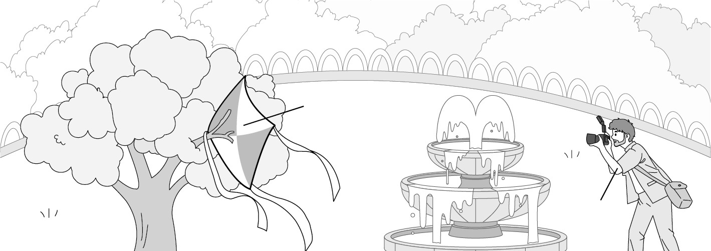
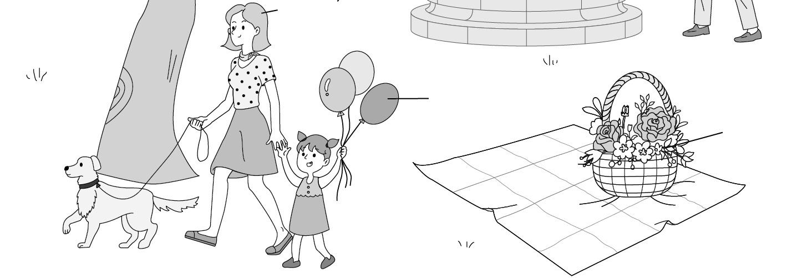
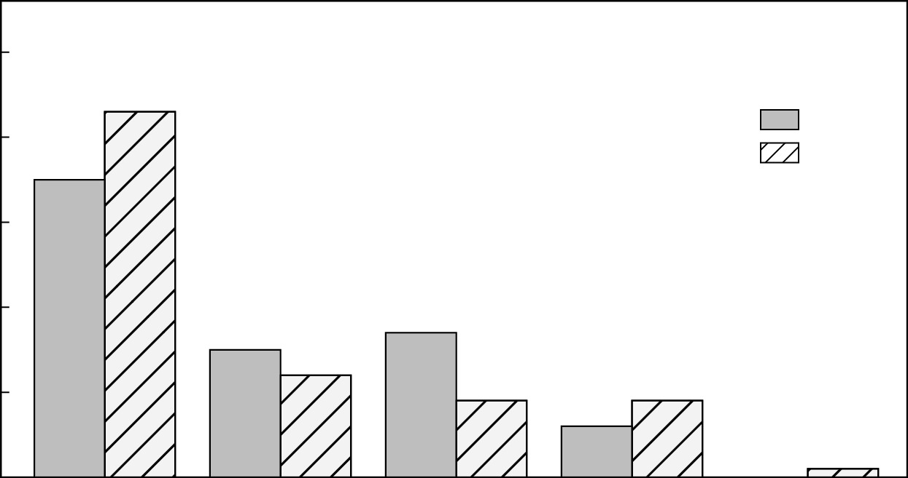

1. 다음을 듣고, 여자가 하는 말의 목적으로 가장 적절한 것을 고르시오.

① 친환경 제품 사용을 홍보하려고
② 음식 대접에 대한 감사를 표하려고
③ 간식이 마련되어 있음을 안내하려고
④ 휴식 시간이 변경되었음을 공지하려고
⑤ 구내식당 메뉴에 관한 의견을 구하려고

2. 대화를 듣고, 남자의 의견으로 가장 적절한 것을 고르시오.

① 인공 지능에서 얻은 정보를 맹목적으로 믿어서는 안 된다.
② 출처를 밝히지 않고 타인의 표현을 인용해서는 안 된다.
③ 인공 지능의 도움을 통해 과제물의 질을 높일 수 있다.
④ 과제를 할 때 본인의 생각이 들어가는 것이 중요하다.
⑤ 기술의 변화에 맞추어 작업 방식을 바꿀 필요가 있다.

3. 다음을 듣고, 여자가 하는 말의 요지로 가장 적절한 것을 고르시오.

① 소셜 미디어는 원만한 대인관계 유지에 도움이 된다.
② 온라인에서는 자아가 다양한 모습으로 표출될 수 있다.
③ 소셜 미디어는 자존감에 부정적인 영향을 줄 수 있다.
④ 친밀한 관계일수록 상대의 언행에 쉽게 영향을 받는다.
⑤ 유명인 사생활 보호의 중요성은 종종 간과된다.

4. 대화를 듣고, 그림에서 대화의 내용과 일치하지 않는 것을 고르시오.

5. 대화를 듣고, 남자가 할 일로 가장 적절한 것을 고르시오.

① 과학 캠프 지원하기
② 참가 실험 결정하기
③ 체크리스트 작성하기
④ 실험 계획서 보여주기
⑤ 자기 소개 영상 촬영하기

6. 대화를 듣고, 여자가 지불할 금액을 고르시오. [3점]

① $50
② $55
③ $60
④ $65
⑤ $70

7. 대화를 듣고, 남자가 마술쇼에 갈 수 없는 이유를 고르시오.

① 록 콘서트에 가야 해서
② 다른 학교 축제에 가야 해서
③ 가족 중 아픈 사람이 있어서
④ 동아리 축제를 준비해야 해서
⑤ 삼촌 생일 파티에 참석해야 해서

8. 대화를 듣고, Victory Marathon에 관해 언급되지 않은 것을 고르시오.

① 행사 날짜
② 신청 방법
③ 출발 지점
④ 참가비
⑤ 예상 참가 인원

9. Violet Hill Mentorship에 관한 다음 내용을 듣고, 일치하지 않는 것을 고르시오.

① 다음 주 금요일에 개최될 예정이다.
② 대학 생활에 관한 조언이 제공된다.
③ 신청 시 질문을 미리 제출해야 한다.
④ 신청 마감일은 다음 주 화요일이다.
⑤ 전공별 참가 가능한 인원은 20명이다.

10. 다음 표를 보면서 대화를 듣고, 두 사람이 구입할 무선 진공 청소기를 고르시오.

Cordless Vacuum Cleaner

|  | Model | Battery Life | Price | Wet Cleaning | Color |
| --- | --- | --- | --- | --- | --- |
| ① | A | 1 hour | $300 | × | Red |
| ② | B | 2 hours | $330 | × | White |
| ③ | C | 2 hours | $370 | ○ | Red |
| ④ | D | 3 hours | $390 | ○ | White |
| ⑤ | E | 3 hours | $410 | ○ | Black |

11. 대화를 듣고, 남자의 마지막 말에 대한 여자의 응답으로 가장 적절한 것을 고르시오.

① Fine. Let’s talk about it over dinner.
② Okay. Be more responsible next time.
③ Great. I already ordered some pet food.
④ Too bad. I hope your cat gets well soon.
⑤ Sorry. I can’t take care of your cat tonight.

12. 대화를 듣고, 여자의 마지막 말에 대한 남자의 응답으로 가장 적절한 것을 고르시오.

① I can’t accept late assignments.
② You did an excellent job this time.
③ Upload your work to our school website.
④ Try to do your homework by yourself.
⑤ We can finish it before the next class.

13. 대화를 듣고, 남자의 마지막 말에 대한 여자의 응답으로 가장 적절한 것을 고르시오. [3점]

Woman:
① Yes. I can give you the phone number of the clinic I visited.
② I agree. Last evening’s badminton match was awesome.
③ No problem. I’ll teach you how to serve this time.
④ Too bad. I hope you recover from your knee injury soon.
⑤ You’re right. Maybe I should start taking badminton lessons.

14. 대화를 듣고, 여자의 마지막 말에 대한 남자의 응답으로 가장 적절한 것을 고르시오. [3점]

Man:
① Sure. It seems like a perfect place for bears.
② Great. Let’s think about the club name first.
③ My pleasure. I can always give you a ride.
④ I agree. It’s hard to give up using plastics.
⑤ No worries. I’ll get my bike repaired.

15. 다음 상황 설명을 듣고, Laura가 Tony에게 할 말로 가장 적절한 것을 고르시오.

Laura:
① I don’t like visiting a hospital for medical checkups.
② I appreciate you taking me to the doctor today.
③ You’d better take a break for a few days.
④ You should finish your work before the deadline.
⑤ I’m afraid I can’t reduce your workload right now.

16. 남자가 하는 말의 주제로 가장 적절한 것은?

① relationships between media and voters
② common ways of promoting school policy
③ guidelines for student election campaigns
④ requirements for becoming a candidate
⑤ useful tips for winning school debates

17. 언급된 매체가 아닌 것은?

따라 답을 하시기 바랍니다.

① social media
② poster
③ pamphlet
④ school newspaper
⑤ school website

18. 다음 글의 목적으로 가장 적절한 것은?

Dear Reader, We always appreciate your support. As you know, our service is now available through an app. There has never been a better time to switch to an online membership of TourTide Magazine. At a 50% discount off your current print subscription, you can access a full year of online reading. Get new issues and daily web pieces at TourTide.com, read or listen to TourTide Magazine via the app, and get our members-only newsletter. You’ll also gain access to our editors’ selections of the best articles. Join today! Yours, TourTide Team

19. 다음 글에 드러난 ‘I’의 심경 변화로 가장 적절한 것은?

As I walked from the mailbox, my heart was beating rapidly. In my hands, I held the letter from the university I had applied to. I thought my grades were good enough to cross the line and my application letter was well-written, but was it enough? I hadn’t slept a wink for days. As I carefully tore into the paper of the envelope, the letter slowly emerged with the opening phrase, “It is our great pleasure...” I shouted with joy, “I am in!” As I held the letter, I began to make a fantasy about my college life in a faraway city.

20. 다음 글에서 필자가 주장하는 바로 가장 적절한 것은?

Having a messy room can add up to negative feelings and destructive thinking. Psychologists say that having a disorderly room can indicate a disorganized mental state. One of the professional tidying experts says that the moment you start cleaning your room, you also start changing your life and gaining new perspective. When you clean your surroundings, positive and good atmosphere follows. You can do more things efficiently and neatly. So, clean up your closets, organize your drawers, and arrange your things first, then peace of mind will follow.

21. 밑줄 친 luxury real estate가 다음 글에서 의미하는 바로 가장 적절한 것은? [3점]

The soil of a farm field is forced to be the perfect environment for monoculture growth. This is achieved by adding nutrients in the form of fertilizer and water by way of irrigation. During the last fifty years, engineers and crop scientists have helped farmers become much more efficient at supplying exactly the right amount of both. World usage of fertilizer has tripled since 1969, and the global capacity for irrigation has almost doubled; we are feeding and watering our fields more than ever, and our crops are loving it. Unfortunately, these luxurious conditions have also excited the attention of certain agricultural undesirables. Because farm fields are loaded with nutrients and water relative to the natural land that surrounds them, they are desired as luxury real estate by every random weed in the area.

22. 다음 글의 요지로 가장 적절한 것은?

When it comes to helping out, you don’t have to do much. All you have to do is come around and show that you care. If you notice someone who is lonely, you could go and sit with them. If you work with someone who eats lunch all by themselves, and you go and sit down with them, they will begin to be more social after a while, and they will owe it all to you. A person’s happiness comes from attention. There are too many people out in the world who feel like everyone has forgotten them or ignored them. Even if you say hi to someone passing by, they will begin to feel better about themselves, like someone cares.

23. 다음 글의 주제로 가장 적절한 것은?

We often try to make cuts in our challenges and take the easy route. When taking the quick exit, we fail to acquire the strength to compete. We often take the easy route to improve our skills. Many of us never really work to achieve mastery in the key areas of life. These skills are key tools that can be useful to our career, health, and prosperity. Highly successful athletes don’t win because of better equipment; they win by facing hardship to gain strength and skill. They win through preparation. It’s the mental preparation, winning mindset, strategy, and skill that set them apart. Strength comes from struggle, not from taking the path of least resistance. Hardship is not just a lesson for the next time in front of us. Hardship will be the greatest teacher we will ever have in life.

24. 다음 글의 제목으로 가장 적절한 것은?

Your behaviors are usually a reflection of your identity. What you do is an indication of the type of person you believe that you are ― either consciously or nonconsciously. Research has shown that once a person believes in a particular aspect of their identity, they are more likely to act according to that belief. For example, people who identified as “being a voter” were more likely to vote than those who simply claimed “voting” was an action they wanted to perform. Similarly, the person who accepts exercise as the part of their identity doesn’t have to convince themselves to train. Doing the right thing is easy. After all, when your behavior and your identity perfectly match, you are no longer pursuing behavior change. You are simply acting like the type of person you already believe yourself to be.

25. 다음 도표의 내용과 일치하지 않는 것은?

Electronic Waste Collection and Recycling Rate by Region in 2016 and 2019

| Region | 2016 | 2019 |
| --- | --- | --- |
| Europe | 35% | 43% |
| Asia | 15% | 12% |
| Americas | 17% | 9% |
| Oceania | 6% | 9% |
| Africa | 0% | 1% |

26. Fritz Zwicky에 관한 다음 글의 내용과 일치하지 않는 것은?

Fritz Zwicky, a memorable astrophysicist who coined the term ‘supernova’, was born in Varna, Bulgaria to a Swiss father and a Czech mother. At the age of six, he was sent to his grandparents who looked after him for most of his childhood in Switzerland. There, he received an advanced education in mathematics and physics. In 1925, he emigrated to the United States and continued his physics research at California Institute of Technology (Caltech). He developed numerous theories that have had a profound influence on the understanding of our universe in the early 21st century. After being appointed as a professor of astronomy at Caltech in 1942, he developed some of the earliest jet engines and holds more than 50 patents, many in jet propulsion.

27. Gourmet Baking Competition에 관한 다음 안내문의 내용과 일치하지 않는 것은?

Gourmet Baking Competition

Get out your cookbooks and dust off your greatest baking recipes. When & Where
5 p.m. - 7 p.m. Saturday, August 3rd
Gourmet Baking Studio Registration
Register online at www.bakeoff.org by July 25th.
Anyone can participate in the competition. Categories
Pies, Cakes, and Cookies
Each person can only enter one category. Prizes & Gifts
Prizes will be given to the top three in each category.
Souvenirs will be given to every participant.

28. Winter Sports Program에 관한 다음 안내문의 내용과 일치하는 것은?

Winter Sports Program

Winter is coming! Let’s have some fun together! Time & Location
Every Sunday in December from 1 p.m. to 3 p.m.
Grand Blue Ice Rink Lesson Details
Ice Hockey, Speed Skating, and Figure Skating
Participants must be 8 years of age or older. Fee
Ice Hockey: $200
Speed Skating / Figure Skating: $150 Notice
Skates and helmets will be provided for free.
You should bring your own gloves.
For more information, visit www.wintersports.com.

29. 다음 글의 밑줄 친 부분 중, 어법상 틀린 것은? [3점]

The hunter-gatherer lifestyle, which can be described as “natural” to human beings, appears to have had much to recommend it. Examination of human remains from early hunter-gatherer societies has suggested that our ancestors enjoyed abundant food, obtainable without excessive effort, and suffered very few diseases. If this is true, it is not clear why so many humans settled in permanent villages and developed agriculture, growing crops and domesticating animals: cultivating fields was hard work, and it was in farming villages that epidemic diseases first took root. Whatever its immediate effect on the lives of humans, the development of settlements and agriculture undoubtedly led to a high increase in population density. This period, known as the New Stone Age, was a major turning point in human development, opening the way to the growth of the first towns and cities, and eventually leading to settled “civilizations.”

30. 다음 글의 밑줄 친 부분 중, 문맥상 낱말의 쓰임이 적절하지 않은 것은? [3점]

Many human and non-human animals save commodities or money for future consumption. This behavior seems to reveal a preference of a delayed reward over an immediate one: the agent gives up some immediate pleasure in exchange for a future one. Thus the discounted value of the future reward should be greater than the un-discounted value of the present one. However, in some cases the agent does not wait for the envisioned occasion but uses their savings prematurely. For example, early in the year an employee might set aside money to buy Christmas presents but then spend it on a summer vacation instead. Such cases could be examples of weakness of will. That is, the agents may judge or resolve to spend their savings in a certain way for the greatest benefit but then act differently when temptation for immediate pleasure disappears.

31. 다음 빈칸에 들어갈 말로 가장 적절한 것을 고르시오.

The costs of interruptions are well-documented. Martin Luther King Jr. lamented them when he described “that lovely poem that didn’t get written because someone knocked on the door.” Perhaps the most famous literary example happened in 1797 when Samuel Taylor Coleridge started writing his poem Kubla Khan from a dream he had but then was visited by an unexpected guest. For Coleridge, by coincidence, the untimely visitor came at a particularly bad time. He forgot his inspiration and left the work unfinished. While there are many documented cases of sudden disruptions that have had significant consequences for professionals in critical roles such as doctors, nurses, control room operators, stock traders, and pilots, they also impact most of us in our everyday lives, slowing down work productivity and generally increasing stress levels.

32. 다음 빈칸에 들어갈 말로 가장 적절한 것을 고르시오.

There’s a lot of scientific evidence demonstrating that focused attention leads to the reshaping of the brain. In animals rewarded for noticing sound (to hunt or to avoid being hunted for example), we find much larger auditory centers in the brain. In animals rewarded for sharp eyesight, the visual areas are larger. Brain scans of violinists provide more evidence, showing dramatic growth and expansion in regions of the cortex that represent the left hand, which has to finger the strings precisely, often at very high speed. Other studies have shown that the hippocampus, which is vital for spatial memory, is enlarged in taxi drivers. The point is that the physical architecture of the brain changes according to where we direct our attention and what we practice doing.

33. 다음 빈칸에 들어갈 말로 가장 적절한 것을 고르시오. [3점]

How did the human mind evolve? One possibility is that competition and conflicts with other human tribes caused our brains to evolve the way they did. A human tribe that could out-think its enemies, even slightly, possessed a vital advantage. The ability of your tribe to imagine and predict where and when a hostile enemy tribe might strike, and plan accordingly, gives your tribe a significant military advantage. The human mind became a weapon in the struggle for survival, a weapon far more decisive than any before it. And this mental advantage was applied, over and over, within each succeeding generation. The tribe that could out-think its opponents was more likely to succeed in battle and would then pass on the genes responsible for this mental advantage to its offspring. You and I are the descendants of the winners.

34. 다음 빈칸에 들어갈 말로 가장 적절한 것을 고르시오. [3점]

To find the hidden potential in teams, instead of brainstorming, we’re better off shifting to a process called brainwriting. The initial steps are solo. You start by asking everyone to generate ideas separately. Next, you pool them and share them anonymously among the group. To preserve independent judgment, each member evaluates them on their own. Only then does the team come together to select and refine the most promising options. By developing and assessing ideas individually before choosing and elaborating them, teams can surface and advance possibilities that might not get attention otherwise. This brainwriting process makes sure that all ideas are brought to the table and all voices are brought into the conversation. It is especially effective in groups that struggle to achieve collective intelligence.

35. 다음 글에서 전체 흐름과 관계 없는 문장은?

Simply giving employees a sense of agency ― a feeling that they are in control, that they have genuine decision-making authority ― can radically increase how much energy and focus they bring to their jobs.

36. 주어진 글 다음에 이어질 글의 순서로 가장 적절한 것을 고르시오. [3점]

As businesses shift some core business activities to digital, such as sales, marketing, or archiving, it is assumed that the impact on the environment will be less negative.

However, digital business activities can still threaten the environment. In some cases, the harm of digital businesses can be even more hazardous. A few decades ago, offices used to have much more paper waste since all documents were paper based

When workplaces shifted from paper to digital documents, invoices, and emails, it was a promising step to save trees. However, the cost of the Internet and electricity for the environment is neglected. A recent Wired report declared that most data centers’ energy source is fossil fuels

When we store bigger data on clouds, increased carbon emissions make our green clouds gray. The carbon footprint of an email is smaller than mail sent via a post office, but still, it causes four grams of CO₂, and it can be as much as 50 grams if the attachment is big

37. 주어진 글 다음에 이어질 글의 순서로 가장 적절한 것을 고르시오.

Problems often arise if an exotic species is suddenly introduced to an ecosystem. Britain’s red and grey squirrels provide a clear example. When the grey arrived from America in the 1870s, both squirrel species competed for the same food and habitat, which put the native red squirrel populations under pressure. The grey had the edge because it can adapt its diet; it is able, for instance, to eat green acorns, while the red can only digest mature acorns. Within the same area of forest, grey squirrels can destroy the food supply before red squirrels even have a bite. Greys can also live more densely and in varied habitats, so have survived more easily when woodland has been destroyed. As a result, the red squirrel has come close to extinction in England.

38. 글의 흐름으로 보아, 주어진 문장이 들어가기에 가장 적절한 곳을 고르시오.

Growing crops forced people to stay in one place. Hunter-gatherers typically moved around frequently, and they had to be able to carry all their possessions with them every time they moved. In particular, mothers had to carry their young children. As a result, hunter-gatherer mothers could have only one baby every four years or so, spacing their births so that they never had to carry more than one child at a time. Farmers, on the other hand, could live in the same place year after year and did not have to worry about transporting young children long distances. Societies that settled down in one place were able to shorten their birth intervals from four years to about two. This meant that each woman could have more children than her hunter-gatherer counterpart, which in turn resulted in rapid population growth among farming communities. An increased population was actually an advantage to agricultural societies, because farming required large amounts of human labor.

39. 글의 흐름으로 보아, 주어진 문장이 들어가기에 가장 적절한 곳을 고르시오. [3점]

Spending time as children allows animals to learn about their environment. Without childhood, animals must rely more fully on hardware, and therefore be less flexible. Among migratory bird species, those that are born knowing how, when, and where to migrate — those that are migrating entirely with instructions they were born with — sometimes have very inefficient migration routes. These birds, born knowing how to migrate, don’t adapt easily. So when lakes dry up, forest becomes farmland, or climate change pushes breeding grounds farther north, those birds that are born knowing how to migrate keep flying by the old rules and maps. By comparison, birds with the longest childhoods, and those that migrate with their parents, tend to have the most efficient migration routes. Childhood facilitates the passing on of cultural information, and culture can evolve faster than genes. Childhood gives flexibility in a changing world.

40. 다음 글의 내용을 한 문장으로 요약하고자 한다. 빈칸 (A), (B)에 들어갈 말로 가장 적절한 것은?

Over the last several decades, scholars have developed standards for how best to create, organize, present, and preserve digital information for future generations. What has remained neglected for the most part, however, are the needs of people with disabilities. As a result, many of the otherwise most valuable digital resources are useless for people who are deaf or hard of hearing, as well as for people who are blind, have low vision, or have difficulty distinguishing particular colors. While professionals working in educational technology and commercial web design have made significant progress in meeting the needs of such users, some scholars creating digital projects all too often fail to take these needs into account. This situation would be much improved if more projects embraced the idea that we should always keep the largest possible audience in mind as we make design decisions, ensuring that our final product serves the needs of those with disabilities as well as those without. 

The needs of people with disabilities have often been overlooked in digital projects, which could be changed by adopting a(n) inclusive design.

41. 윗글의 제목으로 가장 적절한 것은?

All humans, to an extent, seek activities that cause a degree of pain in order to experience pleasure, whether this is found in spicy food, strong massages, or stepping into a too-cold or too-hot bath. The key is that it is a ‘safe threat’. The brain perceives the stimulus to be painful but ultimately non-threatening. Interestingly, this could be similar to the way humor works: a ‘safe threat’ that causes pleasure by playfully violating norms. We feel uncomfortable, but safe. In this context, where survival is clearly not in danger, the desire for pain is actually the desire for a reward, not suffering or punishment. This reward-like effect comes from the feeling of mastery over the pain. The closer you look at your chilli-eating habit, the more remarkable it seems. When the active ingredient of chillies — capsaicin — touches the tongue, it stimulates exactly the same receptor that is activated when any of these tissues are burned. Knowing that our body is firing off danger signals, but that we are actually completely safe, produces pleasure. All children start off hating chilli, but many learn to derive pleasure from it through repeated exposure and knowing that they will never experience any real joy. Interestingly, seeking pain for the pain itself appears to be uniquely human. The only way scientists have trained animals to have a preference for chilli or to self-harm is to have the pain always directly associated with a pleasurable reward.

42. 밑줄 친 낱말 중에서 문맥상 낱말의 쓰임이 적절하지 않은 것은?

All humans, to an extent, seek activities that cause a degree of pain in order to experience pleasure, whether this is found in spicy food, strong massages, or stepping into a too-cold or too-hot bath. The key is that it is a ‘safe threat’. The brain perceives the stimulus to be painful but ultimately non-threatening. Interestingly, this could be similar to the way humor works: a ‘safe threat’ that causes pleasure by playfully violating norms. We feel uncomfortable, but safe. In this context, where survival is clearly not in danger, the desire for pain is actually the desire for a reward, not suffering or punishment. This reward-like effect comes from the feeling of mastery over the pain. The closer you look at your chilli-eating habit, the more remarkable it seems. When the active ingredient of chillies — capsaicin — touches the tongue, it stimulates exactly the same receptor that is activated when any of these tissues are burned. Knowing that our body is firing off danger signals, but that we are actually completely safe, produces pleasure. All children start off hating chilli, but many learn to derive pleasure from it through repeated exposure and knowing that they will never experience any real joy. Interestingly, seeking pain for the pain itself appears to be uniquely human. The only way scientists have trained animals to have a preference for chilli or to self-harm is to have the pain always directly associated with a pleasurable reward.

43. 주어진 글에 이어질 내용을 순서에 맞게 배열한 것으로 가장 적절한 것은?

 When the plane hit a bit of turbulence, the instructor pushed a hidden button. Suddenly, all the monitors inside the plane flashed several times then went out completely! Now the student was in control of an airplane that was flying well, but she had no indication of where she was or where she should go. She did have a map, but no other instruments. She was at a loss and then the plane shook again. When the student began to panic, the instructor said, “Stay calm and steady. You can do it.” Calm as ever, the instructor told her student, “Difficult times always happen during flight. The most important thing is to focus on your flight in those situations.” Those words encouraged the student to focus on flying the aircraft first. “Thank you, I think I can make it,” she said, “As I’ve been trained, I should search for visual markers.” Then, the student carefully flew low enough to see if she could find any ships making their way across the surface of the ocean. Now the instructor and the student could see some ships. Although the ships were far apart, they were all sailing in a line. With the line of ships in view, the student could see the way to home and safety. The student looked at her in relief, who smiled proudly back at her student. 

44. 밑줄 친 낱말 중에서 가리키는 대상이 나머지 넷과 다른 것은?

 When the plane hit a bit of turbulence, the instructor pushed a hidden button. Suddenly, all the monitors inside the plane flashed several times then went out completely! Now the student was in control of an airplane that was flying well, but she had no indication of where she was or where she should go. She did have a map, but no other instruments. She was at a loss and then the plane shook again. When the student began to panic, the instructor said, “Stay calm and steady. You can do it.” Calm as ever, the instructor told her student, “Difficult times always happen during flight. The most important thing is to focus on your flight in those situations.” Those words encouraged the student to focus on flying the aircraft first. “Thank you, I think I can make it,” she said, “As I’ve been trained, I should search for visual markers.” Then, the student carefully flew low enough to see if she could find any ships making their way across the surface of the ocean. Now the instructor and the student could see some ships. Although the ships were far apart, they were all sailing in a line. With the line of ships in view, the student could see the way to home and safety. The student looked at her in relief, who smiled proudly back at her student. 

45. 윗글에 관한 내용으로 적절하지 않은 것은?

 When the plane hit a bit of turbulence, the instructor pushed a hidden button. Suddenly, all the monitors inside the plane flashed several times then went out completely! Now the student was in control of an airplane that was flying well, but she had no indication of where she was or where she should go. She did have a map, but no other instruments. She was at a loss and then the plane shook again. When the student began to panic, the instructor said, “Stay calm and steady. You can do it.” Calm as ever, the instructor told her student, “Difficult times always happen during flight. The most important thing is to focus on your flight in those situations.” Those words encouraged the student to focus on flying the aircraft first. “Thank you, I think I can make it,” she said, “As I’ve been trained, I should search for visual markers.” Then, the student carefully flew low enough to see if she could find any ships making their way across the surface of the ocean. Now the instructor and the student could see some ships. Although the ships were far apart, they were all sailing in a line. With the line of ships in view, the student could see the way to home and safety. The student looked at her in relief, who smiled proudly back at her student.
