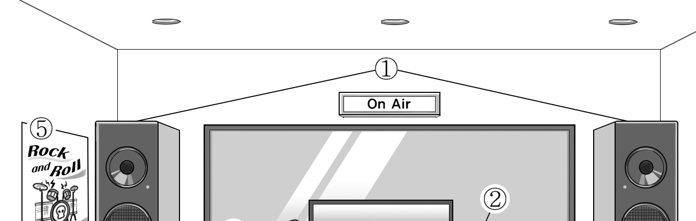
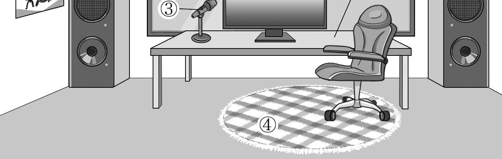
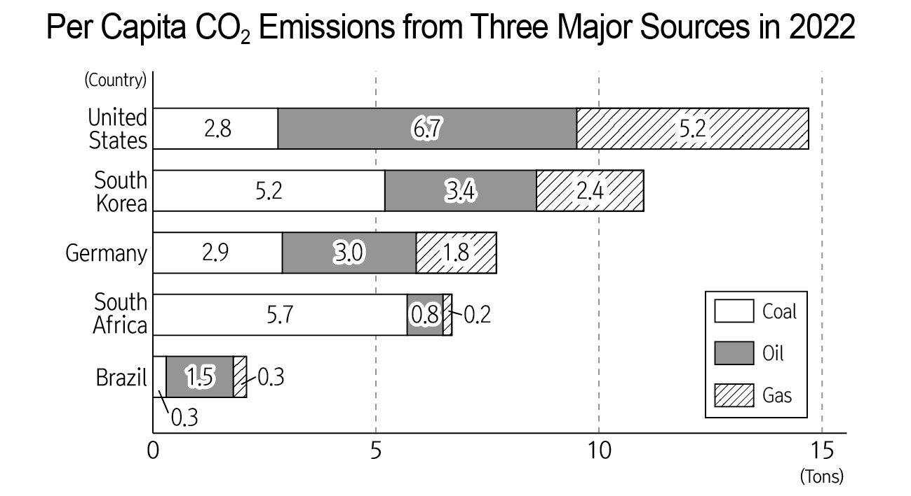

1. 다음을 듣고, 여자가 하는 말의 목적으로 가장 적절한 것을 고르시오.

① 축제 기간 연장을 요청하려고
② 신설된 지하철 노선을 홍보하려고
③ 축제 당일의 지하철 연장 운행을 안내하려고
④ 축제 방문객에게 안전 수칙 준수를 당부하려고
⑤ 축제 기간 중 도심 교통 통제 구간을 공지하려고

2. 대화를 듣고, 남자의 의견으로 가장 적절한 것을 고르시오.

① 불규칙한 수면 습관은 청소년의 뇌 발달을 방해한다.
② 스마트폰의 화면 밝기를 조절하여 눈을 보호해야 한다.
③ 취침 전 스마트폰 사용을 줄여야 수면의 질이 높아진다.
④ 집중력 향상을 위해 디지털 기기 사용을 최소화해야 한다.
⑤ 일정한 시간에 취침하는 것이 생체 리듬 유지에 도움을 준다.

3. 다음을 듣고, 남자가 하는 말의 요지로 가장 적절한 것을 고르시오.

① 과도한 컴퓨터 사용은 스트레스 지수를 증가시킨다.
② 컴퓨터 관련 취미 활동은 IT 활용 능력을 향상시킨다.
③ 직업을 선택할 때 자신의 흥미와 적성을 고려해야 한다.
④ 다양한 악기 연주를 배우는 것은 인생을 풍요롭게 만든다.
⑤ 직업과 관련 없는 취미 활동이 스트레스 감소에 도움이 된다.

4. 대화를 듣고, 그림에서 대화의 내용과 일치하지 않는 것을 고르시오.

5. 대화를 듣고, 여자가 할 일로 가장 적절한 것을 고르시오.

① 선물 준비하기
② 온라인 초대장 보내기
③ 음식 주문하기
④ 초대 손님 명단 확인하기
⑤ 전시 부스 설치하기

6. 대화를 듣고, 남자가 지불할 금액을 고르시오. [3점]
① $63
② $70
③ $81
④ $86
⑤ $90

7. 대화를 듣고, 여자가 이번 주말에 등산을 갈 수 없는 이유를 고르시오.

① 아르바이트를 해야 해서
② 학교 시험공부를 해야 해서
③ 폭우로 인해 등산로가 폐쇄되어서
④ 경연을 위한 춤 연습을 해야 해서
⑤ 주문한 등산 장비가 도착하지 않아서

8. 대화를 듣고, Lakestate Apartment Yoga Program에 관해 언급되지 않은 것을 고르시오.

① 대상 연령
② 운영 요일
③ 모집 인원
④ 등록 방법
⑤ 등록 준비물

9. Global Food Market에 관한 다음 내용을 듣고, 일치하지 않는 것을 고르시오.

① 학교 주차장에서 열린다.
② 이틀간 진행된다.
③ 8개 국가의 음식을 즐길 수 있다.
④ 음식마다 가격이 다르다.
⑤ 채식주의자를 위한 메뉴가 있다.

10. 다음 표를 보면서 대화를 듣고, 남자가 주문할 디지털 텀블러를 고르시오.

Digital Tumblers

|  | Model | Price | Size | Water Intake Display | Color |
| --- | --- | --- | --- | --- | --- |
| ① | A | $35 | 350ml | × | White |
| ② | B | $40 | 470ml | × | Gold |
| ③ | C | $45 | 470ml | ○ | Black |
| ④ | D | $55 | 550ml | ○ | White |
| ⑤ | E | $65 | 550ml | ○ | Gold |

11. 대화를 듣고, 여자의 마지막 말에 대한 남자의 응답으로 가장 적절한 것을 고르시오.

① If it’s too dry inside, you can easily get a cold.
② When you cough, you should cover your mouth.
③ You need to wash your hands not to get a cold.
④ It’s really important to keep yourself warm.
⑤ Drinking water can make your skin soft.

12. 대화를 듣고, 남자의 마지막 말에 대한 여자의 응답으로 가장 적절한 것을 고르시오.

① Awesome. The new bookshelf looks good in your room.
② Right. Then, shall we sell them at a used bookstore?
③ I see. Can you borrow them from the library?
④ Okay. I’ll buy you books in a good condition.
⑤ I’m sorry. I haven’t finished the book yet.

13. 대화를 듣고, 여자의 마지막 말에 대한 남자의 응답으로 가장 적절한 것을 고르시오. [3점]

Man:
① I’ll clarify each group member’s specific role.
② I’ll collect more data for our group research.
③ I should challenge myself for the competition.
④ I need to change the topic of our group project.
⑤ I’ll let you know how to analyze data effectively.

14. 대화를 듣고, 남자의 마지막 말에 대한 여자의 응답으로 가장 적절한 것을 고르시오. [3점]

Woman:
① Trust me. When we eat makes a big difference.
② Okay. I’ll check my meals to get in better shape.
③ Thank you for your tip. But I don’t think I can do it.
④ Of course. I’ll make sure to follow your workout routine.
⑤ Sure. That’s why I didn’t succeed at keeping a balanced diet.

15. 다음 상황 설명을 듣고, Julia가 Sophie에게 할 말로 가장 적절한 것을 고르시오.

① Could you help me assemble my desk?
② Can you share where you bought your desk?
③ How about choosing a new computer together?
④ Why don’t you repair the furniture by yourself?
⑤ Do you have any ideas for decorating my room?

16. 여자가 하는 말의 주제로 가장 적절한 것은?

① material trends in the fashion industry
② benefits of making clothes from nature
③ tips to purchase natural material clothes
④ development of clothes washing methods
⑤ proper ways to wash natural material clothes

17. 언급된 소재가 아닌 것은?

따라 답을 하시기 바랍니다.

① cotton
② silk
③ leather
④ linen
⑤ wool

18. 다음 글의 목적으로 가장 적절한 것은?

To whom it may concern, I am writing to express my deep concern about the recent change made by Pittsburgh Train Station. The station had traditional ticket offices with staff before, but these have been replaced with ticket vending machines. However, individuals who are unfamiliar with these machines are now experiencing difficulty accessing the railway services. Since these individuals heavily relied on the staff assistance to be able to travel, they are in great need of ticket offices with staff in the station. Therefore, I am urging you to consider reopening the ticket offices. With the staff back in their positions, many people would regain access to the railway services. I look forward to your prompt attention to this matter and a positive resolution. Sincerely, Sarah Roberts

19. 다음 글에 드러난 Jeevan의 심경 변화로 가장 적절한 것은?

All the actors on the stage were focused on their acting. Then, suddenly, Arthur fell into the corner of the stage. Jeevan immediately approached Arthur and found his heart wasn’t beating. Jeevan began CPR. Jeevan worked silently, glancing sometimes at Arthur’s face. He thought, “Please, start breathing again, please.” Arthur’s eyes were closed. Moments later, an older man in a grey suit appeared, swiftly kneeling beside Arthur’s chest. “I’m Walter Jacobi. I’m a doctor.” He announced with a calm voice. Jeevan wiped the sweat off his forehead. With combined efforts, Jeevan and Dr. Jacobi successfully revived Arthur. Arthur’s eyes slowly opened. Finally, Jeevan was able to hear Arthur’s breath again, thinking to himself, “Thank goodness. You’re back.”

20. 다음 글에서 필자가 주장하는 바로 가장 적절한 것은?

As the parent of a gifted child, you need to be aware of a certain common parent trap. Of course you are a proud parent, and you should be. While it is very easy to talk nonstop about your little genius and his or her remarkable behavior, this can be very stressful on your child. It is extremely important to limit your bragging behavior to your very close friends, or your parents. Gifted children feel pressured when their parents show them off too much. This behavior creates expectations that they may not be able to live up to, and also creates a false sense of self for your child. You want your child to be who they are, not who they seem to be as defined by their incredible achievements. If not, you could end up with a driven perfectionist child or perhaps a drop-out, or worse.

21. 밑줄 친 “hanging out with the winners”가 다음 글에서 의미하는 바로 가장 적절한 것은?

One valuable technique for getting out of helplessness, depression, and situations which are predominantly being run by the thought, “I can’t,” is to choose to be with other persons who have resolved the problem with which we struggle. This is one of the great powers of self-help groups. When we are in a negative state, we have given a lot of energy to negative thought forms, and the positive thought forms are weak. Those who are in a higher vibration are free of the energy from their negative thoughts and have energized positive thought forms. Merely to be in their presence is beneficial. In some self-help groups, this is called “hanging out with the winners.” The benefit here is on the psychic level of consciousness, and there is a transfer of positive energy and relighting of one’s own latent positive thought forms.

22. 다음 글의 요지로 가장 적절한 것은?

Our emotions are thought to exist because they have contributed to our survival as a species. Fear has helped us avoid dangers, expressing anger helps us scare off threats, and expressing positive emotions helps us bond with others. From an evolutionary perspective, an emotion is a kind of “program” that, when triggered, directs many of our activities (including attention, perception, memory, movement, expressions, etc.). For example, fear makes us very attentive, narrows our perceptual focus to threatening stimuli, will cause us either to face a situation (fight) or avoid it (flight), and may cause us to remember an experience more acutely (so that we avoid the threat in the future). Regardless of the specific ways in which they activate our systems, the specific emotions we possess are thought to exist because they have helped us (as a species) survive challenges within our environment long ago. If they had not helped us adapt and survive, they would not have evolved with us.

23. 다음 글의 주제로 가장 적절한 것은?

By improving accessibility of the workplace for workers that are typically at a disadvantage in the labour market, AI can improve inclusiveness in the workplace. AI-powered assistive devices to aid workers with visual, speech or hearing difficulties are becoming more widespread, improving the access to, and the quality of work for people with disabilities. For example, speech recognition solutions for people with dysarthric voices, or live captioning systems for deaf and hard of hearing people can facilitate communication with colleagues and access to jobs where inter-personal communication is necessary. AI can also enhance the capabilities of low-skilled workers, with potentially positive effects on their wages and career prospects. For example, AI’s capacity to translate written and spoken word in real-time can improve the performance of non-native speakers in the workplace. Moreover, recent developments in AI-powered text generators can instantly improve the performance of lower-skilled individuals in domains such as writing, coding or customer service.

24. 다음 글의 제목으로 가장 적절한 것은?

Whales are highly efficient at carbon storage. When they die, each whale sequesters an average of 30 tons of carbon dioxide, taking that carbon out of the atmosphere for centuries. For comparison, the average tree absorbs only 48 pounds of CO2 a year. From a climate perspective, each whale is the marine equivalent of thousands of trees. Whales also help sequester carbon by fertilizing the ocean as they release nutrient-rich waste, in turn increasing phytoplankton populations, which also sequester carbon ― leading some scientists to call them the “engineers of marine ecosystems.” In 2019, economists from the International Monetary Fund (IMF) estimated the value of the ecosystem services provided by each whale at over $2 million USD. They called for a new global program of economic incentives to return whale populations to preindustrial whaling levels as one example of a “nature-based solution” to climate change. Calls are now being made for a global whale restoration program, to slow down climate change.

25. 다음 도표의 내용과 일치하지 않는 것은?

Per Capita CO2 Emissions from Three Major Sources in 2022 (Tons)

| Country | Coal | Oil | Gas |
| --- | --- | --- | --- |
| United States | 2.8 | 6.7 | 5.2 |
| South Korea | 5.2 | 3.4 | 2.4 |
| Germany | 2.9 | 3.0 | 1.8 |
| South Africa | 5.7 | 0.8 | 0.2 |
| Brazil | 0.3 | 1.5 | 0.3 |

26. Émilie du Châtelet에 관한 다음 글의 내용과 일치하지 않는 것은?

Émilie du Châtelet, a French mathematician and physicist, was born in Paris in 1706. During her childhood, with her father’s support, she was able to get mathematical and scientific education that most women of her time did not receive. In 1737, she submitted her paper on the nature of fire to a contest sponsored by the French Academy of Sciences, and it was published a year later. In her book, Institutions de Physique, Émilie du Châtelet explained the ideas of space and time in a way that is closer to what we understand in modern relativity than what was common during her time. Her most significant achievement was translating Isaac Newton’s Principia into French near the end of her life. Émilie du Châtelet’s work was not recognized in her time, but she is now remembered as a symbol of the Enlightenment and the struggle for women’s participation in science.

27. 2024 Young Inventors Robot Competition에 관한 다음 안내문의 내용과 일치하지 않는 것은?

2024 Young Inventors Robot Competition

Join us for an exciting day of the Young Inventors Robot Competition!
Categories
Participants can compete in one of the following categories: · Robot Design · Robot Coding · Robot Remote Control □
Date and Time
September 28, 2024, 10 a.m. to 3 p.m. □
Location
Computer Lab, Oakwood University □
Registration
From August 1 to August 10, 2024 - Open to high school students - Online registration only (www.younginventors.edu) □
Awards
In each competition category, three participants will be honored. · 1st place: $300 · 2nd place: $200 · 3rd place: $100
For more information, visit our website.

28. Saintville Art Week Stamp Tour에 관한 다음 안내문의 내용과 일치하는 것은?

Saintville Art Week Stamp Tour

The 8th annual Saintville Art Week Stamp Tour is back this year! Anyone can participate in our event. Join us and enjoy exhibitions and new collections. □
When
The first week of October, 2024 □
Where
Saintville Arts District □ How: Step 1. Take a stamp tour map from the Saintville Arts Center. Step 2. Get stamps from at least 3 out of 5 spots and receive your gift. - You can choose either an umbrella or a mug with printed artwork on it for your gift.
For more information, please visit our website at www.SaintvilleArtsCenter.com.

29. 다음 글의 밑줄 친 부분 중, 어법상 틀린 것은?

From an organizational viewpoint, one of the most fascinating examples of how any organization may contain many different types of culture is to recognize the functional operations of different departments within the organization. The varying departments and divisions within an organization will inevitably view any given situation from their own biased and prejudiced perspective. A department and its members will acquire “tunnel vision” where disallows them to see things as others see them. The very structure of organizations can create conflict. The choice of whether the structure is “mechanistic” or “organic” can have a profound influence on conflict management. A mechanistic structure has a vertical hierarchy with many rules, many procedures, and many levels of management involved in decision making. Organic structures are more horizontal in nature, where decision making is less centralized and spread across the plane of the organization.

30. 다음 글의 밑줄 친 부분 중, 문맥상 낱말의 쓰임이 적절하지 않은 것은? [3점]

An excellent alternative to calming traffic is removing it. Some cities reserve an extensive network of lanes and streets for bikes, pedestrians, and the occasional service vehicle. This motivates people to travel by bike rather than by car, making streets safer for everyone. As bicycles become more popular in a city, planners can convert more automobile lanes and entire streets to accommodate more of them. Nevertheless, even the most bikeable cities still require motor vehicle lanes for taxis, emergency vehicles, and delivery trucks. Delivery vehicles are frequently a target of animus, but they are actually an essential component to making cities greener. A tightly packed delivery truck is a far more inefficient transporter of goods than several hybrids carrying a few shopping bags each. Distributing food and other goods to neighborhood vendors allows them to operate smaller stores close to homes so that residents can walk, rather than drive, to get their groceries.

31. 다음 빈칸에 들어갈 말로 가장 적절한 것을 고르시오.

You hear again and again that some of the greatest composers were misunderstood in their own day. Not everyone could understand the compositions of Beethoven, Brahms, or Stravinsky in their day. The reason for this initial lack of acceptance is unfamiliarity. The musical forms, or ideas expressed within them, were completely new. And yet, this is exactly one of the things that makes them so great. Effective composers have their own ideas. Have you ever seen the classic movie Amadeus? The composer Antonio Salieri is the “host” of this movie; he’s depicted as one of the most famous non-great composers ― he lived at the time of Mozart and was completely overshadowed by him. Now, Salieri wasn’t a bad composer; in fact, he was a very good one. But he wasn’t one of the world’s great composers because his work wasn’t original. What he wrote sounded just like what everyone else was composing at the time.

32. 다음 빈칸에 들어갈 말로 가장 적절한 것을 고르시오. [3점]

Every time a new medium comes along — whether it’s the invention of the printed book, or TV, or SNS — and you start to use it, it’s like you are putting on a new kind of goggles, with their own special colors and lenses. Each set of goggles you put on makes you see things differently. So when you start to watch television, before you absorb the message of any particular TV show — whether it’s Wheel of Fortune or The Wire — you start to see the world as being shaped like television itself. That’s why Marshall McLuhan said that every time a new medium comes along — a new way for humans to communicate — it has buried in it a message. It is gently guiding us to see the world according to a new set of codes. The way information gets to you, McLuhan argued, is more important than the information itself. TV teaches you that the world is fast; that it’s about surfaces and appearances.

33. 다음 빈칸에 들어갈 말로 가장 적절한 것을 고르시오. [3점]

Concepts are vital to human survival, but we must also be careful with them because concepts open the door to essentialism. They encourage us to see things that aren’t present. Stuart Firestein opens his book, Ignorance, with an old proverb, “It is very difficult to find a black cat in a dark room, especially when there is no cat.” This statement beautifully sums up the search for essences. History has many examples of scientists who searched fruitlessly for an essence because they used the wrong concept to guide their hypotheses. Firestein gives the example of luminiferous ether, a mysterious substance that was thought to fill the universe so that light would have a medium to move through. The ether was a black cat, writes Firestein, and physicists had been theorizing in a dark room, and then experimenting in it, looking for evidence of a cat that did not exist.

34. 다음 빈칸에 들어갈 말로 가장 적절한 것을 고르시오. [3점]

While social media attention is potentially an instrument to achieve ends like elite celebrity, some content creators desire ordinary fame as a social end in itself. Not unlike reality television stars, social media celebrities are often criticized for not having skills and talents associated with traditional, elite celebrity, such as acting or singing ability. This criticism highlights the fact that digital content creators face real barriers to crossing over to the sphere of elite celebrity. However, the criticism also misses the point that the phenomenon of ordinary celebrity reconstructs the meaning of fame. The elite celebrity is symbolized by the metaphor of the star, characterized by mystery and hierarchical distance and associated with naturalized qualities of talent and class. The ordinary celebrity attracts attention through regular and frequent interactions with other ordinary people. Achieving ordinary fame as a social media celebrity is like doing well at a game, because in this sphere, fame is nothing more nor less than relatively high scores on attention scales, the metrics of subscribers, followers, Likes, or clicks built into social media applications.

35. 다음 글에서 전체 흐름과 관계 없는 문장은?

Why do we have the illusion that cramming for an exam is the best learning strategy? Because we are unable to differentiate between the various sections of our memory. Immediately after reading our textbook or our class notes, information is fully present in our mind.

36. 주어진 글 다음에 이어질 글의 순서로 가장 적절한 것을 고르시오.

The discovery of mirror neurons has profoundly changed the way we think of a fundamental human capacity, learning by observation. As children we learn a lot by observing what our parents and friends do. Newborns, in the first week of life, have an inborn tendency to stick out their tongue if their parents stick out theirs. Such imitation is not perfect. You may not see the tongue stick out each time you stick yours out at your newborn, but if you do it many times, the tongue will come out more often than if you do something different. Babies babble and later start to imitate the sounds their parents produce. Later still, they play with vacuum cleaners and hammers in imitation of their parents. Our modern cultures, in which we write, speak, read, build spaceships and go to school, can work only because we are not restricted to the behavior we are born with or learn by trial and error. We can learn a lot by simply watching others.

37. 주어진 글 다음에 이어질 글의 순서로 가장 적절한 것을 고르시오. [3점]

Have you ever been surprised to hear a recording of your own voice? You might have thought, “Is that really what my voice sounds like?” Maybe your accent is more pronounced in the recording than you realized, or your voice is higher than it seems to your own ears. This is of course quite a common experience. The explanation is actually fairly simple. There are two pathways through which we perceive our own voice when we speak. One is the route through which we perceive most external sounds, like waves that travel from the air through the outer, middle and inner ear. But because our vocal cords vibrate when we speak, there is a second internal path. Vibrations are conducted through our bones and stimulate our inner ears directly. Lower frequencies are emphasized along this pathway. That makes your voice sound deeper and richer to yourself than it may sound to other people.

38. 글의 흐름으로 보아, 주어진 문장이 들어가기에 가장 적절한 곳을 고르시오.

Biologists distinguish two kinds of similarity. “Analogous” traits are ones that have a common function but arose on different branches of the evolutionary tree and are in an important sense not “the same” organ. The wings of birds and the wings of bees are both used for flight and are similar in some ways because anything used for flight has to be built in those ways, but they arose independently in evolution and have nothing in common beyond their use in flight. “Homologous” traits, in contrast, may or may not have a common function, but they descended from a common ancestor and hence have some common structure that indicates their being “the same” organ. The wing of a bat and the front leg of a horse have very different functions, but they are all modifications of the forelimb of the ancestor of all mammals. As a result, they share nonfunctional traits like the number of bones and the ways they are connected. To distinguish analogy from homology, biologists usually look at the overall architecture of the organs and focus on their most useless properties.

39. 글의 흐름으로 보아, 주어진 문장이 들어가기에 가장 적절한 곳을 고르시오. [3점]

Seawater contains an abundance of dissolved oxygen that all marine animals breathe to stay alive. It has long been established in physics that cold water holds more dissolved oxygen than warm water does ― this is one reason that cold polar seas are full of life while tropical oceans are blue, clear, and relatively poorly populated with living creatures. Thus, as global warming raises the temperature of marine waters, it is self-evident that the amount of dissolved oxygen will decrease. This is a worrisome and potentially disastrous consequence if allowed to continue to an ecosystem-threatening level. Now scientists have analyzed data indicating that the amount of dissolved oxygen in the oceans has been declining for more than a half century. The data show that the ocean oxygen level has been falling more rapidly than the corresponding rise in water temperature. Falling oxygen levels in water have the potential to impact the habitat of marine organisms worldwide and in recent years this has led to more frequent anoxic events that killed or displaced populations of fish, crabs, and many other organisms.

40. 다음 글의 내용을 한 문장으로 요약하고자 한다. 빈칸 (A), (B)에 들어갈 말로 가장 적절한 것은?

Capuchins ― New World Monkeys that live in large social groups ― will, in captivity, trade with people all day long, especially if food is involved. I give you this rock and you give me a treat to eat. If you put two monkeys in cages next to each other, and offer them both slices of cucumber for the rocks they already have, they will happily eat the cucumbers. If, however, you give one monkey grapes instead ― grapes being universally preferred to cucumbers ― the monkey that is still receiving cucumbers will begin to throw them back at the experimenter. Even though she is still getting “paid” the same amount for her effort of sourcing rocks, and so her particular situation has not changed, the comparison to another makes the situation unfair. Furthermore, she is now willing to abandon all gains ― the cucumbers themselves ― to communicate her displeasure to the experimenter. 

According to the passage, if the Capuchin monkey realizes the inequality in rewards compared to another monkey, she will reject her rewards to express her feelings about the treatment, despite getting exactly the same rewards as before.

41. 윗글의 제목으로 가장 적절한 것은?

Higher education has grown from an elite to a mass system across the world. In Europe and the USA, increased rates of participation occurred in the decades after the Second World War. Between 2000 and 2014, rates of participation in higher education almost doubled from 19% to 34% across the world among the members of the population in the school-leaving age category (typically 18-23). The dramatic expansion of higher education has been marked by a wider range of institutions of higher learning and a more diverse demographic of students. Changes from an elite system to a mass higher education system are associated with political needs to build a specialised workforce for the economy. In theory, the expansion of higher education to develop a highly skilled workforce should diminish the role of examinations in the selection and control of students, initiating approaches to assessment which block lifelong learning: assessment for learning and a focus on feedback for development. In reality, socio-political changes to expand higher education have set up a ‘field of contradictions’ for assessment in higher education. Mass higher education requires efficient approaches to assessment, such as examinations and multiple-choice quizzes, with minimalist, impersonal, or standardised feedback, often causing students to focus more on grades than feedback. In contrast, the relatively small numbers of students in elite systems in the past allowed for closer relationships between students and their teachers, with formative feedback shaping the minds, academic skills, and even the characters of students.

42. 밑줄 친 낱말 중에서 문맥상 낱말의 쓰임이 적절하지 않은 것은? [3점]

Higher education has grown from an elite to a mass system across the world. In Europe and the USA, increased rates of participation occurred in the decades after the Second World War. Between 2000 and 2014, rates of participation in higher education almost doubled from 19% to 34% across the world among the members of the population in the school-leaving age category (typically 18-23). The dramatic expansion of higher education has been marked by a wider range of institutions of higher learning and a more diverse demographic of students. Changes from an elite system to a mass higher education system are associated with political needs to build a specialised workforce for the economy. In theory, the expansion of higher education to develop a highly skilled workforce should diminish the role of examinations in the selection and control of students, initiating approaches to assessment which block lifelong learning: assessment for learning and a focus on feedback for development. In reality, socio-political changes to expand higher education have set up a ‘field of contradictions’ for assessment in higher education. Mass higher education requires efficient approaches to assessment, such as examinations and multiple-choice quizzes, with minimalist, impersonal, or standardised feedback, often causing students to focus more on grades than feedback. In contrast, the relatively small numbers of students in elite systems in the past allowed for closer relationships between students and their teachers, with formative feedback shaping the minds, academic skills, and even the characters of students.

43. 주어진 글에 이어질 내용을 순서에 맞게 배열한 것으로 가장 적절한 것은?

 On the day of the wedding, the rich merchant, the host of the wedding, was receiving the guests at the gate. Many rich people of the town attended the wedding. They had come out in their best clothes. The poet wore simple clothes which were neither grand nor expensive. He waited for someone to approach him but no one gave him as much as even a second glance. Even the host did not greet him and looked away. Seeing all this, the poet quietly left the party and went to a shop where he could rent clothes. There he chose a richly decorated coat, which made him look like a new person. With this coat, he entered the party and this time was welcomed with open arms. The host embraced him as he would do to an old friend and complimented him on the clothes he was wearing. The poet did not say a word and allowed the host to lead him to the dining room. The host personally led the poet to his seat and served out chicken soup to him. After a moment, the poet suddenly dipped the corner of his coat in the soup as if he fed it. All the guests were now staring at him in surprise. The host said, “Sir, what are you doing?” The poet very calmly replied, “Now that I have put on expensive clothes, I see a world of difference here. All that I can say now is that this feast is meant for my clothes, not for me.” 

44. 밑줄 친 낱말 중에서 가리키는 대상이 나머지 넷과 다른 것은?

 On the day of the wedding, the rich merchant, the host of the wedding, was receiving the guests at the gate. Many rich people of the town attended the wedding. They had come out in their best clothes. The poet wore simple clothes which were neither grand nor expensive. He waited for someone to approach him but no one gave him as much as even a second glance. Even the host did not greet him and looked away. Seeing all this, the poet quietly left the party and went to a shop where he could rent clothes. There he chose a richly decorated coat, which made him look like a new person. With this coat, he entered the party and this time was welcomed with open arms. The host embraced him as he would do to an old friend and complimented him on the clothes he was wearing. The poet did not say a word and allowed the host to lead him to the dining room. The host personally led the poet to his seat and served out chicken soup to him. After a moment, the poet suddenly dipped the corner of his coat in the soup as if he fed it. All the guests were now staring at him in surprise. The host said, “Sir, what are you doing?” The poet very calmly replied, “Now that I have put on expensive clothes, I see a world of difference here. All that I can say now is that this feast is meant for my clothes, not for me.” 

45. 윗글에 관한 내용으로 적절하지 않은 것은?

 On the day of the wedding, the rich merchant, the host of the wedding, was receiving the guests at the gate. Many rich people of the town attended the wedding. They had come out in their best clothes. The poet wore simple clothes which were neither grand nor expensive. He waited for someone to approach him but no one gave him as much as even a second glance. Even the host did not greet him and looked away. Seeing all this, the poet quietly left the party and went to a shop where he could rent clothes. There he chose a richly decorated coat, which made him look like a new person. With this coat, he entered the party and this time was welcomed with open arms. The host embraced him as he would do to an old friend and complimented him on the clothes he was wearing. The poet did not say a word and allowed the host to lead him to the dining room. The host personally led the poet to his seat and served out chicken soup to him. After a moment, the poet suddenly dipped the corner of his coat in the soup as if he fed it. All the guests were now staring at him in surprise. The host said, “Sir, what are you doing?” The poet very calmly replied, “Now that I have put on expensive clothes, I see a world of difference here. All that I can say now is that this feast is meant for my clothes, not for me.”
