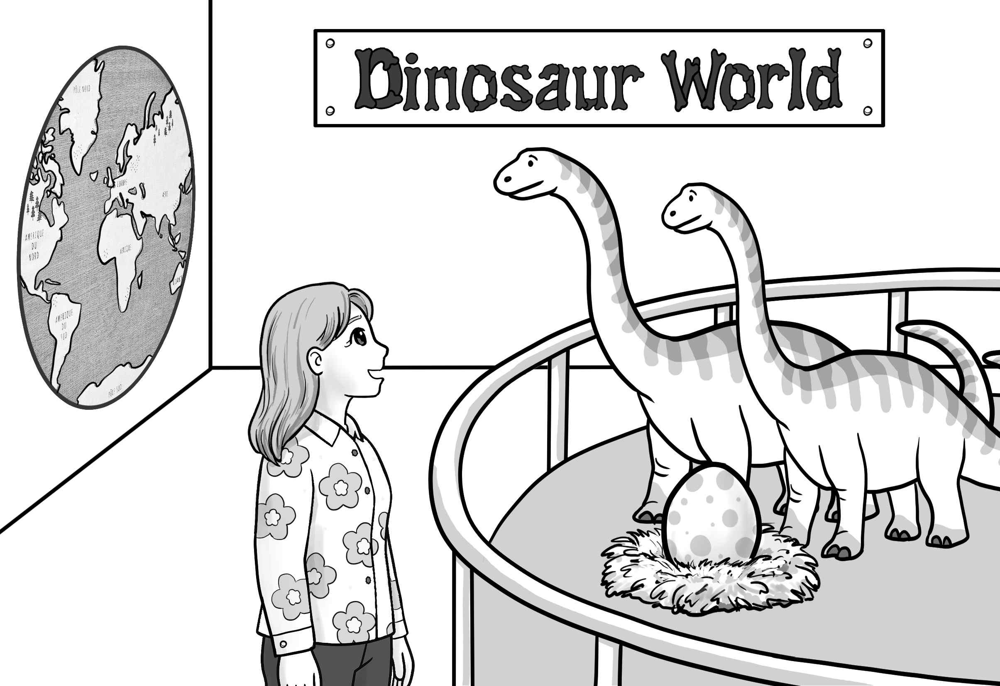
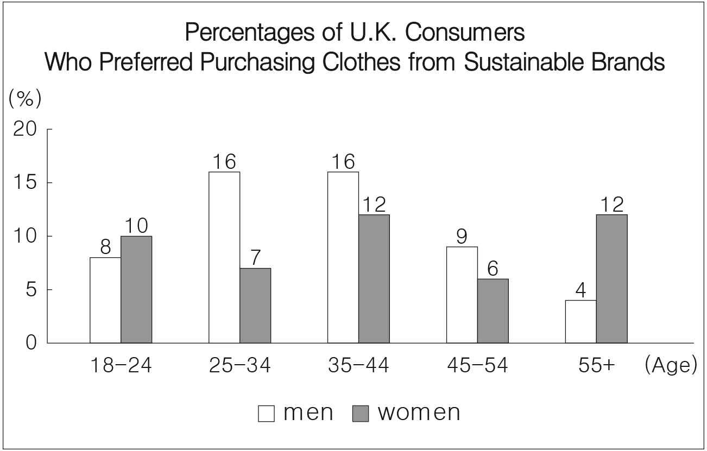
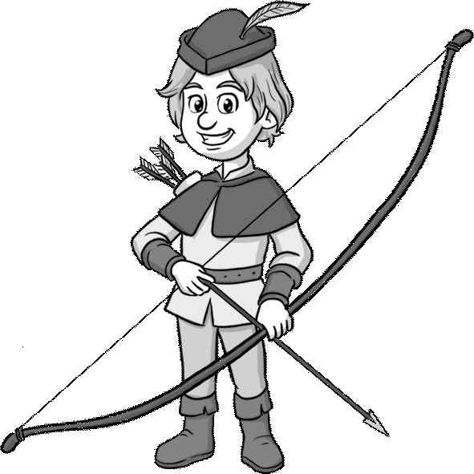

1. 다음을 듣고, 남자가 하는 말의 목적으로 가장 적절한 것을 고르시오.

① 체육 대회 자원봉사자를 모집하려고
② 체육 수업의 장소 변경을 공지하려고
③ 야외 활동 시 규칙 준수를 당부하려고
④ 폭우로 인한 체육관 사용 중단을 요청하려고
⑤ 교내 공사로 인한 등교 시간 조정을 안내하려고

2. 대화를 듣고, 여자의 의견으로 가장 적절한 것을 고르시오.

① 면 소재의 잠옷은 수면에 도움이 된다.
② 숙면을 위해 방의 온도 조절이 중요하다.
③ 호흡기 건강을 위해 환기를 자주 해야 한다.
④ 땀을 흡수하는 소재의 운동복을 입어야 한다.
⑤ 규칙적인 수면 습관은 건강한 삶을 위해 필요하다.

3. 다음을 듣고, 남자가 하는 말의 요지로 가장 적절한 것을 고르시오.

① 다양한 경험은 인생을 풍요롭게 만든다.
② 인생의 중요한 가치를 파악하는 것이 필요하다.
③ 도전에 직면하는 것은 자신감 형성에 중요하다.
④ 익숙한 환경은 자신감을 키우는 데 도움이 된다.
⑤ 자신감을 최대한 발휘할 수 있는 일을 찾아야 한다.

4. 대화를 듣고, 그림에서 대화의 내용과 일치하지 않는 것을 고르시오.

⑤
①

5. 대화를 듣고, 남자가 할 일로 가장 적절한 것을 고르시오.

① 화장실 청소하기
② 음식 재료 장보기
③ 음식 메뉴 선정하기
④ 보드게임 구매하기
⑤ 음악 재생 목록 만들기

6. 대화를 듣고, 여자가 지불할 금액을 고르시오.

① $12
② $16
③ $17
④ $18
⑤ $21

7. 대화를 듣고, 남자가 안경을 찾으러 갈 수 없는 이유를 고르시오.

① 축제 준비를 해야 해서
② 배드민턴 연습을 해야 해서
③ 학교 프로젝트를 끝마쳐야 해서
④ 배드민턴 라켓을 수리해야 해서
⑤ 가족과 저녁 식사를 하기로 해서

8. 대화를 듣고, Crystal Waterfall Tour에 관해 언급되지 않은 것을 고르시오.

① 소요 시간
② 준비물
③ 참가비
④ 모집 인원
⑤ 환불 가능 여부

9. Book Exchange 행사에 관한 다음 내용을 듣고, 일치하지 않는 것을 고르시오.

① 11월 3일에 열린다.
② 학교 도서관에서 개최된다.
③ 모든 장르의 책을 받는다.
④ 스티커를 도서관의 책과 교환해 준다.
⑤ 선착순 50명에게 에코백을 준다.

10. 다음 표를 보면서 대화를 듣고, 여자가 구매할 스터디 플래너를 고르시오.

Study Planners

|  | Product | Special Feature | Cover Material | Price | Digital Access |
| --- | --- | --- | --- | --- | --- |
| ① | A | Study guide | Paper | $9 | ☓ |
| ② | B | Blank paper | Paper | $11 | ◯ |
| ③ | C | Lined paper | Leather | $13 | ☓ |
| ④ | D | To-do list | Leather | $14 | ◯ |
| ⑤ | E | Inside pocket | Leather | $16 | ◯ |

11. 대화를 듣고, 남자의 마지막 말에 대한 여자의 응답으로 가장 적절한 것을 고르시오. [3점]

① Absolutely. I’m grateful for your help.
② No. We’re out of seats at the moment.
③ Of course. I’ll do that for you right now.
④ Yes. We offer free Wi-Fi at our restaurant.
⑤ Never mind. You can leave the plate on the table.

12. 대화를 듣고, 여자의 마지막 말에 대한 남자의 응답으로 가장 적절한 것을 고르시오.

① Sorry. I don’t remember calling you.
② Right. We should start our own band.
③ Don’t worry. I’ll call a taxi with mine.
④ No worries. You can download the app.
⑤ Unbelievable. I can’t believe you already left.

13. 대화를 듣고, 남자의 마지막 말에 대한 여자의 응답으로 가장 적절한 것을 고르시오. [3점]

Woman:

① Your support means a lot to me.
② I don’t understand why you have to win.
③ Grammar cannot be taught by the AI tool.
④ I’m afraid the speech contest has already finished.
⑤ If you use it appropriately, it can be a helpful tool.

14. 대화를 듣고, 여자의 마지막 말에 대한 남자의 응답으로 가장 적절한 것을 고르시오. [3점]

Man:

① Sure. It’s hard to focus online.
② Thanks. I’ll make sure to check my email.
③ No problem. You can help me set up the link.
④ I see. Let’s update your personal information.
⑤ No way. I’ll create an email account immediately.

15. 다음 상황 설명을 듣고, Tom이 Lisa에게 할 말로 가장 적절한 것을 고르시오.

Tom:

① Is it expensive to buy a gift?
② Are you going to buy a flower cake?
③ Can you teach me how to make a cake?
④ Would you bring the cake for my birthday?
⑤ Did you teach my grandmother how to bake?

16. 여자가 하는 말의 주제로 가장 적절한 것은?

① problems caused by consuming detox juices
② the origin of detox juices made with vegetables
③ difficulties in making detox juices with vegetables
④ healthy vegetable juices to aid recovery after surgery
⑤ the positive effects of vegetable detox juices on health

17. 언급된 주스가 아닌 것은?

따라 답을 하시기 바랍니다.

① beet juice
② celery juice
③ cucumber juice
④ carrot juice
⑤ kale juice

18. 다음 글의 목적으로 가장 적절한 것은?

Dear Mr. Kelly, My name is Mark Smith, and I am the manager of Lomos Tours. I express our sincere appreciation for your continued trust and loyalty. Next year, as part of a new promotional campaign, Lomos Tours will be airing an advertisement. We plan to include the experiences of some of our most valued clients. Since you traveled with us last summer, I would like to kindly ask if you would be willing to share a few words about your experience. Your feedback would be invaluable in helping us promote our services. A member of our team will be in touch with you shortly. Thank you in advance for your contributions. Warm regards, Mark Smith

19. 다음 글에 드러난 ‘I’의 심경 변화로 가장 적절한 것은?

After finishing my shopping, I walked out of the grocery store and headed to the spot where I’d parked my car. But it wasn’t there. I wasn’t the kind of person to forget where I’d parked. I knew I was in the right place ― so where was my car? I looked around, but nothing made sense. Not knowing what to do, I called my husband at home and said, “My car is missing! I can’t find my car.” I heard him laughing on the other end of the line. “Your car is here outside the house! You took mine today, remember?” I turned around ― and there it was. I couldn’t help but laugh at myself. With a sigh of relief, I walked over to the car. Everything was fine after all.

20. 다음 글에서 필자가 주장하는 바로 가장 적절한 것은?

One of the most important aspects of sustaining long-term relationships is communication. It’s easy to connect with someone and then let the relationship get stuck due to a lack of follow-up. To keep the connection alive, make a conscious effort to stay in touch. This doesn’t mean constantly reaching out with requests or updates but rather maintaining a friendly and consistent line of communication. A simple message to check in or share something of value can go a long way in reinforcing your relationship. For example, if you come across an article or resource that you think might interest a connection, share it with them, even if you haven’t spoken in a while. This shows that you’re thinking of them and are invested in maintaining the relationship.

21. 밑줄 친 an urban green space paradox가 다음 글에서 의미하는 바로 가장 적절한 것은? [3점]

Currently, urban regeneration projects in degraded areas have been promoted as improving the wellbeing of residents and solving environmental injustice problems. However, such environmental improvements in ethnic communities and/or low-income households can create an urban green space paradox. The creation of new, high-quality green spaces can increase attractiveness, making these neighbourhood more desirable. By contrast, the cost of housing can rise, and residents may not be able to afford the rent. This results in the exclusion or displacement of the poor neighbourhood’s residents, who were intended to benefit from the ecosystem services provided by the new green space. In turn, the residents may only be able to afford to live in a similar degraded neighbourhood to the one they left, with low access to green infrastructure.

22. 다음 글의 요지로 가장 적절한 것은?

An increasing awareness of our effect on the ocean is slowly seeping into the public agenda, dragging behind it a conversation that is decades overdue. But this conversation faces a massive obstacle. It’s almost impossible to discuss what to do about something changing if you don’t initially know how it works. If a doctor tells a patient that they have a problem with their kidneys, the patient probably already has at least a vague idea about where their kidneys are and what they’re up to. They learned about that part of their own personal life-support system at school. But that’s not the case for the oceans. When we see a news story about the long-term decline in the numbers of krill in the Southern Ocean, it sounds generally like a bad thing. But there’s far more to it than the risk of whales going hungry. Krill are a part of the ocean engine. We need to understand at least some of the context before we can discuss the change and take appropriate action.

23. 다음 글의 주제로 가장 적절한 것은?

Rome was said to have been a melting pot from the very start. The historian Livy claimed the city’s original population was comprised of immigrants flooding in from all directions, attracted by Romulus’s deliberate policy of nondiscrimination. It was this initial openness, Livy asserts, that laid the foundations for the later strength and success of the city. Romans described their city as multicultural in the generations after its foundation. Tradition held that only a minority of the city’s legendary kings were Roman-born, with the others all arriving as immigrants before being chosen for the throne for their virtues and merits. As the empire expanded across three continents, Rome eagerly adopted new cultural influences and absorbed incoming groups ― perhaps a little too eagerly for some, who, like the poet Juvenal, complained about the rapid rate of cultural change.

24. 다음 글의 제목으로 가장 적절한 것은? [3점]

The laws and constants of physics and the fundamental forces in our universe have very precise forms and values. This means that, if they were only very slightly different, life would not have been possible. For instance, the precise value of gravity has enabled our universe to arise by permitting the aggregation of dust and gas particles to proto-stars around which planets later came to orbit, including the Earth around the Sun. If the value of the electron had been ever so slightly larger or smaller, chemistry, as we know it, would not have been possible and life, which is based on organic chemistry, could not have started. The universe was not designed for us to evolve, we have no privileged position in the universe; however, the laws and constants of physics allowed advanced life to evolve.

25. 다음 도표의 내용과 일치하지 않는 것은?

Percentages of U.K. Consumers Who Preferred Purchasing Clothes from Sustainable Brands

| Age Group | Men | Women |
| --- | --- | --- |
| 18-24 | 8% | 10% |
| 25-34 | 16% | 7% |
| 35-44 | 16% | 12% |
| 45-54 | 9% | 6% |
| 55+ | 4% | 12% |

26. Dalip Singh Saund에 관한 다음 글의 내용과 일치하지 않는 것은?

Dalip Singh Saund was an Indian-born American politician. After graduating from the University of Punjab in India, he moved to the U.S. to attend graduate school. He earned his doctoral degree at the University of California in 1924 but could not get a job because of his nationality. The next year, he began farming in Imperial Valley, but he was not able to buy land without U.S. citizenship. Dalip developed an interest in politics and he often spoke out on Indian and political topics. He went to Washington, D.C. and promoted a bill that would allow Indians to become U.S. citizens. The bill was passed in 1946, and three years later Dalip received U.S. citizenship. He later became the first Asian to be elected to the U.S. Congress.

27. 2025 Britt High School Character Design Contest에 관한 다음 안내문의 내용과 일치하지 않는 것은?

2025 Britt High School Character Design Contest

Britt High School holds our first Character Design Contest. Join the contest and create a character that symbolizes our school. Submission
Deadline: October 24, 5 p.m.
Entries should be sent by email to cdcbritt@bhs.edu. Judging Criteria
Concept
Creativity
Illustration Prizes Number of winners Prize (per winner) 1st prize 1 $50 gift card 2nd prize 2 $30 gift card 3rd prize 3 $10 gift card
Winners will be announced on our school’s website on October 31. No personal contact will be made.

28. 2025 Robin Hood Festival에 관한 다음 안내문의 내용과 일치하는 것은?

2025 Robin Hood Festival

The Robin Hood Festival is coming soon! This annual festival aims to celebrate Robin Hood, who has made Shearwood Forest famous around the world. When & Where
October 17-19, from 10 a.m. to 6 p.m.
Shearwood Forest Park Events
Shoot a bow like Robin Hood. (only available for ages 6 and above)
Take pictures with Robin Hood and other festival characters. Notes
Free shuttle bus will be provided.
A reservation is not required for any event.
For more information, visit www.rbfestival.org.

29. 다음 글의 밑줄 친 부분 중, 어법상 틀린 것은? [3점]

Human beings have evolved to make the most of the resources available to them in ways that are subtle and complicated. When we change our diets, especially when we do so quickly, we are effectively conducting huge experiments in nutrition. We ought to have more humility. Nutritional science is still young and there is so much we do not know. If we have eaten certain foods in certain ways for millennia, we should assume until it is proven otherwise what there is probably a good reason why. Traditional foods that don’t fit neatly on the contemporary dietary food plate should generally be chosen over highly processed ones that do. We should assume that traditionally made fatty blood sausages are preferable to lean, factory-made salamis; that spoonfuls of honey are superior to sprinkles of sweeteners. Witnessing how poorly traditional societies are faring as they undergo a nutrition transition should make those who have already completed it question whether their diets have moved too far.

30. 다음 글의 밑줄 친 부분 중, 문맥상 낱말의 쓰임이 적절하지 않은 것은?

While convenience and technology are crucial, they are not the only factors driving Gen Z’s financial decisions. This generation is incredibly values-driven, and they want to bank with institutions that match their personal beliefs and values. Transparency is vital. Gen Z is skeptical of large corporations and institutions that lack accountability. They have grown up in a world where information is freely available, and they expect complete transparency from the brands they support. Banks, for example, must clearly communicate fees, terms, and conditions, as well as how they handle customers’ data. Moreover, ethical banking practices are more important than ever. Gen Z cares about the environment, social justice, and the ethical implications of their financial decisions. They are interested in sustainable investing, supporting businesses that match their values, and ensuring that their money is not being used to fund beneficial practices. Banks that offer socially responsible investment opportunities and are committed to environmental sustainability will attract Gen Z’s attention.

31. 다음 빈칸에 들어갈 말로 가장 적절한 것을 고르시오.

Myths aren’t only stories. For example, a well-known myth that persists today is the supposed high iron content in spinach. This is a legend that dates back to 1890 and originates from a simple miscalculation by physiologist Gustav von Bunge. He accurately determined that 100 grams of spinach contained 35 milligrams of iron but he was analyzing dried spinach, which held ten times more iron than the same amount of fresh leafy greens. Although the error was swiftly corrected, the correction was just as swiftly forgotten. The myth had taken hold. Popeye, who gained superhuman strength from the leafy greens and defended himself with iron fists, contributed to its and even today, some nearly 150 years later, parents the world over use this tale to try to persuade their children into eating the healthy vegetable.

32. 다음 빈칸에 들어갈 말로 가장 적절한 것을 고르시오.

The technical term often used to describe animals’ judgement of numbers is the approximate number system. What it does not provide is precision. It shows ― and this is the same in every species tested ― a characteristic pattern of errors, with discrimination becoming less accurate as the quantities get bigger. Rhesus monkeys can tell one from two, two from three, three from four, four from five... but start to fail from five upwards. Rats that learned to press a lever a given number of times, from four up to twenty-four, became markedly less and less precise in their responses as the number increased: by the top end of the range they would merely produce a spread of numbers around the target. It is a common observation that when testing the accuracy of animals’ number sense, ____.

33. 다음 빈칸에 들어갈 말로 가장 적절한 것을 고르시오. [3점]

Despite the cultural trope depicting emotions as the opposite of rational thought, cognition ― what we commonly refer to as thinking ― is actually a key building block of emotion. How we think about our circumstances shapes the emotions we experience; then those emotions echo back to influence how we think. For instance, if you walk into a test thinking you are bad at taking tests, your anxiety will be increased. Then you don’t feel good about your performance on the test, and that becomes evidence for continuing to think that you’re bad at test taking. In this way ____. This bi-directionality of cognition and emotion allows us to adjust difficult emotions by changing the way we think. By thinking differently ― I get nervous sometimes, but I’m still a good test taker, or that nervous feeling is just excitement and anticipation, it means I’m ready ― you can work those pathways to your advantage.

34. 다음 빈칸에 들어갈 말로 가장 적절한 것을 고르시오. [3점]

What is the Capabilities Approach (CA), and why would lawyers passionate about animal justice care about it? It is easy to say what it is not. The CA does not rank animals by likeness to humans or seek special privileges for those considered most “like us,” as do some other popular theoretical approaches. The CA has concern for the finch and the pig as much as the whale and the elephant. And it argues that the human form of life is simply irrelevant when we think about what each type of animal needs and deserves. What is relevant is their own forms of life. Just as humans seek to be able to enjoy the characteristic goods of a human life, so a finch seeks a finch’s life and the whale a whale’s life. We should extend ourselves and learn, not lazily picture animals as lesser humans, seeking a life sort of like our own. According to the CA, each sentient creature should have the opportunity to flourish ____.

35. 다음 글에서 전체 흐름과 관계 없는 문장은?

Social media serves as an important context to facilitate autobiographical remembering. Personal events posted on social media platforms are better remembered and less forgotten than those not posted, independent of the characteristics of the events. This may be because sharing memories online allows individuals to rehearse and make sense of what happened, thus facilitating long-term memory retention. Online feedback such as comments and likes as well as technological features such as algorithms and periodic reminders can further serve as memory cues for the posted event details. Upward social comparisons on social media are particularly harmful for low self-esteem individuals, who tend to make more frequent comparisons when browsing. As a result, event details shared on social media are likely stabilized and remembered over time, whereas those not shared may become inaccessible or forgotten.

36. 주어진 글 다음에 이어질 글의 순서로 가장 적절한 것을 고르시오.

Multisensory experiences are a central part of our everyday lives, yet we often take them for granted, especially when our senses function normally or are corrected to normal with aids like glasses. And it does not stop there. Even the sounds that come both from the atmospheres in which we eat and our interactions with the food (such as chewing) and the tools we use to eat influence our eating experience. However, closer inspection to any, even the most ordinary experiences, reveals the remarkable multisensory world in which we live. Consider the experience of eating a regular meal. At first, it may seem like an ordinary experience, but it is actually a fusion of the senses. We first eat with our eyes, but we are also exposed to countless sensory signals that influence our eating experience such as food textures, tastes, and smells.

37. 주어진 글 다음에 이어질 글의 순서로 가장 적절한 것을 고르시오. [3점]

As children, the principle of opposites is foreign. Children perceive words and their meanings separately from each other. It is only in later development that we understood that individual words directly connect to one another. The same applies to the logical connection between ‘Yes’ and ‘No’ as perceived by parents. When we were children and were told, for example, “No, don’t eat with your hands,” we were confused and didn’t know what our parents expected from us. For many children, for instance, it is not clear that ‘Right’ is the opposite of ‘Left’. A vivid example of this can be seen when children learn to ride a bicycle. If parents tell their child “Don’t go to the left,” they will often find that the child will continue riding straight ahead and not automatically turn to the right. Our confusion was about whether we should continue eating or not and if so, how? Only later did we recognize the connection and understand that we should continue eating, but not with our hands but with a fork or a spoon.

38. 글의 흐름으로 보아, 주어진 문장이 들어가기에 가장 적절한 곳을 고르시오.

These patterns recur predictably because they are tightly programmed genetically and propelled pheromonally. Humans are not the most social animal. Ants, bees, and termites put humanity to shame on many metrics of sociality. A wide variety of relatives live together with perfectly harmonious behavior and collectively care for their young. But while insect colonies are impressively social places, it’s not our kind of social life. Bees always build hexagonal hives, ants march in lines, and termites move in zigzag formations. We humans are more free, less tightly programmed genetically, so our social patterns can be more diverse and dynamic. Every group dances a slightly different dance, and these choreographies change across generations. We still think and act in ways that are in harmony with others around us, but it is through patterns that are more shaped by nurture, not just nature.

39. 글의 흐름으로 보아, 주어진 문장이 들어가기에 가장 적절한 곳을 고르시오. [3점]

But with more permanent things, companies must invent reasons for their customers to continue to consume them. Those who purchase the goods of a company are called customers. Individuals who purchase goods for personal use are called consumers: beings who consume. Therefore, companies have invented multiple ways to ensure that their customers consume the produced items in larger and larger quantities and more and more frequently. Those who sell food have an easy time, for food is literally consumed, so there is always a need to purchase new food. One approach is to make the stuff that people already have outdated by convincing them that it is no longer fashionable. The entire fashion industry is built to convince people that fashion matters, so they must purchase new clothing, even though the old is still perfectly functionable. Fashion today extends to far more things than clothes: automobiles, mobile phones, computers ― the list is extended indefinitely, limited only by the limits of the creative minds of the marketing divisions of companies.

40. 다음 글의 내용을 한 문장으로 요약하고자 한다. 빈칸 (A), (B)에 들어갈 말로 가장 적절한 것은?

Kivetz, Urminsky, and Zheng partnered with a café to test the motivating effect of illusory progress in an experiment. Customers received a reward card that offered one free coffee after they’d bought ten. While half of the customers received a card with ten open slots, the other half got a card with twelve open slots. Yet the twelve-slot card had two preexisting “bonus” stamps, so, strictly speaking, these were identical reward programs. Every customer who got a card needed to make ten coffee purchases (and collect ten stamps) to get their free coffee. But the appeal of the free stamps was high. People who thought they’d gotten a head start came back to the café more often, filling in their reward card more quickly than the others. When the card came with two out of twelve slots already filled, it felt to customers like they were already 16 percent finished with the goal before they’d even started. Believing they were closer to the reward, they were more motivated to reach the finish line. 

According to the study above, customers were more driven to their goals when they perceived the reward as.

41. 윗글의 제목으로 가장 적절한 것은?

Creativity is the ability to generate novel and valuable ideas. It involves divergent thinking, imagination, and a willingness to experiment and take risks. While AI can be a powerful tool for creative efforts, it also carries the risk of limiting originality and innovation. AI algorithms are trained on existing datasets, often identifying patterns and trends in past creations. While this can be useful for generating new content in similar styles or formats, it can also lead to derivative works that lack genuine originality. If artists and designers rely too heavily on AI for inspiration and content generation, they may find themselves trapped in a cycle of imitation, unable to break free from the constraints of the AI’s training data. Moreover, the ease with which AI can generate content can discourage the kind of struggle and experimentation that often leads to breakthroughs. The creative process is often messy and repetitive, involving numerous failures and setbacks. It is through these challenges that we refine our skills, develop our unique perspectives, and push the boundaries of what is possible. If AI provides instant solutions, it can enhance this essential process of learning through trial and error, ultimately inhibiting the development of true creative talent.

42. 밑줄 친 낱말 중에서 문맥상 낱말의 쓰임이 적절하지 않은 것은?

Creativity is the ability to generate novel and valuable ideas. It involves divergent thinking, imagination, and a willingness to experiment and take risks. While AI can be a powerful tool for creative efforts, it also carries the risk of limiting originality and innovation. AI algorithms are trained on existing datasets, often identifying patterns and trends in past creations. While this can be useful for generating new content in similar styles or formats, it can also lead to derivative works that lack genuine originality. If artists and designers rely too heavily on AI for inspiration and content generation, they may find themselves trapped in a cycle of imitation, unable to break free from the constraints of the AI’s training data. Moreover, the ease with which AI can generate content can discourage the kind of struggle and experimentation that often leads to breakthroughs. The creative process is often messy and repetitive, involving numerous failures and setbacks. It is through these challenges that we refine our skills, develop our unique perspectives, and push the boundaries of what is possible. If AI provides instant solutions, it can enhance this essential process of learning through trial and error, ultimately inhibiting the development of true creative talent.

43. 주어진 글에 이어질 내용을 순서에 맞게 배열한 것으로 가장 적절한 것은?

 When billionaire James Walker was once asked by a journalist, “Is there anyone richer than you?”, he replied, “Yes, there is one young man I’ll never forget.” He told the story of when he first met David at a New York airport. Years ago, James was broke and stuck at the airport, killing time reading newspaper headlines at the newsstand. One headline caught his eye, but he had no money to buy the paper. Years passed and James became a wealthy businessman, but he never forgot the young man he had met at the airport. He found David running a small bookstore and visited him there. He introduced himself, saying, “David, you helped me twice when you had almost nothing. I want to give you anything you wish.” He looked at him and said, “You can’t truly compensate me.” James asked, “Why not?” David replied, “Because I gave to you when I had almost nothing. You’re offering me something now that you have everything. That’s just generosity at convenience. So, I can’t accept your offer.” James realized that money doesn’t make someone rich. Remembering that moment, he said to the journalist, “It’s the willingness to give even when you have very little that makes you wealthy. And so, David is the richest person I have ever met.” Just then, David, working at the newsstand noticed James. He asked, “Would you like to buy this, sir?” But, James hesitated, saying he had no money. David smiled and said, “Me, too. But I have enough for this. Take it as a gift.” Three months later, James, still broke, met him at the newsstand once more. Again, David gave him a newspaper without expecting anything in return.

44. 밑줄 친 낱말 중에서 가리키는 대상이 나머지 넷과 다른 것은?

 When billionaire James Walker was once asked by a journalist, “Is there anyone richer than you?”, he replied, “Yes, there is one young man I’ll never forget.” He told the story of when he first met David at a New York airport. Years ago, James was broke and stuck at the airport, killing time reading newspaper headlines at the newsstand. One headline caught his eye, but he had no money to buy the paper. Years passed and James became a wealthy businessman, but he never forgot the young man he had met at the airport. He found David running a small bookstore and visited him there. He introduced himself, saying, “David, you helped me twice when you had almost nothing. I want to give you anything you wish.” He looked at him and said, “You can’t truly compensate me.” James asked, “Why not?” David replied, “Because I gave to you when I had almost nothing. You’re offering me something now that you have everything. That’s just generosity at convenience. So, I can’t accept your offer.” James realized that money doesn’t make someone rich. Remembering that moment, he said to the journalist, “It’s the willingness to give even when you have very little that makes you wealthy. And so, David is the richest person I have ever met.” Just then, David, working at the newsstand noticed James. He asked, “Would you like to buy this, sir?” But, James hesitated, saying he had no money. David smiled and said, “Me, too. But I have enough for this. Take it as a gift.” Three months later, James, still broke, met him at the newsstand once more. Again, David gave him a newspaper without expecting anything in return.

45. 윗글에 관한 내용으로 적절하지 않은 것은?

 When billionaire James Walker was once asked by a journalist, “Is there anyone richer than you?”, he replied, “Yes, there is one young man I’ll never forget.” He told the story of when he first met David at a New York airport. Years ago, James was broke and stuck at the airport, killing time reading newspaper headlines at the newsstand. One headline caught his eye, but he had no money to buy the paper. Years passed and James became a wealthy businessman, but he never forgot the young man he had met at the airport. He found David running a small bookstore and visited him there. He introduced himself, saying, “David, you helped me twice when you had almost nothing. I want to give you anything you wish.” He looked at him and said, “You can’t truly compensate me.” James asked, “Why not?” David replied, “Because I gave to you when I had almost nothing. You’re offering me something now that you have everything. That’s just generosity at convenience. So, I can’t accept your offer.” James realized that money doesn’t make someone rich. Remembering that moment, he said to the journalist, “It’s the willingness to give even when you have very little that makes you wealthy. And so, David is the richest person I have ever met.” Just then, David, working at the newsstand noticed James. He asked, “Would you like to buy this, sir?” But, James hesitated, saying he had no money. David smiled and said, “Me, too. But I have enough for this. Take it as a gift.” Three months later, James, still broke, met him at the newsstand once more. Again, David gave him a newspaper without expecting anything in return.
