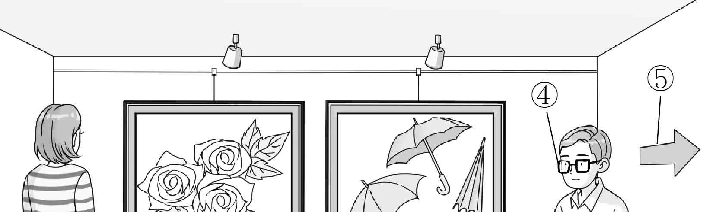
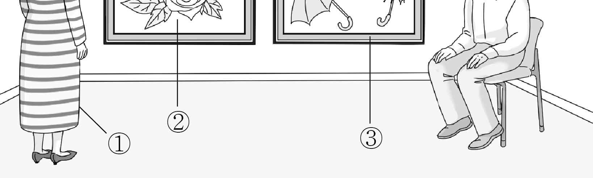
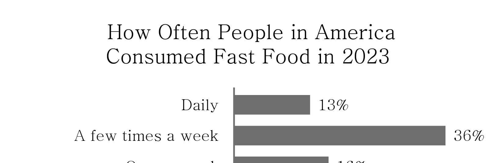
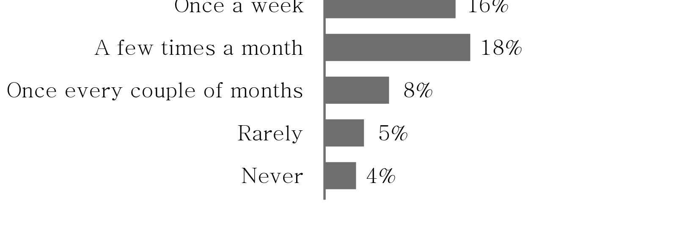
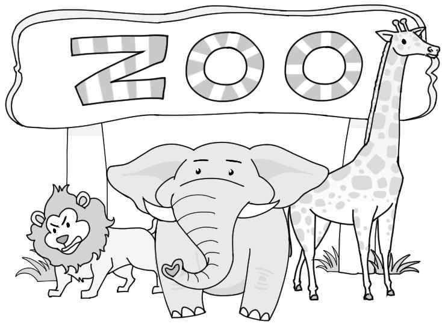

1. 다음을 듣고, 남자가 하는 말의 목적으로 가장 적절한 것을 고르시오.
① 학교 운동장 공사 계획을 안내하려고
② 교내 드론 대회 개최 소식을 알리려고
③ 학교 홍보용 드론 촬영 일정을 공지하려고
④ 학교 드론 동아리 공연의 관람을 권하려고
⑤ 교내 드론 공연의 관람 안전 수칙을 강조하려고

2. 대화를 듣고, 여자의 의견으로 가장 적절한 것을 고르시오.

① 학급 뮤지컬은 다양한 음악을 활용해야 한다.
② 학급 뮤지컬은 학생이 공연하기 쉬워야 한다.
③ 학급 뮤지컬은 인기 있는 소재를 다루어야 한다.
④ 학급 뮤지컬은 의미 있는 교훈을 전달해야 한다.
⑤ 학급 뮤지컬은 학생 모두가 역할을 맡아야 한다.

3. 다음을 듣고, 남자가 하는 말의 요지로 가장 적절한 것을 고르시오.

① 건강을 지키기 위해서 규칙적인 운동이 필수적이다.
② 바쁜 일상에서 휴식을 취하는 것은 건강에 중요하다.
③ 집중력을 높이는 것은 업무 수행 능력을 향상시킨다.
④ 운동 부족을 보완하려면 적절한 식이 요법이 필요하다.
⑤ 다양한 인간관계가 스트레스를 줄이는 데 도움이 된다.

4. 대화를 듣고, 그림에서 대화의 내용과 일치하지 않는 것을 고르시오.

5. 대화를 듣고, 남자가 할 일로 가장 적절한 것을 고르시오.

① 숲지도 다운로드 하기
② 산책 장소 찾아보기
③ 숲 입장권 구매하기
④ 식당 메뉴 찾아보기
⑤ 식당 예약하기

6. 대화를 듣고, 여자가 지불할 금액을 고르시오. [3점]

① $13
② $20
③ $23
④ $30
⑤ $33

7. 대화를 듣고, 남자가 휴대 전화를 수리받지 못한 이유를 고르시오.

① 수리점의 위치를 찾지 못해서
② 예약 없이 수리점을 방문해서
③ 수학 시험을 준비하느라 바빠서
④ 수리점에서 오래 기다려야 해서
⑤ 버스에서 휴대 전화를 잃어버려서

8. 대화를 듣고, Future Generation Talk Show에 관해 언급되지 않은 것을 고르시오.

① 개최 장소
② 강연자
③ 강연 주제
④ 시작 시간
⑤ 온라인 시청 가능 여부

9. Science Day 행사에 관한 다음 내용을 듣고, 일치하지 않는 것을 고르시오.

① 이번 주 토요일에 진행된다.
② 학생들이 직접 로봇을 작동해 볼 수 있다.
③ 선생님들이 오전에 실험 부스를 운영한다.
④ QR 코드를 스캔하여 참가 신청을 할 수 있다.
⑤ 참가자들에게 점심을 제공한다.

10. 다음 표를 보면서 대화를 듣고, 여자가 수강할 운동 수업을 고르시오.

Exercise Classes

|  | Class | Fee | Time | Exercise Type | Level |
| --- | --- | --- | --- | --- | --- |
| ① | A | $25 | 9:00 a.m. | Dancing | Beginner |
| ② | B | $35 | 10:00 a.m. | Dancing | Advanced |
| ③ | C | $35 | 10:00 a.m. | Tennis | Beginner |
| ④ | D | $35 | 2:00 p.m. | Boxing | Beginner |
| ⑤ | E | $45 | 10:00 a.m. | Boxing | Advanced |

11. 대화를 듣고, 여자의 마지막 말에 대한 남자의 응답으로 가장 적절한 것을 고르시오.

① I’ll ask the teacher if I can change my topic.
② I record myself talking and watch it later.
③ I’m looking forward to your presentation.
④ I need more time to finish my slides.
⑤ I haven’t decided what to wear.

12. 대화를 듣고, 남자의 마지막 말에 대한 여자의 응답으로 가장 적절한 것을 고르시오.

① Thanks. But I’m not hungry now.
② I agree. Printing it out is such a waste.
③ Of course not. I’ll help you at any time.
④ Great idea! It’ll catch the students’ attention.
⑤ No worries. I like the menu of our school cafeteria.

13. 대화를 듣고, 여자의 마지막 말에 대한 남자의 응답으로 가장 적절한 것을 고르시오.

Man:
① Right. I’ll try to go to bed earlier and get more sleep.
② I’m sorry. I didn’t know you had a hard time sleeping.
③ Absolutely! I believe you’ll do better next time.
④ Sure. I’ll do my best to stay awake longer.
⑤ I see. I’ll try to come back home in time.

14. 대화를 듣고, 남자의 마지막 말에 대한 여자의 응답으로 가장 적절한 것을 고르시오. [3점]

Woman:
① Reading books can also be a good hobby.
② You had to practice a lot to win the game.
③ How about going out with me this Saturday?
④ Just bring your racket and some comfortable clothes.
⑤ If you don’t have a hobby, you can get more stressed.

15. 다음 상황 설명을 듣고, Kevin이 Ms. Tyler에게 할 말로 가장 적절한 것을 고르시오. [3점]

① Isn’t it fortunate that the rain stopped yesterday?
② Could you teach us about the stars today?
③ Is it okay if we change the camp site?
④ Can we reschedule the camp for another day?
⑤ How can we gather more volunteers for the camp?

16. 여자가 하는 말의 주제로 가장 적절한 것은?

① useful tips for safe world travel
② necessary items for city travelers
③ famous historical cities in the world
④ importance of learning photo techniques
⑤ attractive photo spots around the world

17. 언급된 도시가 아닌 것은?

① New York
② Rome
③ Paris
④ London
⑤ Sydney

18. 다음 글의 목적으로 가장 적절한 것은?

Dear Miranda, Thank you for participating in our Crafts Art Fair. Since we’ve chosen you as one of the ‘Artists of This Year’, we are looking forward to introducing your unique handmade baskets to our community. As part of organizing the exhibition plan, we are happy to inform you that your artworks will be exhibited at the assigned table, number seven. Visitors can easily find your artworks located near the entrance. If you have any special requirements or need further assistance, feel free to contact us in advance. Sincerely, Helen Dwyer

19. 다음 글에 드러난 ‘I’의 심경 변화로 가장 적절한 것은?

The shed is cold and damp, the air thick with the smell of old wood and earth. It’s dark, and I can’t make out what’s moving in the shadows. “Who’s there?” I ask, my voice shaking with fear. The shadow moves closer, and my heart is beating fast — until the figure steps into a faint beam of light breaking through a crack in the wall. A rabbit. A laugh escapes my lips as it stares at me with wide, curious eyes. “You scared me,” I say, feeling much better. The rabbit pauses for a moment, then hops away, disappearing back into the shadows. I’m left smiling. I start to feel at ease.

20. 다음 글에서 필자가 주장하는 바로 가장 적절한 것은?

Improving your gestural communication involves more than just knowing when to nod or shake hands. It’s about using gestures to complement your spoken messages, adding layers of meaning to your words. Open-handed gestures, for example, can indicate honesty, creating an atmosphere of trust. You invite openness and collaboration when you speak with your palms facing up. This simple yet powerful gesture can make others feel more comfortable and willing to engage in conversation. But be careful of the trap of over-gesturing. Too many hand movements can distract from your message, drawing attention away from your words. Imagine a speaker whose hands move quickly like birds, their message lost in the chaos of their gestures. Balance is key. Your gestures should highlight your words, not overshadow them.

21. 밑줄 친 start down this slippery slope이 다음 글에서 의미하는 바로 가장 적절한 것은? [3점]

Assuming gene editing in humans proves to be safe and effective, it might seem logical, even preferable, to correct disease-causing mutations at the earliest possible stage of life, before harmful genes begin causing serious problems. Yet once it becomes possible to transform an embryo’s mutated genes into “normal” ones, there will certainly be temptations to upgrade normal genes to superior versions. Should we begin editing genes in unborn children to lower their lifetime risk of heart disease or cancer? What about giving unborn children beneficial features, like greater strength and increased mental abilities, or changing physical characteristics, like eye and hair color? The pursuit for perfection seems almost natural to human nature, but if we start down this slippery slope, we may not like where we end up.

22. 다음 글의 요지로 가장 적절한 것은?

The science we learn in grade school is a collection of certainties about the natural world — the earth goes around the sun, DNA carries the information of an organism, and so on. Only when you start to learn the practice of science do you realize that each of these “facts” was hard won through a succession of logical inferences based upon many observations or experiments. The process of science is less about collecting pieces of knowledge than it is about reducing the uncertainties in what we know. Our uncertainties can be greater or lesser for any given piece of knowledge depending upon where we are in that process — today we are quite certain of how an apple will fall from a tree, but our understanding of the turbulent fluid flow remains a work in progress after more than a century of effort.

23. 다음 글의 주제로 가장 적절한 것은?

There is a wealth of evidence that when parents, teachers, supervisors, and coaches are perceived as involved and caring, people feel happier and more motivated. And it is not just those people with power — we need to feel valued and respected by peers and coworkers. Thus, when the need for relatedness is met, motivation and internalization are fueled, provided that support for autonomy and competence are also there. If we are trying to motivate others, a caring relationship is a crucial basis from which to begin. And when we are trying to motivate ourselves, doing things to enhance a sense of connectedness to others can be crucial to long-term persistence. So exercise with a friend, call someone when you have a difficult decision to make, and be there as a support for others as they take on challenges.

24. 다음 글의 제목으로 가장 적절한 것은?

Modern brain-scanning techniques such as fMRI (functional Magnetic Resonance Imaging) have revealed that reading aloud lights up many areas of the brain. There is intense activity in areas associated with pronunciation and hearing the sound of the spoken response, which strengthens the connective structures of your brain cells for more brainpower. This leads to an overall improvement in concentration. Reading aloud is also a good way to develop your public speaking skills because it forces you to read each and every word — something people don’t often do when reading quickly, or reading in silence. Children, in particular, should be encouraged to read aloud because the brain is wired for learning through connections that are created by positive stimulation, such as singing, touching, and reading aloud.

25. 다음 도표의 내용과 일치하지 않는 것은?

How Often People in America Consumed Fast Food in 2023

| Frequency of Consumption | Percentage |
| --- | --- |
| Daily | 13% |
| A few times a week | 36% |
| Once a week | 16% |
| A few times a month | 18% |
| Once every couple of months | 8% |
| Rarely | 5% |
| Never | 4% |

26. Robert E. Lucas, Jr.에 관한 다음 글의 내용과 일치하지 않는 것은?

Robert E. Lucas, Jr. was born on September 15, 1937, in Yakima, Washington. During World War II, his family moved to Seattle, where he graduated from Roosevelt High School. At the University of Chicago, he majored in history. After taking economic history courses at University of California, Berkeley, he developed an interest in economics. He earned a doctoral degree in economics from the University of Chicago in 1964. He taught at Carnegie Mellon University from 1963 to 1974 before returning to the University of Chicago to become a professor of economics. He was known as a very influential economist and, in 1995, he was awarded the Nobel Prize in Economic Sciences.

27. Blackwood Zoo에 관한 다음 안내문의 내용과 일치하지 않는 것은?

Blackwood Zoo

Welcome to Blackwood Zoo Get ready to explore! You can watch amazing animals on our 10 km walking path. Hours of Operation
Every day, all year round!
9:30 a.m. - 4:30 p.m. (Last admission at 3:30 p.m.) Ticket Prices
Age 13 - 64: $30
Age 3 - 12: $20
Others: Free Seasonal Note Since the weather is still cold, some animals like snakes and turtles will stay only indoors.
Free shuttle bus departs from Blackwood Subway Station every 30 minutes.

28. Sock DIY Workshop에 관한 다음 안내문의 내용과 일치하는 것은?

Sock DIY Workshop

Join us for a fun and creative Sock DIY (Do It Yourself) Workshop for all ages! When & Where
Saturday, April 19th, from 1 p.m. to 3 p.m.
The community hall, Clanton Center Workshop Program Time DIY Item Things to Do 1 p.m. - 2 p.m. Toys Create stuffed toys with socks Flowerpot Transform socks into decorative 2 p.m. - 3 p.m. Covers covers for small flowerpots What Participants Should Prepare
Used but clean socks Participation Fee
$5 per person (including the cost for materials)
For more details, visit the Clanton Center website or call us at 555 - 123 - 4567.

29. 다음 글의 밑줄 친 부분 중, 어법상 틀린 것은?

Routines enable athletes to evaluate competition conditions. For example, bouncing a ball in a volleyball service routine supplies the server with information about the ball, the floor, and the state of her muscles. This information can then be used to properly prepare for her serve. Routines also enable athletes to adjust and fine-tune their preparations based on those evaluations or in pursuit of a particular competitive goal. This adaptation can involve adjustment to the conditions, rivals, competitive situation, or internal influences what can affect performance. Just like adjusting a race-car engine to the conditions of the track, air temperature, and weather, routines adjust all competitive components to achieve proper performance.

30. 다음 글의 밑줄 친 부분 중, 문맥상 낱말의 쓰임이 적절하지 않은 것은? [3점]

Promotion deals with consumer psychology. We can’t force people to think one way or another, and the clever marketer knows that promotion is used to provide information in the most clear, honest, and simple fashion possible. By doing so, the possibility of increasing sales goes up. Gone are the days when promotions were done in order to fool the consumer into purchasing something. The long‐term effect of getting a consumer to buy something they did not really want or need wasn’t good. In fact, consumers fooled once can do damage to sales as they relate their experience to others. Instead, marketers now know that their goal is to identify the consumers who are most likely to appreciate a good or service, and to promote that good or service in a way that makes the value clear to the consumer. Therefore, marketers must know where the uninterested consumers are, and how to reach them.

31. 다음 빈칸에 들어갈 말로 가장 적절한 것을 고르시오.

Plato argued that when you see something that strikes you as beautiful, you are really just seeing a partial reflection of true beauty, just as a painting or even a photograph only captures part of the real thing. True beauty, or what Plato calls the Form of Beauty, has no particular color, shape, or size. Rather, it is a(n) idea, like the number five. You can make drawings of the number five in blue or red ink, big or small, but the number five itself is none of those things. It has no physical form. Think of the idea of a triangle, for example. Although it has no particular color or size, it somehow lies within each and every triangle you see. Plato thought the same was true of beauty. The Form of Beauty somehow lies within each and every beautiful thing you see.

32. 다음 빈칸에 들어갈 말로 가장 적절한 것을 고르시오.

As you listen to your child in an emotional moment, be aware that usually works better than asking questions to get a conversation rolling. You may ask your child “Why do you feel sad?” and she may not have a clue. As a child, she may not have an answer on the tip of her tongue. Maybe she’s feeling sad about her parents’ arguments, or because she feels overtired, or she’s worried about a piano recital. But she may or may not be able to explain any of this. And even when she does come up with an answer, she might be worried that the answer is not good enough to justify the feeling. Under these circumstances, a series of questions can just make a child silent. It’s better to simply reflect what you notice. You can say, “You seem a little tired today,” or, “I noticed that you frowned when I mentioned the recital,” and wait for her response.

33. 다음 빈칸에 들어갈 말로 가장 적절한 것을 고르시오. [3점]

Our skin conducts electricity more or less efficiently, depending on our emotions. We know that when we’re emotionally stimulated — stressed, sad, any intense emotion, really — our bodies sweat a tiny bit, so little we might not even notice. And when those tiny drops of sweat appear, our skin gets more electrically conductive. This change in sweat gland activity happens completely without your conscious mind having much say in the matter. If you feel emotionally intense, you’re going to notice an increase in sweat gland activity. This is particularly useful from a scientific viewpoint, because it allows us to put an objective value on a subjective state of mind. We can actually by tracking how your body subconsciously sweats, by running a bit of electricity through your skin. We can then turn the subjective, subconscious experience of emotional intensity into an objective number by figuring out how good your skin gets at transferring an electrical current.

34. 다음 빈칸에 들어갈 말로 가장 적절한 것을 고르시오. [3점]

Plants can communicate, although not in the same way we do. Some express their discontent through scents. You know that smell that hangs in the air after you’ve mowed the lawn? Yeah, that’s actually an SOS. Some plants use sound. Yes, sound, though at a frequency that we can’t hear. Researchers experimented with plants and microphones to see if they could record any trouble calls. They found that plants produce a high-frequency clicking noise when stressed and can make different sounds for different stressors. The sound a plant makes when it’s not getting watered differs from the one it’ll make when a leaf is cut. However, it’s worth noting that experts don’t think plants are crying out in pain. It’s more likely that these reactions are knee-jerk survival actions. Plants are living organisms, and their main objective is to survive. Scents and sounds are their tools for ____.

35. 다음 글에서 전체 흐름과 관계 없는 문장은?

What does it mean for a character to be a hero as opposed to a villain? In artistic and entertainment descriptions, it’s essential for the author to establish a positive relationship between a protagonist and the audience.

36. 주어진 글 다음에 이어질 글의 순서로 가장 적절한 것을 고르시오. [3점]

Let’s assume that at least some animals are capable of thinking despite lacking a language. This doesn’t imply that squirrels lack concepts, simply that they don’t need them for this concrete form of thinking. For us to be able to say that an animal has concepts, we have to show not just that she’s capable of thinking, but also that she has certain specific abilities. To do this, in principle she doesn’t need a concept of branch nor a concept of tree. It might be enough for her to have, for example, the ability to think in images; to make a mental map of the tree where she can imagine and try out different routes. This doesn’t necessarily mean that they possess concepts, for some forms of thought may be nonconceptual. We can imagine, for instance, a squirrel who is planning how to get from the branch she’s currently standing on to a branch from the tree in front.

37. 주어진 글 다음에 이어질 글의 순서로 가장 적절한 것을 고르시오. [3점]

Cartilage is extremely important for the healthy functioning of a joint, especially if that joint bears weight, like your knee. This squeezing of joint fluid into and out of the cartilage helps it respond to the off-and-on pressure of walking without breaking under the pressure. The cartilage in your left knee then “drinks in” synovial fluid, in much the same way that a sponge soaks up liquid when put in water. When you take another step and transfer the weight back onto your left leg, much of the fluid squeezes out of the cartilage. Imagine for a moment that you’re looking into the inner workings of your left knee as you walk down the street. When you shift your weight from your left leg to your right, the pressure on your left knee is released.

38. 글의 흐름으로 보아, 주어진 문장이 들어가기에 가장 적절한 곳을 고르시오.

Piaget argued that children’s understanding of morality is like their understanding of those water glasses: we can’t say that it is innate or kids learn it directly from adults. Piaget put the same amount of water into two different glasses: a tall narrow glass and a wide glass, then asked kids to compare two glasses. Kids younger than six or seven usually say that the tall narrow glass now holds more water, because the level is higher. And when they are ready, they figure out the conservation of volume for themselves just by playing with cups of water. Rather, it is self-constructed as kids play with other kids. Taking turns in a game is like pouring water back and forth between glasses. Once kids have reached the age of five or six, then playing games and working things out together will help them learn about fairness far more effectively than any teaching from adults.

39. 글의 흐름으로 보아, 주어진 문장이 들어가기에 가장 적절한 곳을 고르시오.

But all this wisdom about how to deal with heat, accumulated over centuries of practical experience, is all too often ignored. The rise of air-conditioning accelerated the construction of sealed boxes, where the building’s only airflow is through the filtered ducts of the air-conditioning unit. It doesn’t have to be this way. Look at any old building in a hot climate, whether it’s in Sicily or Marrakesh or Tehran. Architects understood the importance of shade, airflow, light colors. They oriented buildings to capture cool breezes and block the worst heat of the afternoon. They built with thick walls and white roofs and transoms over doors to encourage airflow. Anyone who has ever spent a few minutes in a mudbrick house in Tucson, or walked on the narrow streets of old Seville, knows how well these construction methods work. In this sense, air-conditioning is not just a technology of personal comfort; it is also a technology of forgetting.

40. 다음 글의 내용을 한 문장으로 요약하려 한다. 빈칸 (A), (B) 에 들어갈 말로 가장 적절한 것은?

In the course of trying to solve a problem with an invention, you may encounter a brick wall of resistance when you try to think your way logically through the problem. Such logical thinking is a linear type of process, which uses our reasoning skills. This works fine when we’re operating in the area of what we know or have experienced. However, when we need to deal with new information, ideas, and viewpoints, linear thinking will often come up short. On the other hand, creativity by definition involves the application of new information to old problems and the conception of new viewpoints and ideas. For this you will be most effective if you learn to operate in a nonlinear manner; that is, use your creative brain. Stated differently, if you think in a linear manner, you’ll tend to be conservative and keep coming up with techniques which are already known. This, of course, is just what you don’t want. 

thinking works well with familiar problems but falls short in dealing with new ideas, for which creative thinking is needed to come up with solutions.

41. 윗글의 제목으로 가장 적절한 것은?

Some researchers view spoken languages as incomplete devices for capturing precise differences. They think numbers represent the most neutral language of description. However, when our language of description is changed to numbers, we do not move toward greater accuracy. Numbers are no more appropriate ‘pictures of the world’ than words, music, or painting. While useful for specific purposes (e.g. census taking, income distribution), they include information of enormous value. For example, the future lives of young students are tied to their scores on national tests. In effect, whether they can continue with their education, where, and at what cost depends importantly on a handful of numbers. These numbers do not account for the quality of schools they have attended, whether they have been tutored, have supportive parents, have test anxiety, and so on. Finally, putting aside the many ways in which statistical results can be manipulated, there are ways in which turning people’s lives into numbers is morally insulating. Statistics on crime, homelessness, or the spread of a disease say nothing of people’s suffering. We read the statistics as reports on events at a distance, thus allowing us to escape without being disturbed. Statistics are human beings with the tears wiped off. Quantify with caution.

42. 밑줄 친 낱말 중에서 문맥상 낱말의 쓰임이 적절하지 않은 것은? [3점]

Some researchers view spoken languages as incomplete devices for capturing precise differences. They think numbers represent the most neutral language of description. However, when our language of description is changed to numbers, we do not move toward greater accuracy. Numbers are no more appropriate ‘pictures of the world’ than words, music, or painting. While useful for specific purposes (e.g. census taking, income distribution), they include information of enormous value. For example, the future lives of young students are tied to their scores on national tests. In effect, whether they can continue with their education, where, and at what cost depends importantly on a handful of numbers. These numbers do not account for the quality of schools they have attended, whether they have been tutored, have supportive parents, have test anxiety, and so on. Finally, putting aside the many ways in which statistical results can be manipulated, there are ways in which turning people’s lives into numbers is morally insulating. Statistics on crime, homelessness, or the spread of a disease say nothing of people’s suffering. We read the statistics as reports on events at a distance, thus allowing us to escape without being disturbed. Statistics are human beings with the tears wiped off. Quantify with caution.

43. 주어진 글에 이어질 내용을 순서에 맞게 배열한 것으로 가장 적절한 것은?

 Jack, an Arkansas farmer, was unhappy because he couldn’t make enough money from his farm. He worked hard for many years, but things didn’t improve. He sold his farm to his neighbor, Victor, who was by no means wealthy. Hoping for a fresh start, he left for the big city to find better opportunities. Years passed, but Jack still couldn’t find the fortune he was looking for. Tired and broke, he returned to the area where his old farm was. “How did you do all this?” he asked. And he continued, “When you bought the farm, you barely had any money. How did you get so rich?” Victor smiled and said, “I owe it all to you. There were diamonds on this land — acres and acres of diamonds! I got rich because I discovered those diamonds.” “Diamonds?” Jack said in disbelief. And he said, “I knew every part of that land, and there were no diamonds!” Victor reached into his pocket and carefully pulled out something small and shiny. Holding it between his fingers, he let it catch the light. He said, “This is a diamond.” Jack was amazed and said, “I saw so many rocks like that and thought they were useless. They made farming so hard!” Victor laughed and said, “ You didn’t know what diamonds look like. Sometimes, treasures are hidden right in front of us.” One day, he drove past his old land and was shocked by what he saw. Victor, the man who had bought the farm with very little money, now seemed to be living a life of great success. He had torn down the farmhouse and built a massive house in its place. New buildings, trees, and flowers adorned the well-kept property. Jack could hardly believe that he had ever worked on this same land. Curious, he stopped to talk to Victor.

44. 밑줄 친 낱말 중에서 가리키는 대상이 나머지 넷과 다른 것은?

 Jack, an Arkansas farmer, was unhappy because he couldn’t make enough money from his farm. He worked hard for many years, but things didn’t improve. He sold his farm to his neighbor, Victor, who was by no means wealthy. Hoping for a fresh start, he left for the big city to find better opportunities. Years passed, but Jack still couldn’t find the fortune he was looking for. Tired and broke, he returned to the area where his old farm was. “How did you do all this?” he asked. And he continued, “When you bought the farm, you barely had any money. How did you get so rich?” Victor smiled and said, “I owe it all to you. There were diamonds on this land — acres and acres of diamonds! I got rich because I discovered those diamonds.” “Diamonds?” Jack said in disbelief. And he said, “I knew every part of that land, and there were no diamonds!” Victor reached into his pocket and carefully pulled out something small and shiny. Holding it between his fingers, he let it catch the light. He said, “This is a diamond.” Jack was amazed and said, “I saw so many rocks like that and thought they were useless. They made farming so hard!” Victor laughed and said, “ You didn’t know what diamonds look like. Sometimes, treasures are hidden right in front of us.” One day, he drove past his old land and was shocked by what he saw. Victor, the man who had bought the farm with very little money, now seemed to be living a life of great success. He had torn down the farmhouse and built a massive house in its place. New buildings, trees, and flowers adorned the well-kept property. Jack could hardly believe that he had ever worked on this same land. Curious, he stopped to talk to Victor.

45. 윗글에 관한 내용으로 적절하지 않은 것은?

 Jack, an Arkansas farmer, was unhappy because he couldn’t make enough money from his farm. He worked hard for many years, but things didn’t improve. He sold his farm to his neighbor, Victor, who was by no means wealthy. Hoping for a fresh start, he left for the big city to find better opportunities. Years passed, but Jack still couldn’t find the fortune he was looking for. Tired and broke, he returned to the area where his old farm was. “How did you do all this?” he asked. And he continued, “When you bought the farm, you barely had any money. How did you get so rich?” Victor smiled and said, “I owe it all to you. There were diamonds on this land — acres and acres of diamonds! I got rich because I discovered those diamonds.” “Diamonds?” Jack said in disbelief. And he said, “I knew every part of that land, and there were no diamonds!” Victor reached into his pocket and carefully pulled out something small and shiny. Holding it between his fingers, he let it catch the light. He said, “This is a diamond.” Jack was amazed and said, “I saw so many rocks like that and thought they were useless. They made farming so hard!” Victor laughed and said, “ You didn’t know what diamonds look like. Sometimes, treasures are hidden right in front of us.” One day, he drove past his old land and was shocked by what he saw. Victor, the man who had bought the farm with very little money, now seemed to be living a life of great success. He had torn down the farmhouse and built a massive house in its place. New buildings, trees, and flowers adorned the well-kept property. Jack could hardly believe that he had ever worked on this same land. Curious, he stopped to talk to Victor.
