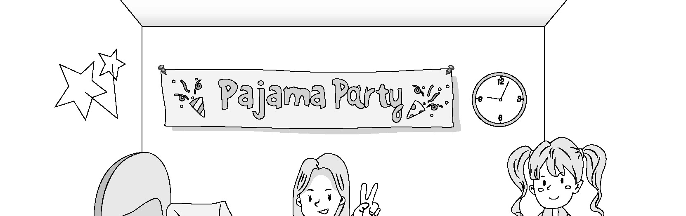
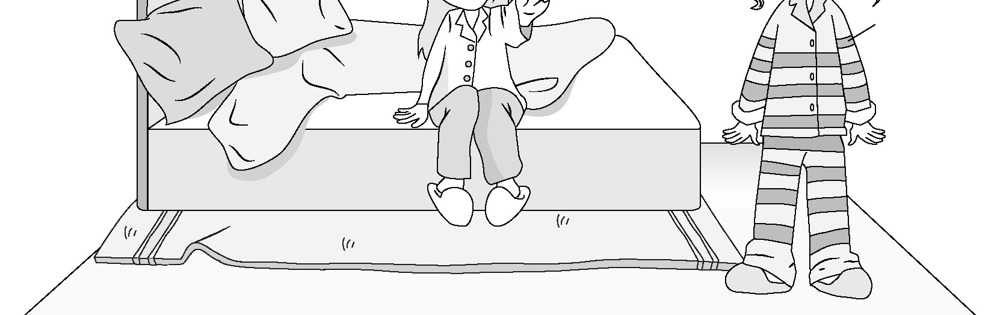
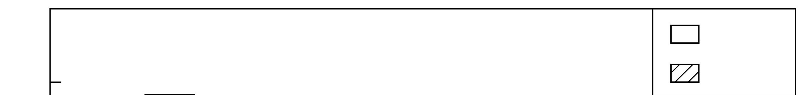
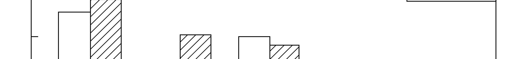
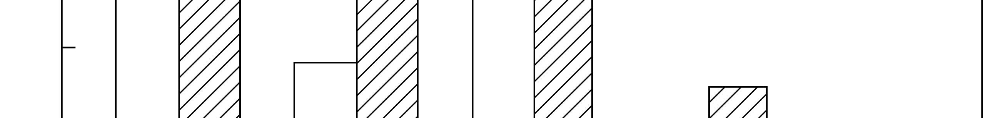
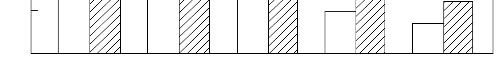
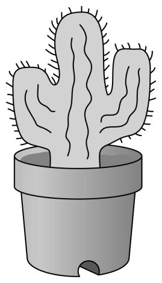
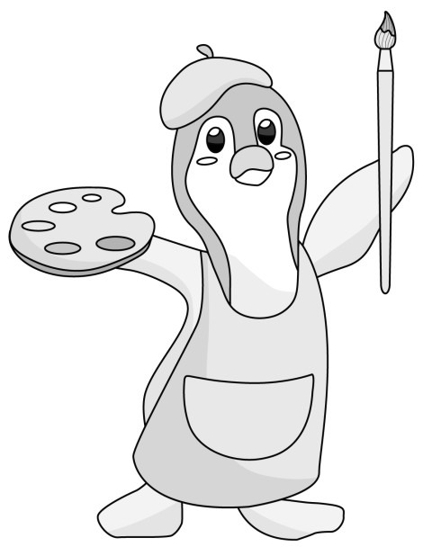

1. 다음을 듣고, 여자가 하는 말의 목적으로 가장 적절한 것을 고르시오.

① 학생회관 리모델링 일정을 공지하려고
② 새로운 학습 자료를 제공하려고
③ 학생용 프린터 설치를 알리려고
④ 학생회장 선출 방법을 안내하려고
⑤ 프린터 고장 시 해결 방법을 설명하려고

2. 대화를 듣고, 남자의 의견으로 가장 적절한 것을 고르시오.

① 단어를 소리내어 말하는 것이 암기에 효과적이다.
② 말하기와 쓰기는 언어 학습에서 필수적인 요소이다.
③ 뇌 기능의 효율성을 높이려면 충분한 휴식이 필요하다.
④ 문화를 이해하면 그 나라의 언어를 더 쉽게 배울 수 있다.
⑤ 언어 학습 과정에서의 실수는 장기 기억 형성에 도움이 된다.

3. 다음을 듣고, 남자가 하는 말의 요지로 가장 적절한 것을 고르시오.

① 햇빛을 쬐는 것은 신체와 정신의 건강에 도움이 된다.
② 자외선 차단제를 바르는 것은 피부 노화를 예방한다.
③ 건강을 위해 다양한 영양소를 고루 섭취해야 한다.
④ 몸과 마음이 건강하면 삶의 만족도가 높아진다.
⑤ 야외 활동 시 안전 수칙을 준수해야 한다.

4. 대화를 듣고, 그림에서 대화의 내용과 일치하지 않는 것을 고르시오.

④
②

5. 대화를 듣고, 남자가 할 일로 가장 적절한 것을 고르시오.

① 시식용 사탕 고르기
② 가격표 붙이기
③ 홍보 포스터 게시하기
④ 스피커 점검하기
⑤ 음악 재생 목록 만들기

6. 대화를 듣고, 여자가 지불할 금액을 고르시오. [3점]

① $80
② $90
③ $100
④ $110
⑤ $120

7. 대화를 듣고, 여자가 버스킹 공연에 참여할 수 없는 이유를 고르시오.

① 기타 연주를 연습해야 해서
② 아르바이트를 해야 해서
③ 테니스 수업을 받아야 해서
④ 오디션을 준비해야 해서
⑤ 대중 앞 공연이 긴장되어서

8. 대화를 듣고, Fireworks Festival 자원봉사에 관해 언급되지 않은 것을 고르시오.

① 기간
② 지원 가능 연령
③ 준비물
④ 활동 내용
⑤ 신청 기한

9. 2025 Talent Show에 관한 다음 내용을 듣고, 일치하지 않는 것을 고르시오.

① 학교 강당에서 개최될 것이다.
② 모든 학생이 참가할 수 있다.
③ 3명의 교사가 심사할 것이다.
④ 모든 참가자는 열쇠고리를 받을 것이다.
⑤ 공연 막바지에 댄스 파티가 있을 것이다.

10. 다음 표를 보면서 대화를 듣고, 두 사람이 구매할 책가방을 고르시오.

School Backpacks

|  | Model | Price | Shape | Color | Waterproof |
| --- | --- | --- | --- | --- | --- |
| ① | A | $50 | Round | Black | × |
| ② | B | $55 | Square | Black | × |
| ③ | C | $60 | Square | White | ○ |
| ④ | D | $65 | Square | Black | ○ |
| ⑤ | E | $75 | Round | White | ○ |

11. 대화를 듣고, 남자의 마지막 말에 대한 여자의 응답으로 가장 적절한 것을 고르시오. [3점]

① I see. Then you should leave now to go see a doctor.
② Good idea. I can put you in another group next class.
③ Too bad. You should have taken some medicine first.
④ Never mind. I hope you do better on the final exam.
⑤ Thank you. I’ll go to the nurse’s office right now.

12. 대화를 듣고, 여자의 마지막 말에 대한 남자의 응답으로 가장 적절한 것을 고르시오.

① No. I made all these cakes by myself.
② Sure. I’m looking forward to my 30th birthday.
③ Actually, I don’t mind if you eat my carrot cake.
④ Not really. It’s hard to remember all the anniversaries.
⑤ Yes, I’d like a heart‐shaped cake with a message on it.

13. 대화를 듣고, 여자의 마지막 말에 대한 남자의 응답으로 가장 적절한 것을 고르시오.

Man:
① I see. You’ve always preferred dogs over cats.
② Okay. I’ll ask him if you can look after his cat.
③ Sorry. I don’t have time to take care of your cat.
④ No problem. I’ll take his pet to the animal hospital.
⑤ I agree. I know for sure he’s a great pet caretaker.

14. 대화를 듣고, 남자의 마지막 말에 대한 여자의 응답으로 가장 적절한 것을 고르시오. [3점]

Woman:
① You’re right. That’s how I found the book.
② Well, I think the food will be delivered soon.
③ Thanks. I guess I haven’t lost my chef skills.
④ Really? I didn’t know that you loved to cook.
⑤ I know. That’s the reason I quit being a chef.

15. 다음 상황 설명을 듣고, Chloe가 호텔 직원에게 할 말로 가장 적절한 것을 고르시오.

① What’s the best tourist attraction near the hotel?
② Would it be possible to change to another room?
③ Could you check the refrigerator in my room?
④ Is there any way to get some cool water?
⑤ Can you turn off the air conditioner?

16. 남자가 하는 말의 주제로 가장 적절한 것은?

① native plants of various countries
② wild plants and their medical uses
③ endangered flowers across the world
④ roles of flowers in national ceremonies
⑤ national flowers with symbolic meanings

17. 언급된 국가가 아닌 것은?

따라 답을 하시기 바랍니다.

① Philippines
② Denmark
③ Germany
④ France
⑤ United States

18. 다음 글의 목적으로 가장 적절한 것은?

Dear Dog Owners, My name is Lily Paxton, and I’m the town’s Pet Program Coordinator. As part of our goal to make the community more dog‐friendly, we recently opened a new dog park. The park was designed to provide an enjoyable experience for both dogs and owners. There are big grassy areas where your dogs can run, jump, and play. We have separate spaces for small dogs and big dogs, to ensure safety. You’ll also find lots of benches and areas for resting and staying cool. We hope you will have a wonderful time with your dogs in this newly opened park. Regards, Lily Paxton, Pet Program Coordinator

19. 다음 글에 드러난 Maya의 심경 변화로 가장 적절한 것은?

Maya waited in line to check in for her flight. Her expectations about her European backpacking trip were really high. She had been looking forward to the trip for a year. She couldn’t wait to visit museums in Madrid and see the Eiffel Tower at night in Paris. As she stood in line, she could feel those experiences were finally so close. When she approached the counter, the airline employee asked to see her passport. Maya reached into her pocket but felt nothing. She realized she had left her passport at home. Her plans were ruined. She was heartbroken, knowing she could not board the flight and had to delay her dream trip.

20. 다음 글에서 필자가 주장하는 바로 가장 적절한 것은?

People often ask me, “What surprises you most about habits?” One thing that continually astonishes me is the degree to which we’re influenced by sheer convenience. The amount of effort, time, or decision making required by an action has a huge influence on habit formation. To a truly remarkable extent, we’re more likely to do something if it’s convenient, and less likely if it’s not. For this reason, we should pay close attention to the convenience of any activity we want to make into a habit. Putting a wastebasket next to our front door made mail sorting slightly more convenient, and I stopped procrastinating with this chore. Many people report that they do a much better job of staying close to distant family members now that tools like group chats make it easy to stay in touch.

21. 밑줄 친 the arrow is as likely to point in the reverse direction이 다음 글에서 의미하는 바로 가장 적절한 것은? [3점]

It is common sense that people’s inner beliefs may drive their external behavior. If you’re attracted to a certain person, you should be more likely to socialize with that person. If you favor a brand of toothpaste, you’re more likely to buy it. Of course, our internal thoughts don’t always predict our public behavior, but, overall, what we do obviously reflects what we think. But beliefs and behaviors are also related in a more remarkable way. It turns out that the arrow is as likely to point in the reverse direction. As social psychologist David Myers observes, “If social psychology has taught us anything during the last 25 years, it is that we are likely not only to think ourselves into a way of acting but also to act ourselves into a way of thinking.”

22. 다음 글의 요지로 가장 적절한 것은?

Imagine following the spirit of a silence vow into daily life. Challenge yourself to spend an entire day saying only what you absolutely must say. It’s been widely observed by behavioral psychology experts — and anyone who’s ever been on a first date — that we too often tend to treat “conversation” as a game of waiting for our own turn to speak. We miss what’s being said because we’re mentally rehearsing our next utterance. What if you could eliminate the idea that the next available mini-silence is your next opening to express whatever is in your head? What if you were limited to, say, fifty spoken words tomorrow? I think you’d listen quite differently. You’d attend quite carefully to every word you heard. You’d be attuned to what you must respond to. You might discover that the less you say, the more you hear.

23. 다음 글의 주제로 가장 적절한 것은?

Science is concerned with accumulating and understanding observations of the physical world. That understanding alone solves no problems. Individual people have to act on that understanding for it to help solve problems. For instance, science has found that regular exercise can lower your risk of heart disease. Knowing this fact is interesting, but it will do nothing for your personal health unless you act on it and actually exercise. And that’s the hard part. Reading an article about exercise is easy. Getting into an actual routine of regular exercise is harder. In this sense, science really solves no problems at all. Problems are only solved when people take the knowledge provided by science and use it. In fact, many of humanity’s biggest problems are caused by lack of action, and not lack of knowledge.

24. 다음 글의 제목으로 가장 적절한 것은?

We think we’re being logical, objective, and rational — and therefore accurate in our analysis, judgment, and decisions. So we think that if other people are logical, objective, and rational, they will agree with us and see what we see. But the opposite is the case. Every human brain is different. Everyone’s life experience is different. Everyone’s desires and knowledge are different. You might think you’re being realistic — that is, that your ideas match reality, but that’s impossible. It’s only your interpretation of reality, which will always be different from someone else’s. When two nations play each other in the World Cup, the fans of each country criticize the referees for missing all the infractions that the other team commits. Without fail, each fan base believes that the referees are biased against their team.

25. 다음 도표의 내용과 일치하지 않는 것은?

Online Share of Retail Trade in Selected European Countries in 2018 and 2019

| Country | 2018 | 2019 |
| --- | --- | --- |
| United Kingdom | 17.8% | 19.2% |
| Netherlands | 9.1% | 15.3% |
| Germany | 15.1% | 14.2% |
| Spain | 4.8% | 7.8% |
| Italy | 3.4% | 5.9% |

26. Edward O. Wilson에 관한 다음 글의 내용과 일치하지 않는 것은?

Edward O. Wilson was born in Birmingham, Alabama, in 1929. In his early childhood, he became interested in nature and spent much time in the outdoors. At age seven, he was partially blinded in a fishing accident; his reduced sight led Wilson to the study of ants. He could not observe larger animals from a distance. Instead, he concentrated on smaller creatures he could study up close. After studying evolutionary biology at the University of Alabama, Wilson transferred to Harvard University, where he became a professor in 1956. He never received a Nobel Prize — the prize didn’t recognize research in the field of evolutionary biology. However, he was awarded the Crafoord Prize in 1990. Wilson, known to some as the “modern‐day Darwin”, died at the age of 92 in Massachusetts.

27. Houseplant Heaven Pop-up Shop에 관한 다음 안내문의 내용과 일치하지 않는 것은?

Houseplant Heaven Pop-up Shop

Enjoy a special plant shopping experience! Explore beautiful houseplants, and bring some green into your home.
When
October 11 ‒ 13, 10 a.m. ‒ 8 p.m.
Where
Tasty Cup Cafe Details
Indoor plants are available for purchase.
If you buy 2 plants, you will get a 50% discount on coffee. Activities
Take pictures in a photo zone filled with unique plants.
Decorate eco‐friendly pots made from recycled glass.
Outside food and drinks are not allowed.

28. 2025 Summer Cartoon Festival에 관한 다음 안내문의 내용과 일치하는 것은?

2025 Summer Cartoon Festival

It’s the 8th annual Summer Cartoon Festival! The festival drew a lot of visitors last year. Why not be one of them this year? Dates: July 5 ‒ 6 Time: 9 a.m. ‒ 6 p.m. Place: Merryville Park Featured Events
Cartoon drawing classes for beginners only
Face painting by cartoonists
Parade of costumed characters Notes
All visitors will receive character stickers.
For a more detailed timetable and other information, check out www.SummerCartoonFest.com.

29. 다음 글의 밑줄 친 부분 중, 어법상 틀린 것은? [3점]

Studies of experts provide insight into what it means to have deep and flexible understanding. Experts in a particular domain are people who have deep, richly interconnected ideas about the world. They are not just good thinkers or people who are exceptionally smart. Rather, experts having knowledge in a specific domain — such as chess, chemistry, or tennis — and are not generalists. However, experts do not just know “a bunch of facts.” In fact, having expertise in a topic means that knowledge is organized into coherent frameworks, and the expert understands the inter-relationship between facts and can distinguish which ideas are most central. This kind of deep but organized understanding allows for greater flexibility in learning and facilitates application across multiple contexts.

30. 다음 글의 밑줄 친 부분 중, 문맥상 낱말의 쓰임이 적절하지 않은 것은?

It is natural for people to observe happenings and then seek explanations for why those happenings occurred. But sometimes the reasoning is wrong because of one or more misconceptions. One of these is the ecological fallacy, where an argument claims that there is a causal relationship between two things merely because they occur together. For example, in the 1950s it was found that crime rates were the highest in neighborhoods where immigrants were most numerous. Some people used this “co‐occurrence” to argue that immigrants were a cause of crime. But a careful analysis of this situation revealed that immigrants were forced to live in neighborhoods where crime rates were already low; they could not afford more expensive housing in safer neighborhoods. Immigrants themselves committed very few of the crimes. Unless you analyze the claim carefully, you would misinterpret the relationship and thereby construct a faulty belief.

31. 다음 빈칸에 들어갈 말로 가장 적절한 것을 고르시오. [3점]

In everyday life, we use to predict where we should pay attention. Different environments create different expectations. This was profoundly illustrated by the scientist Jared Diamond in his book Guns, Germs, and Steel. He describes an adventure wandering through the New Guinea jungle with native New Guineans. He relates that these natives tend to perform poorly at tasks Westerners have been trained to do since childhood. But they are hardly stupid. They can detect the most subtle changes in the jungle, good for following the tracks of a predator or for finding the way back home. They know which insects to leave alone, know where food exists, can build and tear down shelters with ease. Diamond, who had never spent time in such places, has no ability to pay attention to these things. Were he to be tested on such tasks, he also would perform poorly.

32. 다음 빈칸에 들어갈 말로 가장 적절한 것을 고르시오.

Most entrepreneurs put in tremendous amounts of time and effort in creating and launching new products and services and then make the mistake of overpricing them. They have created something they care deeply about, it’s theirs, and this powerful sense of ownership distorts their perception of value which causes them to overprice their products. While many of them are quick to realize that their initial prices are too high, not all these people are happy or willing to drop their prices to make their products more attractive. And this can be a very costly mistake that may lead to the failure of their new business. When you launch a new product or service, your priority should be to get sufficient market adoption as soon as possible and you should be ready to to achieve this aim. Once you have strong sales volumes, you can increase your prices to maximize your profits.

33. 다음 빈칸에 들어갈 말로 가장 적절한 것을 고르시오. [3점]

In most respects, humans are one of a relatively small number of species that evolved a very different strategy of ____. Like apes and elephants, we mature at a leisurely pace, grow large bodies, and have few babies but devote much time and energy to raising them well. This unusual strategy succeeds because while apes and elephants produce fewer babies than mice, a larger percentage of their offspring survive to then reproduce. A house mouse can become a mother when she is just five weeks old, has four to ten pups per litter, and can have a new litter every two months over the course of her approximately twelve-month life. However, the vast majority of her pups die young. In contrast, a chimp or elephant mother does not reproduce until she is at least twelve years old, and she gives birth to only one infant every five or six years over the next thirty or so years. About half of these offspring make it to becoming parents.

34. 다음 빈칸에 들어갈 말로 가장 적절한 것을 고르시오.

When scientists make an important new discovery or experimentally prove some hypothesis, they do not, in general, keep that information to themselves so that they alone can consider its meaning and derive additional theories from it. Instead, they publish their results and make their data available for inspection. This makes it possible for other scientists to reconsider their data and possibly refute their conclusions. More important, though, it makes it possible for other scientists to use that data to construct new hypotheses and perform new experiments. The assumption is that society as a whole will end up knowing more if information is spread as widely as possible, rather than being limited to a few people. In a strict sense, every scientist ____.

35. 다음 글에서 전체 흐름과 관계 없는 문장은?

In the 1930s, the British psychologist Sir Frederic Bartlett asked people to listen to folktales from other countries and then recall these stories at a later date. As you might guess, unfamiliar stories were not remembered as well as familiar stories.

36. 주어진 글 다음에 이어질 글의 순서로 가장 적절한 것을 고르시오. [3점]

History, people often say, repeats itself. And looking at the historical records of the ancient civilizations, some things do seem to happen again and again. If so, archaeology would be pretty boring; one thing would happen again and again. But that’s not what archaeologists see. Some civilizations end suddenly, like the Aztec and Inca, conquered by invaders in the 1520s AD. Civilizations expand, get overextended, and then collapse as in the cases of Rome, which went under in 476 AD, and the British Empire, which fell apart more than a thousand years later in the post‐World War II era. But is this always the case? Those empires never had the chance to collapse as a result of overexpansion. So in the case of civilizations, “history repeats itself” seems to be an oversimplification.

37. 주어진 글 다음에 이어질 글의 순서로 가장 적절한 것을 고르시오.

Stanford psychology professor Dr. Carol Dweck is the internationally recognized pioneer of the concept of “growth mindset” as a way to continually grow, learn, and persevere in our efforts. These kids end up taking on tougher things, and feel better about themselves. “Emphasizing effort gives a child a variable that they can control,” Dweck has explained. In contrast, Dweck found, kids who are praised not for their smarts but for their effort develop what Dweck calls a “growth mindset.” They learn that their effort is what led to their success, and if they continue to try, over time they’ll improve and achieve more things. Dweck found that kids who are told they’re “smart” actually underperform in future tasks, by choosing easier tasks to avoid evidence that they are not smart, which Dweck calls having a “fixed mindset.”

38. 글의 흐름으로 보아, 주어진 문장이 들어가기에 가장 적절한 곳을 고르시오.

Partly this was the obvious convenience of being able to exit more quickly. To monitor our surroundings is to focus on what’s outside of ourselves: what we see, hear, smell, feel, and perhaps even taste. But sometimes what really marks a place is something less specific — a feeling within us. An interesting example emerged from a study of subway passenger behavior. Researchers trying to understand why people sit where they sit or stand where they stand in subway and metro trains examined the factors that shape the way riders used and navigated that space in different situations. One of their findings involved the reasons many riders like to plant themselves close to the train’s doors. But it was shaped partly by a more abstract sensation — the desire to avoid the sometimes uncomfortable feeling of accidentally making eye contact with seated passengers. We can’t see feelings — but they’re very real, and they influence our experience of the world.

39. 글의 흐름으로 보아, 주어진 문장이 들어가기에 가장 적절한 곳을 고르시오. [3점]

But if we sink just our face in a bowl of water, while the whole of the rest of our body is in the dry air, the diving reflex is triggered. We have a ‘diving reflex’, like other marine mammals. This means that special nerve endings on our faces, around the mouth and nose, trigger this reflex only when the facial region goes under water. If we are in the water, with our head out in the air, there is no diving reflex. It automatically closes down the airway, reducing the risk of swallowing water, and it narrows the small air-passages in the lungs. At the same time the heart rate is slowed down to half speed and blood is shunted to the vital organs, protecting them from the effects of the brief stop in breathing. By contrast, if a chimpanzee or a gorilla found itself in water with its face below the surface, it would panic, its heart would race and it would quickly drown.

40. 다음 글의 내용을 한 문장으로 요약하고자 한다. 빈칸 (A), (B)에 들어갈 말로 가장 적절한 것은?

There is a natural assumption of truth, or a truth bias when humans communicate with one another. In other words, when we’re listening to others or reading their words, our automatic assumption is that the other person is telling the truth. This usually works out fine. If you ask someone where the restroom is located or if it’s raining outside, you can safely assume that most people will not lie in their responses. Imagine how difficult it would be to converse with someone if you assumed that everything they were telling you was false! Indeed, questioning the truth of a statement and then choosing not to believe it requires additional mental steps. For the most part, humans are “cognitive misers,” which means we typically don’t expend more mental effort than seems necessary in a given situation. It makes sense then, that when we see something online, even if it is fake, our default is to believe it, at least at first. 

We humans are unlikely to the truth of information we receive, due to our tendency to mental effort.

41. 윗글의 제목으로 가장 적절한 것은?

Paying with plastic fundamentally changes the way we spend money, altering the calculus of our financial decisions. When you buy something with cash, the purchase involves an actual loss — your wallet is literally lighter. Credit cards, however, make the purchase abstract, so that you don’t really feel the downside of spending money. Brain-imaging experiments suggest that paying with credit cards actually reduces activity in the insula, a brain region associated with negative feelings. As George Loewenstein, a neuroeconomist at Carnegie Mellon, says, “The nature of credit cards ensures that your brain is anesthetized against the pain of payment.” Spending money doesn’t feel bad, so you spend more money. Consider this experiment: Drazen Prelec and Duncan Simester, two business professors at MIT, organized a real-life, sealed-bid auction for tickets to a Boston Celtics game. Half the participants in the auction were informed that they had to pay with cash; the other half were told they had to pay with credit cards. Prelec and Simester then averaged the bids for the two different groups. It turns out that the average credit card bid was twice as high as the average cash bid. When people used their credit cards, their bids were much more careful. They no longer felt the need to limit their expenses.

42. 밑줄 친 낱말 중에서 문맥상 낱말의 쓰임이 적절하지 않은 것은? [3점]

Paying with plastic fundamentally changes the way we spend money, altering the calculus of our financial decisions. When you buy something with cash, the purchase involves an actual loss — your wallet is literally lighter. Credit cards, however, make the purchase abstract, so that you don’t really feel the downside of spending money. Brain-imaging experiments suggest that paying with credit cards actually reduces activity in the insula, a brain region associated with negative feelings. As George Loewenstein, a neuroeconomist at Carnegie Mellon, says, “The nature of credit cards ensures that your brain is anesthetized against the pain of payment.” Spending money doesn’t feel bad, so you spend more money. Consider this experiment: Drazen Prelec and Duncan Simester, two business professors at MIT, organized a real-life, sealed-bid auction for tickets to a Boston Celtics game. Half the participants in the auction were informed that they had to pay with cash; the other half were told they had to pay with credit cards. Prelec and Simester then averaged the bids for the two different groups. It turns out that the average credit card bid was twice as high as the average cash bid. When people used their credit cards, their bids were much more careful. They no longer felt the need to limit their expenses.

43. 주어진 글에 이어질 내용을 순서에 맞게 배열한 것으로 가장 적절한 것은?

 The sun shone in the cloudless sky as Becky, a retired teacher, walked to the fruit market. Across town, Dana was riding a bus towards the museum for a job interview. Just before reaching her stop, Dana noticed the sky had suddenly darkened. Her heart sank — she had no umbrella. As she stepped off the bus next to the market, where Becky had just finished shopping, raindrops began to fall. Dana thanked her, took the umbrella, and opened it. She saw a small card tied to the handle. It read: “Cover each other.” She was touched by the message. She hurried to the museum, arriving dry and comfortable, and performed well in her interview. The Museum CEO was impressed by Dana and offered her the Event Manager position, her dream job. Throughout the years ahead, she often thought back to Becky’s kind gesture. Inspired by the memory, Dana created a museum event called “Cover Each Other” with paintings of people supporting others. She donated half of the money from ticket sales to families who lost their homes to natural disasters. Dana kept Becky’s message framed in her office as a reminder that one kind gesture could change someone’s life. The kindness of one stranger had shaped her path, and she made sure it continued to shape the world. Dana felt panic. She didn’t want to show up to her interview soaked. She looked around but couldn’t find any stores nearby to buy an umbrella, and she didn’t have time to search around. Just then, Becky approached her, holding an open umbrella in one hand and a closed one in the other. “Take this,” she said with a smile. Dana’s eyes widened. “Are you sure?” Becky nodded. “I always carry an extra on rainy days.”

44. 밑줄 친 낱말 중에서 가리키는 대상이 나머지 넷과 다른 것은?

 The sun shone in the cloudless sky as Becky, a retired teacher, walked to the fruit market. Across town, Dana was riding a bus towards the museum for a job interview. Just before reaching her stop, Dana noticed the sky had suddenly darkened. Her heart sank — she had no umbrella. As she stepped off the bus next to the market, where Becky had just finished shopping, raindrops began to fall. Dana thanked her, took the umbrella, and opened it. She saw a small card tied to the handle. It read: “Cover each other.” She was touched by the message. She hurried to the museum, arriving dry and comfortable, and performed well in her interview. The Museum CEO was impressed by Dana and offered her the Event Manager position, her dream job. Throughout the years ahead, she often thought back to Becky’s kind gesture. Inspired by the memory, Dana created a museum event called “Cover Each Other” with paintings of people supporting others. She donated half of the money from ticket sales to families who lost their homes to natural disasters. Dana kept Becky’s message framed in her office as a reminder that one kind gesture could change someone’s life. The kindness of one stranger had shaped her path, and she made sure it continued to shape the world. Dana felt panic. She didn’t want to show up to her interview soaked. She looked around but couldn’t find any stores nearby to buy an umbrella, and she didn’t have time to search around. Just then, Becky approached her, holding an open umbrella in one hand and a closed one in the other. “Take this,” she said with a smile. Dana’s eyes widened. “Are you sure?” Becky nodded. “I always carry an extra on rainy days.”

45. 윗글에 관한 내용으로 적절하지 않은 것은?

 The sun shone in the cloudless sky as Becky, a retired teacher, walked to the fruit market. Across town, Dana was riding a bus towards the museum for a job interview. Just before reaching her stop, Dana noticed the sky had suddenly darkened. Her heart sank — she had no umbrella. As she stepped off the bus next to the market, where Becky had just finished shopping, raindrops began to fall. Dana thanked her, took the umbrella, and opened it. She saw a small card tied to the handle. It read: “Cover each other.” She was touched by the message. She hurried to the museum, arriving dry and comfortable, and performed well in her interview. The Museum CEO was impressed by Dana and offered her the Event Manager position, her dream job. Throughout the years ahead, she often thought back to Becky’s kind gesture. Inspired by the memory, Dana created a museum event called “Cover Each Other” with paintings of people supporting others. She donated half of the money from ticket sales to families who lost their homes to natural disasters. Dana kept Becky’s message framed in her office as a reminder that one kind gesture could change someone’s life. The kindness of one stranger had shaped her path, and she made sure it continued to shape the world. Dana felt panic. She didn’t want to show up to her interview soaked. She looked around but couldn’t find any stores nearby to buy an umbrella, and she didn’t have time to search around. Just then, Becky approached her, holding an open umbrella in one hand and a closed one in the other. “Take this,” she said with a smile. Dana’s eyes widened. “Are you sure?” Becky nodded. “I always carry an extra on rainy days.”
