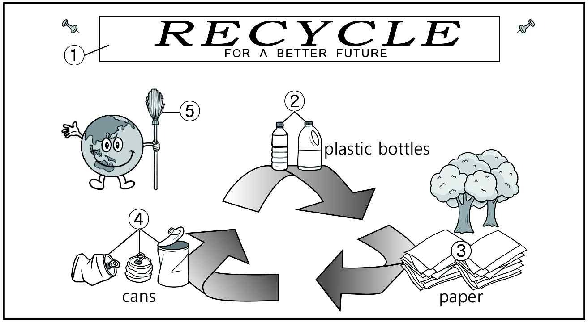
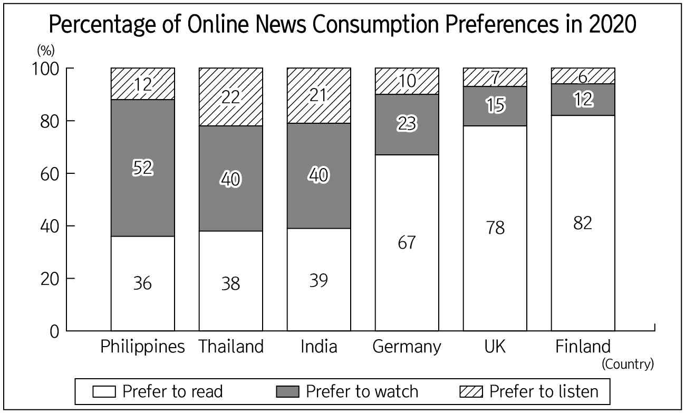
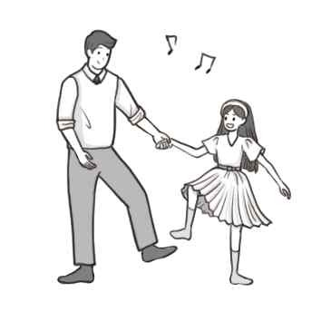

1. 다음을 듣고, 여자가 하는 말의 목적으로 가장 적절한 것을 고르시오.

① 학부모 간담회 참석을 독려하려고
② 학부모 상담 기간 연기를 안내하려고
③ 교직원 회의 시간 변경에 대한 협조를 요청하려고
④ 학부모 간담회를 위한 교직원 주차 장소 변경을 알리려고
⑤ 지역 주민 행사를 위한 주말 교내 주차 허용을 공지하려고

2. 대화를 듣고, 남자의 의견으로 가장 적절한 것을 고르시오.

① 환경을 위해 친환경 가방을 가능한 오래 사용해야 한다.
② 가방 구입 시 디자인과 실용성을 동시에 고려해야 한다.
③ 윤리적인 소비를 위해 친환경 제품을 선택해야 한다.
④ 환경을 위해 일회용 봉투의 사용을 줄여야 한다.
⑤ 쇼핑할 때 할인 혜택을 잘 활용해야 한다.

3. 다음을 듣고, 여자가 하는 말의 요지로 가장 적절한 것을 고르시오.

① 이해가 선행되어야 학습 효과가 극대화된다.
② 학생을 가르칠 때 큰 소리로 말해 집중시켜야 한다.
③ 발표 시 핵심어를 반복하여 말하는 것이 효과적이다.
④ 수업에서 이해한 내용을 빠른 시간 내에 복습해야 한다.
⑤ 배운 내용을 소리내어 설명하는 것이 기억에 도움이 된다.

4. 대화를 듣고, 그림에서 대화의 내용과 일치하지 않는 것을 고르시오.

5. 대화를 듣고, 남자가 할 일로 가장 적절한 것을 고르시오.

① 바닥 보호용 천 가져오기
② 문자 메시지 보내기
③ 벽화 디자인 선택하기
④ 간식 구입하기
⑤ 페인트와 붓 주문하기

6. 대화를 듣고, 여자가 지불할 금액을 고르시오. [3점]
① $25
② $35
③ $40
④ $45
⑤ $50

7. 대화를 듣고, 남자가 학교 영화제에 갈 수 없는 이유를 고르시오.

① 가족 여행을 가야 해서
② 결혼식에 참석해야 해서
③ 축제 행사를 진행해야 해서
④ 학교 과제를 제출해야 해서
⑤ 아르바이트 면접을 봐야 해서

8. 대화를 듣고, Topas Beachcombing에 관해 언급되지 않은 것을 고르시오.

① 날짜
② 등록 방법
③ 준비물
④ 참가 인원
⑤ 참가비

9. Time Travel VR Experience에 관한 다음 내용을 듣고, 일치하지 않는 것을 고르시오.

① VR을 통해 한국 석기 시대를 경험한다.
② 9월 한 달간 진행된다.
③ 어린이를 위한 VR 체험 구역이 있다.
④ 전문가 가이드를 현장에서 신청할 수 있다.
⑤ 입장료는 무료이다.

10. 다음 표를 보면서 대화를 듣고, 남자가 주문할 스마트 배낭을 고르시오.

Smart Backpacks

|  | Model | Price | Size | Safety Feature | Charging Port |
| --- | --- | --- | --- | --- | --- |
| ① | A | $75 | 13 inches | × | Internal |
| ② | B | $85 | 15 inches | ○ | External |
| ③ | C | $90 | 16 inches | ○ | Internal |
| ④ | D | $95 | 16 inches | × | External |
| ⑤ | E | $110 | 17 inches | ○ | External |

11. 대화를 듣고, 남자의 마지막 말에 대한 여자의 응답으로 가장 적절한 것을 고르시오.

① Yes, the repairman is on the way with a spare tire.
② Of course, I filled up the tank at the gas station.
③ No, I can’t find the entrance to the building.
④ Don’t worry. You can use my tire.
⑤ I did. I got here just in time.

12. 대화를 듣고, 여자의 마지막 말에 대한 남자의 응답으로 가장 적절한 것을 고르시오.

① That effect in the theater makes your experience special.
② I prefer to follow the fixed time schedule at work.
③ Right, the theater has set up comfortable chairs.
④ Really? I haven’t watched movies with friends at home.
⑤ Exactly! At home you can watch movies whenever you want.

13. 대화를 듣고, 남자의 마지막 말에 대한 여자의 응답으로 가장 적절한 것을 고르시오. [3점]

Woman:
① Sure. I’ll recommend a list of courses you might like.
② Okay. Choose a course you think you’ll score well in.
③ Cheer up! You’ll make up with Henry soon.
④ Well, the time to choose courses is over.
⑤ No worries. I think you did your best!

14. 대화를 듣고, 여자의 마지막 말에 대한 남자의 응답으로 가장 적절한 것을 고르시오. [3점]

Man:
① Good decision. I’m sure you’ll do a good job.
② Yes. Let’s remove the kitchen table for more space.
③ I don’t think so. I could never do something like that.
④ Exactly. You’d rather work harder to earn more money.
⑤ No way. You should stick to your usual spending habits.

15. 다음 상황 설명을 듣고, Liam이 Sophia에게 할 말로 가장 적절한 것을 고르시오.

① Can I borrow your mini oven to practice baking cookies?
② Are you using the recipe for cookies that I gave you?
③ Do you want to learn how to bake cookies together?
④ Where will you buy a mini oven to use at home?
⑤ How do you make your cookies taste so good?

16. 여자가 하는 말의 주제로 가장 적절한 것은?

① tips for using outdoor items for camping
② essential items for observing wild animals
③ practical items made from natural surroundings
④ costs of upgrading tools for wildlife observation
⑤ tools that were inspired by wild animals’ behaviors

17. 언급된 물건이 아닌 것은?

따라 답을 하시기 바랍니다.

① a notebook
② a camera
③ a raincoat
④ a flashlight
⑤ a map

18. 다음 글의 목적으로 가장 적절한 것은?

Dear Principal Jones, I hope this message finds you well. As student council president, I am reaching out to discuss an important matter regarding our school library’s current operating hours. At present, the library closes at 5 p.m., which many students feel limits their ability to fully use its resources for study and research after regular class hours. This is particularly challenging for those preparing for college entrance exams or working on academic projects that demand a quiet and resourceful environment. Therefore, I’d like to ask you to extend the library’s operating hours to 7 p.m. This change would greatly benefit students by providing additional time to focus on their academic goals. I hope you will consider this proposal as a step toward improving our academic environment and better supporting our needs. Sincerely, Eric Park Student Council President

19. 다음 글에 드러난 ‘I’의 심경 변화로 가장 적절한 것은?

I glanced at the clock on the wall. 10:00. That meant the casting director would call very soon with the results of my first audition for a musical part in The Wizard of Oz. I felt shaky all over, chewing my thumbnail and jiggling my feet. Finally, the telephone rang. While I was coming round, Dad answered. I heard him say, “Ahh, thank you. I’ll let her know...” As I got to the bottom of the stairs, he was just putting the phone down. “That was The Wizard of Oz. You’re second senior munchkin,” he announced. I got a little rush of excitement, knowing I was in — that whatever happened I could be involved in one of the productions.

20. 다음 글에서 필자가 주장하는 바로 가장 적절한 것은?

Inefficient teachers overlook the potential power of the opening minutes of class. Often, if students are quiet enough and if there are many pressing demands on a teacher’s time at that moment, more than ten minutes can disappear before class starts. It’s no wonder that students are late for class; they have little reason to be on time. You can use the first ten minutes to get your class off to a great start, or you can choose to waste this time. The first minutes set the tone for the rest of the class. If you are prepared for class and have taught your students an opening routine, they can use this brief time to make mental and emotional transitions from the last class or subject and prepare to focus on learning new material. In summary, you should establish an opening routine to develop your class with an effective start.

21. 밑줄 친 There will be many who will follow you가 다음 글에서 의미하는 바로 가장 적절한 것은?

Many atoms in your body are nearly as old as the universe itself. When you breathe, for example, only some of the atoms that you inhale are exhaled in your next breath. The remaining atoms are taken into your body to become part of you, and they later leave your body by various means. You don’t “own” the atoms that make up your body; you borrow them. We all share from the same atom pool because atoms forever travel around, within, and among us. Atoms cycle from person to person as we breathe and as our sweat is evaporated. We recycle atoms on a grand scale. The origin of the lightest atoms goes back to the origin of the universe, and most heavier atoms are older than the Sun and Earth. There are atoms in your body that have existed since the first moments of time, recycling throughout the universe among limitless forms, both nonliving and living. You’re the present caretaker of the atoms in your body. There will be many who will follow you.

22. 다음 글의 요지로 가장 적절한 것은?

The act of gardening itself is a fantastic form of physical activity. It involves a range of motions, from digging and planting to watering and harvesting. These activities help improve strength, flexibility, and endurance. You might not realize it, but small tasks like weeding or turning compost can burn many calories. Gardening is particularly beneficial for those who find traditional exercise challenging. It’s a low-impact way to stay active and fit, making it accessible for people of all ages and physical abilities. Besides physical health, gardening has profound mental health benefits. Tending to plants can be incredibly calming and meditative. It allows you to focus on the present moment, reducing stress and anxiety. The repetitive tasks involved in gardening can induce a state of mindfulness, similar to meditation. Studies have shown that spending time in nature, even in a small garden, can elevate mood, improve cognition, and reduce depression symptoms. The sense of accomplishment from watching your plants grow and thrive can also boost self-esteem and overall well-being.

23. 다음 글의 주제로 가장 적절한 것은?

For many centuries, humans have taken advantage of tools that translate and bring into our perception natural phenomena that we can’t perceive with our senses. In some cases, this consists of simply amplifying signals that feed into our normal sensory inputs (e.g., telescopes can bring into clear view that which is too far away for our eyes to perceive on their own). Other instruments turn signals that we cannot perceive into ones that we can observe. Some of these take the form of expanding the reach of our current senses, such as creating visible images based on the ultraviolet spectrum of light or changing sounds that are normally outside the range of what human ears can hear into audible signals. Alternatively, some instruments measure properties for which we have no sensory capacity at all and change them into that which we can observe.

24. 다음 글의 제목으로 가장 적절한 것은?

Many opponents of animal experimentation argue that not only is modern medicine not the only cause for the decline in mortality, many medical advances that did contribute to human health were not the result of animal experimentation. Defenders of research have claimed that since there is a strong correlation between the practice of animal experimentation and medical advancement, the former caused the latter. Opponents of research reject this inference. After all, we have independent reasons to expect these phenomena to be correlated. Since the law prescribes that all new drugs, prosthetic devices, and surgical techniques be tried on animals before they are used in humans, we will subsequently find that all medical advances are correlated with prior experimentation on animals. Consequently, the correlation between animal experimentation and medical discovery is the result of legal necessity, not evidence that animal experimentation led to medical advances. Moreover, several influential physicians have offered historical evidence that animal experimentation has not been as responsible for biomedical discovery as defenders suggest. They claim that clinical discoveries played a more substantial role than animal researchers have led us to believe.

25. 다음 도표의 내용과 일치하지 않는 것은?

Percentage of Online News Consumption Preferences in 2020

| Country | Prefer to Read | Prefer to Watch | Prefer to Listen |
| --- | --- | --- | --- |
| Philippines | 36% | 52% | 12% |
| Thailand | 38% | 40% | 22% |
| India | 39% | 40% | 21% |
| Germany | 67% | 23% | 10% |
| UK | 78% | 15% | 7% |
| Finland | 82% | 12% | 6% |

26. Roger Payne에 관한 다음 글의 내용과 일치하지 않는 것은?

Roger Payne was born in Manhattan in 1935. He studied biology at Harvard University and eventually earned his Ph.D. from Cornell University in 1961. In 1967, he discovered that humpback whales make long and complex sounds. They’re known as “whale songs,” and he showed that whales use them to communicate. Then in 1970, he released an album Songs of the Humpback Whale, which became a surprise hit and helped start the global “Save the Whales” movement. The following year, he founded Ocean Alliance to protect whales and the earth’s oceans, and he used new, safe methods to study whales without harming them. Over his career, he led more than 100 research trips worldwide, including the Voyage of the Odyssey from 2000 to 2005, which studied ocean pollution. His work helped make laws that protect marine mammals, which finally led to the global ban on commercial whaling in 1986.

27. Father-Daughter Sock Hop에 관한 다음 안내문의 내용과 일치하지 않는 것은?

Father-Daughter Sock Hop

We are excited to bring you the 5th annual Father-Daughter Sock Hop ― an incredibly special evening for fathers and daughters to dance! When & Where
September 12th(Friday), from 6 p.m. to 9 p.m.
Maple Creek Community Center Participation Fee
$25 per pair
$5 per each additional daughter
No refund for cancellations on the day of the event Notice
A pair of socks will be given out as a gift to every participant.
Take pictures at the photo zone. Registration
Register online at www.maplecreekcity.org.

28. 2025 Library Bookmark Design Contest에 관한 다음 안내문의 내용과 일치하는 것은?

2025 Library Bookmark Design Contest

The 6th annual Library Bookmark Design Contest is now open! Show your creativity and design skills. Participation
Participants need to be between the ages of 5-12. Guidelines
Create a bookmark by hand using markers or crayons.
Designs must fit the slogan “Find Your Voice.”
Do not use commercialized character images in your design. Submission
Limit one entry per participant.
Entries should be submitted via email to contest@srpls.org by October 4th. Prizes
1st place: $50 gift card, 2nd place: $30 gift card
Winners’ bookmarks will be printed and given to visitors.
For more information, please visit our website at www.sherrillpubliclibrary.org.

29. 다음 글의 밑줄 친 부분 중, 어법상 틀린 것은? [3점]

Big mammalian herbivore species react to danger from predators or humans in different ways. Some species are nervous, fast, and programmed for instant flight when they perceive a threat. Other species are slower, less nervous, seek protection in herds, stand their ground when threatened, and don’t run until necessary. Naturally, the nervous species are difficult to keep in captivity. If put into an enclosure, they are likely to panic, and either die of shock or hit themselves repeatedly to death against the fence in their attempts to escape. That’s true, for example, of gazelles, which for thousands of years were the most frequently hunted game species in some parts of the Fertile Crescent. There is no mammal species that the first settled peoples of that area had more opportunity to domesticate than gazelles. But no gazelle species has ever been domesticated. Just imagine trying to herd an animal that runs away, blindly hits itself against walls, can leap up to nearly 30 feet, and can run at a speed of 50 miles per hour!

30. 다음 글의 밑줄 친 부분 중, 문맥상 낱말의 쓰임이 적절하지 않은 것은?

For a species born in a time when resources were limited and dangers were great, our natural tendency to share and cooperate is complicated when resources are plenty and outside dangers are few. When we have less, we tend to be more open to sharing what we have. Certain nomadic tribes don’t have much, yet they are happy to share because it is in their interest to do so. If you happen upon them in your travels, they will open up their homes and give you their food and hospitality. It’s not just because they are nice people; it’s because their survival depends on sharing, for they know that they may be the travelers in need of food and shelter another day. Ironically, the more we have, the bigger our fences, the more sophisticated our security to keep people away and the less we want to share. Our desire for more, combined with our increased physical interaction with the “common folk,” starts to create a disconnection or blindness to reality.

31. 다음 빈칸에 들어갈 말로 가장 적절한 것을 고르시오.

Whether we feel happy or sad, content or discontent, is not determined merely by each individual successive moment of life experience ― a good thing happens and I’m happy, a bad thing happens and I’m sad. While our experiences affect our mood, we are not blown in a completely new direction by each gust of wind. As humans, we adjust ― to new information and events both good and bad ― and return to our personal default level of well-being. There will be highs and lows, but over time, like water seeking its own level, we are pulled toward our baseline ― back up after bad news and back down after good. The euphoria of first love fades, and so does the despair of a break-up. This tendency is best seen with little kids and their toy joy: When they get what they’ve longed for, they believe they will be happy for the rest of their lives. And for the first few minutes of the rest of their lives, they are. But then the kids ― like adults ― adapt.

32. 다음 빈칸에 들어갈 말로 가장 적절한 것을 고르시오. [3점]

Although you may put off going to sleep in order to squeeze more activities into your day, eventually your need for sleep becomes overwhelming and you are forced to get some sleep. This daily drive for sleep appears to be due, in part, to a compound known as adenosine. This natural chemical builds up in your blood as time awake increases. While you sleep, your body breaks down the adenosine. Thus, this molecule may be what your body uses to keep track of lost sleep and to trigger sleep when needed. An accumulation of adenosine and other factors might explain why, after several nights of less than optimal amounts of sleep, you build up a sleep debt that you must make up by sleeping longer than normal. Because of such built-in molecular feedback, you can’t become accustomed to getting less sleep than your body needs. Eventually, a lack of sleep catches up with you.

33. 다음 빈칸에 들어갈 말로 가장 적절한 것을 고르시오. [3점]

One of the things that makes uncertainty difficult for members of the public to appreciate is that the significance of uncertainty is relative. Take, for example, the distance between Earth and the sun: 1.49597 × 10⁸ km, as measured at one point during the year. This seems relatively precise; after all, using six significant digits means I know the distance to an accuracy of one part in a million or so. However, if the next digit is uncertain, that means the uncertainty in knowing the precise Earth-sun distance is larger than the distance between New York and Chicago! Whether or not the quoted number is “precise” therefore depends on what I’m intending to do with it. If I care only about what minute the sun will rise tomorrow, then the number quoted here is fine. If I want to send a satellite to orbit just above the sun, however, then I would need to know distances more accurately.

34. 다음 빈칸에 들어갈 말로 가장 적절한 것을 고르시오. [3점]

Richard Heinberg, an American journalist, argues that in building the renewable energy infrastructure to stop global warming, we are actually involved in one of the greatest change projects in human history. In addition to solar panels and wind turbines, we have to build an alternative transport infrastructure, farming procedures and industrial processes. This transformation cannot happen without fossil fuels. For instance, production of concrete structures and steel elements require amounts of energy that is only possible to produce with fossil energy. Production of solar panels requires scarce and expensive minerals which must be excavated, again requiring the use of fossil fuels. Thus, the harder we push towards a renewable energy system, the faster we have to use fossil energy for the construction process. This is not only expensive, but also an undermining factor for our efforts to cut global emissions. Heinberg remarks that the cost of building this new energy infrastructure is seldom counted in transition proposals, which tend to focus just on energy supply requirements.

35. 다음 글에서 전체 흐름과 관계 없는 문장은?

Humans for centuries have dreamed of machines that could become intelligent and make human-like decisions. There have been myths about robots, automatons, and artificial beings since ancient Greece (e.g., the myth of Pandora, who released ills upon the world).

36. 주어진 글 다음에 이어질 글의 순서로 가장 적절한 것을 고르시오. [3점]

The desert tortoise has a simple solution for coping with Death Valley’s extreme heat: It avoids it. The slow-moving creature hibernates during the winter and stays in its tunnel for much of the summer, meaning that it spends more than 90 percent of its life immobile. In fact, the tortoise usually only surfaces after a good rain. Then, it gets to work. The tortoise stocks up on water by eating plants and digging holes to collect rain. But to stay supplied with water through its extended hibernation, the reptile relies on something else ― its highly sophisticated bladder. Unlike most animals, the tortoise’s bladder acts as a holding tank, allowing it to reabsorb water back into its body. Incredibly, a desert tortoise can go a full year without taking in any freshwater at all. And because its bladder is so important to a tortoise’s survival, park rangers often remind visitors not to stop and help the slow-movers across the road. Tortoises become so terrified when people pick them up that they empty their bladders, losing their precious water reserves.

37. 주어진 글 다음에 이어질 글의 순서로 가장 적절한 것을 고르시오.

Imagine you are pedalling your bicycle on a level road. You stop pedalling: no force is now acting to move you forward. What happens? You gradually slow down. How could you slow down more suddenly, in a shorter distance? By putting the brakes on. Because the brakes change your movement, making you slow down more suddenly, they must be exerting a force on the bicycle and you, as they grip and rub on the wheel-rims. This is the force called friction, which tends to slow down moving things by acting in the direction opposite to movement, that is backwards. Even without the brakes on, there are other friction forces acting on you and your bicycle, which also slow you down. One of these is friction in the wheels rubbing on the axles. Another is air resistance, which you can feel, pushing you backwards as you and the bicycle move forwards. When you apply these ideas to something around you, like a cart, you can see what could be generating friction: mainly the axles rubbing on the body as they rotate.

38. 글의 흐름으로 보아, 주어진 문장이 들어가기에 가장 적절한 곳을 고르시오.

All editing systems are now nonlinear computer-based systems that allow random access to any video shot or scene without having to fast forward or fast reverse to find it. Nonlinear systems can create a range of special effects, such as slow motion, wipes and dissolves. Another highlight of a digital nonlinear system is its random access process that makes it easy for an editor to find desired shots or scenes without having to spend time fast forwarding or rewinding videotape. With nonlinear editing, shots or scenes can be easily added or removed anywhere in the program, and the computer adjusts the program length automatically. Linear editing was like composing a paper on a typewriter. If a mistake was made or new information needed to be added the whole piece had to be retyped. Nonlinear editing, on the other hand, is like using a word processing program. If a mistake is made, it is easily deleted and fixed with a few keystrokes, and new information can be added easily.

39. 글의 흐름으로 보아, 주어진 문장이 들어가기에 가장 적절한 곳을 고르시오. [3점]

A morally good person is one who does morally bad actions significantly less often than most and does morally good ones significantly more often than most. In judging a person not only her actions but also her intentions and motives are relevant. A morally good person must intend to do morally good actions and intend to avoid morally bad ones. A person who unintentionally prevents harm to others and does not harm them simply because things do not turn out as she intends is not morally good. Although this kind of situation generally occurs only in slapstick movies, it is worth mentioning to avoid the false impression that it is the actual consequences of a person’s actions that count toward her being judged morally good or bad. But actual consequences are important. A person who always tries to prevent harm but never does, is not generally thought of as morally good. Of such a person, it may be said that she means well; but, contrary to Kant, some results are necessary before she is regarded as morally good.

40. 다음 글의 내용을 한 문장으로 요약하고자 한다. 빈칸 (A), (B)에 들어갈 말로 가장 적절한 것은?

Vision is influenced by our preconceptions about reality. In viewing a scene, we establish unconscious hierarchies that reflect our functional relationship to objects and our momentary priorities. For example, when visualizing a hammer in our mind’s eye, we tend to “see” it in profile or at some other “ready for use” angle. One would probably not visualize a hammer as seen from the top so that the handle is hidden by the hammer’s head. The functional relationship we have with objects creates visual expectations that interfere with our ability to see “like a camera.” The camera, like the human eye, sees only shapes and colors. It documents the world impartially through a lens that is similar to the eye. When we look at them carefully, photographs are often surprising because they don’t interpret confusing details but simply serve them up to us with a mechanical indifference. And because of their flatness, photographs often contain areas that appear as unrecognizable colors and shapes. 

Our visual perception is shaped by an established hierarchy based on functional relationships, which interrupts our ability to see objects as they truly are, unlike the objective perspective of a camera.

41. 윗글의 제목으로 가장 적절한 것은?

“May I help you?” are the worst four words that a retail salesperson can utter because they don’t encourage the customer to talk and put them on the defensive. The four words usually draw out a negative response that stops cold a sales transaction. Examples of better questions to use when approaching customers are “Is there anything in particular that you are looking for?” and “Are you shopping for a gift?” If a fashion salesperson approached you with “May I help you?” chances are you would feel the salesperson didn’t care. This line is a rote approach that is so overused by untrained and uninterested salespeople. In fact, most of us shudder in horror on hearing these words. The very meaning of the question “May I help you?” rejects that the customer is in trouble of some sort and needs rescuing. This almost always puts the customer on the defense. “No, thank you” is usually the immediate response, even if the customer is actually in need of assistance. The subconscious thought by the customer is often “I’m smart enough to figure out what I want, and I don’t need your help!” If customers feel pressured or cornered, then salespeople won’t make any sales. The approach has to promote a comfortable environment that makes customers feel there is no rush. Furthermore, if customers just want to look around, they should feel that it is all right to do so. In situations where customers really do want to look around on their own, salespeople should give customers their business cards and keep themselves accessible in case customers have questions or concerns.

42. 밑줄 친 낱말 중에서 문맥상 낱말의 쓰임이 적절하지 않은 것은? [3점]

“May I help you?” are the worst four words that a retail salesperson can utter because they don’t encourage the customer to talk and put them on the defensive. The four words usually draw out a negative response that stops cold a sales transaction. Examples of better questions to use when approaching customers are “Is there anything in particular that you are looking for?” and “Are you shopping for a gift?” If a fashion salesperson approached you with “May I help you?” chances are you would feel the salesperson didn’t care. This line is a rote approach that is so overused by untrained and uninterested salespeople. In fact, most of us shudder in horror on hearing these words. The very meaning of the question “May I help you?” rejects that the customer is in trouble of some sort and needs rescuing. This almost always puts the customer on the defense. “No, thank you” is usually the immediate response, even if the customer is actually in need of assistance. The subconscious thought by the customer is often “I’m smart enough to figure out what I want, and I don’t need your help!” If customers feel pressured or cornered, then salespeople won’t make any sales. The approach has to promote a comfortable environment that makes customers feel there is no rush. Furthermore, if customers just want to look around, they should feel that it is all right to do so. In situations where customers really do want to look around on their own, salespeople should give customers their business cards and keep themselves accessible in case customers have questions or concerns.

43. 주어진 글에 이어질 내용을 순서에 맞게 배열한 것으로 가장 적절한 것은?

 He stood at the drink machine with purpose, fumbling through his fake leather wallet for some change. He came up with a wrinkled dollar bill, and nervously glanced back at his table where other students in his class were sitting. Dave tried to make the machine accept his money. After he failed a few times, some students began to laugh at him. He started shaking, and tears began to form in his eyes. I saw him turn to sit down, looking like he had given up. But for some reason, he decided against it. He wasn’t leaving until he got a drink. With a determined expression, he kept aimlessly pushing the dollar bill into the machine. Just then a popular senior boy stood up from his seat, and walked over to the boy. He calmly explained how the machine often had trouble accepting dollar bills. After that, he pulled some coins from his pocket and put them into the machine. Dave gave him his dollar and chose a flavor of fruit juice. Then the two walked off in different directions. Although it was clear that they were from very different worlds, for one moment, they’d shared a real understanding. As I walked away from my lunch table that day, I looked at Dave. I thought he and the dollar were very much alike. They both weren’t accepted where the world said they were supposed to be. But just as the dollar had found a place in a warm-hearted senior’s pocket, I was sure he would eventually find his, too. 

44. 밑줄 친 낱말 중에서 가리키는 대상이 나머지 넷과 다른 것은?

 He stood at the drink machine with purpose, fumbling through his fake leather wallet for some change. He came up with a wrinkled dollar bill, and nervously glanced back at his table where other students in his class were sitting. Dave tried to make the machine accept his money. After he failed a few times, some students began to laugh at him. He started shaking, and tears began to form in his eyes. I saw him turn to sit down, looking like he had given up. But for some reason, he decided against it. He wasn’t leaving until he got a drink. With a determined expression, he kept aimlessly pushing the dollar bill into the machine. Just then a popular senior boy stood up from his seat, and walked over to the boy. He calmly explained how the machine often had trouble accepting dollar bills. After that, he pulled some coins from his pocket and put them into the machine. Dave gave him his dollar and chose a flavor of fruit juice. Then the two walked off in different directions. Although it was clear that they were from very different worlds, for one moment, they’d shared a real understanding. As I walked away from my lunch table that day, I looked at Dave. I thought he and the dollar were very much alike. They both weren’t accepted where the world said they were supposed to be. But just as the dollar had found a place in a warm-hearted senior’s pocket, I was sure he would eventually find his, too. 

45. 윗글에 관한 내용으로 적절하지 않은 것은?

 He stood at the drink machine with purpose, fumbling through his fake leather wallet for some change. He came up with a wrinkled dollar bill, and nervously glanced back at his table where other students in his class were sitting. Dave tried to make the machine accept his money. After he failed a few times, some students began to laugh at him. He started shaking, and tears began to form in his eyes. I saw him turn to sit down, looking like he had given up. But for some reason, he decided against it. He wasn’t leaving until he got a drink. With a determined expression, he kept aimlessly pushing the dollar bill into the machine. Just then a popular senior boy stood up from his seat, and walked over to the boy. He calmly explained how the machine often had trouble accepting dollar bills. After that, he pulled some coins from his pocket and put them into the machine. Dave gave him his dollar and chose a flavor of fruit juice. Then the two walked off in different directions. Although it was clear that they were from very different worlds, for one moment, they’d shared a real understanding. As I walked away from my lunch table that day, I looked at Dave. I thought he and the dollar were very much alike. They both weren’t accepted where the world said they were supposed to be. But just as the dollar had found a place in a warm-hearted senior’s pocket, I was sure he would eventually find his, too.
