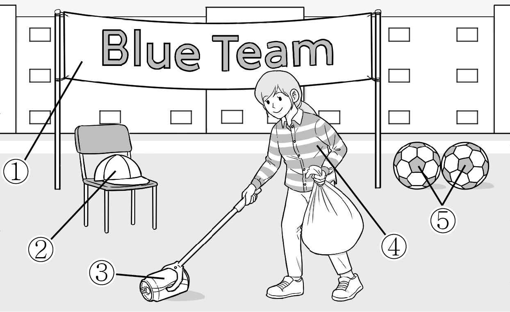
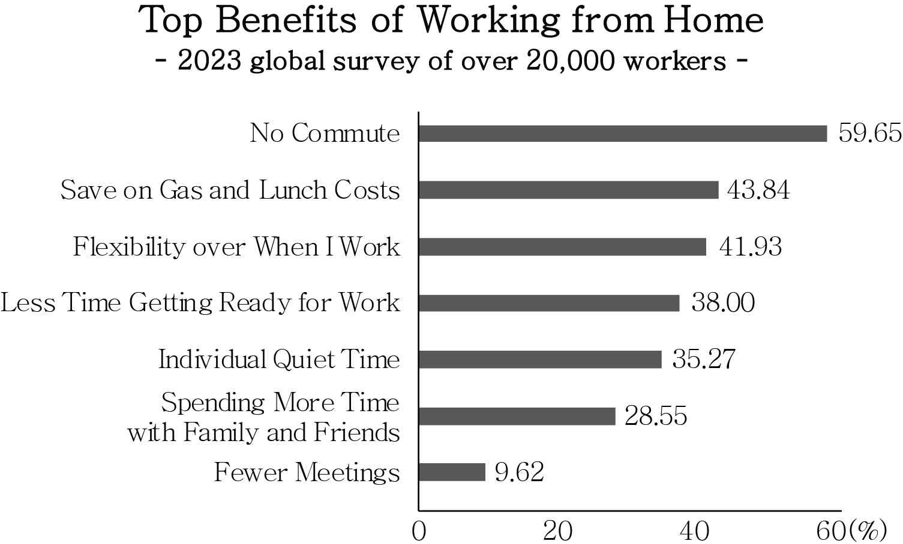
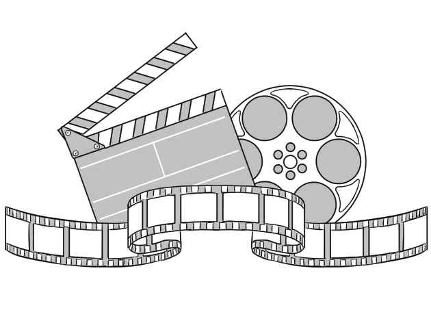

1. 다음을 듣고, 남자가 하는 말의 목적으로 가장 적절한 것을 고르시오.
① 축제 공연 일정 변경을 안내하려고
② 밴드의 신입 부원 모집을 공지하려고
③ 밴드의 경연 대회 우승 소식을 알리려고
④ 축제에서 밴드가 연주할 곡을 추천받으려고
⑤ 축제에서 지켜야 할 안전 수칙을 설명하려고

2. 대화를 듣고, 여자의 의견으로 가장 적절한 것을 고르시오.

① 높은 강도의 운동을 한 뒤에는 휴식을 취해야 한다.
② 근육통을 방지하려면 영양을 고르게 섭취해야 한다.
③ 근육 발달을 위해서는 규칙적으로 운동을 해야 한다.
④ 근육통을 줄이기 위해 운동 후 스트레칭을 해야 한다.
⑤ 운동 종류에 따른 적절한 스트레칭 방식을 익혀야 한다.

3. 다음을 듣고, 여자가 하는 말의 요지로 가장 적절한 것을 고르시오.
① 새로운 환경에서는 언행을 신중하게 하는 것이 바람직하다.
② 침착한 태도는 상대에게 긍정적인 인상을 주어 호감을 높인다.
③ 친구 관계는 서로를 배려하는 과정 속에서 자연스럽게 형성된다.
④ 먼저 인사를 건네는 것은 새로운 관계를 형성하는 데 도움이 된다.
⑤ 원만한 인간관계를 위해서는 상대의 인사에 적절히 반응해야 한다.

4. 대화를 듣고, 그림에서 대화의 내용과 일치하지 않는 것을 고르시오.

5. 대화를 듣고, 남자가 할 일로 가장 적절한 것을 고르시오.

① 녹화 시작하기
② 마이크 점검하기
③ 자료 업로드하기
④ 온라인 링크 공유하기
⑤ 카메라 앵글 점검하기

6. 대화를 듣고, 여자가 지불할 금액을 고르시오. [3점]

① $25
② $30
③ $45
④ $50
⑤ $55

7. 대화를 듣고, 남자가 도서관에서 책을 빌리지 못한 이유를 고르시오.
① 도서관에 늦게 도착해서
② 다른 학생이 이미 대출해서
③ 학생증을 가져가지 않아서
④ 제때 반납하지 않은 책이 있어서
⑤ 도서관 네트워크 시스템에 문제가 있어서

8. 대화를 듣고, Race Against Hunger 행사에 관해 언급되지 않은 것을 고르시오.

① 목적
② 기간
③ 상품
④ 참가비
⑤ 신청 방법

9. AI Coding Afterschool Program에 관한 다음 내용을 듣고, 일치하지 않는 것을 고르시오.

① 1학년 학생을 대상으로 한다.
② 3시간 동안 진행된다.
③ AI 코딩 실습을 포함한다.
④ 참가 학생은 자신의 컴퓨터를 가져와야 한다.
⑤ 프로그램을 완료한 학생은 선물을 받는다.

10. 다음 표를 보면서 대화를 듣고, 여자가 예약할 수업을 고르시오.

Oneday Class

|  | Class | Level | Class Size | Price |
| --- | --- | --- | --- | --- |
| ① | Cake Baking | Beginner | 6 people | $30 |
| ② | Cake Baking | Intermediate | 4 people | $40 |
| ③ | Cookie Baking | Beginner | 10 people | $30 |
| ④ | Cookie Baking | Advanced | 7 people | $50 |
| ⑤ | Soap Making | Intermediate | 5 people | $30 |

11. 대화를 듣고, 여자의 마지막 말에 대한 남자의 응답으로 가장 적절한 것을 고르시오.

① I’m sorry. I already bought a bike.
② Sure. Let’s go to the park together.
③ You’re right. It’s not so hard to fix.
④ That’s too bad. Try to fix it, though.
⑤ No thanks. I heard it’ll rain tomorrow.

12. 대화를 듣고, 남자의 마지막 말에 대한 여자의 응답으로 가장 적절한 것을 고르시오. [3점]

① Don’t worry. Let’s meet and go over the rules together.
② That’s nice. I think I understand the rules much better now.
③ Actually, yes. That’s the main reason I won the competition.
④ You’re welcome. I’ll ask our teammates to meet after school.
⑤ I agree with you. I also think the new rules are easy to follow.

13. 대화를 듣고, 여자의 마지막 말에 대한 남자의 응답으로 가장 적절한 것을 고르시오.

Man:
① Okay. I hope she understands our situation.
② Well done. He will be ready to start the project today.
③ Don’t worry. We finished the project last week already.
④ Right. Let’s email her about the rescheduled project date.
⑤ Great. It’ll be easy to run the project with just the two of us.

14. 대화를 듣고, 남자의 마지막 말에 대한 여자의 응답으로 가장 적절한 것을 고르시오. [3점]

Woman:
① Many visitors usually ask about the animals’ backgrounds.
② The event starts at 10 a.m., so please come by then.
③ Some animals get nervous when many people gather.
④ Please take photos of the visitors with the animals.
⑤ I’m planning to finish uploading the photos tonight.

15. 다음 상황 설명을 듣고, Emily가 Lucas에게 할 말로 가장 적절한 것을 고르시오.

Emily:
① I’m so sorry to hear that your bag is missing.
② I appreciate your help in getting my bag back.
③ I’m afraid that I can’t help you find your bag.
④ Thank you for helping me buy a new bag.
⑤ I’m so glad you finally found your bag.

16. 남자가 하는 말의 주제로 가장 적절한 것은?

① meal patterns across different times of the day
② various methods for preparing a quick breakfast
③ effective diet strategies aimed at health recovery
④ food choices recommended before morning exercise
⑤ practical tips for storing food items for busy people

17. 언급된 음식이 아닌 것은?

① banana
② yogurt
③ honey
④ egg
⑤ nut

18. 다음 글의 목적으로 가장 적절한 것은?

Dear Connexa Point Table Tennis Center members, I am the manager of the Connexa Point Table Tennis Center. Thank you for your interest in the upcoming reopening of the center. Unfortunately, during the repair process, unexpected electrical issues were discovered, causing the work to take longer than we planned. We regret to inform you that the center’s reopening must be delayed. The center was originally scheduled to reopen on April 1st. However, it will now reopen on May 1st to ensure the safety of all members. We look forward to seeing you back on the court soon. Thank you for your patience and understanding. Sincerely, Manager of the Table Tennis Center

19. 다음 글에 드러난 Cassie의 심경 변화로 가장 적절한 것은?

It was the first carnival for the four-year-old girl, Cassie. She had only heard about it from her mother. She had been imagining colorful balloons and delicious candies for a long time. When she finally arrived at the carnival, the twinkling lights and music made her jump with joy. The magician showed his tricks and she cheered with her family. But suddenly, she saw a lot of huge balloons in the parade coming towards her. She thought they were too big, like monsters. Her heart began to beat fast from fear. Cassie froze and dropped her cotton candy on the ground. She quickly hid behind her mother.

20. 다음 글에서 필자가 주장하는 바로 가장 적절한 것은?

There is simply no better way to influence or stir an audience — instantly, powerfully, authentically — than by opening up to them with a personal story or anecdote. To be clear: I’m not saying you need to tell them long stories about your family vacations or show them baby pictures from the stage. I’m saying that you can share a key biographical detail, or an emotion that you’re feeling in the moment, or a self-deprecating joke. It is a tried-and-tested way of bonding with an audience of strangers — and of laying the groundwork for you to then persuade them. The harsh reality is that people won’t bond with your arguments in a vacuum, but they will, says speech coach Bas van den Beld, “bond with you” — the person making those arguments. By sharing a revealing story or a personal flaw, you allow audience members a way to identify with you.

21. 밑줄 친 steal the shade from our descendants가 다음 글에 서 의미하는 바로 가장 적절한 것은? [3점]

We are now at a point of unprecedented genetic, cultural, and environmental power as a species, and we are linked to nearly every other person on Earth. We are embodied individuals trapped within limited time, but we are also networked data streams, memories, and influencers, and part of a grander humanity. Our decisions today have far-reaching impacts that place a responsibility on us to become good ancestors, to take the long view and time travel forward to imagine the well-being of billions of people whose lives will be lived in the world we are currently making. Centuries ago, leaders of the native North American Iroquois people created “seven generation stewardship,” instructing people to consider the impact of every decision on their children, seven generations into the future. In the precious few decades that Earth is ours, while we enjoy the gardens planted by our ancestors, we must not steal the shade from our descendants.

22. 다음 글의 요지로 가장 적절한 것은?

Despite learned eating behaviors that are formed in early childhood and inborn biological differences, taste preferences can be changed throughout our lives due to neuroplasticity, our brain’s amazing adaptability: There is far more flexibility in our food behaviors than most think, even as we age. This is terrific news for adventurous eaters who want to expand their dinner menu — it’s a big, tasty world out there! — but it’s amazing news for those eager to break poor diet habits. Just as kids gradually learn to like nutritious foods, so, too, can adults readjust their taste. Many who switch from processed grain foods like white bread and white rice to whole grain types, for instance, gradually learn to prefer the nutty flavors and chewy textures. Repeated exposure — and a willingness to change — is the key.

23. 다음 글의 주제로 가장 적절한 것은?

Conformity in the teenage years has been studied by putting young people in situations where they are asked to make a choice or decision where that appears to go against what everyone else in the group is saying. The fascinating thing about the results of these studies is that conformity is not spread equally across all age groups. Thus, the willingness to go along with others reaches a peak around the age of 14. After that, this tendency decreases, so that by 16 or 17, young people are much more able to disagree with the group and to stand up for their own opinion. This is an important finding. It demonstrates that the influence of the peer group is not the same across all ages. As young people mature, they become more resilient, and more able to defend their opinions as individuals.

24. 다음 글의 제목으로 가장 적절한 것은? [3점]

Habits aren’t bad. We need them to survive. Understanding how the brain uses habits, and how you can work with them, is essential for business. One question to ask is, are you really trying to break a habit, or would you do better by attaching to another one (known as temptation bundling)? Wharton professor Katy Milkman led a research project called Holding the Hunger Games Hostage at the Gym, where participants could only have access to their audio devices while at the gym. This uses a tempting habit — listening to that awesome audiobook — and combines it with a habit people would like to build, but may otherwise feel forced to put off, like exercising. The participants whose devices were “held hostage” were 51 percent more likely to visit the gym. And the really amazing thing is what happened after it was over: nearly two-thirds opted to pay to have gym-only access for their devices!

25. 다음 도표의 내용과 일치하지 않는 것은?

Top Benefits of Working from Home - 2023 global survey of over 20,000 workers -

| Benefit | Percentage of Respondents |
| --- | --- |
| No Commute | 59.65% |
| Save on Gas and Lunch Costs | 43.84% |
| Flexibility over When I Work | 41.93% |
| Less Time Getting Ready for Work | 38.00% |
| Individual Quiet Time | 35.27% |
| Spending More Time with Family and Friends | 28.55% |
| Fewer Meetings | 9.62% |

Note: Up to three responses were allowed per person.

26. Gary Graffman에 관한 다음 글의 내용과 일치하지 않는 것은?

Gary Graffman was born in New York City in 1928 and began playing the piano at the age of three. When he was seven, he entered the Curtis Institute of Music, where he received training that laid the foundation for his career. In 1949, he won the Leventritt Award and then played concerts worldwide. In the late 1970s, Graffman lost control of the fingers on his right hand, but he never gave up playing the piano. Reconsidering the traditional piano performance convention of using both hands, he focused on works for the left hand alone, such as Ravel’s Piano Concerto for the Left Hand. Graffman returned to the Curtis Institute of Music in 1980 as a member of the piano faculty. There he taught many outstanding young musicians, including Lang Lang, and his lifelong commitment to music continues to inspire people today.

27. Green Parking Pass에 관한 다음 안내문의 내용과 일치하지 않는 것은?

Green Parking Pass

If you are looking for a convenient parking option in our city, check out the Green Parking Pass! You can park safely and save money while using the pass in the city. Where to Use: All public parking lots in the city When to Use: April 1st to June 30th, 2026 Type Price Available Time & Service Basic $30 9 a.m. to 6 p.m. Plus $75 at any time Premium $120 at any time + reserved parking space Purchase Details
The pass can be purchased online or at the city public parking offices.
Each person can purchase only one pass.

28. One Week Online Film Camp에 관한 다음 안내문의 내용과 일치하는 것은?

One Week Online Film Camp

Create your own short film in just one week! You’ll write, direct, shoot, and edit your own project. Open to: Ages 14 — 17 (no experience required) Dates: Monday, April 6th — Sunday, April 12th Time: Weekdays 5 p.m. — 9 p.m. Weekends 1 p.m. — 9 p.m.
Fee
$200 per person Details
You’ll participate in online interactive classes with real‐time instruction.
You’ll complete your own film (shorter than 5 minutes in length) to be screened at the end of the camp. How to apply: Send us an e-mail at oneweek!@film.com.

29. 다음 글의 밑줄 친 부분 중, 어법상 틀린 것은? [3점]

A conceptual model is an explanation, usually highly simplified, of how something works. It doesn’t have to be complete or even accurate as long as it is useful. The files, folders, and icons you see displayed on a computer screen help people create the conceptual model of documents and folders inside the computer, or of apps or applications on the screen. In fact, there are no folders inside the computer — those are effective conceptualizations designed to make them easier to use. Sometimes these depictions can add to the confusion, however. When reading e-mail or visiting a website, the material appears to be on the device, for that is where it is displayed and used. But in fact, in many cases the actual material is “in the cloud,” located on some distant machine. The conceptual model is of one, coherent image, whereas it may actually consist of parts, each located on different machines that could be almost anywhere in the world.

30. 다음 글의 밑줄 친 부분 중, 문맥상 낱말의 쓰임이 적절하지 않은 것은?

The principal transportation mode in the developing world, even in large cities, is still walking because of constraints on the resources needed to operate extensive transit systems. People cover long distances on foot every day and expend human energy that they can hardly spare. Walking under those conditions is an unavoidable burden that consumes productive capability. In North America and Western Europe, however, the attitude and policies are just the opposite: walking is efficient, healthful, and natural. We should do more of it — almost everybody agrees — and some of the current trends should be reversed. Ironically, among the most popular exercise machines in health clubs and in homes are tread-mills that simulate walking, which could be otherwise accomplished with a transport purpose on the street.

31. 다음 빈칸에 들어갈 말로 가장 적절한 것을 고르시오.

Just like how other rooms in your home can cause anxiety when filled with too much stuff, the same is true for kids. If the play space houses every single toy that has ever been purchased for them since birth, they may not be able to express their feelings, but they can feel overwhelmed by so much stuff. This reminds us of how women look in their closets packed full of clothes and think, I have nothing to wear. Revision helps everyone see what they have and use what they own. When there’s too much to see, too much to step over, and too much input, kids have a hard time making a choice. Streamlining a play space is so important. You want your kids to feel inspired and imaginative in the room — not overcome with indecision.

32. 다음 빈칸에 들어갈 말로 가장 적절한 것을 고르시오.

Students often mistake familiarity with true mastery, creating a dangerous “illusion of competence” where recognizing information feels like genuine knowledge, but they struggle when asked to recall or apply it independently. This cognitive bias, strengthened by passive study methods, leads learners to overestimate their understanding. Teaching materials (even informally or imaginatively) actively counters this illusion by requiring deep processing, active recall, structured organization, and revealing gaps in knowledge. It introduces powerful methods like teaching imaginary students, peer-teaching in study groups, employing the Feynman Technique, and writing explanations for others. Ultimately, adopting the teacher mindset transforms surface familiarity into real mastery, exposing and filling gaps in knowledge and ensuring solid, reliable understanding.

33. 다음 빈칸에 들어갈 말로 가장 적절한 것을 고르시오. [3점]

From around 3000 BC, the Sumerian officials would mark their lists of goods on clay tablets. If they wanted to record five fish, they would mark five pictures of a fish. Their first great intellectual leap came from separating the number from the object they were counting. In other words, they would represent five fish with a numeral for the number five alongside a symbol for the fish. If they wanted to describe five of something else, they realized they could keep the same numeral and trade the object symbol for a cow, or a jar of oil, or whatever else they were interested in. The Sumerians had developed the idea of an emancipated number, existing in its own right and independent of whatever it is being used to count. It is easy to take the emancipated number for granted as it is so deeply set into modern thought, but to the earliest civilizations it was intellectually new and extremely powerful.

34. 다음 빈칸에 들어갈 말로 가장 적절한 것을 고르시오. [3점]

The emphasis on learning from the ingroup takes little account of individuals. Amazingly, while we may dislike some of the people in our ingroup, we still copy them. Wilks, Kirby, and Nielsen studied copying behavior in the context of observing how to open a puzzle box. Ingroups and outgroups were distinguished in a minimal way, using simple color coding of wristbands. The children did not simply like all members of their ingroup; they disliked those who behaved in an antisocial fashion. Indeed, they liked these antisocial ingroup members less than the prosocial members of an outgroup. Still, their dislike did not affect their tendency to copy ingroup behavior more closely than outgroup behavior. This overimitation reveals that we are not copying in order to learn how to open a box most efficiently. We want to learn how to do it in the proper way — in other words, conforming to the rules and conventions of the ingroup. This will be appropriately demonstrated even by antisocial ingroup members.

35. 다음 글에서 전체 흐름과 관계 없는 문장은?

The “set point theory” concept is that your body has a stable quantity of fat cells by the time you are an adult. The more weight you carried in your childhood and your teenage years, the more fat cells you will have as an adult.

36. 주어진 글 다음에 이어질 글의 순서로 가장 적절한 것을 고르시오.

Initially the catchphrase “less is more” had a simple meaning. First mentioned in Robert Browning’s poem “Andrea del Sarto,” it suggests that everything simple is better and more beautiful than the complex and tangled. Nowadays this phrase is heard often — maybe even too often. But it’s important to recognize that the way of thinking that lies behind these words slowly extinguishes certain habits from our daily life. For example, think about the heavy, massive radio receivers that existed back in the day. Over time, many of their buttons became viewed as “extra” and were removed, and with each reduction these devices eventually developed into the phones in our pockets. The scale of the object became smaller, and the functions of the buttons got lost in the three-dot menus and multilayered folders of our phones.

37. 주어진 글 다음에 이어질 글의 순서로 가장 적절한 것을 고르시오.

We first need to understand the short but hidden history behind the plastics industry and how it became deeply rooted in our daily lives. Before plastic, people lived more sustainably, with far fewer waste problems than we face today. However, after the invention of plastic, its rapid adoption during World War II, and its explosion into consumer goods, plastic was everywhere. The growing industry came to symbolize the convenience and prosperity of the American dream. This dream came with a price. Over time, people began to notice the environmental impact, and the early seeds of today’s environmental movement were planted. However, the plastics industry was quick to counter these concerns, launching campaigns that presented recycling as the solution to all our problems. They pushed the idea that pollution was the fault of consumers, not the corporations flooding the market with plastic.

38. 글의 흐름으로 보아, 주어진 문장이 들어가기에 가장 적절한 곳을 고르시오. [3점]

As Kuhn proposed, our propositions about the world are embedded within paradigms, roughly a network of interrelated commitments to a particular theory, a conception of a subject matter, and methodological practices. Thus, when scientists undertake research, they do so from within a specific paradigm. Even the most exacting measurements are only sensible from within that paradigm. For example, a look into a microscope tells you nothing unless you are already informed about the nature of the instrument and what you are supposed to be looking at. Thus, what we call major progress in science is not a movement from a less to a more accurate paradigm. Rather, it is a horizontal shift from one ‘way of seeing the world’ to another. For Kuhn, ‘the scientist with a new paradigm sees differently from the way he had seen before.’

39. 글의 흐름으로 보아, 주어진 문장이 들어가기에 가장 적절한 곳을 고르시오.

Making two visits to one of our cold greenhouses — one at dawn after a below-zero night, and the other a few hours later — provides a striking introduction to the winter harvest. During the dawn visit all the crops are frozen solid. Raising the inner covers, which is difficult because they too are frozen, reveals a sight of hard, frost-coated leaves bleak enough to convince anyone that this idea is foolish. Yet a few hours later, after the sun has warmed the greenhouses above freezing, the second visit presents a miraculous contrast. Under the inner covers are closely spaced rows of vigorous, healthy leaves that stretch the length of the greenhouse. The leaf colors in different shades of greens, reds, maroons, and yellows stand bright against the dark soil. It looks like a never-ending spring.

40. 다음 글의 내용을 한 문장으로 요약하려 한다. 빈칸 (A), (B) 에 들어갈 말로 가장 적절한 것은?

Parenting experts say children need to learn independence and resilience. But cities and suburbs don’t offer safe walk and bike routes to school, malls kick teenagers out on the weekends, and free time disappears under a spreadsheet of activities. All of those “musts” take more of the parents’ time or money to navigate, because the child can’t do it on their own. As Darby Saxbe, a clinical psychologist, recently wrote in the New York Times, “underparenting requires structural change.” Unlike most political experts, she’s not just talking about economic policies like family leave and government-supported childcare. She’s talking about actual physical structures, and the cultural change required to populate them. We need to “build back our tolerance for children in public spaces,” she writes, “and create safe environments where lightly supervised kids can move around freely.” 

To help parents raise independent children, cities and suburbs need to create supportive environments, where parents can keep their children under mild supervision, through changes in physical structure and culture.

41. 윗글의 제목으로 가장 적절한 것은?

It’s fair to say that patience has a terrible name. For one thing, the prospect of doing anything that you’ve been told will require patience simply seems unattractive. More specifically, though, it’s disturbingly passive. It is the virtue that has traditionally been urged upon housewives, while their husbands led more exciting lives outside the home; or on racial minorities, told to wait just a few more decades for their full civil rights. The talented but self-effacing employee who “waits patiently” for a promotion, we tend to feel, will be waiting a long time: she ought to be trumpeting her achievements instead. In all such cases, patience is a way of psychologically accommodating yourself to a lack of power, an attitude intended to help you to resign yourself to your lowly position, in theoretical hopes of better days to come. But as society accelerates, something shifts. In more and more contexts, patience becomes a form of power. In a world geared for hurry, the capacity to resist the urge to hurry — to allow things to take the time they take — is a way to gain purchase on the world, to do the work that counts, and to derive satisfaction from the doing itself, instead of putting off all your fulfillment to the future.

42. 밑줄 친 낱말 중에서 문맥상 낱말의 쓰임이 적절하지 않은 것은? [3점]

It’s fair to say that patience has a terrible name. For one thing, the prospect of doing anything that you’ve been told will require patience simply seems unattractive. More specifically, though, it’s disturbingly passive. It is the virtue that has traditionally been urged upon housewives, while their husbands led more exciting lives outside the home; or on racial minorities, told to wait just a few more decades for their full civil rights. The talented but self-effacing employee who “waits patiently” for a promotion, we tend to feel, will be waiting a long time: she ought to be trumpeting her achievements instead. In all such cases, patience is a way of psychologically accommodating yourself to a lack of power, an attitude intended to help you to resign yourself to your lowly position, in theoretical hopes of better days to come. But as society accelerates, something shifts. In more and more contexts, patience becomes a form of power. In a world geared for hurry, the capacity to resist the urge to hurry — to allow things to take the time they take — is a way to gain purchase on the world, to do the work that counts, and to derive satisfaction from the doing itself, instead of putting off all your fulfillment to the future.

43. 주어진 글에 이어질 내용을 순서에 맞게 배열한 것으로 가장 적절한 것은?

 The next morning, near the palace, they saw the king preparing for a war. The king was not satisfied with what he had and sought to expand his kingdom. Accompanied by his army, he stopped when he saw the sage and his disciple. He approached the sage and asked for a blessing that might ensure victory. After a quiet moment of thought, the sage handed the king the coin he had found the previous day. The king, puzzled and slightly annoyed at what he did, asked, “What is the meaning of this coin? I am the richest king in the land. Why would I need a single coin?” The sage replied calmly, “Oh, Great King, I found this coin yesterday while walking through your capital. I had no need for it, so I planned to give it to someone who did. Yet everyone I met seemed content and lacked any urgent need.” The sage added, “Today, I see you preparing for war, seeking to conquer more. And I thought you, the one who desires more, were in need of this coin.” The king was struck by the sage’s words. He realized that his hunger for more had made him forget the value of contentment. The sage’s simple but powerful lesson made him change his plans. The king called off the invasion and chose to appreciate what he already had.

44. 밑줄 친 낱말 중에서 가리키는 대상이 나머지 넷과 다른 것은?

 The next morning, near the palace, they saw the king preparing for a war. The king was not satisfied with what he had and sought to expand his kingdom. Accompanied by his army, he stopped when he saw the sage and his disciple. He approached the sage and asked for a blessing that might ensure victory. After a quiet moment of thought, the sage handed the king the coin he had found the previous day. The king, puzzled and slightly annoyed at what he did, asked, “What is the meaning of this coin? I am the richest king in the land. Why would I need a single coin?” The sage replied calmly, “Oh, Great King, I found this coin yesterday while walking through your capital. I had no need for it, so I planned to give it to someone who did. Yet everyone I met seemed content and lacked any urgent need.” The sage added, “Today, I see you preparing for war, seeking to conquer more. And I thought you, the one who desires more, were in need of this coin.” The king was struck by the sage’s words. He realized that his hunger for more had made him forget the value of contentment. The sage’s simple but powerful lesson made him change his plans. The king called off the invasion and chose to appreciate what he already had.

45. 윗글에 관한 내용으로 적절하지 않은 것은?

 The next morning, near the palace, they saw the king preparing for a war. The king was not satisfied with what he had and sought to expand his kingdom. Accompanied by his army, he stopped when he saw the sage and his disciple. He approached the sage and asked for a blessing that might ensure victory. After a quiet moment of thought, the sage handed the king the coin he had found the previous day. The king, puzzled and slightly annoyed at what he did, asked, “What is the meaning of this coin? I am the richest king in the land. Why would I need a single coin?” The sage replied calmly, “Oh, Great King, I found this coin yesterday while walking through your capital. I had no need for it, so I planned to give it to someone who did. Yet everyone I met seemed content and lacked any urgent need.” The sage added, “Today, I see you preparing for war, seeking to conquer more. And I thought you, the one who desires more, were in need of this coin.” The king was struck by the sage’s words. He realized that his hunger for more had made him forget the value of contentment. The sage’s simple but powerful lesson made him change his plans. The king called off the invasion and chose to appreciate what he already had.
