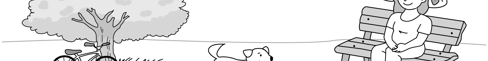
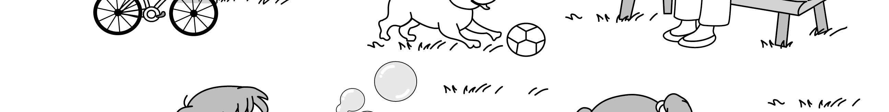
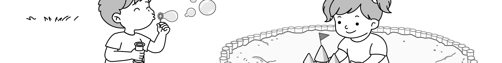

1. 다음을 듣고, 남자가 하는 말의 목적으로 가장 적절한 것을 고르시오.

① 우정 사진 공모전 참가 방법을 안내하려고
② 교내 사진 전시회 일정 변경을 알리려고
③ 우정 사진 공모전 수상자를 공지하려고
④ 교내 사진 전시회 관람을 권유하려고
⑤ 교내 행사에 재능 기부를 요청하려고

2. 대화를 듣고, 여자의 의견으로 가장 적절한 것을 고르시오.

① 일의 결과보다는 과정에 의미를 두어야 한다.
② 힘들더라도 계획된 일을 미루지 않아야 한다.
③ 충분한 휴식을 통해 스트레스를 해소해야 한다.
④ 과제를 수행할 때 친구와 협력하는 것이 중요하다.
⑤ 미리 계획을 세우는 것이 시간 관리에 도움이 된다.

3. 다음을 듣고, 남자가 하는 말의 요지로 가장 적절한 것을 고르시오.

① 정원 가꾸기를 통해 문제 해결 능력을 향상시킬 수 있다.
② 정원 가꾸기는 스트레스 해소와 정서 안정에 효과적이다.
③ 식물을 건강하게 키우려면 책임감과 인내심이 필요하다.
④ 각 식물의 특성을 아는 것은 정원 관리에 도움이 된다.
⑤ 병충해를 예방하려면 정확한 원인 파악이 중요하다.

4. 대화를 듣고, 그림에서 대화의 내용과 일치하지 않는 것을 고르시오.

5. 대화를 듣고, 여자가 할 일로 가장 적절한 것을 고르시오.

① 스크린 설치하기
② 의자 추가로 가져오기
③ 마이크 점검하기
④ 문자 메시지 보내기
⑤ 공지 사항 게시하기

6. 대화를 듣고, 남자가 지불할 금액을 고르시오. [3점]

① $100
② $104
③ $110
④ $114
⑤ $120

7. 대화를 듣고, 여자가 역사 현장 학습에 갈 수 없는 이유를 고르시오.

① 지역 축제를 위한 자원봉사를 해야 해서
② K-pop 댄스 수업에 참여해야 해서
③ 등록 기간 내에 신청하지 못해서
④ 할머니 생신 파티에 가야 해서
⑤ 과학 수업 과제를 끝내야 해서

8. 대화를 듣고, Premier Art Class에 관해 언급되지 않은 것을 고르시오.

① 수업 내용
② 수업 기간
③ 수업료
④ 준비물
⑤ 모집 제한 인원

9. Silverwood Farmers’ Day에 관한 다음 내용을 듣고, 일치하지 않는 것을 고르시오.

① 시청 앞 광장에서 열린다.
② 오전 9시부터 오후 5시까지 운영된다.
③ 판매 품목에 고기와 채소가 포함된다.
④ 인근 공영 주차장을 이용할 수 있다.
⑤ 할인 쿠폰은 현장에서만 받을 수 있다.

10. 다음 표를 보면서 대화를 듣고, 두 사람이 참가할 하프 마라톤을 고르시오.

Half Marathon

|  | Option | Month | Entry Fee (per person) | Shuttle Service | Gift |
| --- | --- | --- | --- | --- | --- |
| ① | A | August | $40 | × | socks |
| ② | B | September | $40 | × | T-shirt |
| ③ | C | September | $60 | ○ | T-shirt |
| ④ | D | October | $60 | ○ | socks |
| ⑤ | E | October | $80 | ○ | T-shirt |

11. 대화를 듣고, 여자의 마지막 말에 대한 남자의 응답으로 가장 적절한 것을 고르시오.

① I ordered a medium but got a large.
② Well, this jacket is missing a button.
③ Sorry, but this item is not refundable.
④ I’d like to exchange it to a black one.
⑤ I want to pay for it with my credit card.

12. 대화를 듣고, 남자의 마지막 말에 대한 여자의 응답으로 가장 적절한 것을 고르시오. [3점]

① Oh, that is a problem for me.
② Peanut cookies are my favorite.
③ I want to join the cooking class, too.
④ Instead, I made cookies with different shapes.
⑤ Why don’t you add some peanut butter next time?

13. 대화를 듣고, 여자의 마지막 말에 대한 남자의 응답으로 가장 적절한 것을 고르시오.

Man:
① Then, we’ll offer a free meal during the flight.
② Oh, I’m glad to have a seat next to them.
③ Sorry, but those seats are already taken.
④ Well, the airport is too far from here.
⑤ Okay, those seats are fine with me.

14. 대화를 듣고, 남자의 마지막 말에 대한 여자의 응답으로 가장 적절한 것을 고르시오. [3점]

Woman:
① That’s why I feel AI videos are fun to watch.
② Your video will get a lot of likes from others.
③ I will organize the background music alone.
④ It is easy for me to make AI videos.
⑤ I think the waves look a bit strange.

15. 다음 상황 설명을 듣고, Mina가 Lucy에게 할 말로 가장 적절한 것을 고르시오.

Mina:
① How about going to the beach some other day?
② Let’s go back home before it starts to rain.
③ We can hike in the mountains on that day.
④ Did you cancel everything and stay home?
⑤ I already packed my things last night.

16. 여자가 하는 말의 주제로 가장 적절한 것은?

① tips for getting better sleep
② foods to energize the brain
③ helpful foods to lose weight
④ easy recipes with video guides
⑤ traditional dishes in many countries

17. 언급된 음식이 아닌 것은?

따라 답을 하시기 바랍니다.

① avocado
② broccoli
③ almonds
④ eggs
⑤ blueberries

18. 다음 글의 목적으로 가장 적절한 것은?

Dear Residents, I am Trixie Mitchell, the director of the Riverside Community Center. I am pleased to invite you to a book donation drive. We are collecting used books to support our reading programs for children and teenagers. By donating books, you can help young readers discover the joy of reading. Any books in good condition are gladly accepted, including novels, poetry, and non-fiction books. You can bring your books to our community center during our operating hours. We would be grateful if you could join this meaningful event. Sincerely, Trixie Mitchell

19. 다음 글에 드러난 Daniel의 심경 변화로 가장 적절한 것은?

Daniel was on his way to the train station for a business trip. He was riding a bus when it suddenly stopped. The driver announced, “We have a mechanical problem.” Daniel grew nervous about missing his train. Without hesitation, he got off the bus and took a taxi to the station. Still, he kept worrying about not making it in time. When he finally reached the station, he found out the train was delayed by ten minutes. Once he settled into his seat, he let out a long breath of relief.

20. 다음 글에서 필자가 주장하는 바로 가장 적절한 것은?

Remember how you learned to drive or cook? You practiced while someone coached you, reminding you what to do until you were able to coach yourself and then, eventually, do it automatically. Children learn values much the same way. They practice different kinds of behavior, while, you, as coach, help focus their attention on what is important and on fine-tuning important skills. You support them with your praise, encouragement and gentle reminders. If you don’t coach your child, she will find her coaches elsewhere and be guided by the values of the media, her peers and anyone else who captures her interest. So, step up to the plate, don’t be afraid and help your child learn how to be a good person, step by step.

21. 밑줄 친 shop for words가 다음 글에서 의미하는 바로 가장 적절한 것은? [3점]

A classical ideal of truth and knowledge is the concept of a market for ideas: as thinking individuals, we encounter competing ideas, we evaluate them for their best fit to reality, and then let the best and brightest facts form the basis of our beliefs. That would be the scientist’s way, in theory at least. But in practice, most of the time we are in a market for justifications. We shop for words not because they contain ideas, but because they contain stories about ideas. Often we are not seeking statements as facts to help us figure out what we should believe. Usually we already know what we believe. What we seek are statements to justify those beliefs ― the lawyer’s way. Language might be good for this function but we can use it to do better. By treating language with greater respect, we can achieve more than simple self-defense.

22. 다음 글의 요지로 가장 적절한 것은?

Suppose you have been working on the solution to a challenging technological problem for many years. Let’s also suppose that you have been paying attention to whatever else you have encountered that might be related to the problem. In that case, chances are that creative solutions to the problem could suddenly pop up in your mind when you are relaxed. Such “eureka moments” (when great insights lead to discovery or invention) often take place at unexpected times. To enhance spontaneous creativity, therefore, one must pay attention to the things that could potentially lead to valuable outcomes. This does not mean that you must narrow down your interest to one specific topic. On the contrary, breadth of experience is the key to creativity. If your experience is limited to a narrow range of topics, then the scope of your imagination will likewise be narrow, which would be harmful to creativity.

23. 다음 글의 주제로 가장 적절한 것은?

Shame is about who we are, and guilt is about our behaviors. We feel guilty when we hold up something we’ve done or failed to do against the kind of person we want to be. It’s an uncomfortable feeling, but one that’s helpful. When we apologize for something we’ve done, make amends to others, or change a behavior that we don’t feel good about, guilt is most often the motivator. Guilt is just as powerful as shame, but its effect is often positive while shame often is destructive. When we see people apologize, make amends, or replace negative behaviors with more positive ones, guilt is often the motivator, not shame. In fact, in my research, I found that shame corrodes the part of us that believes we can change and do better.

24. 다음 글의 제목으로 가장 적절한 것은?

Let’s look at what is occurring in your brain when scrolling on social media, a quick dopamine activity. You open your social media apps and immediately you notice you feel really good, your dopamine levels increase incredibly fast and pleasure is experienced in your brain. The challenge this creates is as with everything in our universe: as the laws of physics explain, ‘what goes up, must come down’. Your brain and body are always seeking something called ‘homeostasis’, which simply means balance. With this in mind, when dopamine levels increase incredibly fast when scrolling social media, the brain then thinks, ‘Wow, how are my dopamine levels so high?’ In order to achieve homeostasis, or balance, the dopamine then has to quickly drop an equal amount below your baseline level in order to rebalance, making you feel even worse than before you started scrolling.

25. 다음 도표의 내용과 일치하지 않는 것은?

The Extent of People’s Trust in Self-Driving Cars, 2023

| Country | A Great Deal | A Lot | A Little | Not at All |
| --- | --- | --- | --- | --- |
| U.K. | 4% | 10% | 34% | 52% |
| U.S. | 6% | 13% | 30% | 51% |
| China | 8% | 47% | 35% | 10% |
| India | 22% | 29% | 35% | 14% |

Note: Over 1,000 respondents surveyed per selected country.

26. George Bird Grinnell에 관한 다음 글의 내용과 일치하지 않는 것은?

George Bird Grinnell, one of the leading figures in early American conservation, was born in New York in 1849. Growing up near Audubon Park, he developed an early interest in birds. After graduating from Yale University, he joined his first scientific expedition, which led to his career in American conservation. From the late 1870s, he wrote many articles in Forest and Stream calling for wildlife conservation. Grinnell contributed to founding early conservation organizations, including the Audubon Society, and helped with the establishment of Glacier National Park in 1910. Through his writings and public campaigns, he had an influence on making early wildlife protection laws. Even after his death in 1938, his work in conservation continues to inspire conservationists.

27. Junior Coding Camp에 관한 다음 안내문의 내용과 일치하지 않는 것은?

Junior Coding Camp

Explore the world of coding through easy, hands-on activities! Date & Site
Wednesday, July 29th, 2026
Arendale Tech Center Ages & Level: 10-13 years old, for beginners Schedule Time Activity 9 a.m. - 12 p.m. Coding Basics 1 p.m. - 4 p.m. Game Design
Participation Fee
$100 per person (lunch provided) Registration
Limited to 50 students
On a first-come, first-served basis
Register on site.

28. Food Truck Festival에 관한 다음 안내문의 내용과 일치하는 것은?

Food Truck Festival

Come hungry and leave happy! Join our annual food truck festival with over 20 trucks. When & Where
August 16, from 11 a.m. to 9 p.m.
Emton Park Festival Highlights
Free sample tastings between 2 p.m. and 3 p.m.
Live music performances throughout the festival
Cookie-making classes for children Notes
There is no entry fee.
Parking is available for free.
For the full schedule, visit www.emtontruckfest.com.

29. 다음 글의 밑줄 친 부분 중, 어법상 틀린 것은? [3점]

Literature, in its essence, is a testament to the enduring power of human creativity and expression. It transcends time and space, connecting us with the thoughts and emotions of people from all walks of life, across centuries and cultures. Despite the rise of new technologies and the ever-changing landscape of media, literature has retained its relevance and significance as a timeless art form. One reason for literature’s enduring power is its ability to capture and convey the complexities of the human experience. Through the written word, authors have the unique ability to explore the depths of human emotion, the nuances of relationships, and the challenges and triumphs of the human spirit. Literature allows us to see ourselves reflected in the pages of a book, to empathize with characters different from ourselves, and to gain a deeper understanding of the human condition.

30. 다음 글의 밑줄 친 부분 중, 문맥상 낱말의 쓰임이 적절하지 않은 것은?

A viewfinder is a piece of card with a hole cut through it in the middle, which can be used to isolate a part of a picture or object. It allows us to concentrate on one small part or area without being distracted by the whole of what can be seen. It is a useful tool that can help children focus or organise their observation and drawing. It can support hesitant children by giving a boundary to what they are looking at and it can confuse children who find it hard to keep track of where and what they are looking at, by bringing them back to the same area each time they look and look back. When you are making viewfinders for use with the children you are supporting, take into consideration the size of the card. You need enough card around the hole to block out the rest of the visual information from the child’s field of vision, but it should not be too big and unwieldy.

31. 다음 빈칸에 들어갈 말로 가장 적절한 것을 고르시오.

Our world is not just interconnected, but ever-changing, even if we can’t sense it. While you’re reading this, you’re changing. You’re aging (a minute amount, thankfully), but the neural networks in your brain are also imperceptibly changing as you perceive each word. Crucially, even when we’re seemingly not doing anything of note, events are taking place outside your immediate surroundings that will change your life in the future, though you won’t realize it yet. Heraclitus, the ancient Greek philosopher, rightly pointed out, “No man ever steps in the same river twice. For it’s not the same river and he’s not the same man.” To that, Cratylus, a student of Heraclitus, added that we are not mere passive observers. When you step in a river, you change it. Nothing is static. Even microscopic changes add up over time.

32. 다음 빈칸에 들어갈 말로 가장 적절한 것을 고르시오.

Do you always study in the same spot? Don’t. If you study in different places, that helps create variety, and that rich experience can reinforce what you are learning. When several college students told us they did school work in different places rather than in some favorite nook, that habit reflected the research on learning. Numerous experiments have found that if learners simply study in at least two different places, they are more likely to recall the material. In one of the first such trials, two different groups studied a list of words. Some students returned to the same room twice while their counterparts spent the same amount of time divided between two locations. When asked to recall as many words on the list as possible, those who had moved around did far better. Variety creates rich association, even when those connections form in the background, totally outside of what we are consciously thinking.

33. 다음 빈칸에 들어갈 말로 가장 적절한 것을 고르시오. [3점]

Talking about what something smells like is the most basic way of talking about our olfactory experience, and even this most basic way of talking about smells is challenging. There are no words in the English language to describe smells in the same way in which “blue” or “green” describe colors. Instead, to talk about how something smells, we talk about the source of the odor. Things smell “flowery,” “fruity,” or “fishy.” Furthermore, even the most familiar odors are difficult to identify when they are not experienced in their usual context. In one experiment the majority of participants was unable to name very common odors like beer, urine, roses, or motor oil. Obviously, even those who couldn’t name any of these odors would drink the beer but not the urine or the motor oil. This is how evolution has shaped our brain: We respond to odors correctly in many different ways, but we are not well-equipped to talk about them.

34. 다음 빈칸에 들어갈 말로 가장 적절한 것을 고르시오. [3점]

A particularly powerful way in which human beings adapt and adjust to their circumstances is by changing behaviors in light of the consequences that they yield. For instance, a child who gets praised by her teacher for doing an exercise correctly is likely to continue doing the exercise in that way. A dancer who feels that a particular conditioning exercise is not giving any results is likely to give that exercise up in favor of another one that seems more promising. In general, we tend to do things that bring us some kind of benefit or act in ways that help us avoid some kind of problem, discomfort, or disadvantage. We also tend to do fewer things (or stop doing things) that lead to problems, discomfort, or disadvantages, and we tend to avoid acting in ways that do not bring any benefit or reward.

35. 다음 글에서 전체 흐름과 관계 없는 문장은?

It is evident through various case studies that adopting digital minimalism can lead to improved mental health outcomes.

36. 주어진 글 다음에 이어질 글의 순서로 가장 적절한 것을 고르시오.

During the Ice Age, not only was the planet much colder, with ice sheets covering much of what we call the northern hemisphere today, but, crucially, it was much drier. In Ireland, we often associate the cold with the wet but if it is really cold, there is far less evaporation, fewer clouds, and less rain. Our world in the Ice Age was cold and dry, meaning it was difficult for plants to grow. In this type of climate, farming isn’t an option: it’s too risky to depend on any one piece of land to produce the energy you need. As the temperature rose and the ice caps melted, we experienced a sudden explosion of life. The world got warmer and wetter, and people started to live around places where they could make food grow most intensively. This didn’t happen overnight; it probably took thousands of years, with hunter-gatherers foraging and hunting, while doing a little side hustle in farming.

37. 주어진 글 다음에 이어질 글의 순서로 가장 적절한 것을 고르시오. [3점]

The big difference between working and long-term memory is that we are explicitly aware of the information in working memory, but we are not able to directly access the information in our long-term memory. We access long-term memory by bringing the information into working memory. For example, right now you are not aware of all the actors you have ever seen. They are stored in your long-term memory outside your consciousness. However, if I asked you to list all the actors, you would use your working memory to retrieve them one by one and reel them off. Your working memory can access your long-term memory and bring those memories to awareness. But remember it has a limit of seven items or chunks. Each actor would be an item. Try and hold all the actors you know in your explicit awareness. You might try to visualize a large group of them. But you still would only be aware of a few actors at any one time.

38. 글의 흐름으로 보아, 주어진 문장이 들어가기에 가장 적절한 곳을 고르시오.

If you gesture while describing an event, do you think you’ll be able to recall that event better than if you don’t gesture? We had adults watch videos of toy objects, animals, and people performing various, sometimes odd, actions: a chicken sliding to a policeman, a jogger bending down to touch his toes, a fence swinging shut on its own. We then tested the adults’ memories of these events immediately after the descriptions and three weeks later. Adults who were told to gesture while describing the events remembered more than adults who were told not to gesture, particularly several weeks later. To see if we’d get the same effects if people gestured on their own, we did the study again, but this time we gave the adults no instructions about gesture. We found the same patterns: people remembered items on which they had gestured spontaneously better than items on which they had not gestured. Producing gesture along with speech makes the information encoded in that speech memorable.

39. 글의 흐름으로 보아, 주어진 문장이 들어가기에 가장 적절한 곳을 고르시오. [3점]

Approximately 15-20% of global greenhouse gas emissions are caused by degradation and deforestation. Trees play a huge role in the carbon cycle. They convert the CO2 in the air to oxygen through the process of photosynthesis, and consequently, they are viewed as a natural regulator of carbon dioxide. The existence of a larger amount of trees will no doubt lead to the reduced presence of carbon dioxide in the atmosphere and the increased existence of oxygen. Unfortunately, deforestation is preventing this process from being fully accomplished. And with half of the Earth’s forests gone, the amount of carbon dioxide is progressively rising. With more carbon dioxide in the atmosphere, more of the sun’s radiation is being reflected back to Earth instead of being released into space, and this is causing the planet’s average temperature to rise. Accordingly, deforestation is a major issue when it comes to global warming.

40. 다음 글의 내용을 한 문장으로 요약하고자 한다. 빈칸 (A), (B)에 들어갈 말로 가장 적절한 것은?

We go out in the world every day and make decisions about what is safe or not and what is appropriate or not. It is what psychologist Joseph LeDoux has suggested is an unconscious “danger detector” that determines whether or not something or someone is safe before we can even begin to consciously make a determination. When the object, animal, or person is assessed to be dangerous, a fear response, which has been called “fight or flight,” occurs. On a conscious level we may correct a mistake in this “danger detector” when we notice it, but often, of course, we simply begin to generate reasons for why it was accurate in the first place. We are generally convinced that our decisions are “rational,” but in reality, most human decisions are made emotionally, and then we collect or generate the facts to justify these decisions. When we see something or someone who “feels” dangerous, we have already launched into action internally before we have even started “thinking.” 

We perform a(n) automatic assessment of danger before conscious thinking, making emotion-based decisions first and then generating reasons to support them.

41. 윗글의 제목으로 가장 적절한 것은?

Commercial businesses aim for predictability and certainty, especially when it comes to product quality. But predictability and certainty are not always valued in the sporting world, especially when it comes to the delivery of professional sport competitions. From a spectator’s perspective the sport experience is better experienced when unpredictable. Sport events actually depend on that unpredictability in order to attract people to the game. When the results of games cannot be predicted, attendances at sporting contests are likely to be higher, as are the profits of leagues. However, the presence of predictability also leads to significant variability in the quality of sporting performances. Many factors can contribute to the variability of the sport product, including the weather, player injuries, the venue, the quality of the opponents, the closeness of the scores and even the size of the crowd. A cricket match can be exhilarating, boring or even frustrating, but fans still have to pay the same price. Sport marketers may attempt to overcome this by ‘improving’ the product in systematic ways, such as including a star player, offering premium seating or providing other forms of entertainment and inviting facilities. The uncertain nature of sport contests is just one element of a total experience, although it is an important element for financial success.

42. 밑줄 친 낱말 중에서 문맥상 낱말의 쓰임이 적절하지 않은 것은? [3점]

Commercial businesses aim for predictability and certainty, especially when it comes to product quality. But predictability and certainty are not always valued in the sporting world, especially when it comes to the delivery of professional sport competitions. From a spectator’s perspective the sport experience is better experienced when unpredictable. Sport events actually depend on that unpredictability in order to attract people to the game. When the results of games cannot be predicted, attendances at sporting contests are likely to be higher, as are the profits of leagues. However, the presence of predictability also leads to significant variability in the quality of sporting performances. Many factors can contribute to the variability of the sport product, including the weather, player injuries, the venue, the quality of the opponents, the closeness of the scores and even the size of the crowd. A cricket match can be exhilarating, boring or even frustrating, but fans still have to pay the same price. Sport marketers may attempt to overcome this by ‘improving’ the product in systematic ways, such as including a star player, offering premium seating or providing other forms of entertainment and inviting facilities. The uncertain nature of sport contests is just one element of a total experience, although it is an important element for financial success.

43. 주어진 글에 이어질 내용을 순서에 맞게 배열한 것으로 가장 적절한 것은?

 When the competition day arrived, Emma felt nervous. Walking into the concert hall, Emma saw a large audience cheering for Lisa. She couldn’t help but compare herself to Lisa. On her turn, Emma performed with all her heart, pouring her months of preparation into every note. The judges then evaluated each vocalist’s performance carefully. Finally, the results were announced. To her surprise, Emma got first place, not Lisa. Moments later, Lisa came over to congratulate Emma with a warm smile. She said, “Your hard work and dedication really paid off. I’m so happy for you.” She didn’t seem bothered by the results. “I’m proud that your singing brings joy to people,” said Lisa. Emma felt grateful for Lisa’s kindness. Lisa added, “I’ve always been moved by your effort and have been supporting you all along.” These words made Emma feel embarrassed at her jealousy. At the same time, she got inspired to find a better path forward. They hugged warmly, their bond strengthened. From that day on, they supported each other and even sang on the same stage together. Emma became more confident and, finally, got a chance to have her solo concert.

44. 밑줄 친 낱말 중에서 가리키는 대상이 나머지 넷과 다른 것은?

 When the competition day arrived, Emma felt nervous. Walking into the concert hall, Emma saw a large audience cheering for Lisa. She couldn’t help but compare herself to Lisa. On her turn, Emma performed with all her heart, pouring her months of preparation into every note. The judges then evaluated each vocalist’s performance carefully. Finally, the results were announced. To her surprise, Emma got first place, not Lisa. Moments later, Lisa came over to congratulate Emma with a warm smile. She said, “Your hard work and dedication really paid off. I’m so happy for you.” She didn’t seem bothered by the results. “I’m proud that your singing brings joy to people,” said Lisa. Emma felt grateful for Lisa’s kindness. Lisa added, “I’ve always been moved by your effort and have been supporting you all along.” These words made Emma feel embarrassed at her jealousy. At the same time, she got inspired to find a better path forward. They hugged warmly, their bond strengthened. From that day on, they supported each other and even sang on the same stage together. Emma became more confident and, finally, got a chance to have her solo concert.

45. 윗글에 관한 내용으로 적절하지 않은 것은?

 When the competition day arrived, Emma felt nervous. Walking into the concert hall, Emma saw a large audience cheering for Lisa. She couldn’t help but compare herself to Lisa. On her turn, Emma performed with all her heart, pouring her months of preparation into every note. The judges then evaluated each vocalist’s performance carefully. Finally, the results were announced. To her surprise, Emma got first place, not Lisa. Moments later, Lisa came over to congratulate Emma with a warm smile. She said, “Your hard work and dedication really paid off. I’m so happy for you.” She didn’t seem bothered by the results. “I’m proud that your singing brings joy to people,” said Lisa. Emma felt grateful for Lisa’s kindness. Lisa added, “I’ve always been moved by your effort and have been supporting you all along.” These words made Emma feel embarrassed at her jealousy. At the same time, she got inspired to find a better path forward. They hugged warmly, their bond strengthened. From that day on, they supported each other and even sang on the same stage together. Emma became more confident and, finally, got a chance to have her solo concert.
