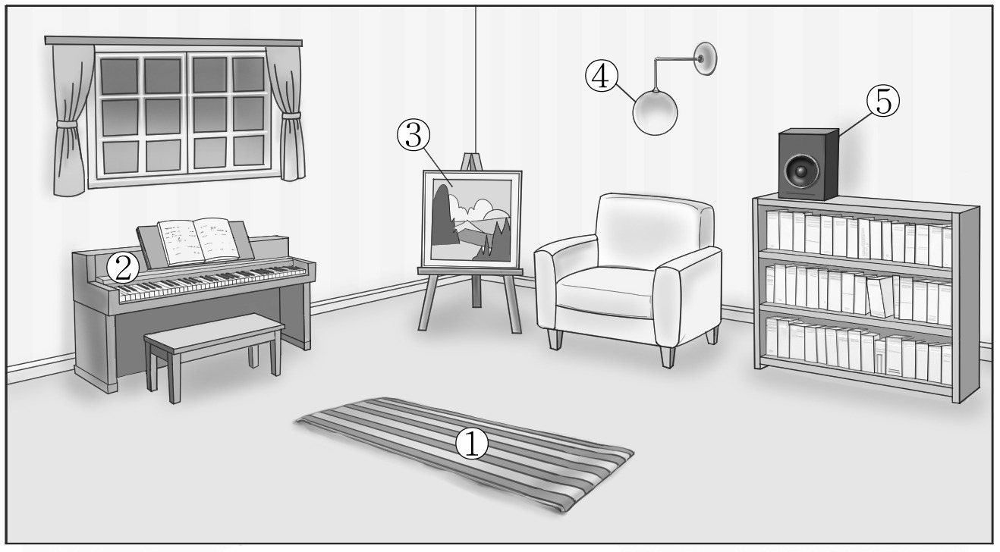
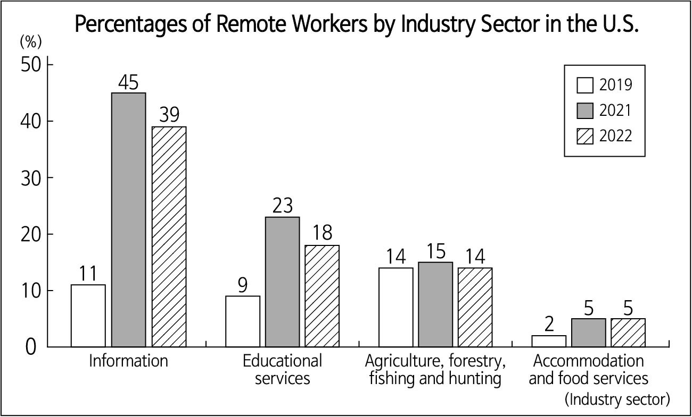

1. 다음을 듣고, 남자가 하는 말의 목적으로 가장 적절한 것을 고르시오.

① 학생의 AI 사용 실태를 조사하려고
② 정보 활용 능력 시험을 안내하려고
③ AI 탐지 시스템의 도입을 공지하려고
④ 과제 제출 방식에 대한 의견을 구하려고
⑤ AI를 활용한 학습 방법의 장점을 설명하려고

2. 대화를 듣고, 여자의 의견으로 가장 적절한 것을 고르시오.

① 갈등은 미루지 않고 빨리 해결할수록 좋다.
② 사과할 때는 핑계 없이 진심을 담아야 한다.
③ 말보다 행동으로 보여주는 사과가 더 중요하다.
④ 갈등을 조정하려면 중립적인 입장을 유지해야 한다.
⑤ 감정을 드러내지 않는 사과가 더 효과적일 수 있다.

3. 다음을 듣고, 남자가 하는 말의 요지로 가장 적절한 것을 고르시오.

① 모둠 수업은 학생의 수업 참여도를 높인다.
② 다양한 글을 통해 학생의 배경지식을 넓혀야 한다.
③ 글을 따라 써보게 하는 것은 글의 구조 습득에 도움이 된다.
④ 친숙한 예를 들어 새로운 개념을 더 쉽게 가르칠 수 있다.
⑤ 글을 쓰기 전에 많은 아이디어를 떠올리게 하는 것이 좋다.

4. 대화를 듣고, 그림에서 대화의 내용과 일치하지 않는 것을 고르시오.

5. 대화를 듣고, 여자가 할 일로 가장 적절한 것을 고르시오.

① 간식 구매하기
② 보드 게임 준비하기
③ 의자와 책 배치하기
④ 행사 일정 포스터 게시하기
⑤ 학생 자원봉사자 모집하기

6. 대화를 듣고, 남자가 지불할 금액을 고르시오. [3점]
① $20
② $23
③ $30
④ $33
⑤ $38

7. 대화를 듣고, 여자가 Robotics Experience Expo에 갈 수 없는 이유를 고르시오.

① 수학 동아리 모임이 있어서
② 과학 프로젝트를 끝내야 해서
③ 사촌의 피아노 콘서트에 가야 해서
④ 부모님 대신 동생을 돌봐야 해서
⑤ 친구와 로봇을 만들어야 해서

8. 대화를 듣고, Island Medical Volunteer Program에 관해 언급되지 않은 것을 고르시오.

① 활동 기간
② 활동 장소
③ 지원 방법
④ 참가 비용
⑤ 참가 인원수

9. SkySymphony에 관한 다음 내용을 듣고, 일치하지 않는 것을 고르시오.

① 리조트 본관 로비에서 진행된다.
② LED 스크린과 스피커를 이용한다.
③ 조명 1,000개가 음악에 맞춰 움직인다.
④ 오전 10시부터 30분 간격으로 시작한다.
⑤ 테마는 계절에 따라 달라진다.

10. 다음 표를 보면서 대화를 듣고, 남자가 주문할 스마트 사진 액자를 고르시오.

Smart Photo Frames

|  | Model | Price | Storage Capacity (GB) | Screen Size (inches) | Sleep Mode |
| --- | --- | --- | --- | --- | --- |
| ① | A | $40 | 16 | 10 | × |
| ② | B | $50 | 32 | 10 | × |
| ③ | C | $60 | 32 | 10 | ○ |
| ④ | D | $80 | 32 | 16 | ○ |
| ⑤ | E | $120 | 64 | 16 | ○ |

11. 대화를 듣고, 여자의 마지막 말에 대한 남자의 응답으로 가장 적절한 것을 고르시오.

① Check if your alarm is working properly.
② You should tell the teacher why you were late.
③ It’s better to fix the alarm rather than buy a new one.
④ Put your alarm far from your bed to make you get up.
⑤ You should bring an extra alarm in case one is broken.

12. 대화를 듣고, 남자의 마지막 말에 대한 여자의 응답으로 가장 적절한 것을 고르시오.

① I see. Let’s visit the eye clinic after school tomorrow.
② That’s okay. I had my eyes checked six months ago.
③ Oh no. Don’t rub your eyes even if they hurt again.
④ I’m sorry. I shouldn’t have broken your glasses.
⑤ Don’t worry. Those glasses look good on you.

13. 대화를 듣고, 여자의 마지막 말에 대한 남자의 응답으로 가장 적절한 것을 고르시오. [3점]

Man:
① No way. The price is the most important factor for me.
② Well, choose locally grown fruits with low food mileage.
③ Sure. You can save money when you buy local food.
④ Don’t worry about the food mileage if the food is fresh.
⑤ Then, you should put food mileage on the products’ labels.

14. 대화를 듣고, 남자의 마지막 말에 대한 여자의 응답으로 가장 적절한 것을 고르시오. [3점]

Woman:
① I’m sorry. I didn’t know you dropped your phone.
② Yeah. I sold my old phone last month on the site.
③ I agree. I think fixing the phone is not that expensive.
④ Amazing! I really appreciate you buying me a new one.
⑤ Great! I should check that site and see what’s available.

15. 다음 상황 설명을 듣고, Henry가 Jenny에게 할 말로 가장 적절한 것을 고르시오.

Henry:
① Will you tell the teacher to delay the book talk?
② Please lend me the book you bought at the event.
③ Let’s skip the book talk and watch a movie instead.
④ Could you ask the author my question for me at the book talk?
⑤ What’s your opinion about the main character’s final decision?

16. 여자가 하는 말의 주제로 가장 적절한 것은?

① ways to properly store food to reduce food waste
② importance of food choices in maintaining health
③ recipes you can make with everyday food
④ effects of climate change on the food we eat
⑤ reasons fresh foods are better than processed ones

17. 언급된 음식물이 아닌 것은?

따라 답을 하시기 바랍니다.

① onions
② cabbage
③ apples
④ bread
⑤ mushrooms

18. 다음 글의 목적으로 가장 적절한 것은?

Dear Parents and Guardians, We appreciate your support and cooperation in our school programs. We would like to share important information regarding this Friday’s school field trip. Our school had originally planned an outdoor field trip to Dreamland Amusement Park. However, according to the latest weather forecast, extremely low temperatures are expected throughout Friday. Spending long hours outdoors under these conditions may be potentially unsafe for students. After careful consideration, we have decided to change the location. Instead of the amusement park, students will visit the City Science Museum, where they will participate in guided exhibitions and hands-on learning activities. We kindly ask for your understanding. Sincerely, Michael Thompson Vice Principal

19. 다음 글에 드러난 Maggie의 심경 변화로 가장 적절한 것은?

Maggie stood up, her hands gripping the seat in front of her. She had never sung alone before, and as she opened her mouth to begin, her voice started shaking. A few children turned around to look at her, and her heart began to race. She focused hard on the lyrics, trying not to forget the words. Then she noticed movement beside her. Durwood quietly stood up and began to sing along. His voice was steady and calm, carrying the song forward. Maggie let out a breath she hadn’t realized she was holding. The tightness in her shoulders slowly faded. With Durwood singing beside her, the tension in her chest eased. She continued the song, no longer frozen, and they finished it together.

20. 다음 글에서 필자가 주장하는 바로 가장 적절한 것은?

Learning games need to be what we call ‘fun enough.’ Many new learning-game developers try to design an entertaining game. Unfortunately, that often makes learning harder rather than easier. Remember, you are not creating the next great commercial game to entertain your learners; you are creating a learning game in which success will be measured by the achievement of learning outcomes. Resist the temptation to create a ton of rules, pile on different game elements, and incorporate multiple dynamics to keep player interest high. Yes, the game should be engaging with a mild level of fun, but learning should be the goal. Focus on engagement rather than entertainment. The goals of the game play should be interactivity and engagement. Research shows that what makes games instructional is the level of interactivity and engagement the learners have with the content. Given those parameters, making sure the learners are engaged and active is far more important than making sure they are entertained.

21. 밑줄 친 getting further and further away from our design이 다음 글에서 의미하는 바로 가장 적절한 것은? [3점]

We are wonderfully made, yet we don’t allow ourselves to participate in the wonder for which we were created. Instead of moving anywhere and everywhere, most of us spend our time moving nowhere. We occupy the same square footage of a chair for hours and hours every day. Many kids today are being held captive by ‘smart’ devices like phones and tablets. They are not going outside to play, they are not learning how to socialize and read physical cues from others. As a result they are not learning or building their movement repertoire, the very thing that will help them learn, communicate, create, and become emotionally mature. They are not even learning how to run, how to skip, or how to climb. Instead, they are learning how to live with anxiety, depression, and even diseases they were never meant to have. The point is we are getting further and further away from our design. We were made to move ― and through movement, we are meant to live extraordinary lives. Movement is life to us.

22. 다음 글의 요지로 가장 적절한 것은?

Perhaps you have heard of the Law of Attraction, which states that ‘like attracts like’ and that by focusing on positive or negative thoughts, one can bring about positive or negative results. The common flaw in our understanding of this law is that we believe all we have to do is think about or visualize something to manifest it. It is true that we attract at the level of our own vibration and that our thoughts and words are extremely magnetic. But the most powerful attractor is our belief system. You can create beautiful poster boards full of images of what you want and affirm every day that you are available for an incredibly successful, passionate career or a loving relationship; but if you don’t truly believe you are enough, worthy, lovable, and deserving, then attracting a great career or relationship into your life may be more challenging. Consider what limiting beliefs you have that contradict your desires and upgrade them to beliefs that are in line with what you want to attract.

23. 다음 글의 주제로 가장 적절한 것은?

It’s important for humans to have many kinds of minds, because variation is critical for the survival of a species. One of Charles Darwin’s greatest insights was that variation is a prerequisite for natural selection to work. Think about it: If there’s a huge change in the environment, like a catastrophic drop in the food supply or a big increase in temperature, a species without much variation might be completely wiped out. A species with great variation will more likely have some survivors after any catastrophe ― the members who are well suited for the new environment. Darwin observed variation in the bodies of animals, and the same principle applies to human minds. If we all had the same kind of mind ― if there were only one human nature ― then when disaster struck, we might become extinct. Thankfully, our species has many kinds of minds, both within a single culture and across cultures, so we’re less likely to be wiped out. This variation preserves the evolvability of our species.

24. 다음 글의 제목으로 가장 적절한 것은?

Letting go of our need for control, being aware, is a lot about gathering the courage to face uncertainty. Human beings want to know. When we don’t know, when things are uncertain, we often feel frightened and become inflexible. So we pretend that things are more predictable than they really are, even though we actually live with enormous uncertainty all the time. We cling to our plans and ideas about how things should be and turn out ever so desperately. And there’s nothing wrong with having plans. I think it’s a beautiful thing. But there’s a difference between planning and thinking all your plans have to come to fruition. American president Eisenhower once said: ‘Plans are worthless, but planning is everything.’ Imagine if we all used pencil instead of ink to write in our calendars and planners. Both figuratively and literally. Imagine if we could bear in mind that what we write down, what we think is going to happen, might not be what actually happens. And if we could try our best to be all right with that.

25. 다음 도표의 내용과 일치하지 않는 것은?

Percentages of Remote Workers by Industry Sector in the U.S.

| Industry Sector | 2019 | 2021 | 2022 |
| --- | --- | --- | --- |
| Information | 11% | 45% | 39% |
| Educational services | 9% | 23% | 18% |
| Agriculture, forestry, fishing and hunting | 14% | 15% | 14% |
| Accommodation and food services | 2% | 5% | 5% |

26. Paul Farmer에 관한 다음 글의 내용과 일치하지 않는 것은?

Paul Farmer was an American medical anthropologist and physician. He was born in 1959 in Massachusetts and grew up with an early awareness of social inequality. During his time at Duke University, he lived in Paris for half a year and became fluent in French, which benefited him in his future work in Haiti. After graduating from Duke University, he began volunteer work at a hospital in Cangé, Haiti. He later returned to the United States and earned both a master’s degree and a PhD in medical anthropology at Harvard University. In 1987, he co-founded Partners In Health, an organization that works in countries like Haiti, Rwanda, and Peru to provide medical treatment and strengthen public health systems. Throughout his life, he wrote more than ten books and over a hundred academic papers. He received many major awards during his career, and after his death, he was also honored with the WHO Director-General’s Global Health Leaders Award for his lifelong work to improve health for the poor.

27. Blue Voice Award에 관한 다음 안내문의 내용과 일치하지 않는 것은?

Blue Voice Award

The Blue Voice Award is an international student competition inviting young creators to express their ideas through creative work. Guidelines
Participation is for high school students from all countries.
The theme of this competition is ‘Ocean Protection.’ Submissions
Deadline: September 10, 2026
Format: Any including videos, posters, paintings, etc.
Upload your work to our website. Awards
Selected works will be showcased online and featured in international exhibitions.
Selected participants will receive a Blue Voice badge. Evaluation Criteria
Clarity
Creativity
Environmental Understanding
Feel free to visit our website, www.bluevoiceaward.org.

28. 2026 Beyond the Stars Camp에 관한 다음 안내문의 내용과 일치하는 것은?

2026 Beyond the Stars Camp

Welcome to 2026 Beyond the Stars Camp, where the cosmos becomes your playground. Get ready to release your inner space explorer! Who: Ages 7-12 When & Where
October 27-31, from 1:00 p.m. to 6:00 p.m.
Grand Moon Space Center This camp includes:
Video calls with real astronauts
Sending a postcard to space
Building and launching rockets Notice
Participants can attend only one day of the camp.
Participants will take home a certificate signed by astronauts.
Free shuttle bus service is provided twice a day.
For more information, please visit our website at www.beyondthestarscamp.space.

29. 다음 글의 밑줄 친 부분 중, 어법상 틀린 것은?

To understand how breathing affects athletic performance, we first need to understand how the body makes energy from air and food. There are two options: with oxygen, a process known as aerobic respiration, and without it, which is called anaerobic respiration. Anaerobic energy is generated only with glucose (a simple sugar), and it’s quicker and easier for our bodies to access. It’s a kind of backup system and turbo boost when the body doesn’t have enough oxygen. But anaerobic energy is inefficient and can be toxic, creating too much lactic acid. The sickness, muscle weakness, and sweating you experience after you’ve pushed it too hard at the gym is the feeling of anaerobic overload. This process explains why the first few minutes of an intense workout is often so miserable. Our lungs and respiratory system haven’t caught up to supply the oxygen our bodies need, and so the body has to use anaerobic respiration. This also explains why, after we’re warmed up, exercise feels easier. The body has switched from anaerobic to aerobic respiration.

30. 다음 글의 밑줄 친 부분 중, 문맥상 낱말의 쓰임이 적절하지 않은 것은? [3점]

Keep your paragraphs short. Writing is visual ― it catches the eye before it has a chance to catch the brain. Short paragraphs put air around what you write and make it look inviting, whereas a long chunk of type can discourage a reader from even starting to read. Newspaper paragraphs should be only two or three sentences long; newspaper type is set in a narrow width, and the inches quickly add up. You may think such frequent paragraphing will damage the development of your point. Obviously The New Yorker is obsessed by this fear ― a reader can go for miles without relief. Don’t worry; the gains far outweigh the hazards. But don’t go too far. A succession of tiny paragraphs is as annoying as a paragraph that’s too long. I’m thinking of all those tiny paragraphs ― verbless wonders ― written by modern journalists trying to make their articles quick ‘n’ easy. Actually they make the reader’s job easier by chopping up a natural train of thought.

31. 다음 빈칸에 들어갈 말로 가장 적절한 것을 고르시오.

Our tastes are simple. Even when you first drank milk, there was the milk, yes, but there was also the person behind the milk who will have presumably either made or messed up your relationship with food for the couple of decades after that. We learn to eat from our families and friends, at school and in work. A village develops a particular recipe for an apple pie ― one that nobody outside the village likes, but who cares? We want these things not just because of what they are, but who we are. Tastes spread like this, person to person, like viruses, almost irrespective of the qualities of the food involved. We observe other people in their food lives, often judgmentally. Nothing turns me off something quicker than the wrong people liking it, by which I mean people almost identical to me in every respect, in a way that doesn’t flatter me. I avoided the viral chopped salad moment of 2024 by the skin of my teeth.

32. 다음 빈칸에 들어갈 말로 가장 적절한 것을 고르시오. [3점]

One of the most fascinating and empowering insights in Stoic philosophy is that our emotions are not random; they change our initial interpretations. This may sound surprising, especially if you’ve ever felt overwhelmed by anger, fear, or sadness. But the Stoics taught that emotions aren’t just automatic reactions. They’re shaped by how we interpret events. Here’s how it works: something happens, you interpret what it means, and that interpretation triggers an emotional response. For example: If someone criticizes you, you may feel angry not due to the words themselves but because you perceive the comment as unfair or threatening. If you lose a job, you might feel devastated not simply because of the job loss but because you believe it defines your worth or future. Change the judgment, and you change the emotion. This doesn’t mean suppressing how you feel; it means examining the story you tell yourself and choosing one that serves you better.

33. 다음 빈칸에 들어갈 말로 가장 적절한 것을 고르시오. [3점]

The ancient Greeks felt that the visual artist’s goal was to copy visual experience. This approach appears in the realism of ancient Greek sculpture and pottery. We must sadly note that, due to the action of time and weather, no paintings from ancient Greek artists exist today. We can only surmise their quality based on tales such as that of Zeuxis and Parhassios, the obvious skill in ancient Greek sculpture, and in drawings that survive on ancient Greek pottery. This definition of art as copying reality has a problem, though. Jackson Pollock, a leader in the New York School of the 1950’s, intentionally did not copy existing objects in his art. While painting these works, Pollock and his fellow artists would consciously avoid making marks or passages that resembled recognizable objects. They succeeded at making artwork that did not copy anything, thus demonstrating that the ancient Greek view of art as mimesis ― simple copying ― cannot be criticized as much as modern art.

34. 다음 빈칸에 들어갈 말로 가장 적절한 것을 고르시오. [3점]

If our bodies know best, why are they easily injured when we do something so seemingly natural as running? On the one hand, running seems very easy, but that is only because its simple movements demand conscious thought. The most powerful supercomputer on the planet cannot administer the enormous number of computations it takes to run, untethered, on two legs. Wherever our running intelligence is, running is not all conscious to us and is so complicated that only the T-1000 Terminators of our imagination are able to do it. Because our running knowledge is buried so deeply within muscle fibres, cells and our DNA, we have to accept that we cannot fully explain its complexities. That doesn’t mean our bodies don’t know how to do it. We may feel our way towards understanding the alchemy of running by learning how to use our senses, getting them firing, and seeing what they are capable of, and accepting that our bodies know more about running than we ever will.

35. 다음 글에서 전체 흐름과 관계 없는 문장은?

Our number one criterion for how we care for our pets should be, “Is this what they actually need? How is it impacting them?” rather than, “What do I want?”

36. 주어진 글 다음에 이어질 글의 순서로 가장 적절한 것을 고르시오. [3점]

The central concerns of mathematics are not numbers, but patterns, structures, symmetries and connections. Take, for example, the Sudoku puzzles that appear daily in newspapers. The objective is to complete a 9 × 9 grid, starting from a few given numbers or clues, while ensuring that each row, each column and each 3 × 3 block contains all the digits from 1 to 9 once and only once. But the numerical values of the digits are irrelevant; what is important is that there are nine distinct symbols. They could be nine letters or nine shapes. It’s the pattern that matters. One Irish daily paper publishes these puzzles with the statement ‘There’s no maths involved, simply use reasoning and logic!’ It seems that even the idea that something might be spoiled by mathematics is enough to scare off potential solvers! Could you imagine the promotion of an exhibition in the National Gallery with the slogan ‘No art involved, just painting and sculpture’? If you can do Sudoku, you can do maths!

37. 주어진 글 다음에 이어질 글의 순서로 가장 적절한 것을 고르시오.

Even before telescopes existed, people looked out into space and tried to understand the universe. The Egyptians, Babylonians, Greeks, and Maya were among the first peoples to map the movements of the stars. In Europe, a 16th-century Polish mathematician named Nicolaus Copernicus put forth a revolutionary idea. Copernicus watched the stars and took measurements by eye. Using a telescope, the Italian scientist Galileo Galilei discovered the four largest moons of Jupiter and observed craters on Earth’s Moon. He also confirmed that Copernicus’ theory was correct. Over the centuries, scientific discoveries and information from telescopes advanced our knowledge of how the universe works. He concluded that the view of the universe accepted at the time ─ that the Sun traveled around Earth ─ was wrong, and that it was in fact Earth that traveled around the Sun. Despite widespread objections to his ideas, he published his theory in a book. Later astronomers built on Copernicus’ work. Technological improvements led to the development of the telescope in the early 17th century.

38. 글의 흐름으로 보아, 주어진 문장이 들어가기에 가장 적절한 곳을 고르시오.

To harness the full potential of units of measurement, we need some degree of consistency. As these communities grew in size, though, the inadequacies of this system would become evident. Subjective measures contain useful knowledge, but this can be difficult to share, based as it is on an individual’s experience. The historian of science Theodore M. Porter describes measurement as a ‘technology of distance’: a tool that uses shared rules to bridge differences of culture and geography, allowing for the exchange of information. Following this logic, if measurement is another sort of language, then just as with words, individual units need reliable definitions in order to communicate. In the earliest societies, these definitions might need to be shared no more widely than a single settlement, meaning that the definition can be no more complex than knowing that a unit was equal to a certain body part. Imagine a disagreement over trade or tribute: it is a moment of conflict that demands greater consistency in measurement.

39. 글의 흐름으로 보아, 주어진 문장이 들어가기에 가장 적절한 곳을 고르시오.

With millions of members in a colony, leaf-cutter ants cultivate their own food. Just like humans, they’re farmers. Instead, smaller worker ants take the pieces of leaves, chew them into smaller pieces, and use these as fertilizer to grow fungus in large underground ‘gardens.’ Some of the ants set forth from the nest to find fresh vegetation; when they find it, they chew off large pieces that they carry back to the nest. However, the ants don’t eat these leaves. The ants feed the fungus, and the fungus blossoms into small fruiting bodies which the ants later eat. Using this successful farming strategy, the ants build enormous nests underground, something spanning hundreds of square meters. Just like humans, they have perfected an agricultural civilization.

40. 다음 글의 내용을 한 문장으로 요약하고자 한다. 빈칸 (A), (B)에 들어갈 말로 가장 적절한 것은?

From an evolutionary perspective, self-esteem has developed as a monitoring mechanism for the quality of our relationships. The system monitors other people’s reactions to our behaviors and sends an alarm that alerts us to any possible changes in our inclusion status. The monitoring system generally operates nonconsciously until it detects that our relational value is falling or low. When the alarm bell rings, the threat to our social bonds is pushed into conscious awareness and we evaluate the situation. Am I being accepted or am I being pushed out? Do I need to adjust my behaviors to fix the relationship? With such a high value for survival closely tied with relationships, it makes sense that the way we mobilize our internal resources around relationships would be highly networked in our brain and body. It also makes sense that we would develop specific mechanisms to attend to minimizing rejection and enhancing acceptance. The continuous scanning is normal, a part of being human. We all have an interpersonal process of searching for cues from the environment to assess our value in the social structure. 

Self-esteem works as a monitoring mechanism that signals that there might be problems in people’s social bonds, allowing them to adjust their behavior to enhance relationships.

41. 윗글의 제목으로 가장 적절한 것은?

The role of ‘slang’ in popular culture has fundamentally changed because of the internet. Since the emergence of Standard English, the rule makers of language have been in charge, and their prescriptive norms about a ‘correct’ version of the English language have dominated our channels of communication. If you wanted your voice to be heard by the public, you had to work within their limits, conforming to the strict expectations of either print or broadcast media. Social media completely broke that barrier. The playing field is now level, and public access is democratized. Anybody and everybody can become a public figure on the new communicative platforms, meaning that nobody’s left to enforce the old rules. TV presenters and journalists might not have been able to use slang, but content creators can. We regularly use words like ‘function’ and ‘side-eye,’ and our influence both legitimizes these terms and gives them a large platform to spread quicker than they could have before. Content creators also come from a greater variety of backgrounds than people working in traditional media. This means that slang can more naturally go beyond the economic and social barriers that once limited its growth. The loose social networks that previously connected us geographically are simply weaker online, and memes are now transmitted at rapid pace.

42. 밑줄 친 낱말 중에서 문맥상 낱말의 쓰임이 적절하지 않은 것은? [3점]

The role of ‘slang’ in popular culture has fundamentally changed because of the internet. Since the emergence of Standard English, the rule makers of language have been in charge, and their prescriptive norms about a ‘correct’ version of the English language have dominated our channels of communication. If you wanted your voice to be heard by the public, you had to work within their limits, conforming to the strict expectations of either print or broadcast media. Social media completely broke that barrier. The playing field is now level, and public access is democratized. Anybody and everybody can become a public figure on the new communicative platforms, meaning that nobody’s left to enforce the old rules. TV presenters and journalists might not have been able to use slang, but content creators can. We regularly use words like ‘function’ and ‘side-eye,’ and our influence both legitimizes these terms and gives them a large platform to spread quicker than they could have before. Content creators also come from a greater variety of backgrounds than people working in traditional media. This means that slang can more naturally go beyond the economic and social barriers that once limited its growth. The loose social networks that previously connected us geographically are simply weaker online, and memes are now transmitted at rapid pace.

43. 주어진 글에 이어질 내용을 순서에 맞게 배열한 것으로 가장 적절한 것은?

 Shocked and with tears trickling down his face, the merchant held Tuti in his arms. Suddenly, he flew and escaped through a window into the garden. “Why are you acting like this?” he asked Tuti. “This is a trick my friend taught me to regain my freedom by playing dead. You are a good master, but I am a bird and I wish to be free, not live my life in a cage,” answered Tuti. The merchant realized that freedom mattered more than all the wealth in the world and he was happy to have the company of two beautiful parrots occasionally. “When you see the parrots of India, look for my friend and tell her all about me. Tell her that I would love to see her, but I can’t because I live in a cage,” Tuti answered. The merchant loved his parrot so much that he couldn’t imagine letting him out of the cage for fear of losing him, but he promised to deliver the message and then left to go on his trip. At the end of his visit to India, he found Tuti’s friend and repeated Tuti’s exact words. The moment the merchant finished the last sentence, Tuti’s friend began to tremble and fell down dead. He couldn’t believe his eyes. “How can I tell this sad news to Tuti?” he said. A few days later, he arrived home and went straight to Tuti. “Did you give my message to my friend?” his parrot asked him happily. The merchant told him the whole story. The moment he finished, Tuti trembled and fell down dead, just like the parrot in India. 

44. 밑줄 친 낱말 중에서 가리키는 대상이 나머지 넷과 다른 것은?

 Shocked and with tears trickling down his face, the merchant held Tuti in his arms. Suddenly, he flew and escaped through a window into the garden. “Why are you acting like this?” he asked Tuti. “This is a trick my friend taught me to regain my freedom by playing dead. You are a good master, but I am a bird and I wish to be free, not live my life in a cage,” answered Tuti. The merchant realized that freedom mattered more than all the wealth in the world and he was happy to have the company of two beautiful parrots occasionally. “When you see the parrots of India, look for my friend and tell her all about me. Tell her that I would love to see her, but I can’t because I live in a cage,” Tuti answered. The merchant loved his parrot so much that he couldn’t imagine letting him out of the cage for fear of losing him, but he promised to deliver the message and then left to go on his trip. At the end of his visit to India, he found Tuti’s friend and repeated Tuti’s exact words. The moment the merchant finished the last sentence, Tuti’s friend began to tremble and fell down dead. He couldn’t believe his eyes. “How can I tell this sad news to Tuti?” he said. A few days later, he arrived home and went straight to Tuti. “Did you give my message to my friend?” his parrot asked him happily. The merchant told him the whole story. The moment he finished, Tuti trembled and fell down dead, just like the parrot in India. 

45. 윗글에 관한 내용으로 적절하지 않은 것은?

 Shocked and with tears trickling down his face, the merchant held Tuti in his arms. Suddenly, he flew and escaped through a window into the garden. “Why are you acting like this?” he asked Tuti. “This is a trick my friend taught me to regain my freedom by playing dead. You are a good master, but I am a bird and I wish to be free, not live my life in a cage,” answered Tuti. The merchant realized that freedom mattered more than all the wealth in the world and he was happy to have the company of two beautiful parrots occasionally. “When you see the parrots of India, look for my friend and tell her all about me. Tell her that I would love to see her, but I can’t because I live in a cage,” Tuti answered. The merchant loved his parrot so much that he couldn’t imagine letting him out of the cage for fear of losing him, but he promised to deliver the message and then left to go on his trip. At the end of his visit to India, he found Tuti’s friend and repeated Tuti’s exact words. The moment the merchant finished the last sentence, Tuti’s friend began to tremble and fell down dead. He couldn’t believe his eyes. “How can I tell this sad news to Tuti?” he said. A few days later, he arrived home and went straight to Tuti. “Did you give my message to my friend?” his parrot asked him happily. The merchant told him the whole story. The moment he finished, Tuti trembled and fell down dead, just like the parrot in India.
