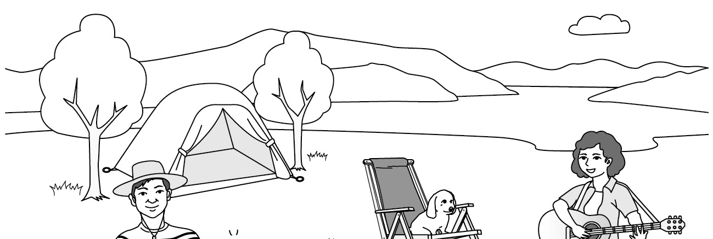
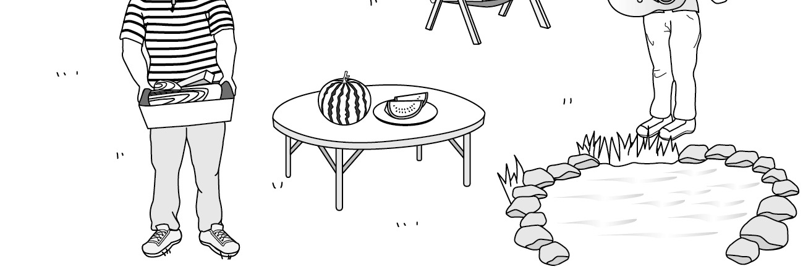
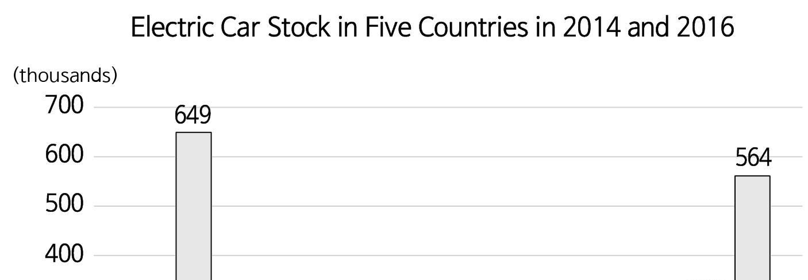
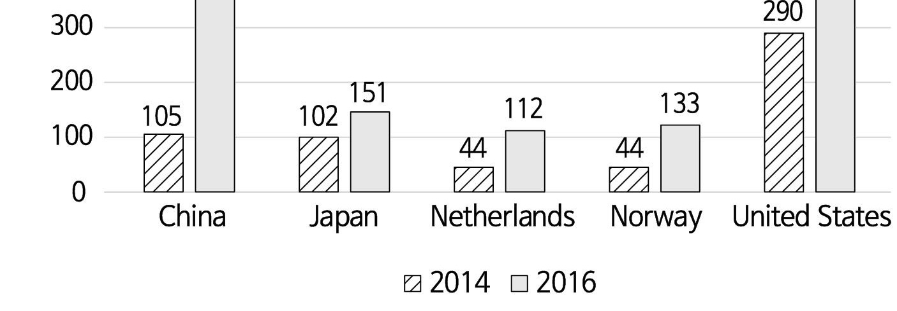
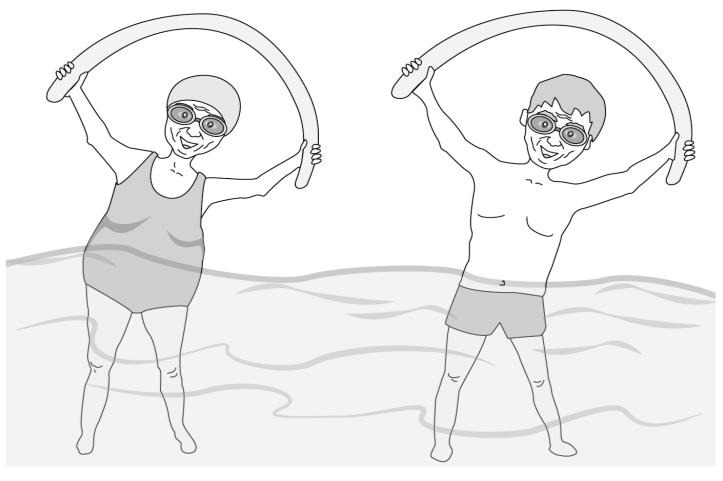
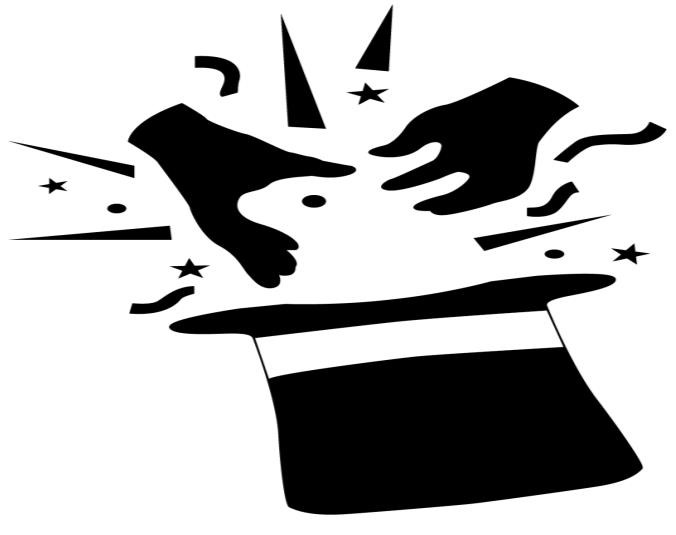

1. 대화를 듣고, 남자의 마지막 말에 대한 여자의 응답으로 가장 적절한 것을 고르시오.

① Yes. They look nice on you.
② Yeah. Let’s go shop for them.
③ Right. Thanks for inviting me.
④ Sorry. I can’t go to the party.
⑤ No. I didn’t take the shoes yet.

2. 대화를 듣고, 여자의 마지막 말에 대한 남자의 응답으로 가장 적절한 것을 고르시오.

① All right! It’s perfect for walking outside.
② Wonderful! The movie is a must‒see.
③ Thanks. I’ll park the car by myself.
④ Sorry. I didn’t check the weather.
⑤ Whew! I can’t walk any longer.

3. 다음을 듣고, 남자가 하는 말의 목적으로 가장 적절한 것을 고르시오.

① 오디션 개최를 공지하려고
② 뮤지컬 공연을 홍보하려고
③ 과제 제출 방법을 설명하려고
④ 재능 기부 방법을 안내하려고
⑤ 연극 수업 참여를 독려하려고

4. 대화를 듣고, 여자의 의견으로 가장 적절한 것을 고르시오.

① 기억력은 반복적인 학습을 통해 향상된다.
② 책을 읽을 때 음악을 듣는 것은 도움이 된다.
③ 꾸준한 독서 습관을 형성하는 것이 중요하다.
④ 음악 감상은 아동의 창의력 발달에 효과적이다.
⑤ 청력 보호를 위해 적절한 음량 조절이 필요하다.

5. 대화를 듣고, 두 사람의 관계를 가장 잘 나타낸 것을 고르시오.

① 배관공 - 집주인
② 식당 지배인 - 요리사
③ 관광 안내원 - 관광객
④ 부동산 중개인 - 고객
⑤ 인테리어 디자이너 - 의뢰인

6. 대화를 듣고, 그림에서 대화의 내용과 일치하지 않는 것을 고르시오.

②
④

7. 대화를 듣고, 여자가 할 일로 가장 적절한 것을 고르시오.

① 케이크 주문하기
② 감사 편지 쓰기
③ 영상 편집하기
④ 파티 공지하기
⑤ 교실 꾸미기

8. 대화를 듣고, 남자가 전시회에 갈 수 없는 이유를 고르시오.

① 봉사활동을 해야 해서
② 축구 경기를 해야 해서
③ 과학 과제를 해야 해서
④ 아르바이트를 해야 해서
⑤ 기말고사 준비를 해야 해서

9. 대화를 듣고, 여자가 지불할 금액을 고르시오. [3점]

① $30
② $36
③ $40
④ $45
⑤ $50

10. 대화를 듣고, Flea Market에 관해 언급되지 않은 것을 고르시오.

① 개최 일시
② 행사 장소
③ 판매자 참가비
④ 신청 방법
⑤ 판매 가능 물품

11. Highland Movie Night에 관한 다음 내용을 듣고, 일치하지 않는 것을 고르시오.

① 매월 개최하는 행사이다.
② Highland 주민에게는 무료이다.
③ Lincoln 도서관에서 열린다.
④ 사전에 등록해야 한다.
⑤ 음식물 반입이 허용된다.

12. 다음 표를 보면서 대화를 듣고, 남자가 구매할 여행 가방을 고르시오.

① A 18 $80 white travel pillow
② B 24 $100 white umbrella
③ C 26 $130 black umbrella
④ D 28 $160 black travel pillow
⑤ E 30 $210 white umbrella

13. 대화를 듣고, 여자의 마지막 말에 대한 남자의 응답으로 가장 적절한 것을 고르시오. [3점]

Man:
① That’s true. I’ll buy a new camera next week.
② Too bad. I will be disappointed if you can’t come.
③ Really? You should tell your boss about the concert.
④ Never mind. The concert will be rescheduled anyway.
⑤ You’re right. I’ll just watch the video after the concert.

14. 대화를 듣고, 남자의 마지막 말에 대한 여자의 응답으로 가장 적절한 것을 고르시오. [3점]

Woman:
① Certainly! You are the best driver ever.
② Great. Let’s check the bus schedule then.
③ No worries. It’ll be the best season for us.
④ Of course. The bus fares are too expensive.
⑤ No problem. We’ll be able to change the flight.

15. 다음 상황 설명을 듣고, Katie가 Brian에게 할 말로 가장 적절한 것을 고르시오.

Katie:
① You’d better change your eating habits.
② We should choose the topic of the project.
③ Why don’t we try an online survey instead?
④ Could you collect the copies for the survey?
⑤ I’ve already made the questions for the survey.

16. 여자가 하는 말의 주제로 가장 적절한 것은?

① lucky numbers in ancient times
② numbers that bring wealth to people
③ relationship between numbers and religion
④ symbolic meanings of numbers across cultures
⑤ danger of using favorite numbers in passwords

17. 언급된 숫자가 아닌 것은?

따라 답을 하시기 바랍니다.

① four
② seven
③ nine
④ ten
⑤ thirteen

18. 다음 글의 목적으로 가장 적절한 것은?

Dear Mr. Stanton: We at the Future Music School have been providing music education to talented children for 10 years. We hold an annual festival to give our students a chance to share their music with the community and we always invite a famous musician to perform in the opening event. Your reputation as a world‒class violinist precedes you and the students consider you the musician who has influenced them the most. That’s why we want to ask you to perform at the opening event of the festival. It would be an honor for them to watch one of the most famous violinists of all time play at the show. It would make the festival more colorful and splendid. We look forward to receiving a positive reply. Sincerely, Steven Forman

19. 다음 글에 드러난 ‘I’의 심경 변화로 가장 적절한 것은?

It was time for the results of the speech contest. I was still skeptical whether I would win a prize or not. My hands were trembling due to the anxiety. I thought to myself, ‘Did I work hard enough to outperform the other participants?’ After a long wait, an envelope was handed to the announcer. She tore open the envelope to pull out the winner’s name. My hands were now sweating and my heart started pounding really hard and fast. “The winner of the speech contest is Josh Brown!” the announcer declared. As I realized my name had been called, I jumped with joy. “I can’t believe it. I did it!” I exclaimed. I felt like I was in heaven. Almost everybody gathered around me and started congratulating me for my victory.

20. 다음 글에서 필자가 주장하는 바로 가장 적절한 것은?

We all have set patterns in life. We like to label ourselves as this or that and are quite proud of our opinions and beliefs. We all like to read a particular newspaper, watch the same sorts of TV programs or movies, go to the same sort of shops every time, eat the sort of food that suits us, and wear the same type of clothes. And all this is fine. But if we cut ourselves off from all other possibilities, we become boring, rigid, hardened ― and thus likely to get knocked about a bit. You have to see life as a series of adventures. Each adventure is a chance to have fun, learn something, explore the world, expand your circle of friends and experience, and broaden your horizons. Shutting down to adventure means exactly that ― you are shut down.

21. 밑줄 친 constantly wearing masks가 다음 글에서 의미하는 바로 가장 적절한 것은? [3점]

Over the centuries various writers and thinkers, looking at humans from an outside perspective, have been struck by the theatrical quality of social life. The most famous quote expressing this comes from Shakespeare: “All the world’s a stage, / And all the men and women merely players; / They have their exits and their entrances, / And one man in his time plays many parts.” If the theater and actors were traditionally represented by the image of masks, writers such as Shakespeare are implying that all of us are constantly wearing masks. Some people are better actors than others. Evil types such as Iago in the play Othello are able to conceal their hostile intentions behind a friendly smile. Others are able to act with more confidence and bravado — they often become leaders. People with excellent acting skills can better navigate our complex social environments and get ahead.

22. 다음 글의 요지로 가장 적절한 것은?

Personal blind spots are areas that are visible to others but not to you. The developmental challenge of blind spots is that you don’t know what you don’t know. Like that area in the side mirror of your car where you can’t see that truck in the lane next to you, personal blind spots can easily be overlooked because you are completely unaware of their presence. They can be equally dangerous as well. That truck you don’t see? It’s really there! So are your blind spots. Just because you don’t see them, doesn’t mean they can’t run you over. This is where you need to enlist the help of others. You have to develop a crew of special people, people who are willing to hold up that mirror, who not only know you well enough to see that truck, but who also care enough about you to let you know that it’s there.

23. 다음 글의 주제로 가장 적절한 것은?

A child whose behavior is out of control improves when clear limits on their behavior are set and enforced. However, parents must agree on where a limit will be set and how it will be enforced. The limit and the consequence of breaking the limit must be clearly presented to the child. Enforcement of the limit should be consistent and firm. Too many limits are difficult to learn and may spoil the normal development of autonomy. The limit must be reasonable in terms of the child’s age, temperament, and developmental level. To be effective, both parents (and other adults in the home) must enforce limits. Otherwise, children may effectively split the parents and seek to test the limits with the more indulgent parent. In all situations, to be effective, punishment must be brief and linked directly to a behavior.

24. 다음 글의 제목으로 가장 적절한 것은?

Many inventions were invented thousands of years ago so it can be difficult to know their exact origins. Sometimes scientists discover a model of an early invention and from this model they can accurately tell us how old it is and where it came from. However, there is always the possibility that in the future other scientists will discover an even older model of the same invention in a different part of the world. In fact, we are forever discovering the history of ancient inventions. An example of this is the invention of pottery. For many years archaeologists believed that pottery was first invented in the Near East (around modern Iran) where they had found pots dating back to 9,000 B.C. In the 1960s, however, older pots from 10,000 B.C. were found on Honshu Island, Japan. There is always a possibility that in the future archaeologists will find even older pots somewhere else.

25. 다음 도표의 내용과 일치하지 않는 것은?

The graph above shows the amount of the electric car stock in five countries in 2014 and 2016. All five countries had more electric car stock in 2016 than in 2014. In 2014, the electric car stock of the United States ranked first among the five countries, followed by that of China. However, China showed the biggest increase of electric car stock from 2014 to 2016, surpassing the United States in electric car stock in 2016. Between 2014 and 2016, the increase in electric car stock in Japan was less than that in Norway. In the Netherlands, the electric car stock was more than three times larger in 2016 than in 2014.

| Country | 2014 | 2016 |
| --- | --- | --- |
| China | 105 | 649 |
| Japan | 102 | 151 |
| Netherlands | 44 | 112 |
| Norway | 44 | 133 |
| United States | 290 | 564 |

26. impala에 관한 다음 글의 내용과 일치하지 않는 것은?

The impala is one of the most graceful four‒legged animals. Impalas have the ability to adapt to different environments of the savannas. Both male and female impalas are similar in color, with white bellies and black‒tipped ears. Male impalas have long and pointed horns which can measure 90 centimeters in length. Female impalas have no horns. Impalas feed upon grass, fruits, and leaves from trees. When conditions are harsh in the dry season, they come together to search for food in mixed herds which can number as many as 100-200 individuals. The breeding season occurs at the end of the wet season around May. Females give birth in an isolated spot away from the herd. The average life span of an impala is between 13 and 15 years in the wild.

27. Silver Aqua Classes에 관한 다음 안내문의 내용과 일치하지 않는 것은?

Silver Aqua Classes
Are you bored with your current exercise routine? Parkside Pool will host special one‒day water exercise classes for senior customers. Please come and enjoy our senior‒friendly pool.
Program
Date: Tuesday, June 9
Special Classes 9:00 a.m. - 10:00 a.m.: water walking 10:30 a.m. - 11:30 a.m.: recreational swimming 2:00 p.m. - 3:00 p.m.: water aerobics
Admission Fee - $5 per person (This includes all classes.)
Notes - No pre‒registration necessary, just show up and have fun! - For more information, please visit our website at www.parksidepool.org.

28. Fanstaville Magic Festival에 관한 다음 안내문의 내용과 일치하는 것은?

Fanstaville Magic Festival Welcome to the Fanstaville Magic Festival! Enjoy a magical experience with your family and make special memories!
When: July 4th (Saturday), 12:00 - 18:00
Where: Fanstaville Center playground (If it rains, the event will be held in the gym.)
What: - Learn simple magic tricks. - Take pictures at the trick art photo zone. - Watch a magic stage show.
Tickets: - $20 per person - All participants will receive a free T‒shirt as a gift. - Purchase tickets online at www.fanstaville.com or at the entrance on the day of the festival.

29. 다음 글의 밑줄 친 부분 중, 어법상 틀린 것은?

Every farmer knows what the hard part is getting the field prepared. Inserting seeds and watching them grow is easy. In the case of science and industry, the community prepares the field, yet society tends to give all the credit to the individual who happens to plant a successful seed. Planting a seed does not necessarily require overwhelming intelligence; creating an environment that allows seeds to prosper does. We need to give more credit to the community in science, politics, business, and daily life. Martin Luther King Jr. was a great man. Perhaps his greatest strength was his ability to inspire people to work together to achieve, against all odds, revolutionary changes in society’s perception of race and in the fairness of the law. But to really understand that he accomplished requires looking beyond the man. Instead of treating him as the manifestation of everything great, we should appreciate his role in allowing America to show that it can be great.

30. 다음 글의 밑줄 친 부분 중, 문맥상 낱말의 쓰임이 적절하지 않은 것은? [3점]

Sudden success or winnings can be very dangerous. Neurologically, chemicals are released in the brain that give a powerful burst of excitement and energy, leading to the desire to repeat this experience. It can be the start of any kind of addiction or manic behavior. Also, when gains come quickly we tend to lose sight of the basic wisdom that true success, to really last, must come through hard work. We do not take into account the role that luck plays in such sudden gains. We try again and again to recapture that high from winning so much money or attention. We acquire feelings of superiority. We become especially resistant to anyone who tries to warn us — they don’t understand, we tell ourselves. Because this cannot be sustained, we experience an inevitable fall, which is all the more painful, leading to the depression part of the cycle. Although gamblers are the most prone to this, it equally applies to businesspeople during bubbles and to people who gain sudden attention from the public.

31. 다음 빈칸에 들어갈 말로 가장 적절한 것을 고르시오. [3점]

When is the right time for the predator to consume the fruit? The plant uses the color of the fruit to signal to predators that it is ripe, which means that the seed’s hull has hardened — and therefore the sugar content is at its height. Incredibly, the plant has chosen to manufacture fructose, instead of glucose, as the sugar in the fruit. Glucose raises insulin levels in primates and humans, which initially raises levels of leptin, a hunger‒blocking hormone — but fructose does not. As a result, the predator never receives the normal message that it is full. That makes for a win‒win for predator and prey. The animal obtains more calories, and because it keeps eating more and more fruit and therefore more seeds, the plant has a better chance of distributing more of its babies.

32. 다음 빈칸에 들어갈 말로 가장 적절한 것을 고르시오.

We are often faced with high‒level decisions, where we are unable to predict the results of those decisions. In such situations, most people end up quitting the option altogether, because the stakes are high and results are very unpredictable. But there is a solution for this. You should use the process of testing the option on a smaller scale. In many situations, it’s wise to dip your toe in the water rather than dive in headfirst. Recently, I was about to enroll in an expensive coaching program. But I was not fully convinced of how the outcome would be. Therefore, I used this process by enrolling in a low‒cost mini course with the same instructor. This helped me understand his methodology, style, and content; and I was able to test it with a lower investment, and less time and effort before committing fully to the expensive program.

33. 다음 빈칸에 들어갈 말로 가장 적절한 것을 고르시오. [3점]

Sociologists have proven that people bring their own views and values to the culture they encounter; books, TV programs, movies, and music may affect everyone, but they affect different people in different ways. In a study, Neil Vidmar and Milton Rokeach showed episodes of the sitcom All in the Family to viewers with a range of different views on race. The show centers on a character named Archie Bunker, an intolerant bigot who often gets into fights with his more progressive family members. Vidmar and Rokeach found that viewers who didn’t share Archie Bunker’s views thought the show was very funny in the way it made fun of Archie’s absurd racism ― in fact, this was the producers’ intention. On the other hand, though, viewers who were themselves bigots thought Archie Bunker was the hero of the show and that the producers meant to make fun of his foolish family! This demonstrates why it’s a mistake to assume that a certain cultural product will have the same effect on everyone.

34. 다음 빈칸에 들어갈 말로 가장 적절한 것을 고르시오. [3점]

The availability heuristic refers to a common mistake that our brains make by assuming that the instances or examples that come to mind easily are also the most important or prevalent. It shows that we make our decisions based on the recency of events. We often misjudge the frequency and magnitude of the events that have happened recently because of the limitations of our memories. According to Harvard professor, Max Bazerman, managers conducting performance appraisals often fall victim to the availability heuristic. The recency of events highly influences a supervisor’s opinion during performance appraisals. Managers give more weight to performance during the three months prior to the evaluation than to the previous nine months of the evaluation period because the recent instances dominate their memories. The availability heuristic is influenced by the ease of recall or retrievability of information of some event. Ease of recall suggests that if something is more easily recalled in your memory, you think that it will occur with a high probability.

35. 다음 글에서 전체 흐름과 관계 없는 문장은?

Marketing management is concerned not only with finding and increasing demand but also with changing or even reducing it. For example, Uluru (Ayers Rock) might have too many tourists wanting to climb it, and Daintree National Park in North Queensland can become overcrowded in the tourist season. Power companies sometimes have trouble meeting demand during peak usage periods. In these and other cases of excess demand, the needed marketing task, called demarketing, is to reduce demand temporarily or permanently. Efforts should be made to compensate for the losses caused by the increase in supply. The aim of demarketing is not to completely destroy demand, but only to reduce or shift it to another time, or even another product. Thus, marketing management seeks to affect the level, timing, and nature of demand in a way that helps the organisation achieve its objectives.

36. 주어진 글 다음에 이어질 글의 순서로 가장 적절한 것을 고르시오.

The invention of the mechanical clock was influenced by monks who lived in monasteries that were the examples of order and routine. They had to keep accurate time so that monastery bells could be rung at regular intervals to announce the seven hours of the day reserved for prayer. Early clocks were nothing more than a weight tied to a rope wrapped around a revolving drum. Time was determined by watching the length of the weighted rope. The discovery of the pendulum in the seventeenth century led to the widespread use of clocks and enormous public clocks. Eventually, keeping time turned into serving time. People started to follow the mechanical time of clocks rather than their natural body time. They ate at meal time, rather than when they were hungry, and went to bed when it was time, rather than when they were sleepy. Even periodicals and fashions became “yearly.” The world had become orderly.

37. 주어진 글 다음에 이어질 글의 순서로 가장 적절한 것을 고르시오. [3점]

Since we know we can’t completely eliminate our biases, we need to try to limit the harmful impacts they can have on the objectivity and rationality of our decisions and judgments.

It is important that we are aware when one of our cognitive biases is activated and make a conscious choice to overcome that bias. We need to be aware of the impact the bias has on our decision making process and our life. [3점]

Then we can choose an appropriate de‒biasing strategy to combat it. After we have implemented a strategy, we should check in again to see if it worked in the way we had hoped.

If it did, we can move on and make an objective and informed decision. If it didn’t, we can try the same strategy again or implement a new one until we are ready to make a rational judgment.

38. 글의 흐름으로 보아, 주어진 문장이 들어가기에 가장 적절한 곳을 고르시오.

It is important to remember that computers can only carry out instructions that humans give them. Computers can process data accurately at far greater speeds than people can, yet they are limited in many respects ― most importantly, they lack common sense. However, combining the strengths of these machines with human strengths creates synergy. Synergy occurs when combined resources produce output that exceeds the sum of the outputs of the same resources employed separately. A computer works quickly and accurately; humans work relatively slowly and make mistakes. A computer cannot make independent decisions, however, or formulate steps for solving problems, unless programmed to do so by humans. Even with sophisticated artificial intelligence, which enables the computer to learn and then implement what it learns, the initial programming must be done by humans. Thus, a human‒ computer combination allows the results of human thought to be translated into efficient processing of large amounts of data.

39. 글의 흐름으로 보아, 주어진 문장이 들어가기에 가장 적절한 곳을 고르시오. [3점]

For hundreds of thousands of years our hunter‒gatherer ancestors could survive only by constantly communicating with one another through nonverbal cues. Developed over so much time, before the invention of language, that is how the human face became so expressive, and gestures so elaborate. We have a continual desire to communicate our feelings and yet at the same time the need to conceal them for proper social functioning. With these counterforces battling inside us, we cannot completely control what we communicate. Our real feelings continually leak out in the form of gestures, tones of voice, facial expressions, and posture. We are not trained, however, to pay attention to people’s nonverbal cues. By sheer habit, we fixate on the words people say, while also thinking about what we’ll say next. What this means is that we are using only a small percentage of the potential social skills we all possess.

40. 다음 글의 내용을 한 문장으로 요약하고자 한다. 빈칸 (A), (B)에 들어갈 말로 가장 적절한 것은?

Why do we help? One widely held view is that self‒interest underlies all human interactions, that our constant goal is to maximize rewards and minimize costs. Accountants call it cost‒benefit analysis. Philosophers call it utilitarianism. Social psychologists call it social exchange theory. If you are considering whether to donate blood, you may weigh the costs of doing so (time, discomfort, and anxiety) against the benefits (reduced guilt, social approval, and good feelings). If the rewards exceed the costs, you will help. Others believe that we help because we have been socialized to do so, through norms that prescribe how we ought to behave. Through socialization, we learn the reciprocity norm: the expectation that we should return help, not harm, to those who have helped us. In our relations with others of similar status, the reciprocity norm compels us to give (in favors, gifts, or social invitations) about as much as we receive. 

 People help because helping gives them advantages, but also because they are socially learned to repay what others have done for them.

41. 윗글의 제목으로 가장 적절한 것은?

An organization imported new machinery with the capacity to produce quality products at a lesser price. A manager was responsible for large quantities in a relatively short span of time. He started with the full utilization of the new machinery. He operated it 24/7 at maximum capacity. He paid the least attention to downtime, recovery breaks or the general maintenance of the machinery. As the machinery was new, it continued to produce results and, therefore, the organization’s profitability soared and the manager was appreciated for his performance. Now after some time, this manager was promoted and transferred to a different location. A new manager came in his place to be in charge of running the manufacturing location. But this manager realized that with heavy utilization and without any downtime for maintenance, a lot of the parts of the machinery were significantly worn and needed to be replaced or repaired. The new manager had to put significant time and effort into repair and maintenance of the machines, which resulted in lower production and thus a loss of profits. The earlier manager had only taken care of the goal of production and ignored the machinery although he had short‒term good results. But ultimately not giving attention to recovery and maintenance resulted in long-term negative consequences.

42. 밑줄 친 낱말 중에서 문맥상 낱말의 쓰임이 적절하지 않은 것은?

An organization imported new machinery with the capacity to produce quality products at a lesser price. A manager was responsible for large quantities in a relatively short span of time. He started with the full utilization of the new machinery. He operated it 24/7 at maximum capacity. He paid the least attention to downtime, recovery breaks or the general maintenance of the machinery. As the machinery was new, it continued to produce results and, therefore, the organization’s profitability soared and the manager was appreciated for his performance. Now after some time, this manager was promoted and transferred to a different location. A new manager came in his place to be in charge of running the manufacturing location. But this manager realized that with heavy utilization and without any downtime for maintenance, a lot of the parts of the machinery were significantly worn and needed to be replaced or repaired. The new manager had to put significant time and effort into repair and maintenance of the machines, which resulted in lower production and thus a loss of profits. The earlier manager had only taken care of the goal of production and ignored the machinery although he had short‒term good results. But ultimately not giving attention to recovery and maintenance resulted in long-term negative consequences.

43. 주어진 글에 이어질 내용을 순서에 맞게 배열한 것으로 가장 적절한 것은?

 This year’s lucky family was a 25‒year‒old mother named Karen and her 3‒year‒old son, who she was raising by herself. However, things went wrong. Two weeks before Christmas Day, a representative from a local organization called Maria to say that the aid she had requested for Karen had fallen through. No Santa Claus. No presents. Maria saw the cheer disappear from Alice’s face at the news. After hearing this, she ran to her room. When Alice returned, her face was set with determination. She counted out the coins from her piggy bank: $4.30. “Mom,” she told Maria, “ I know it’s not much. But maybe this will buy a present for the kid.” Maria gave her daughter a lovely hug. The next day, Maria told her coworkers about her daughter’s latest project. To her surprise, staff members began to open their purses. The story of Alice’s gift had spread beyond Maria’s office, and Maria was able to raise $300 ― plenty for a Christmas gift for Karen and her son. On Christmas Eve, Maria and Alice visited Karen’s house with Christmas gifts. When Karen opened the door, Maria and Alice wished the astonished woman a merry Christmas. Then Alice began to unload the gifts from the car, handing them to Karen one by one. Karen laughed in disbelief, and said she hoped she would one day be able to do something similar for someone else in need. On her way home, Maria said to Alice, “God multiplied your gift.” 

44. 밑줄 친 낱말 중에서 가리키는 대상이 나머지 넷과 다른 것은?

 This year’s lucky family was a 25‒year‒old mother named Karen and her 3‒year‒old son, who she was raising by herself. However, things went wrong. Two weeks before Christmas Day, a representative from a local organization called Maria to say that the aid she had requested for Karen had fallen through. No Santa Claus. No presents. Maria saw the cheer disappear from Alice’s face at the news. After hearing this, she ran to her room. When Alice returned, her face was set with determination. She counted out the coins from her piggy bank: $4.30. “Mom,” she told Maria, “ I know it’s not much. But maybe this will buy a present for the kid.” Maria gave her daughter a lovely hug. The next day, Maria told her coworkers about her daughter’s latest project. To her surprise, staff members began to open their purses. The story of Alice’s gift had spread beyond Maria’s office, and Maria was able to raise $300 ― plenty for a Christmas gift for Karen and her son. On Christmas Eve, Maria and Alice visited Karen’s house with Christmas gifts. When Karen opened the door, Maria and Alice wished the astonished woman a merry Christmas. Then Alice began to unload the gifts from the car, handing them to Karen one by one. Karen laughed in disbelief, and said she hoped she would one day be able to do something similar for someone else in need. On her way home, Maria said to Alice, “God multiplied your gift.” 

45. 윗글에 관한 내용으로 적절하지 않은 것은?

 This year’s lucky family was a 25‒year‒old mother named Karen and her 3‒year‒old son, who she was raising by herself. However, things went wrong. Two weeks before Christmas Day, a representative from a local organization called Maria to say that the aid she had requested for Karen had fallen through. No Santa Claus. No presents. Maria saw the cheer disappear from Alice’s face at the news. After hearing this, she ran to her room. When Alice returned, her face was set with determination. She counted out the coins from her piggy bank: $4.30. “Mom,” she told Maria, “ I know it’s not much. But maybe this will buy a present for the kid.” Maria gave her daughter a lovely hug. The next day, Maria told her coworkers about her daughter’s latest project. To her surprise, staff members began to open their purses. The story of Alice’s gift had spread beyond Maria’s office, and Maria was able to raise $300 ― plenty for a Christmas gift for Karen and her son. On Christmas Eve, Maria and Alice visited Karen’s house with Christmas gifts. When Karen opened the door, Maria and Alice wished the astonished woman a merry Christmas. Then Alice began to unload the gifts from the car, handing them to Karen one by one. Karen laughed in disbelief, and said she hoped she would one day be able to do something similar for someone else in need. On her way home, Maria said to Alice, “God multiplied your gift.”
