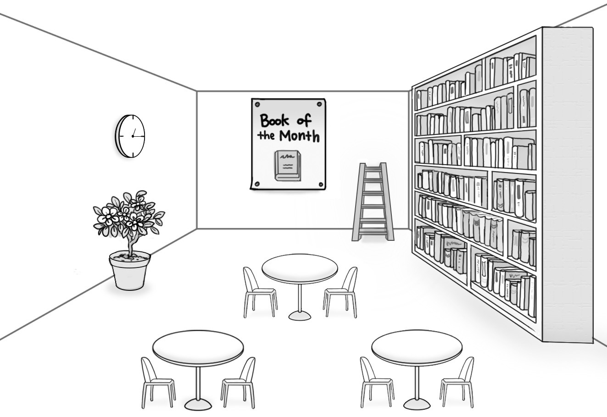
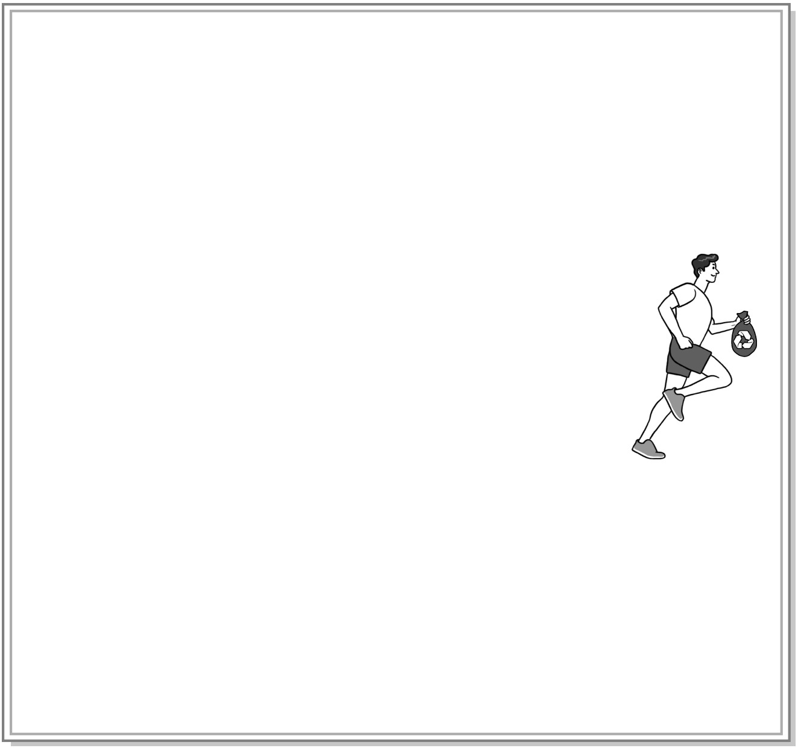

1. 다음을 듣고, 남자가 하는 말의 목적으로 가장 적절한 것을 고르시오.

① 도서관 홈페이지 개설을 홍보하려고
② 도서관 운영 시간 연장을 공지하려고
③ 도서관 재개관 날짜 연기를 안내하려고
④ 도서관 환경 조성 아이디어를 공모하려고
⑤ 도서관 벽 공사로 인한 소음에 대해 사과하려고

2. 대화를 듣고, 여자의 의견으로 가장 적절한 것을 고르시오.

① 방학 계획표에는 매일 해야 할 일을 포함해야 한다.
② 방학 계획을 세울 때는 일의 중요도를 고려해야 한다.
③ 규칙적인 생활 습관이 시간 활용의 효율성을 높여준다.
④ 학생들의 시간 관리 방법에 대한 교육을 강화해야 한다.
⑤ 방학 중에는 다양한 체험 활동을 해보는 것이 필요하다.

3. 대화를 듣고, 두 사람의 관계를 가장 잘 나타낸 것을 고르시오.

① 자동차 정비사 – 운전자
② 렌터카 회사 직원 – 고객
③ 운전면허 강사 – 수강생
④ 공항 주차 요원 – 여행객
⑤ 보험 설계사 – 보험 계약자

4. 대화를 듣고, 그림에서 대화의 내용과 일치하지 않는 것을 고르시오.

⑤
②
④

5. 대화를 듣고, 남자가 여자를 위해 할 일로 가장 적절한 것을 고르시오.

① 캠핑장 예약하기
② 일기 예보 확인하기
③ 모기 퇴치제 가져오기
④ 바비큐 물품 구매하기
⑤ 휴대용 스피커 빌려주기

6. 대화를 듣고, 남자가 지불할 금액을 고르시오.

① $38
② $40
③ $42
④ $44
⑤ $50

7. 대화를 듣고, 여자가 One-Day Baking Class에 참여할 수 없는 이유를 고르시오.

① 독후감을 작성해야 해서
② 사촌 집들이에 가야 해서
③ 영화 시사회에 초대받아서
④ 배우 사인회에 가기로 해서
⑤ 수영 수업을 수강해야 해서

8. 대화를 듣고, Charity Carol Concert에 관해 언급되지 않은 것을 고르시오.

① 공연 장소
② 공연 팀
③ 티켓 판매금 기부처
④ 티켓 판매 시작일
⑤ 최대 관람 인원

9. Drone Photo Contest에 관한 다음 내용을 듣고, 일치하지 않는 것을 고르시오.

① 2017년에 처음 시작된 대회이다.
② 사진과 드론을 좋아하는 누구나 참가할 수 있다.
③ 3개의 사진 분야가 있을 것이다.
④ 우승자에게 최신형 컴퓨터를 줄 것이다.
⑤ 우승 사진은 웹 사이트에 게시될 것이다.

10. 다음 표를 보면서 대화를 듣고, 여자가 주문할 향수를 고르시오.

|  | Product | Price | Scent | Size (ml) | Free Gift |
| --- | --- | --- | --- | --- | --- |
| ① | A | $60 | citrus | 30 | pouch |
| ② | B | $70 | woody | 30 | hand mirror |
| ③ | C | $80 | earthy | 50 | pouch |
| ④ | D | $90 | floral | 50 | pouch |
| ⑤ | E | $110 | fruity | 70 | hand mirror |

11. 대화를 듣고, 여자의 마지막 말에 대한 남자의 응답으로 가장 적절한 것을 고르시오.

① I already bought two apple pies.
② I think five apples will be enough.
③ The recipe is too difficult to follow.
④ You can buy them at the supermarket.
⑤ It’s safe to put them in the refrigerator.

12. 대화를 듣고, 남자의 마지막 말에 대한 여자의 응답으로 가장 적절한 것을 고르시오.

① Sorry. I’m afraid I’m allergic to seafood.
② Really? We need to think of another place.
③ Never mind. The conference was canceled.
④ Why not? You’d better begin the remodeling.
⑤ Thanks. I really enjoyed the dinner you cooked.

13. 대화를 듣고, 여자의 마지막 말에 대한 남자의 응답으로 가장 적절한 것을 고르시오. [3점]

Man:

① Don’t worry. I’ll send you the locations of the stores I often use.
② Thanks. I liked the cups you bought at the zero-waste shop.
③ Definitely. We started reducing waste thanks to your effort.
④ That’s okay. I’ll show you how to recycle this packaging.
⑤ It’s on me. Feel free to buy what you really want.

14. 대화를 듣고, 남자의 마지막 말에 대한 여자의 응답으로 가장 적절한 것을 고르시오. [3점]

Woman:

① Sorry. As for me, taking a subway is better than a bus.
② No worries. I’m sure you’ll do a great job on the project.
③ Too bad. We should have canceled that walking program.
④ I agree. You can keep your life healthy by taking enough rest.
⑤ Great. That way, I can exercise even if I have a busy schedule.

15. 다음 상황 설명을 듣고, Amy가 Mr. Green에게 할 말로 가장 적절한 것을 고르시오. [3점]

Amy:

① Is it possible for me to visit you to see what you do at work?
② Would you help me prepare a presentation on an architect?
③ Could you allow me to take part in designing a building?
④ Are you trying to find a job in the field of architecture?
⑤ Why don’t you give a lecture at school on Career Day?

16. 여자가 하는 말의 주제로 가장 적절한 것은?

① differences between stars and planets
② effective ways to observe planets at night
③ origins of planets’ names from Roman gods
④ ancient people who first discovered planets
⑤ environmental and weather conditions of planets

17. 언급된 행성이 아닌 것은?

따라 답을 하시기 바랍니다.

① Mercury
② Jupiter
③ Mars
④ Neptune
⑤ Saturn

18. 다음 글의 목적으로 가장 적절한 것은?

To whom it may concern, I am a parent of a high school student who takes the 145 bus to commute to Clarkson High School. This is the only public transport available from our area and is used by many students. Recently, I heard that the city council is planning to discontinue this service. My husband and I start work early in the morning and this makes it impossible for us to drop our son off at school. It would take him nearly an hour to walk to school and there is a lot of traffic in the morning, so I do not consider it safe to bike. This matter will place many families, including ours, under a lot of stress. As a resident of Sunnyville, I think such a plan is unacceptable. I urge the council to listen to the concerns of the community. Sincerely, Lucy Jackson

19. 다음 글에 드러난 Ted의 심경 변화로 가장 적절한 것은?

One Friday afternoon, Ted was called to the vice president of human resources. Ted sat down, beaming in anticipation. Today was the big day and this meeting would mark a turning point in his career! Ted felt sure that it was for his promotion and that the vice president would make him the marketing manager. “Ted, there is no easy way to say this.” Ted suddenly realized this meeting wasn’t going to be as he expected. Ted’s mind went blank. The vice president continued, “Ted, I know you’ve desperately wanted this promotion, but we decided Mike is more suitable.” Ted just sat there, frozen. He felt as if he had been hit by a truck. Don’t panic. All he was able to do was repeat that sentence over and over to himself.

20. 다음 글에서 필자가 주장하는 바로 가장 적절한 것은?

In 2003, British Airways made an announcement that they would no longer be able to operate the London to New York Concorde flight twice a day because it was starting to prove uneconomical. Well, the sales for the flight on this route increased the very next day. There was nothing that changed about the route or the service offered by the airlines. Merely because it became a scarce resource, the demand for it increased. If you are interested in persuading people, then the principle of scarcity can be effectively used. If you are a salesperson trying to increase the sales of a certain product, then you must not merely point out the benefits the customer can derive from the said product, but also point out its uniqueness and what they will miss out on if they don’t purchase the product soon. In selling, you should keep in mind that the more limited something is, the more desirable it becomes.

21. 밑줄 친 a “media diet”가 다음 글에서 의미하는 바로 가장 적절한 것은?

The most dangerous threat to our ability to concentrate is not that we use our smartphone during working hours, but that we use it too irregularly. By checking our emails every now and then on the computer and our text messages here and there on our phone with no particular schedule or rhythm in mind, our brain loses its ability to effectively filter. The solution is to regulate your devices as if you were on a strict diet. When it comes to nutrition, sticking to a fixed time plan for breakfast, lunch, and dinner allows your metabolism to adjust, thereby causing less hunger during the in-between phases. Your belly will start to rumble around 12:30 p.m. each day, but that’s okay because that’s a good time to eat lunch. If something unexpected happens, you can add a snack every now and then to get fresh energy, but your metabolism will remain under control. It’s the same with our brain when you put it on a “media diet.”

22. 다음 글의 요지로 가장 적절한 것은?

Who is this person? This is the question all stories ask. It emerges first at the ignition point. When the initial change strikes, the protagonist overreacts or behaves in an otherwise unexpected way. We sit up, suddenly attentive. Who is this person who behaves like this? The question then re-emerges every time the protagonist is challenged by the plot and compelled to make a choice. Everywhere in the narrative that the question is present, the reader or viewer will likely be engaged. Where the question is absent, and the events of drama move out of its narrative beam, they are at risk of becoming detached ― perhaps even bored. If there’s a single secret to storytelling then I believe it’s this. Who is this person? Or, from the perspective of the character, Who am I? It’s the definition of drama. It is its electricity, its heartbeat, its fire.

23. 다음 글의 주제로 가장 적절한 것은?

Shutter speed refers to the speed of a camera shutter. In behavior profiling, it refers to the speed of the eyelid. When we blink, we reveal more than just blink rate. Changes in the speed of the eyelid can indicate important information; shutter speed is a measurement of fear. Think of an animal that has a reputation for being fearful. A Chihuahua might come to mind. In mammals, because of evolution, our eyelids will speed up to minimize the amount of time that we can’t see an approaching predator. The greater the degree of fear an animal is experiencing, the more the animal is concerned with an approaching predator. In an attempt to keep the eyes open as much as possible, the eyelids involuntarily speed up. Speed, when it comes to behavior, almost always equals fear. In humans, if we experience fear about something, our eyelids will do the same thing as the Chihuahua; they will close and open more quickly.

24. 다음 글의 제목으로 가장 적절한 것은?

The free market has liberated people in a way that Marxism never could. What is more, as A. O. Hirschman, the Harvard economic historian, showed in his classic study The Passions and the Interests, the market was seen by Enlightenment thinkers Adam Smith, David Hume, and Montesquieu as a powerful solution to one of humanity’s greatest traditional weaknesses: violence. When two nations meet, said Montesquieu, they can do one of two things: they can wage war or they can trade. If they wage war, both are likely to lose in the long run. If they trade, both will gain. That, of course, was the logic behind the establishment of the European Union: to lock together the destinies of its nations, especially France and Germany, in such a way that they would have an overwhelming interest not to wage war again as they had done to such devastating cost in the first half of the twentieth century.

25. 다음 표의 내용과 일치하지 않는 것은?

Share of Respondents Familiar with/Engaged in E-Sports in 2020
| Country | Familiarity (%) | Engagement (%) |
| --- | --- | --- |
| China | 72 | 47 |
| Denmark | 67 | 10 |
| Indonesia | 57 | 40 |
| U.S. | 34 | 8 |
| Spain | 33 | 17 |
| UAE | 26 | 19 |
| Iraq | 26 | 16 |

The above table shows the share of respondents familiar with or engaged in e-sports in selected countries in 2020.

26. John Bowlby에 관한 다음 글의 내용과 일치하지 않는 것은?

John Bowlby, British developmental psychologist and psychiatrist, was born in 1907, to an upper-middle-class family. His father, who was a member of the King’s medical staff, was often absent. Bowlby was cared for primarily by a nanny and did not spend much time with his mother, as was customary at that time for his class. Bowlby was sent to a boarding school at the age of seven. He later recalled this as being traumatic to his development. This experience, however, proved to have a large impact on Bowlby, whose work focused on children’s development. Following his father’s suggestion, Bowlby enrolled at Trinity College, Cambridge to study medicine, but by his third year, he changed his focus to psychology. During the 1950s, Bowlby briefly worked as a mental health consultant for the World Health Organization. His attachment theory has been described as the dominant approach to understanding early social development.

27. The Great Pumpkin Roll에 관한 다음 안내문의 내용과 일치하지 않는 것은?

The Great Pumpkin Roll Let’s race pumpkins by rolling them down a hill! How far will they go across the road? ▫Date: The last Sunday of May, 2021 ▫Location: Branford Hill in the town of Goomeri ▫Registration
Fee: $10 for adults, $2 for teens ▫Rules ․ The participant who rolls their pumpkin farthest wins. ․ Pumpkins must be at least 15 cm in width. ․ Participants must roll pumpkins only using an underarm action. ․ Each participant has only one opportunity to roll a pumpkin. ▫Prizes ․ $1,000 for the person whose pumpkin lands in the Lucky Spot (If more than one participant lands their pumpkin in the Lucky Spot, the money will be divided equally.) ․ $500 for the adult champion and $200 for the teen champion Please visit www.goomeripumpkinfestival.com.

28. Plogging Event에 관한 다음 안내문의 내용과 일치하는 것은?

Plogging Event Have you heard of Plogging? It comes from the Swedish word for pick up, “plocka upp” and is a combination of jogging and picking up litter. In 2016, it started in Sweden and has recently come to the UK, becoming a new movement for saving nature.
When & Where ․ 9 a.m. on the first Monday of each month ․ Outside the ETNA Centre, East Twickenham
What to Prepare ․ Just bring your running shoes, and we will provide all the other equipment. ․ There is no fee to participate, but you are welcome to donate toward our conservation work. ※ No reservations are necessary to participate. For more information, visit www.environmenttrust.org.

29. 다음 글의 밑줄 친 부분 중, 어법상 틀린 것은? [3점]

Anchoring bias describes the cognitive error you make when you tend to give more weight to information arriving early in a situation compared to information arriving later ― regardless of the relative quality or relevance of that initial information. Whatever data is presented to you first when you start to look at a situation can form an “anchor” and it becomes significantly more challenging to alter your mental course away from this anchor than it logically should be. A classic example of anchoring bias in emergency medicine is “triage bias,” where whatever the first impression you develop, or are given, about a patient tends to influence all subsequent providers seeing that patient. For example, imagine two patients presenting for emergency care with aching jaw pain that occasionally extends down to their chest. Differences in how the intake providers label the chart — “jaw pain” vs. “chest pain,” for example — create anchors that might result in significant differences in how the patients are treated.

30. 다음 글의 밑줄 친 부분 중, 문맥상 낱말의 쓰임이 적절하지 않은 것은?

In order for us to be able to retain valuable pieces of information, our brain has to forget in a manner that is both targeted and controlled. Can you recall, for example, your very first day of school? You most likely have one or two noteworthy images in your head, such as putting your crayons and pencils into your pencil case. But that’s probably the extent of the specifics. Those additional details that are apparently unimportant are actively deleted from your brain the more you go about remembering the situation. The reason for this is that the brain does not consider it valuable to remember all of the details as long as it is able to convey the main message (i.e., your first day of school was great). In fact, studies have shown that the brain actively suppresses regions responsible for insignificant or minor memory content that tends to disturb the main memory. Over time, the minor details vanish more and more, though this in turn serves to sharpen the most important messages of the past.

31. 다음 빈칸에 들어갈 말로 가장 적절한 것을 고르시오.

The elements any particular animal needs are relatively predictable. They are predictable based on the past: what an animal’s ancestors needed is likely to be what that animal also needs. Taste preferences, therefore, can be hardwired. Consider sodium (Na). The bodies of terrestrial vertebrates, including those of mammals, tend to have a concentration of sodium nearly fifty times that of the primary producers on land, plants. This is, in part, because vertebrates evolved in the sea and so evolved cells dependent upon the ingredients that were common in the sea, including sodium. To remedy the difference between their needs for sodium and that available in plants, herbivores can eat fifty times more plant material than they otherwise need (and eliminate the excess). Or they can seek out other sources of sodium. The salt taste receptor rewards animals for doing the latter, seeking out salt in order to satisfy their great need.

32. 다음 빈칸에 들어갈 말로 가장 적절한 것을 고르시오. [3점]

We might think that our gut instinct is just an inner feeling — a secret interior voice — but in fact it is shaped by a perception of something visible around us, such as a facial expression or a visual inconsistency so fleeting that often we’re not even aware we’ve noticed it. Psychologists now think of this moment as a ‘visual matching game’. So a stressed, rushed or tired person is more likely to resort to this visual matching. When they see a situation in front of them, they quickly match it to a sea of past experiences stored in a mental knowledge bank and then, based on a match, they assign meaning to the information in front of them. The brain then sends a signal to the gut, which has many hundreds of nerve cells. So the visceral feeling we get in the pit of our stomach and the butterflies we feel are a(n).

33. 다음 빈칸에 들어갈 말로 가장 적절한 것을 고르시오. [3점]

When it comes to climates in the interior areas of continents, mountains. A great example of this can be seen along the West Coast of the United States. Air moving from the Pacific Ocean toward the land usually has a great deal of moisture in it. When this humid air moves across the land, it encounters the Coast Range Mountains. As the air moves up and over the mountains, it begins to cool, which causes precipitation on the windward side of the mountains. Once the air moves down the opposite side of the mountains (called the leeward side) it has lost a great deal of moisture. The air continues to move and then hits the even higher Sierra Nevada mountain range. This second uplift causes most of the remaining moisture to fall out of the air, so by the time it reaches the leeward side of the Sierras, the air is extremely dry. The result is that much of the state of Nevada is a desert.

34. 다음 빈칸에 들어갈 말로 가장 적절한 것을 고르시오. [3점]

One vivid example of how is given by Dan Ariely in his book Predictably Irrational. He tells the story of a day care center in Israel that decided to fine parents who arrived late to pick up their children, in the hope that this would discourage them from doing so. In fact, the exact opposite happened. Before the imposition of fines, parents felt guilty about arriving late, and guilt was effective in ensuring that only a few did so. Once a fine was introduced, it seems that in the minds of the parents the entire scenario was changed from a social contract to a market one. Essentially, they were paying for the center to look after their children after hours. Some parents thought it worth the price, and the rate of late arrivals increased. Significantly, once the center abandoned the fines and went back to the previous arrangement, late arrivals remained at the high level they had reached during the period of the fines.

35. 다음 글에서 전체 흐름과 관계 없는 문장은?

There is a pervasive idea in Western culture that humans are essentially rational, skillfully sorting fact from fiction, and, ultimately, arriving at timeless truths about the world. This line of thinking holds that humans follow the rules of logic, calculate probabilities accurately, and make decisions about the world that are perfectly informed by all available information. Conversely, failures to make effective and well-informed decisions are often attributed to failures of human reasoning — resulting, say, from psychological disorders or cognitive biases. In this picture, whether we succeed or fail turns out to be a matter of whether individual humans are rational and intelligent. Our ability to make a reasonable decision has more to do with our social interactions than our individual psychology. And so, if we want to achieve better outcomes — truer beliefs, better decisions — we need to focus on improving individual human reasoning.

36. 주어진 글 다음에 이어질 글의 순서로 가장 적절한 것을 고르시오.

Regarding food production, under the British government, there was a different conception of responsibility from that of French government. In France, the responsibility for producing good food lay with the producers.

The state would police their activities and, if they should fail, would punish them for neglecting the interests of its citizens. By contrast, the British government — except in extreme cases — placed most of the responsibility with the individual consumers.

It would be unfair to interfere with the shopkeeper's right to make money. In the 1840s, a patent was granted for a machine designed for making fake coffee beans out of chicory, using the same technology that went into manufacturing bullets.

This machine was clearly designed for the purposes of swindling, and yet the government allowed it. A machine for forging money would never have been licensed, so why this? As one consumer complained, the British system of government was weighted against the consumer in favour of the swindler.

37. 주어진 글 다음에 이어질 글의 순서로 가장 적절한 것을 고르시오. [3점]

Because we are told that the planet is doomed, we do not register the growing number of scientific studies demonstrating the resilience of other species. For instance, climate-driven disturbances are affecting the world's coastal marine ecosystems more frequently and with greater intensity.

This is a global problem that demands urgent action. Yet, as detailed in a 2017 paper in BioScience, there are also instances where marine ecosystems show remarkable resilience to acute climatic events.

In a region in Western Australia, for instance, up to 90 percent of live coral was lost when ocean water temperatures rose, causing what scientists call coral bleaching. Yet in some sections of the reef surface, 44 percent of the corals recovered within twelve years.

Similarly, kelp forests hammered by intense El Niño water-temperature increases recovered within five years. By studying these “bright spots,” situations where ecosystems persist even in the face of major climatic impacts, we can learn what management strategies help to minimize destructive forces and nurture resilience.

38. 글의 흐름으로 보아, 주어진 문장이 들어가기에 가장 적절한 곳을 고르시오. [3점]

Brightness of sounds means much energy in higher frequencies, which can be calculated from the sounds easily. A violin has many more overtones compared to a flute and sounds brighter. An oboe is brighter than a classical guitar, and a crash cymbal brighter than a double bass. This is obvious, and indeed people like brightness. One reason is that it makes sound subjectively louder, which is part of the loudness war in modern electronic music, and in the classical music of the 19th century. All sound engineers know that if they play back a track to a musician that just has recorded this track and add some higher frequencies, the musician will immediately like the track much better. But this is a short-lived effect, and in the long run, people find such sounds too bright. So it is wise not to play back such a track with too much brightness, as it normally takes quite some time to convince the musician that less brightness serves his music better in the end.

39. 글의 흐름으로 보아, 주어진 문장이 들어가기에 가장 적절한 곳을 고르시오. [3점]

Scientists who have observed plants growing in the dark have found that they are vastly different in appearance, form, and function from those grown in the light. This is true even when the plants in the different light conditions are genetically identical and are grown under identical conditions of temperature, water, and nutrient level. Seedlings grown in the dark limit the amount of energy going to organs that do not function at full capacity in the dark, like cotyledons and roots, and instead initiate elongation of the seedling stem to propel the plant out of darkness. In full light, seedlings reduce the amount of energy they allocate to stem elongation. The energy is directed to expanding their leaves and developing extensive root systems. This is a good example of phenotypic plasticity. The seedling adapts to distinct environmental conditions by modifying its form and the underlying metabolic and biochemical processes.

40. 다음 글의 내용을 한 문장으로 요약하고자 한다. 빈칸 (A), (B)에 들어갈 말로 가장 적절한 것은?

In a study, Guy Mayraz, a behavioral economist, showed his experimental subjects graphs of a price rising and falling over time. The graphs were actually of past changes in the stock market, but Mayraz told people that the graphs showed recent changes in the price of wheat. He asked each person to predict where the price would move next ― and offered them a reward if their forecasts came true. But Mayraz had also divided his participants into two categories, “farmers” and “bakers”. Farmers would be paid extra if wheat prices were high. Bakers would earn a bonus if wheat was cheap. So the subjects might earn two separate payments: one for an accurate forecast, and a bonus if the price of wheat moved in their direction. Mayraz found that the prospect of the bonus influenced the forecast itself. The farmers hoped and predicted that the price of wheat would rise. The bakers hoped for ― and predicted ― the opposite. They let their hopes influence their reasoning. When participants were asked to predict the price change of wheat, their wish for where the price would go, which was determined by the group they belonged to, affected their predictions.

41. 윗글의 제목으로 가장 적절한 것은?

Stories populate our lives. If you are not a fan of stories, you might imagine that the best world is a world without them, where we can only see the facts in front of us. But to do this is to deny how our brains work, how they are designed to work. Evolution has given us minds that are alert to stories and suggestion because, through many hundreds of thousands of years of natural selection, minds that can attend to stories have been more successful at passing on their owners’ genes. Think about what happens, for example, when animals face one another in conflict. They rarely plunge into battle right away. No, they first try to signal in all kinds of ways what the outcome of the battle is going to be. They puff up their chests, they roar, and they bare their fangs. Animals evolved to attend to stories and signals because these turn out to be an efficient way to navigate the world. If you and I were a pair of lions on the Serengeti, and we were trying to decide the strongest lion, it would be most foolish — for both of us — to plunge straight into a conflict. It is far better for each of us to make a show of strength, to tell the story of how our victory is inevitable. If one of those stories is much more convincing than the other, we might be able to agree on the outcome without actually having the fight.

42. 밑줄 친 낱말 중에서 문맥상 낱말의 쓰임이 적절하지 않은 것은?

Stories populate our lives. If you are not a fan of stories, you might imagine that the best world is a world without them, where we can only see the facts in front of us. But to do this is to deny how our brains work, how they are designed to work. Evolution has given us minds that are alert to stories and suggestion because, through many hundreds of thousands of years of natural selection, minds that can attend to stories have been more successful at passing on their owners’ genes. Think about what happens, for example, when animals face one another in conflict. They rarely plunge into battle right away. No, they first try to signal in all kinds of ways what the outcome of the battle is going to be. They puff up their chests, they roar, and they bare their fangs. Animals evolved to attend to stories and signals because these turn out to be an efficient way to navigate the world. If you and I were a pair of lions on the Serengeti, and we were trying to decide the strongest lion, it would be most foolish — for both of us — to plunge straight into a conflict. It is far better for each of us to make a show of strength, to tell the story of how our victory is inevitable. If one of those stories is much more convincing than the other, we might be able to agree on the outcome without actually having the fight.

43. 주어진 글에 이어질 내용을 순서에 맞게 배열한 것으로 가장 적절한 것은?

 Jennifer was on her way home. She decided to stop at a gas station to get coffee. After she paid for her coffee, she got back into her car, but before she started it, she noticed a woman standing outside in front of the building. She could tell that the woman was homeless by her appearance. Her clothes were worn and she was nothing but skin and bones. She must have not had enough money to get something to eat. Jennifer thought to herself, feeling pity for her. Watching the scene changed Jennifer’s life entirely. You see, that day was Mother’s Day. It took a homeless woman to show her what selfless giving and love is. From that day on, Jennifer has helped people in trouble, especially mothers struggling to raise children. The homeless woman made Jennifer a better person. Jennifer sat in her car, looking at the dog. She noticed that people were walking by without paying attention to the dog. But she still did not do anything. However, someone did. The homeless woman, who Jennifer thought did not have money to buy herself anything to eat, went into the store. And what she did brought tears to Jennifer’s eyes. She had gone into the store, bought a can of dog food, and fed that dog. She looked so happy to do it as well. Suddenly, a dog walked up to the front of the building. Being a dog lover, Jennifer noticed that the dog was a German Shepherd. She could also tell that the dog was a mother, because anyone could notice that she had been feeding puppies. The dog was terribly in need of something to eat and she felt so bad for her. She knew if the dog didn’t eat soon, she and her puppies would not make it.

44. 밑줄 친 낱말 중에서 가리키는 대상이 나머지 넷과 다른 것은?

 Jennifer was on her way home. She decided to stop at a gas station to get coffee. After she paid for her coffee, she got back into her car, but before she started it, she noticed a woman standing outside in front of the building. She could tell that the woman was homeless by her appearance. Her clothes were worn and she was nothing but skin and bones. She must have not had enough money to get something to eat. Jennifer thought to herself, feeling pity for her. Watching the scene changed Jennifer’s life entirely. You see, that day was Mother’s Day. It took a homeless woman to show her what selfless giving and love is. From that day on, Jennifer has helped people in trouble, especially mothers struggling to raise children. The homeless woman made Jennifer a better person. Jennifer sat in her car, looking at the dog. She noticed that people were walking by without paying attention to the dog. But she still did not do anything. However, someone did. The homeless woman, who Jennifer thought did not have money to buy herself anything to eat, went into the store. And what she did brought tears to Jennifer’s eyes. She had gone into the store, bought a can of dog food, and fed that dog. She looked so happy to do it as well. Suddenly, a dog walked up to the front of the building. Being a dog lover, Jennifer noticed that the dog was a German Shepherd. She could also tell that the dog was a mother, because anyone could notice that she had been feeding puppies. The dog was terribly in need of something to eat and she felt so bad for her. She knew if the dog didn’t eat soon, she and her puppies would not make it.

45. 윗글에 관한 내용으로 적절하지 않은 것은?

 Jennifer was on her way home. She decided to stop at a gas station to get coffee. After she paid for her coffee, she got back into her car, but before she started it, she noticed a woman standing outside in front of the building. She could tell that the woman was homeless by her appearance. Her clothes were worn and she was nothing but skin and bones. She must have not had enough money to get something to eat. Jennifer thought to herself, feeling pity for her. Watching the scene changed Jennifer’s life entirely. You see, that day was Mother’s Day. It took a homeless woman to show her what selfless giving and love is. From that day on, Jennifer has helped people in trouble, especially mothers struggling to raise children. The homeless woman made Jennifer a better person. Jennifer sat in her car, looking at the dog. She noticed that people were walking by without paying attention to the dog. But she still did not do anything. However, someone did. The homeless woman, who Jennifer thought did not have money to buy herself anything to eat, went into the store. And what she did brought tears to Jennifer’s eyes. She had gone into the store, bought a can of dog food, and fed that dog. She looked so happy to do it as well. Suddenly, a dog walked up to the front of the building. Being a dog lover, Jennifer noticed that the dog was a German Shepherd. She could also tell that the dog was a mother, because anyone could notice that she had been feeding puppies. The dog was terribly in need of something to eat and she felt so bad for her. She knew if the dog didn’t eat soon, she and her puppies would not make it.
