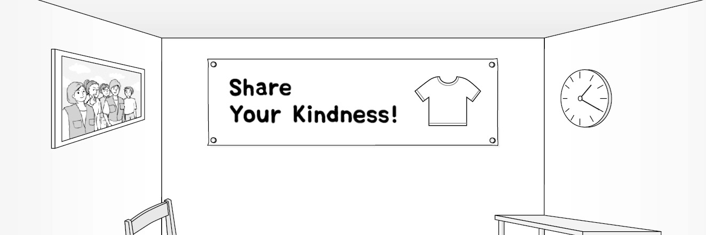
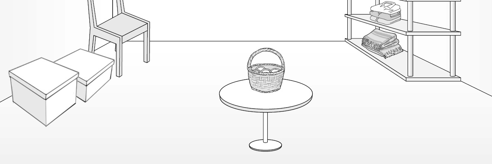
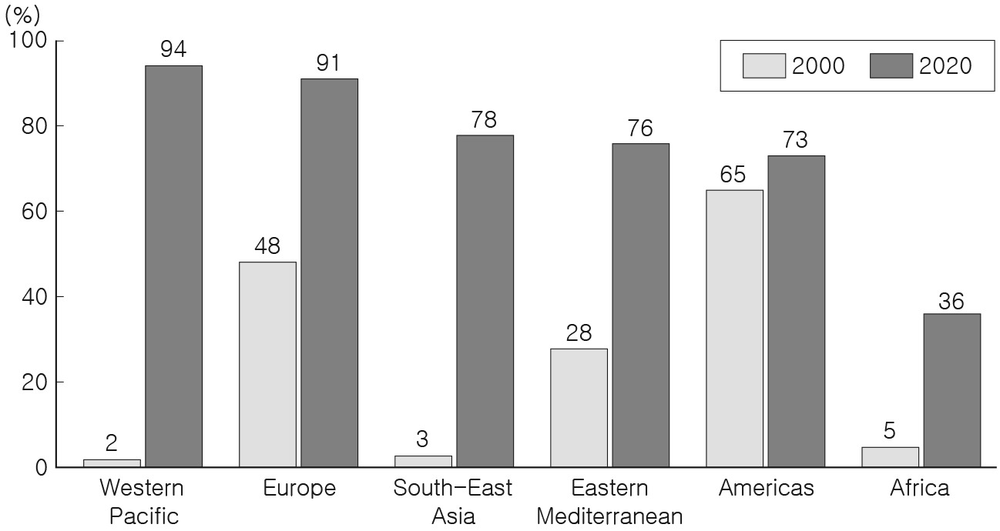
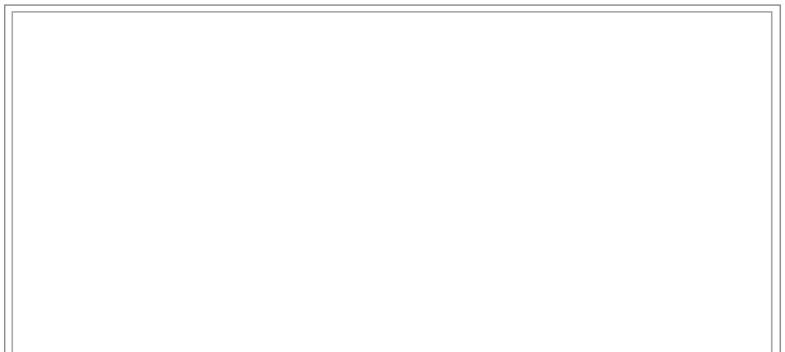
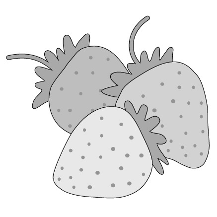

1. 다음을 듣고, 여자가 하는 말의 목적으로 가장 적절한 것을 고르시오.

① 자전거 전용 도로의 정비 일정을 공지하려고
② 자전거 안전 장비 착용의 중요성을 강조하려고
③ 공유 자전거 주차장의 설치 장소를 안내하려고
④ 공유 자전거를 지정된 장소에 주차할 것을 당부하려고
⑤ 친환경적인 교통수단을 이용해 등교할 것을 권장하려고

2. 대화를 듣고, 남자의 의견으로 가장 적절한 것을 고르시오.

① 눈병 예방을 위해 정기적인 안과 검진을 받아야 한다.
② 적절한 휴식은 작업의 집중도를 높이는 데 도움이 된다.
③ 지나치게 밝은 컴퓨터 화면은 눈 건강에 해로울 수 있다.
④ 너무 작은 글씨를 읽는 것은 눈의 피로를 유발할 수 있다.
⑤ 시력 보호를 위해 화면과의 적당한 거리 유지가 필요하다.

3. 대화를 듣고, 두 사람의 관계를 가장 잘 나타낸 것을 고르시오.

① 동화 작가 – 삽화가
② 악기 조율사 – 연주가
③ 학부모 – 유치원 교사
④ 피아노 강사 – 수강생
⑤ 중고 용품점 직원 – 손님

4. 대화를 듣고, 그림에서 대화의 내용과 일치하지 않는 것을 고르시오.

5. 대화를 듣고, 남자가 할 일로 가장 적절한 것을 고르시오.

① 명단 출력하기
② 의자 가져오기
③ 동영상 내려받기
④ 구급상자 확인하기
⑤ 실험용 장갑 가져오기

6. 대화를 듣고, 여자가 지불할 금액을 고르시오. [3점]

① $27
② $34
③ $36
④ $37
⑤ $40

7. 대화를 듣고, 남자가 레일 바이크를 타러 갈 수 없는 이유를 고르시오.

① 가족 모임에 가야 해서
② 축구 연습을 해야 해서
③ 아르바이트를 해야 해서
④ 연극 의상을 제작해야 해서
⑤ 뮤지컬 오디션이 예정되어 있어서

8. 대화를 듣고, Winter Robot Camp에 관해 언급되지 않은 것을 고르시오.

① 기간
② 장소
③ 준비물
④ 운영 프로그램
⑤ 등록 방법

9. Go Greener Festival에 관한 다음 내용을 듣고, 일치하지 않는 것을 고르시오.

① 11월 11일부터 13일까지 진행된다.
② 환경에 관한 노래가 연주된다.
③ 무대는 재활용된 재료로 제작된다.
④ 물병을 가져오면 음료를 무료로 받을 수 있다.
⑤ 주차장 이용이 불가능하다.

10. 다음 표를 보면서 대화를 듣고, 두 사람이 주문할 직소 퍼즐 세트를 고르시오.

|  | Set | Title of Painting | Number of Puzzle Pieces | Price | Frame |
| --- | --- | --- | --- | --- | --- |
| ① | A | Mona Lisa | 1,000 | $44 | wooden |
| ② | B | Starry Night | 800 | $38 | wooden |
| ③ | C | Water Lilies | 700 | $35 | wooden |
| ④ | D | Birth of Venus | 600 | $33 | metal |
| ⑤ | E | Sunflowers | 400 | $30 | metal |

11. 대화를 듣고, 여자의 마지막 말에 대한 남자의 응답으로 가장 적절한 것을 고르시오.

① It was too late to learn something new.
② It was my aunt who taught me calligraphy.
③ I used to teach my little brother handwriting.
④ I didn’t know you had the same hobby as me.
⑤ I bought a special brush for calligraphy online.

12. 대화를 듣고, 남자의 마지막 말에 대한 여자의 응답으로 가장 적절한 것을 고르시오.

① I see. I’ll register for the available course.
② No way. I’m not interested in water activities.
③ No problem. I’ll let you choose the 7 p.m. class.
④ Wonderful. It’s my pleasure to teach scuba diving.
⑤ Really? I’ve already signed up for the Friday course.

13. 대화를 듣고, 여자의 마지막 말에 대한 남자의 응답으로 가장 적절한 것을 고르시오. [3점]

Man:

① It’ll be helpful to deliver DIY furniture.
② I’ll fix your computer by using the manual.
③ I’ve already mastered how to put it together.
④ I’d like you to buy a brand new bookcase online.
⑤ I should find a video for assembling the bookcase.

14. 대화를 듣고, 남자의 마지막 말에 대한 여자의 응답으로 가장 적절한 것을 고르시오.

Woman:

① Definitely. We should avoid eating only vegetables.
② Sorry. I prefer good-looking vegetables to ugly ones.
③ Good. Let’s see if the vegetables we need are for sale.
④ Exactly. Ugly vegetables are not appropriate for eating.
⑤ Excellent. I like the ugly vegetables you bought for me.

15. 다음 상황 설명을 듣고, Sofia가 Henry에게 할 말로 가장 적절한 것을 고르시오. [3점]

Sofia:

① You need to look at reviews when choosing books.
② Why don’t you show an example of a presentation?
③ How about giving students a choice in their books?
④ I recommend you assign a book report to students.
⑤ You should give students time to work with others.

16. 남자가 하는 말의 주제로 가장 적절한 것은?

① migration patterns of various birds
② bird diversity affected by city growth
③ everyday expressions related to birds
④ bird symbolism used in different cultures
⑤ impact of birds on agricultural development

17. 언급된 새가 아닌 것은?

따라 답을 하시기 바랍니다.

① eagle
② crane
③ owl
④ sparrow
⑤ hummingbird

18. 다음 글의 목적으로 가장 적절한 것은?

Dear local business owners, My name is Carol Williams, president of the student council at Yellowstone High School. We are hosting our annual quiz night on March 30 and plan to give prizes to the winning team. However, this event won’t be possible without the support of local businesses who provide valuable products and services. Would you be willing to donate a gift certificate that we can use as a prize? We would be grateful for any amount on the certificate. In exchange for your generosity, we would place an advertisement for your business on our answer sheets. Thank you for taking time to read this letter and consider our request. If you’d like to donate or need more information, please call or email me. I look forward to hearing from you soon. Carol Williams

19. 다음 글에 드러난 ‘I’의 심경 변화로 가장 적절한 것은?

Dan and I were supposed to make a presentation that day. Right after the class started, my phone buzzed. It was a text from Dan saying, “I can’t make it on time. There’s been a car accident on the road!” I almost fainted. ‘What should I do?’ Dan didn’t show up before our turn, and soon I was standing in front of the whole class. I managed to finish my portion, and my mind went blank for a few seconds, wondering what to do. ‘Hold yourself together!’ I quickly came to my senses and worked through Dan’s part of the presentation as best as I could. After a few moments, I finished the entire presentation on my own. Only then did the tension vanish. I could see our professor’s beaming face.

20. 다음 글에서 필자가 주장하는 바로 가장 적절한 것은?

Clarity in an organization keeps everyone working in one accord and energizes key leadership components like trust and transparency. No matter who or what is being assessed in your organization, what they are being assessed on must be clear and the people must be aware of it. If individuals in your organization are assessed without knowing what they are being assessed on, it can cause mistrust and move your organization away from clarity. For your organization to be productive, cohesive, and successful, trust is essential. Failure to have trust in your organization will have a negative effect on the results of any assessment. It will also significantly hinder the growth of your organization. To conduct accurate assessments, trust is a must — which comes through clarity. In turn, assessments help you see clearer, which then empowers your organization to reach optimal success.

21. 밑줄 친 “eating my problems for breakfast”가 다음 글에서 의미하는 바로 가장 적절한 것은?

Research in the science of peak performance and motivation points to the fact that different tasks should ideally be matched to our energy level. For example, analytical tasks are best accomplished when our energy is high and we are free from distractions and able to focus. I generally wake up energized. Over the years, I have consistently stuck to the habit of “eating my problems for breakfast.” I’m someone who tends to overthink different scenarios and conversations that haven’t happened yet. When I procrastinate on talking with an unhappy client or dealing with an unpleasant email, I find I waste too much emotional energy during the day. It’s as if the task hangs over my head, and I’ll spend more time worrying about it, talking about it, and avoiding it, than it would actually take to just take care of it. So for me, it’ll always be the first thing I get done. If you know you are not a morning person, be strategic about scheduling your difficult work later in the day.

22. 다음 글의 요지로 가장 적절한 것은?

In one study, when researchers suggested that a date was associated with a new beginning (such as “the first day of spring”), students viewed it as a more attractive time to kick-start goal pursuit than when researchers presented it as an unremarkable day (such as “the third Thursday in March”). Whether it was starting a new gym habit or spending less time on social media, when the date that researchers suggested was associated with a new beginning, more students wanted to begin changes right then. And more recent research by a different team found that similar benefits were achieved by showing goal seekers modified weekly calendars. When calendars depicted the current day (either Monday or Sunday) as the first day of the week, people reported feeling more motivated to make immediate progress on their goals.

23. 다음 글의 주제로 가장 적절한 것은?

Native Americans often sang and danced in preparation for launching an attack. The emotional and neurochemical excitement that resulted from this preparatory singing gave them stamina to carry out their attacks. What may have begun as an unconscious, uncontrolled act — rushing their victims with singing and beating drums in a frenzy — could have become a strategy as the victors saw firsthand the effect their actions had on those they were attacking. Although war dances risk warning an enemy of an upcoming attack, the arousal and synchronizing benefits for the attackers may compensate for the loss of surprise. Humans who sang, danced, and marched may have enjoyed a strong advantage on the battlefield as well as intimidated enemies who witnessed such a spectacle. Nineteenth-and twentieth-century Germans feared no one more than the Scots — the bagpipes and drums were disturbing in their sheer loudness and visual spectacle.

24. 다음 글의 제목으로 가장 적절한 것은?

The recent “cycling as a lifestyle” craze has expressed itself in an increase in the number of active cyclists and in growth of cycling club membership in several European, American, Australian and Asian urban areas. It has also been accompanied by a symbolic reinterpretation of the bicycle. After the bicycle had been associated with poverty for many years, expensive recreational bicycles or recreationally-inspired commuting bicycles have suddenly become aspirational products in urban environments. In present times, cycling has become an activity which is also performed for its demonstrative value, its role in identity construction and its effectiveness in impressing others and signaling social status. To a certain extent, cycling has turned into a symbolic marker of the well-off. Obviously, value-laden consumption behavior is by no means limited to cycling. However, the link with identity construction and conspicuous consumption has become particularly manifest in the case of cycling.

25. 다음 도표의 내용과 일치하지 않는 것은?

Second-Dose Measles Vaccinations among Children by Region in 2000 and in 2020 The graph above shows the percentage of children who received second-dose measles vaccinations in six regions in 2000 and in 2020.

| Region | 2000 | 2020 |
| --- | --- | --- |
| Western Pacific | 2 | 94 |
| Europe | 48 | 91 |
| South-East Asia | 3 | 78 |
| Eastern Mediterranean | 28 | 76 |
| Americas | 65 | 73 |
| Africa | 5 | 36 |

26. Janaki Ammal에 관한 다음 글의 내용과 일치하지 않는 것은?

Janaki Ammal, one of India’s most notable scientists, was born in 1897, and was expected to wed through an arranged marriage. Despite living at a time when literacy among women in India was less than one percent, she decided to reject tradition and attend college. In 1924, she went to the U.S. and eventually received a doctorate in botany from the University of Michigan. Ammal contributed to the development of the sweetest sugarcane variety in the world. She moved to England where she co-authored the Chromosome Atlas of Cultivated Plants. Following a series of famines, she returned to India to help increase food production at the request of the Prime Minister. However, Ammal disagreed with the deforestation taking place in an effort to grow more food. She became an advocate for the preservation of native plants and successfully saved the Silent Valley from the construction of a hydroelectric dam.

27. 2022 Strawberry Festival에 관한 다음 안내문의 내용과 일치하지 않는 것은?

2022 Strawberry Festival Join us for a fun family festival. This year, we are back to hosting an in-person event in Berry Square! ▫
Date: November 26, 2022 (11:00 a.m. — 5:00 p.m.) ▫ Tickets: $20 per person (Children 6 and under are FREE.) ▫ Special Events
11:00 a.m.: Baking Class for Kids
1:00 p.m.: Strawberry Pie-Eating Contest
3:00 p.m.: Strawberry Costume Contest ▫ Note
The parking fee is $5 and includes tram service to the ticket booth.
If you are interested in volunteering, complete an application form and email it to manager@strawberryfestival.org.

28. Maple Spring Light Art Exhibition에 관한 다음 안내문의 내용과 일치하는 것은?

Maple Spring Light Art Exhibition The Maple Spring Light Art Exhibition will illuminate you, with a route surrounded by light artwork. Admire the beautiful light artwork as you walk through Maple Spring. ▫
Date: December 1 — 31, 2022 (closed on the 2nd and 4th Monday of the month) ▫
Time: 7 p.m. — 11 p.m. ▫ Entrance
Fee: $5 per person ▫ Exhibition Route: alongside the Bow River in central Maple Spring (Only digital maps of the route are available.)
Souvenirs will be available on site and online.
Local residents can get a 10% discount off the entrance fee. Please visit www.maplespringlight.com for more information.

29. 다음 글의 밑줄 친 부분 중, 어법상 틀린 것은? [3점]

Pre-emption means that a strategy is designed to prevent a rival from starting some particular activity. In some case a pre-emptive move may simply be an announcement of some intent that might discourage rivals from doing the same. The idea of pre-emption implies that timing is sometimes very important — a decision or an action at one point in time might be much more rewarding than doing it at a different time point. Pre-emption may involve up-weighting advertising for a period before and during when a new entrant launches into a market. The intent is to make it more difficult for the new entrant’s advertising to make an impression on potential buyers. Product proliferation is another potential pre-emption strategy. The general idea is to launch a large variety of product variants so that there is very little in the way of market demand that is not accommodated. Arguably, if a market is already filled with product variants it is more difficult for competitors to find untapped pockets of market demand.

30. 다음 글의 밑줄 친 부분 중, 문맥상 낱말의 쓰임이 적절하지 않은 것은? [3점]

Countershading is the process of optical flattening that provides camouflage to animals. When sunlight illuminates an object from above, the object will be brightest on top. The color of the object will gradually shade darker toward the bottom. This shading gives the object depth and allows the viewer to distinguish its shape. Thus even if an animal is exactly, but uniformly, the same color as the substrate, it will be easily visible when illuminated. Most animals, however, are darker above than they are below. When they are illuminated from above, the darker back is lightened and the lighter belly is shaded. The animal thus appears to be a single color and easily blends in with the substrate. This pattern of coloration, or countershading, destroys the visual impression of shape in the organism. It allows the animal to blend in with its background.

31. 다음 빈칸에 들어갈 말로 가장 적절한 것을 고르시오.

No learning is possible without an error signal. Organisms only learn when events violate their expectations. In other words, surprise is one of the fundamental drivers of learning. Imagine hearing a series of identical notes, AAAAA. Each note draws out a response in the auditory areas of your brain — but as the notes repeat, those responses progressively decrease. This is called “adaptation,” a deceptively simple phenomenon that shows that your brain is learning to anticipate the next event. Suddenly, the note changes: AAAAA#. Your primary auditory cortex immediately shows a strong surprise reaction: not only does the adaptation fade away, but additional neurons begin to vigorously fire in response to the unexpected sound. And it is not just repetition that leads to adaptation: what matters is whether the notes are predictable. For instance, if you hear an alternating set of notes, such as ABABA, your brain gets used to this alternation, and the activity in your auditory areas again decreases. This time, however, it is an unexpected repetition, such as ABABB, that triggers a surprise response.

32. 다음 빈칸에 들어갈 말로 가장 적절한 것을 고르시오.

The connectedness of the global economic market makes it vulnerable to potential “infection.” A financial failure can make its way from borrowers to banks to insurers, spreading like a flu. However, there are unexpected characteristics when it comes to such infection in the market. Infection can occur even without any contact. A bank might become insolvent even without having any of its investments fail. Fear and uncertainty can be damaging to financial markets, just as cascading failures due to bad investments. If we all woke up tomorrow and believed that Bank X would be insolvent, then it would become insolvent. In fact, it would be enough for us to fear that others believed that Bank X was going to fail, or just to fear our collective fear! We might all even know that Bank X was well-managed with healthy investments, but if we expected others to pull their money out, then we would fear being the last to pull our money out. Financial distress can be self-fulfilling and is a particularly troublesome aspect of financial markets.

33. 다음 빈칸에 들어갈 말로 가장 적절한 것을 고르시오.

Negative numbers are a lot more abstract than positive numbers — you can’t see negative 4 cookies and you certainly can’t eat them — but you can think about them, and you have to, in all aspects of daily life, from debts to contending with freezing temperatures and parking garages. Still, many of us haven’t quite made peace with negative numbers. People have invented all sorts of funny little mental strategies to sidestep the dreaded negative sign. On mutual fund statements, losses (negative numbers) are printed in red or stuck in parentheses with no negative sign to be found. The history books tell us that Julius Caesar was born in 100 B.C., not -100. The underground levels in a parking garage often have designations like B1 and B2. Temperatures are one of the few exceptions: folks do say, especially here in Ithaca, New York, that it’s -5 degrees outside, though even then, many prefer to say 5 below zero. There’s something about that negative sign that just looks so unpleasant.

34. 다음 빈칸에 들어갈 말로 가장 적절한 것을 고르시오. [3점]

Observational studies of humans cannot be properly controlled. Humans live different lifestyles and in different environments. Thus, they are insufficiently homogeneous to be suitable experimental subjects. These confounding factors undermine our ability to draw sound causal conclusions from human epidemiological surveys. Confounding factors are variables (known or unknown) that make it difficult for epidemiologists to isolate the effects of the specific variable being studied. For example, Taubes argued that since many people who drink also smoke, researchers have difficulty determining the link between alcohol consumption and cancer. Similarly, researchers in the famous Framingham study identified a significant correlation between coffee drinking and coronary heart disease. However, most of this correlation disappeared once researchers corrected for the fact that many coffee drinkers also smoke. If the confounding factors are known, it is often possible to correct for them. However, if they are unknown, they will undermine the reliability of the causal conclusions we draw from epidemiological surveys.

35. 다음 글에서 전체 흐름과 관계 없는 문장은?

Of all the human emotions, none is trickier or more elusive than envy. It is very difficult to actually discern the envy that motivates people’s actions. The reason for this elusiveness is simple: we almost never directly express the envy we are feeling. Envy entails the admission to ourselves that we are inferior to another person in something we value. Not only is it painful to admit this inferiority, but it is even worse for others to see that we are feeling this. Envy can cause illness because people with envy can cast the “evil eye” on someone they envy, even unwittingly, or the envious person can become ill from the emotion. And so almost as soon as we experience the initial feelings of envy, we are motivated to disguise it to ourselves — it is not envy we feel but unfairness at the distribution of goods or attention, resentment at this unfairness, even anger.

36. 주어진 글 다음에 이어질 글의 순서로 가장 적절한 것을 고르시오.

The right to be forgotten is a right distinct from but related to a right to privacy. The right to privacy is, among other things, the right for information traditionally regarded as protected or personal not to be revealed. The right to be forgotten, in contrast, can be applied to information that has been in the public domain. The right to be forgotten broadly includes the right of an individual not to be forever defined by information from a specific point in time. One motivation for such a right is to allow individuals to move on with their lives and not be defined by a specific event or period in their lives. For example, it has long been recognized in some countries, such as the UK and France, that even past criminal convictions should eventually be “spent” and not continue to affect a person’s life. Despite the reason for supporting the right to be forgotten, the right to be forgotten can sometimes come into conflict with other rights. For example, formal exceptions are sometimes made for security or public health reasons.

37. 주어진 글 다음에 이어질 글의 순서로 가장 적절한 것을 고르시오. [3점]

To an economist who succeeds in figuring out a person’s preference structure — understanding whether the satisfaction gained from consuming one good is greater than that of another — explaining behavior in terms of changes in underlying likes and dislikes is usually highly problematic. To argue, for instance, that the baby boom and then the baby bust resulted from an increase and then a decrease in the public’s inherent taste for children, rather than a change in relative prices against a background of stable preferences, places a social scientist in an unsound position. In economics, such an argument about birth rates would be equivalent to saying that a rise and fall in mortality could be attributed to an increase in the inherent desire change for death. For an economist, changes in income and prices, rather than changes in tastes, affect birth rates. When income rises, for example, people want more children (or, as you will see later, more satisfaction derived from children), even if their inherent desire for children stays the same.

38. 글의 흐름으로 보아, 주어진 문장이 들어가기에 가장 적절한 곳을 고르시오.

In the natural world, if an animal consumes a plant with enough antinutrients to make it feel unwell, it won’t eat that plant again. Intuitively, animals also know to stay away from these plants. Years of evolution and information being passed down created this innate intelligence. This “intuition,” though, is not just seen in animals. Have you ever wondered why most children hate vegetables? Dr. Steven Gundry justifies this as part of our genetic programming, our inner intelligence. Since many vegetables are full of antinutrients, your body tries to keep you away from them while you are still fragile and in development. It does this by making your taste buds perceive these flavors as bad and even disgusting. As you grow and your body becomes stronger enough to tolerate these antinutrients, suddenly they no longer taste as bad as before.

39. 글의 흐름으로 보아, 주어진 문장이 들어가기에 가장 적절한 곳을 고르시오. [3점]

The difference in the Moon’s gravitational pull on different parts of our planet effectively creates a “stretching force.” It makes our planet slightly stretched out along the line of sight to the Moon and slightly compressed along a line perpendicular to that. The tidal stretching caused by the Moon’s gravity affects our entire planet, including both land and water, inside and out. However, the rigidity of rock means that land rises and falls with the tides by a much smaller amount than water, which is why we notice only the ocean tides. The stretching also explains why there are generally two high tides (and two low tides) in the ocean each day. Because Earth is stretched much like a rubber band, the oceans bulge out both on the side facing toward the Moon and on the side facing away from the Moon. As Earth rotates, we are carried through both of these tidal bulges each day, so we have high tide when we are in each of the two bulges and low tide at the midpoints in between.

40. 다음 글의 내용을 한 문장으로 요약하고자 한다. 빈칸 (A), (B)에 들어갈 말로 가장 적절한 것은? [3점]

A study investigated the economic cost of prejudice based on blind assumptions. Researchers gave a group of Danish teenagers the choice of working with one of two people. The teenager had never met either of them. One of the people had a name that suggested they were from a similar ethnic or religious background to the teenager. The other had a name that suggested they were from a different ethnic or religious background. The study showed that the teenagers were prepared to earn an average of 8% less if they could work with someone they thought came from the same ethnic or religious background. And this prejudice was evident among teenagers with ethnic majority names as well as those with ethnic minority names. The teenagers were blindly making assumptions about the race of their potential colleagues. They then applied prejudice to those assumptions, to the point where they actually allowed that prejudice to reduce their own potential income. The job required the two teenagers to work together for just 90 minutes. A study in which teenagers expressed a(n) preference to work with someone of a similar background, even at a financial cost to themselves, suggests that an assumption-based prejudice can outweigh rational economic behavior.

41. 윗글의 제목으로 가장 적절한 것은?

A neuropsychologist, Michael Gazzaniga conducted a study that shows that our brains excel at creating coherent (but not necessarily true) stories that deceive us. In the study, split-brain patients were shown an image such that it was visible to only their left eye and asked to select a related card with their left hand. Left-eye vision and left-side body movement are controlled by the right hemisphere. In a split-brain patient, the connection between the right and left hemispheres has been broken, meaning no information can cross from one hemisphere to the other. Therefore, in this experiment, the right hemisphere was doing all of the work, and the left hemisphere was unaware of what was happening. Gazzaniga then asked participants why they chose the card that they did. Because language is processed and generated in the left hemisphere, the left hemisphere is required to respond. However, because of the experiment’s design, only the right hemisphere knew why the participant selected the card. As a result, Gazzaniga expected the participants to be silent when asked to answer the question. But instead, every subject fabricated a response. The left hemisphere was being asked to provide a rationalization for a behavior done by the right hemisphere. The left hemisphere didn’t know the answer. But that didn’t keep it from fabricating an answer. That answer, however, had no basis in reality. Now if this study had been limited to split-brain patients, it would be interesting but not very relevant to us. It turns out split-brain patients aren’t the only ones who fabricate reasons. We all do it. We all need a coherent story about ourselves, and when information in that story is missing, our brains simply fill in the details.

42. 밑줄 친 낱말 중에서 문맥상 낱말의 쓰임이 적절하지 않은 것은? [3점]

A neuropsychologist, Michael Gazzaniga conducted a study that shows that our brains excel at creating coherent (but not necessarily true) stories that deceive us. In the study, split-brain patients were shown an image such that it was visible to only their left eye and asked to select a related card with their left hand. Left-eye vision and left-side body movement are controlled by the right hemisphere. In a split-brain patient, the connection between the right and left hemispheres has been broken, meaning no information can cross from one hemisphere to the other. Therefore, in this experiment, the right hemisphere was doing all of the work, and the left hemisphere was unaware of what was happening. Gazzaniga then asked participants why they chose the card that they did. Because language is processed and generated in the left hemisphere, the left hemisphere is required to respond. However, because of the experiment’s design, only the right hemisphere knew why the participant selected the card. As a result, Gazzaniga expected the participants to be silent when asked to answer the question. But instead, every subject fabricated a response. The left hemisphere was being asked to provide a rationalization for a behavior done by the right hemisphere. The left hemisphere didn’t know the answer. But that didn’t keep it from fabricating an answer. That answer, however, had no basis in reality. Now if this study had been limited to split-brain patients, it would be interesting but not very relevant to us. It turns out split-brain patients aren’t the only ones who fabricate reasons. We all do it. We all need a coherent story about ourselves, and when information in that story is missing, our brains simply fill in the details.

43. 주어진 글에 이어질 내용을 순서에 맞게 배열한 것으로 가장 적절한 것은?

 When the practice game ended, Chanel felt her eyes sting with tears. “It’s okay,” Vasha said in a comforting voice. Chanel appreciated her, but Vasha wasn’t making her feel any better. Vasha wanted to help her twin improve. She invited her twin to practice with her. After school, they got their basketball and started practicing their basketball shots. At first, Chanel did not like practicing with Vasha because every time Vasha shot the ball, it went in. But whenever it was Chanel’s turn, she missed. She got frustrated at not making a shot. “Don’t give up!” Vasha shouted after each missed shot. After twelve misses in a row, her thirteenth shot went in and she screamed, “I finally did it!” Her twin said, “I knew you could! Now let’s keep practicing!” The next day, Chanel played in the championship game against a rival school. It was an intense game and the score was tied when Chanel was passed the ball by Vasha, with ten seconds left in the game. She leaped into the air and shot the ball. It went straight into the basket! Chanel’s last shot had made her team the champions. Vasha and all her other teammates cheered for her. 

44. 밑줄 친 낱말 중에서 가리키는 대상이 나머지 넷과 다른 것은?

 When the practice game ended, Chanel felt her eyes sting with tears. “It’s okay,” Vasha said in a comforting voice. Chanel appreciated her, but Vasha wasn’t making her feel any better. Vasha wanted to help her twin improve. She invited her twin to practice with her. After school, they got their basketball and started practicing their basketball shots. At first, Chanel did not like practicing with Vasha because every time Vasha shot the ball, it went in. But whenever it was Chanel’s turn, she missed. She got frustrated at not making a shot. “Don’t give up!” Vasha shouted after each missed shot. After twelve misses in a row, her thirteenth shot went in and she screamed, “I finally did it!” Her twin said, “I knew you could! Now let’s keep practicing!” The next day, Chanel played in the championship game against a rival school. It was an intense game and the score was tied when Chanel was passed the ball by Vasha, with ten seconds left in the game. She leaped into the air and shot the ball. It went straight into the basket! Chanel’s last shot had made her team the champions. Vasha and all her other teammates cheered for her. 

45. 윗글의 Chanel에 관한 내용으로 적절하지 않은 것은?

 When the practice game ended, Chanel felt her eyes sting with tears. “It’s okay,” Vasha said in a comforting voice. Chanel appreciated her, but Vasha wasn’t making her feel any better. Vasha wanted to help her twin improve. She invited her twin to practice with her. After school, they got their basketball and started practicing their basketball shots. At first, Chanel did not like practicing with Vasha because every time Vasha shot the ball, it went in. But whenever it was Chanel’s turn, she missed. She got frustrated at not making a shot. “Don’t give up!” Vasha shouted after each missed shot. After twelve misses in a row, her thirteenth shot went in and she screamed, “I finally did it!” Her twin said, “I knew you could! Now let’s keep practicing!” The next day, Chanel played in the championship game against a rival school. It was an intense game and the score was tied when Chanel was passed the ball by Vasha, with ten seconds left in the game. She leaped into the air and shot the ball. It went straight into the basket! Chanel’s last shot had made her team the champions. Vasha and all her other teammates cheered for her.
