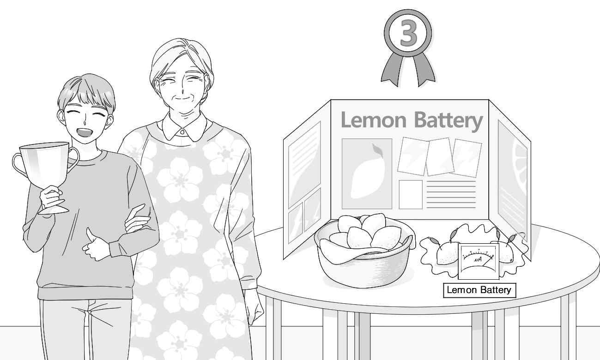
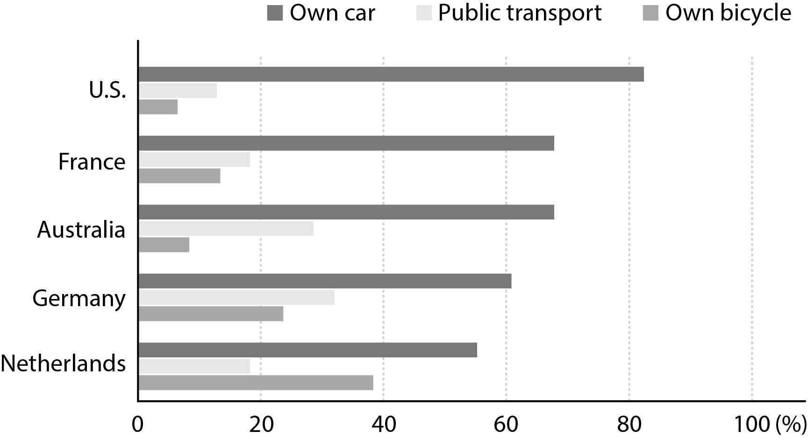

1. 다음을 듣고, 남자가 하는 말의 목적으로 가장 적절한 것을 고르시오.
① 수도관 수리로 음수대를 이용할 수 없다는 것을 알리려고
② 수도관 수리 일정이 변경되는 것을 공지하려고
③ 음수대 이용 시 질서를 지킬 것을 당부하려고
④ 물을 자주 마시는 것의 중요성을 강조하려고
⑤ 음수대가 추가로 설치된 장소를 안내하려고

2. 대화를 듣고, 여자의 의견으로 가장 적절한 것을 고르시오.

① 파스텔 색상의 옷을 입으면 더 친근해 보인다.
② 공식적인 자리에는 어두운 색상의 옷이 어울린다.
③ 밝은 표정으로 인사하면 친근한 인상을 줄 수 있다.
④ 다양한 디자인의 옷을 통해 개성을 표현할 수 있다.
⑤ 기분이 우울할 때는 파스텔 색상의 옷을 입는 것이 좋다.

3. 대화를 듣고, 두 사람의 관계를 가장 잘 나타낸 것을 고르시오.

① 관광객 - 관광 안내원
② 사진작가 - 미술관 큐레이터
③ 화가 - 화가 지망생
④ 관람객 - 박물관 관장
⑤ 촬영 감독 - 배우

4. 대화를 듣고, 그림에서 대화의 내용과 일치하지 않는 것을 고르시오.

5. 대화를 듣고, 남자가 여자를 위해 할 일로 가장 적절한 것을 고르시오.

① 파일 수정하기
② 파일 출력하기
③ 유인물 복사하기
④ 유인물 검토하기
⑤ 발표 일정 확인하기

6. 대화를 듣고, 여자가 지불할 금액을 고르시오. [3점]

① $48
② $55
③ $78
④ $80
⑤ $83

7. 대화를 듣고, 남자가 이번 토요일에 쇼핑하러 갈 수 없는 이유를 고르시오.

① 학교 축제에 쓸 동영상 제작을 도와야 해서
② 도서관에 봉사 활동을 하러 가야 해서
③ 장기 자랑 대회 예행연습을 해야 해서
④ 장기 자랑 대회 사회를 맡아야 해서
⑤ 무대 의상을 제작해야 해서

8. 대화를 듣고, Modern Architecture Expo에 관해 언급되지 않은 것을 고르시오.

① 개최 장소
② 주최 기관
③ 개최 기간
④ 입장료
⑤ 강연자 수

9. 2022 Opera in School에 관한 다음 내용을 듣고, 일치하지 않는 것을 고르시오.

① Romeo and Juliet을 공연할 것이다.
② 3월 25일 학교 강당에서 열릴 것이다.
③ 공연은 45분간 진행될 것이다.
④ 질의응답 시간 전에 가수들과 사진을 찍을 수 있다.
⑤ 참석하려면 사전에 등록해야 한다.

10. 다음 표를 보면서 대화를 듣고, 두 사람이 구입할 미니 오븐을 고르시오.

|  | Model | Price | Capacity (liters) | Weight (kilograms) | Baking Pan |
| --- | --- | --- | --- | --- | --- |
| ① | A | $92 | 9 | 6.0 | × |
| ② | B | $93 | 10 | 6.5 | ○ |
| ③ | C | $95 | 12 | 5.5 | × |
| ④ | D | $98 | 13 | 5.0 | ○ |
| ⑤ | E | $110 | 13 | 4.5 | ○ |

11. 대화를 듣고, 여자의 마지막 말에 대한 남자의 응답으로 가장 적절한 것을 고르시오.

① I can go to the gym and exercise with you.
② I lift weights at the gym three times a week.
③ Joining a team sport is a good way to stay active.
④ I do push-ups and squats for 30 minutes every day.
⑤ Diet is just as important as exercise to stay in shape.

12. 대화를 듣고, 남자의 마지막 말에 대한 여자의 응답으로 가장 적절한 것을 고르시오.

① The person who gets the most votes will be the winner.
② I’m so happy to be chosen as the best dancer.
③ It’s hard for me to make my dance video.
④ I can help you upload the video to the website.
⑤ I’m looking for a good dance competition to enter.

13. 대화를 듣고, 여자의 마지막 말에 대한 남자의 응답으로 가장 적절한 것을 고르시오. [3점]

Man:
① Okay, I’ll visit the repair cafe you recommended before.
② Well, I saw a repair cafe next to the post office.
③ Sure, you can easily find a place to volunteer at.
④ Yes, the new bike shop offers good deals.
⑤ Sorry, but I’m too busy to fix your bike.

14. 대화를 듣고, 남자의 마지막 말에 대한 여자의 응답으로 가장 적절한 것을 고르시오. [3점]

Woman:
① My dad has the same problem. I’ll tell him about the app.
② Don’t eat too much fruit. It raises your blood sugar level.
③ That’s true. Exercise helps lower your blood sugar level.
④ Why not? I’ve been using this app for months.
⑤ You’re right. I should control my screen time.

15. 다음 상황 설명을 듣고, Sandra가 Mr. Wilson에게 할 말로 가장 적절한 것을 고르시오.

Sandra:
① Will you tell me how to run the student council meetings?
② Can we hold a sports competition for student health?
③ Please provide new sports equipment to students.
④ Is it possible for you to join our regular meetings?
⑤ Let us enter the sports league on behalf of our school.

16. 여자가 하는 말의 주제로 가장 적절한 것은?

① animals that can survive without food for a long time
② ways animals manage to adapt to extreme weather
③ impacts of climate change on animals’ habitats
④ techniques animals use to avoid predators
⑤ unique hunting skills of various animals

17. 언급된 동물이 아닌 것은?

① crocodiles
② spiders
③ penguins
④ dolphins
⑤ sharks

18. 다음 글의 목적으로 가장 적절한 것은?

As I explained on the telephone, I don’t want to take my two children by myself on a train trip to visit my parents in Springfield this Saturday since it is the same day the Riverside Warriors will play the Greenville Trojans in the National Soccer Championship. I would really appreciate it, therefore, if you could change my tickets to the following weekend (April 23). I fully appreciate that the original, special-offer ticket was non-exchangeable, but I did not know about the soccer match when I booked the tickets and I would be really grateful if you could do this for me. Thank you in advance.

19. 다음 글에 드러난 ‘I’의 심경으로 가장 적절한 것은?

Hours later — when my back aches from sitting, my hair is styled and dry, and my almost invisible makeup has been applied — Ash tells me it’s time to change into my dress. We’ve been waiting until the last minute, afraid any refreshments I eat might accidentally fall onto it and stain it. There’s only thirty minutes left until the show starts, and the nerves that have been torturing Ash seem to have escaped her, choosing a new victim in me. My palms are sweating, and I have butterflies in my stomach. Nearly all the models are ready, some of them already dressed in their nineteenth-century costumes. Ash tightens my corset.

20. 다음 글에서 필자가 주장하는 바로 가장 적절한 것은?

Though we are marching toward a more global society, various ethnic groups traditionally do things quite differently, and a fresh perspective is valuable in creating an open-minded child. Extensive multicultural experience makes kids more creative (measured by how many ideas they can come up with and by association skills) and allows them to capture unconventional ideas from other cultures to expand on their own ideas. As a parent, you should expose your children to other cultures as often as possible. If you can, travel with your child to other countries; live there if possible. If neither is possible, there are lots of things you can do at home, such as exploring local festivals, borrowing library books about other cultures, and cooking foods from different cultures at your house.

21. 밑줄 친 Fish is Fish-style assimilation이 다음 글에서 의미하는 바로 가장 적절한 것은? [3점]

Studies by Vosniado and Brewer illustrate Fish is Fish-style assimilation in the context of young children’s thinking about the earth. They worked with children who believed that the earth is flat (because this fit their experiences) and attempted to help them understand that, in fact, it is spherical. When told it is round, children often pictured the earth as a pancake rather than as a sphere. If they were then told that it is round like a sphere, they interpreted the new information about a spherical earth within their flat-earth view by picturing a pancake-like flat surface inside or on top of a sphere, with humans standing on top of the pancake. The model of the earth that they had developed — and that helped them explain how they could stand or walk upon its surface — did not fit the model of a spherical earth. Like the story Fish is Fish, where a fish imagines everything on land to be fish-like, everything the children heard was incorporated into their preexisting views.

22. 다음 글의 요지로 가장 적절한 것은?

Advice from a friend or family member is the most well-meaning of all, but it’s not the best way to match yourself with a new habit. While hot yoga may have changed your friend’s life, does that mean it’s the right practice for you? We all have friends who swear their new habit of getting up at 4:30 a.m. changed their lives and that we have to do it. I don’t doubt that getting up super early changes people’s lives, sometimes in good ways and sometimes not. But be cautious: You don’t know if this habit will actually make your life better, especially if it means you get less sleep. So yes, you can try what worked for your friend, but don’t beat yourself up if your friend’s answer doesn’t change you in the same way. All of these approaches involve guessing and chance. And that’s not a good way to strive for change in your life.

23. 다음 글의 주제로 가장 적절한 것은?

Individual human beings differ from one another physically in a multitude of visible and invisible ways. If races — as most people define them — are real biological entities, then people of African ancestry would share a wide variety of traits while people of European ancestry would share a wide variety of different traits. But once we add traits that are less visible than skin coloration, hair texture, and the like, we find that the people we identify as “the same race” are less and less like one another and more and more like people we identify as “different races.” Add to this point that the physical features used to identify a person as a representative of some race (e.g. skin coloration) are continuously variable, so that one cannot say where “brown skin” becomes “white skin.” Although the physical differences themselves are real, the way we use physical differences to classify people into discrete races is a cultural construction.

24. 다음 글의 제목으로 가장 적절한 것은?

The realization of human domination over the environment began in the late 1700s with the industrial revolution. Advances in manufacturing transformed societies and economies while producing significant impacts on the environment. American society became structured on multiple industries’ capitalistic goals as the development of the steam engine led to the mechanized production of goods in mass quantities. Rural agricultural communities with economies based on handmade goods and agriculture were abandoned for life in urban cities with large factories based on an economy of industrialized manufacturing. Innovations in the production of textiles, iron, and steel provided increased profits to private companies. Simultaneously, those industries exerted authority over the environment and began dumping hazardous by-products in public lands and waterways.

25. 다음 도표의 내용과 일치하지 않는 것은?

How People Commute in Five Countries The above graph shows which modes of transportation people use for their daily commute to work, school, or university in five selected countries.

26. 2022 Bluehill Virtual Gala에 관한 다음 안내문의 내용과 일치하지 않는 것은?

2022 Bluehill Virtual Gala You’re invited to the 2022 Bluehill Virtual Gala hosted by the Bluehill Community Center. We’ll have an online party to raise funds for our charity programs! Because we can’t gather together in person this year, we are joining together virtually. - Our Virtual Gala is on April 2 from 6 p.m. to 8 p.m. - It will include musical performances, special lectures, and live auctions! - Our MC will be Edward Jones, the famous actor from A Good Neighbor. Everyone is welcome. This event will stream for free! To join the party, simply visit www.bluehillgala.org.

27. Woodside Clay Workshop에 관한 다음 안내문의 내용과 일치하는 것은?

Woodside Clay Workshop 7 p.m. Thursday March 31, 2022 7 p.m. Thursday April 7, 2022 This is a two-session workshop for adults. In the first session, you will learn the basics of clay and create unique ceramic pendants. In the second session, you will decorate the pieces before we glaze and fire them. Your pendants will be ready to be picked up from April 14. - This workshop is suitable for beginners, so no experience is necessary. -
Fee: ￡25 (including all materials, instruction and a glass of wine) - There are limited spaces, so book early. Advance bookings only. For more information, visit our website at www.woodsideclay.co.uk.

28. Gordon Parks에 관한 다음 글의 내용과 일치하지 않는 것은?

Gordon Parks was a photographer, author, film director, and musician. He documented the everyday lives of African Americans at a time when few people outside the black community were familiar with their lives. Parks was born the youngest of 15 children and grew up on his family’s farm. After the death of his mother, he went to live with a sister in Minnesota. Parks eventually dropped out of school and worked at various jobs. His interest in photography was inspired by a photo-essay he read about migrant farm workers. After he moved to Chicago, Parks began taking photos of poor African Americans. In 1949, he became the first African American to be a staff photographer for Life magazine. He also wrote music pieces in his life and in 1956 the Vienna Orchestra performed a piano concerto he wrote. Parks was an inspiring artist until he died in 2006.

29. 다음 글의 밑줄 친 부분 중, 어법상 틀린 것은? [3점]

Despite abundant warnings that we shouldn’t measure ourselves against others, most of us still do. We’re not only meaning-seeking creatures but social ones as well, constantly making interpersonal comparisons to evaluate ourselves, improve our standing, and enhance our self-esteem. But the problem with social comparison is that it often backfires. When comparing ourselves to someone who’s doing better than we are, we often feel inadequate for not doing as well. This sometimes leads to what psychologists call malignant envy, the desire for someone to meet with misfortune (“I wish she didn’t have what she has”). Also, comparing ourselves with someone who’s doing worse than we are risks scorn, the feeling that others are something undeserving of our beneficence (“She’s beneath my notice”). Then again, comparing ourselves to others can also lead to benign envy, the longing to reproduce someone else’s accomplishments without wishing them ill (“I wish I had what she has”), which has been shown in some circumstances to inspire and motivate us to increase our efforts in spite of a recent failure.

30. 다음 글의 밑줄 친 부분 중, 문맥상 낱말의 쓰임이 적절하지 않은 것은? [3점]

What exactly does normal science involve? According to Thomas Kuhn it is primarily a matter of puzzle-solving. However successful a paradigm is, it will always encounter certain problems — phenomena which it cannot easily accommodate, or mismatches between the theory’s predictions and the experimental facts. The job of the normal scientist is to try to eliminate these minor puzzles while making as few changes as possible to the paradigm. So normal science is a conservative activity — its practitioners are not trying to make any earth-shattering discoveries, but rather just to develop and extend the existing paradigm. In Kuhn’s words, ‘normal science does not aim at novelties of fact or theory, and when successful finds none’. Above all, Kuhn stressed that normal scientists are not trying to test the paradigm. On the contrary, they accept the paradigm unquestioningly, and conduct their research within the limits it sets. If a normal scientist gets an experimental result which conflicts with the paradigm, they will usually assume that their experimental technique is faulty, not that the paradigm is wrong.

31. 다음 빈칸에 들어갈 말로 가장 적절한 것을 고르시오.

Around the boss, you will always find people coming across as friends, good subordinates, or even great sympathizers. But some do not truly belong. One day, an incident will blow their cover, and then you will know where they truly belong. When it is all cosy and safe, they will be there, loitering the corridors and fawning at the slightest opportunity. But as soon as difficulties arrive, they are the first to be found missing. And difficult times are the true test of loyalty. Dr. Martin Luther King said, “The ultimate test of a man is not where he stands in moments of comfort and convenience, but where he stands at times of challenge and controversy.” And so be careful of friends who are always eager to take from you but reluctant to give back even in their little ways. If they lack the commitment to sail with you through difficult weather, then they are more likely to abandon your ship when it stops.

32. 다음 빈칸에 들어갈 말로 가장 적절한 것을 고르시오.

When you’re driving a car, your memory of how to operate the vehicle comes from one set of brain cells; the memory of how to navigate the streets to get to your destination springs from another set of neurons; the memory of driving rules and following street signs originates from another family of brain cells; and the thoughts and feelings you have about the driving experience itself, including any close calls with other cars, come from yet another group of cells. You do not have conscious awareness of all these separate mental plays and cognitive neural firings, yet they somehow work together in beautiful harmony to synthesize your overall experience. In fact, we don’t even know the real difference between how we remember and how we think. But, we do know they are strongly intertwined. That is why truly improving memory can never simply be about using memory tricks, although they can be helpful in strengthening certain components of memory. Here’s the bottom line: To improve and preserve memory at the cognitive level, you have to work on all functions of your brain.

33. 다음 빈칸에 들어갈 말로 가장 적절한 것을 고르시오. [3점]

According to many philosophers, there is a purely logical reason why science will never be able to explain everything. For in order to explain something, whatever it is, we need to invoke something else. But what explains the second thing? To illustrate, recall that Newton explained a diverse range of phenomena using his law of gravity. But what explains the law of gravity itself? If someone asks why all bodies exert a gravitational attraction on each other, what should we tell them? Newton had no answer to this question. In Newtonian science the law of gravity was a fundamental principle: it explained other things, but could not itself be explained. The moral generalizes. However much the science of the future can explain, the explanations it gives will have to make use of certain fundamental laws and principles. Since nothing can explain itself, it follows that at least some of these laws and principles will themselves remain unexplained.

34. 다음 빈칸에 들어갈 말로 가장 적절한 것을 고르시오. [3점]

In one example of the important role of laughter in social contexts, Devereux and Ginsburg examined frequency of laughter in matched pairs of strangers or friends who watched a humorous video together compared to those who watched it alone. The time individuals spent laughing was nearly twice as frequent in pairs as when alone. Frequency of laughing was only slightly shorter for friends than strangers. According to Devereux and Ginsburg, laughing with strangers served to create a social bond that made each person in the pair feel comfortable. This explanation is supported by the fact that in their stranger condition, when one person laughed, the other was likely to laugh as well. Interestingly, the three social conditions (alone, paired with a stranger, or paired with a friend) did not differ in their ratings of funniness of the video or of feelings of happiness or anxiousness. This finding implies that their frequency of laughter was not because we find things funnier when we are with others but instead we are using laughter to connect with others.

35. 다음 글에서 전체 흐름과 관계 없는 문장은?

Today’s “digital natives” have grown up immersed in digital technologies and possess the technical aptitude to utilize the powers of their devices fully. But although they know which apps to use or which websites to visit, they do not necessarily understand the workings behind the touch screen. People need technological literacy if they are to understand machines’ mechanics and uses. In much the same way as factory workers a hundred years ago needed to understand the basic structures of engines, we need to understand the elemental principles behind our devices. The lifespan of devices depends on the quality of software operating them as well as the structure of hardware. This empowers us to deploy software and hardware to their fullest utility, maximizing our powers to achieve and create.

36. 주어진 글 다음에 이어질 글의 순서로 가장 적절한 것을 고르시오.

The ancient Greeks used to describe two very different ways of thinking — logos and mythos. Logos roughly referred to the world of the logical, the empirical, the scientific. Mythos referred to the world of dreams, storytelling and symbols. Like many rationalists today, some philosophers of Greece prized logos and looked down at mythos. Logic and reason, they concluded, make us modern; storytelling and mythmaking are primitive. But lots of scholars then and now — including many anthropologists, sociologists and philosophers today — see a more complicated picture, where mythos and logos are intertwined and interdependent. Science itself, according to this view, relies on stories. The frames and metaphors we use to understand the world shape the scientific discoveries we make; they even shape what we see. When our frames and metaphors change, the world itself is transformed. The Copernican Revolution involved more than just scientific calculation; it involved a new story about the place of Earth in the universe.

37. 주어진 글 다음에 이어질 글의 순서로 가장 적절한 것을 고르시오.

There is no doubt that the length of some literary works is overwhelming. Reading or translating a work in class, hour after hour, week after week, can be such a boring experience that many students never want to open a foreign language book again. Extracts provide one type of solution. The advantages are obvious: reading a series of passages from different works produces more variety in the classroom, so that the teacher has a greater chance of avoiding monotony, while still giving learners a taste at least of an author’s special flavour. On the other hand, a student who is only exposed to ‘bite-sized chunks’ will never have the satisfaction of knowing the overall pattern of a book, which is after all the satisfaction most of us seek when we read something in our own language. Moreover, there are some literary features that cannot be adequately illustrated by a short excerpt: the development of plot or character, for instance, with the gradual involvement of the reader that this implies; or the unfolding of a complex theme through the juxtaposition of contrasting views.

38. 글의 흐름으로 보아, 주어진 문장이 들어가기에 가장 적절한 곳을 고르시오.

In the early stages of modern science, scientists communicated their creative ideas largely by publishing books. This modus operandi is illustrated not only by Newton’s Principia, but also by Copernicus’ On the Revolutions of the Heavenly Spheres, Kepler’s The Harmonies of the World, and Galileo’s Dialogues Concerning the Two New Sciences. With the advent of scientific periodicals, such as the Transactions of the Royal Society of London, books gradually yielded ground to the technical journal article as the chief form of scientific communication. Of course, books were not abandoned altogether, as Darwin’s Origin of Species shows. Even so, it eventually became possible for scientists to establish a reputation for their creative contributions without publishing a single book-length treatment of their ideas. For instance, the revolutionary ideas that earned Einstein his Nobel Prize ― concerning the special theory of relativity and the photoelectric effect ― appeared as papers in the Annalen der Physik. His status as one of the greatest scientists of all time does not depend on the publication of a single book.

39. 글의 흐름으로 보아, 주어진 문장이 들어가기에 가장 적절한 곳을 고르시오. [3점]

A supply schedule refers to the ability of a business to change their production rates to meet the demand of consumers. Some businesses are able to increase their production level quickly in order to meet increased demand. However, sporting clubs have a fixed, or inflexible (inelastic) production capacity. They have what is known as a fixed supply schedule. It is worth noting that this is not the case for sales of clothing, equipment, memberships and memorabilia. But clubs and teams can only play a certain number of times during their season. If fans and members are unable to get into a venue, that revenue is lost forever. Although sport clubs and leagues may have a fixed supply schedule, it is possible to increase the number of consumers who watch. For example, the supply of a sport product can be increased by providing more seats, changing the venue, extending the playing season or even through new television, radio or Internet distribution.

40. 다음 글의 내용을 한 문장으로 요약하고자 한다. 빈칸 (A), (B)에 들어갈 말로 가장 적절한 것은?

Distance is a reliable indicator of the relationship between two people. Strangers stand further apart than do acquaintances, acquaintances stand further apart than friends, and friends stand further apart than romantic partners. Sometimes, of course, these rules are violated. Recall the last time you rode 20 stories in an elevator packed with total strangers. The sardine-like experience no doubt made the situation a bit uncomfortable. With your physical space violated, you may have tried to create “psychological” space by avoiding eye contact, focusing instead on the elevator buttons. By reducing closeness in one nonverbal channel (eye contact), one can compensate for unwanted closeness in another channel (proximity). Similarly, if you are talking with someone who is seated several feet away at a large table, you are likely to maintain constant eye contact — something you might feel uncomfortable doing if you were standing next to each other. 

 Physical distance between people is determined by relationship status, but when the distance is not appropriate, people adjust their nonverbal communication to establish a comfortable psychological distance.

41. 윗글의 제목으로 가장 적절한 것은?

Being able to have a good fight doesn’t just make us more civil; it also develops our creative muscles. In a classic study, highly creative architects were more likely than their technically competent but less original peers to come from homes with plenty of friction. They often grew up in households that were “tense but secure,” as psychologist Robert Albert notes: “The creative person-to-be comes from a family that is anything but harmonious.” The parents weren’t physically or verbally abusive, but they didn’t shy away from conflict, either. Instead of telling their children to be seen but not heard, they encouraged them to stand up for themselves. The kids learned to dish it out — and take it. That’s exactly what happened to Wilbur and Orville Wright, who invented the airplane. When the Wright brothers said they thought together, what they really meant is that they fought together. When they were solving problems, they had arguments that lasted not just for hours but for weeks and months at a time. They didn’t have such ceaseless fights because they were angry. They kept quarreling because they enjoyed it and learned from the experience. “I like scrapping with Orv,” Wilbur reflected. As you’ll see, it was one of their most passionate and prolonged arguments that led them to rethink a critical assumption that had prevented humans from soaring through the skies.

42. 밑줄 친 낱말 중에서 문맥상 낱말의 쓰임이 적절하지 않은 것은? [3점]

Being able to have a good fight doesn’t just make us more civil; it also develops our creative muscles. In a classic study, highly creative architects were more likely than their technically competent but less original peers to come from homes with plenty of friction. They often grew up in households that were “tense but secure,” as psychologist Robert Albert notes: “The creative person-to-be comes from a family that is anything but harmonious.” The parents weren’t physically or verbally abusive, but they didn’t shy away from conflict, either. Instead of telling their children to be seen but not heard, they encouraged them to stand up for themselves. The kids learned to dish it out — and take it. That’s exactly what happened to Wilbur and Orville Wright, who invented the airplane. When the Wright brothers said they thought together, what they really meant is that they fought together. When they were solving problems, they had arguments that lasted not just for hours but for weeks and months at a time. They didn’t have such ceaseless fights because they were angry. They kept quarreling because they enjoyed it and learned from the experience. “I like scrapping with Orv,” Wilbur reflected. As you’ll see, it was one of their most passionate and prolonged arguments that led them to rethink a critical assumption that had prevented humans from soaring through the skies.

43. 주어진 글에 이어질 내용을 순서에 맞게 배열한 것으로 가장 적절한 것은?

 It didn’t take long to make John laugh, and they started to talk. John told him about his ticklish problem. Then he asked the clown how such an old man could carry on being a clown. “I have no one to replace me,” said the clown, “and I have a very serious job to do.” And then he took John to many hospitals, shelters, and schools. All were full of children who were sick, or orphaned, children with very serious problems. But as soon as they saw the clown, their faces changed completely and lit up with a smile. That day was even more special, because in every show John’s contagious laughter would end up making the kids laugh a lot. The old clown winked at him and said “Now do you see what a serious job it is? That’s why I can’t retire, even at my age.” And he added, “Not everyone could do it. He or she has to have a special gift for laughter.” This said, the wind again set off John’s ticklishness and his laughter. After a while, John decided to replace the old clown. From that day onward, the fact that John was different actually made him happy, thanks to his special gift.

44. 밑줄 친 낱말 중에서 가리키는 대상이 나머지 넷과 다른 것은?

 It didn’t take long to make John laugh, and they started to talk. John told him about his ticklish problem. Then he asked the clown how such an old man could carry on being a clown. “I have no one to replace me,” said the clown, “and I have a very serious job to do.” And then he took John to many hospitals, shelters, and schools. All were full of children who were sick, or orphaned, children with very serious problems. But as soon as they saw the clown, their faces changed completely and lit up with a smile. That day was even more special, because in every show John’s contagious laughter would end up making the kids laugh a lot. The old clown winked at him and said “Now do you see what a serious job it is? That’s why I can’t retire, even at my age.” And he added, “Not everyone could do it. He or she has to have a special gift for laughter.” This said, the wind again set off John’s ticklishness and his laughter. After a while, John decided to replace the old clown. From that day onward, the fact that John was different actually made him happy, thanks to his special gift.

45. 윗글의 John에 관한 내용으로 적절하지 않은 것은?

 It didn’t take long to make John laugh, and they started to talk. John told him about his ticklish problem. Then he asked the clown how such an old man could carry on being a clown. “I have no one to replace me,” said the clown, “and I have a very serious job to do.” And then he took John to many hospitals, shelters, and schools. All were full of children who were sick, or orphaned, children with very serious problems. But as soon as they saw the clown, their faces changed completely and lit up with a smile. That day was even more special, because in every show John’s contagious laughter would end up making the kids laugh a lot. The old clown winked at him and said “Now do you see what a serious job it is? That’s why I can’t retire, even at my age.” And he added, “Not everyone could do it. He or she has to have a special gift for laughter.” This said, the wind again set off John’s ticklishness and his laughter. After a while, John decided to replace the old clown. From that day onward, the fact that John was different actually made him happy, thanks to his special gift.
