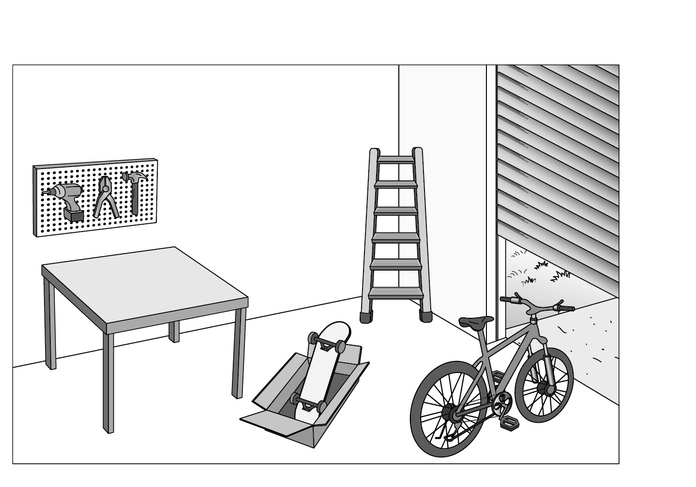
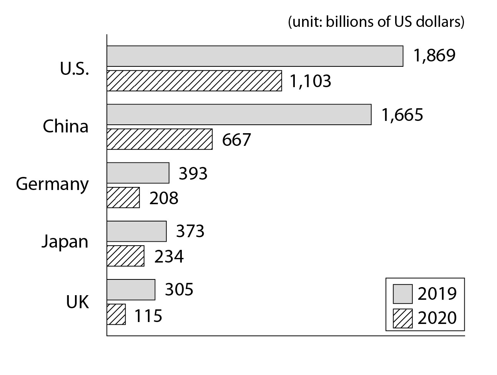
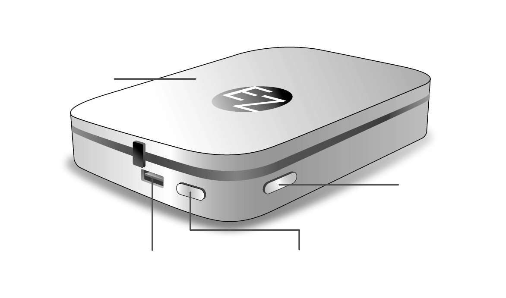
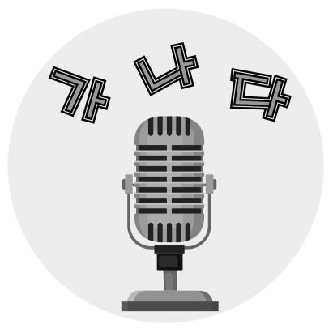

1. 다음을 듣고, 남자가 하는 말의 목적으로 가장 적절한 것을 고르시오.

① 교내 밴드 공연을 홍보하려고
② 교장 선생님의 퇴임을 축하하려고
③ 변경된 음악 수업 장소를 안내하려고
④ 지역 오케스트라의 단원을 모집하려고
⑤ 새로운 음악 선생님의 부임을 알리려고

2. 대화를 듣고, 여자의 의견으로 가장 적절한 것을 고르시오.

① 반복적인 학습을 통해 시험에서의 실수를 줄일 수 있다.
② 적당량의 초콜릿 섭취는 불안감 완화에 도움이 된다.
③ 단 음식을 많이 먹으면 호르몬의 균형이 깨진다.
④ 초콜릿의 효능에 대한 과학적 연구가 필요하다.
⑤ 의약품 남용에 대한 규제를 강화해야 한다.

3. 대화를 듣고, 두 사람의 관계를 가장 잘 나타낸 것을 고르시오.

① 여행사 직원 – 여행객
② 헤어 디자이너 – 고객
③ 가구 제작자 – 의뢰인
④ 화가 – 모델
⑤ 영화감독 – 배우

4. 대화를 듣고, 그림에서 대화의 내용과 일치하지 않는 것을 고르시오.

③
⑤

5. 대화를 듣고, 남자가 할 일로 가장 적절한 것을 고르시오.

① 날씨 확인하기
② 렌트카 예약하기
③ 호텔 방 변경하기
④ 비행기표 예매하기
⑤ 할인 쿠폰 다운받기

6. 대화를 듣고, 여자가 지불할 금액을 고르시오. [3점]

① $30
② $35
③ $40
④ $45
⑤ $50

7. 대화를 듣고, 여자가 벼룩시장에 갈 수 없는 이유를 고르시오.

① 결혼식에서 피아노를 연주해야 해서
② 빵집에서 아르바이트를 해야 해서
③ 티셔츠를 교환하러 가야 해서
④ 건강 검진을 받아야 해서
⑤ 과제를 제출해야 해서

8. 대화를 듣고, Brantown Community Picnic에 관해 언급되지 않은 것을 고르시오.

① 일시
② 장소
③ 참가비
④ 증정품
⑤ 신청 방법

9. Space Science Camp에 관한 다음 내용을 듣고, 일치하지 않는 것을 고르시오.

① 8월 21일부터 8월 23일까지 진행된다.
② 우주 여행에 관한 특별 강연이 있다.
③ 참가자에게는 별을 관측할 기회가 있다.
④ 예약 페이지는 캠프 3주 전에 열린다.
⑤ 참가비는 1인당 50달러이다.

10. 다음 표를 보면서 대화를 듣고, 두 사람이 구매할 식기세척기를 고르시오.

|  | Model | Price | Color | Type | Warranty Period |
| --- | --- | --- | --- | --- | --- |
| ① | A | $650 | black | portable | 6 months |
| ② | B | $680 | black | built-in | 6 months |
| ③ | C | $720 | white | portable | 1 year |
| ④ | D | $760 | silver | built-in | 1 year |
| ⑤ | E | $850 | silver | built-in | 2 years |

11. 대화를 듣고, 남자의 마지막 말에 대한 여자의 응답으로 가장 적절한 것을 고르시오.

① It’s important to grow a lot of plants for the Earth.
② You need to water them once every three days.
③ Too much sunlight can be bad for the plants.
④ I’d better save water for the environment.
⑤ We should drink one liter of water a day.

12. 대화를 듣고, 여자의 마지막 말에 대한 남자의 응답으로 가장 적절한 것을 고르시오.

① Sorry. I’ve already made a reservation at that restaurant.
② Oh, no. I must find another place as soon as possible.
③ Great. Let’s have the phone fixed right now.
④ No way! It is too far away to go there.
⑤ Thanks. I’ll definitely go to your party.

13. 대화를 듣고, 남자의 마지막 말에 대한 여자의 응답으로 가장 적절한 것을 고르시오. [3점]

① Don’t worry. I’ve already ordered it.
② You’re right. I’ll take care of it tomorrow.
③ My fault! I wrote the wrong address on it.
④ I’m sorry. I’ll wake you up early next time.
⑤ Sure. You’d better return the borrowed item now.

14. 대화를 듣고, 여자의 마지막 말에 대한 남자의 응답으로 가장 적절한 것을 고르시오. [3점]

① Okay. Then, I need to hurry up and register.
② Sorry. You can only register for it in person.
③ Thank you. I recommended them to my friend.
④ No worries. You can get over your fear of water.
⑤ Fantastic! The swimming instructor is professional.

15. 다음 상황 설명을 듣고, Amy가 Jerry에게 할 말로 가장 적절한 것을 고르시오.

Amy:
① I think you can get them done by today.
② Do you know any way to get there in time?
③ Would you pick up my son from kindergarten for me?
④ I can’t wait to see you at the kindergarten talent show.
⑤ You need not bring anything to the housewarming party.

16. 남자가 하는 말의 주제로 가장 적절한 것은?

① misunderstandings about recycled products
② processes and outputs of recycling
③ issues caused by waste pollution
④ the history of recycling systems
⑤ tips for reducing trash

17. 언급된 소재가 아닌 것은?

따라 답을 하시기 바랍니다.

① paper
② metals
③ fabrics
④ glass
⑤ plastics

18. 다음 글의 목적으로 가장 적절한 것은?

Dear Ms. Stevens, My name is Peter Watson, and I’m the manager of the Springton Library. Our storytelling program has been so well‑attended that we are planning to expand the program to 6 days each week. This means that we need to recruit more volunteers to read to the children. People still talk about the week you filled in for us when one of our volunteers couldn’t come. You really brought those stories to life! So, would you be willing to read to the preschoolers for an hour, from 10 to 11 a.m. every Friday? I hope you will take this opportunity to let more children hear your voice. We are looking forward to your positive reply. Best regards, Peter Watson

19. 다음 글에 드러난 ‘I’의 심경 변화로 가장 적절한 것은?

I walked up to the little dark brown door and knocked. Nobody answered. I pushed on the door carefully. When the door swung open with a rusty creak, a man was standing in a back corner of the room. My hands flew over my mouth as I started to scream. He was just standing there, watching me! As my heart continued to race, I saw that he had also put his hands over his mouth. Wait a minute... It was a mirror! I took a deep breath and walked past a table to the old mirror that stood in the back of the room. I felt my heartbeat returning to normal, and calmly looked at my reflection in the mirror.

20. 다음 글에서 필자가 주장하는 바로 가장 적절한 것은?

In the rush towards individual achievement and recognition, the majority of those who make it forget their humble beginnings. They often forget those who helped them on their way up. If you forget where you came from, if you neglect those who were there for you when things were tough and slow, then your success is valueless. No one can make it up there without the help of others. There are parents, friends, advisers, and coaches that help. You need to be grateful to all of those who helped you. Gratitude is the glue that keeps you connected to others. It is the bridge that keeps you connected with those who were there for you in the past and who are likely to be there in the end. Relationships and the way you treat others determine your real success.

21. 밑줄 친 ‘give away the house’가 다음 글에서 의미하는 바로 가장 적절한 것은? [3점]

For companies interested in delighting customers, exceptional value and service become part of the overall company culture. For example, year after year, Pazano ranks at or near the top of the hospitality industry in terms of customer satisfaction. The company’s passion for satisfying customers is summed up in its credo, which promises that its luxury hotels will deliver a truly memorable experience. Although a customer-centered firm seeks to deliver high customer satisfaction relative to competitors, it does not attempt to maximize customer satisfaction. A company can always increase customer satisfaction by lowering its price or increasing its services. But this may result in lower profits. Thus, the purpose of marketing is to generate customer value profitably. This requires a very delicate balance: the marketer must continue to generate more customer value and satisfaction but not ‘give away the house’.

22. 다음 글의 요지로 가장 적절한 것은?

The problem with simply adopting any popular method of parenting is that it ignores the most important variable in the equation: the uniqueness of your child. So, rather than insist that one style of parenting will work with every child, we might take a page from the gardener’s handbook. Just as the gardener accepts, without question or resistance, the plant’s requirements and provides the right conditions each plant needs to grow and flourish, so, too, do we parents need to custom-design our parenting to fit the natural needs of each individual child. Although that may seem difficult, it is possible. Once we understand who our children really are, we can begin to figure out how to make changes in our parenting style to be more positive and accepting of each child we’ve been blessed to parent.

23. 다음 글의 주제로 가장 적절한 것은?

In the movie Groundhog Day, a weatherman played by Bill Murray is forced to re-live a single day over and over again. Confronted with this seemingly endless loop, he eventually rebels against living through the same day the same way twice. He learns French, becomes a great pianist, befriends his neighbors, helps the poor. Why do we cheer him on? Because we don’t want perfect predictability, even if what’s on repeat is appealing. Surprise engages us. It allows us to escape autopilot. It keeps us awake to our experience. In fact, the neurotransmitter systems involved in reward are tied to the level of surprise: rewards delivered at regular, predictable times yield a lot less activity in the brain than the same rewards delivered at random unpredictable times. Surprise gratifies.

24. 다음 글의 제목으로 가장 적절한 것은?

A building is an inanimate object, but it is not an inarticulate one. Even the simplest house always makes a statement, one expressed in brick and stone, in wood and glass, rather than in words — but no less loud and obvious. When we see a rusting trailer surrounded by weeds and abandoned cars, or a brand-new mini-mansion with a high wall, we instantly get a message. In both of these cases, though in different accents, it is “Stay Out of Here.” It is not only houses, of course, that communicate with us. All kinds of buildings — churches, museums, schools, hospitals, restaurants, and offices — speak to us silently. Sometimes the statement is deliberate. A store or restaurant can be designed so that it welcomes mostly low-income or high-income customers. Buildings tell us what to think and how to act, though we may not register their messages consciously.

25. 다음 도표의 내용과 일치하지 않는 것은?

Travel and Tourism’s Contribution to GDP (unit: billions of US dollars) The above graph shows travel and tourism’s contribution to GDP for each of the five countries in 2019 and in 2020.

| Country | 2019 | 2020 |
| --- | --- | --- |
| U.S. | 1,869 | 1,103 |
| China | 1,665 | 667 |
| Germany | 393 | 208 |
| Japan | 373 | 234 |
| UK | 305 | 115 |

26. monarch butterfly에 관한 다음 글의 내용과 일치하지 않는 것은?

The monarch butterfly has lovely bright colors splashed on its wings. The wings have white spots on the outer margins. The hind wings are rounded, and they are lighter in color than the front wings. The body is black with white spots. The mother butterfly lays only one egg on the underside of milkweed leaves, which hatches about three to five days later. The monarch loves to fly around in the warm sunshine, from March through October, all across the United States. The monarch cannot survive the cold winter temperatures of the northern states. So, it very wisely migrates from the northern states to the south, and hibernates. The monarch is the only insect that can fly more than four thousand kilometers to a warmer climate.

27. 2022 Korean Speech Contest에 관한 다음 안내문의 내용과 일치하지 않는 것은?

2022 Korean Speech Contest Are you a foreign student who wants to show off your Korean? Make your own video sharing your experiences in Korea.
Theme: “My Experiences While Staying in Korea”
Video Submission Deadline: September 5th
Prizes - 1st place: $100 and traditional Korean tea - 2nd place: $50 and a traditional Korean doll
Details - Your name must be mentioned at the beginning of the video. - Your video must be between 3 to 5 minutes. - Please email your video file to k‑speech@kcontest.com.

28. EZ Portable Photo Printer 사용에 관한 다음 안내문의 내용과 일치하는 것은?

EZ Portable Photo Printer
User Manual Note on LED Indicator Top Cover
White: Power on
Power Button
Red: Battery charging USB Port LED Indicator
How to Operate
Press the power button to turn the printer on.
Press the power button twice to turn the printer off.
To charge the battery, connect the cable to the USB port. It takes 60 - 90 minutes for a full charge.
To connect to the printer wirelessly, download the ‘EZ Printer App’ on your mobile device.
How to Load Photo Paper
Lift the printer’s top cover.
Insert the photo paper with any logos facing downward.

29. 다음 글의 밑줄 친 부분 중, 어법상 틀린 것은? [3점]

Even though institutions like the World Bank use wealth to differentiate between “developed” and “developing” countries, they also agree that development is more than economic growth. “Development” can also include the social and environmental changes that are caused by or accompany economic growth, some of which are positive and thus may be negative. Awareness has grown — and continues to grow — that the question of how economic growth is affecting people and the planet needs to be addressed. Countries are slowly learning that it is cheaper and causes much less suffering to try to reduce the harmful effects of an economic activity or project at the beginning, when it is planned, than after the damage appears. To do this is not easy and is always imperfect. But an awareness of the need for such an effort indicates a greater understanding and moral concern than did the previous widespread attitude that focused only on creating new products and services.

30. 다음 글의 밑줄 친 부분 중, 문맥상 낱말의 쓰임이 적절하지 않은 것은?

The most advanced military jets are fly‑by‑wire: They are so unstable that they require an automated system that can sense and act more quickly than a human operator to maintain control. Our dependence on smart technology has led to a paradox. As technology improves, it becomes more reliable and more efficient, and human operators depend on it even more. Eventually they lose focus, become distracted, and check out, leaving the system to run on its own. In the most extreme case, piloting a massive airliner could become a passive occupation, like watching TV. This is fine until something unexpected happens. The unexpected reveals the value of humans; what we bring to the table is the flexibility to handle new situations. Machines aren’t collaborating in pursuit of a joint goal; they are merely serving as tools. So when the human operator gives up oversight, the system is more likely to have a serious accident.

31. 다음 빈칸에 들어갈 말로 가장 적절한 것을 고르시오.

Followers can be defined by their position as subordinates or by their behavior of going along with leaders’ wishes. But followers also have power to lead. Followers empower leaders as well as vice versa. This has led some leadership analysts like Ronald Heifetz to avoid using the word followers and refer to the others in a power relationship as “citizens” or “constituents.” Heifetz is correct that too simple a view of followers can produce misunderstanding. In modern life, most people wind up being both leaders and followers, and the categories can become quite fluid. Our behavior as followers changes as our objectives change. If I trust your judgment in music more than my own, I may follow your lead on which concert we attend (even though you may be formally my subordinate in position). But if I am an expert on fishing, you may follow my lead on where we fish, regardless of our formal positions or the fact that I followed your lead on concerts yesterday.

32. 다음 빈칸에 들어갈 말로 가장 적절한 것을 고르시오.

Color is an interpretation of wavelengths, one that only exists internally. And it gets stranger, because the wavelengths we’re talking about involve only what we call “visible light”, a spectrum of wavelengths that runs from red to violet. But visible light constitutes only a tiny fraction of the electromagnetic spectrum — less than one ten-trillionth of it. All the rest of the spectrum — including radio waves, microwaves, X-rays, gamma rays, cell phone conversations, wi-fi, and so on — all of this is flowing through us right now, and we’re completely unaware of it. This is because we don’t have any specialized biological receptors to pick up on these signals from other parts of the spectrum. The slice of reality that we can see is limited by our biology.

33. 다음 빈칸에 들어갈 말로 가장 적절한 것을 고르시오. [3점]

What is unusual about journalism as a profession is its lack of independence. In theory, practitioners in the classic professions, like medicine or the clergy, contain the means of production in their heads and hands, and therefore do not have to work for a company or an employer. They can draw their income directly from their clients or patients. Because the professionals hold knowledge, moreover, their clients are dependent on them. Journalists hold knowledge, but it is not theoretical in nature; one might argue that the public depends on journalists in the same way that patients depend on doctors, but in practice a journalist can serve the public usually only by working for a news organization, which can fire her or him at will. Journalists’ income depends not on the public, but on the employing news organization, which often derives the large majority of its revenue from advertisers.

34. 다음 빈칸에 들어갈 말로 가장 적절한 것을 고르시오. [3점]

In most of the world, capitalism and free markets are accepted today as constituting the best system for allocating economic resources and encouraging economic output. Nations have tried other systems, such as socialism and communism, but in many cases they have either switched wholesale to or adopted aspects of free markets. Despite the widespread acceptance of the free-market system, markets are rarely left entirely free. Government involvement takes many forms, ranging from the enactment and enforcement of laws and regulations to direct participation in the economy through entities like the U.S.’s mortgage agencies. Perhaps the most important form of government involvement, however, comes in the attempts of central banks and national treasuries to control and affect the ups and downs of economic cycles.

35. 다음 글에서 전체 흐름과 관계 없는 문장은?

Inflationary risk refers to uncertainty regarding the future real value of one’s investments. Say, for instance, that you hold $100 in a bank account that has no fees and accrues no interest. If left untouched there will always be $100 in that bank account. If you keep that money in the bank for a year, during which inflation is 100 percent, you’ve still got $100. Only now, if you take it out and put it in your wallet, you’ll only be able to purchase half the goods you could have bought a year ago. In other words, if inflation increases faster than the amount of interest you are earning, this will decrease the purchasing power of your investments over time. It would be very useful to know in advance what would happen to your firm’s total revenue if you increased your product’s price. That’s why we differentiate between nominal value and real value.

36. 주어진 글 다음에 이어질 글의 순서로 가장 적절한 것을 고르시오.

Touch receptors are spread over all parts of the body, but they are not spread evenly. Most of the touch receptors are found in your fingertips, tongue, and lips.

On the tip of each of your fingers, for example, there are about five thousand separate touch receptors. In other parts of the body there are far fewer. In the skin of your back, the touch receptors may be as much as 2 inches apart.

You can test this for yourself. Have someone poke you in the back with one, two, or three fingers and try to guess how many fingers the person used. If the fingers are close together, you will probably think it was only one.

But if the fingers are spread far apart, you can feel them individually. Yet if the person does the same thing on the back of your hand (with your eyes closed, so that you don’t see how many fingers are being used), you probably will be able to tell easily, even when the fingers are close together.

37. 주어진 글 다음에 이어질 글의 순서로 가장 적절한 것을 고르시오. [3점]

One interesting feature of network markets is that “history matters.” A famous example is the QWERTY keyboard used with your computer. You might wonder why this particular configuration of keys, with its awkward placement of the letters, became the standard. The QWERTY keyboard in the 19th century was developed in the era of manual typewriters with physical keys. The keyboard was designed to keep frequently used keys (like E and O) physically separated in order to prevent them from jamming. By the time the technology for electronic typing evolved, millions of people had already learned to type on millions of QWERTY typewriters. Replacing the QWERTY keyboard with a more efficient design would have been both expensive and difficult to coordinate. Thus, the placement of the letters stays with the obsolete QWERTY on today’s English-language keyboards.

38. 글의 흐름으로 보아, 주어진 문장이 들어가기에 가장 적절한 곳을 고르시오. [3점]

One way of measuring temperature occurs if an object is hot enough to visibly glow, such as a metal poker that has been left in a fire. The color of a glowing object is related to its temperature: as the temperature rises, the object is first red and then orange, and finally it gets white, the “hottest” color. The relation between temperature and the color of a glowing object is useful to astronomers. The color of stars is related to their temperature, and since people cannot as yet travel the great distances to the stars and measure their temperature in a more precise way, astronomers rely on their color. This temperature is of the surface of the star, the part of the star which is emitting the light that can be seen. The interior of the star is at a much higher temperature, though it is concealed. But the information obtained from the color of the star is still useful.

39. 글의 흐름으로 보아, 주어진 문장이 들어가기에 가장 적절한 곳을 고르시오.

The holy grail of the first wave of creativity research was a personality test to measure general creativity ability, in the same way that IQ measured general intelligence. A person’s creativity score should tell us his or her creative potential in any field of endeavor, just like an IQ score is not limited to physics, math, or literature. But by the 1970s, psychologists realized there was no such thing as a general “creativity quotient.” Creative people aren’t creative in a general, universal way; they’re creative in a specific sphere of activity, a particular domain. We don’t expect a creative scientist to also be a gifted painter. A creative violinist may not be a creative conductor, and a creative conductor may not be very good at composing new works. Psychologists now know that creativity is domain specific.

40. 다음 글의 내용을 한 문장으로 요약하고자 한다. 빈칸 (A), (B)에 들어갈 말로 가장 적절한 것은?

The great irony of performance psychology is that it teaches each sportsman to believe, as far as he is able, that he will win. No man doubts. No man indulges his inner skepticism. That is the logic of sports psychology. But only one man can win. That is the logic of sport. Note the difference between a scientist and an athlete. Doubt is a scientist’s stock in trade. Progress is made by focusing on the evidence that refutes a theory and by improving the theory accordingly. Skepticism is the rocket fuel of scientific advance. But doubt, to an athlete, is poison. Progress is made by ignoring the evidence; it is about creating a mindset that is immune to doubt and uncertainty. Just to reiterate: From a rational perspective, this is nothing less than crazy. Why should an athlete convince himself he will win when he knows that there is every possibility he will lose? Because, to win, one must proportion one’s belief, not to the evidence, but to whatever the mind can usefully get away with. 

 Unlike scientists whose skeptical attitude is needed to make scientific progress, sports psychology says that to succeed, athletes must eliminate feelings of uncertainty about whether they can win.

41. 윗글의 제목으로 가장 적절한 것은?

Common sense suggests that discussion with others who express different opinions should produce more moderate attitudes for everyone in the group. Surprisingly, this is not always the case. In group polarization, a period of discussion pushes group members to take more extreme positions in the direction that they were already inclined to prefer. Group polarization does not reverse the direction of attitudes, but rather accentuates the attitudes held at the beginning. Two pressures appear to push individuals to take more extreme positions following a group discussion. First, conformity and desire for affiliation contribute to group polarization. If the majority of a group is leaning in a particular direction, what could be a better way of fitting in than agreeing with that majority, and maybe even taking its argument one step farther? There is also a tendency for like-minded people to affiliate with one another, which can provide reinforcement for existing opinions, increase people’s confidence in those opinions, lead to the discovery of new reasons for those opinions and counterarguments to opposing views, and reduce exposure to conflicting ideas. Second, exposure to discussion on a topic introduces new reasons for maintaining an attitude. If you are already opposed to gun control and you listen to additional arguments supporting your position, you might end up more opposed than you were originally.

42. 밑줄 친 낱말 중에서 문맥상 낱말의 쓰임이 적절하지 않은 것은? [3점]

Common sense suggests that discussion with others who express different opinions should produce more moderate attitudes for everyone in the group. Surprisingly, this is not always the case. In group polarization, a period of discussion pushes group members to take more extreme positions in the direction that they were already inclined to prefer. Group polarization does not reverse the direction of attitudes, but rather accentuates the attitudes held at the beginning. Two pressures appear to push individuals to take more extreme positions following a group discussion. First, conformity and desire for affiliation contribute to group polarization. If the majority of a group is leaning in a particular direction, what could be a better way of fitting in than agreeing with that majority, and maybe even taking its argument one step farther? There is also a tendency for like-minded people to affiliate with one another, which can provide reinforcement for existing opinions, increase people’s confidence in those opinions, lead to the discovery of new reasons for those opinions and counterarguments to opposing views, and reduce exposure to conflicting ideas. Second, exposure to discussion on a topic introduces new reasons for maintaining an attitude. If you are already opposed to gun control and you listen to additional arguments supporting your position, you might end up more opposed than you were originally.

43. 주어진 글에 이어질 내용을 순서에 맞게 배열한 것으로 가장 적절한 것은?

 He asked the boy a few usual questions, such as his age, his hobbies, as well as his favorite animal. He found it strange that such a young boy would be traveling alone, so he decided to keep an eye on him to make sure he was okay. About an hour into the flight, the plane suddenly began experiencing turbulence. The pilot told everyone to fasten their seat belts and remain calm, as they had encountered rough weather. As the plane rose and fell several times, people got nervous and sat up in their seats. The man was also nervous and grabbing his seat as tightly as he could. Meanwhile, the little boy was sitting quietly beside him. His coloring book and crayons were put away neatly in the seat pocket in front of him, and his hands were calmly resting on his legs. Incredibly, he didn’t seem worried at all. Then, suddenly, the turbulence ended. The pilot apologized for the bumpy ride and announced that they would be landing soon. As the plane began its descent, the man said to the little boy, “You are just a little boy, but I have never met a braver person in all my life! Tell me, how is it that you remained so calm while all of us adults were so afraid?” Looking him in the eyes, he said, “My father is the pilot, and he’s taking me home.” 

44. 밑줄 친 낱말 중에서 가리키는 대상이 나머지 넷과 다른 것은?

 He asked the boy a few usual questions, such as his age, his hobbies, as well as his favorite animal. He found it strange that such a young boy would be traveling alone, so he decided to keep an eye on him to make sure he was okay. About an hour into the flight, the plane suddenly began experiencing turbulence. The pilot told everyone to fasten their seat belts and remain calm, as they had encountered rough weather. As the plane rose and fell several times, people got nervous and sat up in their seats. The man was also nervous and grabbing his seat as tightly as he could. Meanwhile, the little boy was sitting quietly beside him. His coloring book and crayons were put away neatly in the seat pocket in front of him, and his hands were calmly resting on his legs. Incredibly, he didn’t seem worried at all. Then, suddenly, the turbulence ended. The pilot apologized for the bumpy ride and announced that they would be landing soon. As the plane began its descent, the man said to the little boy, “You are just a little boy, but I have never met a braver person in all my life! Tell me, how is it that you remained so calm while all of us adults were so afraid?” Looking him in the eyes, he said, “My father is the pilot, and he’s taking me home.” 

45. 윗글에 관한 내용으로 적절하지 않은 것은?

 He asked the boy a few usual questions, such as his age, his hobbies, as well as his favorite animal. He found it strange that such a young boy would be traveling alone, so he decided to keep an eye on him to make sure he was okay. About an hour into the flight, the plane suddenly began experiencing turbulence. The pilot told everyone to fasten their seat belts and remain calm, as they had encountered rough weather. As the plane rose and fell several times, people got nervous and sat up in their seats. The man was also nervous and grabbing his seat as tightly as he could. Meanwhile, the little boy was sitting quietly beside him. His coloring book and crayons were put away neatly in the seat pocket in front of him, and his hands were calmly resting on his legs. Incredibly, he didn’t seem worried at all. Then, suddenly, the turbulence ended. The pilot apologized for the bumpy ride and announced that they would be landing soon. As the plane began its descent, the man said to the little boy, “You are just a little boy, but I have never met a braver person in all my life! Tell me, how is it that you remained so calm while all of us adults were so afraid?” Looking him in the eyes, he said, “My father is the pilot, and he’s taking me home.”
