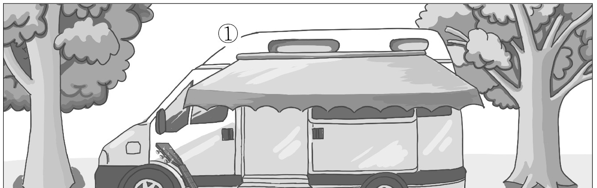
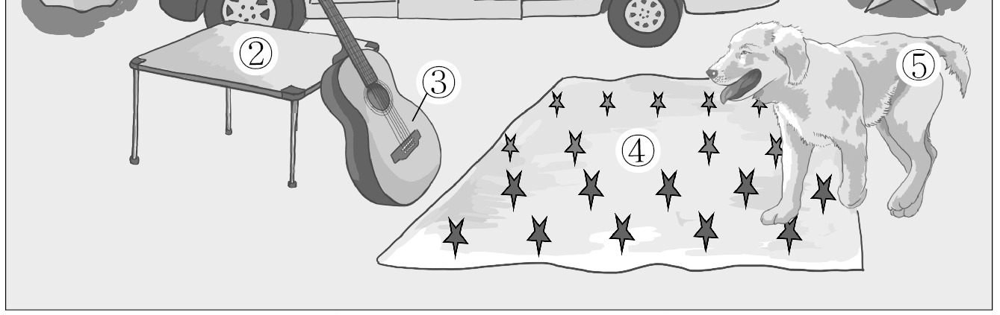
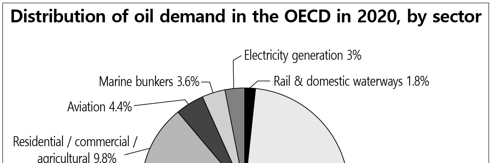
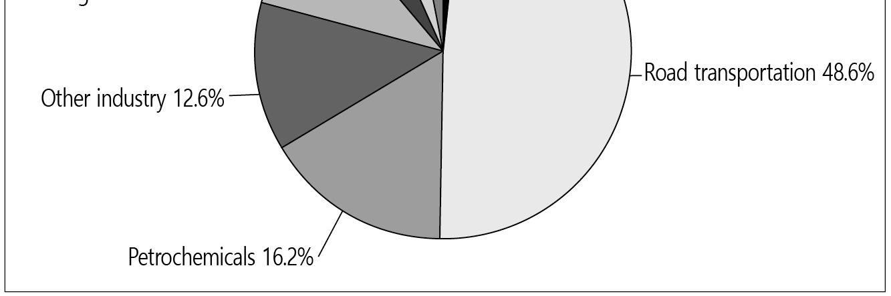

1. 다음을 듣고, 여자가 하는 말의 목적으로 가장 적절한 것을 고르시오.

① 설문조사 참여를 독려하려고
② 설문조사 결과를 공유하려고
③ 설문조사 기간 변경을 공지하려고
④ 학교 홈페이지 가입을 요청하려고
⑤ 학교 홈페이지 점검 시간을 안내하려고

2. 대화를 듣고, 남자의 의견으로 가장 적절한 것을 고르시오.

① 논쟁은 더 나은 결정을 위한 기회가 된다.
② 의사 결정에 있어서 전원의 합의가 필수적이다.
③ 고민이 있을 때는 전문가에게 조언을 구해야 한다.
④ 리더로서 팀원들과 수평적 관계를 유지하는 것이 중요하다.
⑤ 팀 프로젝트의 성공을 위해서는 리더의 결단력이 필요하다.

3. 대화를 듣고, 두 사람의 관계를 가장 잘 나타낸 것을 고르시오.

① 학생 - 문화 인류학 교수
② 미술관 관장 - 건축가
③ 여행 작가 - 삽화가
④ 신문 기자 - 전시 기획자
⑤ 구호 활동가 - 후원자

4. 대화를 듣고, 그림에서 대화의 내용과 일치하지 않는 것을 고르시오.

5. 대화를 듣고, 남자가 할 일로 가장 적절한 것을 고르시오.

① 포스터 인쇄하기
② MC 선발하기
③ 무대 설치하기
④ 졸업생에게 전화하기
⑤ 댄스팀 스케줄 정하기

6. 대화를 듣고, 여자가 지불할 금액을 고르시오. [3점]

① $13
② $14
③ $15
④ $16
⑤ $17

7. 대화를 듣고, 남자가 락 페스티벌에 가지 않는 이유를 고르시오.

① 밴드 연습을 해야 해서
② 결혼식에 참석해야 해서
③ 할인 티켓이 매진되어서
④ 선물 살 돈을 모아야 해서
⑤ 라인업이 마음에 들지 않아서

8. 대화를 듣고, Nova’s Guide to the Stars에 관해 언급되지 않은 것을 고르시오.

① 장소
② 참가 비용
③ 활동 내용
④ 운영 기간
⑤ 신청 방법

9. 2022 London Public Library Event에 관한 다음 내용을 듣고, 일치하지 않는 것을 고르시오.

① 작가를 초청한다.
② 10월 27일에 열린다.
③ 현장 접수가 가능하다.
④ 참여 가능 인원은 최대 50명이다.
⑤ 질문을 이메일로 미리 보낼 수 있다.

10. 다음 표를 보면서 대화를 듣고, 남자가 구입할 휴대용 접이식 의자를 고르시오.

|  | Model | Weight (kg) | Color | Number of Cup Holders | Carry Bag |
| --- | --- | --- | --- | --- | --- |
| ① | A | 3.2 | white | 1 | ○ |
| ② | B | 2.3 | white | 2 | ○ |
| ③ | C | 2.1 | gray | 2 | ○ |
| ④ | D | 1.8 | gray | 2 | × |
| ⑤ | E | 1.6 | black | 1 | × |

11. 대화를 듣고, 남자의 마지막 말에 대한 여자의 응답으로 가장 적절한 것을 고르시오.

① The person sitting behind me kept kicking my seat.
② You should have called the staff to help you.
③ I was so into it that it went by so fast.
④ I’m sorry you couldn’t enjoy it.
⑤ I can’t wait to see the movie.

12. 대화를 듣고, 여자의 마지막 말에 대한 남자의 응답으로 가장 적절한 것을 고르시오.

① No way. We need the international program.
② Don’t worry. I can exchange my book with yours.
③ Not bad. That’s a good example of a topic sentence.
④ I understand. I was really nervous during the presentation.
⑤ Okay. Let’s find one that is easy and interesting to talk about.

13. 대화를 듣고, 여자의 마지막 말에 대한 남자의 응답으로 가장 적절한 것을 고르시오. [3점]

Man:
① I’m sorry. I can give you a 10% discount, instead.
② Yes, please. I hope the new speaker works.
③ That’s okay. But you’ll need the receipt.
④ Never mind. I just got a full refund.
⑤ Thanks. But I fixed it already.

14. 대화를 듣고, 남자의 마지막 말에 대한 여자의 응답으로 가장 적절한 것을 고르시오. [3점]

Woman:
① It’s nothing. I’m glad I could help.
② Excuse me. But I’m afraid I can’t repair it.
③ I’m sorry. I missed an important phone call.
④ Sure. I can help you to make an appointment.
⑤ You’re right. We should not waste our resources.

15. 다음 상황 설명을 듣고, Amelia가 엄마에게 할 말로 가장 적절한 것을 고르시오.

Amelia:
① Do you have any good ideas regarding the presentation?
② Why don’t you take Anna home before it gets too late?
③ I think we can finish the rest of the work tomorrow.
④ Could you please pick me up at Anna’s house?
⑤ Tell me if you want to hang out with Anna.

16. 남자가 하는 말의 주제로 가장 적절한 것은?

① ways to encourage people to become vegetarians
② health risks associated with a poorly planned diet
③ the various reasons why people become vegetarians
④ the recommended daily amount of essential nutrients
⑤ food sources for vegetarians to prevent nutrient deficiency

17. 언급된 영양소가 아닌 것은?

따라 답을 하시기 바랍니다.

① protein
② omega‐3
③ calcium
④ iron
⑤ vitamin B12

18. 다음 글의 목적으로 가장 적절한 것은?

Dear Customer Service, I am writing in regard to my magazine subscription. Currently, I have just over a year to go on my subscription to Economy Tomorrow and would like to continue my subscription as I have enjoyed the magazine for many years. Unfortunately, due to my bad eyesight, I have trouble reading your magazine. My doctor has told me that I need to look for large print magazines and books. I’d like to know whether there’s a large print version of your magazine. Please contact me if this is something you offer. Thank you for your time. I look forward to hearing from you soon. Sincerely, Martin Gray

19. 다음 글에 나타난 ‘I’의 심경 변화로 가장 적절한 것은?

There was no choice next morning but to turn in my private reminiscence of Belleville. Two days passed before Mr. Fleagle returned the graded papers, and he returned everyone’s but mine. I was anxiously expecting for a command to report to Mr. Fleagle immediately after school for discipline when I saw him lift my paper from his desk and rap for the class’s attention. “Now, boys,” he said, “I want to read you an essay. This is titled ‘The Art of Eating Spaghetti.’” And he started to read. My words! He was reading my words out loud to the entire class. What’s more, the entire class was listening attentively. Then somebody laughed, then the entire class was laughing, and not in contempt and ridicule, but with openhearted enjoyment. I did my best to avoid showing pleasure, but what I was feeling was pure ecstasy at this startling demonstration that my words had the power to make people laugh.

20. 다음 글에서 필자가 주장하는 바로 가장 적절한 것은?

We usually take time out only when we really need to switch off, and when this happens we are often overtired, sick, and in need of recuperation. Me time is complicated by negative associations with escapism, guilt, and regret as well as overwhelm, stress, and fatigue. All these negative connotations mean we tend to steer clear of it. Well, I am about to change your perception of the importance of me time, to persuade you that you should view it as vital for your health and wellbeing. Take this as permission to set aside some time for yourself! Our need for time in which to do what we choose is increasingly urgent in an overconnected, overwhelmed, and overstimulated world.

21. 밑줄 친 the innocent messenger who falls before a firing line이 다음 글에서 의미하는 바로 가장 적절한 것은? [3점]

Perhaps worse than attempting to get the bad news out of the way is attempting to soften it or simply not address it at all. This “Mum Effect” — a term coined by psychologists Sidney Rosen and Abraham Tesser in the early 1970s — happens because people want to avoid becoming the target of others’ negative emotions. We all have the opportunity to lead change, yet it often requires of us the courage to deliver bad news to our superiors. We don’t want to be the innocent messenger who falls before a firing line. When our survival instincts kick in, they can override our courage until the truth of a situation gets watered down. “The Mum Effect and the resulting filtering can have devastating effects in a steep hierarchy,” writes Robert Sutton, an organizational psychologist. “What starts out as bad news becomes happier and happier as it travels up the ranks ― because after each boss hears the news from his or her subordinates, he or she makes it sound a bit less bad before passing it up the chain.”

22. 다음 글의 요지로 가장 적절한 것은?

Most parents think that if our child would just “behave,” we could stay calm as parents. The truth is that managing our own emotions and actions is what allows us to feel peaceful as parents. Ultimately we can’t control our children or the obstacles they will face ― but we can always control our own actions. Parenting isn’t about what our child does, but about how we respond. In fact, most of what we call parenting doesn’t take place between a parent and child but within the parent. When a storm brews, a parent’s response will either calm it or trigger a full‐scale tsunami. Staying calm enough to respond constructively to all that childish behavior ― and the stormy emotions behind it ― requires that we grow, too. If we can use those times when our buttons get pushed to reflect, not just react, we can notice when we lose equilibrium and steer ourselves back on track. This inner growth is the hardest work there is, but it’s what enables you to become a more peaceful parent, one day at a time.

23. 다음 글의 주제로 가장 적절한 것은?

We have already seen that learning is much more efficient when done at regular intervals: rather than cramming an entire lesson into one day, we are better off spreading out the learning. The reason is simple: every night, our brain consolidates what it has learned during the day. This is one of the most important neuroscience discoveries of the last thirty years: sleep is not just a period of inactivity or a garbage collection of the waste products that the brain accumulated while we were awake. Quite the contrary: while we sleep, our brain remains active; it runs a specific algorithm that replays the important events it recorded during the previous day and gradually transfers them into a more efficient compartment of our memory.

24. 다음 글의 제목으로 가장 적절한 것은? [3점]

From the earliest times, healthcare services have been recognized to have two equal aspects, namely clinical care and public healthcare. In classical Greek mythology, the god of medicine, Asklepios, had two daughters, Hygiea and Panacea. The former was the goddess of preventive health and wellness, or hygiene, and the latter the goddess of treatment and curing. In modern times, the societal ascendancy of medical professionalism has caused treatment of sick patients to overshadow those preventive healthcare services provided by the less heroic figures of sanitary engineers, biologists, and governmental public health officers. Nevertheless, the quality of health that human populations enjoy is attributable less to surgical dexterity, innovative pharmaceutical products, and bioengineered devices than to the availability of public sanitation, sewage management, and services which control the pollution of the air, drinking water, urban noise, and food for human consumption. The human right to the highest attainable standard of health depends on public healthcare services no less than on the skills and equipment of doctors and hospitals.

25. 다음 도표의 내용과 일치하지 않는 것은?

The above graph shows the distribution of oil demand by sector in the OECD in 2020. The Road transportation sector, which took up 48.6%, was the greatest oil demanding sector in the OECD member states. The percentage of oil demand in the Petrochemicals sector was one‐third that of the Road transportation sector. The difference in oil demand between the Other industry sector and the Petrochemicals sector was smaller than the difference in oil demand between the Aviation sector and the Electricity generation sector. The oil demand in the Residential, commercial and agricultural sector took up 9.8% of all oil demand in the OECD, which was the fourth largest among all the sectors. The percentage of oil demand in the Marine bunkers sector was twice that of the oil demand in the Rail & domestic waterways sector.

| Sector | Share |
| --- | --- |
| Road transportation | 48.6% |
| Petrochemicals | 16.2% |
| Other industry | 12.6% |
| Residential / commercial / agricultural | 9.8% |
| Aviation | 4.4% |
| Marine bunkers | 3.6% |
| Electricity generation | 3% |
| Rail & domestic waterways | 1.8% |

26. Carl‐Gustaf Rossby에 관한 다음 글의 내용과 일치하지 않는 것은?

Carl‐Gustaf Rossby was one of a group of notable Scandinavian researchers who worked with the Norwegian meteorologist Vilhelm Bjerknes at the University of Bergen. While growing up in Stockholm, Rossby received a traditional education. He earned a degree in mathematical physics at the University of Stockholm in 1918, but after hearing a lecture by Bjerknes, and apparently bored with Stockholm, he moved to the newly established Geophysical Institute in Bergen. In 1925, Rossby received a scholarship from the Sweden‐America Foundation to go to the United States, where he joined the United States Weather Bureau. Based in part on his practical experience in weather forecasting, Rossby had become a supporter of the “polar front theory,” which explains the cyclonic circulation that develops at the boundary between warm and cold air masses. In 1947, Rossby accepted the chair of the Institute of Meteorology, which had been set up for him at the University of Stockholm, where he remained until his death ten years later.

27. The Colchester Zoo Charity Race에 관한 다음 안내문의 내용과 일치하지 않는 것은?

The Colchester Zoo Charity Race Join us for a charity event to help endangered species. You will be running through Colchester Zoo, home to over 260 species!
Date: Sunday, Sep. 25th, 2022
Time: 9:00 a.m. - 11:00 a.m.
Registration
Fee: $50 ⦁Registration fee includes a free pass to the zoo, food and drinks, and official photos. ⦁Register at www.info.colchesters.com.
Course Length: 10km ⦁Every runner will run 1km of the race through the zoo before going out to the main road.
Other Information ⦁Only the runners who complete the race will receive a medal at the finish line. ⦁Event T‐shirts can be purchased at the zoo.

28. 7‐Day Story Writing Competition에 관한 다음 안내문의 내용과 일치하는 것은?

7‐Day Story Writing Competition Is writing your talent? This is the stage for you.
When: From Monday, Dec. 5th to Sunday, Dec. 11th, 2022
Age: 17 and over
Content ⦁All participants will write about the same topic. ⦁You will be randomly assigned one of 12 literary genres for your story. ⦁You’ll have exactly 7 days to write and submit your story.
Submission ⦁Only one entry per person ⦁You can revise and resubmit your entry until the deadline.
Prize ⦁We will choose 12 finalists, one from each genre, and the 12 entries will be published online and shared via social media. ⦁From the 12 finalists, one overall winner will be chosen and awarded $500. ※ To register and for more information, visit our website at www.7challenge_globestory.com.

29. 다음 글의 밑줄 친 부분 중, 어법상 틀린 것은? [3점]

By noticing the relation between their own actions and resultant external changes, infants develop self‐efficacy, a sense that they are agents of the perceived changes. Although infants can notice the effect of their behavior on the physical environment, it is in early social interactions that infants most readily perceive the consequence of their actions. People have perceptual characteristics that virtually assure that infants will orient toward them. They have visually contrasting and moving faces. They produce sound, provide touch, and have interesting smells. In addition, people engage with infants by exaggerating their facial expressions and inflecting their voices in ways that infants find fascinating. But most importantly, these antics are responsive to infants’ vocalizations, facial expressions, and gestures; people vary the pace and level of their behavior in response to infant actions. Consequentially, early social interactions provide a context where infants can easily notice the effect of their behavior.

30. 다음 글의 밑줄 친 부분 중, 문맥상 낱말의 쓰임이 적절하지 않은 것은?

Adam Smith pointed out that specialization, where each of us focuses on one specific skill, leads to a general improvement of everybody’s well‐being. The idea is simple and powerful. By specializing in just one activity ― such as food raising, clothing production, or home construction ― each worker gains mastery over the particular activity. Specialization makes sense, however, only if the specialist can subsequently trade his or her output with the output of specialists in other lines of activity. It would make no sense to produce more food than a household needs unless there is a market outlet to exchange that excess food for clothing, shelter, and so forth. At the same time, without the ability to buy food on the market, it would not be possible to be a specialist home builder or clothing maker, since it would be necessary to farm for one’s own survival. Thus Smith realized that the division of labor is limited by the extent of the market, whereas the extent of the market is determined by the degree of specialization.

31. 다음 빈칸에 들어갈 말로 가장 적절한 것을 고르시오. [3점]

It is not the peasant’s goal to produce the highest possible time‐averaged crop yield, averaged over many years. If your time‐averaged yield is marvelously high as a result of the combination of nine great years and one year of crop failure, you will still starve to death in that one year of crop failure before you can look back to congratulate yourself on your great time‐averaged yield. Instead, the peasant’s aim is to make sure to produce a yield above the starvation level in every single year, even though the time‐averaged yield may not be highest. That’s why field scattering may make sense. If you have just one big field, no matter how good it is on the average, you will starve when the inevitable occasional year arrives in which your one field has a low yield. But if you have many different fields, varying independently of each other, then in any given year some of your fields will produce well even when your other fields are producing poorly.

32. 다음 빈칸에 들어갈 말로 가장 적절한 것을 고르시오.

There are several reasons why support may not be effective. One possible reason is that receiving help could be a blow to self‐esteem. A recent study by Christopher Burke and Jessica Goren at Lehigh University examined this possibility. According to the threat to self‐esteem model, help can be perceived as supportive and loving, or it can be seen as threatening if that help is interpreted as implying incompetence. According to Burke and Goren, support is especially likely to be seen as threatening if it is in an area that is self‐relevant or self‐defining — that is, in an area where your own success and achievement are especially important. Receiving help with a self‐relevant task can make you feel bad about yourself, and this can undermine the potential positive effects of the help. For example, if your self‐concept rests, in part, on your great cooking ability, it may be a blow to your ego when a friend helps you prepare a meal for guests because it suggests that you’re not the master chef you thought you were.

33. 다음 빈칸에 들어갈 말로 가장 적절한 것을 고르시오.

As well as making sense of events through narratives, historians in the ancient world established the tradition of history as a(n) source of moral lessons and reflections. The history writing of Livy or Tacitus, for instance, was in part designed to examine the behavior of heroes and villains, meditating on the strengths and weaknesses in the characters of emperors and generals, providing exemplars for the virtuous to imitate or avoid. This continues to be one of the functions of history. French chronicler Jean Froissart said he had written his accounts of chivalrous knights fighting in the Hundred Years’ War “so that brave men should be inspired thereby to follow such examples.” Today, historical studies of Lincoln, Churchill, Gandhi, or Martin Luther King, Jr. perform the same function.

34. 다음 빈칸에 들어갈 말로 가장 적절한 것을 고르시오.

Psychologist Christopher Bryan finds that when we shift our emphasis from behavior to character, people evaluate choices differently. His team was able to cut cheating in half: instead of “Please don’t cheat,” they changed the appeal to “Please don’t be a cheater.” When you’re urged not to cheat, you can do it and still see an ethical person in the mirror. But when you’re told not to be a cheater, the act casts a shadow; immorality is tied to your identity, making the behavior much less attractive. Cheating is an isolated action that gets evaluated with the logic of consequence: Can I get away with it? Being a cheater evokes a sense of self, triggering the logic of appropriateness: What kind of person am I, and who do I want to be? In light of this evidence, Bryan suggests that we should embrace nouns more thoughtfully. “Don’t Drink and Drive” could be rephrased as: “Don’t Be a Drunk Driver.” The same thinking can be applied to originality. When a child draws a picture, instead of calling the artwork creative, we can say “You are creative.”

35. 다음 글에서 전체 흐름과 관계 없는 문장은?

Taking a stand is important because you become a beacon for those individuals who are your people, your tribe, and your audience. When you raise your viewpoint up like a flag, people know where to find you; it becomes a rallying point. Displaying your perspective lets prospective (and current) customers know that you don’t just sell your products or services. The best marketing is never just about selling a product or service, but about taking a stand — showing an audience why they should believe in what you’re marketing enough to want it at any cost, simply because they agree with what you’re doing. If you want to retain your existing customers, you need to create ways that a customer can feel like another member of the team, participating in the process of product development. Products can be changed or adjusted if they aren’t functioning, but rallying points align with the values and meaning behind what you do.

36. 주어진 글 다음에 이어질 글의 순서로 가장 적절한 것을 고르시오.

If DNA were the only thing that mattered, there would be no particular reason to build meaningful social programs to pour good experiences into children and protect them from bad experiences.

But brains require the right kind of environment if they are to correctly develop. When the first draft of the Human Genome Project came to completion at the turn of the millennium, one of the great surprises was that humans have only about twenty thousand genes.

This number came as a surprise to biologists: given the complexity of the brain and the body, it had been assumed that hundreds of thousands of genes would be required.

So how does the massively complicated brain, with its eighty‐six billion neurons, get built from such a small recipe book? The answer relies on a clever strategy implemented by the genome: build incompletely and let world experience refine.

37. 주어진 글 다음에 이어질 글의 순서로 가장 적절한 것을 고르시오. [3점]

One benefit of reasons and arguments is that they can foster humility. If two people disagree without arguing, all they do is yell at each other. No progress is made. Both still think that they are right. In contrast, if both sides give arguments that articulate reasons for their positions, then new possibilities open up. One of the arguments gets refuted — that is, it is shown to fail. In that case, the person who depended on the refuted argument learns that he needs to change his view. That is one way to achieve humility — on one side at least. Another possibility is that neither argument is refuted. Both have a degree of reason on their side. Even if neither person involved is convinced by the other’s argument, both can still come to appreciate the opposing view. They also realize that, even if they have some truth, they do not have the whole truth. They can gain humility when they recognize and appreciate the reasons against their own view.

38. 글의 흐름으로 보아, 주어진 문장이 들어가기에 가장 적절한 곳을 고르시오. [3점]

Adaptation involves changes in a population, with characteristics that are passed from one generation to the next. This is different from acclimation — an individual organism's changes in response to an altered environment. For example, if you spend the summer outside, you may acclimate to the sunlight: your skin will increase its concentration of dark pigments that protect you from the sun. This is a temporary change, and you won't pass the temporary change on to future generations. However, the capacity to produce skin pigments is inherited. For populations living in intensely sunny environments, individuals with a good ability to produce skin pigments are more likely to thrive, or to survive, than people with a poor ability to produce pigments, and that trait becomes increasingly common in subsequent generations. If you look around, you can find countless examples of adaptation. The distinctive long neck of a giraffe, for example, developed as individuals that happened to have longer necks had an advantage in feeding on the leaves of tall trees.

39. 글의 흐름으로 보아, 주어진 문장이 들어가기에 가장 적절한 곳을 고르시오.

On any day of the year, the tropics and the hemisphere that is experiencing its warm season receive much more solar radiation than do the polar regions and the colder hemisphere. Averaged over the course of the year, the tropics and latitudes up to about 40° receive more total heat than they lose by radiation. Latitudes above 40° receive less total heat than they lose by radiation. This inequality produces the necessary conditions for the operation of a huge, global‐scale engine that takes on heat in the tropics and gives it off in the polar regions. Its working fluid is the atmosphere, especially the moisture it contains. Air is heated over the warm earth of the tropics, expands, rises, and flows away both northward and southward at high altitudes, cooling as it goes. It descends and flows toward the equator again from more northerly and southerly latitudes.

40. 다음 글의 내용을 한 문장으로 요약하고자 한다. 빈칸 (A), (B)에 들어갈 말로 가장 적절한 것은? [3점]

Greenwashing involves misleading a consumer into thinking a good or service is more environmentally friendly than it really is. Greenwashing ranges from making environmental claims required by law, and therefore irrelevant (CFC‐free for example), to puffery (exaggerating environmental claims) to fraud. Researchers have shown that claims on products are often too vague or misleading. Some products are labeled “chemical‐free,” when the fact is everything contains chemicals, including plants and animals. Products with the highest number of misleading or unverifiable claims were laundry detergents, household cleaners, and paints. Environmental advocates agree there is still a long way to go to ensure shoppers are adequately informed about the environmental impact of the products they buy. The most common reason for greenwashing is to attract environmentally conscious consumers. Many consumers do not find out about the false claims until after the purchase. Therefore, greenwashing may increase sales in the short term. However, this strategy can seriously backfire when consumers find out they are being deceived. 

 While greenwashing might bring a company profits temporarily by deceiving environmentally conscious consumers, the company will face serious trouble when the consumers figure out they were misinformed.

41. 윗글의 제목으로 가장 적절한 것은?

The driver of FOMO (the fear of missing out) is the social pressure to be at the right place with the right people, whether it’s from a sense of duty or just trying to get ahead, we feel obligated to attend certain events for work, for family and for friends. This pressure from society combined with FOMO can wear us down. According to a recent survey, 70 percent of employees admit that when they take a vacation, they still don’t disconnect from work. Our digital habits, which include constantly checking emails, and social media timelines, have become so firmly established, it is nearly impossible to simply enjoy the moment, along with the people with whom we are sharing these moments. JOMO (the joy of missing out) is the emotionally intelligent antidote to FOMO and is essentially about being present and being content with where you are at in life. You do not need to compare your life to others but instead, practice tuning out the background noise of the “shoulds” and “wants” and learn to let go of worrying whether you are doing something wrong. JOMO allows us to live life in the slow lane, to appreciate human connections, to be intentional with our time, to practice saying “no,” to give ourselves “tech‐free breaks,” and to give ourselves permission to acknowledge where we are and to feel emotions. Instead of constantly trying to keep up with the rest of society, JOMO allows us to be who we are in the present moment. When you free up that competitive and anxious space in your brain, you have so much more time, energy, and emotion to conquer your true priorities.

42. 밑줄 친 낱말 중에서 문맥상 낱말의 쓰임이 적절하지 않은 것은?

The driver of FOMO (the fear of missing out) is the social pressure to be at the right place with the right people, whether it’s from a sense of duty or just trying to get ahead, we feel obligated to attend certain events for work, for family and for friends. This pressure from society combined with FOMO can wear us down. According to a recent survey, 70 percent of employees admit that when they take a vacation, they still don’t disconnect from work. Our digital habits, which include constantly checking emails, and social media timelines, have become so firmly established, it is nearly impossible to simply enjoy the moment, along with the people with whom we are sharing these moments. JOMO (the joy of missing out) is the emotionally intelligent antidote to FOMO and is essentially about being present and being content with where you are at in life. You do not need to compare your life to others but instead, practice tuning out the background noise of the “shoulds” and “wants” and learn to let go of worrying whether you are doing something wrong. JOMO allows us to live life in the slow lane, to appreciate human connections, to be intentional with our time, to practice saying “no,” to give ourselves “tech‐free breaks,” and to give ourselves permission to acknowledge where we are and to feel emotions. Instead of constantly trying to keep up with the rest of society, JOMO allows us to be who we are in the present moment. When you free up that competitive and anxious space in your brain, you have so much more time, energy, and emotion to conquer your true priorities.

43. 주어진 글에 이어질 내용을 순서에 맞게 배열한 것으로 가장 적절한 것은?

 The monk understood the wealthy man’s problem and said that for some time he should concentrate only on green colours and not let his eyes see any other colours. The wealthy man thought it was a strange prescription, but he was desperate and decided to try it. He got together a group of painters and purchased barrels of green paint and ordered that every object he was likely to see be painted green just as the monk had suggested. In a few days everything around that man was green. The wealthy man made sure that nothing around him could be any other colour. When the monk came to visit him after a few days, the wealthy man’s servants ran with buckets of green paint and poured them all over him because he was wearing red clothes. He asked the servants why they did that. They replied, “We can’t let our master see any other colour.” Hearing this, the monk laughed and said “If only you had purchased a pair of green glasses for just a few dollars, you could have saved these walls, trees, pots, and everything else and you could have saved a large share of his fortune. You cannot paint the whole world green.” 

44. 밑줄 친 낱말 중에서 가리키는 대상이 나머지 넷과 다른 것은?

 The monk understood the wealthy man’s problem and said that for some time he should concentrate only on green colours and not let his eyes see any other colours. The wealthy man thought it was a strange prescription, but he was desperate and decided to try it. He got together a group of painters and purchased barrels of green paint and ordered that every object he was likely to see be painted green just as the monk had suggested. In a few days everything around that man was green. The wealthy man made sure that nothing around him could be any other colour. When the monk came to visit him after a few days, the wealthy man’s servants ran with buckets of green paint and poured them all over him because he was wearing red clothes. He asked the servants why they did that. They replied, “We can’t let our master see any other colour.” Hearing this, the monk laughed and said “If only you had purchased a pair of green glasses for just a few dollars, you could have saved these walls, trees, pots, and everything else and you could have saved a large share of his fortune. You cannot paint the whole world green.” 

45. 윗글에 관한 내용으로 적절하지 않은 것은?

 The monk understood the wealthy man’s problem and said that for some time he should concentrate only on green colours and not let his eyes see any other colours. The wealthy man thought it was a strange prescription, but he was desperate and decided to try it. He got together a group of painters and purchased barrels of green paint and ordered that every object he was likely to see be painted green just as the monk had suggested. In a few days everything around that man was green. The wealthy man made sure that nothing around him could be any other colour. When the monk came to visit him after a few days, the wealthy man’s servants ran with buckets of green paint and poured them all over him because he was wearing red clothes. He asked the servants why they did that. They replied, “We can’t let our master see any other colour.” Hearing this, the monk laughed and said “If only you had purchased a pair of green glasses for just a few dollars, you could have saved these walls, trees, pots, and everything else and you could have saved a large share of his fortune. You cannot paint the whole world green.” 하시오.
