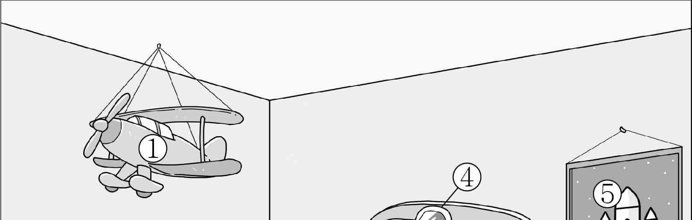
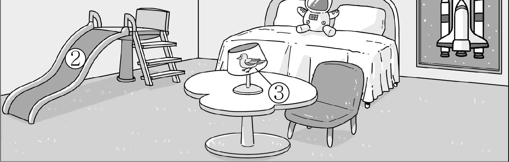
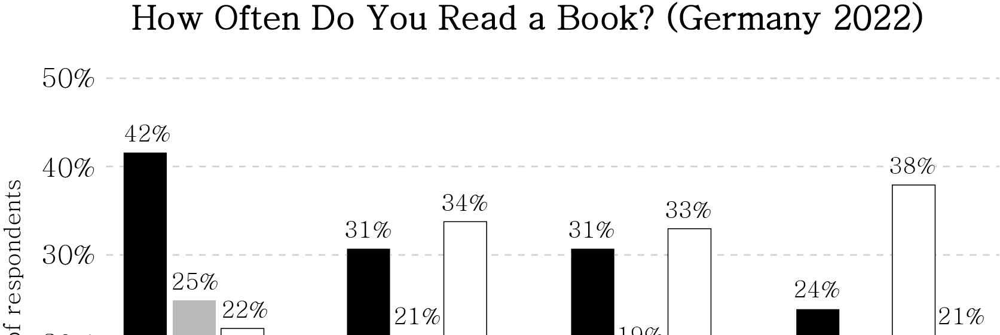
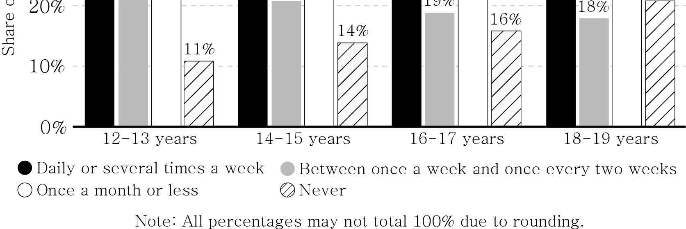

1. 다음을 듣고, 여자가 하는 말의 목적으로 가장 적절한 것을 고르시오.
① 학교 실내 체육관의 임시 폐쇄를 안내하려고
② 학교 실내 체육관의 방과 후 이용을 권장하려고
③ 학교 실내 체육관 개관 10주년 기념식에 초대하려고
④ 학교 실내 체육관 시설 보수를 위한 의견을 모으려고
⑤ 학교 실내 체육관 이용 후 운동 기구 정리를 당부하려고

2. 대화를 듣고, 남자의 의견으로 가장 적절한 것을 고르시오.

① 주위 환경과 대비되는 색의 등산복을 입는 것이 안전하다.
② 얇은 옷을 여러 겹 입으면 기온 변화에 대비할 수 있다.
③ 등산로를 벗어나 산행하면 자연을 훼손할 위험이 있다.
④ 등산복을 고를 때 방수 기능이 있는지 확인해야 한다.
⑤ 등산 전에 하는 준비 운동은 부상의 위험을 줄인다.

3. 대화를 듣고, 두 사람의 관계를 가장 잘 나타낸 것을 고르시오.

① 사진작가 – 모델
② 휴대 전화 판매원 – 손님
③ 제품 디자이너 – 제조업자
④ 노트북 수리 기사 – 의뢰인
⑤ 택배 배달원 – 고객 센터 직원

4. 대화를 듣고, 그림에서 대화의 내용과 일치하지 않는 것을 고르시오.

5. 대화를 듣고, 남자가 여자를 위해 할 일로 가장 적절한 것을 고르시오.

① 도서관에 데려다주기
② 에세이 검토해 주기
③ 프린터 설치해 주기
④ 출력물 가져다주기
⑤ 수리 센터에 연락해 주기

6. 대화를 듣고, 여자가 지불할 금액을 고르시오. [3점]

① $36
② $39
③ $47
④ $52
⑤ $55

7. 대화를 듣고, 남자가 내일 봉사 활동에 같이 갈 수 없는 이유를 고르시오.

① 봉사 활동 장소가 너무 멀어서
② 독감 예방 주사를 맞지 않아서
③ 가족과 저녁 식사를 해야 해서
④ 참여 가능한 나이가 되지 않아서
⑤ 스포츠 프로그램에 참여해야 해서

8. 대화를 듣고, Nari Island 패키지 여행에 관해 언급되지 않은 것을 고르시오.

① 여행 기간
② 방문 장소
③ 최소 출발 인원
④ 이동 수단
⑤ 가격

9. Afterschool Math Festival에 관한 다음 내용을 듣고, 일치하지 않는 것을 고르시오.

① 다음 주 월요일부터 3일간 진행된다.
② 9개의 활동 중 3개까지 참가할 수 있다.
③ 모든 활동의 예상 소요 시간은 같다.
④ 강연에 참석한 학생에게 강연자의 책이 무료로 제공된다.
⑤ 구내식당에서 특별한 간식과 음료가 제공된다.

10. 다음 표를 보면서 대화를 듣고, 두 사람이 구매할 자외선 칫솔 소독기를 고르시오.

|  | Model | Number of Slots | Built-in Battery | Drying Function | Price |
| --- | --- | --- | --- | --- | --- |
| ① | A | 3 | × | × | $39 |
| ② | B | 4 | ○ | ○ | $48 |
| ③ | C | 4 | × | × | $40 |
| ④ | D | 5 | ○ | × | $50 |
| ⑤ | E | 6 | ○ | ○ | $54 |

11. 대화를 듣고, 여자의 마지막 말에 대한 남자의 응답으로 가장 적절한 것을 고르시오.

① Yes. You should stop watering it for a while.
② No, thanks. I can’t keep a plant at home.
③ I agree. Those colorful leaves look nice.
④ Sure. I think gardening is a good hobby.
⑤ No. It’s easy to grow plants indoors.

12. 대화를 듣고, 남자의 마지막 말에 대한 여자의 응답으로 가장 적절한 것을 고르시오.

① I’m afraid I handed in my paper late.
② If so, applying hand cream might help.
③ Be careful when you use fabric scissors.
④ Well, the gloves are too big for my son.
⑤ Let’s bring a paper grocery bag this time.

13. 대화를 듣고, 여자의 마지막 말에 대한 남자의 응답으로 가장 적절한 것을 고르시오. [3점]

Man:
① Okay. Let me go over to collect the boxes.
② Good idea. I hope they listen to our suggestion.
③ I see it differently. Those towels can be reused.
④ Never mind. I can go to the post office by myself.
⑤ Not really. Students must clean their own bedroom.

14. 대화를 듣고, 남자의 마지막 말에 대한 여자의 응답으로 가장 적절한 것을 고르시오. [3점]

Woman:
① Don’t worry. I can help you create a virtual lecture hall.
② Don’t you remember? We’ve rented the same place.
③ Not yet. I need to sign up for a conference soon.
④ No way. Metaverse is not just for online games.
⑤ Why not? The audience loved your presentation.

15. 다음 상황 설명을 듣고, Jane이 David에게 할 말로 가장 적절한 것을 고르시오.

Jane:
① I’m sure you can play the solo part beautifully.
② It’s all my fault. I should have been more careful.
③ How about giving your solo part to someone else?
④ Too bad. We should postpone our concert for a week.
⑤ I will do my best to participate in the Spring Concert.

16. 남자가 하는 말의 주제로 가장 적절한 것은?

① reasons national flags have simple designs and colors
② geographical features affecting the national identity
③ common colors and their meanings in national flags
④ most frequently used symbols in national flags
⑤ differences in color preference across cultures

17. 언급된 색이 아닌 것은?

① red
② blue
③ white
④ black
⑤ green

18. 다음 글의 목적으로 가장 적절한 것은?

It was a pleasure meeting you at your gallery last week. I appreciate your effort to select and exhibit diverse artwork. As I mentioned, I greatly admire Robert D. Parker’s paintings, which emphasize the beauty of nature. Over the past few days, I have been researching and learning about Robert D. Parker’s online viewing room through your gallery’s website. I’m especially interested in purchasing the painting that depicts the horizon, titled Sunrise. I would like to know if the piece is still available for purchase. It would be a great pleasure to house this wonderful piece of art. I look forward to your reply to this inquiry.

19. 다음 글에 드러난 Isabel의 심경 변화로 가장 적절한 것은?

On opening day, Isabel arrives at the cafe very early with nervous anticipation. She looks around the cafe, but she can’t shake off the feeling that something is missing. As she sets out cups, spoons, and plates, Isabel’s doubts grow. She looks around, trying to imagine what else she could do to make the cafe perfect, but nothing comes to mind. Then, in a sudden burst of inspiration, Isabel grabs her paintbrush and transforms the blank walls into landscapes, adding flowers and trees. As she paints, her doubts begin to fade. Looking at her handiwork, which is beautifully done, she is certain that the cafe will be a success. ‘Now, success is not exactly guaranteed,’ she thinks to herself, ‘but I’ll definitely get there.’

20. 다음 글에서 필자가 주장하는 바로 가장 적절한 것은?

The more people have to do unwanted things the more chances are that they create unpleasant environment for themselves and others. If you hate the thing you do but have to do it nonetheless, you have choice between hating the thing and accepting that it needs to be done. Either way you will do it. Doing it from place of hatred will develop hatred towards the self and others around you; doing it from the place of acceptance will create compassion towards the self and allow for opportunities to find a more suitable way of accomplishing the task. If you decide to accept the fact that your task has to be done, start from recognising that your situation is a gift from life; this will help you to see it as a lesson in acceptance.

21. 밑줄 친 helping move the needle forward가 다음 글에서 의미하는 바로 가장 적절한 것은? [3점]

Everyone’s heard the expression don’t let the perfect become the enemy of the good. If you want to get over an obstacle so that your idea can become the solution‑based policy you’ve long dreamed of, you can’t have an all‑or‑nothing mentality. You have to be willing to alter your idea and let others influence its outcome. You have to be okay with the outcome being a little different, even a little less, than you wanted. Say you’re pushing for a clean water act. Even if what emerges isn’t as well‑funded as you wished, or doesn’t match how you originally conceived the bill, you’ll have still succeeded in ensuring that kids in troubled areas have access to clean water. That’s what counts, that they will be safer because of your idea and your effort. Is it perfect? No. Is there more work to be done? Absolutely. But in almost every case, helping move the needle forward is vastly better than not helping at all.

22. 다음 글의 요지로 가장 적절한 것은?

Brands that fail to grow and develop lose their relevance. Think about the person you knew who was once on the fast track at your company, who is either no longer with the firm or, worse yet, appears to have hit a plateau in his or her career. Assuming he or she did not make an ambitious move, more often than not, this individual is a victim of having failed to stay relevant and embrace the advances in his or her industry. Think about the impact personal computing technology had on the first wave of executive leadership exposed to the technology. Those who embraced the technology were able to integrate it into their work styles and excel. Those who were resistant many times found few opportunities to advance their careers and in many cases were ultimately let go through early retirement for failure to stay relevant and update their skills.

23. 다음 글의 주제로 가장 적절한 것은?

What consequences of eating too many grapes and other sweet fruit could there possibly be for our brains? A few large studies have helped to shed some light. In one, higher fruit intake in older, cognitively healthy adults was linked with less volume in the hippocampus. This finding was unusual, since people who eat more fruit usually display the benefits associated with a healthy diet. In this study, however, the researchers isolated various components of the subjects’ diets and found that fruit didn’t seem to be doing their memory centers any favors. Another study from the Mayo Clinic saw a similar inverse relationship between fruit intake and volume of the cortex, the large outer layer of the brain. Researchers in the latter study noted that excessive consumption of high‑sugar fruit (such as mangoes, bananas, and pineapples) may cause metabolic and cognitive problems as much as processed carbs do.

24. 다음 글의 제목으로 가장 적절한 것은?

Winning turns on a self‑conscious awareness that others are watching. It’s a lot easier to move under the radar when no one knows you and no one is paying attention. You can mess up and be rough and get dirty because no one even knows you’re there. But as soon as you start to win, and others start to notice, you’re suddenly aware that you’re being observed. You’re being judged. You worry that others will discover your flaws and weaknesses, and you start hiding your true personality, so you can be a good role model and good citizen and a leader that others can respect. There is nothing wrong with that. But if you do it at the expense of being who you really are, making decisions that please others instead of pleasing yourself, you’re not going to be in that position very long. When you start apologizing for who you are, you stop growing and you stop winning. Permanently.

25. 다음 도표의 내용과 일치하지 않는 것은?

The above graph shows how often German children and young adults read books in 2022 according to age groups.

| Age Group | Daily or several times a week | Between once a week and once every two weeks | Once a month or less | Never |
| --- | --- | --- | --- | --- |
| 12-13 years | 42% | 25% | 22% | 11% |
| 14-15 years | 31% | 21% | 34% | 14% |
| 16-17 years | 31% | 19% | 33% | 16% |
| 18-19 years | 24% | 18% | 38% | 21% |

26. Julia Margaret Cameron에 관한 다음 글의 내용과 일치하지 않는 것은?

British photographer Julia Margaret Cameron is considered one of the greatest portrait photographers of the 19th century. Born in Calcutta, India, into a British family, Cameron was educated in France. Given a camera as a gift by her daughter in December 1863, she quickly and energetically devoted herself to the art of photography. She cleared out a chicken coop and converted it into studio space where she began to work as a photographer. Cameron made illustrative studio photographs, convincing friends and family members to pose for photographs, fitting them in theatrical costumes and carefully composing them into scenes. Criticized for her so‑called bad technique by art critics in her own time, she ignored convention and experimented with composition and focus. Later critics appreciated her valuing of spiritual depth over technical perfection and now consider her portraits to be among the finest expressions of the artistic possibilities of the medium.

27. Have a Good Night App에 관한 다음 안내문의 내용과 일치하지 않는 것은?

Have a Good Night App This smart app helps you have a refreshing sleep!
FEATURES ∎ Sounds for Sleep - Providing relaxing sounds for sleep ∎ Sleep Recorder - Recording sounds such as coughing or snoring while sleeping ∎ Sleep Pattern Tracker - Checking and analyzing the user’s sleep pattern ∎ Stress‑Free Alarm Tones - Adjusting alarm tones to the user’s sleep pattern
PRICE ∎ Basic version: Free ∎ Premium version (extra soundtracks): $30 per year
Click HERE to Download the App!

28. 2023 Online Talent Show에 관한 다음 안내문의 내용과 일치하는 것은?

2023 Online Talent Show
Show off your amazing talents! ∎ Categories: singing, dancing, playing instruments ∎ How to Enter - Record a 3‑minute video of your talent and send it to talent@westhigh.edu. - Submit the entry between March 27 and March 31. ∎ How We Select a Winner 1. All the videos will be uploaded on the school website on April 5. * The winning video will be played at the school festival. For more information, please visit www.westhigh.edu.

29. 다음 글의 밑줄 친 부분 중, 어법상 틀린 것은? [3점]

Human beings like certainty. This liking stems from our ancient ancestors who needed to survive alongside saber‑toothed tigers and poisonous berries. Our brains evolved to help us attend to threats, keep away from them, and remain alive afterward. In fact, we learned that the more certain we were about something, the better chance we had of making the right choice. Is this berry the same shape as last time? The same size? If I know for certain it is, my brain will direct me to eat it because I know it’s safe. And if I’m uncertain, my brain will send out a danger alert to protect me. The dependence on certainty all those millennia ago ensured our survival to the present day, and the danger‑alert system continues to protect us. This is achieved by our brains labeling new, vague, or unpredictable everyday events and experiences as uncertain. Our brains then generate sensations, thoughts, and action plans to keep us safe from the uncertain element, and we live to see another day.

30. 다음 글의 밑줄 친 부분 중, 문맥상 낱말의 쓰임이 적절하지 않은 것은? [3점]

Robert Blattberg and Steven Hoch noted that, in a changing environment, it is not clear that consistency is always a virtue and that one of the advantages of human judgment is the ability to detect change. Thus, in changing environments, it might be advantageous to combine human judgment and statistical models. Blattberg and Hoch examined this possibility by having supermarket managers forecast demand for certain products and then creating a composite forecast by averaging these judgments with the forecasts of statistical models based on past data. The logic was that statistical models assume stable conditions and therefore cannot account for the effects on demand of novel events such as actions taken by competitors or the introduction of new products. Humans, however, can incorporate these novel factors in their judgments. The composite ─ or average of human judgments and statistical models ─ proved to be more accurate than either the statistical models or the managers working alone.

31. 다음 빈칸에 들어갈 말로 가장 적절한 것을 고르시오.

Free play is nature’s means of teaching children that they are not helpless. In play, away from adults, children really do have control and can practice asserting it. In free play, children learn to make their own decisions, solve their own problems, create and follow rules, and get along with others as equals rather than as obedient or rebellious subordinates. In active outdoor play, children deliberately dose themselves with moderate amounts of fear and they thereby learn how to control not only their bodies, but also their fear. In social play children learn how to negotiate with others, how to please others, and how to manage and overcome the anger that can arise from conflicts. None of these lessons can be taught through verbal means; they can be learned only through experience, which free play provides.

32. 다음 빈칸에 들어갈 말로 가장 적절한 것을 고르시오.

Many early dot‑com investors focused almost entirely on revenue growth instead of net income. Many early dot‑com companies earned most of their revenue from selling advertising space on their Web sites. To boost reported revenue, some sites began exchanging ad space. Company A would put an ad for its Web site on company B’s Web site, and company B would put an ad for its Web site on company A’s Web site. No money ever changed hands, but each company recorded revenue (for the value of the space that it gave up on its site) and expense (for the value of its ad that it placed on the other company’s site). This practice did little to boost net income and resulted in no additional cash inflow ─ but it did boost reported revenue. This practice was quickly put to an end because accountants felt that it did not meet the criteria of the revenue recognition principle.

33. 다음 빈칸에 들어갈 말로 가장 적절한 것을 고르시오. [3점]

Scholars of myth have long argued that myth gives structure and meaning to human life; that meaning is amplified when a myth evolves into a world. A virtual world’s ability to fulfill needs grows when lots and lots of people believe in the world. Conversely, a virtual world cannot be long sustained by a mere handful of adherents. Consider the difference between a global sport and a game I invent with my nine friends and play regularly. My game might be a great game, one that is completely immersive, one that consumes all of my group’s time and attention. If its reach is limited to the ten of us, though, then it’s ultimately just a weird hobby, and it has limited social function. For a virtual world to provide lasting, wide‑ranging value, its participants must be a large enough group to be considered a society. When that threshold is reached, psychological value can turn into wide‑ranging social value.

34. 다음 빈칸에 들어갈 말로 가장 적절한 것을 고르시오. [3점]

It seems natural to describe certain environmental conditions as ‘extreme’, ‘harsh’, ‘benign’ or ‘stressful’. It may seem obvious when conditions are ‘extreme’: the midday heat of a desert, the cold of an Antarctic winter, the salinity of the Great Salt Lake. But this only means that these conditions are extreme for us, given our particular physiological characteristics and tolerances. To a cactus there is nothing extreme about the desert conditions in which cacti have evolved; nor are the icy lands of Antarctica an extreme environment for penguins. It is lazy and dangerous for the ecologist to assume that all other organisms sense the environment in the way we do. Rather, the ecologist should try to gain a worm’s‑eye or plant’s‑eye view of the environment: to see the world as others see it. Emotive words like harsh and benign, even relativities such as hot and cold, should be used by ecologists only with care.

35. 다음 글에서 전체 흐름과 관계 없는 문장은?

Human processes differ from rational processes in their outcome. A process is rational if it always does the right thing based on the current information, given an ideal performance measure. In short, rational processes go by the book and assume that the book is actually correct. Human processes involve instinct, intuition, and other variables that don’t necessarily reflect the book and may not even consider the existing data. As an example, the rational way to drive a car is to always follow the laws. Likewise, pedestrian crossing signs vary depending on the country with differing appearances of a person crossing the street. However, traffic isn’t rational; if you follow the laws precisely, you end up stuck somewhere because other drivers aren’t following the laws precisely. To be successful, a self‑driving car must therefore act humanly, rather than rationally.

36. 주어진 글 다음에 이어질 글의 순서로 가장 적절한 것을 고르시오.

Like positive habits, bad habits exist on a continuum of easy‑to‑change and hard‑to‑change. When you get toward the “hard” end of the spectrum, note the language you hear — breaking bad habits and battling addiction. It’s as if an unwanted behavior is a nefarious villain to be aggressively defeated. But this kind of language (and the approaches it spawns) frames these challenges in a way that isn’t helpful or effective. I specifically hope we will stop using this phrase: “break a habit.” This language misguides people. The word “break” sets the wrong expectation for how you get rid of a bad habit. This word implies that if you input a lot of force in one moment, the habit will be gone. However, that rarely works, because you usually cannot get rid of an unwanted habit by applying force one time.

37. 주어진 글 다음에 이어질 글의 순서로 가장 적절한 것을 고르시오. [3점]

A common but incorrect assumption is that we are creatures of reason when, in fact, we are creatures of both reason and emotion. We cannot get by on reason alone since any reason always eventually leads to a feeling. Should I get a wholegrain cereal or a chocolate cereal?

I can list all the reasons I want, but the reasons have to be based on something. For example, if my goal is to eat healthy, I can choose the wholegrain cereal, but what is my reason for wanting to be healthy?

I can list more and more reasons such as wanting to live longer, spending more quality time with loved ones, etc., but what are the reasons for those reasons? You should be able to see by now that reasons are ultimately based on non‑reason such as values, feelings, or emotions. [3점]

These deep‑seated values, feelings, and emotions we have are rarely a result of reasoning, but can certainly be influenced by reasoning. We have values, feelings, and emotions before we begin to reason and long before we begin to reason effectively.

38. 글의 흐름으로 보아, 주어진 문장이 들어가기에 가장 적절한 곳을 고르시오.

Electric communication is mainly known in fish. The electric signals are produced in special electric organs. When the signal is discharged the electric organ will be negatively loaded compared to the head and an electric field is created around the fish. A weak electric current is created also in ordinary muscle cells when they contract. In the electric organ the muscle cells are connected in larger chunks, which makes the total current intensity larger than in ordinary muscles. The fish varies the signals by changing the form of the electric field or the frequency of discharging. The system is only working over small distances, about one to two meters. This is an advantage since the species using the signal system often live in large groups with several other species. If many fish send out signals at the same time, the short range decreases the risk of interference.

39. 글의 흐름으로 보아, 주어진 문장이 들어가기에 가장 적절한 곳을 고르시오. [3점]

Creativity can have an effect on productivity. Creativity leads some individuals to recognize problems that others do not see, but which may be very difficult. Charles Darwin’s approach to the speciation problem is a good example of this; he chose a very difficult and tangled problem, speciation, which led him into a long period of data collection and deliberation. This choice of problem did not allow for a quick attack or a simple experiment. In such cases creativity may actually decrease productivity (as measured by publication counts) because effort is focused on difficult problems. For others, whose creativity is more focused on methods and technique, creativity may lead to solutions that drastically reduce the work necessary to solve a problem. We can see an example in the development of the polymerase chain reaction (PCR) which enables us to amplify small pieces of DNA in a short time. This type of creativity might reduce the number of steps or substitute steps that are less likely to fail, thus increasing productivity.

40. 다음 글의 내용을 한 문장으로 요약하고자 한다. 빈칸 (A), (B)에 들어갈 말로 가장 적절한 것은?

A young child may be puzzled when asked to distinguish between the directions of right and left. But that same child may have no difficulty in determining the directions of up and down or back and front. Scientists propose that this occurs because, although we experience three dimensions, only two had a strong influence on our evolution: the vertical dimension as defined by gravity and, in mobile species, the front/back dimension as defined by the positioning of sensory and feeding mechanisms. These influence our perception of vertical versus horizontal, far versus close, and the search for dangers from above (such as an eagle) or below (such as a snake). However, the left‑right axis is not as relevant in nature. A bear is equally dangerous from its left or the right side, but not if it is upside down. In fact, when observing a scene containing plants, animals, and man‑made objects such as cars or street signs, we can only tell when left and right have been inverted if we observe those artificial items. 

 Having affected the evolution of our spatial perception, vertical and front/back dimensions are easily perceived, but the left‑right axis, which is not significant in nature, doesn’t come instantly to us.

41. 윗글의 제목으로 가장 적절한 것은?

Creative people aren’t all cut from the same cloth. They have varying levels of maturity and sensitivity. They have different approaches to work. And they’re each motivated by different things. Managing people is about being aware of their unique personalities. It’s also about empathy and adaptability, and knowing how the things you do and say will be interpreted and adapting accordingly. Who you are and what you say may not be the same from one person to the next. For instance, if you’re asking someone to work a second weekend in a row, or telling them they aren’t getting that deserved promotion just yet, you need to bear in mind the individual. Vincent will have a very different reaction to the news than Emily, and they will each be more receptive to the news if it’s bundled with different things. Perhaps that promotion news will land easier if Vincent is given a few extra vacation days for the holidays, while you can promise Emily a bigger promotion a year from now. Consider each person’s complex positive and negative personality traits, their life circumstances, and their mindset in the moment when deciding what to say and how to say it. Personal connection, compassion, and an individualized management style are key to drawing consistent, rock star‑level work out of everyone.

42. 밑줄 친 낱말 중에서 문맥상 낱말의 쓰임이 적절하지 않은 것은?

Creative people aren’t all cut from the same cloth. They have varying levels of maturity and sensitivity. They have different approaches to work. And they’re each motivated by different things. Managing people is about being aware of their unique personalities. It’s also about empathy and adaptability, and knowing how the things you do and say will be interpreted and adapting accordingly. Who you are and what you say may not be the same from one person to the next. For instance, if you’re asking someone to work a second weekend in a row, or telling them they aren’t getting that deserved promotion just yet, you need to bear in mind the individual. Vincent will have a very different reaction to the news than Emily, and they will each be more receptive to the news if it’s bundled with different things. Perhaps that promotion news will land easier if Vincent is given a few extra vacation days for the holidays, while you can promise Emily a bigger promotion a year from now. Consider each person’s complex positive and negative personality traits, their life circumstances, and their mindset in the moment when deciding what to say and how to say it. Personal connection, compassion, and an individualized management style are key to drawing consistent, rock star‑level work out of everyone.

43. 주어진 글에 이어질 내용을 순서에 맞게 배열한 것으로 가장 적절한 것은?

 Coach McGraw, too, saw the pattern ― new kids and others grouping separately. ‘This has to change,’ he thought. He wanted a winning team. To do that, he needed to build relationships. “I want you guys to come over here in the middle and sit,” he called the players as he walked over. “You!” McGraw roared, pointing at Wylder. “Come here onto the field and sit. And Jonny! You sit over there!” He started pointing, making sure they mixed together. Wylder realized what Coach was trying to do, so he hopped onto the field. McGraw continued to point, calling each player out, until he was satisfied with the rearrangement. “Okay, this is how it’s going to be,” he began. “We need to learn how to trust and work with each other. This is how a team plays. This is how I want you to be on and off the field: together.” The players looked at each other. Almost immediately, McGraw noticed a change in their postures and faces. He saw some of them starting to smile. ‘Wow,’ thought Wylder. From his new location on the grass, he stretched out his legs. He liked what he was hearing. A new sense of team spirit came across him, a deeper sense of connection. It was encouraging to hear Coach talk about this, to see him face the challenge head‑on. Now his speech was over. The players got up and started walking on the field to warm up. “Good job, Coach. That was good,” Wylder said to McGraw in a low voice as he walked past him, keeping his eyes down out of respect. 

44. 밑줄 친 낱말 중에서 가리키는 대상이 나머지 넷과 다른 것은?

 Coach McGraw, too, saw the pattern ― new kids and others grouping separately. ‘This has to change,’ he thought. He wanted a winning team. To do that, he needed to build relationships. “I want you guys to come over here in the middle and sit,” he called the players as he walked over. “You!” McGraw roared, pointing at Wylder. “Come here onto the field and sit. And Jonny! You sit over there!” He started pointing, making sure they mixed together. Wylder realized what Coach was trying to do, so he hopped onto the field. McGraw continued to point, calling each player out, until he was satisfied with the rearrangement. “Okay, this is how it’s going to be,” he began. “We need to learn how to trust and work with each other. This is how a team plays. This is how I want you to be on and off the field: together.” The players looked at each other. Almost immediately, McGraw noticed a change in their postures and faces. He saw some of them starting to smile. ‘Wow,’ thought Wylder. From his new location on the grass, he stretched out his legs. He liked what he was hearing. A new sense of team spirit came across him, a deeper sense of connection. It was encouraging to hear Coach talk about this, to see him face the challenge head‑on. Now his speech was over. The players got up and started walking on the field to warm up. “Good job, Coach. That was good,” Wylder said to McGraw in a low voice as he walked past him, keeping his eyes down out of respect. 

45. 윗글에 관한 내용으로 적절하지 않은 것은?

 Coach McGraw, too, saw the pattern ― new kids and others grouping separately. ‘This has to change,’ he thought. He wanted a winning team. To do that, he needed to build relationships. “I want you guys to come over here in the middle and sit,” he called the players as he walked over. “You!” McGraw roared, pointing at Wylder. “Come here onto the field and sit. And Jonny! You sit over there!” He started pointing, making sure they mixed together. Wylder realized what Coach was trying to do, so he hopped onto the field. McGraw continued to point, calling each player out, until he was satisfied with the rearrangement. “Okay, this is how it’s going to be,” he began. “We need to learn how to trust and work with each other. This is how a team plays. This is how I want you to be on and off the field: together.” The players looked at each other. Almost immediately, McGraw noticed a change in their postures and faces. He saw some of them starting to smile. ‘Wow,’ thought Wylder. From his new location on the grass, he stretched out his legs. He liked what he was hearing. A new sense of team spirit came across him, a deeper sense of connection. It was encouraging to hear Coach talk about this, to see him face the challenge head‑on. Now his speech was over. The players got up and started walking on the field to warm up. “Good job, Coach. That was good,” Wylder said to McGraw in a low voice as he walked past him, keeping his eyes down out of respect.
