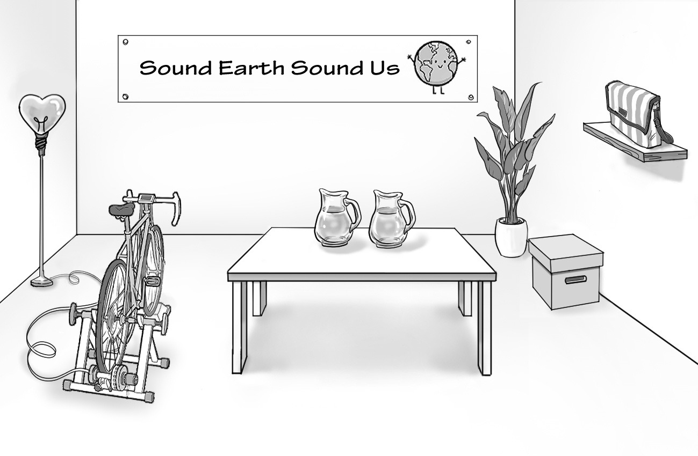
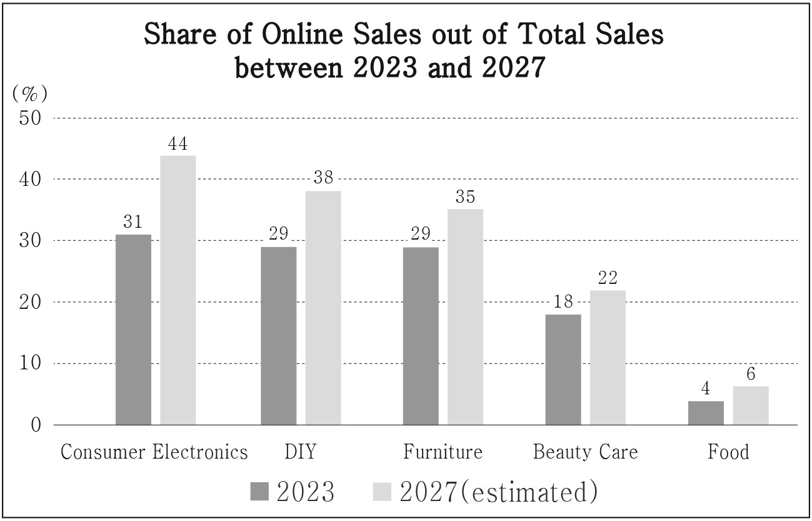

1. 다음을 듣고, 남자가 하는 말의 목적으로 가장 적절한 것을 고르시오.

① 승강기 점검 일정을 공지하려고
② 승강기 대신 계단 이용을 권장하려고
③ 교내 질서 유지 봉사자를 모집하려고
④ 올바른 계단 이용 수칙을 설명하려고
⑤ 승강기 고장 시 대처 방법을 안내하려고

2. 대화를 듣고, 여자의 의견으로 가장 적절한 것을 고르시오.

① 칫솔질을 너무 세게 하는 것은 치아를 손상시킬 수 있다.
② 칫솔을 사용한 후에는 세워서 보관하는 것이 위생적이다.
③ 치아를 희고 밝게 관리하려면 식후 바로 양치질을 해야 한다.
④ 이의 시린 증상을 완화하기 위해 차가운 음식을 피해야 한다.
⑤ 구강 건강을 유지하려면 주기적으로 치과 진료를 받아야 한다.

3. 다음을 듣고, 여자가 하는 말의 요지로 가장 적절한 것을 고르시오.

① 월급의 일정 비율을 정기적으로 투자하는 것이 좋다.
② 이익을 얻기 위해 어느 정도의 위험은 감수해야 한다.
③ 돈을 분산하여 투자하면 투자의 위험을 낮출 수 있다.
④ 투자 결정 시 타인의 의견에 휩쓸리는 것은 위험하다.
⑤ 투자할 기업을 고를 때 성장 가능성을 고려해야 한다.

4. 대화를 듣고, 그림에서 대화의 내용과 일치하지 않는 것을 고르시오.

5. 대화를 듣고, 남자가 할 일로 가장 적절한 것을 고르시오.

① 의자 가져오기
② 토론 주제 정하기
③ 문자 메시지 보내기
④ 참가자 명단 만들기
⑤ 마이크 작동 여부 확인하기

6. 대화를 듣고, 여자가 지불할 금액을 고르시오. [3점]

① $65
② $70
③ $75
④ $85
⑤ $90

7. 대화를 듣고, 남자가 Noopy 팝업 스토어에 갈 수 없는 이유를 고르시오.

① 도서관에 가야 해서
② 점심 약속이 있어서
③ 남동생을 돌보아야 해서
④ 문학 에세이를 써야 해서
⑤ 학교 잡지를 편집해야 해서

8. 대화를 듣고, Make Your Own Emoji 행사에 관해 언급되지 않은 것을 고르시오.

① 날짜
② 장소
③ 강사
④ 소요 시간
⑤ 등록 방법

9. 2024 Silent Disco에 관한 다음 내용을 듣고, 일치하지 않는 것을 고르시오.

① 시청 광장에서 열릴 것이다.
② 방문객들은 무선 헤드셋을 받을 것이다.
③ 세 시간 동안 진행될 것이다.
④ 모든 연령대가 참여할 수 있다.
⑤ 티켓은 온라인으로만 구매할 수 있다.

10. 다음 표를 보면서 대화를 듣고, 두 사람이 주문할 키보드 손목 받침대를 고르시오.

|  | Model | Color | Material | Free Gift | Price |
| --- | --- | --- | --- | --- | --- |
| ① | A | Purple | Cotton | Sticker | $10 |
| ② | B | Blue | Memory foam | Mouse pad | $12 |
| ③ | C | White | Silicone | Mouse pad | $17 |
| ④ | D | Brown | Leather | Mouse pad | $22 |
| ⑤ | E | Silver | Aluminum | Sticker | $27 |

11. 대화를 듣고, 여자의 마지막 말에 대한 남자의 응답으로 가장 적절한 것을 고르시오.

① Absolutely. Vintage clothes are not my thing.
② Sure. I want to check out the store this week.
③ I agree. My jacket really needs to get cleaned.
④ Same here. I prefer shopping online for clothes.
⑤ No, thanks. I’ve never heard of that school before.

12. 대화를 듣고, 남자의 마지막 말에 대한 여자의 응답으로 가장 적절한 것을 고르시오.

① That’s a shame. You should’ve checked the weather.
② That’s a nice idea. We should go hiking again soon.
③ I totally agree. I twisted my ankle on the way up.
④ Let me see. It takes one hour to climb to the top.
⑤ Chin up. You cannot be successful all the time.

13. 대화를 듣고, 여자의 마지막 말에 대한 남자의 응답으로 가장 적절한 것을 고르시오. [3점]

Man:

① Wait. The runner at the front is falling behind.
② Good for you. You can always come run with us.
③ Terrible. I don’t like being sweaty under the sun.
④ Fantastic. Please count me in for the next meetup.
⑤ Exactly. You should always push beyond your limits.

14. 대화를 듣고, 남자의 마지막 말에 대한 여자의 응답으로 가장 적절한 것을 고르시오.

Woman:

① Awesome. Let me see how well you play.
② Okay. Thank you for coming to cheer me up.
③ I’m so sorry. I’ll support you wherever I am.
④ Never mind. You don’t need to attend the game.
⑤ Apologies. I don’t like watching basketball much.

15. 다음 상황 설명을 듣고, Emily가 Mr. Garcia에게 할 말로 가장 적절한 것을 고르시오. [3점]

Emily:

① I’d like you to replace my suitcase with a new one.
② Could you give me a refund for the plane ticket?
③ Will you see if my suitcase has been damaged?
④ Can I receive money for my broken suitcase?
⑤ Please help me with checking my baggage in.

16. 여자가 하는 말의 주제로 가장 적절한 것은?

① reasons why kids these days lack important social skills
② how kids can develop diverse social skills through play
③ developmental stages of basic social skills in children
④ different social skills found among various cultures
⑤ social skills needed for parents to raise their kids

17. 언급된 사회적 기술이 아닌 것은?

따라 답을 하시기 바랍니다.

① language
② self-control
③ responsibility
④ empathy
⑤ apology

18. 다음 글의 목적으로 가장 적절한 것은?

Dear Executive Manager Schulz, It is a week before the internship program starts. I am writing to bring your attention to a matter that requires immediate consideration regarding the issue my department has. As the coordinator, it is becoming apparent to me that the budget, previously approved by your department, needs some adjustments in order to meet the emerging modifications. Since my department has hired three more interns than planned initially, the most expensive need is for additional funding to cover their wages, training costs, and materials. I kindly request an additional budget allocation for these expenses. Please refer to the attachment for details. Thank you for your attention. Best regards, Matt Perry

19. 다음 글에 드러난 Katie의 심경 변화로 가장 적절한 것은?

Katie approached the hotel front desk to check-in but an unexpected event unfolded. The receptionist couldn’t find her reservation under the name ‘Katie’. “I’m sorry, but I can’t seem to locate a reservation under that name,” the receptionist said. “No way, I definitely made a reservation on the phone,” Katie said, puzzled. The receptionist asked, “Can you tell me your phone number?” and Katie told it to him, thinking ‘What happened? Did I make a mistake?’ “Just a moment,” the receptionist said, typing deliberately on the keyboard. “I found it! It seems there was a small misspelling. Your reservation is under ‘K-A-T-Y’,” the receptionist explained. With a sense of ease, Katie watched her reservation appearing on the screen. With her heart slowing to a gentle rhythm, she proceeded with her check-in, thinking that a simple misspelling might have ruined her plans.

20. 다음 글에서 필자가 주장하는 바로 가장 적절한 것은?

To be mathematically literate means to be able to think critically about societal issues on which mathematics has bearing so as to make informed decisions about how to solve these problems. Dealing with such complex problems through interdisciplinary approaches, mirroring real-world problems requires innovative ways of planning and organizing mathematical teaching methods. Navigating our world means being able to quantify, measure, estimate, classify, compare, find patterns, conjecture, justify, prove, and generalize within critical thinking and when using critical thinking. Therefore, making decisions, even qualitatively, is not possible without using mathematics and critical thinking. Thus, teaching mathematics should be done in interaction with critical thinking along with a decision-making process. They can be developed into the mathematical context, so that there is no excuse to not explicitly support students to develop them.

21. 밑줄 친 Popping a pill cannot make you a better person이 다음 글에서 의미하는 바로 가장 적절한 것은?

Imagine that your usually stingy friend delights in buying you a Christmas present after taking a generosity booster. How would you feel? Undoubtedly, there is something praiseworthy about the action. You’d be pleased to receive the gift. You’d say ‘thank you’, and mean it. But his change of heart is not entirely satisfying. According to Zagzebski, an American philosopher, he is not really generous. When we praise someone’s character, we use words for various virtues: ‘generous’, ‘kind’, ‘courageous’, etc. A person who gives one gift isn’t generous. Instead, generosity is a stable part of a person’s ‘moral identity’, an emotional habit that is part of who you are. Thus virtues, as opposed to nontypical impulse, are the result of your personal history. They are part of who you are, as they are part of how your character was formed. Instant virtue is therefore impossible. Popping a pill cannot make you a better person.

22. 다음 글의 요지로 가장 적절한 것은?

To determine the mass of my bowling ball, I might put it onto a balance and compare it with a known mass, such as a number of metal cubes each weighing 1, 10, or 100 grams. Things get much more complicated if I want to know the mass of a distant star. How do I measure it? We can roughly say that measuring the mass of a star involves various theories. If we want to measure the mass of a binary star, we first determine a center of mass between the two stars, then their distance from that center which we can then use, together with a value for the period and a certain instance of Kepler’s Third Law, to calculate the mass. In other words, in order to “measure” the star mass, we measure other quantities and use those values, together with certain equations, to calculate the mass. Measurement is not a simple and unmediated estimation of independently existing properties, but a determination of certain magnitudes before the background of a number of accepted theories.

23. 다음 글의 주제로 가장 적절한 것은?

Based on discoveries in neuroscience, pain and pleasure are formed and processed in the same area of the brain. Our bodies constantly strive for homeostasis, which is defined as the balance of bodily functions. Without the body’s effective compensatory mechanisms, which may cushion potential highs and lows, we would not be capable of surviving. Pleasure and pain are like two sides of the same coin; they seem to work together and are heavily reliant on one another and keep balance. If you imagine pleasure and pain as the two opposite points on a scale, you can easily understand that as one of the two points rises, the other must correspondingly fall. We’ve all heard the expression, “No pain, no gain.” Well, according to psychiatrist Dr. Anna Lembke, there may be some truth to these words. She says that our attempts to escape being miserable are in fact making us even more miserable. This is because pain is actually an essential component of our ability to maintain a neutral state, and allowing it will in turn reset our internal scale back to balance.

24. 다음 글의 제목으로 가장 적절한 것은?

Manufacturers masterfully sow seeds of doubt about the adequacy of our current devices. Suddenly, the phone that was your lifeline a year ago is now a museum piece, unable to keep pace with your digital demands. And thus, the itch to upgrade begins, often before there’s a genuine need. This cycle isn’t just confined to our digital companions. It spills over into almost every aspect of consumer electronics, from the self-driving car to the smart fridge. Every product seems to be on an unstoppable march towards the next version, the next generation that promises to revolutionize your life. What’s fascinating, or perhaps disturbing, is the utter efficacy of this cycle in shaping our desires. It’s not so much that we want the newest device; we’re led to believe we need it. The distinction between want and need blurs, shifting our financial priorities in favor of staying current with trends. For all the logical arguments against this ceaseless upgrading, the temptation remains compelling.

25. 다음 도표의 내용과 일치하지 않는 것은?

The graph above shows the shares of online sales out of total sales by each of five product categories in 2023 and the estimated ones in 2027.

| Product Category | 2023 | 2027 (estimated) |
| --- | --- | --- |
| Consumer Electronics | 31 | 44 |
| DIY | 29 | 38 |
| Furniture | 29 | 35 |
| Beauty Care | 18 | 22 |
| Food | 4 | 6 |

26. Helen Suzman에 관한 다음 글의 내용과 일치하지 않는 것은?

Helen Suzman was an activist against apartheid, a racist political and social system in the Republic of South Africa. Suzman was born to Jewish immigrant parents in Germiston in the Union of South Africa in 1917. While working as a lecturer on economic history at Witwatersrand University, she joined the South African Institute of Race Relations. In 1953, she joined the United Party and was elected to Parliament, but when the United Party adopted a more moderate stance on apartheid, Suzman and other progressive members left it and formed the Progressive Party in 1959. Suzman tirelessly fought against apartheid, exposing the government’s abuses and challenging its laws for a total of 36 years in Parliament. Even after her retirement in 1989, she continued to advocate for a multi-racial democracy in the Republic of South Africa and influenced the drafting of the country’s new constitution after the end of apartheid. She remained an active voice for human rights and democracy until her death in 2009.

27. Bigwave Beach Earthing Challenge에 관한 다음 안내문의 내용과 일치하지 않는 것은?

Bigwave Beach Earthing Challenge Walk barefoot around Bigwave Beach and feel the energy of nature. Let’s enjoy Earthing together.
Date: Oct. 27, 2024 (Sun) Gathering: in front of information board of Bigwave Beach
Registration: Oct. 20, 2024, only on our website (QR code will be sent after confirmation.)
Schedule 1:00 p.m.: Show your QR code and receive a wrist band. 1:30 p.m.: Listen to a simple lecture on barefoot walking. 2:00 p.m.: Walk around beach in groups. 4:00 p.m.: Return your wrist band to receive a souvenir at gathering point.
Note - Washing feet is allowed only in the designated area. - In an emergency, call the number on your wrist band. For registration, please visit www.bwbearth.com.

28. Fashion Styling Consultation에 관한 다음 안내문의 내용과 일치하는 것은?

Fashion Styling Consultation Find the style that suits you best. We are ready to make the employees of Woodville Company look nice. Freely visit booths with no fixed order! When &
Where: Dec. 27, 2024, Auditorium Consultation Booths (Each booth has professional consultants.)
A: Find colors that go well with your skin tone.
B: Learn about accessories for various situations.
C: Find the best hairstyle that fits your face shape.
Note - There is a section where you can try styling yourself and take pictures. - If you post your picture on social media, you will receive a special gift. For more information, please visit www.whatsurstyle2024.com.

29. 다음 글의 밑줄 친 부분 중, 어법상 틀린 것은?

Conditioned Place Preference is a way of finding out what animals want. Researchers train them to associate one place with an experience such as food or a loud noise and another place with something completely different, usually where nothing happens. The two places are made obviously different to make it as easy as possible for the animal to associate each place with what happened to it there. The animal’s preference for being in one place or another is measured both before and after its experiences in the two places. If there is a shift in where the animal chooses to spend its time for the reward, this suggests that it liked the experience and is trying to repeat it. Conversely, if it now avoids the place the stimulus appeared and starts to prefer the place it did not experience it, then this suggests that it found the stimulus unpleasant. For example, mice with cancer show a preference for the place where they have been given morphine, a drug used to relieve pain, rather than where they have received saline whereas healthy mice developed no such preference. This suggests that the mice with cancer wanted the morphine.

30. 다음 글의 밑줄 친 부분 중, 문맥상 낱말의 쓰임이 적절하지 않은 것은? [3점]

Near the equator, many species of bird breed all year round. But in temperate and polar regions, the breeding seasons of birds are often sharply defined. They are triggered mainly by changes in day length. If all goes well, the outcome is that birds raise their young when the food supply is at its peak. Most birds are not simply reluctant to breed at other times but they are also physically incapable of doing so. This is because their reproductive system shrinks, which helps flying birds save weight. The main exception to this rule are nomadic desert species. These can initiate their breeding cycle within days of rain. It’s for making the most of the sudden breeding opportunity. Also, different species divide the breeding season up in different ways. Most seabirds raise a single brood. In warm regions, however, songbirds may raise several families in a few months. In an exceptionally good year, a pair of House Sparrows, a kind of songbird, can raise successive broods through a marathon reproductive effort.

31. 다음 빈칸에 들어갈 말로 가장 적절한 것을 고르시오.

One factor that may hinder creativity is unawareness of the resources required in each activity in students’ learning. Often students are unable to identify the resources they need to perform the task required of them. Different resources may be compulsory for specific learning tasks, and recognizing them may simplify the activity’s performance. For example, it may be that students desire to conduct some experiments in their projects. There must be a prior investigation of whether the students will have access to the laboratory, equipment, and chemicals required for the experiment. It means preparation is vital for the students to succeed, and it may be about human and financial resources such as laboratory technicians, money to purchase chemicals, and equipment for their learning where applicable. Even if some of the resources required for a task may not be available, identifying them in advance may help students’ creativity. It may even lead to changing the topic, finding alternative resources, and other means.

32. 다음 빈칸에 들어갈 말로 가장 적절한 것을 고르시오.

All translators feel some pressure from the community of readers for whom they are doing their work. And all translators arrive at their interpretations in dialogue with other people. The English poet Alexander Pope had pretty good Greek, but when he set about translating Homer’s Iliad in the early 18th century he was not on his own. He had Greek commentaries to refer to, and translations that had already been done in English, Latin, and French ― and of course he had dictionaries. Translators always draw on more than one source text. Even when the scene of translation consists of just one person with a pen, paper, and the book that is being translated, or even when it is just one person translating orally for another, that person’s linguistic knowledge arises from lots of other texts and other conversations. And then his or her idea of the translation’s purpose will be influenced by the expectations of the person or people it is for. In both these senses every translation is a crowd translation.

33. 다음 빈칸에 들어갈 말로 가장 적절한 것을 고르시오. [3점]

Some people argue that there is a single, logically consistent concept known as reading that can be neatly set apart from everything else people do with books. Is reading really that simple? The most productive way to think about reading is as a loosely related set of behaviors that belong together owing to family resemblances, as Ludwig Wittgenstein used the phrase, without having in common a single defining trait. Consequently, efforts to distinguish reading from nonreading are destined to fail because there is no agreement on what qualifies as reading in the first place. The more one tries to figure out where the border lies between reading and not-reading, the more edge cases will be found to stretch the term’s flexible boundaries. Thus, it is worth attempting to collect together these exceptional forms of reading into a single forum, one highlighting the challenges faced by anyone wishing to establish the boundaries where reading begins and ends. The attempt moves toward an understanding of reading as a spectrum that is expansive enough to accommodate the distinct reading activities.

34. 다음 빈칸에 들어갈 말로 가장 적절한 것을 고르시오. [3점]

Weber’s law concerns the perception of difference between two stimuli. It suggests that we might not be able to detect a 1-mm difference when we are looking at lines 466 mm and 467 mm in length, but we may be able to detect a 1-mm difference when we are comparing a line 2 mm long with one 3 mm long. Another example of this principle is that we can detect 1 candle when it is lit in an otherwise dark room. But when 1 candle is lit in a room in which 100 candles are already burning, we may not notice the light from this candle. Therefore, the Just-noticeable difference (JND) varies as a function of the strength of the signals. For example, the JND is greater for very loud noises than it is for much more quiet sounds. When a sound is very weak, we can tell that another sound is louder, even if it is barely louder. When a sound is very loud, to tell that another sound is even louder, it has to be much louder. Thus, Weber’s law means that it is harder to distinguish between two samples when those samples are larger or stronger levels of the stimuli.

35. 다음 글에서 전체 흐름과 관계 없는 문장은?

Any new resource (e.g., a new airport, a new mall) always opens with people benefiting individually by sharing a common resource (e.g., the city or state budget). Soon, at some point, the amount of traffic grows too large for the “commons” to support. Traffic jams, overcrowding, and overuse lessen the benefits of the common resource for everyone ― the tragedy of the commons! If the new resource cannot be expanded or provided with additional space, it becomes a problem, and you cannot solve the problem on your own, in isolation from your fellow drivers or walkers or competing users. The total activity on this new resource keeps increasing, and so does individual activity; but if the dynamic of common use and overuse continues too long, both begin to fall after a peak, leading to a crash. Likewise, common resource such as knowledge and information is infinite one whose relative value decreases as the number of users increases, but will not be totally consumed though overused. What makes the “tragedy of commons” tragic is the crash dynamic ― the destruction or degeneration of the common resource’s ability to regenerate itself.

36. 주어진 글 다음에 이어질 글의 순서로 가장 적절한 것을 고르시오.

Theoretically, our brain would have the capacity to store all experiences throughout life, reaching the quality of a DVD. However, this theoretical capacity is offset by the energy demand associated with the process of storing and retrieving information in memory. As a result, the brain develops efficient strategies, becoming dependent on shortcuts. When we observe a face, the visual image captured by the eyes is highly variable, depending on the point of view, lighting conditions and other contextual factors. Nevertheless, we are able to recognize the face as the same, maintaining the underlying identity. The brain, rather than focusing on the details of visualization, creates and stores general patterns that allow for consistent recognition across diverse circumstances. This ability to match what we see with general visual memory patterns serves as an effective mechanism for optimizing brain performance and saving energy. The brain, being naturally against unnecessary effort, constantly seeks to simplify and generalize information to facilitate the cognitive process.

37. 주어진 글 다음에 이어질 글의 순서로 가장 적절한 것을 고르시오. [3점]

Where scientific research is concerned, explanatory tales are expected to adhere closely to experimental data and to illuminate the regular and predictable features of experience. However, this paradigm sometimes conceals the fact that theories are deeply loaded with creative elements that shape the construction of research projects and the interpretations of evidence. Scientific explanations do not just relate a chronology of facts. They construct frameworks for systematically chosen data in order to provide a consistent and meaningful explanation of what is observed. Such constructions lead us to imagine specific kinds of subject matter in particular sorts of relations, and the storylines they inspire will prove more effective for analyzing some features of experience over others. When we neglect the creative contributions of such scientific imagination and treat models and interpretive explanations as straightforward facts — even worse, as facts including all of reality — we can blind ourselves to the limitations of a given model and fail to note its potential for misunderstanding a situation to which it ill applies.

38. 글의 흐름으로 보아, 주어진 문장이 들어가기에 가장 적절한 곳을 고르시오. [3점]

We encounter contrary claims about the relation of literature to action. Theorists have maintained that literature encourages solitary reading and reflection as the way to engage with the world and thus counters the social and political activities that might produce social change. At best it encourages detachment or appreciation of complexity, and at worst passivity and acceptance of what is. But on the other hand, literature has historically been seen as dangerous: it promotes the questioning of authority and social arrangements. Plato banned poets from his ideal republic because they could only do harm, and novels have long been credited with making people dissatisfied with their lives and eager for something new. By promoting identification across divisions of class, gender, and race, books may promote a fellowship that discourages struggle; but they may also produce a keen sense of injustice that makes progressive struggles possible. Historically, works of literature are credited with producing change: Uncle Tom’s Cabin, a best-seller in its day, helped create a revulsion against slavery that made possible the American Civil War.

39. 글의 흐름으로 보아, 주어진 문장이 들어가기에 가장 적절한 곳을 고르시오.

According to Hobbes, man is not a being who can act morally in spite of his instinct to protect his existence in the state of nature. Hence, the only place where morality and moral liberty will begin to find an application begins in a place where a sovereign power, namely the state, emerges. Hobbes thus describes the state of nature as a circumstance in which man’s life is “solitary, poor, nasty, brutish and short”. It means when people live without a general power to control them all, they are indeed in a state of war. In other words, Hobbes, who accepted that human beings are not social and political beings in the state of nature, believes that without the power human beings in the state of nature are “antisocial and rational based on their selfishness”. Moreover, since society is not a natural phenomenon and there is no natural force bringing people together, what will bring them together as a society is not mutual affection according to Hobbes. It is, rather, mutual fear of men’s present and future that assembles them, since the cause of fear is a common drive among people in the state of nature.

40. 다음 글의 내용을 한 문장으로 요약하고자 한다. 빈칸 (A), (B)에 들어갈 말로 가장 적절한 것은? [3점]

There is research that supports the idea that cognitive factors influence the phenomenology of the perceived world. Delk and Fillenbaum asked participants to match the color of figures with the color of their background. Some of the figures depicted objects associated with a particular color. These included typically red objects such as an apple, lips, and a symbolic heart. Other objects were presented that are not usually associated with red, such as a mushroom or a bell. However, all the figures were made out of the same red-orange cardboard. Participants then had to match the figure to a background varying from dark to light red. They had to make the background color match the color of the figures. The researchers found that red-associated objects required more red in the background to be judged a match than did the objects that are not associated with the color red. This implies that the cognitive association of objects to color influences how we perceive that color. In one study, participants chose greater redness when asked to match the color of objects that are usually red to a background with the same color, which showed that their knowledge about the colors of objects influenced their perceptual judgment.

41. 윗글의 제목으로 가장 적절한 것은?

In each round of genome copying in our body, there is still about a 70 percent chance that at least one pair of chromosomes will have an error. With each round of genome copying, errors accumulate. This is similar to alterations in medieval books. Each time a copy was made by hand, some changes were introduced accidentally; as changes stacked up, the copies may have acquired meanings at variance with the original. Similarly, genomes that have undergone more copying processes will have gathered more mistakes. To make things worse, mutations may damage genes responsible for error checking and repair of genomes, further accelerating the introduction of mutations. Most genome mutations do not have any noticeable effects. It is just like changing the i for a y in “kingdom” would not distort the word’s readability. But sometimes a mutation to a human gene results in, for example, an eye whose iris is of two different colors. Similarly, almost everyone has birthmarks, which are due to mutations that occurred as our body’s cells multiplied to form skin. If mutations are changes to the genome of one particular cell, how can a patch of cells in an iris or a whole patch of skin, consisting of many individual cells, be affected simultaneously? The answer lies in the cell lineage, the developmental history of a tissue from particular cells through to their fully differentiated state. If the mutation occurred early on in the lineage of the developing iris, then all cells in that patch have inherited that change.

42. 밑줄 친 낱말 중에서 문맥상 낱말의 쓰임이 적절하지 않은 것은? [3점]

In each round of genome copying in our body, there is still about a 70 percent chance that at least one pair of chromosomes will have an error. With each round of genome copying, errors accumulate. This is similar to alterations in medieval books. Each time a copy was made by hand, some changes were introduced accidentally; as changes stacked up, the copies may have acquired meanings at variance with the original. Similarly, genomes that have undergone more copying processes will have gathered more mistakes. To make things worse, mutations may damage genes responsible for error checking and repair of genomes, further accelerating the introduction of mutations. Most genome mutations do not have any noticeable effects. It is just like changing the i for a y in “kingdom” would not distort the word’s readability. But sometimes a mutation to a human gene results in, for example, an eye whose iris is of two different colors. Similarly, almost everyone has birthmarks, which are due to mutations that occurred as our body’s cells multiplied to form skin. If mutations are changes to the genome of one particular cell, how can a patch of cells in an iris or a whole patch of skin, consisting of many individual cells, be affected simultaneously? The answer lies in the cell lineage, the developmental history of a tissue from particular cells through to their fully differentiated state. If the mutation occurred early on in the lineage of the developing iris, then all cells in that patch have inherited that change.

43. 주어진 글에 이어질 내용을 순서에 맞게 배열한 것으로 가장 적절한 것은?

 Max froze. What? It can’t be! It was due next Friday! After school, he came home worrying that his whole perfectly planned week was going to be ruined. Without his usual greeting, Max headed to his room in haste. “What’s wrong Max?,” Jeremy, his dad, followed Max, worrying about him. Max furiously browsed through his planner without answering him, only to find the wrong date written in it. Fighting through tears, Max finally managed to explain the unending pressure to be perfect to his dad. To his surprise, Jeremy laughed. “Max, guess what? Perfect is a great goal, but nobody gets there all the time. What matters is what we do when things get messy.” That made him feel a little better. “You are saying I can fix this?” “Absolutely, try to deal with problems in a logical way,” Jeremy said. Max thought for a moment. “I guess…. I can do that by rescheduling tonight’s baseball lesson.” Jeremy beamed. “See? That’s you finding a solution.” Max felt a genuine smile spreading. The next Wednesday, he successfully handed in the final draft on time with satisfaction. From then on, he still loved order and routines, but also embraced the messy, unpredictable bits of life too. 

44. 밑줄 친 낱말 중에서 가리키는 대상이 나머지 넷과 다른 것은?

 Max froze. What? It can’t be! It was due next Friday! After school, he came home worrying that his whole perfectly planned week was going to be ruined. Without his usual greeting, Max headed to his room in haste. “What’s wrong Max?,” Jeremy, his dad, followed Max, worrying about him. Max furiously browsed through his planner without answering him, only to find the wrong date written in it. Fighting through tears, Max finally managed to explain the unending pressure to be perfect to his dad. To his surprise, Jeremy laughed. “Max, guess what? Perfect is a great goal, but nobody gets there all the time. What matters is what we do when things get messy.” That made him feel a little better. “You are saying I can fix this?” “Absolutely, try to deal with problems in a logical way,” Jeremy said. Max thought for a moment. “I guess…. I can do that by rescheduling tonight’s baseball lesson.” Jeremy beamed. “See? That’s you finding a solution.” Max felt a genuine smile spreading. The next Wednesday, he successfully handed in the final draft on time with satisfaction. From then on, he still loved order and routines, but also embraced the messy, unpredictable bits of life too. 

45. 윗글에 관한 내용으로 적절하지 않은 것은?

 Max froze. What? It can’t be! It was due next Friday! After school, he came home worrying that his whole perfectly planned week was going to be ruined. Without his usual greeting, Max headed to his room in haste. “What’s wrong Max?,” Jeremy, his dad, followed Max, worrying about him. Max furiously browsed through his planner without answering him, only to find the wrong date written in it. Fighting through tears, Max finally managed to explain the unending pressure to be perfect to his dad. To his surprise, Jeremy laughed. “Max, guess what? Perfect is a great goal, but nobody gets there all the time. What matters is what we do when things get messy.” That made him feel a little better. “You are saying I can fix this?” “Absolutely, try to deal with problems in a logical way,” Jeremy said. Max thought for a moment. “I guess…. I can do that by rescheduling tonight’s baseball lesson.” Jeremy beamed. “See? That’s you finding a solution.” Max felt a genuine smile spreading. The next Wednesday, he successfully handed in the final draft on time with satisfaction. From then on, he still loved order and routines, but also embraced the messy, unpredictable bits of life too.
