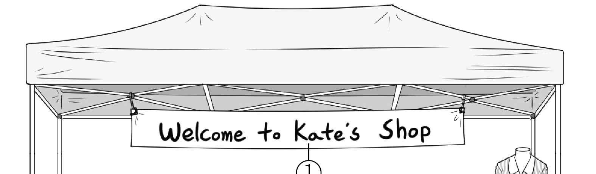
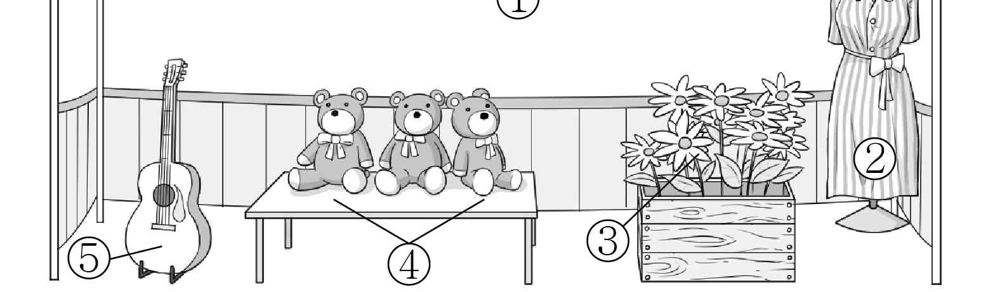
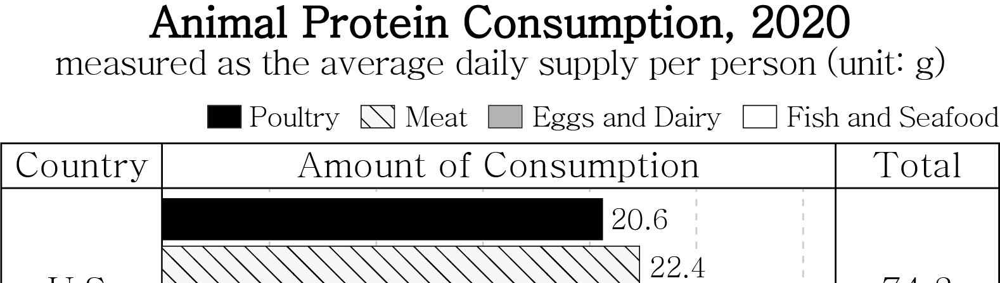
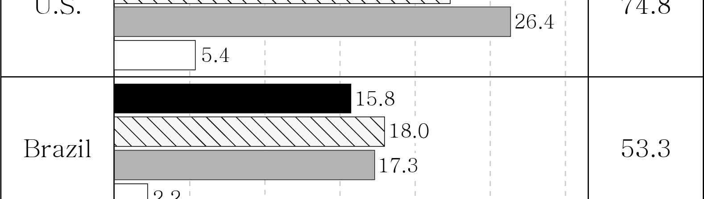

1. 다음을 듣고, 남자가 하는 말의 목적으로 가장 적절한 것을 고르시오.
① 꽃 사진 촬영 동아리 회원을 모집하려고
② 꽃 사진 촬영 시 유의 사항을 당부하려고
③ 꽃 사진 촬영 행사가 취소됨을 공지하려고
④ 꽃 사진 촬영에 적합한 장비를 소개하려고
⑤ 꽃 사진을 촬영하기에 좋은 장소를 안내하려고

2. 대화를 듣고, 여자의 의견으로 가장 적절한 것을 고르시오.

① 플래시 카드를 퀴즈에 활용하면 단어를 즐겁게 익힐 수 있다.
② 퀴즈를 내는 활동을 통해 학습자의 약점을 파악할 수 있다.
③ 단어 학습에 가장 효과적인 방법은 개인마다 차이가 있다.
④ 그림과 글이 함께 포함된 플래시 카드는 학습에 효과적이다.
⑤ 플래시 카드를 활용한 단어 학습 프로그램 개발이 필요하다.

3. 다음을 듣고, 남자가 하는 말의 요지로 가장 적절한 것을 고르시오.

① 깔끔한 방을 유지하기 위해 필요 없는 물건을 없애야 한다.
② 쓰레기를 버릴 때는 환경에 미칠 악영향을 고려해야 한다.
③ 공간의 기능과 종류에 따라 효과적인 정리 방법이 다르다.
④ 사용하지 않는 물건은 보관하기보다 기부하는 것이 낫다.
⑤ 상자를 이용하면 물건을 효과적으로 보관할 수 있다.

4. 대화를 듣고, 그림에서 대화의 내용과 일치하지 않는 것을 고르시오.

5. 대화를 듣고, 여자가 남자에게 부탁한 일로 가장 적절한 것을 고르시오.

① 설문 결과 정리하기
② 원인 조사하기
③ 그래프 제작하기
④ 사진 고르기
⑤ 데이터 전송하기

6. 대화를 듣고, 남자가 지불할 금액을 고르시오. [3점]

① $25
② $29
③ $31
④ $34
⑤ $36

7. 대화를 듣고, 여자가 공연 동영상 파일을 보내줄 수 없는 이유를 고르시오.

① 동영상을 촬영하지 않아서
② 부원들의 동의를 구해야 해서
③ 동영상 파일을 갖고 있지 않아서
④ 공연을 성공적으로 마치지 못해서
⑤ 학교 홍보 영상에 나오고 싶지 않아서

8. 대화를 듣고, 학급 캠핑에 관해 언급되지 않은 것을 고르시오.

① 참여 학생 수
② 날짜
③ 대여 물품
④ 비용
⑤ 도착 시간

9. 2024 AI Expo에 관한 다음 내용을 듣고, 일치하지 않는 것을 고르시오.

① 5월 27일과 28일에 진행된다.
② 올해의 주제는 학교에서의 AI 활용이다.
③ 50개가 넘는 국가에서 채택된 AI 기술을 경험할 수 있다.
④ AI가 그려 주는 초상화를 받을 수 있다.
⑤ 웹사이트에서 20% 할인된 가격에 입장권을 구입할 수 있다.

10. 다음 표를 보면서 대화를 듣고, 두 사람이 구매할 사진첩을 고르시오.

|  | Model | Cover Material | Pages | Cover Color | Price |
| --- | --- | --- | --- | --- | --- |
| ① | A | paper | 20 | white | $16 |
| ② | B | paper | 30 | blue | $19 |
| ③ | C | fabric | 30 | white | $22 |
| ④ | D | fabric | 40 | blue | $25 |
| ⑤ | E | leather | 40 | brown | $30 |

11. 대화를 듣고, 여자의 마지막 말에 대한 남자의 응답으로 가장 적절한 것을 고르시오.

① Fishing on the boat was the best for me.
② My grandparents visited us last weekend.
③ I am so glad that you had a great time.
④ It took too long to get to the island.
⑤ Some activities were canceled.

12. 대화를 듣고, 남자의 마지막 말에 대한 여자의 응답으로 가장 적절한 것을 고르시오.

① Good idea. I’ll go to the bookstore tomorrow.
② I’m sorry, but I haven’t finished reading that book.
③ That’s okay. I’ve already returned the book to the library.
④ Not at all. I would be able to go to her birthday party.
⑤ Thank you. I’ve always wanted to write a book myself.

13. 대화를 듣고, 여자의 마지막 말에 대한 남자의 응답으로 가장 적절한 것을 고르시오. [3점]

Man:
① Don’t worry. You can pay with a credit card.
② I see. Then this one is a perfect choice for him.
③ It’ll be fine. Your husband can drop by and pick it up.
④ Really? You’d better apply sunscreen before going out.
⑤ Exactly. A product with strong sun protection is better.

14. 대화를 듣고, 남자의 마지막 말에 대한 여자의 응답으로 가장 적절한 것을 고르시오. [3점]

Woman:
① Right. It’s better to hide weaknesses whenever possible.
② Good luck. Show them who you are, and you’ll make it.
③ Of course. You can handle your homework effectively.
④ I agree. You can make your schedule using a planner.
⑤ Be careful! A weakness keeps you from growing up.

15. 다음 상황 설명을 듣고, Lucy가 James에게 할 말로 가장 적절한 것을 고르시오.

Lucy:
① Why don’t we start a campaign to ban the use of plastic?
② How about making posters with me about recycling?
③ Will you prepare for the student council meeting?
④ I want your opinion on the school art festival.
⑤ Let me tell you how to recycle properly.

16. 남자가 하는 말의 주제로 가장 적절한 것은?

① historical events that inspired inventions
② how inventions are unexpectedly created
③ hidden stories behind scientific inventions
④ unique inventions based on cultural identities
⑤ inventions that affected human life and history

17. 언급된 발명품이 아닌 것은?

① wheel
② printing press
③ steam engine
④ light bulb
⑤ telephone

18. 다음 글의 목적으로 가장 적절한 것은?

Dear Art Crafts People of Greenville, For the annual Crafts Fair on May 25 from 1 p.m. to 6 p.m., the Greenville Community Center is providing booth spaces to rent as in previous years. To reserve your space, please visit our website and complete a registration form by April 20. The rental fee is $50. All the money we receive from rental fees goes to support upcoming activities throughout the year. We expect all available spaces to be fully booked soon, so don’t get left out. We hope to see you at the fair.

19. 다음 글에 드러난 Sarah의 심경 변화로 가장 적절한 것은?

Sarah, a young artist with a love for painting, entered a local art contest. As she looked at the amazing artworks made by others, her confidence dropped. She quietly thought, ‘I might not win an award.’ The moment of judgment arrived, and the judges began announcing winners one by one. It wasn’t until the end that she heard her name. The head of the judges said, “Congratulations, Sarah Parker! You won first prize. We loved the uniqueness of your work.” Sarah was overcome with joy, and she couldn’t stop smiling. This experience meant more than just winning; it confirmed her identity as an artist.

20. 다음 글에서 필자가 주장하는 바로 가장 적절한 것은?

Too many times people, especially in today’s generation, expect things to just happen overnight. When we have these false expectations, it tends to discourage us from continuing to move forward. Because this is a high tech society, everything we want has to be within the parameters of our comfort and convenience. If it doesn’t happen fast enough, we’re tempted to lose interest. So many people don’t want to take the time it requires to be successful. Success is not a matter of mere desire; you should develop patience in order to achieve it. Have you fallen prey to impatience? Great things take time to build.

21. 밑줄 친 we were still taping bricks to accelerators가 다음 글에서 의미하는 바로 가장 적절한 것은? [3점]

If you had wanted to create a “self-driving” car in the 1950s, your best option might have been to strap a brick to the accelerator. Yes, the vehicle would have been able to move forward on its own, but it could not slow down, stop, or turn to avoid barriers. Obviously not ideal. But does that mean the entire concept of the self-driving car is not worth pursuing? No, it only means that at the time we did not yet have the tools we now possess to help enable vehicles to operate both autonomously and safely. This once-distant dream now seems within our reach. It is much the same story in medicine. Two decades ago, we were still taping bricks to accelerators. Today, we are approaching the point where we can begin to bring some appropriate technology to bear in ways that advance our understanding of patients as unique individuals. In fact, many patients are already wearing devices that monitor their conditions in real time, which allows doctors to talk to their patients in a specific, refined, and feedback-driven way that was not even possible a decade ago.

22. 다음 글의 요지로 가장 적절한 것은?

We tend to overrate the impact of new technologies in part because older technologies have become absorbed into the furniture of our lives, so as to be almost invisible. Take the baby bottle. Here is a simple implement that has transformed a fundamental human experience for vast numbers of infants and mothers, yet it finds no place in our histories of technology. This technology might be thought of as a classic time-shifting device, as it enables mothers to exercise more control over the timing of feeding. It can also function to save time, as bottle feeding allows for someone else to substitute for the mother’s time. Potentially, therefore, it has huge implications for the management of time in everyday life, yet it is entirely overlooked in discussions of high-speed society.

23. 다음 글의 주제로 가장 적절한 것은?

Empathy is frequently listed as one of the most desired skills in an employer or employee, although without specifying exactly what is meant by empathy. Some businesses stress cognitive empathy, emphasizing the need for leaders to understand the perspective of employees and customers when negotiating deals and making decisions. Others stress affective empathy and empathic concern, emphasizing the ability of leaders to gain trust from employees and customers by treating them with real concern and compassion. When some consultants argue that successful companies foster empathy, what that translates to is that companies should conduct good market research. In other words, an “empathic” company understands the needs and wants of its customers and seeks to fulfill those needs and wants. When some people speak of design with empathy, what that translates to is that companies should take into account the specific needs of different populations — the blind, the deaf, the elderly, non-English speakers, the color-blind, and so on — when designing products.

24. 다음 글의 제목으로 가장 적절한 것은?

The most prevalent problem kids report is that they feel like they need to be accessible at all times. Because technology allows for it, they feel an obligation. It’s easy for most of us to relate — you probably feel the same pressure in your own life! It is really challenging to deal with the fact that we’re human and can’t always respond instantly. For a teen or tween who’s still learning the ins and outs of social interactions, it’s even worse. Here’s how this behavior plays out sometimes: Your child texts one of his friends, and the friend doesn’t text back right away. Now it’s easy for your child to think, “This person doesn’t want to be my friend anymore!” So he texts again, and again, and again — “blowing up their phone.” This can be stress-inducing and even read as aggressive. But you can see how easily this could happen.

25. 다음 도표의 내용과 일치하지 않는 것은?

The graph above shows the animal protein consumption measured as the average daily supply per person in three different countries in 2020.

| Country | Poultry | Meat | Eggs and Dairy | Fish and Seafood | Total |
| --- | --- | --- | --- | --- | --- |
| U.S. | 20.6 | 22.4 | 26.4 | 5.4 | 74.8 |
| Brazil | 15.8 | 18.0 | 17.3 | 2.2 | 53.3 |
| Japan | 8.6 | 10.0 | 13.9 | 16.9 | 49.4 |

26. Theodore von Kármán에 관한 다음 글의 내용과 일치하지 않는 것은?

Theodore von Kármán, a Hungarian-American engineer, was one of the greatest minds of the twentieth century. He was born in Hungary and at an early age, he showed a talent for math and science. In 1908, he received a doctoral degree in engineering at the University of Göttingen in Germany. In the 1920s, he began traveling as a lecturer and consultant to industry. He was invited to the United States to advise engineers on the design of a wind tunnel at California Institute of Technology (Caltech). He became the director of the Guggenheim Aeronautical Laboratory at Caltech in 1930. Later, he was awarded the National Medal of Science for his leadership in science and engineering.

27. Basic Latte Art Class에 관한 다음 안내문의 내용과 일치하지 않는 것은?

Basic Latte Art Class Make perfect lattes and present them in the most beautiful way! In this class, you will learn how to steam and pour milk. You will make three latte art designs on your own: heart, tulip, and leaf.
Date: April 27, 2024
Time: 9 a.m. - 1 p.m.
Place: Camefort Community Center
Registration & Fee
Register online at www.camefortcc.com, from April 22 to April 24.
$60 per person (cost of ingredients included)
Notes
Dairy alternatives will be available for non-milk drinkers.
Students can get a 10% discount.

28. Family Night-hiking Event에 관한 다음 안내문의 내용과 일치하는 것은?

Family Night-hiking Event Join us for a fun-filled night of hiking and family bonding!
Date: Saturday, May 4
Time: 6 p.m. - 9 p.m.
Location: Skyline Preserve
Cost
Adults: $20
Children under 19: $10
Guidelines
Children must be accompanied by legal guardians.
Bring a flashlight and a bottle of water.
Follow the instructions of the guides at all times.
Registration
Visit www.familyhiking.com and register by April 26.
A free first aid kit is provided for all who register by April 12.

29. 다음 글의 밑줄 친 부분 중, 어법상 틀린 것은?

For years, many psychologists have held strongly to the belief that the key to addressing negative health habits is to change behavior. This, more than values and attitudes, is the part of personality that is easiest to change. Ingestive habits such as smoking, drinking and various eating behaviors are the most common health concerns targeted for behavioral changes. Process-addiction behaviors (workaholism, shopaholism, and the like) fall into this category as well. Mental imagery combined with power of suggestion was taken up as the premise of behavioral medicine to help people change negative health behaviors into positive ones. Although this technique alone will not produce changes, when used alongside other behavior modification tactics and coping strategies, behavioral changes have proved effective for some people. What mental imagery does is reinforce a new desired behavior. Repeated use of images reinforces the desired behavior more strongly over time.

30. 다음 글의 밑줄 친 부분 중, 문맥상 낱말의 쓰임이 적절하지 않은 것은? [3점]

Emotion socialization — learning from other people about emotions and how to deal with them — starts early in life and plays a foundational role for emotion regulation development. Although extra-familial influences, such as peers or media, gain in importance during adolescence, parents remain the primary socialization agents. For example, their own responses to emotional situations serve as a role model for emotion regulation, increasing the likelihood that their children will show similar reactions in comparable situations. Parental practices at times when their children are faced with emotional challenges also impact emotion regulation development. Whereas direct soothing and directive guidance of what to do are beneficial for younger children, they may intrude on adolescents’ autonomy striving. In consequence, adolescents might pull away from, rather than turn toward, their parents in times of emotional crisis, unless parental practices are adjusted. More suitable in adolescence is indirect support of autonomous emotion regulation, such as through interest in, as well as awareness and nonjudgmental acceptance of, adolescents’ emotional experiences, and being available when the adolescent wants to talk.

31. 다음 빈칸에 들어갈 말로 가장 적절한 것을 고르시오.

Dancers often push themselves to the limits of their physical capabilities. But that push is misguided if it is directed toward accomplishing something physically impossible. For instance, a tall dancer with long feet may wish to perform repetitive vertical jumps to fast music, pointing his feet while in the air and lowering his heels to the floor between jumps. That may be impossible no matter how strong the dancer is. But a short-footed dancer may have no trouble! Another dancer may be struggling to complete a half-turn in the air. Understanding the connection between a rapid turn rate and the alignment of the body close to the rotation axis tells her how to accomplish her turn successfully. In both of these cases, understanding and working within the imposed by nature and described by physical laws allows dancers to work efficiently, minimizing potential risk of injury.

32. 다음 빈칸에 들어갈 말로 가장 적절한 것을 고르시오.

We must explore the relationship between children’s film production and consumption habits. The term “children’s film” implies ownership by children — their cinema — but films supposedly made for children have always been, particularly in commercial cinemas. The considerable crossover in audience composition for children’s films can be shown by the fact that, in 2007, eleven Danish children’s and youth films attracted 59 per cent of theatrical admissions, and in 2014, German children’s films comprised seven out of the top twenty films at the national box office. This phenomenon corresponds with a broader, international embrace of what is seemingly children’s culture among audiences of diverse ages. The old prejudice that children’s film is some other realm, separate from (and forever subordinate to) a more legitimate cinema for adults is not supported by the realities of consumption: children’s film is at the heart of contemporary popular culture.

33. 다음 빈칸에 들어갈 말로 가장 적절한 것을 고르시오. [3점]

Beethoven’s drive to create something novel is a reflection of his state of curiosity. Our brains experience a sense of reward when we create something new in the process of exploring something uncertain, such as a musical phrase that we’ve never played or heard before. When our curiosity leads to something novel, the resulting reward brings us a sense of pleasure. A number of investigators have modeled how curiosity influences musical composition. In the case of Beethoven, computer modeling focused on the thirty-two piano sonatas written after age thirteen revealed that the musical patterns found in all of Beethoven’s music decreased in later sonatas, while novel patterns, including patterns that were unique to a particular sonata, increased. In other words, Beethoven’s music as his curiosity drove the exploration of new musical ideas. Curiosity is a powerful driver of human creativity.

34. 다음 빈칸에 들어갈 말로 가장 적절한 것을 고르시오. [3점]

Technologists are always on the lookout for quantifiable metrics. Measurable inputs to a model are their lifeblood, and like a social scientist, a technologist needs to identify concrete measures, or “proxies,” for assessing progress. This need for quantifiable proxies produces a bias toward measuring things that are easy to quantify. But simple metrics can take us further away from the important goals we really care about, which may require complicated metrics or be extremely difficult, or perhaps impossible, to reduce to any measure. And when we have imperfect or bad proxies, we can easily fall under the illusion that we are solving for a good end without actually making genuine progress toward a worthy solution. The problem of proxies results in technologists frequently substituting what is measurable for what is meaningful. As the saying goes, “Not everything that counts can be counted, and not everything that can be counted counts.”

35. 다음 글에서 전체 흐름과 관계 없는 문장은?

We are the only species that seasons its food, deliberately altering it with the highly flavored plant parts we call herbs and spices. It’s quite possible that our taste for spices has an evolutionary root. Many spices have antibacterial properties — in fact, common seasonings such as garlic, onion, and oregano inhibit the growth of almost every bacterium tested. And the cultures that make the heaviest use of spices — think of the garlic and black pepper of Thai food, the ginger and coriander of India, the chili peppers of Mexico — come from warmer climates, where bacterial spoilage is a bigger issue. The changing climate can have a significant impact on the production and availability of spices, influencing their growth patterns and ultimately affecting global spice markets. In contrast, the most lightly spiced cuisines — those of Scandinavia and northern Europe — are from cooler climates. Our uniquely human attention to flavor, in this case the flavor of spices, turns out to have arisen as a matter of life and death.

36. 주어진 글 다음에 이어질 글의 순서로 가장 적절한 것을 고르시오. [3점]

Development of the human body from a single cell provides many examples of the structural richness that is possible when the repeated production of random variation is combined with nonrandom selection.

All phases of body development from embryo to adult exhibit random activities at the cellular level, and body formation depends on the new possibilities generated by these activities coupled with selection of those outcomes that satisfy previously built-in criteria. Always new structure is based on old structure, and at every stage selection favors some cells and eliminates others.

The survivors serve to produce new cells that undergo further rounds of selection. Except in the immune system, cells and extensions of cells are not genetically selected during development, but rather, are positionally selected.

Those in the right place that make the right connections are stimulated, and those that don't are eliminated. This process is much like sculpting. A natural consequence of the strategy is great variability from individual to individual at the cell and molecular levels, even though large-scale structures are quite similar.

37. 주어진 글 다음에 이어질 글의 순서로 가장 적절한 것을 고르시오. [3점]

In order to bring the ever-increasing costs of home care for elderly and needy persons under control, managers of home care providers have introduced management systems.

These systems specify tasks of home care workers and the time and budget available to perform these tasks. Electronic reporting systems require home care workers to report on their activities and the time spent, thus making the distribution of time and money visible and, in the perception of managers, controllable.

This, in the view of managers, has contributed to the resolution of the problem. The home care workers, on the other hand, may perceive their work not as a set of separate tasks to be performed as efficiently as possible, but as a service to be provided to a client with whom they may have developed a relationship.

This includes having conversations with clients and enquiring about the person's well-being. Restricted time and the requirement to report may be perceived as obstacles that make it impossible to deliver the service that is needed. If the management systems are too rigid, this may result in home care workers becoming overloaded and demotivated.

38. 글의 흐름으로 보아, 주어진 문장이 들어가기에 가장 적절한 곳을 고르시오. [3점]

It is a common assumption that most vagrant birds are ultimately doomed, aside from the rare cases where individuals are able to reorientate and return to their normal ranges. In turn, it is also commonly assumed that vagrancy itself is a relatively unimportant biological phenomenon. This is undoubtedly true for the majority of cases, as the most likely outcome of any given vagrancy event is that the individual will fail to find enough resources, and/or be exposed to inhospitable environmental conditions, and perish. However, there are many lines of evidence to suggest that vagrancy can, on rare occasions, dramatically alter the fate of populations, species or even whole ecosystems. Despite being infrequent, these events can be extremely important when viewed at the timescales over which ecological and evolutionary processes unfold. The most profound consequences of vagrancy relate to the establishment of new breeding sites, new migration routes and wintering locations. Each of these can occur through different mechanisms, and at different frequencies, and they each have their own unique importance.

39. 글의 흐름으로 보아, 주어진 문장이 들어가기에 가장 적절한 곳을 고르시오.

Intuition can be great, but it ought to be hard-earned. Experts, for example, are able to think on their feet because they've invested thousands of hours in learning and practice: their intuition has become data-driven. Only then are they able to act quickly in accordance with their internalized expertise and evidence-based experience. Yet most people are not experts, though they often think they are. Most of us, especially when we interact with others on social media, act with expert-like speed and conviction, offering a wide range of opinions on global crises, without the substance of knowledge that supports it. And thanks to AI, which ensures that our messages are delivered to an audience more inclined to believing it, our delusions of expertise can be reinforced by our personal filter bubble. We have an interesting tendency to find people more open-minded, rational, and sensible when they think just like us.

40. 다음 글의 내용을 한 문장으로 요약하고자 한다. 빈칸 (A), (B)에 들어갈 말로 가장 적절한 것은?

The fast-growing, tremendous amount of data, collected and stored in large and numerous data repositories, has far exceeded our human ability for understanding without powerful tools. As a result, data collected in large data repositories become “data tombs” — data archives that are hardly visited. Important decisions are often made based not on the information–rich data stored in data repositories but rather on a decision maker’s instinct, simply because the decision maker does not have the tools to extract the valuable knowledge hidden in the vast amounts of data. Efforts have been made to develop expert system and knowledge-based technologies, which typically rely on users or domain experts to manually input knowledge into knowledge bases. However, this procedure is likely to cause biases and errors and is extremely costly and time consuming. The widening gap between data and information calls for the systematic development of tools that can turn data tombs into “golden nuggets” of knowledge. 

 As the vast amounts of data stored in repositories overwhelm human understanding, effective tools to obtain valuable knowledge are required for better decision-making.

41. 윗글의 제목으로 가장 적절한 것은?

It’s untrue that teens can focus on two things at once — what they’re doing is shifting their attention from one task to another. In this digital age, teens wire their brains to make these shifts very quickly, but they are still, like everyone else, paying attention to one thing at a time, sequentially. Common sense tells us multitasking should increase brain activity, but Carnegie Mellon University scientists using the latest brain imaging technology find it doesn’t. As a matter of fact, they discovered that multitasking actually decreases brain activity. Neither task is done as well as if each were performed individually. Fractions of a second are lost every time we make a switch, and a person’s interrupted task can take 50 percent longer to finish, with 50 percent more errors. Turns out the latest brain research supports the old advice “one thing at a time.” It’s not that kids can’t do some tasks simultaneously. But if two tasks are performed at once, one of them has to be familiar. Our brains perform a familiar task on “automatic pilot” while really paying attention to the other one. That’s why insurance companies consider talking on a cell phone and driving to be as dangerous as driving while drunk — it’s the driving that goes on “automatic pilot” while the conversation really holds our attention. Our kids may be living in the Information Age but our brains have not been redesigned yet.

42. 밑줄 친 낱말 중에서 문맥상 낱말의 쓰임이 적절하지 않은 것은?

It’s untrue that teens can focus on two things at once — what they’re doing is shifting their attention from one task to another. In this digital age, teens wire their brains to make these shifts very quickly, but they are still, like everyone else, paying attention to one thing at a time, sequentially. Common sense tells us multitasking should increase brain activity, but Carnegie Mellon University scientists using the latest brain imaging technology find it doesn’t. As a matter of fact, they discovered that multitasking actually decreases brain activity. Neither task is done as well as if each were performed individually. Fractions of a second are lost every time we make a switch, and a person’s interrupted task can take 50 percent longer to finish, with 50 percent more errors. Turns out the latest brain research supports the old advice “one thing at a time.” It’s not that kids can’t do some tasks simultaneously. But if two tasks are performed at once, one of them has to be familiar. Our brains perform a familiar task on “automatic pilot” while really paying attention to the other one. That’s why insurance companies consider talking on a cell phone and driving to be as dangerous as driving while drunk — it’s the driving that goes on “automatic pilot” while the conversation really holds our attention. Our kids may be living in the Information Age but our brains have not been redesigned yet.

43. 주어진 글에 이어질 내용을 순서에 맞게 배열한 것으로 가장 적절한 것은?

 Christine was a cat owner who loved her furry companion, Leo. One morning, she noticed that Leo was not feeling well. Concerned for her beloved cat, Christine decided to take him to the animal hospital. As she always brought Leo to this hospital, she was certain that the vet knew well about Leo. She desperately hoped Leo got the necessary care as soon as possible. “I’ll call you with updates as soon as we know anything,” said the vet. Throughout the day, Christine anxiously awaited news about Leo. Later that day, the phone rang and it was the vet. “The tests revealed a minor infection. Leo needs some medication and rest, but he'll be back to his playful self soon.” Relieved to hear the news, Christine rushed back to the animal hospital to pick up Leo. The vet provided detailed instructions on how to administer the medication and shared tips for a speedy recovery. Back at home, Christine created a comfortable space for Leo to rest and heal. She patted him with love and attention, ensuring that he would recover in no time. As the days passed, Leo gradually regained his strength and playful spirit. The waiting room was filled with other pet owners. Finally, it was Leo’s turn to see the vet. Christine watched as the vet gently examined him. The vet said, “ I think Leo has a minor infection.” “Infection? Will he be okay?” asked Christine. “We need to do some tests to see if he is infected. But for the tests, it’s best for Leo to stay here,” replied the vet. It was heartbreaking for Christine to leave Leo at the animal hospital, but she had to accept it was for the best.

44. 밑줄 친 낱말 중에서 가리키는 대상이 나머지 넷과 다른 것은?

 Christine was a cat owner who loved her furry companion, Leo. One morning, she noticed that Leo was not feeling well. Concerned for her beloved cat, Christine decided to take him to the animal hospital. As she always brought Leo to this hospital, she was certain that the vet knew well about Leo. She desperately hoped Leo got the necessary care as soon as possible. “I’ll call you with updates as soon as we know anything,” said the vet. Throughout the day, Christine anxiously awaited news about Leo. Later that day, the phone rang and it was the vet. “The tests revealed a minor infection. Leo needs some medication and rest, but he'll be back to his playful self soon.” Relieved to hear the news, Christine rushed back to the animal hospital to pick up Leo. The vet provided detailed instructions on how to administer the medication and shared tips for a speedy recovery. Back at home, Christine created a comfortable space for Leo to rest and heal. She patted him with love and attention, ensuring that he would recover in no time. As the days passed, Leo gradually regained his strength and playful spirit. The waiting room was filled with other pet owners. Finally, it was Leo’s turn to see the vet. Christine watched as the vet gently examined him. The vet said, “ I think Leo has a minor infection.” “Infection? Will he be okay?” asked Christine. “We need to do some tests to see if he is infected. But for the tests, it’s best for Leo to stay here,” replied the vet. It was heartbreaking for Christine to leave Leo at the animal hospital, but she had to accept it was for the best.

45. 윗글에 관한 내용으로 적절하지 않은 것은?

 Christine was a cat owner who loved her furry companion, Leo. One morning, she noticed that Leo was not feeling well. Concerned for her beloved cat, Christine decided to take him to the animal hospital. As she always brought Leo to this hospital, she was certain that the vet knew well about Leo. She desperately hoped Leo got the necessary care as soon as possible. “I’ll call you with updates as soon as we know anything,” said the vet. Throughout the day, Christine anxiously awaited news about Leo. Later that day, the phone rang and it was the vet. “The tests revealed a minor infection. Leo needs some medication and rest, but he'll be back to his playful self soon.” Relieved to hear the news, Christine rushed back to the animal hospital to pick up Leo. The vet provided detailed instructions on how to administer the medication and shared tips for a speedy recovery. Back at home, Christine created a comfortable space for Leo to rest and heal. She patted him with love and attention, ensuring that he would recover in no time. As the days passed, Leo gradually regained his strength and playful spirit. The waiting room was filled with other pet owners. Finally, it was Leo’s turn to see the vet. Christine watched as the vet gently examined him. The vet said, “ I think Leo has a minor infection.” “Infection? Will he be okay?” asked Christine. “We need to do some tests to see if he is infected. But for the tests, it’s best for Leo to stay here,” replied the vet. It was heartbreaking for Christine to leave Leo at the animal hospital, but she had to accept it was for the best.
