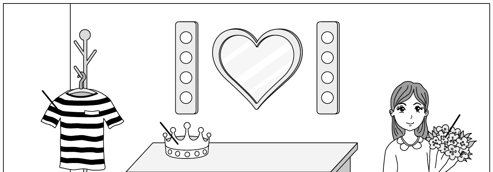
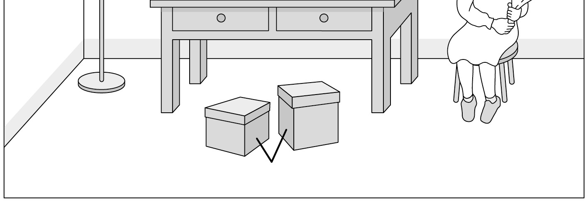
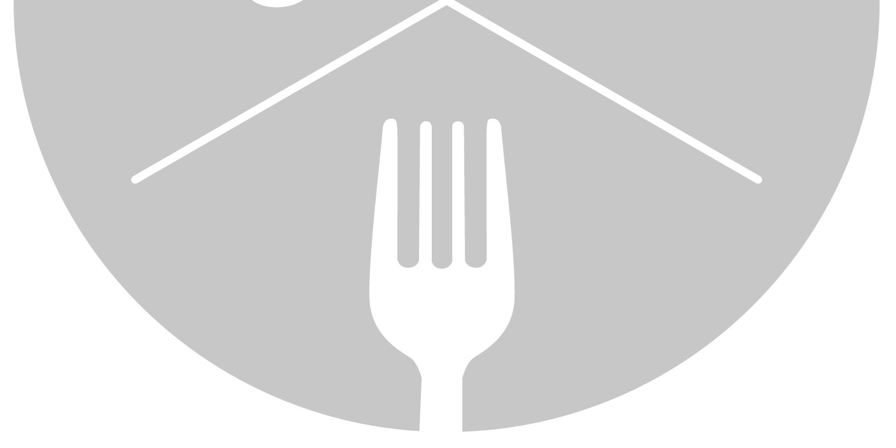

1. 다음을 듣고, 여자가 하는 말의 목적으로 가장 적절한 것을 고르시오.

① 휴식의 중요성을 강조하려고
② 직업 상담 전문가를 모집하려고
③ 스트레스 받는 이유를 설명하려고
④ 회사의 상담 프로그램을 홍보하려고
⑤ 상담 프로그램의 일정 변경을 공지하려고

2. 대화를 듣고, 남자의 의견으로 가장 적절한 것을 고르시오.

① 운동을 마친 후 스트레칭을 하는 것이 필요하다.
② 천천히 걷는 것은 근육통 완화에 도움이 된다.
③ 과도한 스트레칭은 부상을 유발할 수 있다.
④ 자신의 몸에 맞는 식단을 구성하는 것이 중요하다.
⑤ 몸과 마음의 건강을 위해 규칙적인 운동을 해야 한다.

3. 다음을 듣고, 여자가 하는 말의 요지로 가장 적절한 것을 고르시오.

① 감정 일기 쓰기는 자신의 감정을 이해하는 데 도움이 된다.
② 자신의 감정을 절제하며 의견을 전달하는 것이 필요하다.
③ 타인과의 유대감은 감정 일기의 공유를 통해 증진된다.
④ 일기 쓰기는 규칙적인 생활 습관 형성에 효과적이다.
⑤ 가족과의 대화로 부정적인 감정을 해소할 수 있다.

4. 대화를 듣고, 그림에서 대화의 내용과 일치하지 않는 것을 고르시오.

⑤
③
④
①

5. 대화를 듣고, 남자가 할 일로 가장 적절한 것을 고르시오.

① 저녁 식사 요리하기
② 여분 접시 확인하기
③ 와인 준비하기
④ 케이크 사러 가기
⑤ 공항에 마중 나가기

6. 대화를 듣고, 여자가 지불할 금액을 고르시오. [3점]

① $14
② $19
③ $24
④ $28
⑤ $33

7. 대화를 듣고, 남자가 송별회에 참석할 수 없는 이유를 고르시오.

① 동생을 돌봐야 해서
② 클럽 활동에 가야 해서
③ 마라톤에 참가해야 해서
④ 병원 진료를 받아야 해서
⑤ 교수님과 면담을 해야 해서

8. 대화를 듣고, Noodle Cooking Contest에 관해 언급되지 않은 것을 고르시오.

① 참가 대상
② 대회 날짜
③ 대회 장소
④ 우승 상금
⑤ 지원 방법

9. Library Plus에 관한 다음 내용을 듣고, 일치하지 않는 것을 고르시오.

① 도서관 자원봉사자들이 책을 집으로 배송한다.
② 도서관 회원은 무료로 이용할 수 있다.
③ 한 번에 최대 5권의 책을 빌릴 수 있다.
④ 전화로 대출 기간을 연장할 수 있다.
⑤ 직접 도서관에 방문하여 책을 반납해야 한다.

10. 다음 표를 보면서 대화를 듣고, 두 사람이 구매할 반지를 고르시오.

|  | Model | Price | Color | Stone | Gift-Wrapping Service |
| --- | --- | --- | --- | --- | --- |
| ① | A | $300 | White | Ruby | × |
| ② | B | $330 | Yellow | Ruby | × |
| ③ | C | $350 | White | Emerald | ○ |
| ④ | D | $380 | Rose | Ruby | ○ |
| ⑤ | E | $430 | Rose | Emerald | × |

11. 대화를 듣고, 남자의 마지막 말에 대한 여자의 응답으로 가장 적절한 것을 고르시오. [3점]

① Sorry. We can’t finish our art class project today.
② Oh, it’s such a shame that you missed the chance.
③ I don’t think so. The tickets are not that expensive.
④ Yeah, just let me make sure it’s okay with my mom first.
⑤ Why not? My mom and I don’t have any plans on Sunday.

12. 대화를 듣고, 여자의 마지막 말에 대한 남자의 응답으로 가장 적절한 것을 고르시오.

① Good idea. You can cook instead of me.
② My fault! I should have paid for the dinner.
③ Unfortunately, the restaurant is closed tonight.
④ Okay, then I guess we should cancel our plans.
⑤ Right. I’ll check if there’s any public parking nearby.

13. 대화를 듣고, 남자의 마지막 말에 대한 여자의 응답으로 가장 적절한 것을 고르시오. [3점]

Woman:
① Right. Let’s ask him if he can help us with the interview.
② I agree. That’s why I want to go to the event to see him.
③ Wow, I can see that you’ve read so many of his books.
④ Yeah, I’m glad that your new book got published.
⑤ No. Negative reviews could help my career.

14. 대화를 듣고, 여자의 마지막 말에 대한 남자의 응답으로 가장 적절한 것을 고르시오.

Man:
① Don’t worry. He’ll get his driver’s license soon.
② Really? I didn’t know you were interested in my car.
③ Oh, no. Then I should take my car to the repair shop.
④ No problem. We can schedule a time with my brother.
⑤ Never mind. I’m going to buy a different one tomorrow.

15. 다음 상황 설명을 듣고, Bill이 Susan에게 할 말로 가장 적절한 것을 고르시오.

Bill:
① I think you need to find the right time to relax.
② Getting good grades is not the most important thing.
③ There must be many benefits to studying at the library.
④ Why don’t you make a study plan to prepare for exams?
⑤ How about changing where you study to regain your focus?

16. 남자가 하는 말의 주제로 가장 적절한 것은?

① various drawing styles used by artists
② objects used as symbols in Western art
③ impact of religious objects on Western culture
④ changes in painting tools through history
⑤ how to paint objects in a realistic way

17. 언급된 사물이 아닌 것은?

따라 답을 하시기 바랍니다.

① mirrors
② candles
③ shells
④ books
⑤ flowers

18. 다음 글의 목적으로 가장 적절한 것은?

Dear Residents, My name is Kari Patterson, and I’m the manager of the River View Apartments. It’s time to take advantage of the sunny weather to make our community more beautiful. On Saturday, July 13 at 9 a.m., residents will meet in the north parking lot. We will divide into teams to plant flowers and small trees, pull weeds, and put colorful decorations on the lawn. Please join us for this year’s Gardening Day, and remember no special skills or tools are required. Last year, we had a great time working together, so come out and make this year’s event even better! Warm regards, Kari Patterson

19. 다음 글에 드러난 Emma의 심경 변화로 가장 적절한 것은?

It was the championship race. Emma was the final runner on her relay team. She anxiously waited in her spot for her teammate to pass her the baton. Emma wasn’t sure she could perform her role without making a mistake. Her hands shook as she thought, “What if I drop the baton?” She felt her heart rate increasing as her teammate approached. But as she started running, she received the baton smoothly. In the final 10 meters, she passed two other runners and crossed the finish line in first place! She raised her hands in the air, and a huge smile came across her face. As her teammates hugged her, she shouted, “We did it!” All of her hard training had been worth it.

20. 다음 글에서 필자가 주장하는 바로 가장 적절한 것은?

Most people resist the idea of a true self-estimate, probably because they fear it might mean downgrading some of their beliefs about who they are and what they’re capable of. As Goethe’s maxim goes, it is a great failing “to see yourself as more than you are.” How could you really be considered self-aware if you refuse to consider your weaknesses? Don’t fear self-assessment because you’re worried you might have to admit some things about yourself. The second half of Goethe’s maxim is important too. He states that it is equally damaging to “value yourself at less than your true worth.” We underestimate our capabilities just as much and just as dangerously as we overestimate other abilities. Cultivate the ability to judge yourself accurately and honestly. Look inward to discern what you’re capable of and what it will take to unlock that potential.

21. 밑줄 친 “Slavery resides under marble and gold.”가 다음 글에서 의미하는 바로 가장 적절한 것은? [3점]

Take a look at some of the most powerful, rich, and famous people in the world. Ignore the trappings of their success and what they’re able to buy. Look instead at what they’re forced to trade in return ― look at what success has cost them. Mostly? Freedom. Their work demands they wear a suit. Their success depends on attending certain parties, kissing up to people they don’t like. It will require ― inevitably ― realizing they are unable to say what they actually think. Worse, it demands that they become a different type of person or do bad things. Sure, it might pay well — but they haven’t truly examined the transaction. As Seneca put it, “Slavery resides under marble and gold.” Too many successful people are prisoners in jails of their own making. Is that what you want? Is that what you’re working hard toward? Let’s hope not.

22. 다음 글의 요지로 가장 적절한 것은?

If a firm is going to be saved by the government, it might be easier to concentrate on lobbying the government for more money rather than taking the harder decision of restructuring the company to be able to be profitable and viable in the long term. This is an example of something known as moral hazard ― when government support alters the decisions firms take. For example, if governments rescue banks who get into difficulty, as they did during the credit crisis of 2007-08, this could encourage banks to take greater risks in the future because they know there is a possibility that governments will intervene if they lose money. Although the government rescue may be well intended, it can negatively affect the behavior of banks, encouraging risky and poor decision making.

23. 다음 글의 주제로 가장 적절한 것은?

If there is little or no diversity of views, and all scientists see, think, and question the world in a similar way, then they will not, as a community, be as objective as they maintain they are, or at least aspire to be. The solution is that there should be far greater diversity in the practice of science: in gender, ethnicity, and social and cultural backgrounds. Science works because it is carried out by people who pursue their curiosity about the natural world and test their and each other’s ideas from as many varied perspectives and angles as possible. When science is done by a diverse group of people, and if consensus builds up about a particular area of scientific knowledge, then we can have more confidence in its objectivity and truth.

24. 다음 글의 제목으로 가장 적절한 것은?

We tend to break up time into units, such as weeks, months, and seasons; in a series of studies among farmers in India and students in North America, psychologists found that if a deadline is on the other side of a “break” ― such as in the New Year ― we’re more likely to see it as remote, and, as a result, be less ready to jump into action. What you need to do in that situation is find another way to think about the timeframe. For example, if it’s November and the deadline is in January, it’s better to tell yourself you have to get it done “this winter” rather than “next year.” The best approach is to view deadlines as a challenge that you have to meet within a period that’s imminent. That way the stress is more manageable, and you have a better chance of starting ― and therefore finishing ― in good time.

25. 다음 도표의 내용과 일치하지 않는 것은?

 CO2 Emissions per Person across Selected Asian Countries in 2010 and 2020 (tons) 12 11.3 8 7.7 6.4 6 5.1 4 3.8 3.3 3.8 2 1.6 1.4 1.7 China Mongolia Uzbekistan Vietnam India The graph above shows the amount of CO₂ emissions per person across selected Asian countries in 2010 and 2020.

| Country | 2010 | 2020 |
| --- | --- | --- |
| China | 6.4 | 7.7 |
| Mongolia | 5.1 | 11.3 |
| Uzbekistan | 3.8 | 3.3 |
| Vietnam | 1.6 | 3.8 |
| India | 1.4 | 1.7 |

26. Henry David Thoreau에 관한 다음 글의 내용과 일치하지 않는 것은?

Henry David Thoreau was born in Concord, Massachusetts in 1817. When he was 16, he entered Harvard College. After graduating, Thoreau worked as a schoolteacher but he quit after two weeks. In June of 1838 he set up a school with his brother John. However, he had hopes of becoming a nature poet. In 1845, he moved into a small self-built house near Walden Pond. At Walden, Thoreau did an incredible amount of reading. The journal he wrote there became the source of his most famous book, Walden. In his later life, Thoreau traveled to the Maine woods, to Cape Cod, and to Canada. At the age of 43, he ended his travels and returned to Concord. Although his works were not widely read during his lifetime, he never stopped writing, and his works fill 20 volumes.

27. 2024 Future Engineers Camp에 관한 다음 안내문의 내용과 일치하지 않는 것은?

2024 Future Engineers Camp Calling all young creators! Join us at Southside Maker Space to explore the wonders of engineering with exciting activities.
Date: Saturday, July 20 & Sunday, July 21
Time: 10 a.m. - 4 p.m.
Ages: 14 to 16
Participation
Fee: $100
Day 1 - Robotics Workshop
Learn basic coding skills.
Work in teams to build mini-robots.
Day 2 - Flying Challenge
Make and test toy airplanes.
Participate in an airplane flying race.
Notes
Lunch is included in the participation fee.
All tools and materials for the projects are provided. For more information, please visit www.southsidemaker.com.

28. Taste the City에 관한 다음 안내문의 내용과 일치하는 것은?

Taste the City Experience Jamestown’s diverse and delicious food culture all in one place. Enjoy tasty treats, and discover new restaurants!
When & Where
September 6th - 8th (10 a.m. - 9 p.m.)
Grand Park
Highlights
30 kinds of food samples provided by local restaurants
Live music performances each evening
Cooking classes with experienced chefs
Entry Tickets
Adult: $15
Child: $10 ※ No pre-reservations necessary, just show up and enjoy.

29. 다음 글의 밑줄 친 부분 중, 어법상 틀린 것은? [3점]

The built-in capacity for smile is proven by the remarkable observation that babies who are congenitally both deaf and blind, who have never seen a human face, also start to smile at around 2 months. However, smiling in blind babies eventually disappears if nothing is done to reinforce it. Without the right feedback, smiling dies out. But here’s a fascinating fact: blind babies will continue to smile if they are cuddled, bounced, nudged, and tickled by an adult ― anything to let them know that they are not alone and that someone cares about them. This social feedback encourages the baby to continue smiling. In this way, early experience operates with our biology to establish social behaviors. In fact, you don’t need the cases of blind babies to make the point. Babies with sight smile more at you when you look at them or, better still, smiling back at them.

30. 다음 글의 밑줄 친 부분 중, 문맥상 낱말의 쓰임이 적절하지 않은 것은? [3점]

Because people tend to adapt, interrupting positive things with negative ones can actually increase enjoyment. Take commercials. Most people hate them, so removing them should make shows or other entertainment more enjoyable. But the opposite is true. Shows are actually more enjoyable when they’re broken up by annoying commercials. Because these less enjoyable moments break up adaptation to the positive experience of the show. Think about eating chocolate chips. The first chip is delicious: sweet, melt-in-your-mouth goodness. The second chip is also pretty good. But by the fourth, fifth, or tenth chip in a row, the goodness is no longer as pleasurable. We adapt. Interspersing positive experiences with less positive ones, however, can delay adaptation. Eating a Brussels sprout between chocolate chips or viewing commercials between parts of TV shows disrupts the process. The less positive moment makes the following positive one new again and thus more enjoyable.

31. 다음 빈칸에 들어갈 말로 가장 적절한 것을 고르시오.

We collect stamps, coins, vintage cars even when they serve no practical purpose. The post office doesn’t accept the old stamps, the banks don’t take old coins, and the vintage cars are no longer allowed on the road. These are all side issues; the attraction is that they are in short supply. In one study, students were asked to arrange ten posters in order of attractiveness ― with the agreement that afterward they could keep one poster as a reward for their participation. Five minutes later, they were told that the poster with the third highest rating was no longer available. Then they were asked to judge all ten from scratch. The poster that was no longer available was suddenly classified as the most beautiful. In psychology, this phenomenon is called reactance: when we are deprived of an option, we suddenly deem it more attractive.

32. 다음 빈칸에 들어갈 말로 가장 적절한 것을 고르시오.

If we’ve invested in something that hasn’t repaid us ― be it money in a failing venture, or time in an unhappy relationship ― we find it very difficult to walk away. This is the sunk cost fallacy. Our instinct is to continue investing money or time as we hope that our investment will prove to be worthwhile in the end. Giving up would mean acknowledging that we’ve wasted something we can’t get back, and that thought is so painful that we prefer to avoid it if we can. The problem, of course, is that if something really is a bad bet, then staying with it simply increases the amount we lose. Rather than walk away from a bad five-year relationship, for example, we turn it into a bad 10-year relationship; rather than accept that we’ve lost a thousand dollars, we lay down another thousand and lose that too. In the end, by delaying the pain of admitting our problem, we only add to it. Sometimes we just have to cut our losses.

33. 다음 빈칸에 들어갈 말로 가장 적절한 것을 고르시오. [3점]

On our little world, light travels, for all practical purposes, instantaneously. If a lightbulb is glowing, then of course it’s physically where we see it, shining away. We reach out our hand and touch it: It’s there all right, and unpleasantly hot. If the filament fails, then the light goes out. We don’t see it in the same place, glowing, illuminating the room years after the bulb breaks and it’s removed from its socket. The very notion seems nonsensical. But if we’re far enough away, an entire sun can go out and we’ll continue to see it shining brightly; we won’t learn of its death, it may be, for ages to come ― in fact, for how long it takes light, which travels fast but not infinitely fast, to cross the intervening vastness. The immense distances to the stars and the galaxies mean that we see everything in space in the past.

34. 다음 빈칸에 들어갈 말로 가장 적절한 것을 고르시오. [3점]

Financial markets do more than take capital from the rich and lend it to everyone else. They enable each of us to smooth consumption over our lifetimes, which is a fancy way of saying that we don’t have to spend income at the same time we earn it. Shakespeare may have admonished us to be neither borrowers nor lenders; the fact is that most of us will be both at some point. If we lived in an agrarian society, we would have to eat our crops reasonably soon after the harvest or find some way to store them. Financial markets are a more sophisticated way of managing the harvest. We can spend income now that we have not yet earned ― as by borrowing for college or a home ― or we can earn income now and spend it later, as by saving for retirement. The important point is that earning income has been divorced from spending it, allowing us much more flexibility in life.

35. 다음 글에서 전체 흐름과 관계 없는 문장은?

As the old joke goes: “Software, free. User manual, $10,000.” But it’s no joke. A couple of high-profile companies make their living selling instruction and paid support for free software. The copy of code, being mere bits, is free. The lines of free code become valuable to you only through support and guidance. A lot of medical and genetic information will go this route in the coming decades. Right now getting a full copy of all your DNA is very expensive ($10,000), but soon it won’t be. The public exposure of people’s personal genetic information will undoubtedly cause serious legal and ethical problems. The price is dropping so fast, it will be $100 soon, and then the next year insurance companies will offer to sequence you for free. When a copy of your sequence costs nothing, the interpretation of what it means, what you can do about it, and how to use it ― the manual for your genes ― will be expensive.

36. 주어진 글 다음에 이어질 글의 순서로 가장 적절한 것을 고르시오.

Brains are expensive in terms of energy. Twenty percent of the calories we consume are used to power the brain.

So brains try to operate in the most energy-efficient way possible, and that means processing only the minimum amount of information from our senses that we need to navigate the world. Neuroscientists weren’t the first to discover that fixing your gaze on something is no guarantee of seeing it. Magicians figured this out long ago.

By directing your attention, they perform tricks with their hands in full view. Their actions should give away the game, but they can rest assured that your brain processes only small bits of the visual scene.

This all helps to explain the prevalence of traffic accidents in which drivers hit pedestrians in plain view, or collide with cars directly in front of them. In many of these cases, the eyes are pointed in the right direction, but the brain isn’t seeing what’s really out there.

37. 주어진 글 다음에 이어질 글의 순서로 가장 적절한 것을 고르시오. [3점]

Buying a television is current consumption. It makes us happy today but does nothing to make us richer tomorrow. Yes, money spent on a television keeps workers employed at the television factory.

But if the same money were invested, it would create jobs somewhere else, say for scientists in a laboratory or workers on a construction site, while also making us richer in the long run.

Think about college as an example. Sending students to college creates jobs for professors. Using the same money to buy fancy sports cars for high school graduates would create jobs for auto workers. [3점]

The crucial difference between these scenarios is that a college education makes a young person more productive for the rest of his or her life; a sports car does not. Thus, college tuition is an investment; buying a sports car is consumption.

38. 글의 흐름으로 보아, 주어진 문장이 들어가기에 가장 적절한 곳을 고르시오.

The Net differs from most of the mass media it replaces in an obvious and very important way: it’s bidirectional. We can send messages through the network as well as receive them, which has made the system all the more useful. The ability to exchange information online, to upload as well as download, has turned the Net into a thoroughfare for business and commerce. With a few clicks, people can search virtual catalogues, place orders, track shipments, and update information in corporate databases. But the Net doesn’t just connect us with businesses; it connects us with one another. It’s a personal broadcasting medium as well as a commercial one. Millions of people use it to distribute their own digital creations, in the form of blogs, videos, photos, songs, and podcasts, as well as to critique, edit, or otherwise modify the creations of others.

39. 글의 흐름으로 보아, 주어진 문장이 들어가기에 가장 적절한 곳을 고르시오.

Imagine that seven out of ten working Americans got fired tomorrow. What would they all do? It’s hard to believe you’d have an economy at all if you gave pink slips to more than half the labor force. But that is what the industrial revolution did to the workforce of the early 19th century. Two hundred years ago, 70 percent of American workers lived on the farm. Today automation has eliminated all but 1 percent of their jobs, replacing them with machines. But the displaced workers did not sit idle. Instead, automation created hundreds of millions of jobs in entirely new fields. Those who once farmed were now manning the factories that manufactured farm equipment, cars, and other industrial products. Since then, wave upon wave of new occupations have arrived — appliance repair person, food chemist, photographer, web designer — each building on previous automation. Today, the vast majority of us are doing jobs that no farmer from the 1800s could have imagined.

40. 다음 글의 내용을 한 문장으로 요약하고자 한다. 빈칸 (A), (B)에 들어갈 말로 가장 적절한 것은?

Many things spark envy: ownership, status, health, youth, talent, popularity, beauty. It is often confused with jealousy because the physical reactions are identical. The difference: the subject of envy is a thing (status, money, health etc.). The subject of jealousy is the behaviour of a third person. Envy needs two people. Jealousy, on the other hand, requires three: Peter is jealous of Sam because the beautiful girl next door rings him instead. Paradoxically, with envy we direct resentments toward those who are most similar to us in age, career and residence. We don’t envy businesspeople from the century before last. We don’t envy millionaires on the other side of the globe. As a writer, I don’t envy musicians, managers or dentists, but other writers. As a CEO you envy other, bigger CEOs. As a supermodel you envy more successful supermodels. Aristotle knew this: ‘Potters envy potters.’ 

 Jealousy involves three parties, focusing on the actions of a third person, whereas envy involves two individuals whose personal circumstances are most alike, with one person resenting the other.

41. 윗글의 제목으로 가장 적절한 것은?

We have biases that support our biases! If we’re partial to one option ― perhaps because it’s more memorable, or framed to minimize loss, or seemingly consistent with a promising pattern ― we tend to search for information that will justify choosing that option. On the one hand, it’s sensible to make choices that we can defend with data and a list of reasons. On the other hand, if we’re not careful, we’re likely to conduct an imbalanced analysis, falling prey to a cluster of errors collectively known as “confirmation biases.” For example, nearly all companies include classic “tell me about yourself” job interviews as part of the hiring process, and many rely on these interviews alone to evaluate applicants. But it turns out that traditional interviews are actually one of the least useful tools for predicting an employee’s future success. This is because interviewers often subconsciously make up their minds about interviewees based on their first few moments of interaction and spend the rest of the interview cherry-picking evidence and phrasing their questions to confirm that initial impression: “I see here you left a good position at your previous job. You must be pretty ambitious, right?” versus “You must not have been very committed, huh?” This means that interviewers can be prone to overlooking significant information that would clearly indicate whether this candidate was actually the best person to hire. More structured approaches, like obtaining samples of a candidate’s work or asking how he would respond to difficult hypothetical situations, are dramatically better at assessing future success, with a nearly threefold advantage over traditional interviews.

42. 밑줄 친 낱말 중에서 문맥상 낱말의 쓰임이 적절하지 않은 것은? [3점]

We have biases that support our biases! If we’re partial to one option ― perhaps because it’s more memorable, or framed to minimize loss, or seemingly consistent with a promising pattern ― we tend to search for information that will justify choosing that option. On the one hand, it’s sensible to make choices that we can defend with data and a list of reasons. On the other hand, if we’re not careful, we’re likely to conduct an imbalanced analysis, falling prey to a cluster of errors collectively known as “confirmation biases.” For example, nearly all companies include classic “tell me about yourself” job interviews as part of the hiring process, and many rely on these interviews alone to evaluate applicants. But it turns out that traditional interviews are actually one of the least useful tools for predicting an employee’s future success. This is because interviewers often subconsciously make up their minds about interviewees based on their first few moments of interaction and spend the rest of the interview cherry-picking evidence and phrasing their questions to confirm that initial impression: “I see here you left a good position at your previous job. You must be pretty ambitious, right?” versus “You must not have been very committed, huh?” This means that interviewers can be prone to overlooking significant information that would clearly indicate whether this candidate was actually the best person to hire. More structured approaches, like obtaining samples of a candidate’s work or asking how he would respond to difficult hypothetical situations, are dramatically better at assessing future success, with a nearly threefold advantage over traditional interviews.

43. 주어진 글에 이어질 내용을 순서에 맞게 배열한 것으로 가장 적절한 것은?

 As Todd finished loading his groceries, Greg’s door remained open. Todd noticed Greg didn’t get out of his car. But he was pulling something from his car. He put a metal frame on the ground beside his door. Remaining in the driver’s seat, he then reached back into his car to grab something else. Todd realized what he was doing and considered whether he should try to help him. After a moment, he decided to approach Greg. By this time, Greg had already pulled one thin wheel out of his car and attached it to the frame. He was now pulling a second wheel out when he looked up and saw Todd standing near him. Todd said, “Hi there! Have a great weekend!” Greg seemed a bit surprised, but replied by wishing him a great weekend too. Then Greg added, “Thanks for letting me have my independence.” “Of course,” Todd said. After Todd and Ava climbed into their truck, Ava became curious. So she asked why he didn’t offer to help the man with his wheelchair. Todd said, “Why do you insist on brushing your teeth without my help?” She answered, “Because I know how to!” He said, “And the man knows how to put together his wheelchair.” Ava understood that sometimes the best way to help someone is to not help at all.

44. 밑줄 친 낱말 중에서 가리키는 대상이 나머지 넷과 다른 것은?

 As Todd finished loading his groceries, Greg’s door remained open. Todd noticed Greg didn’t get out of his car. But he was pulling something from his car. He put a metal frame on the ground beside his door. Remaining in the driver’s seat, he then reached back into his car to grab something else. Todd realized what he was doing and considered whether he should try to help him. After a moment, he decided to approach Greg. By this time, Greg had already pulled one thin wheel out of his car and attached it to the frame. He was now pulling a second wheel out when he looked up and saw Todd standing near him. Todd said, “Hi there! Have a great weekend!” Greg seemed a bit surprised, but replied by wishing him a great weekend too. Then Greg added, “Thanks for letting me have my independence.” “Of course,” Todd said. After Todd and Ava climbed into their truck, Ava became curious. So she asked why he didn’t offer to help the man with his wheelchair. Todd said, “Why do you insist on brushing your teeth without my help?” She answered, “Because I know how to!” He said, “And the man knows how to put together his wheelchair.” Ava understood that sometimes the best way to help someone is to not help at all.

45. 윗글에 관한 내용으로 적절하지 않은 것은?

 As Todd finished loading his groceries, Greg’s door remained open. Todd noticed Greg didn’t get out of his car. But he was pulling something from his car. He put a metal frame on the ground beside his door. Remaining in the driver’s seat, he then reached back into his car to grab something else. Todd realized what he was doing and considered whether he should try to help him. After a moment, he decided to approach Greg. By this time, Greg had already pulled one thin wheel out of his car and attached it to the frame. He was now pulling a second wheel out when he looked up and saw Todd standing near him. Todd said, “Hi there! Have a great weekend!” Greg seemed a bit surprised, but replied by wishing him a great weekend too. Then Greg added, “Thanks for letting me have my independence.” “Of course,” Todd said. After Todd and Ava climbed into their truck, Ava became curious. So she asked why he didn’t offer to help the man with his wheelchair. Todd said, “Why do you insist on brushing your teeth without my help?” She answered, “Because I know how to!” He said, “And the man knows how to put together his wheelchair.” Ava understood that sometimes the best way to help someone is to not help at all.
