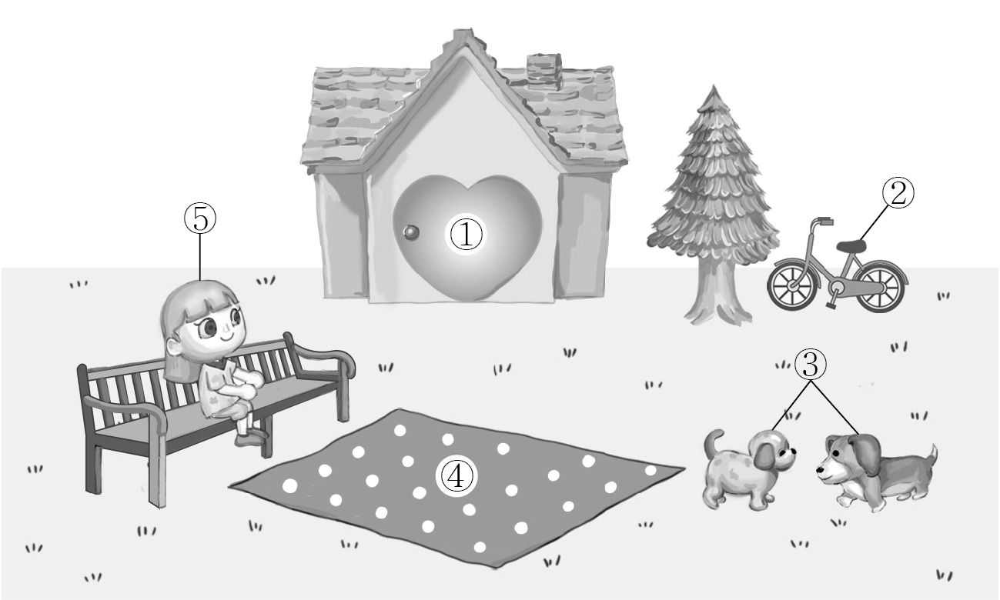
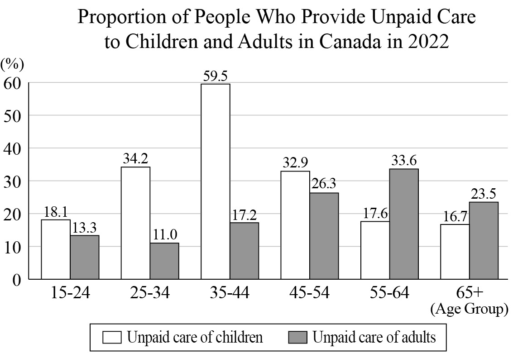
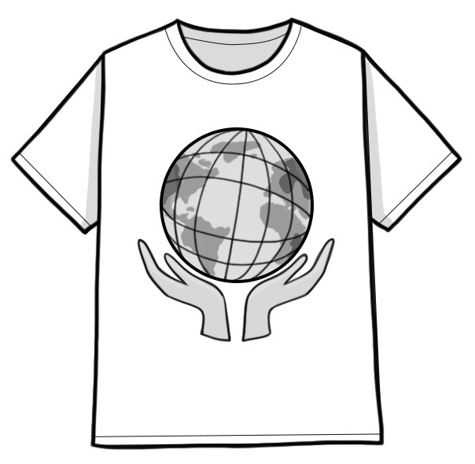
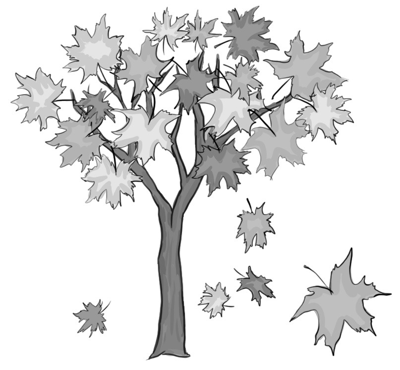

1. 다음을 듣고, 여자가 하는 말의 목적으로 가장 적절한 것을 고르시오.

① 미술 대회 작품을 공모하려고
② 직원 채용 일정을 안내하려고
③ 전시회 취소에 대해 항의하려고
④ 어린이 미술관 건립을 제안하려고
⑤ 미술관 무료 입장 행사를 홍보하려고

2. 대화를 듣고, 남자의 의견으로 가장 적절한 것을 고르시오.

① 식물을 실내에 두면 호흡기 건강에 해로울 수 있다.
② 지나치게 높은 온도는 실내 식물에 악영향을 미친다.
③ 식물에게 말하는 것은 식물이 자라는 데 도움이 된다.
④ 상대방의 목소리를 통해 건강 상태를 파악할 수 있다.
⑤ 적절한 인사말은 대화를 자연스럽게 시작하는 데 필요하다.

3. 다음을 듣고, 남자가 하는 말의 요지로 가장 적절한 것을 고르시오.

① 과일과 채소는 색깔에 따라 효능이 다르다.
② 규칙적인 식사는 혈당 수치 조절에 도움이 된다.
③ 식사 직후의 과일 섭취는 소화 문제를 유발할 수 있다.
④ 일상생활의 스트레스는 소화 불량을 악화시킬 수 있다.
⑤ 음식물 섭취만으로 하루 권장 비타민양을 채울 수 있다.

4. 대화를 듣고, 그림에서 대화의 내용과 일치하지 않는 것을 고르시오.

5. 대화를 듣고, 여자가 할 일로 가장 적절한 것을 고르시오.

① 운동 장비 대여하기
② 축구공 개수 확인하기
③ 스포츠 클럽 방문하기
④ 경기 규칙 유인물 만들기
⑤ 자원봉사자들에게 전화하기

6. 대화를 듣고, 남자가 지불할 금액을 고르시오. [3점]

① $24
② $28
③ $30
④ $38
⑤ $40

7. 대화를 듣고, 여자가 대회에 출품할 사진을 촬영하지 못한 이유를 고르시오.

① 카메라가 고장나서
② 몸 상태가 좋지 않아서
③ 촬영하기에 날씨가 나빠서
④ 과학 캠프와 일정이 겹쳐서
⑤ 적합한 촬영 장소를 찾지 못해서

8. 대화를 듣고, Poetry Magic에 관해 언급되지 않은 것을 고르시오.

① 출연자
② 일시
③ 장소
④ 기념품
⑤ 등록 방법

9. Short-form Video Course에 관한 다음 내용을 듣고, 일치하지 않는 것을 고르시오.

① 무료 온라인 강좌이다.
② 세 단계로 이루어져 있다.
③ 웹사이트에서 등록할 수 있다.
④ 언제든지 반복해서 수강할 수 있다.
⑤ 모든 참가자의 작품에 대해 피드백을 제공한다.

10. 다음 표를 보면서 대화를 듣고, 두 사람이 주문할 백색 소음 기계를 고르시오.

|  | Model | Price | Number of White Noise Tracks | Color | Alarm Function |
| --- | --- | --- | --- | --- | --- |
| ① | A | $42 | 20 | Silver | × |
| ② | B | $38 | 18 | White | × |
| ③ | C | $35 | 15 | White | ○ |
| ④ | D | $30 | 12 | Black | ○ |
| ⑤ | E | $25 | 8 | Black | × |

11. 대화를 듣고, 여자의 마지막 말에 대한 남자의 응답으로 가장 적절한 것을 고르시오.

① Yeah. Our delivery has just arrived.
② Alright. Let’s sign up for the membership.
③ Oh, no. I forgot to renew our membership.
④ Great. The shopping mall is close to our home.
⑤ Okay. I’ll consider reducing my online shopping.

12. 대화를 듣고, 남자의 마지막 말에 대한 여자의 응답으로 가장 적절한 것을 고르시오.

① Sure. I’ll bring my tumbler next time.
② I’m afraid not. We’re out of paper cups.
③ No worries. I already prepared the drinks.
④ Sorry. The cafe doesn’t offer any discount.
⑤ Why not? Let’s get a refund for the tumbler.

13. 대화를 듣고, 여자의 마지막 말에 대한 남자의 응답으로 가장 적절한 것을 고르시오.

Man:
① Good choice. This shirt looks great on you!
② Okay. We’d better go buy your shirt right away.
③ Really? I didn’t know the rehearsal was canceled.
④ Well, why not wear a white shirt for the show?
⑤ Oh, I’m sorry that I missed your performance.

14. 대화를 듣고, 남자의 마지막 말에 대한 여자의 응답으로 가장 적절한 것을 고르시오. [3점]

Woman:
① I agree that we should walk our dogs often.
② I’m glad that my dog loved staying at the pet hotel.
③ I’d really appreciate it if you could take care of him.
④ It’s better to pack only necessary things for traveling.
⑤ I recommend you bring your dog to the animal hospital.

15. 다음 상황 설명을 듣고, David가 Emily에게 할 말로 가장 적절한 것을 고르시오. [3점]

David:
① Can you look for different music for the last scene?
② I think we need to practice more for the musical.
③ Please check the schedule for the final stage.
④ Would you mind if I change some scenes?
⑤ I want you to play the main character.

16. 여자가 하는 말의 주제로 가장 적절한 것은?

① traditional ways to preserve foods
② possible origins of famous desserts
③ health concerns about ready-made foods
④ controversy over the cost of popular desserts
⑤ newly-invented desserts with special ingredients

17. 언급된 나라가 아닌 것은?

따라 답을 하시기 바랍니다.

① Scotland
② Italy
③ Egypt
④ France
⑤ Sweden

18. 다음 글의 목적으로 가장 적절한 것은?

To whom it may concern, My name is Peter Jackson and I am thinking of applying for the Advanced Licensed Counselor Program that the university provides. I found that the certification for 100 hours of counseling experience is required for the application. However, I do not think I could possibly complete the required counseling experience by the current deadline. So, if possible, I kindly request an extension of the deadline until the end of this summer vacation. I am actively working on obtaining the certification, and I am sure I will be able to submit it by then. I understand the importance of following the application process, and would greatly appreciate your consideration of this request. I look forward to your response. Sincerely, Peter Jackson

19. 다음 글에 드러난 ‘I’의 심경 변화로 가장 적절한 것은?

The passport control line was short and the inspectors looked relaxed; except the inspector at my window. He seemed to want to model the seriousness of the task at hand for the other inspectors. Maybe that’s why I felt uneasy when he studied my passport more carefully than I expected. “You were here in September,” he said. “Why are you back so soon?” “I came in September to prepare to return this month,” I replied with a trembling voice, considering if I missed any Italian regulations. “For how long?” he asked. “One month, this time,” I answered truthfully. I knew it was not against the rules to stay in Italy for three months. “Enjoy your stay,” he finally said, as he stamped my passport. Whew! As I walked away, the burden I had carried, even though I did nothing wrong, vanished into the air. My shoulders, once weighed down, now stretched out with comfort.

20. 다음 글에서 필자가 주장하는 바로 가장 적절한 것은?

Merely convincing your children that worry is senseless and that they would be more content if they didn’t worry isn’t going to stop them from worrying. For some reason, young people seem to believe that worry is a fact of life over which they have little or no control. Consequently, they don’t even try to stop. Therefore, you need to convince them that worry, like guilt and fear, is nothing more than an emotion, and like all emotions, is subject to the power of the will. Tell them that they can eliminate worry from their lives by simply refusing to attend to it. Explain to them that if they refuse to act worried regardless of how they feel, they will eventually stop feeling worried and will begin to experience the contentment that accompanies a worry-free life.

21. 밑줄 친 Build a jazz band가 다음 글에서 의미하는 바로 가장 적절한 것은?

In today’s information age, in many companies and on many teams, the objective is no longer error prevention and replicability. On the contrary, it’s creativity, speed, and keenness. In the industrial era, the goal was to minimize variation. But in creative companies today, maximizing variation is more essential. In these situations, the biggest risk isn’t making a mistake or losing consistency; it’s failing to attract top talent, to invent new products, or to change direction quickly when the environment shifts. Consistency and repeatability are more likely to suppress fresh thinking than to bring your company profit. A lot of little mistakes, while sometimes painful, help the organization learn quickly and are a critical part of the innovation cycle. In these situations, rules and process are no longer the best answer. A symphony isn’t what you’re going for. Leave the conductor and the sheet music behind. Build a jazz band instead.

22. 다음 글의 요지로 가장 적절한 것은?

Any new or threatening situation may require us to make decisions and this requires information. So important is communication during a disaster that normal social barriers are often lowered. We will talk to strangers in a way we would never consider normally. Even relatively low grade disruption of our life such as a fire drill or a very late train seems to give us the permission to break normal etiquette and talk to strangers. The more important an event to a particular public, the more detailed and urgent the requirement for news becomes. Without an authoritative source of facts, whether that is a newspaper or trusted broadcast station, rumours often run riot. Rumours start because people believe their group to be in danger and so, although the rumour is unproven, feel they should pass it on. For example, if a worker heard that their employer’s business was doing badly and people were going to be made redundant, they would pass that information on to colleagues.

23. 다음 글의 주제로 가장 적절한 것은?

People seem to recognize that the arts are cultural activities that draw on (or react against) certain cultural traditions, certain shared understanding, and certain values and ideas that are characteristic of the time and place in which the art is created. In the case of science, however, opinions differ. Some scientists, like the great biologist J. B. S. Haldane, see science in a similar light ― as a historical activity that occurs in a particular time and place, and that needs to be understood within that context. Others, however, see science as a purely “objective” pursuit, uninfluenced by the cultural viewpoint and values of those who create it. In describing this view of science, philosopher Hugh Lacey speaks of the belief that there is an underlying order of the world which is simply there to be discovered ― the world of pure “fact” stripped of any link with value. The aim of science according to this view is to represent this world of pure “fact”, independently of any relationship it might bear contingently to human practices and experiences.

24. 다음 글의 제목으로 가장 적절한 것은?

Mental development consists of individuals increasingly mastering social codes and signals themselves, which they can master only in social situations with the support of more competent individuals, typically adults. In this sense, mental development consists of internalizing social patterns and gradually becoming a responsible actor among other responsible actors. In Denmark, the age of criminal responsibility is 15 years, which means that we then say that people have developed sufficient mental maturity to be accountable for their actions at this point. And at the age of 18 people are given the right to vote and are thereby formally included in the basic democratic process. I do not know whether these age boundaries are optimal, but it is clear that mental development takes place at different rates for different individuals, and depends especially on the social and family environment they have been given. Therefore, having formal limits for responsibility from a specific age that apply to everyone is a somewhat questionable practice. But the question, of course, is whether it can be done any differently.

25. 다음 도표의 내용과 일치하지 않는 것은?

The graph above shows the percentage of people who provided unpaid care to children and adults by age group in Canada in 2022.

| Age Group | Unpaid care of children | Unpaid care of adults |
| --- | --- | --- |
| 15-24 | 18.1 | 13.3 |
| 25-34 | 34.2 | 11.0 |
| 35-44 | 59.5 | 17.2 |
| 45-54 | 32.9 | 26.3 |
| 55-64 | 17.6 | 33.6 |
| 65+ | 16.7 | 23.5 |

26. Charles Elton에 관한 다음 글의 내용과 일치하지 않는 것은?

Born in the English city of Liverpool, Charles Elton studied zoology under Julian Huxley at Oxford University from 1918 to 1922. After graduating, he began teaching as a part-time instructor and had a long and distinguished teaching career at Oxford from 1922 to 1967. After a series of arctic expeditions with Huxley, he worked with a fur-collecting and trading company as a biological consultant, and examined the company’s records to study animal populations. In 1927, he wrote his first and most important book, Animal Ecology, in which he demonstrated the nature of food chains and cycles. In 1932, he helped establish the Bureau of Animal Population at Oxford. In the same year he became the editor of the new Journal of Animal Ecology. Throughout his career, Elton wrote six books and played a major role in shaping the modern science of ecology.

27. Clifton Fall Clean-up Day 2024에 관한 다음 안내문의 내용과 일치하지 않는 것은?

Clifton Fall Clean-up Day 2024 Join us for this annual event to clean up the fallen leaves in Central Park, and enjoy meeting your neighbors!
When: Sunday, October 20th, 1 p.m. - 3 p.m.
Details
Clean-up will be done in groups of 10 people based on age.
After the clean-up, you can enjoy a casual gathering with neighbors.
Food trucks will be set up for your gathering.
Notes
A T-shirt with the event’s logo will be provided as a gift.
You’ll be supplied with cleaning materials, such as bags and gloves, so you don’t have to bring them. We’re looking forward to seeing you there!

28. Sustainable Fashion Festival 2024에 관한 다음 안내문의 내용과 일치하는 것은?

Sustainable Fashion Festival 2024 Sustainable Fashion Festival 2024 is coming! Be inspired and learn how to live sustainably while looking fabulous.
When & Where
Friday, September 13th, 5 p.m. - 9 p.m.
Aimes Community Center Tickets: $20 for early birds / $25 at the door (Early purchase discount ends two days before the event.)
Programs
Marketplace for sustainable products: You can sell or buy new, vintage, or upcycled clothing.
Talks from eco-fashion experts on fashion’s sustainable future
Clothing exchange: You can exchange 5 or fewer items.
Runway showcase of sustainable designs ※ To sell your sustainable products at our marketplace, registration is required in advance. Contact us on social media for more information.

29. 다음 글의 밑줄 친 부분 중, 어법상 틀린 것은? [3점]

One well-known shift took place when the accepted view ― that the Earth was the center of the universe — changed to one where we understood that we are only inhabitants on one planet orbiting the Sun. With each person who grasped the solar system view, it became easier for the next person to do so. So it is with the notion that the world revolves around the human economy. This is slowly being replaced by the view that the economy is a part of the larger system of material flows that connect all living things. When this perspective shifts into place, it will be obvious that our economic well-being requires that we account for, and respond to, factors of ecological health. Unfortunately we do not have a century or two to make the change. By clarifying the nature of the old and new perspectives, and by identifying actions on which we might cooperate to move the process along, we can help accelerate the shift.

30. 다음 글의 밑줄 친 부분 중, 문맥상 낱말의 쓰임이 적절하지 않은 것은?

The first human beings probably evolved in tropical regions where survival was possible without clothing. It is likely that they had very dark skin because light skin would have given little protection against the burning rays of the sun. There is a debate about whether these people spread into other parts of the world or, instead, whether people developed independently in various parts of the world. Whichever the case, it is believed that in time they became capable of spreading out from Africa, eventually to most of the world. This was probably because their physical characteristics changed. For instance, early hominids probably did not walk upright, but when they developed that ability, they could travel more efficiently. More important, perhaps, was their development of tool making. With tools, they could hunt other animals, so they could consume more protein and fat than their low-energy vegetarian diet would have provided. Not only their bodies but also their brains would have been changed with more energy. The brain needs lots of energy to grow. As their diet expanded, hominids could physically and intellectually expand their territory.

31. 다음 빈칸에 들어갈 말로 가장 적절한 것을 고르시오. [3점]

When we get an unfavorable outcome, in some ways the last thing we want to hear is that the process was fair. As outraging as the combination of an unfavorable outcome and an unfair process is, this combination also brings with it a consolation prize: the possibility of attributing the bad outcome to something other than ourselves. We may reassure ourselves by believing that our bad outcome had little to do with us and everything to do with the unfair process. If the process is fair, however, we cannot nearly as easily externalize the outcome; we got what we got “fair and square.” When the process is fair we believe that our outcome is deserved, which is another way of saying that there must have been something about ourselves (what we did or who we are) that caused the outcome.

32. 다음 빈칸에 들어갈 말로 가장 적절한 것을 고르시오. [3점]

The well-known American ethnologist Alfred Louis Kroeber made a rich and in-depth study of women’s evening dress in the West, stretching back about three centuries and using reproductions of engravings. Having adjusted the dimensions of these plates due to their diverse origins, he was able to analyse the constant elements in fashion features and to come up with a study that was neither intuitive nor approximate, but precise, mathematical and statistical. He reduced women’s clothing to a certain number of features: length and size of the skirt, size and depth of the neckline, height of the waistline. He demonstrated unambiguously that fashion is a profoundly regular phenomenon which is not located at the level of annual variations but on the scale of history. For practically 300 years, women’s dress was subject to a very precise periodic cycle: forms reach the furthest point in their variations every fifty years. If, at any one moment, skirts are at their longest, fifty years later they will be at their shortest; thus skirts become long again fifty years after being short and a hundred years after being long.

33. 다음 빈칸에 들어갈 말로 가장 적절한 것을 고르시오. [3점]

Over the last few centuries, humanity’s collective prosperity has skyrocketed, as technological progress has made us far wealthier than ever before. To share out those riches, almost all societies have settled upon the market mechanism, rewarding people in various ways for the work that they do and the things that they own. But rising inequality, itself often driven by technology, has started to put that mechanism under strain. Today, markets already provide immense rewards to some people but leave many others with very little. And now, technological unemployment threatens to become a more radical version of the same story, taking place in the particular market we rely upon the most: the labor market. As that market begins to break down, more and more people will be in danger of not receiving a share of society’s prosperity at all.

34. 다음 빈칸에 들어갈 말로 가장 적절한 것을 고르시오. [3점]

It’s often said that those who can’t do, teach. It would be more accurate to say that those who can do, can’t teach the basics. A great deal of expert knowledge is implicit, not explicit. The further you progress toward mastery, the less conscious awareness you often have of the fundamentals. Experiments show that skilled golfers and wine aficionados have a hard time describing their putting and tasting techniques — even asking them to explain their approaches is enough to interfere with their performance, so they often stay on autopilot. When I first saw an elite diver do four and a half somersaults, I asked how he managed to spin so fast. His answer: “Just go up in a ball.” Experts often have an intuitive understanding of a route, but they struggle to clearly express all the steps to take. Their brain dump is partially filled with garbage.

35. 다음 글에서 전체 흐름과 관계 없는 문장은?

Minimal processing can be one of the best ways to keep original flavors and taste, without any need to add artificial flavoring or additives, or too much salt. This would also be the efficient way to keep most nutrients, especially the most sensitive ones such as many vitamins and antioxidants. Milling of cereals is one of the most harsh processes which dramatically affect nutrient content. While grains are naturally very rich in micronutrients, antioxidants and fiber (i.e. in wholemeal flour or flakes), milling usually removes the vast majority of minerals, vitamins and fibers to raise white flour. To increase grain production, the use of chemical fertilizers should be minimized, and insect-resistant grain varieties should be developed. Such a spoilage of key nutrients and fiber is no longer acceptable in the context of a sustainable diet aiming at an optimal nutrient density and health protection. In contrast, fermentation of various foodstuffs or germination of grains are traditional, locally accessible, low-energy and highly nutritious processes of sounded interest.

36. 주어진 글 다음에 이어질 글의 순서로 가장 적절한 것을 고르시오.

It would seem obvious that the more competent someone is, the more we will like that person. By “competence,” I mean a cluster of qualities: smartness, the ability to get things done, wise decisions, etc. We stand a better chance of doing well at our life tasks if we surround ourselves with people who know what they’re doing and have a lot to teach us. But the research evidence is paradoxical: In problem-solving groups, the participants who are considered the most competent and have the best ideas tend not to be the ones who are best liked. Why? One possibility is that, although we like to be around competent people, those who are too competent make us uncomfortable. They may seem unapproachable, distant, superhuman ― and make us look bad (and feel worse) by comparison. If this were true, we might like people more if they reveal some evidence of fallibility. For example, if your friend is a brilliant mathematician, superb athlete, and gourmet cook, you might like him or her better if, every once in a while, they screwed up.

37. 주어진 글 다음에 이어질 글의 순서로 가장 적절한 것을 고르시오. [3점]

A computational algorithm that takes input data and generates some output from it doesn’t really embody any notion of meaning. Certainly, such a computation does not generally have as its purpose its own survival and well-being. It does not, in general, assign value to the inputs. Compare, for example, a computer algorithm with the waggle dance of the honeybee, by which means a foraging bee conveys to others in the hive information about the source of food (such as nectar) it has located. The “dance” ― a series of stylized movements on the comb ― shows the bees how far away the food is and in which direction. But this input does not simply program other bees to go out and look for it. Rather, they evaluate this information, comparing it with their own knowledge of the surroundings. Some bees might not bother to make the journey, considering it not worthwhile. The input, such as it is, is processed in the light of the organism’s own internal states and history; there is nothing prescriptive about its effects.

38. 글의 흐름으로 보아, 주어진 문장이 들어가기에 가장 적절한 곳을 고르시오.

There are deep similarities between viral contagion and behavioral contagion. For example, people in close or extended proximity to others infected by a virus are themselves more likely to become infected, just as people are more likely to drink excessively when they spend more time in the company of heavy drinkers. But there are also important differences between the two types of contagion. One is that visibility promotes behavioral contagion but inhibits the spread of infectious diseases. Solar panels that are visible from the street, for instance, are more likely to stimulate neighboring installations. In contrast, we try to avoid others who are visibly ill. Another important difference is that whereas viral contagion is almost always a bad thing, behavioral contagion is sometimes negative ― as in the case of smoking ― but sometimes positive, as in the case of solar installations.

39. 글의 흐름으로 보아, 주어진 문장이 들어가기에 가장 적절한 곳을 고르시오. [3점]

Sleep is clearly about more than just resting. One curious fact is that animals that are hibernating also have periods of sleep. It comes as a surprise to most of us, but hibernation and sleep are not the same thing at all, at least not from a neurological and metabolic perspective. Hibernating is more like being anesthetized: the subject is unconscious but not actually asleep. So a hibernating animal needs to get a few hours of conventional sleep each day within the larger unconsciousness. A further surprise to most of us is that bears, the most famous of wintry sleepers, don’t actually hibernate. Real hibernation involves profound unconsciousness and a dramatic fall in body temperature ― often to around 32 degrees Fahrenheit. By this definition, bears don’t hibernate, because their body temperature stays near normal and they are easily awakened. Their winter sleeps are more accurately called a state of torpor.

40. 다음 글의 내용을 한 문장으로 요약하고자 한다. 빈칸 (A), (B)에 들어갈 말로 가장 적절한 것은?

The concern about how we appear to others can be seen in children, though work by the psychologist Ervin Staub suggests that the effect may vary with age. In a study where children heard another child in distress, young children (kindergarten through second grade) were more likely to help the child in distress when with another child than when alone. But for older children ― in fourth and sixth grade ― the effect reversed: they were less likely to help a child in distress when they were with a peer than when they were alone. Staub suggested that younger children might feel more comfortable acting when they have the company of a peer, whereas older children might feel more concern about being judged by their peers and fear feeling embarrassed by overreacting. Staub noted that “older children seemed to discuss the distress sounds less and to react to them less openly than younger children.” In other words, the older children were deliberately putting on a poker face in front of their peers. 

 The study suggests that, contrary to younger children, older children are less likely to help those in distress in the presence of others because they care more about how they are evaluated.

41. 윗글의 제목으로 가장 적절한 것은?

What makes questioning authority so hard? The difficulties start in childhood, when parents — the first and most powerful authority figures — show children “the way things are.” This is a necessary element of learning language and socialization, and certainly most things learned in early childhood are noncontroversial: the English alphabet starts with A and ends with Z, the numbers 1 through 10 come before the numbers 11 through 20, and so on. Children, however, will spontaneously question things that are quite obvious to adults and even to older kids. The word “why?” becomes a challenge, as in, “Why is the sky blue?” Answers such as “because it just is” or “because I say so” tell children that they must unquestioningly accept what authorities say “just because,” and children who persist in their questioning are likely to find themselves dismissed or yelled at for “bothering” adults with “meaningless” or “unimportant” questions. But these questions are in fact perfectly reasonable. Why is the sky blue? Many adults do not themselves know the answer. And who says the sky’s color needs to be called “blue,” anyway? How do we know that what one person calls “blue” is the same color that another calls “blue”? The scientific answers come from physics, but those are not the answers that children are seeking. They are trying to understand the world, and no matter how irritating the repeated questions may become to stressed and time-pressed parents, it is important to take them seriously to encourage kids to question authority to think for themselves.

42. 밑줄 친 낱말 중에서 문맥상 낱말의 쓰임이 적절하지 않은 것은?

What makes questioning authority so hard? The difficulties start in childhood, when parents — the first and most powerful authority figures — show children “the way things are.” This is a necessary element of learning language and socialization, and certainly most things learned in early childhood are noncontroversial: the English alphabet starts with A and ends with Z, the numbers 1 through 10 come before the numbers 11 through 20, and so on. Children, however, will spontaneously question things that are quite obvious to adults and even to older kids. The word “why?” becomes a challenge, as in, “Why is the sky blue?” Answers such as “because it just is” or “because I say so” tell children that they must unquestioningly accept what authorities say “just because,” and children who persist in their questioning are likely to find themselves dismissed or yelled at for “bothering” adults with “meaningless” or “unimportant” questions. But these questions are in fact perfectly reasonable. Why is the sky blue? Many adults do not themselves know the answer. And who says the sky’s color needs to be called “blue,” anyway? How do we know that what one person calls “blue” is the same color that another calls “blue”? The scientific answers come from physics, but those are not the answers that children are seeking. They are trying to understand the world, and no matter how irritating the repeated questions may become to stressed and time-pressed parents, it is important to take them seriously to encourage kids to question authority to think for themselves.

43. 주어진 글에 이어질 내용을 순서에 맞게 배열한 것으로 가장 적절한 것은?

 The teacher was determined to understand Benjamin and to accept him as he was. One day he came home with a note from his teacher. He suggested I go to the school library. They were having a sale, and he thought my son would like one of the books. I couldn’t go for a couple of days and was concerned I’d missed the opportunity. When I finally went to the school, his teacher told me that the sale had ended but that the library had saved the book for my little boy. I suspected the teacher had paid for it out of his own pocket. It was a story-board book with a place for a photo. On each page there was an outline of an animal and a hole so that the face in the photo appeared to be the face of the animal. Wondering if Benjamin would really be interested in the book, I brought it home. He loved it! Through that book, he saw that he could be anything he wanted to be: a cat, an octopus, a dinosaur — even a frog! Benjamin joyfully embarked on an imaginative journey through the book, and little did we know, it laid the groundwork for his future successes. And thankfully, his teacher had taken the time to observe and understand him and had discovered a way to help him reach out of his own world and join ours through a story-board book. My son later became a child actor and performed for seven years with a Toronto casting agency. He is now a published author who writes fantasy and science-fiction! Who would have guessed?

44. 밑줄 친 낱말 중에서 가리키는 대상이 나머지 넷과 다른 것은?

 The teacher was determined to understand Benjamin and to accept him as he was. One day he came home with a note from his teacher. He suggested I go to the school library. They were having a sale, and he thought my son would like one of the books. I couldn’t go for a couple of days and was concerned I’d missed the opportunity. When I finally went to the school, his teacher told me that the sale had ended but that the library had saved the book for my little boy. I suspected the teacher had paid for it out of his own pocket. It was a story-board book with a place for a photo. On each page there was an outline of an animal and a hole so that the face in the photo appeared to be the face of the animal. Wondering if Benjamin would really be interested in the book, I brought it home. He loved it! Through that book, he saw that he could be anything he wanted to be: a cat, an octopus, a dinosaur — even a frog! Benjamin joyfully embarked on an imaginative journey through the book, and little did we know, it laid the groundwork for his future successes. And thankfully, his teacher had taken the time to observe and understand him and had discovered a way to help him reach out of his own world and join ours through a story-board book. My son later became a child actor and performed for seven years with a Toronto casting agency. He is now a published author who writes fantasy and science-fiction! Who would have guessed?

45. 윗글에 관한 내용으로 적절하지 않은 것은?

 The teacher was determined to understand Benjamin and to accept him as he was. One day he came home with a note from his teacher. He suggested I go to the school library. They were having a sale, and he thought my son would like one of the books. I couldn’t go for a couple of days and was concerned I’d missed the opportunity. When I finally went to the school, his teacher told me that the sale had ended but that the library had saved the book for my little boy. I suspected the teacher had paid for it out of his own pocket. It was a story-board book with a place for a photo. On each page there was an outline of an animal and a hole so that the face in the photo appeared to be the face of the animal. Wondering if Benjamin would really be interested in the book, I brought it home. He loved it! Through that book, he saw that he could be anything he wanted to be: a cat, an octopus, a dinosaur — even a frog! Benjamin joyfully embarked on an imaginative journey through the book, and little did we know, it laid the groundwork for his future successes. And thankfully, his teacher had taken the time to observe and understand him and had discovered a way to help him reach out of his own world and join ours through a story-board book. My son later became a child actor and performed for seven years with a Toronto casting agency. He is now a published author who writes fantasy and science-fiction! Who would have guessed? 하시오.
