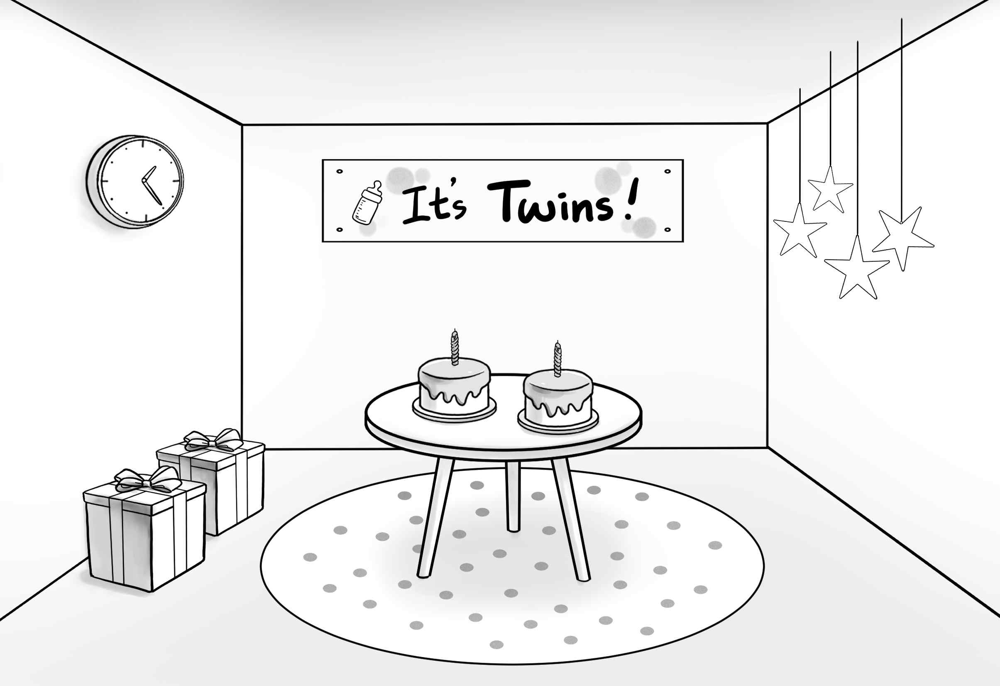
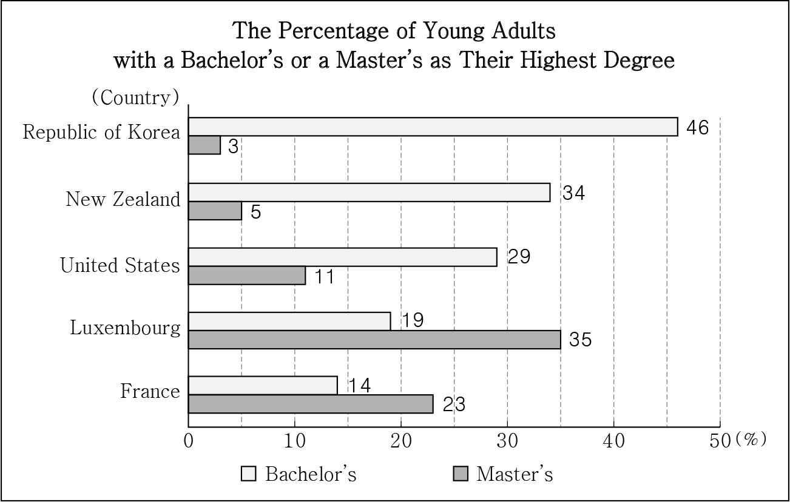
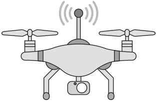
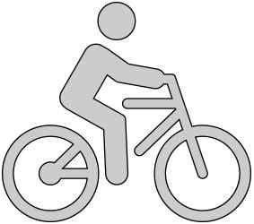

1. 다음을 듣고, 여자가 하는 말의 목적으로 가장 적절한 것을 고르시오.

① 과도한 스마트폰 사용의 부작용을 경고하려고
② 온라인 수업에 필요한 스마트폰 앱들을 추천하려고
③ 사이버 공간에서의 언어 예절의 중요성을 강조하려고
④ 새로 출시된 디지털 학습 도구의 장단점을 소개하려고
⑤ 올바른 스마트폰 사용에 관한 표어 공모 대회를 안내하려고

2. 대화를 듣고, 남자의 의견으로 가장 적절한 것을 고르시오.

① 텀블러는 사용하고 난 후 바로 씻어야 한다.
② 인체에 안전한 소재의 텀블러를 구매해야 한다.
③ 텀블러는 완전히 마를 때까지 뚜껑을 열어 두어야 한다.
④ 텀블러는 음료 종류에 따라 세척 방법을 달리해야 한다.
⑤ 환경 보호를 위해 일회용 컵 대신 텀블러를 사용해야 한다.

3. 다음을 듣고, 여자가 하는 말의 요지로 가장 적절한 것을 고르시오.

① 실수를 줄이기 위해 꾸준한 연습이 필요하다.
② 여러 사람과 함께 일하면 더 나은 결과를 낼 수 있다.
③ 과업에 시간제한을 두면 집중력과 효율을 높일 수 있다.
④ 집중력을 높이기 위해 먼저 주변을 정돈하는 것이 좋다.
⑤ 업무의 우선순위 목록을 작성하는 것은 시간 관리에 효과적이다.

4. 대화를 듣고, 그림에서 대화의 내용과 일치하지 않는 것을 고르시오.

5. 대화를 듣고, 남자가 할 일로 가장 적절한 것을 고르시오.

① 상품 준비하기
② 현수막 출력하기
③ 쓰레기봉투 챙기기
④ 음악 재생 목록 만들기
⑤ 보건실에서 구급함 가져오기

6. 대화를 듣고, 여자가 지불할 금액을 고르시오. [3점]

① $35
② $36
③ $40
④ $45
⑤ $54

7. 대화를 듣고, 남자가 플로깅 행사에 갈 수 없는 이유를 고르시오.

① 코딩 수업이 있어서
② 환경 캠페인 활동을 해야 해서
③ 여동생의 피아노 독주회에 가야 해서
④ 업사이클링 축제에 참여해야 해서
⑤ 가족여행 날짜와 겹쳐서

8. 대화를 듣고, Helene Sunrise Festival에 관해 언급되지 않은 것을 고르시오.

① 시작 일시
② 장소
③ 작년 방문객 수
④ 주차장
⑤ 활동 내용

9. Space Food Tasting Event에 관한 다음 내용을 듣고, 일치하지 않는 것을 고르시오.

① 국립 우주 박물관에서 열린다.
② 우주 비행사가 실제로 먹는 음식을 맛볼 기회가 있다.
③ 우주 식품이 만들어지는 과정에 대한 짧은 영상이 있다.
④ 오전 10시부터 오후 1시까지 진행된다.
⑤ 달 모양의 엽서가 참가자에게 기념품으로 주어진다.

10. 다음 표를 보면서 대화를 듣고, 여자가 주문할 책상 램프를 고르시오.

|  | Model | Brightness Level | Power Source | Timer | Price |
| --- | --- | --- | --- | --- | --- |
| ① | A | 2 | USB | ☓ | $15 |
| ② | B | 3 | Battery | ◯ | $20 |
| ③ | C | 3 | Plug-in | ☓ | $25 |
| ④ | D | 4 | USB | ◯ | $40 |
| ⑤ | E | 4 | Plug-in | ◯ | $55 |

11. 대화를 듣고, 남자의 마지막 말에 대한 여자의 응답으로 가장 적절한 것을 고르시오.

① I’m sorry. Maybe we should just cancel the event.
② Good idea. I’ll remind them to bring their costumes.
③ Okay. Let me ask them what time the festival ends.
④ Don’t worry. Your previous costume looked amazing.
⑤ Really? They’ve already designed the new costumes.

12. 대화를 듣고, 여자의 마지막 말에 대한 남자의 응답으로 가장 적절한 것을 고르시오.

① You’re right. Let’s bring another one now.
② Thanks. I can turn in my artwork on time.
③ Good. You found your missing sketchbook.
④ Never mind. I’ve already finished my art project.
⑤ Sorry. I couldn’t prepare the materials for the class.

13. 대화를 듣고, 남자의 마지막 말에 대한 여자의 응답으로 가장 적절한 것을 고르시오.

Woman:

① No problem. I can introduce a new coach to you.
② That’s true. I’m also taking the same course as you.
③ Nice. I’ll check the website and sign up for next month.
④ Terrific! I’m glad you won 1st prize in the competition.
⑤ Sure. I recommend group lessons rather than private ones.

14. 대화를 듣고, 여자의 마지막 말에 대한 남자의 응답으로 가장 적절한 것을 고르시오. [3점]

Man:

① Great. Don’t forget to order drinks with the food.
② Awesome. I’ll try that the next time I order food.
③ Actually, I brought my own food from home today.
④ Right. Using a thicker container keeps food hot longer.
⑤ Too late. You should have returned the container earlier.

15. 다음 상황 설명을 듣고, Ethan이 Olivia에게 할 말로 가장 적절한 것을 고르시오. [3점]

Ethan:

① I’m sorry that I ruined your book by accident.
② My apologies for forgetting to lend you my book.
③ I feel terrible that I couldn’t help you with the assignment.
④ I apologize for just taking your book without asking.
⑤ I didn’t mean to spill the drink on your clothes.

16. 여자가 하는 말의 주제로 가장 적절한 것은?

① ingredients used to preserve food before refrigerators
② ways to store raw meat using natural ingredients
③ unique traditional dishes from different cultures
④ how different crops are grown and harvested
⑤ why cooking styles vary from place to place

17. 언급된 식재료가 아닌 것은?

따라 답을 하시기 바랍니다.

① black pepper
② cinnamon
③ mustard seeds
④ saffron
⑤ dried chili peppers

18. 다음 글의 목적으로 가장 적절한 것은?

To the Customer Service Team, About a month ago, my wife and I purchased a set of bookshelves from your store. I was truly excited to find furniture that perfectly matched our new home. When we bought the bookshelves, the manager said it would take four weeks for delivery, which was last weekend. We had set our plans to ensure someone would be available to receive the delivery; however, no one came with the bookshelves that day. This delay has caused us considerable inconvenience. Therefore, please provide a clear and specific delivery date. We expect this issue to be addressed promptly, so that we can reorganize our schedule to receive the delivery without any confusion.

19. 다음 글에 드러난 ‘I’의 심경 변화로 가장 적절한 것은?

I was heading in the direction of a forest road that I knew would take me home. But almost as though someone had switched off all the lights I was suddenly in a black forest with no light of any kind. Feeling lost, I stumbled. I fell. I tore my clothes and injured myself falling down a hill. In desperation I stopped and leaned against a tree. I have no idea where I am now. Will anyone even notice that I’m gone? It was then that a faint aroma drifted through the darkness: the scent of cooking. I stumbled towards it, and soon, a faint, yellowish light glowed through the trees. It was Uncle Krull’s cabin and I could see him through the window! Thankful beyond words, I knew I could finally ask for help. My hardship was over.

20. 다음 글에서 필자가 주장하는 바로 가장 적절한 것은?

When you are working in healthcare, it is important to develop a solid professional relationship with your patients. By establishing realistic self-boundaries, you can protect that relationship. It is important to keep the focus on the patient. When working with patients who are seen frequently, it is easy to start to think of them as friends. With a friend, you are likely to share personal information that is not appropriate with a patient. Patients may feel that they cannot share important health-related information because you are their friend, and it would be embarrassing to share that information. Self-boundaries can also be thought of as professional boundaries. You need to treat patients with respect and keep the relationship professional. Be friendly to patients and always keep the focus on the patient.

21. 밑줄 친 chemistry, at least in your mouth, could be destiny가 다음 글에서 의미하는 바로 가장 적절한 것은? [3점]

Coat a fresh, wet swab in salt, and gently touch various spots on your tongue, recording where your taste seems strongest. Then, gargle with water to thoroughly clean your tongue, use a swab coated with sugar on the same spots, and record those results. Gargle again, and then swab with lemon juice. After a final gargle, try coffee. Compare your reactions with your friends’. Your taste pattern may reveal more than just taste preferences. Recent studies suggest links between taster status and behavioral disorders. For example, “non-tasters” tend to have a higher incidence of alcoholism, perhaps because liquor seems less bitter to them. Conversely, “super-tasters” may avoid nutritious but mildly bitter foods such as broccoli, thus depriving themselves of a balanced diet. So, although taste is not nearly as glamorous as vision, hearing, or even touch, it makes sense for you to pay closer attention to it because chemistry, at least in your mouth, could be destiny.

22. 다음 글의 요지로 가장 적절한 것은?

Experiments testify to science’s embrace of ignorance. Arguably the worst thing a scientist can do is to suppose they know what will happen in a given scenario without bothering to check. The rise of the experimental philosophy coincided with the liberation of curiosity as a valuable rather than a questionable attribute. For all that experimental science today is often assumed to be supported by a philosophical framework and an approved methodology (“state your hypothesis and then test it”), the fact is that, as philosopher of science Ian Hacking says, “One can conduct an experiment simply out of curiosity to see what will happen.” Indeed, in the view of Charles Darwin’s son, the astronomer George Darwin, once in a while one should do a completely crazy experiment, even if it is most likely to prove fruitless. You never know until you try.

23. 다음 글의 주제로 가장 적절한 것은?

We can discard or replace a scientific theory only if we have a better way of explaining the evidence that supports it. The theories of Newton and Einstein offer great examples. A vast body of evidence supports Newton’s theory of gravity, but by the late nineteenth century scientists had begun to discover cases where its predictions did not perfectly match observations. These discrepancies were explained only when Einstein developed his general theory of relativity, which was able to match the observations. Still, the many successes of Newton’s theory could not be ignored, and Einstein’s theory would not have gained acceptance if it had not been able to explain these successes equally well. It did, and that is why we now view Einstein’s theory as a broader theory of gravity than Newton’s theory. Some scientists today are seeking a theory of gravity that will go beyond Einstein’s. If any new theory ever gains acceptance, it will have to match all the successes of Einstein’s theory as well as work in new realms where Einstein’s theory does not.

24. 다음 글의 제목으로 가장 적절한 것은?

Imagine pausing in the middle of a busy day, taking a moment to refresh your mind and recharge your energy. This power of a midday break is often underestimated. When you break away from routine, especially with activities designed to stimulate your brain, you prevent cognitive tiredness and enhance productivity for the rest of the day. Neurobic exercises ― simple yet effective ― are perfect for such breaks. They target different areas of your brain, keeping it agile and alert. These exercises create a mental oasis that refreshes and prepares you for the afternoon’s challenges. This strategic pause is not just a break; it boosts your cognitive capabilities, ensuring your mind remains sharp and focused. Even briefly experimenting with neurobic exercises can work wonders for your cognitive state during lunch. Start with using your non-dominant hand for routine tasks like writing or eating. This simple switch challenges your brain, activating pathways that aren’t typically engaged and promoting greater flexibility in thinking.

25. 다음 도표의 내용과 일치하지 않는 것은?

The graph above illustrates the percentage of 25- to 34-year-olds (young adults) who attained either a bachelor’s or a master’s degree as their highest degree in five selected OECD countries as of 2022.

| Country | Bachelor's | Master's |
| --- | --- | --- |
| Republic of Korea | 46 | 3 |
| New Zealand | 34 | 5 |
| United States | 29 | 11 |
| Luxembourg | 19 | 35 |
| France | 14 | 23 |

26. Eunice Kathleen Waymon에 관한 다음 글의 내용과 일치하지 않는 것은?

Eunice Kathleen Waymon was an American musician and civil rights activist. She displayed musical talent from an early age. At 12, during her first classical recital, her parents’ seats, originally near the front, were moved to the back against their will to make seats for white people. After graduating from high school, she prepared for an audition at the Curtis Institute of Music, but her application was rejected, which she attributed to racial discrimination. To fund her private lessons, she began performing in Atlantic City, adopting the stage name “Nina Simone.” In the 1960s, she became a supporter of the Civil Rights Movement and composed and performed songs as a response to racism and violence in the Southern United States. Frustrated by the racism in the United States, she left the country in 1970, living in various places before settling in France. She passed away in 2003 but her reputation continues through her powerful music.

27. Manuha Island Drone Film Contest에 관한 다음 안내문의 내용과 일치하지 않는 것은?

Manuha Island Drone Film Contest
Are you interested in drone filming? Shoot and share the beauty of Manuha Island!
Submission
Until October 24, 2025 (Friday), 6 p.m.
Only through the official website
Guidelines
Video length must be 5 minutes or less.
At least 50% of the video must be shot using drones.
Films that have been submitted in other contests are not allowed.
Prize by Category Category Prize Landscape of the City $800 Nature of Manuha $700 Life & People in Manuha $700 ※ A single contestant is awarded for each category. Visit our official website www.manuhadronefilm.org.

28. One-day Bicycle Riding Class에 관한 다음 안내문의 내용과 일치하는 것은?

One-day Bicycle Riding Class Attention, Northmere Elementary School parents! Let your children enjoy safe bicycle riding.
Who: 1st to 2nd graders only
When: November 8, 2025
Schedule
10:00 a.m. - 10:30 a.m.: Safety education
10:30 a.m. - 12:00 p.m.: Hands-on riding practice Instructor: Northmere Elementary School teachers
Registration
Where: School website
Deadline: October 10, 2025 at 12 p.m.
Tuition: Free ※ Note
A parent or guardian must stay on site during class.
Safety gear will be provided.
It is recommended to bring your children’s own bike. (Only 10 bicycles are available for rental.)

29. 다음 글의 밑줄 친 부분 중, 어법상 틀린 것은?

When a cell divides, the genomes of its two daughters are often not quite identical to each other or to that of the parent cell. On rare occasions, the error may represent a change for the better; more probably, it will cause no significant difference in the cell’s prospects. But in some cases, the error will cause serious damage; for example, by disrupting the coding sequence for a key protein. Changes due to mistakes of the first type will tend to be perpetuated, because the altered cell has an increased likelihood of reproducing itself. Changes due to mistakes of the second type ― neutral changes ― may be perpetuated or not: it is a matter of chance whether the altered cell or its cousins will succeed. But changes that cause serious damage lead nowhere: the cell that suffers them dies, leaving no progeny. Through endless repetition of this cycle of mutation and natural selection organisms evolve: their genetic specifications change, sometimes give organisms new ways to exploit the environment more effectively, to survive in competition with others, and to reproduce successfully.

30. 다음 글의 밑줄 친 부분 중, 문맥상 낱말의 쓰임이 적절하지 않은 것은? [3점]

Within liberal culture, the value of fair equality of opportunity for individuals outweighs the preservation of the family’s integrity. In contrast, for Confucian culture, while seeking fair equality of opportunity for individuals is important, the family assumes a fundamental role in human flourishing, and living within a family institution is considered the essential way of life. Individuals are primarily understood as family members before they are regarded as state citizens. Therefore, for Confucians, the family possesses inherent value that should never be abandoned, even if it results in certain societal inequalities. Some cultures, like the liberal one, may choose to impose increasing restrictions on the role of families and implement more egalitarian government programs for education, healthcare, and other positive rights in society in the pursuit of fair equality of opportunity. On the other hand, other cultures, like the Confucian one, may prefer to primarily assign welfare responsibilities to the family, rejecting inequalities stemming from the existence of the family as long as everyone’s basic freedoms and rights are safeguarded in the state.

31. 다음 빈칸에 들어갈 말로 가장 적절한 것을 고르시오.

Statistics in the twentieth century became the systematic collection of quantitative information needed by the state. This process occurred in all the industrialised countries as a key part of their becoming modern states. Desrosières writes: “It is difficult to think simultaneously that the objects being measured really do exist and that this is only a convention”. Yet this is the case. Phenomena such as prices being charged and products being sold exist, but the categories and classification frameworks supporting the collection, aggregation, and organisation of official statistics are devised to serve the purposes of the state, for macroeconomic or for social policies. Theodore Porter described the use of statistics to create: “Quantification is a way of making decisions without seeming to decide”, characterising it as a “social technology” intended to build trust in authority.

32. 다음 빈칸에 들어갈 말로 가장 적절한 것을 고르시오. [3점]

Just as an expert in the taste and colour of wine will gain much by being aware of the chemistry that underlies those qualities, so each perspective on the body can potentially enhance the others. And yet every scientific tool, from microscopes to mathematics, and every aspect of the body, from the brain to the microorganism, requires such depth of expertise that this tends not to happen: we tend to study the human body in silos, each community sectioned from the others by its own specialised vocabulary. Research communities may be dedicated to one type of scientific tool or a specific component of the body, such as one type of cell. How different types of cell communicate with one another becomes its own specialist topic. Even simple forms of life on Earth are now rarely studied as a whole, and the human body is evidently much more complex. As long ago as 1890, The Times newspaper commented that knowledge ‘had already become too vast to be manageable’. Today, .

33. 다음 빈칸에 들어갈 말로 가장 적절한 것을 고르시오.

Historically, palaces weren’t just homes; they were carefully constructed stages designed to impress and intimidate. While stone symbolized permanence and strength, glass offered something equally powerful: visibility. The introduction of large windows in palaces allowed rulers to literally look down upon their subjects, emphasizing their elevated position. Conversely, it also allowed subjects to gaze up at their leaders, creating a sense of awe and distance. Consider the Palace of Versailles: its Hall of Mirrors, lined with reflective surfaces, not only magnified the grandeur of the space but also placed the king at the center of a dazzling display, reinforcing his absolute authority. The use of glass in palaces wasn’t merely aesthetic; it was strategic. Open sightlines allowed for better surveillance and control, ensuring the safety and security of the ruling family. Courtiers and visitors were constantly aware of being observed, contributing to an atmosphere of careful obedience and respect. The very architecture dictated social behavior, with glass .

34. 다음 빈칸에 들어갈 말로 가장 적절한 것을 고르시오.

As a political researcher in Germany, Noelle-Neumann observed that during election campaigns, certain views seemed to get more play than others, and sometimes people muted their opinions rather than talking about them, especially if those opinions were perceived to be unpopular. Noelle-Neumann calls this the spiral of silence. The spiral of silence occurs when individuals who perceive that their opinions are popular express them, whereas those who do not think their opinions are popular remain quiet. This process occurs in a spiral, so that one side of an issue ends up with considerable publicity and the other side with very little. In everyday life, people express their opinions in a variety of ways: they talk about them, they wear buttons, they put bumper stickers on their cars, and they post their views on social media. According to this theory, people are more apt to do these kinds of things when .

35. 다음 글에서 전체 흐름과 관계 없는 문장은?

Consider units of measure, one kind of descriptive device we are familiar with using in physics. Spatial distances can be given in terms of feet or meters or some other unit, and the physics will be the same regardless. We conclude from this that physics does not prefer one unit of length over any other, and we may choose any one we like for reasons of convenience. We further conclude that any feature depending on that choice, such as the particular numerical value assigned to the spatial separation between two locations, is not out there in the world apart from a choice of unit. Temperatures can likewise be given in terms of the Fahrenheit or Celsius or Kelvin scale, and nothing in the physics changes when we switch from one scale to another. Perception of temperature can vary with humidity and wind, even at the same measured value. We conclude that the choice of scale is an arbitrary choice in description, and that any feature that depends on that choice is scale-dependent.

36. 주어진 글 다음에 이어질 글의 순서로 가장 적절한 것을 고르시오. [3점]

Even though sea creatures live in it, they still need to take in water for their bodies to function properly. Notice that it has increased in size. The same principle applies to sea creatures. If the body fluids in a sea animal are saltier than the seawater it lives in, then the extra salt in the creature’s body will absorb seawater. This can cause them to swell up. On the other hand, if the amount of salt in the seawater is higher than the amount of salt in the body fluids of a sea animal, the extra salt in the water will draw fluids out of the creature’s body, causing it to dehydrate and shrink. They just need to get rid of any extra salt it might bring with it. Salt absorbs water like a sponge. If you put a tiny mountain of salt on a small plate, then add enough water to the side, making sure an edge touches the salt, the salt will absorb the water. Now you have a pile of wet salt.

37. 주어진 글 다음에 이어질 글의 순서로 가장 적절한 것을 고르시오.

Distinguishing moths from butterflies on outward appearance is not always easy, but there are a few rules of thumb that can help. Further distinctions can be made by looking for a tiny hook that joins fore- and hindwings, a feature only present in moths. The stereotypical differences, with moths cast as the gloomy, nocturnal cousins of colourful sun-loving butterflies are simply wrong. There are many brightly coloured moths and many which are active throughout the day. In most butterflies the antennae end with a small club-shaped swelling, whereas in moths they are usually feathery or narrow to a fine tip. Butterflies tend to rest with their wings held shut above their body, whereas moths more usually rest with the upper sides of the wings on full view. Equally, there are a few nocturnal butterflies and plenty that come clothed in shades of brown and grey. It’s more sensible to think of them together; both butterflies and moths are beautiful and fascinating insects.

38. 글의 흐름으로 보아, 주어진 문장이 들어가기에 가장 적절한 곳을 고르시오.

Other populations may not be actively managed, like those in national parks. There are numerous ways wildlife is managed, but they all imply stewardship and can be classified into two broad categories: active management and inactive management. Active management does something to the population ― such as increasing or decreasing its size ― in a direct manner through strategies like translocations or hunting, respectively. Populations can also be actively managed by altering the habitat to the benefit or disadvantage of a population. If population numbers are too low for the goal of management agencies, other active management can be incorporated, such as predator control to minimize neonatal deaths or habitat improvement to provide required cover for neonates from predators. These efforts represent active approaches to management. In such situations, management activities minimize external influences on populations and habitat, which often involves management of humans and not animals.

39. 글의 흐름으로 보아, 주어진 문장이 들어가기에 가장 적절한 곳을 고르시오. [3점]

Those who supported the idea that waste is necessary to drive demand failed to realize that prioritizing the elimination of waste via repair and remanufacturing creates a different kind of demand: products as a service. Waste has historically been seen as a necessary driver of the economy. Sales are tied to the amount of a product supplied, which is directly dependent on the demand for that product. Therefore, if you design the product to eventually be wasted, you can ensure that the demand for more products will be sustained. Many strategies have been incorporated into product design and use to ensure that waste is inevitable, such as planned obsolescence, limited access to tools for repairs, and use of cheap materials. All these strategies ensure that the consumer will have limited access to the product in use and will eventually require a replacement. Through this setup, companies simply lease out products that were once sold directly to the customer. With this transition of ownership, companies maintain profit by offering maintenance and repair services and are encouraged to develop long-lasting products.

40. 다음 글의 내용을 한 문장으로 요약하고자 한다. 빈칸 (A), (B)에 들어갈 말로 가장 적절한 것은? [3점]

Viewing time as a purchasable and consistent product cemented artificial views on time into our psyche, but every now and again we are forced to acknowledge this mistake. On twenty-six occasions in the last fifty years, a second has been added to everyone’s day to adjust for the Earth wobbling and the rate of its spin changing. For instance, when El Niño, a climatic system in the Pacific, causes wind speed to change dramatically, it can slow the rotation of the Earth slightly. Indeed, the Earth’s spin is generally slowing because the moon’s gravity is acting as a drag, so days are getting longer by about 1.7 milliseconds per century. Such events disturb the similarity between man-made time and more flexible time based on the Earth’s naturally occurring rotation. When events like this happen, a bunch of humans make the decision to add a small slice of time to your day, without your knowledge. We try to force our fixed, man-made view of time on to nature in the false hope that it will yield. It doesn’t. 

 Humans, who have long viewed that time is, have continuously made modifications, sticking to their belief that their efforts can the gap between man-made time and natural time.

41. 윗글의 제목으로 가장 적절한 것은?

When your hand is hanging at your side and then you lift it, opposing muscles on your upper arm shorten and lengthen ― contract and relax ― to bend the elbow. Biceps contract, and triceps relax. Reversing the motion, when you drop your hand back down, muscles reverse roles. Triceps contract, and biceps relax. Lift your hand or drop it, and muscle shows what it is: a system of coordination, managed by orchestrated tension. As arms and legs rotate around joints, muscles activate and deactivate, contract and relax. All physical activity is paradoxical, in this sense: Movement depends on what muscles don’t do, as much as it depends on what they do. Both are necessary, each in its time ― and the same is true of each side of the pairs of concepts shaping how we talk of muscles. Start with nature versus nurture: Some people are stronger or more muscular than others; is the difference inborn, or does it depend on what people do? To the latter question: What do you do? Do you have to lift weights, or is walking enough exercise? How should you do the exercise? Should you move fast or slowly? Lift heavy weights or lighter ones? Put like that, basic questions about muscle may sound like they have one right answer. Oppositions can polarize. But where muscle is concerned, few oppositions are true polarities. Look closely, and most prove to be paradoxes. Born and made, heavy and light, fast and slow: Those opposites actually exclude each other.

42. 밑줄 친 낱말 중에서 문맥상 낱말의 쓰임이 적절하지 않은 것은? [3점]

When your hand is hanging at your side and then you lift it, opposing muscles on your upper arm shorten and lengthen ― contract and relax ― to bend the elbow. Biceps contract, and triceps relax. Reversing the motion, when you drop your hand back down, muscles reverse roles. Triceps contract, and biceps relax. Lift your hand or drop it, and muscle shows what it is: a system of coordination, managed by orchestrated tension. As arms and legs rotate around joints, muscles activate and deactivate, contract and relax. All physical activity is paradoxical, in this sense: Movement depends on what muscles don’t do, as much as it depends on what they do. Both are necessary, each in its time ― and the same is true of each side of the pairs of concepts shaping how we talk of muscles. Start with nature versus nurture: Some people are stronger or more muscular than others; is the difference inborn, or does it depend on what people do? To the latter question: What do you do? Do you have to lift weights, or is walking enough exercise? How should you do the exercise? Should you move fast or slowly? Lift heavy weights or lighter ones? Put like that, basic questions about muscle may sound like they have one right answer. Oppositions can polarize. But where muscle is concerned, few oppositions are true polarities. Look closely, and most prove to be paradoxes. Born and made, heavy and light, fast and slow: Those opposites actually exclude each other.

43. 주어진 글에 이어질 내용을 순서에 맞게 배열한 것으로 가장 적절한 것은?

 Jason stared at the banner across the high school gym wall: “Annual Charity Marathon ― Run for Sam.” The slogan stirred something in him. Sam, a cheerful seven-year-old who loved to draw and dreamed of being an artist, had a rare heart condition. Sam wasn’t just anyone — he was the little boy living next door that Jason had babysat every summer break. He had played in the park and spent summer afternoons chasing ice cream trucks with Sam. When the whistle blew, Jason started strong, but since he hadn’t run for so long, his energy faded quickly. Every step was a struggle, but he pushed forward, encouraged by the thought of how happy Sam would be. Finally, he crossed the finish line. As he was sitting to catch his breath, Sam came over and handed him bottled water. He felt pride, relief, and gratitude. He finally finished ― for Sam. Jason did everything he could to recover, following his doctor’s advice. A day before registration deadline, his doctor said a 3-mile run would be fine. Jason signed up for the 3-mile beginner route, hoping to run for Sam. On marathon morning, Jason stood among the runners, heart pounding. In the crowd, Sam was holding a sign: “Thank you, Runners!” Jason smiled. He was all the motivation needed. Seeing Sam’s name on the banner made everything feel personal. Jason had always been the fastest runner in school, known among his friends as “The Speedster.” But since his knee injury, he hadn’t been able to run for quite a long time. Still, when Jason thought about Sam and the hope this marathon represented, he knew he had to try.

44. 밑줄 친 낱말 중에서 가리키는 대상이 나머지 넷과 다른 것은?

 Jason stared at the banner across the high school gym wall: “Annual Charity Marathon ― Run for Sam.” The slogan stirred something in him. Sam, a cheerful seven-year-old who loved to draw and dreamed of being an artist, had a rare heart condition. Sam wasn’t just anyone — he was the little boy living next door that Jason had babysat every summer break. He had played in the park and spent summer afternoons chasing ice cream trucks with Sam. When the whistle blew, Jason started strong, but since he hadn’t run for so long, his energy faded quickly. Every step was a struggle, but he pushed forward, encouraged by the thought of how happy Sam would be. Finally, he crossed the finish line. As he was sitting to catch his breath, Sam came over and handed him bottled water. He felt pride, relief, and gratitude. He finally finished ― for Sam. Jason did everything he could to recover, following his doctor’s advice. A day before registration deadline, his doctor said a 3-mile run would be fine. Jason signed up for the 3-mile beginner route, hoping to run for Sam. On marathon morning, Jason stood among the runners, heart pounding. In the crowd, Sam was holding a sign: “Thank you, Runners!” Jason smiled. He was all the motivation needed. Seeing Sam’s name on the banner made everything feel personal. Jason had always been the fastest runner in school, known among his friends as “The Speedster.” But since his knee injury, he hadn’t been able to run for quite a long time. Still, when Jason thought about Sam and the hope this marathon represented, he knew he had to try.

45. 윗글에 관한 내용으로 적절하지 않은 것은?

 Jason stared at the banner across the high school gym wall: “Annual Charity Marathon ― Run for Sam.” The slogan stirred something in him. Sam, a cheerful seven-year-old who loved to draw and dreamed of being an artist, had a rare heart condition. Sam wasn’t just anyone — he was the little boy living next door that Jason had babysat every summer break. He had played in the park and spent summer afternoons chasing ice cream trucks with Sam. When the whistle blew, Jason started strong, but since he hadn’t run for so long, his energy faded quickly. Every step was a struggle, but he pushed forward, encouraged by the thought of how happy Sam would be. Finally, he crossed the finish line. As he was sitting to catch his breath, Sam came over and handed him bottled water. He felt pride, relief, and gratitude. He finally finished ― for Sam. Jason did everything he could to recover, following his doctor’s advice. A day before registration deadline, his doctor said a 3-mile run would be fine. Jason signed up for the 3-mile beginner route, hoping to run for Sam. On marathon morning, Jason stood among the runners, heart pounding. In the crowd, Sam was holding a sign: “Thank you, Runners!” Jason smiled. He was all the motivation needed. Seeing Sam’s name on the banner made everything feel personal. Jason had always been the fastest runner in school, known among his friends as “The Speedster.” But since his knee injury, he hadn’t been able to run for quite a long time. Still, when Jason thought about Sam and the hope this marathon represented, he knew he had to try.
