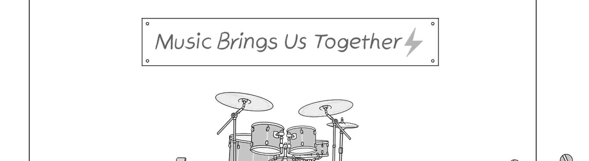
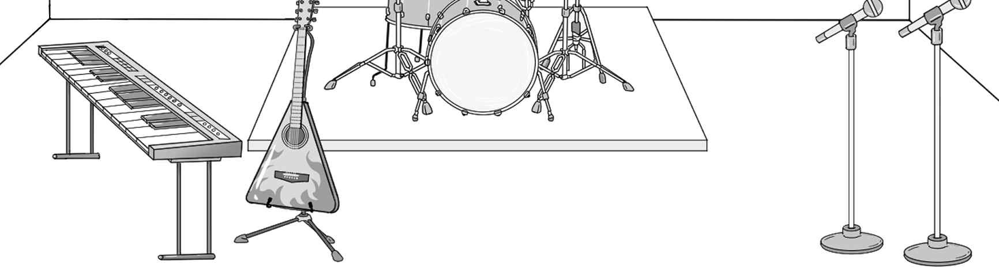
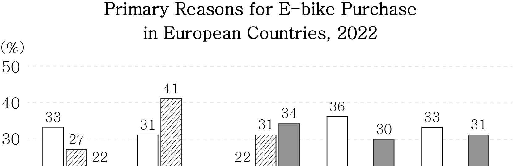
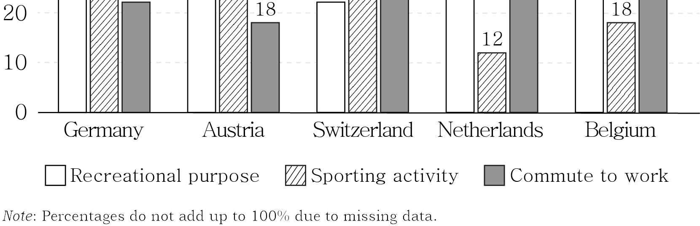
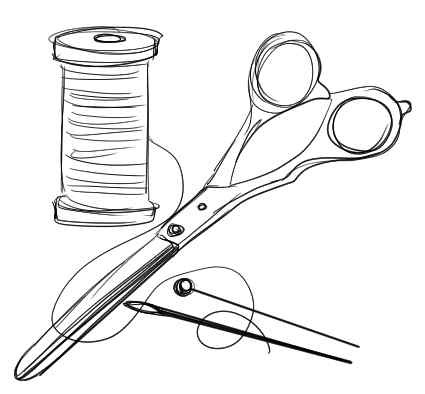

1. 다음을 듣고, 남자가 하는 말의 목적으로 가장 적절한 것을 고르시오.
① 자판기 추가 설치가 완료되었음을 알리려고
② 자판기 설치 장소가 변경된 이유를 설명하려고
③ 자판기 설치에 관한 의견 수렴 결과를 공유하려고
④ 자판기 고장으로 인해 사용이 제한됨을 공지하려고
⑤ 자판기 판매 희망 품목에 관한 설문 참여를 요청하려고

2. 대화를 듣고, 여자의 의견으로 가장 적절한 것을 고르시오.

① 벽지의 색을 정할 때 공간의 크기를 고려하는 것이 중요하다.
② 어두운 색상의 벽지는 집중력 향상에 도움을 줄 수 있다.
③ 천장과 벽의 색을 일치시키면 공간이 넓어 보인다.
④ 조명의 색상으로 방의 분위기를 바꿀 수 있다.
⑤ 가구의 배치에 따라 방의 공간감이 달라진다.

3. 다음을 듣고, 남자가 하는 말의 요지로 가장 적절한 것을 고르시오.
① 노인에게 디지털 기술 활용 교육을 제공해야 한다.
② 노인을 위한 맞춤형 디지털 기기를 개발해야 한다.
③ 노인을 위한 대면 서비스를 계속 운영해야 한다.
④ 노인을 대상으로 하는 금융 범죄를 예방해야 한다.
⑤ 노인이 디지털 기술에 적응하지 못하는 이유를 이해해야 한다.

4. 대화를 듣고, 그림에서 대화의 내용과 일치하지 않는 것을 고르시오.

5. 대화를 듣고, 여자가 할 일로 가장 적절한 것을 고르시오.

① 짝 명단 만들기
② 열쇠고리 포장하기
③ 기념품 주문하기
④ 인사말 가르치기
⑤ 전통 공예 재료 준비하기

6. 대화를 듣고, 남자가 지불할 금액을 고르시오.

① $18
② $27
③ $30
④ $36
⑤ $40

7. 대화를 듣고, 여자가 학급 사진 대회에 참가하지 못한 이유를 고르시오.

① 사진을 실수로 삭제해서
② 야외에서 촬영된 사진이 없어서
③ 사진 제출 마감 날짜를 착각해서
④ 사진의 크기가 조건에 맞지 않아서
⑤ 학급 친구들이 사진 찍는 것을 싫어해서

8. 대화를 듣고, 2025 Aquathlon에 관해 언급되지 않은 것을 고르시오.
① 경기 종목
② 경기 날짜
③ 등록 방법
④ 참가비
⑤ 경기 장소

9. Sunnyville Pet Fair에 관한 다음 내용을 듣고, 일치하지 않는 것을 고르시오.

① 토요일에 개최된다.
② 반려동물 행동 전문가의 개 훈련 프로그램이 있다.
③ 반려동물 의상 경연이 열린다.
④ 수제 장난감을 판매하는 부스가 있다.
⑤ 행사 당일에 현장에서 입장권을 판매한다.

10. 다음 표를 보면서 대화를 듣고, 남자가 구매할 가방 장식을 고르시오.

|  | Type | Size | Color | Material | Price |
| --- | --- | --- | --- | --- | --- |
| ① | A | Small | Pink | Fabric | $10 |
| ② | B | Small | Yellow | Plastic | $12 |
| ③ | C | Medium | Green | Fabric | $14 |
| ④ | D | Medium | Blue | Plastic | $17 |
| ⑤ | E | Large | Purple | Plastic | $20 |

11. 대화를 듣고, 남자의 마지막 말에 대한 여자의 응답으로 가장 적절한 것을 고르시오.

① Thanks. I’ve always wanted to see their live performance.
② You’re right. The concert is going to be canceled anyway.
③ Sorry. I can’t make it to the live chat with the band.
④ Oh, no. You shouldn’t have missed this special opportunity.
⑤ Wonderful! I look forward to seeing you play in the festival.

12. 대화를 듣고, 여자의 마지막 말에 대한 남자의 응답으로 가장 적절한 것을 고르시오.

① You have to be careful not to lose your locker key.
② You can borrow an extra copy from our school library.
③ You shouldn’t have sold your book to a second-hand bookstore.
④ You are allowed to take notes in your science textbook.
⑤ You could have chosen another topic for the project.

13. 대화를 듣고, 남자의 마지막 말에 대한 여자의 응답으로 가장 적절한 것을 고르시오. [3점]

Woman:
① Yes. I’ll copy motivational quotes in my planner.
② Of course. Reminders have already been sent to me.
③ I guess so. Using apps can be distracting sometimes.
④ Exactly! You need to submit your report on your own.
⑤ Absolutely! This app will help you solve your problem.

14. 대화를 듣고, 여자의 마지막 말에 대한 남자의 응답으로 가장 적절한 것을 고르시오. [3점]

Man:
① Cheer up! You can win the competition next time.
② I agree. Focusing on contemporary art is important.
③ Not really. I’ve never found any helpful drawing classes.
④ Good for you! You might have a more meaningful experience.
⑤ Never mind. I can start fresh on a new social media platform.

15. 다음 상황 설명을 듣고, Anthony가 Emma에게 할 말로 가장 적절한 것을 고르시오. [3점]

Anthony:
① I’m not sure. I won’t be a responsible leader like you.
② I don’t think I can help you. I’ve already joined another team.
③ I’m afraid I can’t. But I’ll recommend a close friend instead.
④ My pleasure! I’m honored to be able to join the team again.
⑤ That’s right. I had to quit the badminton team due to injury.

16. 여자가 하는 말의 주제로 가장 적절한 것은?

① etiquette for using digital devices in museums
② modern technologies transforming museum experiences
③ problems caused by rapid technological changes in museums
④ obstacles in integrating technologies in museum exhibitions
⑤ architectural technologies used in building museums

17. 언급된 기술이 아닌 것은?

① virtual reality
② motion tracking
③ 3D animation
④ laser projection
⑤ 3D printing

18. 다음 글의 목적으로 가장 적절한 것은?

Notice to Hilltop Apartment Residents In accordance with fire safety regulations, it is essential to keep all hallways free of personal belongings such as bicycles, boxes, and small furniture. Hallways serve as critical evacuation routes during emergencies, and anything left there could block the way and pose serious safety risks. To ensure the safety of all residents, we request that any personal items placed in the hallways be removed by Monday, April 14th. Please note that not following this may result in penalties. We appreciate your cooperation in maintaining a safe environment.

19. 다음 글에 드러난 Nathan의 심경 변화로 가장 적절한 것은?

Nathan boarded the train on Saturday evening. As he made his way to his seat, he found someone already sitting there. Confused, he checked his ticket and realized his mistake ― it was for Sunday, not Saturday! A flush of panic spread across his face. He quickly approached a train attendant and explained the situation. “Is there anything I can do to resolve this?” Nathan asked. “Don’t worry, sir. We still have seats available,” the attendant said with a reassuring smile. Nathan exchanged his old ticket for a new one, his worries melting away. Settling into his seat, he let out a deep breath, feeling the tension in his shoulders ease as the train began to move.

20. 다음 글에서 필자가 주장하는 바로 가장 적절한 것은?

Fans who are inclined to spend a lot of time thinking about what athletes owe them as fans should also think about the corresponding obligations that fans might have as fans. One who thinks only about what they are entitled to receive from their friends without ever giving a moment’s thought to what they owe their friends is, to put it mildly, not a very good friend. Similarly, fans who only think about what athletes owe them without ever thinking about what they owe to athletes have failed to take the fan/athlete relationship all that seriously. As in nearly every other area of human life, whatever special rights fans may possess are limited by a corresponding set of obligations, and fans who never think about how they can be better fans even as they confidently opine about what athletes owe them are hardly fulfilling their end of the bargain.

21. 밑줄 친 keeping the ball on a slope가 다음 글에서 의미하는 바로 가장 적절한 것은? [3점]

The concept of ecosystem states should be familiar to anyone with a home vegetable garden. The garden is a small ecosystem that the grower attempts to keep in a specific state, namely the maximization of fruit and vegetable production. To achieve this, the grower is almost always intervening in the dynamics of the ecosystem; they remove unwanted plants that begin to grow and perhaps spray insecticides and fence off the patch to stop insects and other animals from consuming the vegetables. Since maximizing vegetable growth is an inherently unstable state for the ecosystem, the grower is effectively keeping the ball on a slope. If the grower stops intervening, even for a day, the ecosystem, that small patch of ground, will naturally begin to shift to a more stable state. Vegetables may still grow, but yield will almost certainly be lower as other plants crowd out the vegetables and wildlife consume the produce.

22. 다음 글의 요지로 가장 적절한 것은?

Commitment is the glue holding together characteristically human forms of social life. Commitments make individuals’ behavior predictable in the face of fluctuations in their desires and interests, thereby facilitating the planning and coordination of joint actions involving multiple agents. Moreover, commitments make people willing to perform actions that they would not otherwise perform. For example, a taxi driver picks up his clients and transports them to their desired destination because they are committed to paying him afterwards for the service, and a construction worker performs her job every day because her employer has made a credible commitment to pay her at the end of the month. Indeed, the taxi driver and the construction worker are willing to accept money as payment only because a network of other agents (notably the central bank) is committed to taking various measures to sustain the currency in question. Thus, social objects and institutions such as jobs, money, government, scientific collaborations and marriage depend for their origin and stability upon the credibility of commitments.

23. 다음 글의 주제로 가장 적절한 것은?

If the brain has already stored someone’s face and name, why do we still end up remembering one and not the other? This is because the brain has something of a two-tier memory system at work when it comes to retrieving memories, and this gives rise to a common yet infuriating sensation: recognising someone, but not being able to remember how or why, or what their name is. This happens because the brain differentiates between familiarity and recall. To clarify, familiarity (or recognition) is when you encounter someone or something and you know you’ve done so before. But beyond that, you’ve got nothing; all you can say is this person/thing is already in your memories. Recall is when you can access the original memory of how and why you know this person; recognition is just flagging up the fact that the memory exists.

24. 다음 글의 제목으로 가장 적절한 것은?

Since their start in the early 1950s U.S. television sitcoms have charted many of the social conflicts in U.S. society: civil rights, women’s rights in the home and in the workplace, children’s rights, immigration and multiculturalism, as well as evolving conceptions of the family. Each of these issues has been addressed through humour in a way that has helped to make more progressive values more acceptable than previously. Often a character, usually someone marked as a bigot, resisted one or more of these developments and was then made to appear ridiculous. They were cut down either through their own stupidity, a brief scolding from others, or both. In this way, the humour of sitcoms acted as a cost-effective means to encourage acceptance of a more pluralistic and tolerant society.

25. 다음 도표의 내용과 일치하지 않는 것은?

The graph above shows the percentages of the primary reasons for E-bike purchase in five European countries in 2022.

| Country | Recreational purpose | Sporting activity | Commute to work |
| --- | --- | --- | --- |
| Germany | 33 | 27 | 22 |
| Austria | 31 | 41 | 18 |
| Switzerland | 22 | 31 | 34 |
| Netherlands | 36 | 12 | 30 |
| Belgium | 33 | 18 | 31 |

26. Friedrich Mohs에 관한 다음 글의 내용과 일치하지 않는 것은?

Friedrich Mohs, a well-known mineralogist, was born on January 29, 1773, in Gernrode, Germany. He displayed a marked interest in science at an early age. He studied chemistry, mathematics, and physics at the University of Halle and also studied mineralogy at the Mining Academy. In his late twenties, he went to Austria and classified minerals by their physical attributes. This new classification system of his led to conflicts with many mineralogists who followed the conventional methods. In 1812, Mohs was appointed Professor of Mineralogy at the Joanneum, where he developed the Mohs Scale of Mineral Hardness. Mohs ended his remarkable career at the Mining University in Leoben and died at the age of 66 in Italy.

27. Casting Call for Movie Extras에 관한 다음 안내문의 내용과 일치하지 않는 것은?

Casting Call for Movie Extras Step into the world of cinema and become an extra in an exciting upcoming movie! Filming
Time: Sunday, April 20th, 2025, 8 a.m. - 4 p.m.
Place: At the Golden Film Production Studio
Scenes
Chatting in a hallway
Dining at a restaurant
Payment: $100 (Lunch provided)
Who Can Apply
Applicants must be 18 years or older.
Applicants with previous acting experience will be given priority. How to Apply: Email the application to goldenstudio@movie.com by Thursday, April 10th, 2025.

28. Bearford Eco Fashion Workshop에 관한 다음 안내문의 내용과 일치하는 것은?

Bearford Eco Fashion Workshop Join us for the hands-on event to make a special fashion item using old clothing of yours.
When: Saturday, April 12th (9 a.m. - 11 a.m.)
Where: Bearford City Hall
Registration: April 1st to 5th, only on our website Entry
Fee: $5 (12 years and under are free)
Programs
Listen to a special lecture on sustainable fashion trends.
Learn to make an eco-friendly bag using old clothing.
Note: You need to bring your own old clothing large enough to make a bag. (Other materials will be provided.)

29. 다음 글의 밑줄 친 부분 중, 어법상 틀린 것은?

The prominence of the social dimension in food writing might suggest that the flavor of food is taking a back seat. I suspect that most people view flavor as of secondary importance in social settings where food is served. Although our social gatherings coalesce around food, the meaning of these gatherings does not seem to depend on flavor. Flavor assists with the narrow purpose of filling the belly, and once that is accomplished it provides the backdrop for whatever social dynamics characterize the gathering. These can be understood independently of the flavor of the food on offer, the appreciation of which is understood to be personal and subjective. According to this conventional wisdom, the ceremonies and rituals around food, the social events that supply food with its meaning, does not depend on the quality of sensations provided by the food. To focus excessively on flavor is to miss the larger significance of these social relations.

30. 다음 글의 밑줄 친 부분 중, 문맥상 낱말의 쓰임이 적절하지 않은 것은?

There are reasons why science is not fully trusted and why healthy skepticism and critical thinking are essential. In spite of professional standards, claims of objectivity, and the peer review process, the conduct of science can be biased. All experts are not the same, nor do they submit their work to the same scrutiny. Knowing the source of funding can be important in evaluating scientific claims. For example, the Harvard researchers who made claims in the late 1960s about the problems with dietary fat, leading the nation away from perceiving sugar as one of the main causes in health problems, were funded in part by the sugar industry. The authors did not reveal their funding source to the New England Journal of Medicine, where their influential article appeared. Their article shaped a generation of changes in eating patterns that appears to have discouraged higher use of sugar, now widely implicated as a source of the rise in obesity and diabetes. Stories such as this one fuel suspicion — but also lead to further safeguards in the scientific process. Funding disclosures, although not required five decades ago, have since been made compulsory.

31. 다음 빈칸에 들어갈 말로 가장 적절한 것을 고르시오.

The explosion of popular music in the second half of the twentieth century as well as the global circulation and dissemination of music by the creative industries propelled a new understanding of in relation to music. Suddenly, in the 1950s, anyone could pick up spoons, a couple of pans, a second-hand guitar and start a band. This led to specific genres such as skiffle, but also, more generally, reflected a much more relaxed and inclusive attitude to music making. While ordinary people had always sung and made music, the popular music movement was driven by a spirit of rebellion and freedom. This approach led to the punk movement, whose musicians even made it a condition for their music to be non-virtuosic and accessible to all in the 1970s. Groups who had been entirely excluded from music revelled in opportunities to create. This led to a sense of novelty and empowerment in and beyond the music sphere.

32. 다음 빈칸에 들어갈 말로 가장 적절한 것을 고르시오. [3점]

Great scientists are seldom one-hit wonders. Newton is a prime example: beyond the Newtonian mechanics, he developed the theory of gravitation, calculus, laws of motion, and optimization. In fact, well-known scientists are often involved in multiple discoveries, a phenomenon potentially explained by the Matthew effect. Indeed, an initial success may offer a scientist legitimacy, improve peer perception, provide knowledge of how to score and win, enhance social status, and attract resources and quality collaborators, each of these payoffs further increasing her odds of scoring another win. Yet, there is an appealing alternative explanation: Great scientists have multiple hits and consistently succeed in their scientific endeavors simply because they’re exceptionally talented. Therefore, future success again goes to those who have had success earlier, not because of advantages offered by the previous success, but because the earlier success was . The Matthew effect posits that success alone increases the future probability of success, raising the question: Does status dictate outcomes, or does it simply reflect an underlying talent or quality? In other words, is there really a Matthew effect after all?

33. 다음 빈칸에 들어갈 말로 가장 적절한 것을 고르시오. [3점]

When we realize we’ve said something in error and we pause to go back to correct it, we stop gesturing a couple of hundred milliseconds before we stop speaking. Such sequences suggest the startling notion that our hands “know” what we’re going to say before our conscious minds do, and in fact this is often the case. Gesture can mentally prime a word so that the right term comes to our lips. When people are prevented from gesturing, they talk less fluently; their speech becomes halting because their hands are no longer able to supply them with the next word, and the next. Not being able to gesture has other deleterious effects: without gesture to help our mental processes along, we remember less useful information, we solve problems less well, and we are less able to explain our thinking. Far from tagging along as speech’s clumsy companion, gesture.

34. 다음 빈칸에 들어갈 말로 가장 적절한 것을 고르시오. [3점]

Despite the difference between the past and the future, between what has happened and what is to come, it can be suggested, that our sense of the past has always been influenced by our view of the future. Revolutionaries have always looked to the past to frame their future cause, as is amply illustrated by examples from nationalism to communism. The future has often been seen as variously a recovery of a lost time, as a replication of what is established, or as a model bequeathed by a heroic age long gone. The writing of history is based on understanding or explaining future outcomes that were not known to contemporaries, since the historian has the benefit of hindsight and the past is nothing more than the accumulation of futures that are now our past. So, rather than see the hand of the past always shaping the future, perhaps it can be seen in reverse, with the past — in the sense of our understanding of it — being .

35. 다음 글에서 전체 흐름과 관계 없는 문장은?

Dictionaries are relatively good resources for anyone interested in finding out what a word means. Using one set of words to define another word is called a lexical definition. But it’s important to understand the limits of dictionary definitions. More often than not, a definition in a dictionary requires readers to have a fairly robust understanding of the language already at their disposal. In other words, a dictionary functions in many cases as a cross-reference or translator between words one knows and words that one doesn’t yet know. However, there are words that may be defined not through other words but only by pointing to something in our experience. Even the most obscure words in a dictionary, say, for example, “pulchritudinous” or “kalokagathia,” must be defined using words that the reader already knows and understands. Otherwise, the dictionary isn’t very helpful.

36. 주어진 글 다음에 이어질 글의 순서로 가장 적절한 것을 고르시오. [3점]

The governments of virtually every country on the planet attach great importance to achieving food security and a wide variety of mechanisms have been developed to realize this goal. However, food security does not require food self-sufficiency because countries can import food items not easily produced within the country. Agricultural products are, after all, highly sensitive to climatic, soil and other conditions that tend to vary around the world. The first issue governments face in achieving national food security is the problem of insuring that adequate amounts of food are available to the resident population. Some governments have set goals of food self-sufficiency, which means most if not all of the food available in a country comes from the domestic farming system. Even countries with extremely productive agricultural sectors are not fully self-sufficient in all food items. The United States, for example, depends on imports for its supply of coffee, tea, bananas and other tropical products. In general, the problem of assuring adequate food supplies is solved by relying on both domestic production and imports.
37. 주어진 글 다음에 이어질 글의 순서로 가장 적절한 것을 고르시오.

Stress not only affects physical disease but also the very structure of our brains, making us even more likely to experience a drained brain. Why does this matter? This part of the brain helps you remain resilient in the face of stress and is involved in mood regulation. It also helps you to monitor the safety of your environment and store dangerous images in your long-term memory so you can avoid them in the future. It does all these things as part of its duties of regulating your sympathetic and parasympathetic nervous systems. But chronic stress can confuse the hippocampus and lead to turning signals for cortisol “on” instead of “off,” which can trap you in a constant state of fight, flight, or freeze. A number of studies have been done to reveal what happens in healthy people’s brains when they go through something stressful. One study demonstrated a link between a smaller hippocampus and people who had experienced long-lasting stress.

38. 글의 흐름으로 보아, 주어진 문장이 들어가기에 가장 적절한 곳을 고르시오. [3점]

Knowledge is information that has demonstrated its usefulness. It is important to recognize that although science is a rule-based procedure, it is very much a creative process. A conjecture is a philosophical invention, cooked up rather mystically by the mind through the mental computation we call careful contemplation. However, until the hypothesis is tested against reality, it is not yet truly knowledge; it is just information that represents speculation. It is what is left over after cycles of experimental testing have eliminated false theories. As scientists continually test their hypotheses and modify their models to account for new and surprising data, a kind of “learning loop” emerges that statisticians call Bayesian updating. Based on Bayes’ Rule, developed by eighteenth-century English statistician and philosopher Thomas Bayes, Bayesian updating refers to a mathematical process whereby an accepted theory or predictive model gets increasingly accurate through the repetitive testing of competing variants of that theory.

39. 글의 흐름으로 보아, 주어진 문장이 들어가기에 가장 적절한 곳을 고르시오. [3점]

For example, we do not have a term in ordinary language that describes a memory that is not necessarily a memory of something the person having it has experienced. As a general rule, it’s better if your definition corresponds as closely as possible to the way in which the term is ordinarily used in the kinds of debates to which your claims are pertinent. There will be, however, occasions where it is appropriate, even necessary, to coin special uses through what philosophers call stimulative definition. This would be the case where the current lexicon is not able to make distinctions that you think are philosophically important. Such a thing would occur, for example, if I could somehow share your memories: I would have a memory-type experience, but this would not be of something that I had actually experienced. To call this a memory would be misleading. For this reason, philosophers have coined the special term ‘quasi-memory’ to refer to these hypothetical memory-like experiences.

40. 다음 글의 내용을 한 문장으로 요약하고자 한다. 빈칸 (A), (B)에 들어갈 말로 가장 적절한 것은?

Quite often the interaction between groups is socially unequal, and this is reflected in the fact that in many cases borrowing of words or constructions goes mostly or entirely in one direction, from the more powerful or prestigious group to the less favored one. The languages of socially subordinated groups may from quite an early period of contact provide terminology for objects or practices with which speakers of the more powerful group were previously unfamiliar, but the effects of contact in that direction may not progress any further than this. In some cases, as with the Dharug language of Sydney, Australia, the source of some of the earliest loans from Indigenous Australian languages into English, the fate of the language system is extinction after the obliteration of many of its speakers. The remainder shifted to varieties of English, the language of the people who had suppressed them. 

 Language borrowing from dominant to subordinate groups reflects social, where the language systems of the latter often even though they may have provided some terms, as exemplified by Dharug in Australia.

41. 윗글의 제목으로 가장 적절한 것은?

In 1900, at the close of the first decade in which electric systems had become a practical alternative for manufacturers, less than 5 percent of the power used in factories came from electricity. But the technological advances of suppliers made electric systems and electric motors ever more affordable and reliable, and the suppliers’ intensive marketing programs also sped the adoption of the new technology. Further accelerating the shift was the rapid expansion in the number of skilled electrical engineers, who provided the expertise needed to install and run the new systems. In short order, electric power had gone from exotic to commonplace. But one thing didn’t change. Factories continued to build their own power-supply systems on their own premises. Few manufacturers considered buying electricity from the small central stations. Designed to supply lighting to local homes and shops, the central stations had neither the size nor the skill to serve the needs of big factories. And the factory owners, having always supplied their own power, were willing to assign such a critical function to an outsider. They knew that a glitch in power supply would bring their operations to a halt — and that a lot of glitches might well mean bankruptcy. As the new century began, a survey found that there were already 50,000 private electric plants in operation, far surpassing the 3,600 central stations.

42. 밑줄 친 낱말 중에서 문맥상 낱말의 쓰임이 적절하지 않은 것은?

In 1900, at the close of the first decade in which electric systems had become a practical alternative for manufacturers, less than 5 percent of the power used in factories came from electricity. But the technological advances of suppliers made electric systems and electric motors ever more affordable and reliable, and the suppliers’ intensive marketing programs also sped the adoption of the new technology. Further accelerating the shift was the rapid expansion in the number of skilled electrical engineers, who provided the expertise needed to install and run the new systems. In short order, electric power had gone from exotic to commonplace. But one thing didn’t change. Factories continued to build their own power-supply systems on their own premises. Few manufacturers considered buying electricity from the small central stations. Designed to supply lighting to local homes and shops, the central stations had neither the size nor the skill to serve the needs of big factories. And the factory owners, having always supplied their own power, were willing to assign such a critical function to an outsider. They knew that a glitch in power supply would bring their operations to a halt — and that a lot of glitches might well mean bankruptcy. As the new century began, a survey found that there were already 50,000 private electric plants in operation, far surpassing the 3,600 central stations.

43. 주어진 글에 이어질 내용을 순서에 맞게 배열한 것으로 가장 적절한 것은?

 Ms. Blake walked along the edge of the soccer field, watching Eva pack up her things after practice. She paused for a moment, then called out, “Hey, Eva! How about staying a little longer? We can work on some drills — just the two of us.” Eva hesitated. “I don’t know, Coach. I’m pretty tired.” Ms. Blake gave her a warm smile. “Just ten minutes. It’ll be fun. I promise.” Finally, Eva agreed, though she still seemed reluctant. They practiced passing the ball together. The next game, Ms. Blake watched from the sidelines as Eva played. There was a new confidence that hadn’t been there before. Eva didn’t score but led the team successfully. After the game she ran over, saying, “Thanks for believing in me, Coach.” Ms. Blake smiled back. “You’ve always had it in you. I’m just here to remind you of that.” Eva’s face softened, as she realized she had been too hard on herself. She said to herself, “What matters is doing my best, not being perfect.” Ms. Blake stepped closer and placed a reassuring hand on Eva’s shoulder. She suggested, “You don’t have to be perfect. Soccer isn’t about perfection — it’s about passion. And you’ve always had plenty of that.” Eva’s gaze met Ms. Blake’s. “Do you really think so?” Ms. Blake said firmly, “Yes. The way you play, the energy you bring — that’s what makes you special. Not the goals scored or the trophies won. It’s the love you have for the game.” Eva nodded thoughtfully. Ms. Blake noticed that Eva’s movements were slow and that her focus seemed elsewhere. Breaking the silence, Ms. Blake asked, “Do you remember the final game last year?” “Yeah, I remember.” Eva recalled the game where she scored three goals. “ I was quite good back then.” “You still are,” replied Ms. Blake. “Well, now I’m so worried I can’t score a goal or even pass the ball properly. I’m afraid of making mistakes,” said Eva.

44. 밑줄 친 낱말 중에서 가리키는 대상이 나머지 넷과 다른 것은?

 Ms. Blake walked along the edge of the soccer field, watching Eva pack up her things after practice. She paused for a moment, then called out, “Hey, Eva! How about staying a little longer? We can work on some drills — just the two of us.” Eva hesitated. “I don’t know, Coach. I’m pretty tired.” Ms. Blake gave her a warm smile. “Just ten minutes. It’ll be fun. I promise.” Finally, Eva agreed, though she still seemed reluctant. They practiced passing the ball together. The next game, Ms. Blake watched from the sidelines as Eva played. There was a new confidence that hadn’t been there before. Eva didn’t score but led the team successfully. After the game she ran over, saying, “Thanks for believing in me, Coach.” Ms. Blake smiled back. “You’ve always had it in you. I’m just here to remind you of that.” Eva’s face softened, as she realized she had been too hard on herself. She said to herself, “What matters is doing my best, not being perfect.” Ms. Blake stepped closer and placed a reassuring hand on Eva’s shoulder. She suggested, “You don’t have to be perfect. Soccer isn’t about perfection — it’s about passion. And you’ve always had plenty of that.” Eva’s gaze met Ms. Blake’s. “Do you really think so?” Ms. Blake said firmly, “Yes. The way you play, the energy you bring — that’s what makes you special. Not the goals scored or the trophies won. It’s the love you have for the game.” Eva nodded thoughtfully. Ms. Blake noticed that Eva’s movements were slow and that her focus seemed elsewhere. Breaking the silence, Ms. Blake asked, “Do you remember the final game last year?” “Yeah, I remember.” Eva recalled the game where she scored three goals. “ I was quite good back then.” “You still are,” replied Ms. Blake. “Well, now I’m so worried I can’t score a goal or even pass the ball properly. I’m afraid of making mistakes,” said Eva.

45. 윗글에 관한 내용으로 적절하지 않은 것은?

 Ms. Blake walked along the edge of the soccer field, watching Eva pack up her things after practice. She paused for a moment, then called out, “Hey, Eva! How about staying a little longer? We can work on some drills — just the two of us.” Eva hesitated. “I don’t know, Coach. I’m pretty tired.” Ms. Blake gave her a warm smile. “Just ten minutes. It’ll be fun. I promise.” Finally, Eva agreed, though she still seemed reluctant. They practiced passing the ball together. The next game, Ms. Blake watched from the sidelines as Eva played. There was a new confidence that hadn’t been there before. Eva didn’t score but led the team successfully. After the game she ran over, saying, “Thanks for believing in me, Coach.” Ms. Blake smiled back. “You’ve always had it in you. I’m just here to remind you of that.” Eva’s face softened, as she realized she had been too hard on herself. She said to herself, “What matters is doing my best, not being perfect.” Ms. Blake stepped closer and placed a reassuring hand on Eva’s shoulder. She suggested, “You don’t have to be perfect. Soccer isn’t about perfection — it’s about passion. And you’ve always had plenty of that.” Eva’s gaze met Ms. Blake’s. “Do you really think so?” Ms. Blake said firmly, “Yes. The way you play, the energy you bring — that’s what makes you special. Not the goals scored or the trophies won. It’s the love you have for the game.” Eva nodded thoughtfully. Ms. Blake noticed that Eva’s movements were slow and that her focus seemed elsewhere. Breaking the silence, Ms. Blake asked, “Do you remember the final game last year?” “Yeah, I remember.” Eva recalled the game where she scored three goals. “ I was quite good back then.” “You still are,” replied Ms. Blake. “Well, now I’m so worried I can’t score a goal or even pass the ball properly. I’m afraid of making mistakes,” said Eva.
