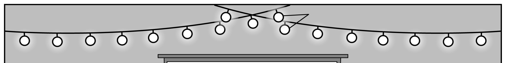
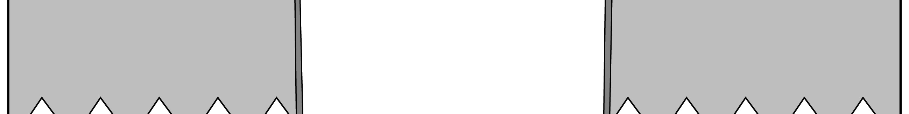
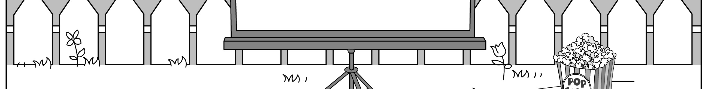
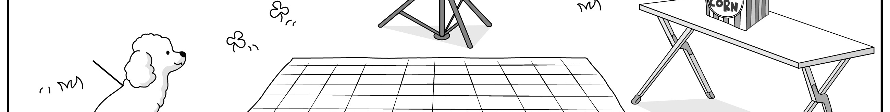
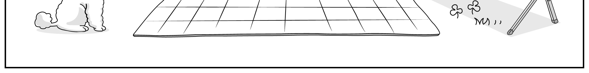
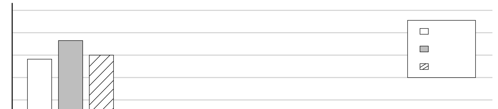
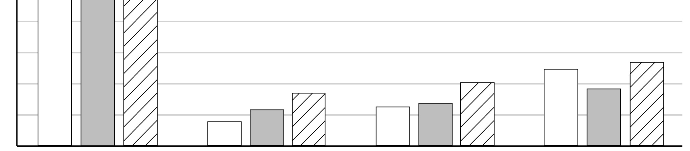
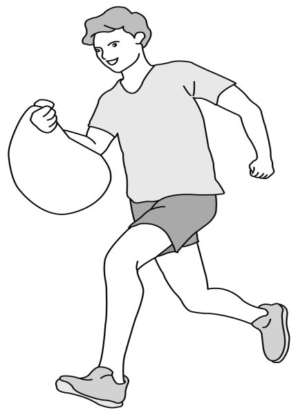

1. 다음을 듣고, 여자가 하는 말의 목적으로 가장 적절한 것을 고르시오.

① 보건실 이용에 대해 안내하려고
② 구급약 사용 방법을 설명하려고
③ 보건실 환경 개선을 건의하려고
④ 학생 식당 위치를 알려주려고
⑤ 학사 일정 변경을 공지하려고

2. 대화를 듣고, 남자의 의견으로 가장 적절한 것을 고르시오.

① 물건을 충동적으로 구매하지 않아야 한다.
② 지출을 기록하는 것은 금전 관리에 도움이 된다.
③ 부모로부터 경제적으로 독립하는 것이 필요하다.
④ 현명한 소비는 자기 만족감을 향상시킬 수 있다.
⑤ 기억력 향상을 위해 메모하는 습관을 길러야 한다.

3. 다음을 듣고, 여자가 하는 말의 요지로 가장 적절한 것을 고르시오.

① 질문은 의사소통을 원활하게 만들어 준다.
② 어려운 과업일수록 더 꾸준한 연습이 필요하다.
③ 지나친 조언은 오히려 대화를 단절시킬 수 있다.
④ 성공하기 위해서 원만한 인간관계가 필수적이다.
⑤ 좋은 관계 형성을 위해 경청하는 태도가 중요하다.

4. 대화를 듣고, 그림에서 대화의 내용과 일치하지 않는 것을 고르시오.

① Movie Night

5. 대화를 듣고, 남자가 할 일로 가장 적절한 것을 고르시오.

① 상품 준비하기
② 무대 장식하기
③ 참가 신청서 받기
④ 심사 위원 선정하기
⑤ 스피커 점검하기

6. 대화를 듣고, 여자가 지불할 금액을 고르시오. [3점]

① $70
② $72
③ $90
④ $94
⑤ $100

7. 대화를 듣고, 남자가 시상식에 갈 수 없는 이유를 고르시오.

① 대학 입학 면접이 있어서
② 아르바이트를 해야 해서
③ 여동생 병문안을 가야 해서
④ 도서관 자원봉사를 해야 해서
⑤ 공연 리허설과 일정이 겹쳐서

8. 대화를 듣고, Darlington Park Festival에 관해 언급되지 않은 것을 고르시오.

① 운영 프로그램
② 날짜
③ 입장료
④ 주차 요금
⑤ 신청 방법

9. Bake a Cake Competition에 관한 다음 내용을 듣고, 일치하지 않는 것을 고르시오.

① 8월 31일에 개최된다.
② 기본 재료는 제공된다.
③ 조리법을 대회 당일 제출해야 한다.
④ 세 명의 심사 위원이 케이크를 시식할 것이다.
⑤ 웹사이트에서 참가 신청을 할 수 있다.

10. 다음 표를 보면서 대화를 듣고, 두 사람이 주문할 여행용 가방을 고르시오.

|  | Model | Size (inch) | Price | Material | Lock |
| --- | --- | --- | --- | --- | --- |
| ① | A | 20 | $80 | fabric | × |
| ② | B | 20 | $100 | plastic | ○ |
| ③ | C | 24 | $130 | plastic | × |
| ④ | D | 24 | $150 | fabric | ○ |
| ⑤ | E | 28 | $170 | plastic | ○ |

11. 대화를 듣고, 남자의 마지막 말에 대한 여자의 응답으로 가장 적절한 것을 고르시오. [3점]

① Absolutely. You can donate them next time instead.
② Don’t worry. I’m going to the supermarket right now.
③ Never mind. We’ve already got things we need to use.
④ Sure. Let’s first pick out some items in good condition.
⑤ Sorry. I didn’t have enough money to buy toys for kids.

12. 대화를 듣고, 여자의 마지막 말에 대한 남자의 응답으로 가장 적절한 것을 고르시오.

① In that case, you can check other libraries for the book.
② Unfortunately, you have to pay a fine if you return it late.
③ I don’t think so. I haven’t really heard of that author.
④ Exactly. You should return the book by the due date.
⑤ Sure, I guess you should probably order three more.

13. 대화를 듣고, 남자의 마지막 말에 대한 여자의 응답으로 가장 적절한 것을 고르시오. [3점]

Woman:
① No worries. I often keep myself updated with them.
② I’m afraid not. You need more experience in fashion.
③ Of course. You already have what it takes for the job.
④ You’re right. I have more responsibilities at the magazine.
⑤ Sorry to hear that. You’ll get another chance in the future.

14. 대화를 듣고, 여자의 마지막 말에 대한 남자의 응답으로 가장 적절한 것을 고르시오.

Man:
① Right. All you need is a yoga mat and a towel.
② Okay. I’ll give it a try to see if it’s right for me.
③ Sorry. Registration is already closed at this time.
④ Great. My yoga class is very popular around here.
⑤ Too bad. You should have worked out much harder.

15. 다음 상황 설명을 듣고, Ben이 Amy에게 할 말로 가장 적절한 것을 고르시오.

Ben:
① How about putting our ideas together for the project?
② Let me tell you how to reduce food waste at school.
③ Why don’t we do a campaign about recycling?
④ You need to get the teacher’s permission right away.
⑤ I think we should share his ideas with our classmates.

16. 여자가 하는 말의 주제로 가장 적절한 것은?

① strategies animals use to protect themselves
② benefits of the unique appearances of animals
③ importance of saving endangered wild animals
④ difficulties that animals face when finding food
⑤ skills that animals develop to defend their young

17. 언급된 동물이 아닌 것은?

따라 답을 하시기 바랍니다.

① skunk
② chameleon
③ frog
④ lizard
⑤ zebra

18. 다음 글의 목적으로 가장 적절한 것은?

Dear Ms. Lopez, We want to express our gratitude for your dedication as a Spanish instructor. With exceptional teaching skills, you have significantly improved our students’ progress and confidence in Spanish. As the year is about to end, it is time for us to reflect on your contributions and consider the renewal of your contract. Given your positive impact, we would like to offer an extension of your contract for the next academic year. We believe your continued involvement will further enhance our students’ learning experience and academic achievement. We look forward to your response. Sincerely, James Martin Principal

19. 다음 글에 드러난 Peter의 심경 변화로 가장 적절한 것은?

Peter stepped out of the freezing night air and into the brightly lit hospital lobby, holding his three‐year‐old daughter in his arms. The harsh light made her look even more unwell, her face all red and sweaty. Her fever had started suddenly, just before dinner, but it wouldn’t go down despite his efforts. At the front desk, he explained her symptoms, his concern growing with every moment. They were quickly led to the doctor, who reassured him and carefully examined his daughter. After the doctor gave her a shot, her fever went down and she seemed more comfortable. As Peter watched her sleep peacefully that night, he felt a wave of calm wash over him.

20. 다음 글에서 필자가 주장하는 바로 가장 적절한 것은?

Imagine you have the best tea in the world and you put it into a bag that’s impermeable. It won’t work. You just won’t be able to make a cup of tea. For the teabag to work, it needs to be porous. You need the tea and the water to come in contact with each other. In our lives too, we cannot survive and thrive in isolation. Leaders need to be careful not to build walls around themselves that prevent people from reaching out to them. As a leader, you need to be able to touch other people. The tea was meant to mix with the water. Similarly all of us were designed to work with other people, with teams, and with society at large.

21. 밑줄 친 every man has a horizon of his own이 다음 글에서 의미하는 바로 가장 적절한 것은? [3점]

It is difficult, if not impossible, to define the limits which reason should impose on the desire for wealth; for there is no absolute or definite amount of wealth which will satisfy a man. The amount is always relative, that is to say, just so much as will maintain the proportion between what he wants and what he gets; for to measure a man’s happiness only by what he gets, and not also by what he expects to get, is as pointless as to try and express a fraction which shall have a numerator but no denominator. A man never feels the loss of things which it never occurs to him to ask for; he is just as happy without them; whilst another, who may have a hundred times as much, feels miserable because he has not got the one thing he wants. In fact, every man has a horizon of his own, and he will expect as much as he thinks it is possible for him to get.

22. 다음 글의 요지로 가장 적절한 것은?

All of the restaurants are using carefully chosen words to evoke vivid mental images of delicious food and rich desserts in order to draw the potential customer to their particular establishment. Just like the restaurants, nature has its own dining establishments. In a fashion similar to the restaurants’ financial dependence upon drawing in many customers, the restaurateurs of the natural world (i.e., flowers) must also attract potential diners to sample their offerings. In the natural world, there are no neon signs or flashy words in which to market a potential meal to hungry animals. These restaurants that I am referring to are the world’s flowers, and the potential guests are the host of organisms that visit flowers to obtain nectar and other valuable resources. Instead of using a written language or neon sign, they advertise their offerings just as effectively using the language of smell.

23. 다음 글의 주제로 가장 적절한 것은?

Would you rather receive $1,000 in a year or $1,100 in a year and a month? Most people will opt for the larger sum in thirteen months — where else will you find a monthly interest rate of 10 percent. A wise choice, since the interest will compensate you generously for any risks you face by waiting the extra few weeks. Second question: Would you prefer $1,000 today cash on the table or $1,100 in a month? If you think like most people, you’ll take the $1,000 right away. This is amazing. In both cases, if you hold out for just a month longer, you get $100 more. In the first case, it’s simple enough. You figure: “I’ve already waited twelve months; what’s one more?” Not in the second case. The introduction of “now” causes us to make inconsistent decisions. Science calls this phenomenon hyperbolic discounting. The closer a reward is, the higher our “emotional interest rate” rises and the more we are willing to give up in exchange for it.

24. 다음 글의 제목으로 가장 적절한 것은?

Of central importance for understanding the development of handedness is the answer to the question of when in development it is actually determined whether a child will be left‐handed or right‐handed. It was long thought that handedness could only be reliably determined in elementary school, when a child learns to write. However, this assumption is incorrect. In fact, scientific studies show that left‐handedness is established in many children long before elementary school — interestingly, even before birth in most people. In such studies, the hand and arm movements of unborn children in the womb are recorded using ultrasound images. Using this technique, it was shown that a clear preference for the movement of the right arm exists as early as 10 weeks after fertilization. In this study, ultrasound images of 72 unborn children 10 weeks after fertilization were evaluated and 85% showed more movements of the right arm than the left. This number is already very close to the approximately 89.4% right‐handers among adults.

25. 다음 도표의 내용과 일치하지 않는 것은?

US Dairy Product Imports in Selected Countries from 2018 to 2020 ($) (unit: millions of US dollars) 408 372 238 246 272 Mexico Indonesia Philippines China The graph above shows US dairy product imports in selected countries from 2018 to 2020. Among the four countries above, Mexico consistently recorded the highest imports of US dairy products from 2018 to 2020. However, US dairy product imports in Mexico decreased from 2019 to 2020, while the reverse was true in the other three countries during the same period. In Indonesia, US dairy product imports in 2020 were more than twice those in 2018. The increase in US dairy product imports in the Philippines from 2018 to 2019 was larger than that in Indonesia in the same period. China was the only country where imports of US dairy products dropped between 2018 and 2019.

| Country | 2018 | 2019 | 2020 |
| --- | --- | --- | --- |
| Mexico | 1,370 | 1,530 | 1,400 |
| Indonesia | 164 | 238 | 348 |
| Philippines | 246 | 272 | 408 |
| China | 497 | 372 | 538 |

26. Filippo Brunelleschi에 관한 다음 글의 내용과 일치하지 않는 것은?

Filippo Brunelleschi is considered to be the founding father of Renaissance architecture. He was born in Florence in 1377. Filippo was artistically talented, and trained as a goldsmith and a clockmaker before becoming an architect. When he was around 25, he traveled to Rome with his friend, the sculptor Donatello, where he studied the remains of ancient Roman buildings. His first architectural commission was the Ospedale degli Innocenti, which is one of the great Renaissance buildings. A number of other fine works, including chapels in Florentine churches, strengthened his reputation. And the stunning dome of Il Duomo is his masterpiece. He also designed machinery to produce special effects in theatrical productions. He died in Florence and was buried in Il Duomo.

27. Youth Leaders Camp에 관한 다음 안내문의 내용과 일치하지 않는 것은?

Youth Leaders Camp This camp is an annual event to improve your leadership. We look forward to meeting you soon in Canada.
Dates: July 5 ‒ 7, 2025
Ages: 17 ‒ 19
Place: University of Drakemont
Programs ⦁Day 1: Team Building & Leadership Skills Workshop ⦁Day 2: Culture Tour ⦁Day 3: Leadership Project Planning & Presentations
Participation
Fee: $700
Notes ⦁Registration is only available online at www.ylc2025.com. ⦁Participation fee includes everything except for the flight tickets to Canada. For more information, please visit our website.

28. Plogging Run에 관한 다음 안내문의 내용과 일치하는 것은?

Plogging Run Jog, walk, pick up trash, and conserve the Earth!
When: September 13, 2025
Where: Lake Union
Details ⦁The event starts at 11:00 a.m. ⦁There is no participation fee. ⦁You’ll walk and run around the lake while picking up trash.
Notes ⦁Wear comfortable athletic clothes and running shoes for your safety. ⦁Garbage bags will be provided. ⦁If it rains, the event will be cancelled. If you have any questions, please email us at information@ploggingrun.org.

29. 다음 글의 밑줄 친 부분 중, 어법상 틀린 것은?

In art, there are a number of ways to use perspective to obtain the illusion of depth, including using colors and graduated values of black and white, and accurately drawing the subject by applying the rules of the geometric system of perspective. In order to achieve perspective, you must make a number of observations. The forms or objects that you draw on a flat surface actually has depth and dimension in real life. As you view them and place their shapes and forms on a drawing surface, try to represent that depth to make the objects appear realistic and three‐ dimensional. Objects appear differently when viewed from various positions. Because of this, it’s important to establish the viewpoint, and stick with it. When observing a subject, you see depth and three dimensions. When you draw this subject onto a flat surface as it appears to the eye, you are drawing in perspective.

30. 다음 글의 밑줄 친 부분 중, 문맥상 낱말의 쓰임이 적절하지 않은 것은? [3점]

Low oil prices are a good thing, because it means lower energy costs of production for the majority of industries, not least the automobile and the logistics industries. Firms directly benefit from the decrease in their costs of production and provision of services. This has the effect of stimulating the aggregate supply and provides a stimulus for growth. Conversely, a sudden rise in oil prices due to a shrink in oil production is never good news, even though it definitely gives a big boost to the energy sector. A look through the history of oil price fluctuations disproves this notion, as this has been the subject of much economic research. Following an oil price jump of 10 per cent due to a contraction in supply, an economy (as typified by the US economy) typically sees its output (GDP) slowed by close to 1 percentage point. For a $15 trillion economy, that is a loss of $150 billion in potential wealth or economic growth. Conversely, there has never been much concern with oil price decreases following an excess in its supply.

31. 다음 빈칸에 들어갈 말로 가장 적절한 것을 고르시오.

We might forget an anecdote about a stranger because it makes few connections with our existing associations, but we won’t forget a piece of gossip about our cousin. There’s one complex network that is larger and quicker to access than all others — the self. We’ve been thinking about ourselves in our whole lives. (In fact, there were entire years during junior high when we weren’t capable of thinking about much else.) So if a new piece of information has something to do with us, it will be more easily and thoroughly processed. It hits even closer to home than our actual home — we can take a vacation away from our home, but not from ourselves. The most effective communicators find ways to make the abstract . Consider the warning that law schools give to motivate first‐year law students concerning the rigors of their program. Hearing that “the first‐year dropout rate is 33%” is an abstract statistic. “Look to your left, look to your right. One of the three of you won’t be joining us next fall” wakes up the self.

32. 다음 빈칸에 들어갈 말로 가장 적절한 것을 고르시오.

Steve Jobs used analogy to get people to embrace the new technology. Before computers, people worked in a physical world. We used paper and pens and physical file folders and so on. The idea of working in a virtual world was radically different. Or at least seemed radically different. What Jobs understood was that a physical office was fundamentally similar to a virtual office. To win over the masses, Jobs drew strong analogies between the traditional workplace people knew well with the new, unfamiliar virtual workplace. In the pre‐computer workplace, when ideas were written on paper it was called... a document. When those documents needed to be stored they were put in... a folder. And those folders were kept on... a desk. Documents, folders, and desktops are the terms we use in our virtual work because Steve Jobs understood that would make the new technology easier to understand. The parallels between the physical and virtual workplace now seem obvious.

33. 다음 빈칸에 들어갈 말로 가장 적절한 것을 고르시오. [3점]

Turtle hatchlings have, it seems, evolved to crawl toward the light. For millions of years this was a highly rational and effective strategy because the light on a dark beach represented the reflection of the moon and stars on the water’s surface. Following the lights led baby turtles back home to the sea. The problems started when humans began building beachfront homes and sparkling hotels on the other side of the beach. Now after hatching, turtles heading for the brightest nearby lights were being guided straight into traffic. Are self‐ destructive sea turtles naturally irrational? Yes, in the modern world. But there’s a deeper truth. Turtles are basing their decisions on simple cues that were perfectly rational for their ancestors; these days, however, their evolved decision‐making mechanisms.

34. 다음 빈칸에 들어갈 말로 가장 적절한 것을 고르시오. [3점]

Sensory organs are the only channels of communication between the brain and the outside world. Simply put, the brain is not designed to sense on its own. For instance, an exposed brain would neither sense light shining on it nor feel something touching it. In fact, patients are often kept awake during brain surgery, which can help a surgeon isolate specific regions of the brain. The ancient Greek philosopher Aristotle recognized this characteristic of the brain over 2,000 years ago when he said, “Nothing is in the mind that does not pass through the senses.” This concept can be seen clearly when volunteers are blind‐folded and placed in the warm water of a sensory deprivation tank. They soon experience visual, auditory, and tactile (touch) hallucinations, as well as incoherent thought patterns. From these experiments and others, it is apparent that to carry out functions that give us personality and intellect.

35. 다음 글에서 전체 흐름과 관계 없는 문장은?

The writer and zoologist Desmond Morris observed that our feet communicate exactly what we think and feel more honestly than any other part of our bodies. Why are the feet and legs such accurate reflectors of our sentiments? For millions of years, long before humans spoke, our legs and feet reacted to environmental threats (e.g., hot sand, ill‐ tempered lions) instantaneously, without the need for conscious thought. Our limbic brains made sure that our feet and legs reacted as needed by either ceasing motion, running away, or kicking at a potential threat. This survival regimen, retained from our ancestral heritage, has served us well and continues to do so today. In some cultures, therefore, barefoot walking is considered a spiritual practice, connecting the individual to the ancestors. In fact, these age‐old reactions are still so hardwired in us that when we are presented with something dangerous or even disagreeable, our feet and legs still react as they did in prehistoric times.

36. 주어진 글 다음에 이어질 글의 순서로 가장 적절한 것을 고르시오.

The transition from an oral culture, in which knowledge was handed down through stories, songs, and apprenticeships, to a literate one, based on the written word, was held back for centuries by the lack of suitable writing material. The invention of paper, said to be one of the four great inventions of the Chinese, solved these problems, but it wasn’t until the Romans replaced the scroll with the codex — or, as we call it now, the book — that the material reached its full potential. Stone and clay tablets were used, but they were prone to fracture and were bulky and heavy to transport. Wood suffers from splitting and is susceptible to decay. Wall paintings are static and space is limited. That was two thousand years ago, and it is still a dominant form of the written word. That paper, a much softer material than either stone or wood, won out as the guardian of the written word is a remarkable materials story.

37. 주어진 글 다음에 이어질 글의 순서로 가장 적절한 것을 고르시오. [3점]

A reason for a conclusion is very unlikely to consist in a single claim. No matter how we might state it in short‐ hand, it is, analytically, a complex interaction of many ideas and implications. While the link between these two ideas and the conclusion might seem obvious, the purpose of reasoning is to avoid assuming the ‘obvious’ by carefully working through the connections between the various ideas in the initial statement of our reason. But is our analysis of the situation clearly expressed in just one statement? Hardly. The conclusion is about universities and free education, while the reason introduces some new ideas: economic benefit and a well‐ educated population. The reason must be broken down into a chain of more precise premises. For example, the claim that ‘university education should be free for all Australians’ might be supported by the reason that ‘the economy benefits from a well‐educated Australian population’.
38. 글의 흐름으로 보아, 주어진 문장이 들어가기에 가장 적절한 곳을 고르시오.

But migration can also be a solution for many preexisting problems. The word “migration” is almost always reported in the popular media and even in scientific literature as a problem or a crisis. For example, migrants are assumed to overcrowd cities, clog up labor markets, and increase poverty. The other questionable assumption is that most migration is involuntary — people fleeing natural or man‐made disasters. The reality, however, is more complex, and many migrants are simply seeking greater economic opportunity. Of course migration can and does create social and economic problems. For example, out‐migration generally redistributes workers from places of labor surplus to areas where there is greater demand or more opportunity. Migration is generally selective of persons who are younger, healthier, more flexible, and more willing to endure hardship in hopes of a better life relative to their prospects in their places of origin. Most research that examines long‐term outcomes of migration, including remittances and intergenerational mobility, finds positive “long‐term” effects on places of origin and destination.

39. 글의 흐름으로 보아, 주어진 문장이 들어가기에 가장 적절한 곳을 고르시오. [3점]

For this reason, many countries have preferred using gold, silver, or some other material that is inherently limited in supply, as money. The big problem with money created by the government is that those who run the government always face the temptation to create more money and spend it. Whether among ancient kings or modern politicians, this has happened again and again over the centuries, leading to inflation and the many economic and social problems that follow from inflation. It is a way of depriving governments of the power to expand the money supply to inflationary levels. Gold has long been considered ideal for this purpose, since the supply of gold in the world usually cannot be increased rapidly. When paper money is convertible into gold whenever the individual chooses to do so, then the money is said to be “backed up” by gold. This expression is misleading only if we imagine that the value of the gold is somehow transferred to the paper money, when in fact the real point is that the gold simply limits the amount of paper money that can be issued.

40. 다음 글의 내용을 한 문장으로 요약하고자 한다. 빈칸 (A), (B)에 들어갈 말로 가장 적절한 것은? [3점]

The study of emotions and decision making is now of considerable importance. This involves the application of various tools afforded by neuroscience. One important stream of the literature examines people with brain damage and how damage to particular parts of the brain known to be responsible for particular cognitive functions impacts on decision making. One example of this research is the work of Antonio Damasio, who finds that when the emotional part of the brain is damaged, this actually reduces the efficacy of decision making. Good decisions are a product of the emotional part of the brain working in conjunction with the deliberative part. This contradicts the assumptions of conventional economics, where emotions play a negative role in the decision‐making process. Here it is assumed that decision making can be modeled as being generated in a stoic, unemotional fashion, and that’s why decisions tend to be optimal. But the evidence suggests that emotions actually play an important and, often, a positive role in decision making. 

 The brain’s emotional part working in relation with its deliberative part the effectiveness of decision making, which the ideas about emotions in the decision‐making process of traditional economics.

41. 윗글의 제목으로 가장 적절한 것은?

Shoppers confronted with the choice of thirty different varieties of gourmet chocolates are more likely to walk away without buying any, compared with when they are presented with only half a dozen choices. If employees are given a free trip to Paris, they are happy. If you give them a free trip to Hawaii, they are happy. But if you offer them the choice between the two destinations, they are less happy, no matter what they choose. Why might choice be so disruptive? The reason is that choice forces us to make comparisons and acknowledge relative disadvantages. People who choose Paris complain that it doesn’t have the ocean and those who choose Hawaii regret that it doesn’t have the museums. Psychologist Barry Schwartz calls this the ‘tyranny of choice’ because rather than providing freedom, it actually constrains our decision‐making. He argues that narrower choice increases unhappiness because we worry that we are going to make the wrong decision and so we get stressed about trying to process all the comparisons in an effort to get it right. This both increases our fear of making the wrong choice and raises expectations that we should be able to get the best choice. Having made the choice, we then start to regret, wondering whether it was the right one.

42. 밑줄 친 낱말 중에서 문맥상 낱말의 쓰임이 적절하지 않은 것은?

Shoppers confronted with the choice of thirty different varieties of gourmet chocolates are more likely to walk away without buying any, compared with when they are presented with only half a dozen choices. If employees are given a free trip to Paris, they are happy. If you give them a free trip to Hawaii, they are happy. But if you offer them the choice between the two destinations, they are less happy, no matter what they choose. Why might choice be so disruptive? The reason is that choice forces us to make comparisons and acknowledge relative disadvantages. People who choose Paris complain that it doesn’t have the ocean and those who choose Hawaii regret that it doesn’t have the museums. Psychologist Barry Schwartz calls this the ‘tyranny of choice’ because rather than providing freedom, it actually constrains our decision‐making. He argues that narrower choice increases unhappiness because we worry that we are going to make the wrong decision and so we get stressed about trying to process all the comparisons in an effort to get it right. This both increases our fear of making the wrong choice and raises expectations that we should be able to get the best choice. Having made the choice, we then start to regret, wondering whether it was the right one.

43. 주어진 글에 이어질 내용을 순서에 맞게 배열한 것으로 가장 적절한 것은?

 As the train pulled into a quiet countryside station, the gentle chatter of passengers filled the air. Linda was excited to finally visit her grandparents after two years. She watched people getting onto the train and hurriedly finding their seats. A moment later, an elderly woman struggled with a heavy bag, trying to sit down next to her. The bag seemed almost too big for her small body. As the elderly woman finally calmed down, she looked at Linda with a smile. “I’m so sorry,” she said. “I have low blood pressure, and the sudden movement of the train must have made me feel dizzy. Thank you so much for helping me.” Linda nodded gently in response, then turned her gaze back to the peaceful countryside scene. She thought that no matter how unsure she might feel, even the smallest act of help is much better for someone in need than doing nothing. Linda carefully tapped the elderly woman’s shoulder to check if she was alright. The woman groaned softly, trying to gather her strength. Linda moved closer, sliding a hand under the woman’s back. As the woman’s eyes slowly opened, she reassured her softly, “It’s okay, just relax for a moment.” Linda helped the woman sit up slowly, then guided her back to her seat. As the situation settled, people around went back to their seats. Linda hesitated, unsure if the elderly woman would want her help. But soon, she chose to assist the woman. “Let me help you with your bag,” she said. Before she could reach the bag, the elderly woman suddenly lost her balance and fell down. She lay on her back, and her face was pale. Linda froze for a moment, feeling the urgency of the situation. She quickly knelt down beside the fallen woman, as a few people rushed over.

44. 밑줄 친 낱말 중에서 가리키는 대상이 나머지 넷과 다른 것은?

 As the train pulled into a quiet countryside station, the gentle chatter of passengers filled the air. Linda was excited to finally visit her grandparents after two years. She watched people getting onto the train and hurriedly finding their seats. A moment later, an elderly woman struggled with a heavy bag, trying to sit down next to her. The bag seemed almost too big for her small body. As the elderly woman finally calmed down, she looked at Linda with a smile. “I’m so sorry,” she said. “I have low blood pressure, and the sudden movement of the train must have made me feel dizzy. Thank you so much for helping me.” Linda nodded gently in response, then turned her gaze back to the peaceful countryside scene. She thought that no matter how unsure she might feel, even the smallest act of help is much better for someone in need than doing nothing. Linda carefully tapped the elderly woman’s shoulder to check if she was alright. The woman groaned softly, trying to gather her strength. Linda moved closer, sliding a hand under the woman’s back. As the woman’s eyes slowly opened, she reassured her softly, “It’s okay, just relax for a moment.” Linda helped the woman sit up slowly, then guided her back to her seat. As the situation settled, people around went back to their seats. Linda hesitated, unsure if the elderly woman would want her help. But soon, she chose to assist the woman. “Let me help you with your bag,” she said. Before she could reach the bag, the elderly woman suddenly lost her balance and fell down. She lay on her back, and her face was pale. Linda froze for a moment, feeling the urgency of the situation. She quickly knelt down beside the fallen woman, as a few people rushed over.

45. 윗글에 관한 내용으로 적절하지 않은 것은?

 As the train pulled into a quiet countryside station, the gentle chatter of passengers filled the air. Linda was excited to finally visit her grandparents after two years. She watched people getting onto the train and hurriedly finding their seats. A moment later, an elderly woman struggled with a heavy bag, trying to sit down next to her. The bag seemed almost too big for her small body. As the elderly woman finally calmed down, she looked at Linda with a smile. “I’m so sorry,” she said. “I have low blood pressure, and the sudden movement of the train must have made me feel dizzy. Thank you so much for helping me.” Linda nodded gently in response, then turned her gaze back to the peaceful countryside scene. She thought that no matter how unsure she might feel, even the smallest act of help is much better for someone in need than doing nothing. Linda carefully tapped the elderly woman’s shoulder to check if she was alright. The woman groaned softly, trying to gather her strength. Linda moved closer, sliding a hand under the woman’s back. As the woman’s eyes slowly opened, she reassured her softly, “It’s okay, just relax for a moment.” Linda helped the woman sit up slowly, then guided her back to her seat. As the situation settled, people around went back to their seats. Linda hesitated, unsure if the elderly woman would want her help. But soon, she chose to assist the woman. “Let me help you with your bag,” she said. Before she could reach the bag, the elderly woman suddenly lost her balance and fell down. She lay on her back, and her face was pale. Linda froze for a moment, feeling the urgency of the situation. She quickly knelt down beside the fallen woman, as a few people rushed over.
