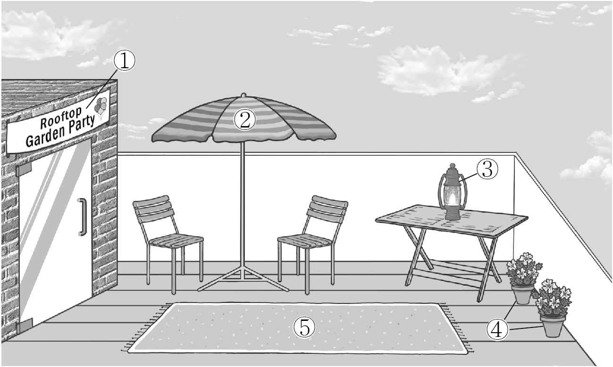
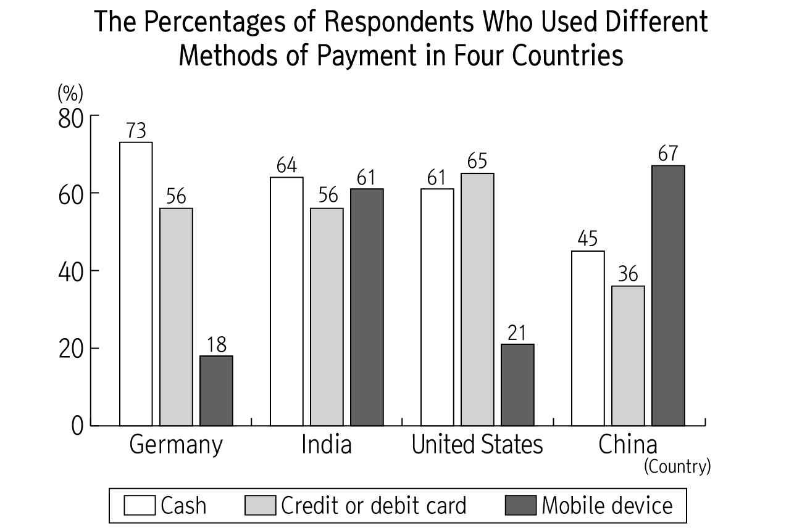
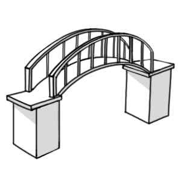
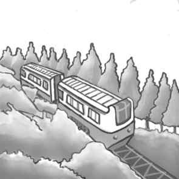

1. 다음을 듣고, 여자가 하는 말의 목적으로 가장 적절한 것을 고르시오.

① 걷기 프로그램 시간 변경을 안내하려고
② 방과 후 프로그램 신청을 독려하려고
③ 산책로 출입 금지 시간을 공지하려고
④ 점심 식사 시간 준수를 당부하려고
⑤ 새로 개설한 동아리를 홍보하려고

2. 대화를 듣고, 남자의 의견으로 가장 적절한 것을 고르시오.

① 냉장고 문을 자주 여닫으면 전기가 낭비된다.
② 과도한 육류 섭취는 영양 불균형의 원인이 된다.
③ 한 번 해동한 음식은 다시 냉동하지 않는 것이 좋다.
④ 음식을 밀폐해서 보관하면 세균 증식을 억제할 수 있다.
⑤ 오랫동안 냉동 보관한 음식을 먹는 것은 해로울 수 있다.

3. 다음을 듣고, 남자가 하는 말의 요지로 가장 적절한 것을 고르시오.

① 무선 이어폰의 장시간 사용은 청력에 부정적인 영향을 미친다.
② 무선 이어폰은 주변 소음을 차단하여 집중력을 높일 수 있다.
③ 보행 중 무선 이어폰 사용은 심각한 사고를 유발할 수 있다.
④ 자전거를 탈 때 보행자를 배려하는 습관이 필요하다.
⑤ 운동을 하면서 음악을 들으면 운동 효과가 커진다.

4. 대화를 듣고, 그림에서 대화의 내용과 일치하지 않는 것을 고르시오.

5. 대화를 듣고, 여자가 할 일로 가장 적절한 것을 고르시오.

① 이메일 보내기
② 선물 구매하기
③ 팸플릿 인쇄하기
④ 행사 장소 정하기
⑤ 배경 음악 고르기

6. 대화를 듣고, 남자가 지불할 금액을 고르시오. [3점]

① $108
② $120
③ $135
④ $150
⑤ $162

7. 대화를 듣고, 여자가 특강에 참석할 수 없는 이유를 고르시오.

① 발표 자료를 만들어야 해서
② 배구 경기에 참가해야 해서
③ 물리학 과제를 해야 해서
④ 아르바이트가 있어서
⑤ 무릎을 다쳐서

8. 대화를 듣고, Historical Costume Parade에 관해 언급되지 않은 것을 고르시오.

① 장소
② 목적
③ 날짜
④ 참가 비용
⑤ 등록 방법

9. 2025 Brain Competition에 관한 다음 내용을 듣고, 일치하지 않는 것을 고르시오.

① 고등학생을 대상으로 한다.
② 3시간 동안 진행된다.
③ 두 번째 라운드에서 구술시험을 본다.
④ 전자기기를 사용할 수 있다.
⑤ 우승자는 상금을 받는다.

10. 다음 표를 보면서 대화를 듣고, 두 사람이 주문할 스마트 어항을 고르시오.

|  | Model | Price | Tank Volume | Function | Frame Color |
| --- | --- | --- | --- | --- | --- |
| ① | A | $109 | 13L | Smart Heating System | White |
| ② | B | $129 | 15L | Automatic Feeder | Black |
| ③ | C | $149 | 20L | Automatic Feeder | White |
| ④ | D | $179 | 23L | Smart Heating System | Silver |
| ⑤ | E | $219 | 26L | Automatic Feeder | Silver |

11. 대화를 듣고, 여자의 마지막 말에 대한 남자의 응답으로 가장 적절한 것을 고르시오.

① Sure. We can bake them together at my place.
② Good. Share these cookies with your friends.
③ Sorry. I haven’t prepared presents for you.
④ Okay. I won’t burn my cookies next time.
⑤ No. She’ll be too busy to help you.

12. 대화를 듣고, 남자의 마지막 말에 대한 여자의 응답으로 가장 적절한 것을 고르시오.

① You’re right. The construction is now complete.
② I see. I’ll take the subway tomorrow instead.
③ No way. I’ve just missed the bus to school.
④ No problem. I can drive you to work.
⑤ Of course. I’ll come home early.

13. 대화를 듣고, 여자의 마지막 말에 대한 남자의 응답으로 가장 적절한 것을 고르시오. [3점]

Man:
① Okay. I’ll let you know if I find any.
② Right. I have to finish my experiment.
③ No thanks. I already used some earlier.
④ Not really. I don’t need any special effects.
⑤ Never mind. I’ll take care of it after your show.

14. 대화를 듣고, 남자의 마지막 말에 대한 여자의 응답으로 가장 적절한 것을 고르시오. [3점]

Woman:
① Sorry. I don’t have any large sizes left.
② Great. Let’s register for the tournament.
③ Thank you. I hope I can change the size.
④ Excellent. I’d like to buy that uniform, too.
⑤ Don’t worry. I’m sure you’ll win the matches.

15. 다음 상황 설명을 듣고, Jack이 Emma에게 할 말로 가장 적절한 것을 고르시오.

Jack:
① I wonder how I could decorate my booth.
② Please donate your items for the flea market.
③ You should always be kind to your customers.
④ Who will participate in the charity event with us?
⑤ Can you tell me what items sell well at flea markets?

16. 여자가 하는 말의 주제로 가장 적절한 것은?

① animals that can cause damage to buildings
② various functions of structures built by animals
③ construction skills that humans can learn from animals
④ effective ways for animals to escape from danger
⑤ creative hunting strategies of different animals

17. 언급된 동물이 아닌 것은?

따라 답을 하시기 바랍니다.

① beavers
② ants
③ spiders
④ bees
⑤ birds

18. 다음 글의 목적으로 가장 적절한 것은?

Dear Principal Smith, My name is Kara Peterson, and I am the Community Event Coordinator at the Greenfield Community Center. We are organizing a drone show for the local community and are excited about this special event. While searching for the ideal location, we found that your school is the best place to ensure the safety and accessibility of all attendees. I kindly request your permission to use the school playground on Saturday, December 6th, from 6 p.m. to 8 p.m. We will ensure that all safety rules are strictly followed, and that any cleanup will be handled efficiently. Please let me know if there are any specific procedures for obtaining approval. Thank you for your time and consideration. I will be eagerly awaiting your response. Sincerely, Kara Peterson

19. 다음 글에 드러난 Amina의 심경 변화로 가장 적절한 것은?

When Amina returned home from the river with her full clay water jar, she noticed men with tools near her family’s hut. She wondered who they were. Her uncle stood among them, pointing to a spot beyond the baobab tree. She put the jar down and walked closer, wanting to know what was happening. The men began clearing and marking the ground. Amina ran to her uncle with a mind full of questions. “Uncle, what’s happening?” she asked. “We’re preparing the land. Something important will be built. A school!” her uncle said with a proud smile. Amina’s eyes sparkled with joy. The school nearest to her village was hours away on foot. “It’s for all the children in the village,” her uncle continued. Amina imagined learning how to read and write, and her heart swelled with excitement.

20. 다음 글에서 필자가 주장하는 바로 가장 적절한 것은?

“Tactics” is a term drawn from military usage. Strategies are plans of action directing a military force when attacking another, and tactics are responses to conditions on the ground. In this vein, time is imposed on us by our cultures, by the technologies that have regimented time down to the nanosecond, and by its own finite nature and the fact that we’re going to live only so long. In response, we must develop tactics for dealing with time and waiting. These aren’t tactics to eliminate waiting; instead, these are tactics for teaching us how to learn from the seams. These tactics have the potential to reorient us in profound ways, transforming our perspectives on our wait times. Such renewed perspectives transform waiting from a burden to a springboard toward things like creativity, social critique, or reflection on our inner state and the state of our relationships.

21. 밑줄 친 swimming alongside the boat가 다음 글에서 의미하는 바로 가장 적절한 것은? [3점]

Mirror neurons are the hardware of empathy, and so what would make more sense than to look and see which animals possess these cells? And this is exactly where modern research now stands: all researchers know so far is that apes possess mirror neurons. We still need to test to see which other species are like us in this respect. Scientists often publicly speculate that we can probably expect surprises here, too. They assume that all animals that live in herds or large groups possess similar brain mechanisms, because social units function only if individuals can see things from the perspective of others in the group and feel what they are feeling. I can see a goldfish waving its fin at us. As an animal that travels around in a tightly-knit group, it’s on board with this idea ― or at least swimming alongside the boat.

22. 다음 글의 요지로 가장 적절한 것은?

The future of work depends on two forces: a harmful substituting force and a helpful complementing one. Many tales have a hero and a villain fighting each other for dominance, but in our story, technology plays both roles at once, displacing workers while simultaneously raising the demand for their efforts elsewhere in the economy. This interaction helps explain why past worries about automation were misplaced: our ancestors had predicted the wrong winner in that fight, underestimating quite how powerful the complementing force would prove to be or simply ignoring that factor altogether. It also helps to explain why economists have traditionally been dismissive of the idea of technological unemployment: there appeared to be firm limits to the substituting force, leaving lots of tasks that could not be performed by machines, and a growing demand for human beings to do them instead.

23. 다음 글의 주제로 가장 적절한 것은?

It’s conceivable that in a world where solar panels are incredibly expensive and there’s an extreme collapse in the cost of launching objects to space, you might want to maximize your energy per panel by putting them above the atmosphere. But panels are cheap, and even if we assume pretty steep drops in the cost of space launch, the numbers don’t add up. This becomes especially clear when you start to think about maintenance. Try to imagine acres upon acres of glass panels in space, regularly hit by intense radiation and bits of space debris while enduring the extreme heat of constant sunlight. They’ll have to be repaired and cared for either by astronauts or an army of advanced robots. Solar panels in Australia can be cleaned by a teenager with a spray bottle and a cloth.

24. 다음 글의 제목으로 가장 적절한 것은?

Everything in the world exists on a continuum, whether in speed, size, or any other possible descriptor you could think of. Still, we create and mindlessly adopt sharp distinctions, and those distinctions change lives far more dramatically than marginal differences ever do. Indeed, all differences are arbitrary, but drawing hard lines between categories hides this arbitrariness and can be severely damaging. I call this resulting damage “the borderline effect.” The examples are endless. Someone’s IQ is 69 and someone else’s is 70 ― but only the score of 70 is deemed to be within the range of normal. We don’t have to be statisticians to know there is not a meaningful difference between 69 and 70. Yet once the person with the lower score is labeled “cognitively impaired,” his or her life will unfold differently than the person with a one-point advantage.

25. 다음 도표의 내용과 일치하지 않는 것은?

The above graph, which was based on a survey conducted from April of 2022 to March of 2023, shows the percentages of respondents in four countries who used different methods of payment.

| Country | Cash | Credit or debit card | Mobile device |
| --- | --- | --- | --- |
| Germany | 73 | 56 | 18 |
| India | 64 | 56 | 61 |
| United States | 61 | 65 | 21 |
| China | 45 | 36 | 67 |

26. Barry Commoner에 관한 다음 글의 내용과 일치하지 않는 것은?

Barry Commoner, born in Brooklyn in 1917, was the son of Jewish immigrants from Russia. Commoner was a leading ecologist and one of the founders of the modern environmental movement. He earned his doctoral degree in cellular biology from Harvard University in 1941. After serving in the US Navy during World War II, Commoner moved to Missouri, and became a professor of plant physiology at Washington University in 1947, where he taught for 34 years. In the late 1950s, Commoner became widely known for his opposition to nuclear weapons testing and went on to write several books about the negative ecological effects of atmospheric nuclear testing. In 1980, Commoner founded the Citizens Party to serve as a vehicle for his ecological message. In his later years, Commoner continued his efforts to raise awareness about the impact that human activity has on the environment.

27. Hikes for Rides에 관한 다음 안내문의 내용과 일치하지 않는 것은?

Hikes for Rides Join us at Hikes for Rides and spend a magical morning in the Enchanted Forest. All profits will be put toward the installation of a new tram for those who are unable to hike on their own. When &
Where: Saturday, September 27th, at Harris
County Enchanted Forest
Registration: While early registration is available online, you can register on site. Participation
Fee: $5 (Free for children aged 8 and under)
Start Times
10km course: 8:30 a.m.
5km course: 9:00 a.m.
Kids Fun Hike: 9:30 a.m.
Notes
Stay on designated trails at all times.
Yield to wildlife.
Pets are not allowed. For more information, click here.

28. Paper Bridge Building Contest에 관한 다음 안내문의 내용과 일치하는 것은?

Paper Bridge Building Contest We’re excited to announce the 5th Paper
Bridge Building Contest! Show off your creativity and engineering skills by building the strongest paper bridge! Date &
Time: October 18th, 2025, 10 a.m.
Location: Lakeland City Hall Who Can Enter: Middle and high school students in Lakeland
Requirements
You can only use A4-sized paper and tape provided to you at the event.
Your bridge must be 30cm or longer.
Prizes The top three strongest bridges that can support the heaviest loads will win.
1st place: $300
2nd place: $200
3rd place: $100
Click here to register now!

29. 다음 글의 밑줄 친 부분 중, 어법상 틀린 것은?

All human cultures mark the passing of time by the differences they observe in the world around them. Our choice of which differences to mark depends firstly on what we can observe and secondly on what is important in our lives. How we mark the differences ― the shapes of our calendars and our rituals ― depends on the connections we make between those two things. In the agricultural society of pre-modern Europe, where higher latitudes make the seasons easily observable, it was natural to monitor the solar cycle. Conversely, among the largely nomadic peoples of Arabia, for whom seasonal changes were less significant, the lunar calendar was a more sensible choice. That did not make it inevitable that Islam would use a lunar calendar and Roman Christianity a solar one, but political and religious decisions were made from options limited by geography and lifestyle, filtered through tradition.

30. 다음 글의 밑줄 친 부분 중, 문맥상 낱말의 쓰임이 적절하지 않은 것은? [3점]

Although empathy is widely praised by scholars and public figures, not everyone is an empathy booster. Critics of empathy argue that empathy will not save us from interpersonal and intergroup conflict. In fact, they argue, empathy makes such conflicts worse. These critics maintain that empathy can be exhausting and lead to burnout or insensitivity to suffering. They argue that we tend to empathize strongly with our in-group and resist empathizing with out-groups, and even enjoy the suffering of out-groups in competitive or threatening contexts. Thus, the prescription for more empathy is often counterproductive in cases of conflict. Empathy, they argue, can further encourage conflict and force us into an us vs. them mentality. Finally, even when we try to empathize with others who are dissimilar from us or in unfamiliar contexts, sometimes we are unable to accurately empathize with their experiences, causing further misunderstandings and frustration. Critics of empathy argue that we should give up on empathy and employ other tools in pursuit of social harmony, e.g., rational compassion or moral emotions like fear, anger, and shame.

31. 다음 빈칸에 들어갈 말로 가장 적절한 것을 고르시오.

Paradoxically, it’s uncertainty that makes us feel most alive. Think of events that shake you out of your everyday routine: maybe attending a family wedding, making a big presentation, or going somewhere you’ve never been. It’s on those occasions that time seems to slow down a little, and you feel more fully engaged. The same holds true if the experience is risky, like mountain climbing or parasailing. Your senses are sharper. You notice more. Thanks to the release of a feel-good chemical in the brain called dopamine, you get a greater rush of pleasure from chance encounters with people than planned meetings. Good news, financial rewards, and gifts are more enjoyable if they are surprises. It’s why the most popular television shows and movies are the ones with unexpected plot twists and astonishing endings.

32. 다음 빈칸에 들어갈 말로 가장 적절한 것을 고르시오. [3점]

A great strength of the market mechanism is that there are incentives for individuals to reveal their knowledge through their behavior. This stands in contrast to many strategic situations ― for example, in political negotiations ― in which it is wise not to let the other side know what one’s true preferences or production capacities are. A perfectly competitive market that clears on the spot leaves no room for such strategies. If prices are not sticky ― as many models assume ― individuals adapt their behavior instantaneously, whenever their preferences or the circumstances change. They stop buying items that do not satisfy their needs and stop selling items that do not provide them with optimal gains, maybe switching to the production of other items. If they have motivational problems, for example, falling into denial about the fact that there is no demand for their products, markets reveal to them, sometimes in quite brutal ways, that they better accept this fact.

33. 다음 빈칸에 들어갈 말로 가장 적절한 것을 고르시오.

Dictionary definitions are constantly revised to keep up with our changing uses and knowledge. In Roman times, “addicts” were people who were unable to pay their debts and gave themselves as slaves to their creditors. The word eventually came to be associated with drug dependency: one becomes a slave to one’s addiction. The word “husband” originally referred to being a homeowner; it had nothing to do with being married. But because owning your own property made it more likely you’d find a mate, the word eventually came to mean a male who has been wed. On November 5th, 1605, Guy Fawkes tried to blow up the British Parliament. He was captured and put to death. Loyalists burned his effigy, which they nicknamed the “guy.” Centuries later, the word lost its negative connotation and a musical named Guys and Dolls ran on Broadway. In American slang, bad means good, cool means great, and wicked means excellent. If you could transport yourself one hundred years into the future, you’d find yourself confused by your great-grandchildren’s speech because language itself is an ever-changing reflection of human invention.

34. 다음 빈칸에 들어갈 말로 가장 적절한 것을 고르시오. [3점]

The term “anchoring” was introduced by Roland Barthes who observed that text is often used next to images (his focus was on photographs) to confine meaning. Of all possible literal or implied interpretations an image could elicit, text would point the viewer towards a desired, specific direction. In advertising, as Barthes argues, the symbolic message does not guide identification but interpretation. The viewer is not asked to recognize what they see but to understand why they see it and what it means to them. By combining images with text, advertising produces symbolic meaning that is accurate and specific on the one hand, richer on the other, thus adding depth and eliminating breadth of rational and emotional interpretations. The headline or tagline of an ad directs the reader through the intended meanings of the image, so that the reader avoids some and receives others. It “remote-controls” the reader towards a meaning chosen in advance.

35. 다음 글에서 전체 흐름과 관계 없는 문장은?

According to Einstein’s theory, a large mass like the Sun ‘bends’ spacetime. Newton’s theory makes no such prediction. This bending of spacetime leads to phenomena such as ‘gravitational lensing’ where the light of distant stars appears to be in different locations when they pass by a large mass like the Sun. We don’t normally see this lensing because stars aren’t visible during the day when the Sun is out, but a solar eclipse in 1919 allowed scientists to observe what the Sun’s gravity was doing to the light from distant stars. The stars around the Sun appeared to have moved from their normal positions in the night sky. Despite the consistent efforts to confirm the precise orbit of planets within our solar system, observational schedules were often disrupted by local weather phenomena. The shift was much larger than Newton’s theory predicted, but exactly in the positions predicted by Einstein’s theory.

36. 주어진 글 다음에 이어질 글의 순서로 가장 적절한 것을 고르시오.

We’re naturally wired to organize the world into a hierarchy. We do this to help make sense of the world, maintain our beliefs, and generally feel better. But when someone infringes on our place in the world and our understanding of how it works, we react without thinking. When someone cuts you off on the highway and road rage kicks in, that’s your unconscious mind saying, “Who are you to cut me off?” You’re reacting to a threat to your inherent sense of hierarchy. On the road we are all equals. We’re all supposed to play by the same rules. Cutting someone off violates those rules and implies higher status. Or consider when you get frustrated with your kids and end an argument with “Because I said so.” (Or the office equivalent: “Because I’m the boss.”) In these moments you’ve stopped thinking and regressed to your biological tendencies of reaffirming the hierarchy.

37. 주어진 글 다음에 이어질 글의 순서로 가장 적절한 것을 고르시오. [3점]

Once a nail is hammered in, it is friction that holds it in place. Friction is the force that arises when two surfaces are sliding, or trying to slide, against each other. If you try to pull apart two blocks of wood that have been nailed together, the wood fibers grip the shaft of the nail. The nail feels a force trying to rip it apart along its length, and we call that force tension. Your experiment can now fail in one of two ways ― either the nail stretches and splits in half because the tension force is too large for the nail, or the nail comes loose because the friction force is overcome. The force it would take to stretch the nail is much larger than the friction forces on the surface, so we don’t have to worry too much about the former. It’s the friction with which we need to concern ourselves.

38. 글의 흐름으로 보아, 주어진 문장이 들어가기에 가장 적절한 곳을 고르시오.

The traditional bank manager in the 1950s was usually a respected pillar of the community, a cautious, careful sort of person who probably went to bed early and didn’t drink too much. But from the 1970s a new kind of banker appeared ― loud, flashy, and arrogant. These bankers loved taking big risks. They wanted to get rich quick and blow their money on fast cars and expensive champagne. They made their money through what’s called ‘speculation’. Normally, people buy things because they want to use them, such as wheat to make bread and petrol to run the car. But when people speculate, they buy things even when they have no interest in using them. They might buy a load of wheat simply because they think that its price is going to rise when a drought is predicted in wheat-growing areas. If their guess is right, they later sell the wheat for a profit.

39. 글의 흐름으로 보아, 주어진 문장이 들어가기에 가장 적절한 곳을 고르시오. [3점]

Paper’s mechanical properties lend themselves to folding and bending. The cellulose fibers of which it is made can be partially snapped in the area of maximum bend, allowing a permanent crease to form, while sufficient fibers remain undamaged for the material not to crack and fall apart. Indeed, in this state it pretty much maintains its ability to resist being pulled apart, but it can also be torn easily and accurately along the crease if a point of weakness ― a small, initial tear ― is opened up. This winning combination of mechanical properties allows it to assume the shape of any object through creasing and folding ― hence the art of origami. There are very few materials as good: metal foils can hold a crease, but control of the crease is somewhat more difficult. Plastic sheeting doesn’t tend to hold a crease at all, unless it is very soft, in which case it lacks the rigidity required of a good wrapping material. So it is its ability to hold a crease while remaining stiff that makes paper uniquely suited to this purpose.

40. 다음 글의 내용을 한 문장으로 요약하고자 한다. 빈칸 (A), (B)에 들어갈 말로 가장 적절한 것은?

Mother cats can tell which kittens belong to them ― when litters are mixed up they use their kittens’ scent to distinguish them from offspring of other mothers. Despite this, when faced with a selection of kittens who have wandered from the nest, her own and others that aren’t hers, a mother cat doesn’t appear to favor her own offspring when retrieving them. The reason for this is uncertain, although distress vocalizations from kittens that are lost from their nest are known to be very powerful, so it may just be hard for the mother to resist retrieving them, regardless of whether they are hers. In the wild, a squeaking kitten out in the open is likely to attract predators, which is bad news for any other kittens around it. A rapid rescue of any crying kitten would be a good strategy to prevent them from drawing unwanted attention. 

 Although mother cats can identify their own offspring, they are likely to collect any lost crying kittens, possibly to reduce the chances of being detected by predators.

41. 윗글의 제목으로 가장 적절한 것은?

Many animals pursue a mixed strategy of accumulating both body fat and food, which leads one to ask, “What are the relative advantages and disadvantages of these two forms of energy storage?” Maximum fat deposition increases with body mass whereas maximum food storage is not constrained by body size. This means that animals, especially small animals, can accumulate much greater energy reserves in the form of stored food than they can in the form of body fat. Further, stored food is more economical than body fat because fat contributes to body mass, and metabolic rate increases with body mass. In other words, there is a metabolic expense to maintaining fat. Excessive fat accumulations may also have a negative effect on an animal’s ability to avoid predators. And, if maintaining a high body temperature is advantageous, animals might be expected to accumulate more energy in the form of a food store than as body fat. On the other hand, stored food may rot over time, may be removed by robbers, or may simply be lost. Many animals must expend energy managing and protecting their food stores. Eating food and converting it to fat avoids these types of losses and the energetic costs of managing stored food. A large accumulation of body fat adds to an animal’s fasting capacity, especially large animals, permitting some animals to enter prolonged dormancy in the relative security of a hibernaculum. Thus, both fat accumulation and food storage have some decided advantages.

42. 밑줄 친 낱말 중에서 문맥상 낱말의 쓰임이 적절하지 않은 것은? [3점]

Many animals pursue a mixed strategy of accumulating both body fat and food, which leads one to ask, “What are the relative advantages and disadvantages of these two forms of energy storage?” Maximum fat deposition increases with body mass whereas maximum food storage is not constrained by body size. This means that animals, especially small animals, can accumulate much greater energy reserves in the form of stored food than they can in the form of body fat. Further, stored food is more economical than body fat because fat contributes to body mass, and metabolic rate increases with body mass. In other words, there is a metabolic expense to maintaining fat. Excessive fat accumulations may also have a negative effect on an animal’s ability to avoid predators. And, if maintaining a high body temperature is advantageous, animals might be expected to accumulate more energy in the form of a food store than as body fat. On the other hand, stored food may rot over time, may be removed by robbers, or may simply be lost. Many animals must expend energy managing and protecting their food stores. Eating food and converting it to fat avoids these types of losses and the energetic costs of managing stored food. A large accumulation of body fat adds to an animal’s fasting capacity, especially large animals, permitting some animals to enter prolonged dormancy in the relative security of a hibernaculum. Thus, both fat accumulation and food storage have some decided advantages.

43. 주어진 글에 이어질 내용을 순서에 맞게 배열한 것으로 가장 적절한 것은?

 The next morning, before heading to school, Collin put an envelope on the kitchen table. When his dad came into the kitchen, he noticed the envelope and asked his wife about it. She explained that Collin had left it there before leaving for school. Collin’s dad opened the envelope and saw a thick stack of money. “There’s $1,000 in here!” he exclaimed, after counting it. His wife smiled and said, “Collin wanted to help you pay for the new car.” That afternoon, Collin’s dad went to the car dealership and purchased a car that was only one year old. He picked a red car because that was Collin’s favorite color. The money that his son had left for him was enough to cover the remaining cost, and he even had some funds left over! Collin’s dad decided to buy his son a small gift with the extra money. That evening, when Collin came home, he was amazed to see the new car parked in the driveway. His dad thanked him sincerely, and told Collin how proud he was of his thoughtful gesture. Then, he handed Collin a small box with a bow on top of it, and a brand-new baseball was inside. Collin loved it! He beamed with excitement and said, “Not only do we have a new car, but I also got an awesome new baseball!” His dad smiled warmly and hugged him. Collin’s kind and generous heart had created a beautiful moment for his family. 

44. 밑줄 친 낱말 중에서 가리키는 대상이 나머지 넷과 다른 것은?

 The next morning, before heading to school, Collin put an envelope on the kitchen table. When his dad came into the kitchen, he noticed the envelope and asked his wife about it. She explained that Collin had left it there before leaving for school. Collin’s dad opened the envelope and saw a thick stack of money. “There’s $1,000 in here!” he exclaimed, after counting it. His wife smiled and said, “Collin wanted to help you pay for the new car.” That afternoon, Collin’s dad went to the car dealership and purchased a car that was only one year old. He picked a red car because that was Collin’s favorite color. The money that his son had left for him was enough to cover the remaining cost, and he even had some funds left over! Collin’s dad decided to buy his son a small gift with the extra money. That evening, when Collin came home, he was amazed to see the new car parked in the driveway. His dad thanked him sincerely, and told Collin how proud he was of his thoughtful gesture. Then, he handed Collin a small box with a bow on top of it, and a brand-new baseball was inside. Collin loved it! He beamed with excitement and said, “Not only do we have a new car, but I also got an awesome new baseball!” His dad smiled warmly and hugged him. Collin’s kind and generous heart had created a beautiful moment for his family. 

45. 윗글에 관한 내용으로 적절하지 않은 것은?

 The next morning, before heading to school, Collin put an envelope on the kitchen table. When his dad came into the kitchen, he noticed the envelope and asked his wife about it. She explained that Collin had left it there before leaving for school. Collin’s dad opened the envelope and saw a thick stack of money. “There’s $1,000 in here!” he exclaimed, after counting it. His wife smiled and said, “Collin wanted to help you pay for the new car.” That afternoon, Collin’s dad went to the car dealership and purchased a car that was only one year old. He picked a red car because that was Collin’s favorite color. The money that his son had left for him was enough to cover the remaining cost, and he even had some funds left over! Collin’s dad decided to buy his son a small gift with the extra money. That evening, when Collin came home, he was amazed to see the new car parked in the driveway. His dad thanked him sincerely, and told Collin how proud he was of his thoughtful gesture. Then, he handed Collin a small box with a bow on top of it, and a brand-new baseball was inside. Collin loved it! He beamed with excitement and said, “Not only do we have a new car, but I also got an awesome new baseball!” His dad smiled warmly and hugged him. Collin’s kind and generous heart had created a beautiful moment for his family. 하시오.
