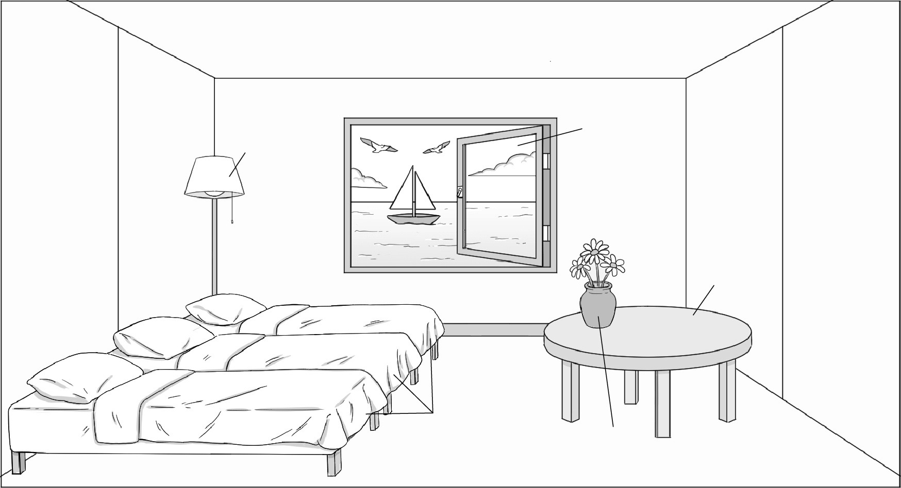
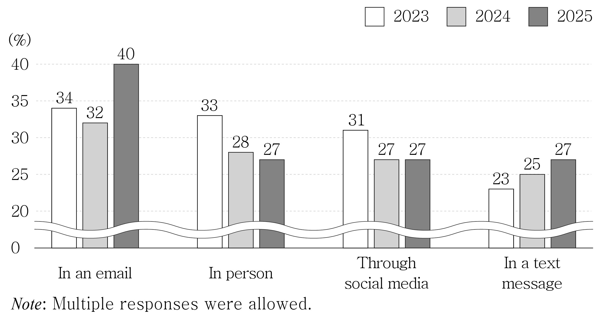
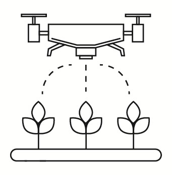

1. 다음을 듣고, 남자가 하는 말의 목적으로 가장 적절한 것을 고르시오.
① 학교 신문 이름의 공모를 안내하려고
② 학교 신문에 게재할 기사를 모집하려고
③ 학교 신문 창간 기념식 개최를 공지하려고
④ 학교 신문 동아리의 지원 절차를 설명하려고
⑤ 학교 신문 디자인 선호도 조사를 실시하려고

2. 대화를 듣고, 여자의 의견으로 가장 적절한 것을 고르시오.

① 친구 사이라도 예의를 갖추어 행동해야 한다.
② 논쟁 상황에서는 잠시 침묵을 지키는 것이 좋다.
③ 자신의 감정을 솔직하게 표현하는 것이 중요하다.
④ 상대방의 입장에서 먼저 생각하고 이해해야 한다.
⑤ 의견이 다를 때는 이성적으로 판단하려 노력해야 한다.

3. 다음을 듣고, 남자가 하는 말의 요지로 가장 적절한 것을 고르시오.
① 선택의 기준은 개인의 필요와 처한 상황에 따라 달라진다.
② 결정 상황에서 처음 정한 선택이 가장 바람직한 경우가 많다.
③ 빠르고 정확한 판단은 분석적 사고력이 뒷받침될 때 가능하다.
④ 중요한 결정에는 주변 사람들의 조언을 구하는 것이 도움이 된다.
⑤ 하나의 결론만 고집하기보다 여러 가능성을 살피는 것이 좋다.

4. 대화를 듣고, 그림에서 대화의 내용과 일치하지 않는 것을 고르시오.

②
③

5. 대화를 듣고, 남자가 할 일로 가장 적절한 것을 고르시오.

① 쓰레기봉투 가져가기
② 바람막이 빌려주기
③ 샌드위치 만들기
④ 간식 구매하기
⑤ 등산로 정하기

6. 대화를 듣고, 여자가 지불할 금액을 고르시오. [3점]

① $33
② $39
③ $40
④ $43
⑤ $46

7. 대화를 듣고, 여자가 클라우드 서비스 구독을 취소하려는 이유를 고르시오.

① 회사에서 접속이 불가능해서
② 서비스 이용 요금이 너무 비싸서
③ 스마트폰 전용 앱을 지원하지 않아서
④ 저장 용량에 만족하지 못해서
⑤ 서버 오류가 자주 발생해서

8. 대화를 듣고, 역사 강연에 관해 언급되지 않은 것을 고르시오.

① 주제
② 강연자
③ 날짜
④ 참가비
⑤ 장소

9. 2026 World Folk Dance Festival에 관한 다음 내용을 듣고, 일치하지 않는 것을 고르시오.

① 3월 27일 금요일에 열린다.
② 여섯 개의 댄스팀이 무대에 오른다.
③ 민속춤 의상을 입어 볼 수 있다.
④ 공연 후 공연자들과 함께 사진을 찍을 수 있다.
⑤ 방문객 모두에게 특별 기념품을 증정한다.

10. 다음 표를 보면서 대화를 듣고, 남자가 구매할 달리기용 조끼를 고르시오.

|  | Model | Price | Visibility Features | Weight | Number of Bottle Holders |
| --- | --- | --- | --- | --- | --- |
| ① | A | $17 | None | Medium | 2 |
| ② | B | $25 | Reflective Strips | Lightweight | 1 |
| ③ | C | $27 | Reflective Strips | Lightweight | 2 |
| ④ | D | $29 | LED Lights | Medium | 1 |
| ⑤ | E | $35 | LED Lights | Lightweight | 1 |

11. 대화를 듣고, 남자의 마지막 말에 대한 여자의 응답으로 가장 적절한 것을 고르시오.

① You’re too late. The train already left five minutes ago.
② That’s tight. You need to hurry after you get off.
③ I agree. There’ll be less traffic tomorrow.
④ That’s my fault. I’ll leave earlier next time.
⑤ No problem. I can give you a ride to the station.

12. 대화를 듣고, 여자의 마지막 말에 대한 남자의 응답으로 가장 적절한 것을 고르시오.

① Good job. I feel proud of you finishing the work.
② You’ll be fine. That job doesn’t require a uniform.
③ Don’t worry. Just do your best and trust yourself.
④ You’re right. Many students are looking for part-time jobs.
⑤ It won’t matter. Some part-time jobs start in the afternoon.

13. 대화를 듣고, 남자의 마지막 말에 대한 여자의 응답으로 가장 적절한 것을 고르시오.

Woman:
① That’s perfect. Thank you so much for doing that.
② Too bad. We could have ordered the T-shirts.
③ Good idea. I can help you right now.
④ Not really. We can just use the original design.
⑤ I agree. We’d better ask the printing shop to fix it.

14. 대화를 듣고, 여자의 마지막 말에 대한 남자의 응답으로 가장 적절한 것을 고르시오. [3점]

Man:
① Great. Let’s use the service and enjoy the day.
② Never mind. I’d rather stay in the hotel tomorrow.
③ Okay. We can take our luggage with us the whole day.
④ I’m sorry. I totally forgot to cancel our hotel reservation.
⑤ Right. We can come back here and pick up our suitcases.

15. 다음 상황 설명을 듣고, Hailey가 Brian에게 할 말로 가장 적절한 것을 고르시오. [3점]

Hailey:
① Do you mind sharing it again in the class group chat?
② I didn’t get the photo. Did you send it in another chat?
③ The photos aren’t clear. Could you share different ones?
④ I’m not comfortable with the photos, so can you remove them?
⑤ How about taking pictures with all the classmates instead?

16. 여자가 하는 말의 주제로 가장 적절한 것은?

① foods that seem healthy but may be misleading
② nutritional benefits of eating healthy foods
③ the role of packaging in food marketing
④ how low-calorie foods help with weight control
⑤ why people can’t trust nutrition labels completely

17. 언급된 음식이 아닌 것은?

① light salad dressing
② nut bars
③ wheat bread
④ fruit juice
⑤ veggie chips

18. 다음 글의 목적으로 가장 적절한 것은?

Dear Members of the City Sports Center, We greatly appreciate your continued use of our sports center. As previously announced, we will be conducting essential maintenance on our underground parking lot. As a result, the underground parking facility will be unavailable from April 1st to April 7th. During this period, we kindly ask you to use the temporary outdoor parking lot located across from the main entrance. We are committed to completing the work as quickly as possible. We sincerely apologize for any inconvenience this may cause and appreciate your patience and cooperation.

19. 다음 글에 드러난 Oliver의 심경 변화로 가장 적절한 것은?

Looking around the noisy cafeteria, Oliver gripped his tray tightly. He felt the heavy weight of being new to the school. Not knowing how the day would go made him feel anxious. He sat with a heavy sigh at a corner table. He thought, ‘Can I make it through the rest of the day?’ Just then, a plastic tray was placed down opposite him. It was a boy from his math class. “Hey, is this seat taken? By the way, thanks for lending me that pen earlier.” The invisible wall around Oliver seemed to melt away. “Not at all, please sit,” he replied. Starting to feel at ease, he smiled brightly at the boy.

20. 다음 글에서 필자가 주장하는 바로 가장 적절한 것은?

When moving into a new situation, many people decide that they need to master what’s new. To this end, they reduce their connections to people or activities that might distract them from their goal. But that is a mistake. Being too focused can lead to becoming unidimensional — you have few remedies to the microstresses that are inevitably bombarding you at that time. So when things are tough during such a transition, you have almost nothing else in your life to counterbalance the stress. Instead of staying laser-focused, use this transition as the jumping-off point for building new networks to shape the work you want to do and whom you want to do it with.

21. 밑줄 친 having a “blank face”가 다음 글에서 의미하는 바로 가장 적절한 것은? [3점]

A first step toward establishing a respectful classroom learning community is acceptance of all ideas and answers — regardless of any obvious errors. Rich mathematical discussions cannot occur if this expectation is not in place. We must remember that wrong answers are often rooted in misconceptions, and unless these ideas are allowed to be brought to the forefront, we cannot help students confront their thinking. Students who are in safe learning environments are willing to risk sharing an incorrect answer with their peers in order to grow mathematically. It is important to model and expect the acceptance of all ideas without derogatory comments. As educators we can model this by recording all answers to be considered without giving any verbal or physical expressions that indicate agreement or disagreement with any answer. The teacher may need to practice having a “blank face.” Students look to teachers as the source of correct answers. Part of building a safe learning community is to shift this source of knowledge to the students by equipping them to defend the thinking behind their solutions.

22. 다음 글의 요지로 가장 적절한 것은?

The usual intercity traveler moves slowly through the station area. The passenger may not be familiar with the routine, have baggage to handle and check or retrieve, have a long wait for connections or delayed trains, and may require information, food, and a comfortable place to sit. Commuters, on the other hand, are familiar with the route through the station, have little or no luggage, and are usually in a hurry. They want direct access to or from local streets and transport. These two types of traffic should be kept separate to avoid conflict and confusion. In some large stations such as Grand Central Terminal in New York City, commuter and intercity trains arrive and depart on different levels. In smaller stations, separate platforms should be used and traffic routed so that the two lines of movement do not cross. In some instances, separate stations are in use. Clear and concise direction and routing signs and other means of channelization are desirable.

23. 다음 글의 주제로 가장 적절한 것은?

Most performance lighting is made up of a number of different looks which we have called lighting states. Each lighting cue triggers a change to a new state. Like actors, lighting cues usually need a motivation. This might be something very obvious such as a cue required to brighten a room setting when an actor turns on a light switch or the rapid increase in intensity at the end of a dance number in a traditional musical (known as a button cue). At other times we will need a cue to provide a subtle change in atmosphere over a number of minutes, motivated perhaps by the mention of a sunset or the intention to slowly change the feel of the performance from normal to threatening. The question, ‘What will lighting do for this production?’ needs to be asked for each moment of the production, each dramatic unit or scene, and each transition.

24. 다음 글의 제목으로 가장 적절한 것은? [3점]

Rooms have their own “sound” because they impose their own characteristics on audio signals contained within them. It’s actually kind of remarkable. Sound such as music coming from headphones will sound the same everywhere. No matter what acoustical environment we are in, the headphones sound the same. That’s because the room is not part of that playback signal path. But sound such as music from a loudspeaker will sound different in every acoustical environment. Every room where you set up the loudspeaker will cause the sound you hear to be different — sometimes dramatically different; that is because the room is now part of the signal path. Also, in the same room, the loudspeaker will sound different when it is placed in different locations in the room and it will sound different as you move around the room. Similarly, when you are recording a musical instrument, the sound you receive at the microphone will be different in every room and the recorded sound will sound different as the instrument or the microphone is moved.

25. 다음 도표의 내용과 일치하지 않는 것은?

The Percentages of Consumers in the U.S. Who Were Likely to Respond, by Review Request Methods The graph above shows the percentages of consumers in the U.S. who were likely to respond to four different review request methods in 2023, 2024, and 2025.

| Method | 2023 | 2024 | 2025 |
| --- | --- | --- | --- |
| In an email | 34 | 32 | 40 |
| In person | 33 | 28 | 27 |
| Through social media | 31 | 27 | 27 |
| In a text message | 23 | 25 | 27 |

26. Dennis William Sciama에 관한 다음 글의 내용과 일치하지 않는 것은?

Dennis William Sciama was born in Manchester, England, in 1926. He received an education in mathematics and physics at Malvern College. Despite his father’s wish for him to take over the family business, Sciama chose to continue pursuing his academic career. After earning a doctoral degree in physics from the University of Cambridge in 1953, he became famous for his research on the universe. Early in his career, Sciama supported the steady-state theory, which argued that the universe had no beginning. However, when new evidence against the theory appeared in the 1960s, he changed his view and accepted the Big Bang model. In 1991, he was awarded the Guthrie Medal for outstanding contributions to experimental physics by the British Institute of Physics. Sciama’s role as a mentor became known even outside academic circles. Later, he was introduced in films about his most famous student, Stephen Hawking, which made Sciama known to a wider audience.

27. 2026 Student Smart Farming Program에 관한 다음 안내문의 내용과 일치하지 않는 것은?

2026 Student Smart Farming Program Join a one-year smart farming program for students! Learn how to run a smart farm using temperature control systems and watering drones. Program
Details: Participants should...
Attend a workshop at the beginning of the program.
Keep a journal to track crop growth.
Participate in monthly mentoring sessions.
Submit a final report at the end of the program.
Benefit
Top students will visit agricultural research institutes.
Registration
The program is free of charge.
Students may apply individually or in teams of up to three members.

28. Library of Things에 관한 다음 안내문의 내용과 일치하는 것은?

Library of Things Use the “Library of Things” and borrow what you need from our community center.
How It Works 1. To use this service, download the “Library of Things” app and log in.
2. Check out and reserve what you need in the app. (Online reservation only)
3. Pick up your item from Monday to Sunday.
4. Return it in good condition for your neighbors.

Available Items: Household tools and camping gear Borrowing Period: Items can be borrowed for up to 7 days, with one possible extension.
Fee: It’s free. Only if returned late, a late fee of $2 will be charged daily.

29. 다음 글의 밑줄 친 부분 중, 어법상 틀린 것은?

The Industrial Revolution did more than just invent new materials or machines. It invented a new process for manufacturing: the modern factory. Prior to around 1850, most piano shops used an apprentice system in which a master builder taught younger workers the skills of the trade, usually over the course of many years. The larger piano shops did have specialists — for example, one person who specialized in soundboards, another who made hammers, and so on. But even the largest piano makers of that time produced no more than 5-10 pianos per year per worker, as pianos were still made essentially one at a time. The development of a true piano factory occurred first in the United States, led by Jonas Chickering in Boston and later the Steinway family in New York City. These factories led to improvements in both efficiency and quality. For example, one of the factories of the time had its own iron casting facility where it made its metal plates, which were thought to be the best available.

30. 다음 글의 밑줄 친 부분 중, 문맥상 낱말의 쓰임이 적절하지 않은 것은?

In a thesis-based doctoral programme, students typically spend a significant amount of time and effort researching a specific topic. While this deep dive into a particular area allows for thorough exploration and understanding, it can also result in narrowing the focus. As students become deeply absorbed in their research, they may spend less time exploring related fields or acquiring skills outside their immediate area of study. Consequently, this singular focus may limit the breadth of knowledge and skills developed during the programme, potentially hindering students’ ability to adapt to diverse career paths or address interdisciplinary challenges. Some universities in Europe have recognised the limitations of traditional thesis-based doctoral programmes and have started to implement more structured approaches. These structured programmes often combine research with coursework and training in transferable skills. By incorporating coursework, seminars, workshops and internships into the curriculum, they aim to provide students with a broader skill set and better prepare them for a variety of career paths beyond academia.

31. 다음 빈칸에 들어갈 말로 가장 적절한 것을 고르시오.

Research shows that, by age three, children understand that imaginary objects do not come to life. This is especially clear with respect to everyday objects — children know that even though they imagine a pencil in an empty box, the box will remain empty. However, emotion can sometimes disrupt this understanding, or at least its expression. That is, even though a child knows that monsters are not real, the thought of a monster under a bed might be enough to make a child refuse to go into his room at night. Indeed, research shows that children have a more difficult time displaying their understanding of the causal relations between imagination and reality when they are asked to pretend or imagine scary things, like monsters. In one study, preschool children were shown an empty box and were asked to imagine a monster inside. All children agreed that the box was empty. However, when they were left alone with the box they exhibited fear and avoidance of it.

32. 다음 빈칸에 들어갈 말로 가장 적절한 것을 고르시오.

Perhaps the best-known development to emerge from the liberation and expansion of aesthetic experience is the aesthetics of everyday life. Although there is presently a flowering of work on everyday aesthetics, the possibility of aesthetic gratification in ordinary objects and events has long been recognized, even if degraded and dismissed by prevalent philosophical theory. Widely valued by poets, especially Romantic poets and those in Asian traditions, the aesthetic in everyday situations has also been recognized by novelists. It may be most convenient, though, to locate its contemporary intellectual origins in John Dewey’s Art as Experience. In that book Dewey argued against the separation of art from life by basing aesthetic experience on the biological and cultural conditions of human life. He located the aesthetic, not in an internalized awareness of sensation and feeling but in “a complete interpenetration of self and the world of objects and events.” Further, Dewey maintained that “the aesthetic is the clarified and intensified development of traits that belong to every normally complete experience.”

33. 다음 빈칸에 들어갈 말로 가장 적절한 것을 고르시오. [3점]

One cannot validly argue that humans are morally superior beings on the ground that they possess, while others lack, the capacities of a moral agent. The reason is that, as far as moral standards are concerned, only beings that have the capacities of a moral agent can meaningfully be said to be either morally good or morally bad. Only moral agents can be judged to be morally better or worse than others, and the others in question must be moral agents themselves. Judgments of moral superiority are based on the comparative merits or deficiencies of the entities being judged, and these merits and deficiencies are all moral ones, that is, ones determined by moral standards. One entity is correctly judged morally superior to another if it is the case that, when valid moral standards are applied to both entities, the first fulfills them to a greater degree than the second. Both entities, therefore, must fall within the range of application of moral standards. This would not be the case, however, if humans were being judged superior to animals and plants, since the latter are not moral agents.

34. 다음 빈칸에 들어갈 말로 가장 적절한 것을 고르시오. [3점]

Such artificial ‘pause fillers’ as machine-generated supplements for silence may help to produce a more natural-sounding cadence in machine-generated speech patterns and so help to convince the AI’s human interlocutors that they are engaging with another human. AI’s ‘humanity’ of silence emerges in these contexts not least because a short period of silence is likely to be interpreted as a ‘pause for thought’, therefore reinforcing the illusion that the machine is ‘thinking’ before responding, just as a human might. However, the technical issues flagged in AI’s poor handling of higher duration and frequency silences, no less than the machine inference that silence can be filled with relevant sounds in some conversational situations, are both significant. In this context at least, the AI may be starting to recognise silence not as an absence but as meaningful data. Yet the AI’s confusion when presented with substantial silences, and its understanding that short break tags are equivalent to vocal markers such as ‘uh’s’ and ‘ah’s’ indicate the AI’s continuing preferences for sound over silence, for presence over absence.

35. 다음 글에서 전체 흐름과 관계 없는 문장은?

Standardization of information was an effect of printing; since it allowed exact reproduction of information in a way that manuscript copying did not. This is evident in the contrast between the travel logs of Marco Polo and those of Christopher Columbus. After his return from China in 1295, a century and a half before printing, Polo’s narrative was copied in about 150 different manuscripts, with so many differences that we’re not sure which version is authentic. In contrast, there is only one version of Christopher Columbus’s letters about the exploration of the Caribbean in the 1490s, since they were fixed in printed form and widely distributed at the time they were written. Christopher Columbus’s travel logs are largely lacking in sharp observation, suggestive reflection, or even much of a sense of novelty. So the certainty of accuracy was a way that printing was an improvement over the old oral-manuscript culture.

36. 주어진 글 다음에 이어질 글의 순서로 가장 적절한 것을 고르시오.

Archaeological evidence suggests that various crops were being cultivated as early as 9500 BC in the Levant. Over the millennia, continuous innovations have boosted agricultural productivity while reducing manual labor. However, the growing global population will always demand more food. It is projected that by 2050, the world’s population will increase to 9.7 billion, which will require global food production to rise by at least 70% to meet demand. Despite this need, only a small portion of the Earth’s surface is suitable for farming due to limitations such as climate, topography, soil quality, and technology. Political and economic factors, including land ownership patterns, environmental laws, and population density, also influence agricultural land use. In fact, the amount of land used for agriculture has been declining. In 2013, around 18.6 million square miles was used for food production, compared to 19.5 million square miles in 1991.

37. 주어진 글 다음에 이어질 글의 순서로 가장 적절한 것을 고르시오. [3점]

If you are going to compare languages, it helps to start with something that you are confident you can find in all languages. Take for example signs or words for mother and father. If we add other family relationships to this category — son, grandmother, aunt, brother-in-law, cousin — we are defining the category of kinship terminology. Comparative typological studies of kinship terminology have discovered that languages have labels for some but not all family relationships. And the probability that a specific kin relationship has a label is predictable based on the other kinship terms in the language. For example, all languages have a core set of kinship terms — like mother and father. By contrast, terms for less central category members are often built up from the core terms — like mother-in-law and step-father. If we compare languages across the world, we can ask what kinship relationships are typically expressed with core terminology, and what relationships are expressed by modifying the core terminology.

38. 글의 흐름으로 보아, 주어진 문장이 들어가기에 가장 적절한 곳을 고르시오.

There are several ways that participants in a make-believe can communicate things about the fictional world to other participants. Sometimes these messages are emitted naturally as a result of full participation in the fictional world — i.e., something said or done by a player while in character communicates some things that are fictional of that world. For example, a child pretending to be Peter Pan might gasp and draw a plastic knife. This might be sufficient to communicate that fictionally one of Peter’s enemies, such as Captain Hook, is approaching. These in-character behaviors can be insufficient, however, to maintain the necessary amount of common ground about what is fictional in the world of the make-believe. At these times participants often come at least partly out of character to give other participants the information they need. For example, it would be important to avoid confusion about who is playing which character: “No, you’re Captain Hook, and I’m Peter Pan!”

39. 글의 흐름으로 보아, 주어진 문장이 들어가기에 가장 적절한 곳을 고르시오. [3점]

Our intuition about states of matter comes from our experience on Earth’s surface, where the pressure is uniformly low and variations in temperature cause changes in the state of matter from solid to liquid to gas. Therefore, when we think of melting or boiling or the creation of plasma, we intuitively assume it reflects an increase in temperature. This bias comes from the fact that we live in a very constant pressure environment. Even small changes in pressure, such as those we experience when under water or on high mountaintops, can have very large effects on our metabolism. But the pressure changes we experience are trivial compared to the pressure range of the overall planetary environment. Since pressure is controlled by the weight of overlying material, pressures increase rapidly with depth. Imagine the pressures generated by the weight of rock a mile thick! For this reason a planet’s pressure ranges are enormous — from essentially zero pressure in space to pressures of millions of atmospheres in planetary interiors.

40. 다음 글의 내용을 한 문장으로 요약하고자 한다. 빈칸 (A), (B)에 들어갈 말로 가장 적절한 것은?

When self-experimentation and conventional experiments are both possible, the difference between them often resembles the difference between learning and showing: Self-experiments are better for discovery but worse for convincing others that the solution is helpful or the answer is correct. Of course, most scientists want to do both — discover something and convince others of their discovery. Thus, psychologists should consider doing both self-experiments and conventional ones. The best use of resources may often be self-experiments followed by conventional ones. The researcher begins with self-experiments that, if all goes well, find large effects and / or generate and eliminate many hypotheses. This exploratory and theory-building phase lasts until a convenient solution or large effect is found. Then the researcher uses self-experiments to find the procedural parameters (e.g., duration, time of day, intensity) that optimize the solution or maximize the effect. Only then would the researcher begin conventional experiments, using the optimized parameters. 

 Since self-experiments are suited to exploration while conventional experiments provide validation, the most efficient strategy is for the former to precede the latter.

41. 윗글의 제목으로 가장 적절한 것은?

The emergence of the social sciences in the nineteenth century and the ability to work with large datasets created demand for new ways of visualizing information. Processed numerical information was best expressed in tables, charts, and graphs. Mathematics, natural sciences, and social sciences that employed statistics were at the forefront of the development of charts and graphs. History was a consumer, not a designer, of most of these new visualizations — and mostly a sparing consumer at that, since economic and social history lagged behind political history as an area of research. Simple charts and graphs were not difficult to interpret, and their visual conventions became part of what any ordinary reader would be expected to follow. As statistical analysis became more sophisticated, the visualizations that resulted became more and more central to the argument. In some cases, the visualization made interpretation possible. These success stories demonstrated the worth of statistical analysis and visualization. Perhaps the most notable example is John Snow’s map of the incidence of cholera in an 1854 London outbreak, which helped plot the source of the outbreak at a single water pump in the neighborhood. Snow’s cholera map showed that visualizations could serve as both narrative and analysis. Authors began to experiment with ways of using visual clues to tell complex stories about events, increasing the amount of information that could be conveyed in a small space and thereby overcoming the limitations of two dimensions in print.

42. 밑줄 친 낱말 중에서 문맥상 낱말의 쓰임이 적절하지 않은 것은? [3점]

The emergence of the social sciences in the nineteenth century and the ability to work with large datasets created demand for new ways of visualizing information. Processed numerical information was best expressed in tables, charts, and graphs. Mathematics, natural sciences, and social sciences that employed statistics were at the forefront of the development of charts and graphs. History was a consumer, not a designer, of most of these new visualizations — and mostly a sparing consumer at that, since economic and social history lagged behind political history as an area of research. Simple charts and graphs were not difficult to interpret, and their visual conventions became part of what any ordinary reader would be expected to follow. As statistical analysis became more sophisticated, the visualizations that resulted became more and more central to the argument. In some cases, the visualization made interpretation possible. These success stories demonstrated the worth of statistical analysis and visualization. Perhaps the most notable example is John Snow’s map of the incidence of cholera in an 1854 London outbreak, which helped plot the source of the outbreak at a single water pump in the neighborhood. Snow’s cholera map showed that visualizations could serve as both narrative and analysis. Authors began to experiment with ways of using visual clues to tell complex stories about events, increasing the amount of information that could be conveyed in a small space and thereby overcoming the limitations of two dimensions in print.

43. 주어진 글에 이어질 내용을 순서에 맞게 배열한 것으로 가장 적절한 것은?

 On entering, Aiden eagerly spread his best landscape drawings, waiting for praise. However, Rowan scanned them quickly and pushed them aside. Not giving any comments that Aiden expected, he walked to his garden. He picked up a plain, gray stone and handed it to Aiden. “Paint this,” Rowan said. “But forget your fancy techniques. Paint what is truly inside.” Aiden felt a wave of disappointment. He thought the master was mocking him. How could a dull, ugly rock have anything inside? Reluctantly, Aiden took the stone to his place. For days and nights, he stared at it, frustrated. It seemed just a rough, gray lump. But as he watched the stone in the changing light of sunrise and sunset over time, something changed. Aiden noticed the gray stone held tiny pieces of quartz catching light and patches of dried moss telling a story of time. The more he looked at the stone, the more beauty he found in the rough surface. Fascinated, he grabbed his brush and began to mix colors. Several days later, Aiden returned with his canvas to Master Rowan. His hands shook as he handed the canvas to the master. After the master looked at the stone in Aiden’s painting for a long time, a warm smile broke across his face. In Aiden’s interpretation, the stone sparkled with hidden colors of blue, green, and gold. “To be an artist is not to invent, but to observe,” the master said softly. Aiden realized the lesson was not about painting, but about seeing.

44. 밑줄 친 낱말 중에서 가리키는 대상이 나머지 넷과 다른 것은?

 On entering, Aiden eagerly spread his best landscape drawings, waiting for praise. However, Rowan scanned them quickly and pushed them aside. Not giving any comments that Aiden expected, he walked to his garden. He picked up a plain, gray stone and handed it to Aiden. “Paint this,” Rowan said. “But forget your fancy techniques. Paint what is truly inside.” Aiden felt a wave of disappointment. He thought the master was mocking him. How could a dull, ugly rock have anything inside? Reluctantly, Aiden took the stone to his place. For days and nights, he stared at it, frustrated. It seemed just a rough, gray lump. But as he watched the stone in the changing light of sunrise and sunset over time, something changed. Aiden noticed the gray stone held tiny pieces of quartz catching light and patches of dried moss telling a story of time. The more he looked at the stone, the more beauty he found in the rough surface. Fascinated, he grabbed his brush and began to mix colors. Several days later, Aiden returned with his canvas to Master Rowan. His hands shook as he handed the canvas to the master. After the master looked at the stone in Aiden’s painting for a long time, a warm smile broke across his face. In Aiden’s interpretation, the stone sparkled with hidden colors of blue, green, and gold. “To be an artist is not to invent, but to observe,” the master said softly. Aiden realized the lesson was not about painting, but about seeing.

45. 윗글에 관한 내용으로 적절하지 않은 것은?

 On entering, Aiden eagerly spread his best landscape drawings, waiting for praise. However, Rowan scanned them quickly and pushed them aside. Not giving any comments that Aiden expected, he walked to his garden. He picked up a plain, gray stone and handed it to Aiden. “Paint this,” Rowan said. “But forget your fancy techniques. Paint what is truly inside.” Aiden felt a wave of disappointment. He thought the master was mocking him. How could a dull, ugly rock have anything inside? Reluctantly, Aiden took the stone to his place. For days and nights, he stared at it, frustrated. It seemed just a rough, gray lump. But as he watched the stone in the changing light of sunrise and sunset over time, something changed. Aiden noticed the gray stone held tiny pieces of quartz catching light and patches of dried moss telling a story of time. The more he looked at the stone, the more beauty he found in the rough surface. Fascinated, he grabbed his brush and began to mix colors. Several days later, Aiden returned with his canvas to Master Rowan. His hands shook as he handed the canvas to the master. After the master looked at the stone in Aiden’s painting for a long time, a warm smile broke across his face. In Aiden’s interpretation, the stone sparkled with hidden colors of blue, green, and gold. “To be an artist is not to invent, but to observe,” the master said softly. Aiden realized the lesson was not about painting, but about seeing.
