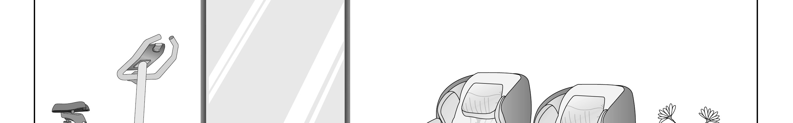
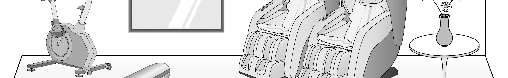
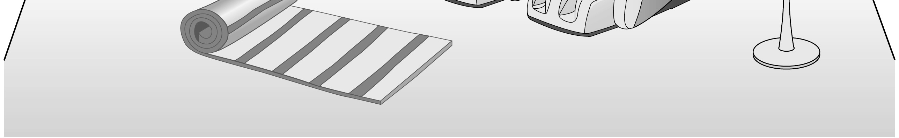
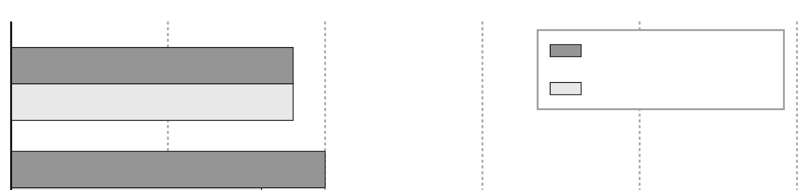
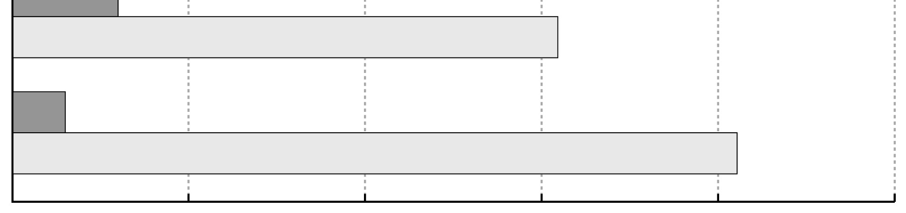
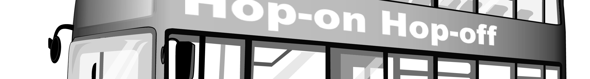
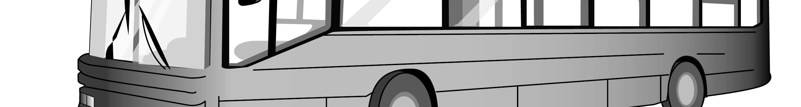

1. 다음을 듣고, 여자가 하는 말의 목적으로 가장 적절한 것을 고르시오.

① 보건실 이용 방법을 설명하려고
② 학교 급식 도우미를 모집하려고
③ 급식 만족도 조사 참여를 독려하려고
④ 학교 웹사이트 주소 변경을 알려주려고
⑤ 학교 구내식당 운영 중단 계획을 공지하려고

2. 대화를 듣고, 남자의 의견으로 가장 적절한 것을 고르시오.

① 꾸준한 복습은 좋은 학습 습관 형성에 필수적이다.
② 친구와 함께 공부하는 것은 학습 동기를 높여 준다.
③ 스스로 문제를 만들어 보는 것은 학습에 도움이 된다.
④ 약간의 소음 속에서의 학습은 집중력을 길러줄 수 있다.
⑤ 다양한 문제를 푸는 것은 문제 해결력 향상에 효과적이다.

3. 다음을 듣고, 여자가 하는 말의 요지로 가장 적절한 것을 고르시오.

① 컴퓨터 화면을 오래 볼 때는 규칙적인 눈의 휴식이 필요하다.
② 컴퓨터 사용 후 가벼운 스트레칭은 자세 교정에 도움을 준다.
③ 눈의 건조 증상을 막으려면 실내 습도를 조절하는 것이 좋다.
④ 컴퓨터 화면과 눈의 거리를 적절히 유지하는 것이 중요하다.
⑤ 숙면을 위해 취침 전 전자기기 사용을 자제해야 한다.

4. 대화를 듣고, 그림에서 대화의 내용과 일치하지 않는 것을 고르시오.

5. 대화를 듣고, 남자가 할 일로 가장 적절한 것을 고르시오.

① 의자 배치하기
② 포스터 부착하기
③ 강당 청소하기
④ 마이크 교체하기
⑤ 유인물 출력하기

6. 대화를 듣고, 남자가 지불할 금액을 고르시오.

① $36
② $45
③ $50
④ $54
⑤ $60

7. 대화를 듣고, 여자가 Sun Beach Cleanup Event에 가지 않은 이유를 고르시오.

① 감기에 걸려서
② 조별 발표가 있어서
③ 동아리 면접을 봐야 해서
④ 밀린 과제를 끝내야 해서
⑤ 삼촌과 점심 식사가 있어서

8. 대화를 듣고, Stonefield Drawing Picnic에 관해 언급되지 않은 것을 고르시오.

① 장소
② 날짜
③ 준비물
④ 참가비
⑤ 기념품

9. 2026 Future Innovation Expo에 관한 다음 내용을 듣고, 일치하지 않는 것을 고르시오.

① 10월 3일부터 5일까지 개최된다.
② 올해의 주제는 미래 교통수단이다.
③ 첫날 오전 11시에 강연이 진행된다.
④ 자율주행차를 타볼 수 있다.
⑤ 티켓은 현장에서 구매할 수 있다.

10. 다음 표를 보면서 대화를 듣고, 남자가 주문할 컴퓨터 마우스를 고르시오.

|  | Model | Price | Color | Connection Type | Silent Click |
| --- | --- | --- | --- | --- | --- |
| ① | A | $28 | pink | wired | × |
| ② | B | $32 | white | wired | ○ |
| ③ | C | $35 | black | wireless | × |
| ④ | D | $38 | pink | wireless | ○ |
| ⑤ | E | $45 | black | wireless | ○ |

11. 대화를 듣고, 남자의 마지막 말에 대한 여자의 응답으로 가장 적절한 것을 고르시오.

① I usually buy my skateboards online.
② Skateboards are too expensive these days.
③ You should’ve gotten some tips before buying it.
④ You can borrow my new board if you like it so much.
⑤ I couldn’t ride it anymore because it broke completely.

12. 대화를 듣고, 여자의 마지막 말에 대한 남자의 응답으로 가장 적절한 것을 고르시오. [3점]

① I agree. It might be a good way to motivate me to run.
② Great idea. That’s the best running route I’ve taken.
③ Right. You should definitely try running a marathon.
④ I’m sorry. I’ve already finished running for today.
⑤ Don’t worry. I’ll keep you motivated every day.

13. 대화를 듣고, 남자의 마지막 말에 대한 여자의 응답으로 가장 적절한 것을 고르시오. [3점]

Woman:
① Great idea! Then I can try it first without buying anything.
② My pleasure. I don’t need my old camping gear anymore.
③ You’re right. Thanks to you, I enjoyed this camping trip a lot.
④ Too bad. If I were you, I would find a better campsite.
⑤ I don’t think so. You should’ve booked it in advance.

14. 대화를 듣고, 여자의 마지막 말에 대한 남자의 응답으로 가장 적절한 것을 고르시오.

Man:
① Sorry. You should’ve prepared the handouts earlier.
② Great. Then I won’t have to worry about printing.
③ No thanks. I’ve already checked the data.
④ That’s odd. My printer is working fine today.
⑤ Good for you. The presentation turned out great.

15. 다음 상황 설명을 듣고, Ethan이 Chloe에게 할 말로 가장 적절한 것을 고르시오. [3점]

Ethan:
① Let me send you last year’s film through email.
② Let’s have students email their videos directly to us.
③ How about using an online platform to edit the videos?
④ You should make a shared folder before collecting the videos.
⑤ Why don’t we share our ideas with council members online?

16. 남자가 하는 말의 주제로 가장 적절한 것은?

① how colors affect the performance of athletes
② various colors used in sports brand marketing
③ role of colors in sports team logo design
④ why sports fans prefer certain team colors
⑤ historical roots of color usage in team uniforms

17. 언급된 색깔이 아닌 것은?

따라 답을 하시기 바랍니다.

① red
② blue
③ purple
④ green
⑤ black

18. 다음 글의 목적으로 가장 적절한 것은?

Dear students, The annual Riverdale Science Fair will be held on July 18 with the theme “Sustainable Future.” Although we announced the fair last month, student registration is still lower than we expected. Therefore, we would like to encourage more of you to take part. You are invited to present a project, experiment, or model related to environmental conservation or renewable energy. You will have the opportunity to showcase your work for teachers, peers, and local scientists. If you are interested, please submit a brief description of your work by June 25. We look forward to your participation. Mr. Howard, Science Teacher

19. 다음 글에 드러난 Luna의 심경 변화로 가장 적절한 것은?

Luna went to the bakery to pick up a chocolate cake for her dad’s 70th birthday. As she opened the box, she couldn’t understand what she saw. It was a lemon cake. Then she noticed the message on top. It said, “Happy 50th Birthday, Dad!” Luna said to the baker, “I don’t get it. The flavor and the message are wrong.” She wondered if she made a mistake when ordering. The baker asked her to wait and walked away. Moments later, he returned with her cake, explaining they had received two similar orders. Knowing she had chosen a quality bakery, Luna said, “I see. Well, this looks perfect, even better than I imagined.”

20. 다음 글에서 필자가 주장하는 바로 가장 적절한 것은?

We can sometimes assume that the whole will be as good as each of its parts. Suppose, for example, you’re in charge of a startup, and you know that everyone you’ve brought on board is productive and efficient. It might seem logical to assume that, as a result, the startup will be productive and efficient, too — but this isn’t necessarily true. The fallacy of composition fails to allow for how the different “parts” interact with each other — if, for example, your efficient administrator and your highly skilled head of IT each assumes the other is in charge of collating prototype test results, then you have a problem. Equally, a unit composed of good people can still be working on a doomed project, and a project composed of good ideas may lack a stable center. When assembling a team with a common goal, always check the overall view as well as the individuals involved.

21. 밑줄 친 a wise bit of self-restraint on your genes’ part가 다음 글에서 의미하는 바로 가장 적절한 것은? [3점]

Humans excel at visual imagery. Our brains evolved this ability to create an internal mental picture or model of the world in which we can rehearse forthcoming actions, without the risks or the penalties of doing them in the real world. There are even hints from brain-imaging studies by Harvard University psychologist Steve Kosslyn showing that your brain uses the same regions to imagine a scene as when you actually view one. But evolution has seen to it that such internally generated representations are never as authentic as the real thing. This is a wise bit of self-restraint on your genes’ part. If your internal model of the world were a perfect substitute, then anytime you felt hungry you could simply imagine yourself at a banquet, consuming a feast. You would have no incentive to find real food and would soon starve to death. As the Bard said, “You cannot cloy the hungry edge of appetite by bare imagination of a feast.”

22. 다음 글의 요지로 가장 적절한 것은?

For each objective probability — from one percent to 100 percent — we want to know the subjective probability weight. When we make decisions, do we treat a one-percent chance just like one percent, or like something else? Events that could happen but aren’t likely — low-probability events — can be defined as probabilities up to about 25 percent. Low-probability events tend to factor more into decisions than they should. That is, an event that has an objective one-percent chance of occurring could subjectively seem like it has a five-percent chance of occurring. We overestimate the likelihood of these low-probability events. In general, the smaller the probability, the more we overestimate its likelihood. For example, people who play the lottery are often optimistic about winning. However, the odds of a single ticket winning the largest, most popular U.S. lotteries are on the order of one in 175 million.

23. 다음 글의 주제로 가장 적절한 것은?

Many of the barriers to trade exist not because of a lack of markets or customers, but because there are major barriers to getting products to market at competitive prices. Transaction costs are significant for companies — not only the straight exchange costs, but also the cost of converting, paying, and hedging funds just to pay for the goods and services. Having a common currency means that many of those transaction costs disappear and the savings can be reinvested back into firms’ productivity and innovation. Basically, useless costs turn into productive costs — with longer-term benefits to the whole economy. By unifying some of the currencies, whole economies benefit and grow more than they would as independents. So a common currency provides for a strong economic foundation that all can benefit from.

24. 다음 글의 제목으로 가장 적절한 것은?

The light from even our nearest stellar neighbour takes four years to reach us. When we look at the stars, we are looking back in time. This is an incredible gift. We can see parts of space, parts of our universe, as they were many years ago. The further we can collect light from, the further back in time we can look. If you look at the bright star Betelgeuse, which glows in the Orion constellation, you wind time back more than six hundred years. Its reddish glow started its journey to Earth in the Middle Ages. The stars in Orion’s belt are even further away. Their light, familiar to generations of humans, has travelled at least 1,000 years to reach us. This means we have a chance of understanding the history of the universe because we can see the more distant parts of it as they were in the past, thousands or millions or billions of years ago.

25. 다음 도표의 내용과 일치하지 않는 것은?

Proportions of Selected Age Groups of the World Population by Region (2024) Over 65 years North America Under 15 years Europe Oceania Central Asia Sub-Saharan Africa 0 10 20 30 40 50 (%) The graph above shows the proportions of people aged over 65 and under 15 in five selected regions in 2024.

| Region | Over 65 years | Under 15 years |
| --- | --- | --- |
| North America | 18 | 18 |
| Europe | 20 | 16 |
| Oceania | 13 | 23 |
| Central Asia | 6 | 31 |
| Sub-Saharan Africa | 3 | 41 |

26. Jacob Lawrence에 관한 다음 글의 내용과 일치하지 않는 것은?

Jacob Lawrence was an American painter known for vivid scenes of African-American history and daily life. Born in Atlantic City in 1917, he moved to Harlem at 13 and studied art at Utopia Children’s Center. He used bright colors and simplified shapes in his paintings. The Migration Series, widely regarded as Jacob Lawrence’s masterpiece, brought him national recognition. During World War II, he served in the U.S. Coast Guard and produced many paintings, but most of them were lost. Later, he taught at the University of Washington for 16 years. Throughout his lifetime, he received honorary degrees from several universities, including Harvard. Until a few weeks before his death, he continued to explore the lives of African-Americans through his painting.

27. Hop-on Hop-off City Tour에 관한 다음 안내문의 내용과 일치하지 않는 것은?

Hop-on Hop-off City Tour Enjoy a tour you can control. Get on or off the bus at 15 different stops. Explore what you want, when you want, for as long as you want!
On the Bus － Free Wi-Fi and USB ports － Open-air top level provides wonderful city views. － Unlimited rides for one day
Audio Guides － Scan QR codes to listen to information about landmarks. － Languages available: English, Spanish, and Chinese
Special Offer Show your tour ticket to get a discount at museums. ※ For prices and more information, check out h*h#citytour.com.

28. One-day Glass Art Workshop에 관한 다음 안내문의 내용과 일치하는 것은?

One-day Glass Art Workshop Have you ever seen glass melt and glow like lava? Come to Spark Studio and learn how to heat and shape glass into a beautiful piece of art.
Time: July 12th, 9:30 - 11:30 a.m.
Participants
For safety, only adults & children over 12
10 people maximum
Details
$60 per person, including all tools and materials
You can make one cup, vase, or bowl.
Note: Glass objects need 24 hours to cool, so you must pick up your artwork another day. Sign up now at sp*rk2glass.com.

29. 다음 글의 밑줄 친 부분 중, 어법상 틀린 것은? [3점]

The renowned British philosopher Alfred North Whitehead asserted that “civilization advances by extending the number of operations we can perform without thinking about them.” Take, for example, the “advance” offered to civilization by the discount coupon, which allows consumers to assume that they will receive a reduced purchase price by presenting the coupon. The extent to which we have learned to operate mechanically on that assumption is illustrated in the experience of one automobile-tire company. Mailed-out coupons that ― because of a printing error ― offered no savings to recipients produced just as much customer response as did error-free coupons that offered substantial savings. The obvious but instructive point here is that we expect discount coupons to do double duty. Not only do we expect them to save us money, we also expect them to save us the time and mental energy required to think about how to do it. In today’s world, we need the first advantage to handle pocketbook strain; but we need the second advantage to handle something potentially more important ― brain strain.

30. 다음 글의 밑줄 친 부분 중, 문맥상 낱말의 쓰임이 적절하지 않은 것은?

Usually, innovative high-tech products have low price elasticity. This means that high variation in price, an increase as well as a decrease, does not significantly modify demand. These high-tech products have few substitutes, meaning that the costs to switch to another product are high. Additionally, at the first stage of the technology, buyers — either innovators or forerunners — are less sensitive to price than to additional performance; they often have deep pockets or are ready to spend a lot for a new innovative and outstanding product. For instance, with its new product range, a high-end mobile phone manufacturer is aiming at the 3% of millionaire households with assets of more than $2.5 million; those are customers who are ready to accept the price range the manufacturer has set. At that stage, the competitors are not interested in lowering their price significantly whatsoever, because they are chasing the same categories of customers, not sensitive to price. Furthermore, the high price of these products is often perceived as a sign of quality and reinforces a customer’s confidence in the company.

31. 다음 빈칸에 들어갈 말로 가장 적절한 것을 고르시오.

One easily underappreciated feature of a city street or square is its “future-proof” nature. The ancient medieval squares in places like Marrakesh and Siena are still places where stuff is sold every day, even if the stuff itself has changed over the last five hundred years. The city square is a fairly future-proof technology, as is the shopping street, even in an age of online shopping. For example, the same physical store that once sold buggy whips and typewriters might now repair damaged phones and sell bubble tea. The same infrastructure supports evolving uses. Jane Jacobs, the great prophet of the city economy, made much of this fact in her books, including The Death and Life of Great American Cities and The Nature of Economies. As she pointed out, the great advantage of a city architecture is its ability to support change in uses, and Jacobs correctly predicted the persistence of the city itself, unlike those who predicted the rise of the Internet would mean the death of the city.

32. 다음 빈칸에 들어갈 말로 가장 적절한 것을 고르시오.

The genomics revolution made it possible to see just how impactful touch is to plants on a deeper level. Peering at the genes of Arabidopsis thaliana, a weedy plant in the mustard family and the lab rat of the plant biology world, researchers saw that touch quietly triggered such a dramatic response in their hormones and gene expression that it could substantially inhibit their growth. They stroked the arabidopsis with soft paintbrushes, and then analyzed the plants’ genetic responses. Within thirty minutes of being touched, 10 percent of the plant’s genome was altered. Clearly, the plant was reorganizing its priorities to deal with the disturbance, and rerouting energy away from the hard work of getting taller. Touched multiple times, arabidopsis cut its upward growth rate by as much as 30 percent.

33. 다음 빈칸에 들어갈 말로 가장 적절한 것을 고르시오. [3점]

Evolution will come to a standstill until something in the conditions changes: the onset of an ice age, a change in the average rainfall of the area, a shift in the prevailing wind. Such changes do happen when we are dealing with a timescale as long as the evolutionary one. As a consequence, evolution normally does not come to a halt, but constantly tracks the changing environment. If there is a steady downward drift in the average temperature in the area, a drift that persists over centuries, successive generations of animals will be propelled by a steady selection ‘pressure’ in the direction, say, of growing longer coats of hair. If after a few thousand years of reduced temperature the trend reverses and average temperatures creep up again, the animals will come under the influence of a new selection pressure, and will be pushed towards growing shorter coats again.

34. 다음 빈칸에 들어갈 말로 가장 적절한 것을 고르시오. [3점]

The high price of land in metropolitan areas has implications for the efficient employment of resources. For example, in New York City, as in many large cities, sidewalk vending carts sell everything from hot dogs to ice cream. Why are these carts so popular, with over 3,000 in New York City alone? Consider the resources used to supply hot dogs: land, labor, capital, entrepreneurial ability, plus intermediate goods such as hot dogs, buns, and other ingredients. Which of these do you suppose is most expensive in New York City? Retail space along Madison Avenue rents for an average of $550 a year per square foot. Because operating a hot dog cart requires about 4 square yards, it could cost as much as $20,000 a year to rent that much commercial space. Aside from the necessary public permits, however, space on the public sidewalk is free to vendors. Profit-maximizing street vendors substitute public sidewalks for costly commercial space.

35. 다음 글에서 전체 흐름과 관계 없는 문장은?

The process we go through when we look at a work of art to determine if we recognize and can make sense of its content is not just a visual one. It is a mental process as well, largely based on the elements within and about the work we can identify and categorize. As we look and think, we may be given clues about what the work means by where it is, when it was made, what culture it came from, who created it, or why it was made. We should strive to understand a work of art as we see it, without being influenced by the background of the work, its creator, or its historical context. Any information we can gather helps us understand the work’s context, that is, for what historical, social, personal, political, or scientific reasons the work of art was made. And then, using all the contextual information we have gathered, we interpret the work of art’s content to discover what it means or symbolizes.

36. 주어진 글 다음에 이어질 글의 순서로 가장 적절한 것을 고르시오. [3점]

For most animals the struggle to survive takes up all their time. Finding food and drink, keeping warm and clean, avoiding predators, migrating and reproducing use up all their energies. If they do have any time to spare, they spend it resting or sleeping. Only very young animals, under the protection of their parents, have enough surplus energy to engage in lively bouts of play. This was also true for our early ancestors. The constant search for food would have put heavy demands upon them. But as they slowly evolved into more and more efficient hunters, the situation changed. The secret of their success was the development of much greater intelligence. They used brain not brawn to kill their prey. At the end of the long hunting era, before they turned to farming, they were already enjoying some degree of affluence. In certain regions, at particular times of year, the prey was sufficiently plentiful and their hunting techniques sufficiently advanced for them to experience a remarkable degree of prosperity. They had time on their hands.

37. 주어진 글 다음에 이어질 글의 순서로 가장 적절한 것을 고르시오.

Think about a time when you were startled. Did you come to a sudden stop, freeze all your movements, and hold your breath as you scanned the environment for a threat?

All these responses maximize our ability to avoid detection, locate the source of possible danger, and prepare to fight or flee. As sophisticated as language has become, it is still the creation of sound that might give away our location to a potential predator.

Because of this, the freeze response results in the inhibition of language in highly stressful and traumatic situations. Natural selection promoted the evolution of language but conserved the freeze rule. When the threat passes, we begin to relax and find our voices again, perhaps even to laugh at our own reactions.

But what if we can never relax? What if our experiences shape our brain to be in a constant state of fear? This interference with the proper development and integration of neural networks can result in chronic stress and even mental illness.

38. 글의 흐름으로 보아, 주어진 문장이 들어가기에 가장 적절한 곳을 고르시오.

Video gaming is one of the most studied technologies with regard to empathy. Because there have been longstanding concerns about the impact of violent video games on youth, much research has been conducted over the last couple of decades on the topic. While measuring and documenting the impact of video game violence, scientists have formulated credible explanations of how video gaming could affect empathy. Part of a normal, healthy reaction to witnessing violent events is to feel negative emotions, and to experience physiological arousal that is connected to fear or disgust. With repeated exposure to violent events — such as what might happen when a person plays violent video games — this normal reaction might become blunted, a phenomenon known as desensitization. The next step in this problematic process would be having diminished emotional responses to violence, which could also interfere with the ability to recognize and/or to sympathize with others, leading to reduced empathy. A significant body of work shows an association between extensive violent video gaming and reduced empathy in people.

39. 글의 흐름으로 보아, 주어진 문장이 들어가기에 가장 적절한 곳을 고르시오. [3점]

Realising the benefits of differentiation, some brands broadcast their social purpose before they do much actual good. Their marketers are using social purpose to boost the brand's reputation, rather than embracing the purpose itself. Making a real difference with social problems is hard enough; to succeed, it has to follow from an authentic, company-wide commitment to the purpose. Otherwise the mission is just window-dressing, or what we call “purpose-washing” ― similar to green-washing, where purpose-driven activities serve mainly for publicity purposes. We end up with what Anand Giridhardas describes in Winners Take All: “social purpose that just furthers the charade of elites disrupting the old order without giving much back”. Purpose-washing brands gain one of the benefits of social purpose, differentiation, but only for a short while. They lose out on positioning for future markets, and they might even make employees feel worse about working for them.

40. 다음 글의 내용을 한 문장으로 요약하고자 한다. 빈칸 (A), (B)에 들어갈 말로 가장 적절한 것은? [3점]

The brain needs to create a model of a constant pulse ― a schema ― so that we know when the musicians are not conforming to it. This is similar to variations of a melody: We need to have a mental representation of what the melody is in order to know ― and appreciate ― when the musician is taking liberties with it. Metrical extraction, knowing what the pulse is and when we expect it to occur, is a crucial part of musical emotion. Music communicates to us emotionally through systematic violations of expectations. These violations can occur in any domain ― the domain of pitch, rhythm, tempo, and so on ― but occur they must. Music is organized sound, but the organization has to involve some element of the unexpected or it is emotionally flat and robotic. Too much organization may technically still be music, but it would be music that no one wants to listen to. 

 The brain models anticipated musical patterns, which creates the possibility for emotional impact to arise when musicians break these patterns, making music engaging.

41. 윗글의 제목으로 가장 적절한 것은?

The major consumer of oil is transport. But consider what has happened over the last 30 years or so to the technology involved in producing the internal combustion engine. Because oil is expensive, car engines today are far more efficient in their consumption of fuel (and far less polluting) than they were in 1972. The cars that Asia buys tomorrow will certainly not be anything like those Americans use today. Americans will not buy today’s cars tomorrow either. In fact, if the price of oil does rise much further then fuel cell technology (which produces energy from water!) will receive yet another momentum. The big car multinationals have already produced the prototype motors ― they are currently racing to try and get prices down and engine performances up. Their future profits depend upon it. Imagine now if there is a breakthrough in fuel cell technology. What would happen to oil prices? They would fall dramatically ― signalling much less demand than supply ― and oil companies and OPEC oil producers would stand to lose much income. The fact that this threat is real is driving the producers to look for alternative sources of income. The ‘oil majors’ have diversified and are now more energy companies than oil companies these days and the OPEC countries are urgently attempting to develop other industries.

42. 밑줄 친 낱말 중에서 문맥상 낱말의 쓰임이 적절하지 않은 것은?

The major consumer of oil is transport. But consider what has happened over the last 30 years or so to the technology involved in producing the internal combustion engine. Because oil is expensive, car engines today are far more efficient in their consumption of fuel (and far less polluting) than they were in 1972. The cars that Asia buys tomorrow will certainly not be anything like those Americans use today. Americans will not buy today’s cars tomorrow either. In fact, if the price of oil does rise much further then fuel cell technology (which produces energy from water!) will receive yet another momentum. The big car multinationals have already produced the prototype motors ― they are currently racing to try and get prices down and engine performances up. Their future profits depend upon it. Imagine now if there is a breakthrough in fuel cell technology. What would happen to oil prices? They would fall dramatically ― signalling much less demand than supply ― and oil companies and OPEC oil producers would stand to lose much income. The fact that this threat is real is driving the producers to look for alternative sources of income. The ‘oil majors’ have diversified and are now more energy companies than oil companies these days and the OPEC countries are urgently attempting to develop other industries.

43. 주어진 글에 이어질 내용을 순서에 맞게 배열한 것으로 가장 적절한 것은?

 Anna noticed the box in front of her door. She walked closer and saw it was addressed to her. When Anna opened it, she found a folded letter and a jar of homemade strawberry mint jam from Mrs. Pike. She wrote, “Your words made me smile. I used to have a garden, but when my husband died, I stopped planting. Your letter reminded me how much I missed it. So I planted some herbs. Have a taste!” The letter was signed, “Love, Mrs. Pike.” Anna was deeply moved by Mrs. Pike’s response. When her teacher announced that her class would visit the village to meet the seniors, Anna was thrilled. As they arrived, Mrs. Pike warmly greeted Anna with open arms. She pointed to a green space beside her house, saying, “Look at my herbs.” Anna smiled and commented on how wonderful they must smell. Together, they spent the day planting seeds. Mrs. Pike even gave Anna some herbs to take home. Mrs. Pike thanked Anna for brightening her spirit. After the visit, Anna continued writing to Mrs. Pike every month. She also started a gardening club where students planted seeds in recycled jars and cups. Anna used the empty jam jar to plant some rosemary, which reminded her of Mrs. Pike’s herb garden. The rosemary grew by the window. Whenever Anna looked at it, she had a warm feeling. It was a daily reminder that people, like plants, sometimes just need a little sunlight. 

44. 밑줄 친 낱말 중에서 가리키는 대상이 나머지 넷과 다른 것은?

 Anna noticed the box in front of her door. She walked closer and saw it was addressed to her. When Anna opened it, she found a folded letter and a jar of homemade strawberry mint jam from Mrs. Pike. She wrote, “Your words made me smile. I used to have a garden, but when my husband died, I stopped planting. Your letter reminded me how much I missed it. So I planted some herbs. Have a taste!” The letter was signed, “Love, Mrs. Pike.” Anna was deeply moved by Mrs. Pike’s response. When her teacher announced that her class would visit the village to meet the seniors, Anna was thrilled. As they arrived, Mrs. Pike warmly greeted Anna with open arms. She pointed to a green space beside her house, saying, “Look at my herbs.” Anna smiled and commented on how wonderful they must smell. Together, they spent the day planting seeds. Mrs. Pike even gave Anna some herbs to take home. Mrs. Pike thanked Anna for brightening her spirit. After the visit, Anna continued writing to Mrs. Pike every month. She also started a gardening club where students planted seeds in recycled jars and cups. Anna used the empty jam jar to plant some rosemary, which reminded her of Mrs. Pike’s herb garden. The rosemary grew by the window. Whenever Anna looked at it, she had a warm feeling. It was a daily reminder that people, like plants, sometimes just need a little sunlight. 

45. 윗글에 관한 내용으로 적절하지 않은 것은?

 Anna noticed the box in front of her door. She walked closer and saw it was addressed to her. When Anna opened it, she found a folded letter and a jar of homemade strawberry mint jam from Mrs. Pike. She wrote, “Your words made me smile. I used to have a garden, but when my husband died, I stopped planting. Your letter reminded me how much I missed it. So I planted some herbs. Have a taste!” The letter was signed, “Love, Mrs. Pike.” Anna was deeply moved by Mrs. Pike’s response. When her teacher announced that her class would visit the village to meet the seniors, Anna was thrilled. As they arrived, Mrs. Pike warmly greeted Anna with open arms. She pointed to a green space beside her house, saying, “Look at my herbs.” Anna smiled and commented on how wonderful they must smell. Together, they spent the day planting seeds. Mrs. Pike even gave Anna some herbs to take home. Mrs. Pike thanked Anna for brightening her spirit. After the visit, Anna continued writing to Mrs. Pike every month. She also started a gardening club where students planted seeds in recycled jars and cups. Anna used the empty jam jar to plant some rosemary, which reminded her of Mrs. Pike’s herb garden. The rosemary grew by the window. Whenever Anna looked at it, she had a warm feeling. It was a daily reminder that people, like plants, sometimes just need a little sunlight.
