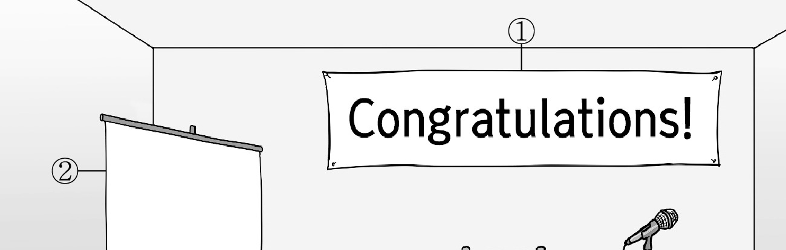
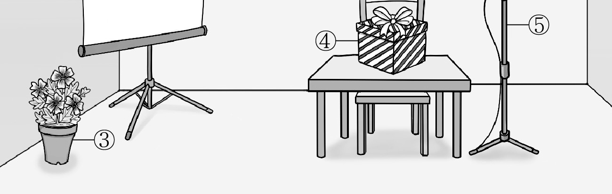
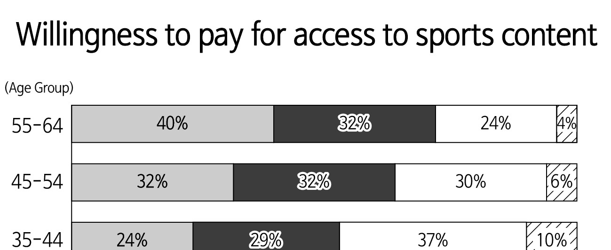
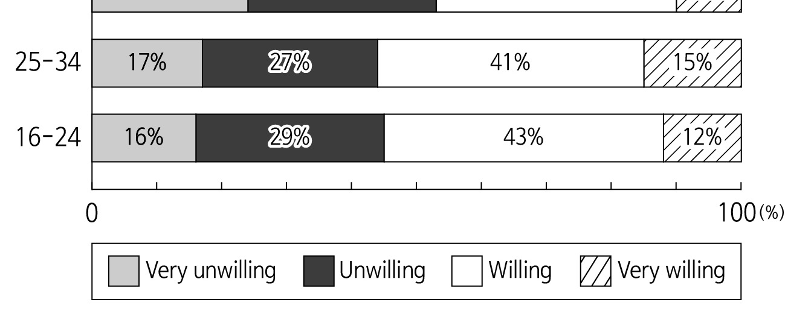

1. 다음을 듣고, 여자가 하는 말의 목적으로 가장 적절한 것을 고르시오.

① 학교 안전 도우미 모집을 홍보하려고
② 학교의 새로운 출입문 사용을 안내하려고
③ 등교 시 진행되는 캠페인 참여를 독려하려고
④ 학교 시설 개방 시간의 변경을 공지하려고
⑤ 교내 안전 표지판의 설치를 요청하려고

2. 대화를 듣고, 남자의 의견으로 가장 적절한 것을 고르시오.

① 개인적 경험을 바탕으로 만든 음악은 공감을 얻는다.
② 좋은 곡을 만들기 위해서는 전문적 기술이 요구된다.
③ 인공 지능이 추천한 음악을 들으면 기분 전환이 된다.
④ 인공 지능이 자신만의 음악을 만드는 데 도움이 된다.
⑤ 인공 지능을 활용한 창작 시 저작권법 준수가 필수적이다.

3. 다음을 듣고, 여자가 하는 말의 요지로 가장 적절한 것을 고르시오.

① 걷는 습관은 두뇌를 자극하여 집중력을 향상한다.
② 장거리 이동 시 대중교통을 이용하면 에너지가 절약된다.
③ 출퇴근 시 이어폰을 사용하면 주변 상황을 인지하기 어렵다.
④ 출근 전에 하루 업무 계획을 세우는 것은 일의 효율성을 높인다.
⑤ 대중교통 이용 시 아무것도 하지 않는 것은 두뇌 휴식에 도움이 된다.

4. 대화를 듣고, 그림에서 대화의 내용과 일치하지 않는 것을 고르시오.

5. 대화를 듣고, 남자가 할 일로 가장 적절한 것을 고르시오.

① 포스터 부착하기
② 초대장 발송하기
③ 장소 사용 허락받기
④ 음향 장비 점검하기
⑤ 의자 설치 확인하기

6. 대화를 듣고, 여자가 지불할 금액을 고르시오.

어
① $55
② $63
③ $70
④ $81
⑤ $90

7. 대화를 듣고, 남자가 직업 체험 프로그램에 참가할 수 없는 이유를 고르시오.

① 토론 대회에 참가해야 해서
② 채용 면접에 참여해야 해서
③ 인턴십 준비를 해야 해서
④ 봉사활동을 가야 해서
⑤ 독서 모임이 있어서

8. 대화를 듣고, Astro Space Camp에 관해 언급되지 않은 것을 고르시오.

① 장소
② 날짜
③ 활동 내용
④ 신청 방법
⑤ 등록비

9. 2026 Beeswax Lip Balm Event에 관한 다음 내용을 듣고, 일치하지 않는 것을 고르시오.

① 2일 동안 진행된다.
② 다큐멘터리가 상영된다.
③ 꿀로 만든 간식이 제공된다.
④ 참가비는 무료이다.
⑤ 참가 인원은 100명으로 제한된다.

10. 다음 표를 보면서 대화를 듣고, 남자가 구입할 여행 어댑터를 고르시오.

|  | Model | Price | Max. Charging Output (Watts) | Number of USB Ports | Color |
| --- | --- | --- | --- | --- | --- |
| ① | A | $20 | 30 | 3 | White |
| ② | B | $25 | 45 | 3 | Black |
| ③ | C | $35 | 60 | 4 | White |
| ④ | D | $45 | 70 | 5 | Black |
| ⑤ | E | $60 | 85 | 5 | White |

11. 대화를 듣고, 여자의 마지막 말에 대한 남자의 응답으로 가장 적절한 것을 고르시오.

① Not really. I don’t need to submit it.
② No. I’m afraid I can’t fix your laptop.
③ Sure. You can stop by and pick it up anytime.
④ Never mind. Our science project is going well.
⑤ No, thanks. I already finished my project yesterday.

12. 대화를 듣고, 남자의 마지막 말에 대한 여자의 응답으로 가장 적절한 것을 고르시오.

① Do you think so? I’ll sign up for it.
② I don’t agree. The contest was very rewarding.
③ Don’t worry. The contest will be held as scheduled.
④ Excellent. I’ll find someone else for the contest.
⑤ Actually, I’ve never done calligraphy before.

13. 대화를 듣고, 여자의 마지막 말에 대한 남자의 응답으로 가장 적절한 것을 고르시오. [3점]

Man:
① That sounds great. I’ll give it a try.
② Right. The video was a huge success!
③ I agree. People won’t care about my video.
④ Sure. I’ll join the local culture guide program.
⑤ That’s true. I don’t have time to post it online.

14. 대화를 듣고, 남자의 마지막 말에 대한 여자의 응답으로 가장 적절한 것을 고르시오. [3점]

Woman:
① Fortunately, I’m sure you’ll get accepted.
② Too bad. You can get another chance next time.
③ Just in case, don’t forget to check your schedule.
④ Okay. I’ll include those activities in my application.
⑤ Of course. I’ve seen the activities on the notice board.

15. 다음 상황 설명을 듣고, Daniel이 Jane에게 할 말로 가장 적절한 것을 고르시오. [3점]

Daniel:
① The app could really benefit from better visuals.
② The schedule is tight, but deadlines are important too.
③ Most users probably won’t notice a small error like this.
④ Let’s deal with complaints later if people report problems.
⑤ I think we should put off the launch and fix the error first.

16. 남자가 하는 말의 주제로 가장 적절한 것은?

① different causes of food poisoning
② farming techniques for improving food quality
③ food cultures that spread across various regions
④ traditional cooking methods that keep us healthy
⑤ foods once considered not proper for humans to eat

17. 언급된 식품이 아닌 것은?

따라 답을 하시기 바랍니다.

① tomatoes
② carrots
③ corn
④ eggplants
⑤ potatoes

18. 다음 글의 목적으로 가장 적절한 것은?

To whom it may concern, I am a teacher at Pendington High School, and we are currently preparing a new school promotional brochure. As we wish to update the overall design of our brochure, we are considering working with a new printing company. While reviewing several options, we felt that your design style and printing formats seemed to suit our needs well. We intend to make a four-paged brochure and print 500 copies in full color. Before proceeding, we would like to ask you how much it would cost. This will greatly help us in setting our budget and schedule more effectively. Thank you very much for your time and assistance. I look forward to your response. Sincerely, Sarah Clayton

19. 다음 글에 드러난 ‘I’의 심경 변화로 가장 적절한 것은?

I ran into the music room, breathing heavily. The rest of the band were sitting with long faces. Immy looked up at me and shook her head. I sank into a chair. I had truly believed we would make it; our audition had been flawless. My chest felt heavy as I asked, “So, who won?” I was holding back my tears. “A band called A Happy Accident. They were quite good,” she said calmly. A moment later, a big smile spread across Immy’s face, and the others began to cheer. “Wait, what? That’s us!” I said. Immy laughed and said, “Since you were late, we decided to play a joke on you! We made it!” I was filled with joy. We jumped up and hugged each other. My heart was racing with excitement.

20. 다음 글에서 필자가 주장하는 바로 가장 적절한 것은?

Only when you’re happy that you’ve done the best you can for your story should you show it to someone else. You may well want to show it to your nearest and dearest, and that’s fine, but in most cases you shouldn’t look to their reading for any great benefit to your work. The most valuable feedback is likely to come from other sources: you should choose readers for their critical insight, not their closeness to you. Fellow writers are ideal, but don’t imagine that any writer will do. If you are part of a writers’ circle or class, you’ll know whose writing you admire, and if you’ve had feedback in the past you’ll know whose opinions have been helpful ― and whose have not.

21. 밑줄 친 an evergreen tree가 다음 글에서 의미하는 바로 가장 적절한 것은? [3점]

A meeting in a flexible-time culture like those found in South America, parts of Europe, Africa, and the Middle East is more like an evergreen tree. An agenda with a meeting start time and a topic will probably be circulated before the meeting. This will serve as the trunk of the tree. But there’s no expectation that the meeting will progress in a linear manner. What seemed like a priority last week when the agenda was crafted is not necessarily the priority right now ― so discussion may branch off in a new direction. Other branches may sprout as some members have urgent phone calls that take them in and out of the meeting. Or sub-groups may form within the room to discuss timely subjects linked in some way to the main meeting trunk. In flexible-time cultures, it seems clear that the most productive meetings grow in unpredictable ways, and the effective manager is flexible and professional enough to capitalize on priorities and changing needs as they arise. Interruptions, agenda changes, and frequent shifts in direction are seen as natural and necessary.

22. 다음 글의 요지로 가장 적절한 것은?

When we are ‘always on’ we are constantly ingesting content ― reading alerts and texts, liking, checking emails, downloading, uploading, upgrading, updating, deleting, submitting responses, and posting. If we do it while we are eating, our multi-tasking is overloading us. As our will attempts to digest the virtual content its forces are diverted from the physical content, our food. It’s easy to eat a sandwich in a minute while talking on the phone. Some people are skilled at doing both at the same time. Others write a half-hearted, shorthand text while they hurriedly eat their sandwich at the same time. The result can be a misunderstood text with the need for further clarifying texts and the beginnings of nervous indigestion. Eat your sandwich. Taste it. Let it go down. Then text.

23. 다음 글의 주제로 가장 적절한 것은?

Music can bring us into a very comfortable rhythm, and it can be satisfying in and of itself. Most of the time, however, we want something more to happen. There needs to be a process that creates tension and drives the movement towards something in particular. The excitement that arises in this process creates satisfaction and pleasure. This is seen in the measureless prelude as well. But there the tension might be caused by the ambiguity of the rhythm. Therefore, the fluid movement in the prelude usually creates a tension that can be released in the subsequent movement with a set rhythm. This, in turn, creates new and other types of tensions, where the rhythm is unambiguous and predictable, but where unexpected chords and modulations create drama and an experience of development in the piece.

24. 다음 글의 제목으로 가장 적절한 것은?

Progressive educators and librarians are developing curricula to teach what we might call attention literacy. This means helping students recognize, for example, how the architecture of a social media feed or a news site is deliberately designed to distract or provoke them. Classes in media literacy traditionally cover how to evaluate the credibility of sources ― now they also include recognizing clickbait, understanding the role of algorithms in what content is served up, and observing one’s own patterns of distraction. A student might be tasked with tracking how many times they switch tasks or check their phone in an hour of homework, to raise self-awareness about fragmentation. Another lesson might involve unpacking the design of popular apps: Why does an app use infinite scrolling instead of pages? Why do notifications appear with specific colors and sounds? By treating these as deliberate design choices (often rooted in psychology and profit motives), young people become more critical users rather than passive consumers.

25. 다음 도표의 내용과 일치하지 않는 것은?

The graph above shows the willingness to pay for access to sports content across five different age groups, ranging from 16-24 to 55-64.

| Age Group | Very unwilling | Unwilling | Willing | Very willing |
| --- | --- | --- | --- | --- |
| 55-64 | 40% | 32% | 24% | 4% |
| 45-54 | 32% | 32% | 30% | 6% |
| 35-44 | 24% | 29% | 37% | 10% |
| 25-34 | 17% | 27% | 41% | 15% |
| 16-24 | 16% | 29% | 43% | 12% |

26. Frederick Law Olmsted에 관한 다음 글의 내용과 일치하지 않는 것은?

Frederick Law Olmsted, known as the father of American landscape architecture, was born in 1822. When Olmsted was young, he often went on trips to the countryside with his father, who loved scenery. At age 14, he was preparing himself to study at Yale College, but he could not enter due to a severe sumac poisoning that damaged his eyesight. Instead of attending a college, he gained experience working as a clerk, a sailor, and a farmer. In 1858, he worked with Calvert Vaux and won the design competition for New York City’s Central Park with the “Greensward Plan.” During the Civil War, Olmsted served as General Secretary of the United States Sanitary Commission. Although he passed away in 1903, his sons and successors continued his design philosophy. In 1979, the National Park Service designated his home and office in Brookline, Massachusetts, as a National Historic Site to honor his legacy.

27. Ashwood Dunes Reforestation Event에 관한 다음 안내문의 내용과 일치하지 않는 것은?

Ashwood Dunes Reforestation Event Join us for a meaningful morning at the annual Ashwood Dunes Reforestation. Volunteers will plant native tree seedlings to help restore the local environment. No special skills required, feel free to join us.
When and Where
September 5th, 2026, 8 a.m.-11 a.m.
Ashwood Dunes Wilderness
Participation
Fee: Free Rewards: All participants will get a commemorative badge.
Plant 5 trees: Receive a reusable water bottle
Plant 10 or more trees: Receive a T-shirt
Registration: Online registration is encouraged, but on-site sign-ups will be available on the day of the event.
Event Guidelines
Bring a hat and gloves; shovels and water will be prepared.
Follow instructions from the event staff. For more information, please visit www.ashwooddunes.com.

28. 2026 Footnote Dance Program에 관한 다음 안내문의 내용과 일치하는 것은?

2026 Footnote Dance Program The 2026 Footnote Dance Program is a modern dance program created for youth aged 13-18.
When: Wednesday, October 21st-Friday, October 23rd (5 p.m.-8 p.m. each day)
Where: Footnote Studio, 70 Elm Street Cost: $50 per workshop, or $120 for all three workshops
Workshop Schedule
[Day 1] Dance Lesson: Build creative confidence through guided movement exercises.
[Day 2] Performance Practice: Refine your performance skills and learn to connect with your audience.
[Day 3] Open Studio: Friends and family are invited to see what participants have created!
Information
A free shuttle bus service will be provided for all participants and visitors.
Pre-registration is required.

29. 다음 글의 밑줄 친 부분 중, 어법상 틀린 것은? [3점]

Capitalism is not a system where cash is everywhere but rather one in which islands of cash exchange exist within oceans of cheap ― or potentially cheap ― natures. Reproducing life within the cash nexus is expensive, and it grows more expensive over time. Workers’ wages can be frozen, even rolled back, but in the end inequality leads to crises of the kind we’ve recently seen bring about populist protests in the United States and the United Kingdom. Workers demand dignity, and their labor becomes expensive. Production processes burn through an island, and energy is no longer cheap. The climate changes, and crops can no longer grow as abundantly as they once did. Frontiers are so important in these processes because they offer places which the new cheap things can be seized ― and the cheap work of humans and other natures can be forcefully taken.

30. 다음 글의 밑줄 친 부분 중, 문맥상 낱말의 쓰임이 적절하지 않은 것은? [3점]

Some people are more likely to cheat and steal after purchasing “eco-friendly” products, probably because they feel licensed to do so since they morally account the “eco-friendly” choice as a “good” deed. Moral licensing has also been observed in the context of cooperation for the good of the environment. When people are reminded of deeds they have done that they know were harmful to the environment, they might be left with a feeling of “eco-guilt.” People who experience eco-guilt seek pro-environmental actions to compensate for this guilt and restore balance. In their search for such a balance, people are reluctant to believe in “quick-fixes,” because they want to re-establish the moral balance and escape the guilt as quickly and easily as possible. In the same way that people may change their attitudes to reduce inconsistencies between attitudes and behavior, people may also change their evaluation of past environmentally burdening behaviors and future environmentally friendly behaviors. For instance, people are more likely to sign a petition addressing environmental damage after viewing evidence of human-caused environmental damage.

31. 다음 빈칸에 들어갈 말로 가장 적절한 것을 고르시오.

Human geography is becoming unclear. As people find themselves regularly on the move, we are experiencing a phase shift like when matter transitions from solid to liquid to gas: molecules heat up and loosen from one another, vibrating more rapidly. One might even say that humans are becoming like particles in quantum physics, their velocity and location always in flux. It would be nice to return to some form of stability, but that’s not how things work in a quantum world. Instead, the complexity of today’s world makes it increasingly difficult to hide permanently anywhere. Highly paid digital nomads and billionaires with multiple passports as well as migratory workers are all part of the diverse and growing global demographic of quantum people.

32. 다음 빈칸에 들어갈 말로 가장 적절한 것을 고르시오. [3점]

Of the cognitive motivations, the most fundamental one encourages people to understand their environment to predict what is going to happen in case of uncertainties. Most important, people prefer to remain flexible in rapidly changing environments develop meanings that. For example, if in a given year more people accept offers of admission than a college expects, quite a few students end up living in dorm lounges or campus hotels. It is easy to understand why living in the lounge is problematic (no closet, for one thing). But what is wrong with a room at campus hotels? After all, students in a hotel get private bathrooms, their own TV, and larger rooms. In fact, living in those hotels is problematic because the student residents are not a part of a stable group with people who will be their neighbors for the year; they must wait in uncertainty before finding their social niche. The uncertainty itself is the problem. People lack a shared social understanding, normally developed from membership in a stable group.

33. 다음 빈칸에 들어갈 말로 가장 적절한 것을 고르시오. [3점]

Psychological theories across the field agree on the importance of grieving our losses, from the highly personal through to the broadly collective. Grief is a dynamic emotional process essential to consciousness. At a psychological level, it supports us to both face into our own and others’ vulnerability, transience and mortality, and to repair life energy after significant loss. Grief work honours the loss, the sadness and the experience of diminishment or absence, while also setting up the ground for self-transformation and the continuation of life. Psychotherapist Fran Weller describes grief work is “an act of devotion, rooted in love and compassion” that requires “an ongoing practice of deepening, attending and listening.” When we grieve for what is lost, it clears the way towards a strengthening of love and commitment for what remains. In time this may build a desire to make good from the loss by repairing as many damages as we can and/or compensating for them. Grief can help us self-reflect and distance ourselves from others.

34. 다음 빈칸에 들어갈 말로 가장 적절한 것을 고르시오. [3점]

When we focus on the obvious aspects of media, we miss the changes that strengthen family bonds in ways we did not anticipate. Most of us notice the obvious aspects of a new medium or technology while missing the more subtle aspects. Take, for example, the microwave oven. It was introduced in the early 1980s and revolutionized food preparation. Traditionally, one person spent the better part of an afternoon fixing an evening meal for a family. Now, it was possible to prepare foods very quickly, and this shortening of preparation time was liberating for the cooks in the family, most of whom tended to be women. But the short-term, obvious implications of greater convenience made it easy to overlook the long-term implications of no longer having one person fix food for the family to eat together at an evening meal. As time went on, fewer and fewer families sat down together to eat dinner. Meals that took a long time to prepare became a luxury of the past, except perhaps for special occasions. The effects of the microwave oven on family life were not anticipated and would have been difficult to foresee.

35. 다음 글에서 전체 흐름과 관계 없는 문장은?

Digital twins are digital replicas of assets or activities using modeling and sensors to create digital representations. Digital twins are not new; engineering teams in various industries have used 3D renderings of computer-aided design models, asset models, and process simulations for years. However, faster wireless networks and the resulting availability of real-time data enable much more detailed and dynamic digital representations. When sensors collect data from a connected device, the sensor data can be used to continuously update the digital twin. The digital twin becomes a real-time accurate copy of a physical object’s properties and states. Similarly, the twin fails to capture emotional or cultural factors, limiting discussions beyond strictly technical contexts. For instance, digital twins of physical assets such as power-generation turbines, jet engines, and train engines are becoming common when the assets are very valuable and when downtime would be very costly.

36. 주어진 글 다음에 이어질 글의 순서로 가장 적절한 것을 고르시오.

The ability to select a set of surroundings suitable for foraging, shelter from predators, and the availability of mates is one of the most important determinants of biological success ― measured as survival to reproductive age and the production of offspring. Many studies have shown that not only do animals have a remarkable ability to seek out the best available locations for the necessities of life, but that they are able to anticipate how a setting will serve their future needs. For example, the black-throated green warbler, a small songbird that nests in spruce forests of eastern North America, establishes territories preferentially among the red spruce trees early in the summer months, even though these trees offer less food than the neighboring white spruce trees. Later, though, when nests are built and hungry baby birds need nourishment, it is the red spruce forest that offers the easier pickings. Somehow, the warbler has been guided to settle in locations that will suit its future parenting needs better than its present ones.

37. 주어진 글 다음에 이어질 글의 순서로 가장 적절한 것을 고르시오.

Language is a manifestation of culture. At different language acquisition stages, children do not learn language per se; rather they learn the various patterns and styles of language interaction that enable them to function as competent communicators in different situational contexts. They develop a culture-specific communication style that is, for example, direct and explicit in individualistic cultures or indirect and implicit in collectivistic cultures. Examples of words linked with the direct style are categorical words like absolutely, certainly, or positively. By contrast, the cultural assumptions of interdependence and harmony require that collectivists limit themselves to implicit and even ambiguous use of words, using terms like maybe, perhaps, or probably. The English language is the only language in the world that spells I with a capital letter. This phenomenon may reflect the fact that the roots of individualism are in England. There is no Japanese equivalent for the English I. Different words are used to refer to the self, depending on the social situation, the speaker’s gender, age, and the other social attributes relative to the listener.

38. 글의 흐름으로 보아, 주어진 문장이 들어가기에 가장 적절한 곳을 고르시오. [3점]

Environmental psychologists make a distinction between the physical measurement of density (how many people are in a particular space) and crowding (the psychological feeling of not having enough space). Usually, high density is needed for the phenomenon of crowding, which makes people experience sensory overload, a lack of control, and rising stress and anxiety. However, some psychologists see crowding as neutral rather than invariably negative, and believe that people’s moods and behaviors intensify as density increases. But if they are dreading an event, crowding will make the person’s experience of it even worse. Put into a community setting, crowding may accentuate the dominant behavior ― an aggressive group may turn violent as density rises. So if an individual is looking forward to a concert, say, the feeling of crowding enhances their enjoyment of the performance. Conversely, creating positive social spaces such as parks and pedestrian areas in high-density urban environments may help to lift the general mood and defuse tension.

39. 글의 흐름으로 보아, 주어진 문장이 들어가기에 가장 적절한 곳을 고르시오.

Exclusion is a state that is ignored by the organization psychologists. Therefore, it is possible that precautions regarding organizational exclusion are not taken. Individuals react to organizational exclusion by trying to strengthen their basic needs, which are threatened. Positive social behaviors develop belonging and self-respect. The likelihood that individuals who try to adapt to positive social behaviors will experience organizational exclusion decreases. When excluded individuals grow away from communication and social activities, their contribution to the organization they are in may decrease. However, individuals may be faced with more exclusion when they cannot adapt to a group. When this situation is not avoided, exclusion increases even more and strongly affects the performance of the employee in a negative way. Precautions need to be taken regarding organizational exclusion, which is very important for business.

40. 다음 글의 내용을 한 문장으로 요약하고자 한다. 빈칸 (A), (B)에 들어갈 말로 가장 적절한 것은?

Our adult brains retain a preference for perpetuating good, fair behavior. Simply perceiving ourselves as people who do good deeds and behaving accordingly motivates us to do greater good in the future. In one paid study of one hundred college students, subjects who wrote down a list of past good deeds and were then asked to donate money to a charity gave, on average, over half the earnings they’d made from the study — almost twice as much as those who had been instructed to recall previous bad deeds. In addition, subjects who’d taken pains to describe not only how they’d been nice to others but how people responded were likely to donate significantly less than those who focused purely on the actions themselves. In other words, people who seemed concerned about appearances (e.g., the impact of their good deed, as much as the deed itself) were less generous than those who cared more about doing good for its own sake. 

 According to the study, the motivation to do good deeds was more activated in those who recalled their past virtues and those who focused purely on their good deeds than those who recalled their previous bad deeds and those who seemed highly forgetful of the appearances of their deeds.

41. 윗글의 제목으로 가장 적절한 것은?

The concept of “choice architecture,” popularized in behavioral economics, highlights how the design of the environment in which choices are made can significantly influence the decisions people make. Algorithms are, in essence, sophisticated architects of our digital environments. By curating what we see, what we are recommended, and what options are presented to us, they subtly, and sometimes not so subtly, nudge us towards particular paths. While nudges can be used for beneficial purposes, such as encouraging healthier habits, they also carry the potential for manipulation, particularly when the underlying objectives of the architects are not aligned with the well-being or autonomy of the individual. The question then becomes: how can we cultivate and protect our human agency in an increasingly algorithmic world? It requires a conscious effort to maintain critical engagement with the technologies we use. It means actively seeking out diverse perspectives, following algorithmic recommendations, and making deliberate choices that go against the predicted grain. It involves cultivating a healthy skepticism towards the seemingly objective outputs of algorithms and remembering that these systems are designed by humans with specific goals, and that their data is a reflection of past realities, not necessarily a prescription for future flourishing.

42. 밑줄 친 낱말 중에서 문맥상 낱말의 쓰임이 적절하지 않은 것은?

The concept of “choice architecture,” popularized in behavioral economics, highlights how the design of the environment in which choices are made can significantly influence the decisions people make. Algorithms are, in essence, sophisticated architects of our digital environments. By curating what we see, what we are recommended, and what options are presented to us, they subtly, and sometimes not so subtly, nudge us towards particular paths. While nudges can be used for beneficial purposes, such as encouraging healthier habits, they also carry the potential for manipulation, particularly when the underlying objectives of the architects are not aligned with the well-being or autonomy of the individual. The question then becomes: how can we cultivate and protect our human agency in an increasingly algorithmic world? It requires a conscious effort to maintain critical engagement with the technologies we use. It means actively seeking out diverse perspectives, following algorithmic recommendations, and making deliberate choices that go against the predicted grain. It involves cultivating a healthy skepticism towards the seemingly objective outputs of algorithms and remembering that these systems are designed by humans with specific goals, and that their data is a reflection of past realities, not necessarily a prescription for future flourishing.

43. 주어진 글에 이어질 내용을 순서에 맞게 배열한 것으로 가장 적절한 것은?

 While Ridge was singing along to the music, the man suddenly stopped playing. He had never stopped in the middle of a song, so naturally Ridge looked in his direction. The man held up his index finger as if to say, “Hold on.” He lifted one sheet of paper, and Ridge narrowed his eyes to get a good look at what was written on it. His phone number and “Text me” were written on the sheet. Then he flipped the paper over and wrote, “I have a question.” After reading the man’s message asking for his lyrics, Ridge hesitated. Ridge loved writing lyrics, but he had never shared anything he’d written with anyone. Eventually, he wrote down one of his favorite lyrics and sent it to him. A few days later, a new message came from the man. He wanted to use Ridge’s lyrics for his new album. It turned out he was a deaf guitarist and songwriter in a band called Brennan’s Band. Curious about the man’s question, and wondering why he had asked for a text instead of a call, Ridge pulled out his phone and entered the number. He typed, “What’s your question?” The man texted, “I want to know how you’re singing lyrics to my songs when I haven’t even added lyrics to them yet.” Ridge was greatly surprised. Why hadn’t he thought the man could see him sitting out there? He had never thought the man had noticed him singing along to his music. The man sent another message asking, “Will you send them to me?”

44. 밑줄 친 낱말 중에서 가리키는 대상이 나머지 넷과 다른 것은?

 While Ridge was singing along to the music, the man suddenly stopped playing. He had never stopped in the middle of a song, so naturally Ridge looked in his direction. The man held up his index finger as if to say, “Hold on.” He lifted one sheet of paper, and Ridge narrowed his eyes to get a good look at what was written on it. His phone number and “Text me” were written on the sheet. Then he flipped the paper over and wrote, “I have a question.” After reading the man’s message asking for his lyrics, Ridge hesitated. Ridge loved writing lyrics, but he had never shared anything he’d written with anyone. Eventually, he wrote down one of his favorite lyrics and sent it to him. A few days later, a new message came from the man. He wanted to use Ridge’s lyrics for his new album. It turned out he was a deaf guitarist and songwriter in a band called Brennan’s Band. Curious about the man’s question, and wondering why he had asked for a text instead of a call, Ridge pulled out his phone and entered the number. He typed, “What’s your question?” The man texted, “I want to know how you’re singing lyrics to my songs when I haven’t even added lyrics to them yet.” Ridge was greatly surprised. Why hadn’t he thought the man could see him sitting out there? He had never thought the man had noticed him singing along to his music. The man sent another message asking, “Will you send them to me?”

45. 윗글에 관한 내용으로 적절하지 않은 것은?

 While Ridge was singing along to the music, the man suddenly stopped playing. He had never stopped in the middle of a song, so naturally Ridge looked in his direction. The man held up his index finger as if to say, “Hold on.” He lifted one sheet of paper, and Ridge narrowed his eyes to get a good look at what was written on it. His phone number and “Text me” were written on the sheet. Then he flipped the paper over and wrote, “I have a question.” After reading the man’s message asking for his lyrics, Ridge hesitated. Ridge loved writing lyrics, but he had never shared anything he’d written with anyone. Eventually, he wrote down one of his favorite lyrics and sent it to him. A few days later, a new message came from the man. He wanted to use Ridge’s lyrics for his new album. It turned out he was a deaf guitarist and songwriter in a band called Brennan’s Band. Curious about the man’s question, and wondering why he had asked for a text instead of a call, Ridge pulled out his phone and entered the number. He typed, “What’s your question?” The man texted, “I want to know how you’re singing lyrics to my songs when I haven’t even added lyrics to them yet.” Ridge was greatly surprised. Why hadn’t he thought the man could see him sitting out there? He had never thought the man had noticed him singing along to his music. The man sent another message asking, “Will you send them to me?” 하시오.
