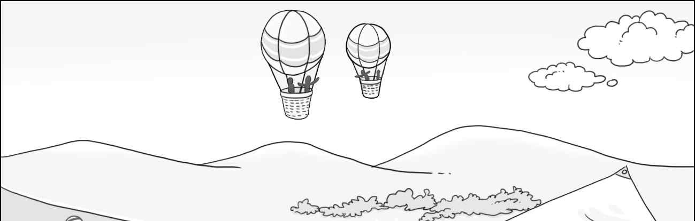
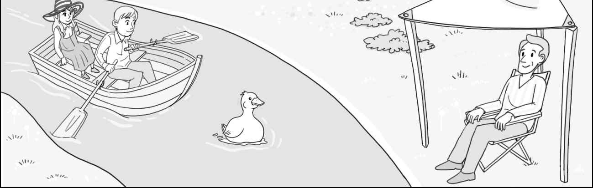
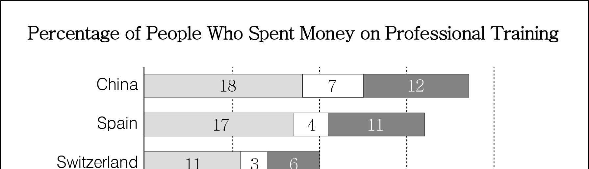
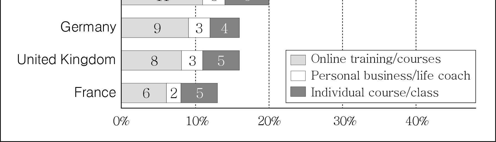
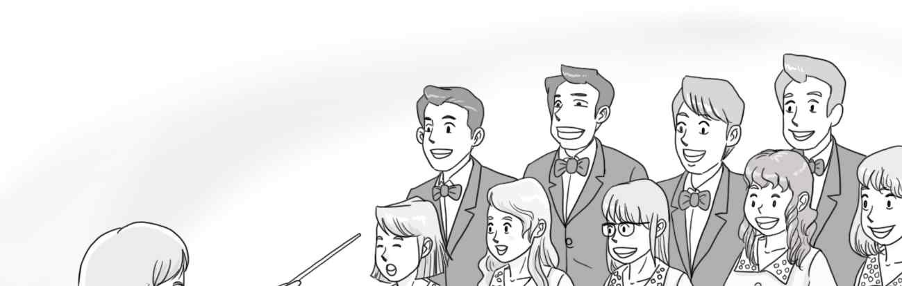
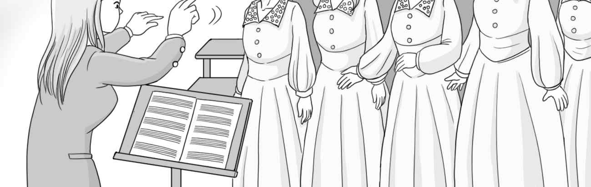

1. 다음을 듣고, 남자가 하는 말의 목적으로 가장 적절한 것을 고르시오.
① 사진 동아리 부원을 모집하려고
② 동물원 견학 프로그램을 홍보하려고
③ 동물 사진을 찍는 요령을 알려 주려고
④ 동물원 관람 시 유의 사항을 안내하려고
⑤ 새로 출시된 카메라의 사용법을 설명하려고

2. 대화를 듣고, 여자의 의견으로 가장 적절한 것을 고르시오.

① 개인 이메일 계정을 업무용으로 사용하지 말아야 한다.
② 환경을 보호하기 위해 종이 우편물을 줄일 필요가 있다.
③ 출처가 불분명한 이메일의 첨부 파일을 열어서는 안 된다.
④ 탄소 배출량 감소를 위해 불필요한 이메일을 삭제해야 한다.
⑤ 개인 정보 유출을 방지하기 위해 휴면 계정을 정리해야 한다.

3. 대화를 듣고, 두 사람의 관계를 가장 잘 나타낸 것을 고르시오.

① 환경 운동가 - 기자
② 고객 - 청소업체 직원
③ 집주인 - 실내 디자이너
④ 건축가 - 건축 자재 판매자
⑤ 지역 주민 - 건설 현장 직원

4. 대화를 듣고, 그림에서 대화의 내용과 일치하지 않는 것을 고르시오.

5. 대화를 듣고, 남자가 할 일로 가장 적절한 것을 고르시오.

① 무대 조명 점검하기
② 사회자에게 연락하기
③ 피아노 위치 조정하기
④ 무선 마이크 가져가기
⑤ 참가자에게 공연 순서 알리기

6. 대화를 듣고, 여자가 지불할 금액을 고르시오. [3점]

① $26
② $28
③ $30
④ $34
⑤ $36

7. 대화를 듣고, 남자가 전자책을 사려는 이유를 고르시오.

① 글자 크기를 조절할 수 있어서
② 종이책 재고가 부족해서
③ 휴대하기가 편리해서
④ 종이책보다 가격이 저렴해서
⑤ 서점에 가지 않고 구매할 수 있어서

8. 대화를 듣고, Central Flower Market에 관해 언급되지 않은 것을 고르시오.

① 운영 시간
② 위치
③ 휴무 요일
④ 주차 요금
⑤ 입점 매장 수

9. 2021 Robinson Fishing Contest에 관한 다음 내용을 듣고, 일치하지 않는 것을 고르시오.

① 10월 22일부터 23일까지 개최된다.
② 대회 장소는 Silver Cloud 호수이다.
③ 1등 상품은 고급 낚싯대 한 세트이다.
④ 잡은 물고기의 수를 기준으로 심사한다.
⑤ 대회가 끝난 후에 호수를 청소하는 행사가 있다.

10. 다음 표를 보면서 대화를 듣고, 두 사람이 주문할 와플 메이커를 고르시오.

|  | Model | Price | Plates | Waffle Shape | Audible Alert |
| --- | --- | --- | --- | --- | --- |
| ① | A | $20 | Fixed | Square | × |
| ② | B | $33 | Removable | Round | × |
| ③ | C | $48 | Fixed | Round | × |
| ④ | D | $52 | Removable | Round | ○ |
| ⑤ | E | $70 | Removable | Square | ○ |

11. 대화를 듣고, 여자의 마지막 말에 대한 남자의 응답으로 가장 적절한 것을 고르시오.

① Thank you. Please let me know if you find it.
② Don’t worry. I can find your house by myself.
③ Why don’t you try it on? It’ll look nice on you.
④ I’m sorry. I don’t think I can make it to your party.
⑤ I think you’re right. The baseball cap doesn’t fit me.

12. 대화를 듣고, 남자의 마지막 말에 대한 여자의 응답으로 가장 적절한 것을 고르시오.

① Be careful. You might get an electric shock.
② Oh, I see. Then I’ll go get some new ones now.
③ Great. The bathroom is much brighter than before.
④ All right. I’ll replace the garage light bulb right now.
⑤ Never mind. I’ll come back when the items are in stock.

13. 대화를 듣고, 여자의 마지막 말에 대한 남자의 응답으로 가장 적절한 것을 고르시오. [3점]

Man:
① I’m sorry I can’t join the design project this time.
② Traditional culture can be a great source of creativity.
③ Our preference should be quality over brand and price.
④ I’ll change the pattern of the dress as you suggested.
⑤ We should have handed in the assignment on time.

14. 대화를 듣고, 남자의 마지막 말에 대한 여자의 응답으로 가장 적절한 것을 고르시오. [3점]

Woman:
① Great. I can’t wait to open the boxes myself.
② Right. I’ll ask about replacing it with a new one.
③ Yes. You should return the product within a week.
④ Sorry. The delivery will be a little later than usual.
⑤ No problem. I’ve already moved all the boxes for you.

15. 다음 상황 설명을 듣고, Sarah가 Emily에게 할 말로 가장 적절한 것을 고르시오.

Sarah: Emily,
① you should rinse plastic containers before recycling them.
② I want you to do your laundry by yourself more often.
③ our recycling center requires us to remove the labels.
④ we need to refill these containers with some fruits.
⑤ you have to wipe the table right after you eat.

16. 여자가 하는 말의 주제로 가장 적절한 것은?

① the origins of national sports teams’ nicknames
② the ways countries choose their capital cities
③ city nicknames and how they came to be
④ commonly confused capital cities in the world
⑤ famous tourist attractions and their economic value

17. 언급된 도시가 아닌 것은?

① Rome
② Paris
③ Singapore
④ Sydney
⑤ Seattle

18. 다음 글의 목적으로 가장 적절한 것은?

Dear Ms. Lopez, In reply to your letter of September 29, it affords me great pleasure to say that we know Mr. Turner to be alert and diligent, as well as faithful in his duties and loyal to his employers. He is a fine judge of goods and has done most of the buying in our textile department for the past two years. We regret to lose him, but the position he seeks in your company is probably much better than anything we have to offer, and we hope that you will decide to employ him. Very truly yours, Charles Moore

19. 다음 글에 드러난 ‘I’의 심경 변화로 가장 적절한 것은?

Off I went in the dark, headed to the top of Kilimanjaro. Some sections were so steep that I had to make zigzags to make it easy on my oxygen deprived body. All the energy I had went to breathing. My body felt like a dead weight. I almost gave up, with the summit just around the corner. My guide responded to my exhaustion, saying, “Go slow and steady, just one step at a time”. I followed his words. I made it to Uhuru Peak, known as the very top of Kilimanjaro. Indeed, I saw the incredible, unforgettable sunrise! The beauty, the teamwork, and the accomplishment of a personal life goal were worth all the sacrifice and strain. Mt. Kilimanjaro was worth the climb!

20. 다음 글에서 필자가 주장하는 바로 가장 적절한 것은?

We can’t begin to build a strategy for our lives without first understanding where we are and where we want to go. Since people are different, it’s reasonable to assume their current situations or starting points will be different as well. That’s why books that tout a single formula for success or improvement, without taking into account the different places people are starting from, are worthless. Would you trust a doctor who didn’t ask any questions or run any tests to diagnose what was wrong, yet wrote you a prescription anyway? In medicine, the adage is Prescription without diagnosis equals malpractice. Before we can “prescribe” strategy, we first need to diagnose the situation ─ where we stand, where we are today.

21. 밑줄 친 we have “confusion at the frontier”가 다음 글에서 의미하는 바로 가장 적절한 것은? [3점]

Two independent research groups have discovered that we have “confusion at the frontier” when we search the Internet. Adrian Ward, a psychologist at the University of Texas, found that engaging in Internet searches increased people’s cognitive self-esteem, their sense of their own ability to remember and process information. Moreover, people who searched the Internet for facts they didn’t know and were later asked where they found the information often misremembered and reported that they had known it all along. Many of them completely forgot ever having conducted the search. They gave themselves the credit instead of the Internet. In a different set of studies, researchers found that those who had searched the Internet to answer specific questions rated their ability to answer unrelated questions as higher than those who had not. The act of searching the Internet and finding answers to one set of questions caused the participants to increase their sense that they knew the answers to all questions, including those whose answers they had not researched.

22. 다음 글의 요지로 가장 적절한 것은?

A visual scene can set up our emotional response. Suspense is driven by a sense of calm with the anticipation of impending terror. Indeed, anticipation or expectations play a key role in driving our emotions. The Russian silent filmmaker Lev Kuleshov considered such contextual influences. He interspersed shots of an actor exhibiting a neutral expression with shots of a child’s coffin or a plate of soup. This same “neutral” expression was interpreted differently depending on what image preceded it. Thus, the same expression appeared to show sorrow or hunger, depending on the context. Psychological studies of the Kuleshov effect have confirmed the impact of the social context on emotion. For example, if a person smiles at you and then the smile turns into a neutral expression, that person will appear somewhat grumpy or disappointed. Conversely, if a person first looks angry and then the expression turns into a neutral expression, the person looks somewhat pleasant or positive.

23. 다음 글의 주제로 가장 적절한 것은?

The most enduring lessons have to be learnt from the seismic response of ground and the built environment in the largest natural laboratory, i.e., the earth, from damage observations in all earthquakes, whether inter- or intra-plate. Complete protection of all life and the entire built environment in all earthquakes is still a distant dream. However, efforts are on to have a built environment in which loss of life is minimized, and lifelines and infrastructure continue to function during and after an earthquake disaster. Construction activities in seismically prone and hazardous areas that are vulnerable to different damaging effects of earthquakes are best avoided. Most of the time such situations are unavoidable; in that case appropriate strengthening measures are required. Structures should be preferably made on firm ground. For construction in soft soil, the ground should be strengthened, and the foundations should be sufficiently deep, wide, and strong. Subsequently, application of appropriate interventions regarding earthquake-resistant design of structures goes a long way in saving human lives.

24. 다음 글의 제목으로 가장 적절한 것은?

The most innovative teams are those that can restructure themselves in response to unexpected shifts in the environment; they don’t need a strong leader to tell them what to do. Moreover, they tend to form spontaneously; when like-minded people find each other, a group emerges. The improvisational collaboration of the entire group translates moments of individual creativity into group innovation. Allowing the space for this self-organizing emergence to occur is difficult for many managers because the outcome isn’t controlled by the management team’s agenda and is therefore less predictable. Most business executives like to start with the big picture and then work out the details. That’s why so many of the best examples of improvised innovation take place outside of formal organizations. In improvisational innovation, teams start with the details and then work up to the big picture. It’s riskier and less efficient, but when a successful innovation emerges, it’s often very surprising and imaginative.

25. 다음 도표의 내용과 일치하지 않는 것은?

Percentage of People Who Spent Money on Professional Training

| Country | Online training/courses | Personal business/life coach | Individual course/class |
| --- | --- | --- | --- |
| China | 18 | 7 | 12 |
| Spain | 17 | 4 | 11 |
| Switzerland | 11 | 3 | 6 |
| Germany | 9 | 3 | 4 |
| United Kingdom | 8 | 3 | 5 |
| France | 6 | 2 | 5 |

26. Dorothy Lavinia Brown에 관한 다음 글의 내용과 일치하지 않는 것은?

Dorothy Lavinia Brown was the first black female in the American South to become a surgeon. As an infant she was placed in an orphanage. After high school, she won a scholarship to Bennett College, and after graduating there in 1941, she entered Meharry Medical College in Nashville, Tennessee, graduating in 1948. Her medical internship was served at New York’s Harlem Hospital but there she encountered gender resistance and was denied residency as a surgeon. She then returned to Meharry and completed her surgical residency in 1954. She later became chief of surgery and educational director of the Riverside-Meharry Clinic in Nashville, as well as an attending surgeon at George W. Hubbard Hospital and a professor of surgery at the Meharry Medical College. In 1966 she became the first African American woman elected to the Tennessee state legislature.

27. Maple Singers에 관한 다음 안내문의 내용과 일치하지 않는 것은?

 Maple Singers Interested in sharing your vocal talent with the community? Then join the Maple Singers!
This community chorus is composed of over 30 members ranging in age from 18 to 90.
They sing a variety of music by composers including Wolfgang Amadeus Mozart, Andrew Lloyd Webber, George Gershwin, and many more.
No audition is required to become a member.
Rehearsals are conducted once a week at the Maple Arts Center and concerts are held throughout the year.
The annual membership fee is $70. (Please contact Ellena Collins at 0345-303-5627.)

28. Guided Nature Walks에 관한 다음 안내문의 내용과 일치하는 것은?

 Guided Nature Walks Get to know the plants and animals of Tender Nature Park with a guided walk from one of the Naturalists here at the Park! We will go on an easy one-hour walk with frequent stops. We will look for deer, birds, insects, and various interesting plants. Schedule
Each Sunday we host two nature walks ─available at 9 a.m. and 11 a.m.
Walks begin at Tender Nature Park Visitor Center. Registration
Walks are available by reservation only ($5 per person).
Sign up for a guided walk at www.tendernp.org.
For each walk, the group size is limited to 15 participants.

29. 다음 글의 밑줄 친 부분 중, 어법상 틀린 것은? [3점]

According to its dictionary definition, an anthem is both a song of loyalty, often to a country, and a piece of ‘sacred music’, definitions that are both applicable in sporting contexts. This genre is dominated, although not exclusively, by football and has produced a number of examples where popular songs become synonymous with the club and are enthusiastically adopted by the fans. More than this they are often spontaneous expressions of loyalty and identity and, according to Desmond Morris, have ‘reached the level of something approaching a local art form’. A strong element of the appeal of such sports songs is that they feature ‘memorable and easily sung choruses in which fans can participate’. This is a vital part of the team’s performance as it makes the fans’ presence more tangible. This form of popular culture can be said to display pleasure and emotional excess in contrast to the dominant culture which tends to maintain ‘respectable aesthetic distance and control’.

30. 다음 글의 밑줄 친 부분 중, 문맥상 낱말의 쓰임이 적절하지 않은 것은?

How people behave often depends on what others do. If other car drivers or subway users leave for work at 8 a.m., it may be to my advantage to leave at 6 a.m., even if that is really too early from my point of view. In equilibrium, flows stabilize so that each person makes the best trade-off between their ideal schedule and the congestion they will suffer on their commute. In making such choices, agents seek to differentiate their behavior from that of others. On other occasions, agents have a problem with coordination. They would like to choose to behave the same way as others. For example, if most of my fellow citizens did not pay their parking tickets, there would be (unfortunately) strong pressure for an amnesty for such offenders, which would increase my incentive to pay my parking tickets too. There may be multiple equilibria, so that two otherwise identical societies may adopt different behavioral patterns.

31. 다음 빈칸에 들어갈 말로 가장 적절한 것을 고르시오.

Writing lyrics means shaping the meaning of something which, if left as instrumental music, would remain undefined; there is a concrete change of the level of expression. That’s one reason why for many songwriters ‘lyric’ seems to be the hardest word. Picture this scene: a songwriter at the piano, or with a guitar, plays with chords and creates an emotion and atmosphere that is creatively inspiring. Our songwriter invents a melody to go with this mood. Then comes the moment where words are required, and that means getting specific. This sad- or happy-sounding chord progression must now direct its general sadness or happiness to a particular human situation. A lyric is the place where the emotional suggestions of pure music are defined as human concerns and events. It’s like a piece of translation, from one medium into another. The general musical mood is focused by a lyric into a context, a voice, a human drama.

32. 다음 빈칸에 들어갈 말로 가장 적절한 것을 고르시오.

In the health area, the concern with use after “purchase” is as critical as and even more critical than the concern with the purchase itself. The person who is sold on and goes through disease screening procedures but does not follow through with medical treatment for a diagnosed condition, is as much of a failure as a person who did not avail himself of the screening program to begin with. The obese individual who has been successfully sold on going on a medically prescribed diet but is lured back to his candy jar and apple pie after one week, is as much of a failure as if he never had been sold on the need to lose and control his weight. The most challenging, most difficult, most perplexing problem is not how to sell people on health-supportive practices, not even how to get them to initiate such practices. We have been fairly successful with these. It is to persuade and help them to stick with new practices.

33. 다음 빈칸에 들어갈 말로 가장 적절한 것을 고르시오. [3점]

Like faces, sometimes movement can fool us into thinking that something has a mind. For example, toys that seem to come alive fascinate children. In my day, one of the popular toys was a piece of finely coiled wire called a “Slinky.” It could appear to walk by stretching and lifting up one end over another down an incline, a bit like an acrobatic caterpillar. The attraction of the Slinky on Christmas Day was the lifelike movement it had as it stepped down the stairs before someone trod on it or twisted the spring and ruined it for good. Toys that appear to be alive are curiosities because they challenge how we think inanimate objects and living things should behave. Many toys today exploit this principle to great effect, but be warned: not all babies enjoy objects that suddenly seem lifelike. This anxiety probably reflects their confusion over the question, “Is it alive or what?” Once babies decide that something is alive, they are inclined to see its movements as purposeful.

34. 다음 빈칸에 들어갈 말로 가장 적절한 것을 고르시오. [3점]

If the nature of a thing is such that when removed from the environment in which it naturally occurs it alters radically, you will not glean an accurate account of it by examining it within laboratory conditions. If you are only accustomed to seeing it operate within such an artificial arena, you may not even recognize it when it is functioning in its normal context. Indeed, if you ever spot it in that environment you may think it is something else. Similarly, if you believe that leadership only takes the form of heroic men metaphorically charging in on white horses to save the day, you may neglect the many acts which contribute to their ability to be there. You may fail to see the importance of the grooms who care for the horses, the messengers who bring attention to the crisis or the role played by those cheering from the sidelines. You may miss the fact that without troops supporting them, any claims to leading on the part of these heroes would be rather hollow.

35. 다음 글에서 전체 흐름과 관계 없는 문장은?

A group of academics, mainly political scientists, assumed that human rights treaties did not have any effect on the behavior of countries.

36. 주어진 글 다음에 이어질 글의 순서로 가장 적절한 것을 고르시오.

In a process called seeding, you need to have a time frame in mind. Start telling your family how you feel about your current job. Tell them how you get frustrated and bored with this job. These stories will make them realise that you are meant to follow your passion. At times they need to be surprised with your small achievements, which could be some additional skills you acquired, or some awards you won in your field of passion. Discuss this almost twice a week. Then start doing work related to your passion on the side and let them see and experience how happy you are while doing this. Find a way to get your family and friends involved in your passion. The more they see you doing your passion, the more they connect with you emotionally. Tell them stories of how you are inspired by the passion and how it makes a difference not only to you but also to others. Give examples of how someone living a similar passion started his or her life and today how he or she is living happily.

37. 주어진 글 다음에 이어질 글의 순서로 가장 적절한 것을 고르시오. [3점]

Living in dispersal correlates with a shocking retreat from public life, according to extensive analysis of the Social Capital Community Benchmark Survey of nearly thirty thousand people begun in 2000. It is hard to pinpoint the origin of this retreat. It may be because people in the dispersed city have invested so heavily in private comfort that they feel insulated from the problems of the rest of the world. It may be that sprawl has attracted people who are naturally less interested in engaging with the world, socially or politically. These are both possible, but evidence suggests that the spatial landscape matters. Sociologists point out that the suburbs have done an efficient job of sorting people into communities where they will be surrounded by people of the same socioeconomic status. Meanwhile, the architectures of sprawl inhibit political activity that requires face-to-face interaction. It is not that sprawl makes political activity impossible, but by privatizing gathering space and dispersing human activity, sprawl makes political gathering less likely.

38. 글의 흐름으로 보아, 주어진 문장이 들어가기에 가장 적절한 곳을 고르시오.

Government warnings and stark statistics about mercury-contaminated fish have become so routine that we barely take note. I have to ask: why have these warnings been aimed at getting people to cease eating fish, rather than at getting the industries to stop putting mercury into our environment? Finally in February 2009, near-global consensus was reached: more than 140 countries convened by the United Nations Environment Programme (UNEP) unanimously agreed to create an international mercury treaty. They also urged immediate action through a voluntary Global Mercury Partnership while the treaty is being finalized. Getting mercury out of our production processes will be hard work and it will cost money, for sure. But investments in eliminating mercury are investments well spent. UNEP estimates that every kilogram of mercury taken out of the environment can lead to up to $12,500 worth of social, environmental, and human health benefits.

39. 글의 흐름으로 보아, 주어진 문장이 들어가기에 가장 적절한 곳을 고르시오. [3점]

A meaningful level of complexity in our history consists of culture: information stored in nerve and brain cells or in human records of various kinds. The species that has developed this capacity the most is, of course, humankind. In terms of total body weight, our species currently makes up about 0.005 per cent of all planetary biomass. If all life combined were only a paint chip, all human beings today would jointly amount to no more than a tiny colony of bacteria sitting on that flake. Yet through their combined efforts humans have learned to control a considerable portion of the terrestrial biomass, today perhaps as much as between 25 and 40 per cent of it. In other words, thanks to its culture this tiny colony of microorganisms residing on a paint chip has gained control over a considerable portion of that flake. To understand how human societies operate, it is therefore not sufficient to only look at their DNA, their molecular mechanisms and the influences from the outside world. We also need to study the cultural information that humans have been using for shaping their own lives as well as considerable portions of the rest of nature.

40. 다음 글의 내용을 한 문장으로 요약하고자 한다. 빈칸 (A), (B)에 들어갈 말로 가장 적절한 것은?

Perhaps not surprisingly, given how long magicians have been developing their craft, a lot of creativity in magic is of the tweaking variety ─ some of the most skilled and inventive magicians gained fame by refining the execution of tricks that have been known for decades, or sometimes centuries. Nevil Maskelyne, one of magic’s old masters, claimed that “the difficulty of producing a new magical effect is about equivalent to that of inventing a new proposition in Euclid.” Whether it’s because there’s little that’s completely new, or for some other reason, magicians seem to worry less about imitation. They do, however, worry a lot about traitors ─ those magicians who expose the secrets behind a trick to the public. Once a trick is exposed in this way, its value as “magic” is destroyed, and this harms everyone in the industry. For this reason, magicians’ norms are focused mostly on punishing magicians who expose tricks to the public ─ even if the trick is the exposer’s own invention.

Magicians, having long refined existing tricks, are not much worried about copying tricks, but they are very strict about disclosing the methods of tricks as it damages their industry.

41. 윗글의 제목으로 가장 적절한 것은?

In many ways, the proliferation of news sources has been a wonderful thing. The public now has multiple ways to check facts and learn about differing points of view. In theory, this access should improve our ability to have meaningful discussions with one another and our ability to form informed opinions. But this isn’t always the case. One of the most significant developments is that media has become like a Las Vegas buffet — we have too many choices. When you consider all of the information options — including niche media and personalized social media networks where developers utilize algorithms to serve up ideal content — there just isn’t enough time to explore them all. In this space it is easy to become trapped in an echo chamber, where your own opinions are reinforced by others without introducing new or conflicting content into the mix, which restricts public discourse and can lead to extremes. This is most evident in the realm of politics. Traditionally, mass media has been a place to tune in and hear nonpartisan reporting of facts about a situation or candidate, giving everyone equal access to the vital information necessary to form opinions and make decisions. Cable news networks and partisan online sources can enhance the audience’s ability to access accurate, full-picture information. In some cases, audience members have made the conscious decision to only engage with content that is in line with their ideals.

42. 밑줄 친 낱말 중에서 문맥상 낱말의 쓰임이 적절하지 않은 것은? [3점]

In many ways, the proliferation of news sources has been a wonderful thing. The public now has multiple ways to check facts and learn about differing points of view. In theory, this access should improve our ability to have meaningful discussions with one another and our ability to form informed opinions. But this isn’t always the case. One of the most significant developments is that media has become like a Las Vegas buffet — we have too many choices. When you consider all of the information options — including niche media and personalized social media networks where developers utilize algorithms to serve up ideal content — there just isn’t enough time to explore them all. In this space it is easy to become trapped in an echo chamber, where your own opinions are reinforced by others without introducing new or conflicting content into the mix, which restricts public discourse and can lead to extremes. This is most evident in the realm of politics. Traditionally, mass media has been a place to tune in and hear nonpartisan reporting of facts about a situation or candidate, giving everyone equal access to the vital information necessary to form opinions and make decisions. Cable news networks and partisan online sources can enhance the audience’s ability to access accurate, full-picture information. In some cases, audience members have made the conscious decision to only engage with content that is in line with their ideals.

43. 주어진 글에 이어질 내용을 순서에 맞게 배열한 것으로 가장 적절한 것은?

Mr. Green was startled by the sudden appearance in the doorway of a tall young man. His dark trench coat caught Mr. Green’s attention. He was Jacob. He had grown a bit since Mr. Green last saw him and his demeanor was certainly different, but Mr. Green recognized the lost, insecure first grader he had taught and loved many years ago. At that time, some children didn’t have the privilege of a nurturing family.

 Jacob was one of those children. In the first grade, he required constant reassurance and redirection from his teachers. He often was unable or unwilling to participate or cooperate in the classroom. Mr. Green took the responsibility not only for Jacob’s education, but for his social and emotional needs as well. Jacob quickly became one of his favorites, and began to willingly engage in the process of learning. Even after Jacob left first grade, he would return year after year, willing to give up his recess time to see Mr. Green. Jacob simply needed that unconditional acceptance. Family circumstances eventually took Jacob to another state, and with a heavy heart Mr. Green thought he would never see him again. He was worried how life would treat Jacob. So, Mr. Green felt great relief and joy to see him standing in the doorway. He waved Jacob to come in. Entering the classroom, Jacob greeted him back. His eyes darted around Mr. Green’s classroom. Suddenly, with a laugh, he asked, “Do you still have that treasure chest for your students?” Mr. Green reached under his desk to pull out the old treasure chest. Jacob began digging for his favorite candy. They sat down for conversation over the candies. Jacob must have eaten ten before he was finished. On the way out he gave Mr. Green both a hug and a look of gratitude. Both his stomach and his emotional “bucket” were filled.

44. 밑줄 친 낱말 중에서 가리키는 대상이 나머지 넷과 다른 것은?

Mr. Green was startled by the sudden appearance in the doorway of a tall young man. His dark trench coat caught Mr. Green’s attention. He was Jacob. He had grown a bit since Mr. Green last saw him and his demeanor was certainly different, but Mr. Green recognized the lost, insecure first grader he had taught and loved many years ago. At that time, some children didn’t have the privilege of a nurturing family.

 Jacob was one of those children. In the first grade, he required constant reassurance and redirection from his teachers. He often was unable or unwilling to participate or cooperate in the classroom. Mr. Green took the responsibility not only for Jacob’s education, but for his social and emotional needs as well. Jacob quickly became one of his favorites, and began to willingly engage in the process of learning. Even after Jacob left first grade, he would return year after year, willing to give up his recess time to see Mr. Green. Jacob simply needed that unconditional acceptance. Family circumstances eventually took Jacob to another state, and with a heavy heart Mr. Green thought he would never see him again. He was worried how life would treat Jacob. So, Mr. Green felt great relief and joy to see him standing in the doorway. He waved Jacob to come in. Entering the classroom, Jacob greeted him back. His eyes darted around Mr. Green’s classroom. Suddenly, with a laugh, he asked, “Do you still have that treasure chest for your students?” Mr. Green reached under his desk to pull out the old treasure chest. Jacob began digging for his favorite candy. They sat down for conversation over the candies. Jacob must have eaten ten before he was finished. On the way out he gave Mr. Green both a hug and a look of gratitude. Both his stomach and his emotional “bucket” were filled.

45. 윗글에 관한 내용으로 적절하지 않은 것은?

Mr. Green was startled by the sudden appearance in the doorway of a tall young man. His dark trench coat caught Mr. Green’s attention. He was Jacob. He had grown a bit since Mr. Green last saw him and his demeanor was certainly different, but Mr. Green recognized the lost, insecure first grader he had taught and loved many years ago. At that time, some children didn’t have the privilege of a nurturing family.

 Jacob was one of those children. In the first grade, he required constant reassurance and redirection from his teachers. He often was unable or unwilling to participate or cooperate in the classroom. Mr. Green took the responsibility not only for Jacob’s education, but for his social and emotional needs as well. Jacob quickly became one of his favorites, and began to willingly engage in the process of learning. Even after Jacob left first grade, he would return year after year, willing to give up his recess time to see Mr. Green. Jacob simply needed that unconditional acceptance. Family circumstances eventually took Jacob to another state, and with a heavy heart Mr. Green thought he would never see him again. He was worried how life would treat Jacob. So, Mr. Green felt great relief and joy to see him standing in the doorway. He waved Jacob to come in. Entering the classroom, Jacob greeted him back. His eyes darted around Mr. Green’s classroom. Suddenly, with a laugh, he asked, “Do you still have that treasure chest for your students?” Mr. Green reached under his desk to pull out the old treasure chest. Jacob began digging for his favorite candy. They sat down for conversation over the candies. Jacob must have eaten ten before he was finished. On the way out he gave Mr. Green both a hug and a look of gratitude. Both his stomach and his emotional “bucket” were filled.

