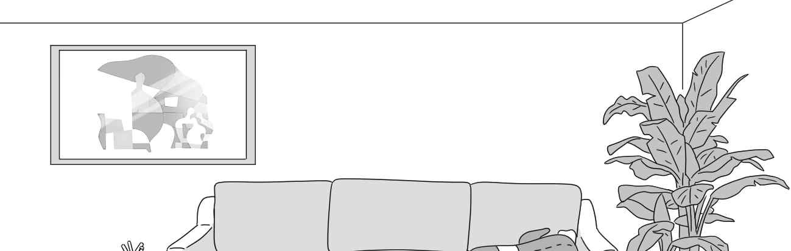
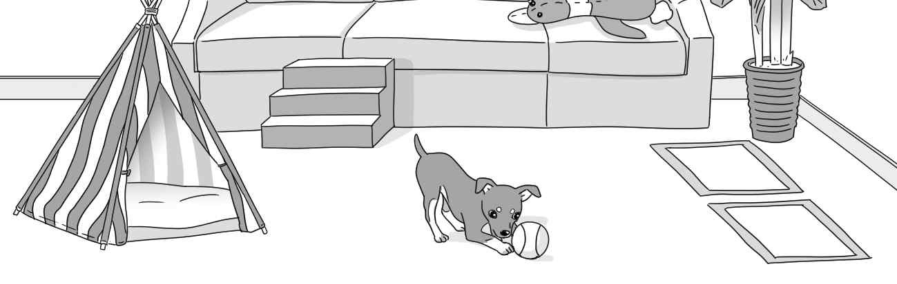
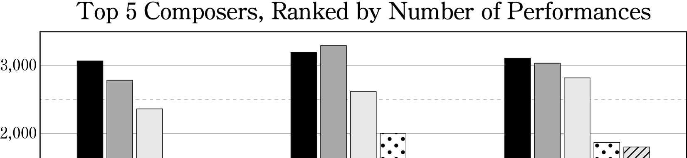
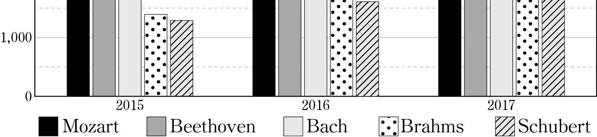
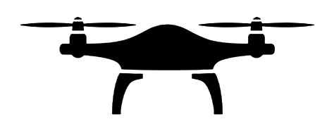

1. 다음을 듣고, 남자가 하는 말의 목적으로 가장 적절한 것을 고르시오.
① 재활용 쓰레기 분리 배출 방법을 안내하려고
② 재활용 쓰레기 배출 시간 준수를 당부하려고
③ 재활용 쓰레기 분리수거 요일 변경을 공지하려고
④ 재활용 쓰레기 관련 주민 회의 결과를 알려주려고
⑤ 재활용 쓰레기 분리수거 관련 공청회 참석을 요청하려고

2. 대화를 듣고, 여자의 의견으로 가장 적절한 것을 고르시오.

① 적합한 조리 도구 사용은 요리를 쉽고 즐겁게 해 준다.
② 요리 동영상을 참고하면 누구나 요리를 할 수 있다.
③ 같은 재료라도 조리법에 따라 음식 맛이 달라진다.
④ 조리 도구는 훌륭한 인테리어 소품이 될 수 있다.
⑤ 조리 도구를 청결하게 관리하는 것이 중요하다.

3. 대화를 듣고, 두 사람의 관계를 가장 잘 나타낸 것을 고르시오.

① 꽃꽂이 강사 - 수강생
② 택배 기사 - 수령인
③ 웨딩 플래너 - 예비 신부
④ 꽃 판매 상인 - 사진작가
⑤ 인테리어 디자이너 - 건축가

4. 대화를 듣고, 그림에서 대화의 내용과 일치하지 않는 것을 고르시오.

5. 대화를 듣고, 여자가 남자를 위해 할 일로 가장 적절한 것을 고르시오.

① 물 가져가기
② 안내 방송하기
③ 카메라 설치하기
④ 배터리 충전하기
⑤ 구급상자 챙기기

6. 대화를 듣고, 남자가 지불할 금액을 고르시오. [3점]

① $117
② $130
③ $135
④ $150
⑤ $161

7. 대화를 듣고, 여자가 다른 주문처를 찾고 있는 이유를 고르시오.

① 더 좋은 품질을 원해서
② 더 빠른 배송을 원해서
③ 더 싼 가격을 원해서
④ 무료 배송을 원해서
⑤ 대량 주문을 원해서

8. 대화를 듣고, Delizia에 관해 언급되지 않은 것을 고르시오.

① 창업 연도
② 창업자
③ 예약 방법
④ 장소 협찬 영화
⑤ 야외 정원

9. Nest Cave Boat Tour에 관한 다음 내용을 듣고, 일치하지 않는 것을 고르시오.

① 1시간 동안 진행된다.
② 보트당 최대 탑승 인원은 10명이다.
③ 동굴의 역사에 관해 들을 수 있다.
④ 동굴 내에서 사진 촬영을 할 수 있다.
⑤ 사전에 예약을 해야 한다.

10. 다음 표를 보면서 대화를 듣고, 두 사람이 주문할 사다리를 고르시오.

|  | Model | Price | Height (cm) | Load Capacity (kg) | Foldable |
| --- | --- | --- | --- | --- | --- |
| ① | A | $55 | 90 | 80 | ○ |
| ② | B | $65 | 130 | 90 | × |
| ③ | C | $75 | 150 | 110 | ○ |
| ④ | D | $85 | 180 | 150 | × |
| ⑤ | E | $105 | 210 | 200 | ○ |

11. 대화를 듣고, 여자의 마지막 말에 대한 남자의 응답으로 가장 적절한 것을 고르시오.

① Actually, it leads to the basement of the store.
② Please connect me with the marketing department.
③ No, the menswear is on the fifth floor of the store.
④ Well, the department store opens at 10 in the morning.
⑤ Not exactly. This is the direct number of the department.

12. 대화를 듣고, 남자의 마지막 말에 대한 여자의 응답으로 가장 적절한 것을 고르시오.

2 영어 영

① Of course. She’ll be very happy to see you.
② Thank you for the ride. Say hello to Daniel.
③ How nice! I’ll call and thank her for the ride.
④ Never mind. I’ll take a bus to the baseball field.
⑤ Hurry up. You’ll be late for baseball practice again.

13. 대화를 듣고, 여자의 마지막 말에 대한 남자의 응답으로 가장 적절한 것을 고르시오. [3점]

Man:
① Great. It’ll be really nice if we sing together.
② Thank you. I had a great time in your choir.
③ Think twice. It’s not easy to sing in a choir.
④ Actually, I’m not a big fan of classical music.
⑤ Never mind. The choir practice has been canceled.

14. 대화를 듣고, 남자의 마지막 말에 대한 여자의 응답으로 가장 적절한 것을 고르시오. [3점]

Woman:
① I’m afraid I can’t go with you this time.
② I’m glad you’ve done the farm work in time.
③ Unfortunately, there are no more apples to pick.
④ Thank you for the apples you sent me last week.
⑤ You’ll enjoy it. It’s hard work but very rewarding.

15. 다음 상황 설명을 듣고, Katrina가 Simon에게 할 말로 가장 적절한 것을 고르시오.

Katrina:
① Let’s go bicycle riding as often as possible.
② Go to the hospital before the pain gets worse.
③ You shouldn’t do risky things while riding a bicycle.
④ I’ll let you know the repair shop that I often go to.
⑤ You’re brave to ride a bicycle with no hands.

16. 여자가 하는 말의 주제로 가장 적절한 것은?

① colors to help animals protect themselves
② English animal expressions and their meanings
③ animal sounds expressed in different languages
④ classroom animal games and activities for children
⑤ animals that appear frequently in children’s stories

17. 언급된 동물이 아닌 것은?

① snail
② horse
③ hawk
④ monkey
⑤ snake

18. 다음 글의 목적으로 가장 적절한 것은?

Dear Ms. Emily Dashwood, I write to thank you for your recent orders and also to make a suggestion which I feel certain will be agreeable to you. We are now in the height of the fruit and green groceries season. Among the specially good things that I have on hand at present are some potatoes of exceptional quality. In the fruit line, raspberries and blackberries are now at their best, and I have the best. Other good things will follow, and I will take care to let you know all about them. Very respectfully, John Pippin

19. 다음 글에 드러난 ‘I’의 심경 변화로 가장 적절한 것은?

I was waiting outside when the exam grades were posted on the bulletin board. I was perspiring. My heart started beating fast. What if I failed? A swarm of students rushed forward to see the exam results. Fortunately, I was tall enough to see over their heads. The minute I saw the results, all my anxiety disappeared. I walked quickly back to my dormitory and phoned my father. “Dad,” I mumbled in a haze. “You won’t believe this, but I passed the exams.” My father was speechless. Finally he said, “Son, that is good news. I frankly never thought you’d do it.” I was overjoyed as if I were walking on the cloud.

20. 다음 글에서 필자가 주장하는 바로 가장 적절한 것은?

Good teachers know that learning occurs when students compare what they already know with the new ideas presented by the teacher or textbook. It is the students who decide whether or not to reconstruct their conceptions; therefore, teaching should be student centered rather than teacher centered. This means that students should be actively involved in making and interpreting analogies. If we believe that analogy use is an effective way to help students think and learn, then it makes sense to help students generate their own analogies or reconstruct the teacher’s analogies to fit in with their own experiences.

21. 밑줄 친 last in, first out이 다음 글에서 의미하는 바로 가장 적절한 것은? [3점]

While user habits are a boon to companies fortunate enough to generate them, their existence inherently makes success less likely for new innovations and startups trying to disrupt the status quo. The fact is, successfully changing long-term user habits is exceptionally rare. Altering behavior requires not only an understanding of how to persuade people to act but also necessitates getting them to repeat behaviors for long periods, ideally for the rest of their lives. Companies that succeed in building a habit-forming business are often associated with game-changing, wildly successful innovation. But like any discipline, habit design has rules that define and explain why some products change lives while others do not. For one, new behaviors have a short half-life, as our minds tend to return to our old ways of thinking and doing. Experiments show that lab animals habituated to new behaviors tend to regress to their first learned behaviors over time. To borrow a term from accounting, behaviors are LIFO ─ “last in, first out.”

22. 다음 글의 요지로 가장 적절한 것은?

Despite numerous studies on the influence of mediated agendas on politics, most studies examine text only ⎯ as if media only deliver words. These studies looked at how reporters, analysts, and commentators verbally describe and criticize the candidates. But they often neglect another important source of influence: visuals. As some communication scholars said, “Stories are often complex combinations of visual and verbal content ⎯ all too often the visual information is so powerful that it overwhelms the verbal.” The challenge of tackling visuals to examine their influence is multifaceted. The difficulties of gathering and coding visual data and of attributing impact to specific parts of images have no doubt caused veritable scholars to shy away. But the potential impact of visuals on people’s perceptions is simply too important to ignore. Furthermore, the importance of understanding both visuals and text in tandem cannot be understated.

23. 다음 글의 주제로 가장 적절한 것은?

Despite excellent training, actors inevitably experience the visceral life of their characters, even if it is for brief moments during a performance. Self-perceptions are altered during the course of a performance, and even more so during long performance seasons. For many actors, they experience greater empathy and social cognition for their character, which may intensify identity boundary blurring. As well, actors tend to employ more dissociative processes, which increase potential character boundary blurring. Actors also experience more unresolved mourning for past trauma and loss experiences because they continually draw from these experiences when portraying characters. Adding to this tendency to merge with the creative work, audience members also confuse the character’s personality with the actor’s personality. Audience attribution errors may increase distress in the actor, including fearing that their personality identity is not stable.

24. 다음 글의 제목으로 가장 적절한 것은?

There is a story about F. Yates, a prominent UK statistician. During his student years at St. John’s College, Cambridge, Yates had been keen on a form of sport. It consisted of climbing about the roofs and towers of the college buildings at night. In particular, the chapel of St. John’s College has a massive neo-Gothic tower adorned with statues of saints, and to Yates it appeared obvious that it would be more decorous if these saints were properly attired in surplices. One night he climbed up and did the job; next morning the result was generally much admired. But the College authorities were unappreciative and began to consider means of divesting the saints of their newly acquired garments. This was not easy, since they were well out of reach of any ordinary ladder. An attempt to lift the surplices off from above, using ropes with hooks attached, was unsuccessful. No progress was being made and eventually Yates came forward and volunteered to climb up in the daylight and bring them down. This he did to the admiration of the crowd that assembled.

25. 다음 도표의 내용과 일치하지 않는 것은?

Top 5 Composers, Ranked by Number of Performances

26. Herbert Shelton에 관한 다음 글의 내용과 일치하지 않는 것은?

Herbert Shelton was born on October 6, 1895 in Wylie, Texas. As a child, Shelton took an interest in animals, especially their habits when sick as compared to when well. Shelton attended Bernarr Macfadden’s College of Physcultopathy in Chicago and interned at Crane’s Sanatorium in Elmhurst, Illinois. In 1921, he graduated from the American School of Naturopathy with a Doctor of Naturopathic Medicine. Shelton claimed that cooking food denatures it, and that a healthy body has the ability to restore itself from illness without medical intervention. Although heavily criticized by his contemporaries for advocating fasting over medical treatment, Shelton’s work served as an early influence for the raw food movement. A pacifist, Shelton was jailed in 1917 for making an anti-draft statement in public during the height of World War I. By 1972, at the age of 77, Shelton became bedridden from Parkinson’s disease. He died thirteen years later.

27. Wingstar Drone에 관한 다음 안내문의 내용과 일치하지 않는 것은?

 Wingstar Drone Please read this manual carefully before drone operation. Description
Control distance: about 100 meters
Flying time: about 20 minutes
Charging time: about 100 minutes
Transmitter battery: four AAA batteries Drone Operation and Battery Care
It’s suitable for experienced drone users aged 14 years and older.
Please use only original Wingstar parts and accessories.
Store batteries at room temperature between 5℃ and 27℃.
Check the battery and connections after every crash.
Do not overcharge the battery.

28. Grace Foundation Logo Design Contest에 관한 다음 안내문의 내용과 일치하는 것은?

Grace Foundation Logo Design Contest As Grace Foundation turns 20 in 2022, we invite you to be part of our history! Design a logo that best portrays our journey of hope and despair, love and loss, grief and joy! Fee: $30 (students: $20) Prizes: 1st ($1,000), 2nd ($800), 3rd ($500) Period: 1 April 2021 – 31 May 2021 Design Theme: 20 Years of Humanitarian Action Additional Information
The entry should be submitted in PDF format.
Winners will be notified via email.
The winning design will be used in all 20th anniversary materials throughout 2022.

29. 다음 글의 밑줄 친 부분 중, 어법상 틀린 것은? [3점]

The formats and frequencies of traditional trade encompass a spectrum. At the simplest level are the occasional trips made by individual !Kung and Dani to visit their individual trading partners in other bands or villages. Suggestive of our open-air markets and flea markets were the occasional markets at which Sio villagers living on the coast of northeast New Guinea met New Guineans from inland villages. Up to a few dozen people from each side sat down in rows facing each other. An inlander pushed forward a net bag containing between 10 and 35 pounds of taro and sweet potatoes, and the Sio villager sitting opposite responded by offering a number of pots and coconuts judged equivalent in value to the bag of food. Trobriand Island canoe traders conducted similar markets on the islands that they visited, exchanging utilitarian goods (food, pots, and bowls) by barter, at the same time as they and their individual trade partners gave each other reciprocated gifts of luxury items (shell necklaces and armbands).

30. 다음 글의 밑줄 친 부분 중, 문맥상 낱말의 쓰임이 적절하지 않은 것은? [3점]

Those who limit themselves to Western scientific research have virtually ignored anything that cannot be perceived by the five senses and repeatedly measured or quantified. Research is dismissed as superstitious and invalid if it cannot be scientifically explained by cause and effect. Many continue to cling with an almost religious passion to this cultural paradigm about the power of science ⸻ more specifically, the power that science gives them. By dismissing non-Western scientific paradigms as inferior at best and inaccurate at worst, the most rigid members of the conventional medical research community try to counter the threat that alternative therapies and research pose to their work, their well-being, and their worldviews. And yet, biomedical research cannot explain many of the phenomena that concern alternative practitioners regarding caring-healing processes. When therapies such as acupuncture or homeopathy are observed to result in a physiological or clinical response that cannot be explained by the biomedical model, many have tried to deny the results rather than modify the scientific model.

31. 다음 빈칸에 들어갈 말로 가장 적절한 것을 고르시오. [3점]

People unknowingly sabotage their own work when they withhold help or information from others or try to undermine them lest they become more successful or get more credit than “me.” Cooperation is alien to the ego, except when there is a secondary motive. The ego doesn’t know that the more you include others, the more smoothly things flow and the more easily things come to you. When you give little or no help to others or put obstacles in their path, the universe ― in the form of people and circumstances ― gives little or no help to you because you have cut yourself off from the whole. The ego’s unconscious core feeling of “not enough” causes it to react to someone else’s success as if that success had taken something away from “me.” It doesn’t know that your resentment of another person’s success curtails your own chances of success. In order to attract success, you need to welcome it wherever you see it.

32. 다음 빈칸에 들어갈 말로 가장 적절한 것을 고르시오.

Jeffrey A. Rodgers, a vice president of a big company, was once taught the simple idea of pausing to refresh. It began when Jeff realized that as he drove home from work each evening his mind was still focused on work-related projects. We all know this feeling. We may have left the office physically, but we are very much still there mentally, as our minds get caught in the endless loop of replaying the events of today and worrying about all the things we need to get done the following day. So now, as he gets to the door of his house, he applies what he calls “the pause that refreshes.” He stops for just a moment. He closes his eyes. He breathes in and out once: deeply and slowly. As he exhales, he lets the work issues fall away. This allows him to walk through the front door to his family with more singleness of purpose. It supports the sentiment attributed to Lao Tzu: “In work, do what you enjoy. In family life, be completely present.”

33. 다음 빈칸에 들어갈 말로 가장 적절한 것을 고르시오.

Plants are genius chemists. They rely on their ability to manufacture chemical compounds for every single aspect of their survival. A plant with juicy leaves can’t run away to avoid being eaten. It relies on its own chemical defenses to kill microbes, deter pests, or poison would-be predators. Plants also need to reproduce. They can’t impress a potential mate with a fancy dance, a victory in horn-to-horn combat, or a well-constructed nest like animals do. Since plants need to attract pollinators to accomplish reproduction, they’ve evolved intoxicating scents, sweet nectar, and pheromones that send signals that bees and butterflies can’t resist. When you consider that plants solve almost all of their problems by making chemicals, and that there are nearly 400,000 species of plants on Earth, it’s no wonder that the plant kingdom is a source for a dazzling array of useful substances.

34. 다음 빈칸에 들어갈 말로 가장 적절한 것을 고르시오. [3점]

The meritocratic emphasis on effort and hard work seeks to vindicate the idea that, under the right conditions, we are responsible for our success and thus capable of freedom. It also seeks to vindicate the faith that, if the competition is truly fair, success will align with virtue; those who work hard and play by the rules will earn the rewards they deserve. We want to believe that success, in sports and in life, is something we earn, not something we inherit. Natural gifts and the advantages they bring embarrass the meritocratic faith. They cast doubt on the conviction that praise and rewards flow from effort alone. In the face of this embarrassment, we inflate the moral significance of effort and striving. This can be seen, for example, in television coverage of the Olympics, which focuses less on the feats the athletes perform than on heartbreaking stories of the hardships and obstacles they have overcome, and the struggles they have gone through to triumph over injury, or a difficult childhood, or political turmoil in their native land.

35. 다음 글에서 전체 흐름과 관계 없는 문장은?

Cyber attacks on air traffic control systems have become a leading security concern. The federal government released a report in 2009 stating that the nation’s air traffic control system is vulnerable to a cyber attack that could interrupt communication with pilots and alter the flight information used to separate aircraft as they approach an airport. The report found numerous security problems in airline computer systems, including easy-to-crack passwords and unencrypted file folders, issues that could give invaders easy access. A cyber attack on air traffic has the potential to kill many people and could cripple the country’s entire airline industry. Unprecedented declines in consumer demand impacted the profitability of the airline industry, changing the face of aircraft travel for the foreseeable future. Tightening airline computer security could be even more important than conducting security screenings of passengers, because in an increasingly cyber-oriented world, plane hijackers of the future may not even be on board.

36. 주어진 글 다음에 이어질 글의 순서로 가장 적절한 것을 고르시오. [3점]

A classic positive-sum game in economic life is the trading of surpluses. One infrastructure that allows efficient exchange is transportation, which makes it possible for producers to trade their surpluses even when they are separated by distance. Another is money, interest, and middlemen, which allow producers to exchange many kinds of surpluses with many other producers at many points in time. If a farmer has more grain than he can eat, and a herder has more milk than he can drink, both of them come out ahead if they trade some wheat for some milk. As they say, everybody wins. Of course, an exchange at a single moment in time only pays when there is a division of labor. There would be no point in one farmer giving a bushel of wheat to another farmer and receiving a bushel of wheat in return. A fundamental insight of modern economics is that the key to the creation of wealth is a division of labor, in which specialists learn to produce a commodity with increasing cost-effectiveness and have the means to exchange their specialized products efficiently.

37. 주어진 글 다음에 이어질 글의 순서로 가장 적절한 것을 고르시오.

Human movement can be affected, either positively or negatively, by the environment within which the movement takes place. Consider an athlete who runs the 100 m wearing training shoes. She is unlikely to achieve as good a time wearing these shoes as she would if she wore specifically designed spiked running shoes. Is she there because she really wants to be, or is she there just because her brother is also a runner and so her parents bring her along as well? Motivation is a key factor in sports training and performance. On the contrary, if she had a tailwind her performance would be enhanced and movement assisted by the wind. Let us also consider other surrounding circumstances, such as what is motivating the athlete to run. During athletic competitions wind speed is always measured as it is recognised as having an impact, either positively or negatively, on performance times. If our runner was running into a headwind, her speed would be reduced, as some of her force would be needed to overcome the additional obstacle of the wind.

38. 글의 흐름으로 보아, 주어진 문장이 들어가기에 가장 적절한 곳을 고르시오.

Wind direction is usually measured through the use of a simple vane. This is simply a paddle of some sort mounted on a spindle; when it catches the wind, it turns so that the wind passes by without obstruction. The direction is recorded, but if you ever have a chance to watch a wind vane on a breezy day, you will notice that there is a lot of variation in the direction of wind flow ― a lot! Sometimes the wind can blow from virtually every direction within a minute or two. In order to make some sense of this, an average wind direction over an hour is sometimes calculated, or sometimes the direction that the wind blew from the most during the hour is recorded. Either way, it is a generalization, and it’s important to remember that there can be a lot of variation in the data. It’s also important to remember that the data recorded at a weather station give an indication of conditions prevailing in an area but will not be exactly the same as the conditions at a landscape some distance from the weather station.

39. 글의 흐름으로 보아, 주어진 문장이 들어가기에 가장 적절한 곳을 고르시오. [3점]

Bundle pricing is packaging together two or more products, usually complementary ones, to be sold for a single price, which is usually considerably less than the sum of the prices of the individual products. Bundle pricing facilitates customer satisfaction and, when slow-moving products are bundled with products with higher turnover, can help a company stimulate sales and increase revenues. Selling products as a package rather than individually also may result in cost savings, so bundle pricing is commonly used for banking and travel services, computers, and automobiles with option packages. Some organizations, however, are unbundling in favor of a more itemized approach sometimes called à la carte pricing. This provides customers with the opportunity to pick and choose the products they want without having to purchase bundles that may not be the right mix for their purposes. Furthermore, with the help of the Internet, comparison shopping has become more convenient than ever, allowing customers to price items and create their own mixes. Nevertheless, bundle pricing continues to appeal to customers who prefer the convenience of a package.

40. 다음 글의 내용을 한 문장으로 요약하고자 한다. 빈칸 (A), (B)에 들어갈 말로 가장 적절한 것은?

The searchability of online works represents a variation on older navigational aids such as tables of contents, indexes, and concordances. But the effects are different. As with links, the ease and ready availability of searching make it much simpler to jump between digital documents than it ever was to jump between printed ones. Our attachment to any one text becomes more tenuous, more transitory. Searches also lead to the fragmentation of online works. A search engine often draws our attention to a particular snippet of text, a few words or sentences that have strong relevance to whatever we’re searching for at the moment, while providing little incentive for taking in the work as a whole. We don’t see the forest when we search the Web. We don’t even see the trees. We see twigs and leaves.

As online search becomes easier and speedier, people’s attachment to a text tends to become more temporary, and their interest in the whole content diminishes.

41. 윗글의 제목으로 가장 적절한 것은?

Surprisingly, consciousness might not be as crucial to creativity as we like to think. There are several different types of creativity ― some of them conscious, some of them unconscious. Creativity can happen when you deliberately try to create something or it can happen in your sleep. In any case, Arne Dietrich, a neuroscientist, believes that the creative brain might work much like software. Neuroscientists suspect that creativity is essentially about discovery rather than anything mystical ― driven by a mechanical process in the brain that generates possible solutions and then eliminates them systematically. He believes our tendency to dismiss computational creativity as inferior to our own comes from an ingrained dualism in human culture. ‘We are overvaluing ourselves and underestimating them,’ he says. As a neuroscientist, Dietrich says he tackles the brain as a machine ― and does not see machine creativity as different. Considered in this way, the idea that the human brain has a unique claim to creative talents seems a proper perspective. Will others accept that idea? The trick is to stop trying to compare computer artists to human ones. If we can embrace computer creativity for what it is and stop trying to make it look human, not only will computers teach us new things about our own creative talents, but they might become creative in ways that we cannot begin to imagine.

42. 밑줄 친 낱말 중에서 문맥상 낱말의 쓰임이 적절하지 않은 것은?

Surprisingly, consciousness might not be as crucial to creativity as we like to think. There are several different types of creativity ― some of them conscious, some of them unconscious. Creativity can happen when you deliberately try to create something or it can happen in your sleep. In any case, Arne Dietrich, a neuroscientist, believes that the creative brain might work much like software. Neuroscientists suspect that creativity is essentially about discovery rather than anything mystical ― driven by a mechanical process in the brain that generates possible solutions and then eliminates them systematically. He believes our tendency to dismiss computational creativity as inferior to our own comes from an ingrained dualism in human culture. ‘We are overvaluing ourselves and underestimating them,’ he says. As a neuroscientist, Dietrich says he tackles the brain as a machine ― and does not see machine creativity as different. Considered in this way, the idea that the human brain has a unique claim to creative talents seems a proper perspective. Will others accept that idea? The trick is to stop trying to compare computer artists to human ones. If we can embrace computer creativity for what it is and stop trying to make it look human, not only will computers teach us new things about our own creative talents, but they might become creative in ways that we cannot begin to imagine.

43. 주어진 글에 이어질 내용을 순서에 맞게 배열한 것으로 가장 적절한 것은?

One day my father hired three young men to harvest the crop. At the end of the day he gathered them around to pay them. “What do I owe you, John?” my dad asked the first young man he had hired. “Fifty-five dollars, Mr. Burres,” John said. Dad wrote him a check for fiftyfive dollars. “What do I owe you, Michael?” he asked the second young man who had worked the same number of hours as John. “You owe me seventy-five dollars,” Michael said.

 With a look of surprise, my dad asked quietly, “How do you figure that, Michael?” “Oh,” said Michael, “I charge from the time I get into my car to drive to the job site, until the time I get back home, plus gas mileage and meal allowance.” “Meal allowance ― even if we provide the meals?” my dad said. “Yup,” replied Michael. “I see,” said my dad, writing him a check for the seventy-five dollars he requested. “And what about you, Nathan?” Dad inquired. “You owe me thirty-eight dollars and fifty cents, Mr. Burres,” Nathan said. Again my father was surprised. He asked for clarification. “And how did you arrive at that figure?” The third young man, like the other two, had been hired for the same job and had put in equal time. “Well,” said Nathan, “I didn’t charge you for the lunch break since your wife prepared and served lunch. I didn’t have gas expenses since I came with my buddies. So the actual number of hours worked brings my pay to thirty-eight dollars and fifty cents.” My father wrote him out a check for one hundred dollars. Dad then looked at the three young men ― stricken silent by my father’s actions ― all of whom were a bit bewildered by the differing amounts on their individual check. “I always pay a man his worth, boys. Where I come from we call that equal pay for equal worth.” He looked benevolently at the three young men and in his typical fatherly style added, “The values in a man create the value of a man.”

44. 밑줄 친 낱말 중에서 가리키는 대상이 나머지 넷과 다른 것은?

One day my father hired three young men to harvest the crop. At the end of the day he gathered them around to pay them. “What do I owe you, John?” my dad asked the first young man he had hired. “Fifty-five dollars, Mr. Burres,” John said. Dad wrote him a check for fiftyfive dollars. “What do I owe you, Michael?” he asked the second young man who had worked the same number of hours as John. “You owe me seventy-five dollars,” Michael said.

 With a look of surprise, my dad asked quietly, “How do you figure that, Michael?” “Oh,” said Michael, “I charge from the time I get into my car to drive to the job site, until the time I get back home, plus gas mileage and meal allowance.” “Meal allowance ― even if we provide the meals?” my dad said. “Yup,” replied Michael. “I see,” said my dad, writing him a check for the seventy-five dollars he requested. “And what about you, Nathan?” Dad inquired. “You owe me thirty-eight dollars and fifty cents, Mr. Burres,” Nathan said. Again my father was surprised. He asked for clarification. “And how did you arrive at that figure?” The third young man, like the other two, had been hired for the same job and had put in equal time. “Well,” said Nathan, “I didn’t charge you for the lunch break since your wife prepared and served lunch. I didn’t have gas expenses since I came with my buddies. So the actual number of hours worked brings my pay to thirty-eight dollars and fifty cents.” My father wrote him out a check for one hundred dollars. Dad then looked at the three young men ― stricken silent by my father’s actions ― all of whom were a bit bewildered by the differing amounts on their individual check. “I always pay a man his worth, boys. Where I come from we call that equal pay for equal worth.” He looked benevolently at the three young men and in his typical fatherly style added, “The values in a man create the value of a man.”

45. 윗글에 관한 내용으로 적절하지 않은 것은?

One day my father hired three young men to harvest the crop. At the end of the day he gathered them around to pay them. “What do I owe you, John?” my dad asked the first young man he had hired. “Fifty-five dollars, Mr. Burres,” John said. Dad wrote him a check for fiftyfive dollars. “What do I owe you, Michael?” he asked the second young man who had worked the same number of hours as John. “You owe me seventy-five dollars,” Michael said.

 With a look of surprise, my dad asked quietly, “How do you figure that, Michael?” “Oh,” said Michael, “I charge from the time I get into my car to drive to the job site, until the time I get back home, plus gas mileage and meal allowance.” “Meal allowance ― even if we provide the meals?” my dad said. “Yup,” replied Michael. “I see,” said my dad, writing him a check for the seventy-five dollars he requested. “And what about you, Nathan?” Dad inquired. “You owe me thirty-eight dollars and fifty cents, Mr. Burres,” Nathan said. Again my father was surprised. He asked for clarification. “And how did you arrive at that figure?” The third young man, like the other two, had been hired for the same job and had put in equal time. “Well,” said Nathan, “I didn’t charge you for the lunch break since your wife prepared and served lunch. I didn’t have gas expenses since I came with my buddies. So the actual number of hours worked brings my pay to thirty-eight dollars and fifty cents.” My father wrote him out a check for one hundred dollars. Dad then looked at the three young men ― stricken silent by my father’s actions ― all of whom were a bit bewildered by the differing amounts on their individual check. “I always pay a man his worth, boys. Where I come from we call that equal pay for equal worth.” He looked benevolently at the three young men and in his typical fatherly style added, “The values in a man create the value of a man.”

