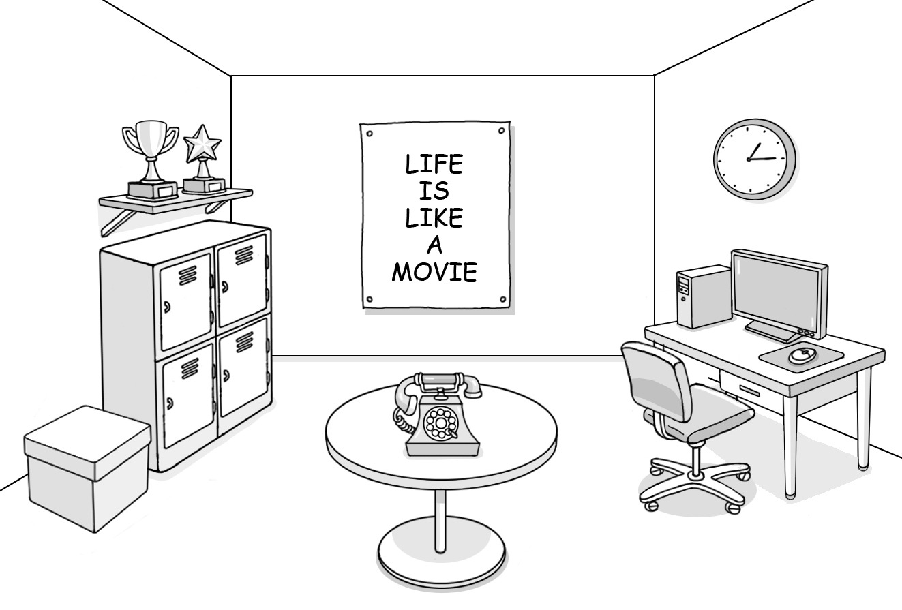

1. 다음을 듣고, 남자가 하는 말의 목적으로 가장 적절한 것을 고르시오.

① 아파트 입주민 회의 참여를 독려하려고
② 아파트 입주민을 위한 앱을 소개하려고
③ 아파트 관리비 납부 방법 변경을 알리려고
④ 아파트 시설 보수 공사 계획을 안내하려고
⑤ 아파트 단지 내 승강기 점검 일정을 공지하려고

2. 대화를 듣고, 여자의 의견으로 가장 적절한 것을 고르시오.

① 근력 운동은 관절 강화에 효과적이다.
② 스트레칭을 통해 자세 교정이 가능하다.
③ 몸 상태에 따라 운동량을 조절할 필요가 있다.
④ 규칙적인 운동은 스트레스 완화에 도움이 된다.
⑤ 바른 자세로 운동하는 것은 부상 위험을 줄인다.

3. 대화를 듣고, 두 사람의 관계를 가장 잘 나타낸 것을 고르시오.

① 음악 교사 – 학생
② 학생회장 – 졸업생
③ 진로 상담사 – 학부모
④ 콘서트 진행자 – 관객
⑤ 드럼 연주자 – 악기점 주인

4. 대화를 듣고, 그림에서 대화의 내용과 일치하지 않는 것을 고르시오.

5. 대화를 듣고, 남자가 여자에게 부탁한 일로 가장 적절한 것을 고르시오.

① 회의 참석하기
② 티켓 출력하기
③ 저녁 준비하기
④ 유니폼 가져오기
⑤ 자동차 수리하기

6. 대화를 듣고, 여자가 지불할 금액을 고르시오. [3점]

① $90
② $99
③ $108
④ $110
⑤ $120

7. 대화를 듣고, 여자가 Katie Wood의 책 사인회에 갈 수 없는 이유를 고르시오.

① 요리 수업을 들어야 해서
② 사촌 결혼식에 참석해야 해서
③ 중국어 시험공부를 해야 해서
④ 도서관 봉사 활동을 해야 해서
⑤ 에세이 쓰기 대회에 참가해야 해서

8. 대화를 듣고, Summer Computer Coding Program에 관해 언급되지 않은 것을 고르시오.

① 장소
② 운영 기간
③ 수강료
④ 수업 시간
⑤ 신청 마감일

9. Rescue the Animals에 관한 다음 내용을 듣고, 일치하지 않는 것을 고르시오.

① 시청 광장에서 열릴 것이다.
② 20개가 넘는 부스가 있을 것이다.
③ 구조된 동물들의 사진들이 전시될 것이다.
④ 기부자들에게 동물 모양의 열쇠고리를 줄 것이다.
⑤ 시청 옆 공터는 주차장으로 사용될 것이다.

10. 다음 표를 보면서 대화를 듣고, 두 사람이 선택할 음악 축제를 고르시오.

|  | Model | Date | Genre | Place | Pet-friendly |
| --- | --- | --- | --- | --- | --- |
| ① | A | April 24 | Rock | Union Square | O |
| ② | B | May 8 | Jazz | Limestone Island | O |
| ③ | C | May 22 | Rock | Olympic Stadium | X |
| ④ | D | June 5 | Jazz | Grand Park | O |
| ⑤ | E | June 12 | Classical | Fitzroy Garden | X |

11. 대화를 듣고, 남자의 마지막 말에 대한 여자의 응답으로 가장 적절한 것을 고르시오.

① I should be there by the end of this month.
② Working on the marketing team isn’t easy.
③ I have to go to Canada for a job interview.
④ They haven’t hired a new manager yet.
⑤ My family is going to travel with me.

12. 대화를 듣고, 여자의 마지막 말에 대한 남자의 응답으로 가장 적절한 것을 고르시오.

① Excuse me. I can’t find where my baggage is.
② Hurry up. We might miss the train to the airport.
③ Okay. I’d like to buy a ticket for the earlier flight.
④ Really? I’m sorry that there are no seats available today.
⑤ I see. I’ll let you know when we arrive at the destination.

13. 대화를 듣고, 남자의 마지막 말에 대한 여자의 응답으로 가장 적절한 것을 고르시오.

Woman:

① Right. That’s why I always check customers’ reviews.
② I’d rather not. It’s too late to get a refund for the laptop bag.
③ Thanks for your tip. I can save money by using a rental service.
④ That makes sense. I should read the reviews to make a decision.
⑤ Don’t worry. The item I ordered online will be delivered soon.

14. 대화를 듣고, 여자의 마지막 말에 대한 남자의 응답으로 가장 적절한 것을 고르시오. [3점]

Man:

① That’s true. I received an acceptance letter from the university.
② You’re right. I’ll think about the internship in a more positive way.
③ I agree. The experience helped me a lot in getting a job.
④ No problem. I can take the fashion class next semester.
⑤ Thank you. I’ve dreamed of working in your company.

15. 다음 상황 설명을 듣고, Ms. Brown이 Andrew에게 할 말로 가장 적절한 것을 고르시오. [3점]

Ms. Brown:

① How about reading Spanish books on a regular basis?
② I recommend you read more science books for yourself.
③ What do you think of taking an extra class to get a good score?
④ You’d better write book reports to improve your writing skills.
⑤ Why not try books with different themes to grow your vocabulary?

16. 여자가 하는 말의 주제로 가장 적절한 것은?

① materials used for writing before paper
② difficulties of processing natural materials
③ ways raw materials were stored in the past
④ writing materials that affected printing techniques
⑤ common characteristics of eco-friendly materials

17. 언급된 재료가 아닌 것은?

따라 답을 하시기 바랍니다.

① clay
② papyrus
③ stone
④ animal skins
⑤ silk

18. 다음 글의 목적으로 가장 적절한 것은?

Dear City Council Members, My name is Celina Evans and I am a lifelong Woodridge resident. The Woodridge Children’s Theater has been the pride of our community since 1975. My daughter Katie has been participating in the theater’s activities for six years. The theater has meant so much to so many in our community. However, I have been made aware that you are considering cutting the budget of the theater. The experiences and life lessons children gain at the theater are invaluable. Not only do kids learn about the arts there, but they also learn skills that will last for a lifetime. To reduce funding would be a huge loss to future generations and thus I strongly object to it. Thank you for your consideration in this matter. Sincerely, Celina Evans

19. 다음 글에 드러난 ‘I’의 심경 변화로 가장 적절한 것은?

The day for my teaching evaluation arrived. The principal was present to grade my teaching. My heart pounded heavily. I said a little prayer quietly before stepping into the classroom. As I entered the classroom, the tense atmosphere turned into wild laughter. I stood at the front of the classroom wearing my funny dress instead of my formal work clothes, which helped me to get the students’ attention. I took a deep breath and started the language activity with a catchy song that students love. Soon, the magic took off and all the students were blown away. When the class ended, all the students and even the principal started clapping. The class was a success! All my time and effort had finally paid off.

20. 다음 글에서 필자가 주장하는 바로 가장 적절한 것은?

More often than not, modern parents are paralyzed by the fear that they will no longer be liked or even loved by their children if they scold them for any reason. They want their children’s friendship above all, and are willing to sacrifice respect to get it. This is not good. A child will have many friends, but only two parents ― if that ― and parents are more, not less, than friends. Friends have very limited authority to correct. Every parent therefore needs to learn to tolerate the momentary anger or even hatred directed toward them by their children, after necessary corrective action has been taken, as the capacity of children to perceive or care about long-term consequences is very limited. Parents are the judges of society. They teach children how to behave so that other people will be able to interact meaningfully and productively with them.

21. 밑줄 친 the mind’s eye is blind가 다음 글에서 의미하는 바로 가장 적절한 것은? [3점]

All any neuron in the brain ever “sees” is that some change occurred in the firing patterns of its upstream peers. It cannot tell whether such change is caused by an external disturbance or by the brain’s constant self-organized activity. Thus, neurons located in networks of other neurons do not “know” what the brain’s sensors are sensing; they simply respond to their upstream inputs. In other words, the neurons have no way of relating or comparing their spikes to anything else because they only receive retinal correspondences or processed “representations” of the sensory input. But establishing correspondences without knowing the rules by which those correspondences are constructed is like comparing Mansi words with Khanty words when we understand neither language. Only after we have defined the vocabulary of one language can we understand the corresponding meaning of words in the other. Similarly, without further information, sensory neurons can attach no meaning whatsoever to their spikes. Put simply, the mind’s eye is blind.

22. 다음 글의 요지로 가장 적절한 것은?

The way reduced prices are written during a sale will greatly affect people’s attitude toward the products (and their likelihood of purchasing them). If the sale prices are easy to understand using percentages (for example, “-50%”) or with the new prices already calculated (for example, “now only $20”), shoppers will react in an automatic and positive fashion. However, if it is necessary for them to do complex mental calculations (for example, if a $27.50 product is advertised at 12% off), they will switch to a more analytical style of thinking. This results in more attention spent on the calculation, and subsequently on the merits of the product. No longer feeling spontaneous, shoppers will start questioning whether it is actually a good deal or not, whether they really need another pair of shoes, etc. The more cognitive effort is demanded from shoppers, the more of a negative and suspicious reaction will be evoked, and the chances of making a sale diminish.

23. 다음 글의 주제로 가장 적절한 것은?

Early astronomers saw and learned more from eclipses and other forms of shadow than from direct observation. In Galileo’s time, the empiricist’s insistence on direct observation as the only legitimate way of knowing limited what could be learned about the cosmos, and the medievalist allowance for extraperceptual insights had nothing to contribute to what we would consider scientific inquiry. Galileo’s breakthroughs came in part from his understanding of how to use shadows to extend his powers of observation. At the time he trained his telescope on Venus, it was believed the planet shone with its own light and moved in an orbit independent of the sun. Galileo saw that the planet was in partial shadow as it went through its phases, and thus had to be a dark body. He also realized from the logic of the shadow that Venus orbited the sun, since all phases from new to full could be observed from earth. The end of the Ptolemaic system came quickly thereafter, a shadow thus shedding light on the ordering of the cosmos.

24. 다음 글의 제목으로 가장 적절한 것은?

Moral philosophy textbooks often proclaim that we can discern if a claim is ethical by attending to the use of the words “is” and “ought.” On this suggestion, the claim “You ought to keep your promises,” because it uses “ought,” is ethical. “An atom is small,” because it uses “is,” is nonethical. Yet, despite being commonly invoked, this is-ought test is seriously deficient. Some is-statements have ethical content and some ought-statements do not. For example, consider the claims “Murder is wrong” and “Friendship is good.” These claims obviously have ethical content. Whatever the is-ought test is tracking, these claims clearly fall on the ought side of that divide. Yet they both use “is.” Similarly, consider the claim “The train ought to arrive in an hour.” This statement is clearly nonethical, the use of “ought” notwithstanding. There is an important distinction between ethical and nonethical claims. But we can’t simply rely on “is” and “ought” to make it. Instead we need to attend to the substance of the claim.

25. 다음 표의 내용과 일치하지 않는 것은?

Perceived and Actual Food Waste in Households by Country, 2017-2018

| Country | Perceived food waste (%) (A) | Actual food waste (%) (B) | Gap (B-A) |
| --- | --- | --- | --- |
| U.S. | 15 | 24 | 9 |
| Canada | 10 | 21 | 11 |
| Poland | 10 | 12 | 2 |
| Denmark | 10 | 4 | -6 |
| Mexico | 6 | 13 | 7 |
| Germany | 6 | 12 | 6 |
| Switzerland | 5 | 18 | 13 |
| Russia | 5 | 6 | 1 |

26. Donald Griffin에 관한 다음 글의 내용과 일치하지 않는 것은?

Donald Griffin was an American biophysicist and animal behaviourist known for his research in animal navigation, acoustic orientation, and sensory biophysics. During his childhood, he was influenced by his uncle, who was a Harvard professor of biology. Griffin received a Ph.D. in zoology from Harvard University in 1942. He demonstrated that bats emit high-frequency sounds with which they can locate objects as small as flying insects. In 1965, he became a professor at Rockefeller University in New York and a research zoologist for the New York Zoological Society. After he retired from Rockefeller University in 1986, he didn’t stop his research: he continued to present papers at national and international meetings. In the late 1970s Griffin argued that animals might possess the ability to think and reason. Although his claim sparked much controversy in the science community, there is no question that he radically opened up the field of animal cognition.

27. Leather Craft Class에 관한 다음 안내문의 내용과 일치하지 않는 것은?

 Leather Craft Class Learn how to make leather goods in our hands-on class! The class is designed only for beginners.
When: Saturday, May 22, 2021, 2 p.m. - 5 p.m.
Where: Culture Room, Mayfair Museum
Participation Fee: $50 - This includes leather, tools and snacks. - Participants take what they make on the day.
Note - Each participant must choose one leather item to make among a wallet, a pencil case or a book cover. - Spaces are limited, so registration in advance is required. Visit www.mayfairleathercraft.com for more information.

28. Handwriting Competition에 관한 다음 안내문의 내용과 일치하는 것은?

 Handwriting Competition “Handwriting matters, no matter how old you are!”
No Entry Fee
Submission Deadline: 6 p.m. on May 31, 2021
Submit your work to Room No. 205, 2nd floor, City Hall. Age Groups
Group A (ages 6-8) 
Group B (ages 9-11)
Group C (ages 12-14) 
Group D (ages 15-17)
Group E (anyone over 17) Prizes Two winners in each group (First Place: $50, Second Place: $30) Details
Entrants will be asked to copy out a poem in their neatest handwriting.
The poem must be copied on plain A4 paper without the aid of lines.
All entries must be written in blue or black ink. For additional information, email us at hwriting@citycompetition.org.

29. 다음 글의 밑줄 친 부분 중, 어법상 틀린 것은? [3점]

The world’s first complex writing form, Sumerian cuneiform, followed an evolutionary path, moving around 3500 BCE from pictographic to ideographic representations, from the depiction of objects to that of abstract notions. Sumerian cuneiform was a linear writing system, its symbols usually set in columns, read from top to bottom and from left to right. This regimentation was a form of abstraction: the world is not a linear place, and objects do not organize themselves horizontally or vertically in real life. Early rock paintings, thought to have been created for ritual purposes, were possibly shaped and organized to follow the walls of the cave, or the desires of the painters, who may have organized them symbolically, or artistically, or even randomly. Yet after cuneiform, virtually every form of script that has emerged has been set out in rows with a clear beginning and endpoint. So uniformly is this expectation, indeed, that the odd exception is noteworthy, and generally established for a specific purpose.

30. 다음 글의 밑줄 친 부분 중, 문맥상 낱말의 쓰임이 적절하지 않은 것은?

It’s likely that for a very long time people managed to survive with draped animal pelts and then began roughly sewing these together. Ultimately, though, the advantages of using woven fabric for clothing would have become obvious. A fur pelt offers inadequate thermal protection if someone is sitting still, but once on the move or in strong winds, this is less true, because pelts aren’t shaped close to the body. The more air gets between the body and the clothing, the less effective it is at trapping an insulating layer of air close to the skin. In fact, the insulating properties of clothing decrease very much when walking quickly. Clothing also needs to be breathable, because damp clothes are bad at keeping the wearer warm and become very heavy. Woven fabrics are more breathable than fur and, when specifically tailored to the body, make excellent internal layers, preventing cold air from getting direct access to the skin’s surface. Thus the ability to create woven clothing would have offered material advantages to our early ancestors once they had left Africa for cooler areas.

31. 다음 빈칸에 들어갈 말로 가장 적절한 것을 고르시오.

Contrary to popular opinion, woodpeckers don’t restrict themselves to rotten trees, and they often start construction in healthy trees. Just like us, woodpeckers want the place where they bring up their families to be solid and durable. Even though the birds are well equipped to hammer away at healthy wood, it would be too much for them to complete the job all at once. And that’s why they take a months-long break after making a hole that may be only an inch or two deep, hoping fungi will pitch in. As far as the fungi are concerned, this is the invitation they have been waiting for, because usually they can’t get past the bark. In this case, the fungi quickly move into the opening and begin to break down the wood. What the tree sees as a coordinated attack, the woodpecker sees as a(n) division of labor. After a while, the wood fibers are so soft that it’s much easier for the woodpecker to enlarge the hole.

32. 다음 빈칸에 들어갈 말로 가장 적절한 것을 고르시오.

The urban environment is generally designed so as not to make contact with our skin. We do not push through bushes on our way to school or work. Roads and sidewalks are kept clear of obstacles. Only once in a while are we reminded of the materiality of the environment, as when we feel the brush of an unexpected tree branch or nearly fall over a curb. Most of our time is not even spent outside. “Outside” is often just a space we go through to get “inside.” Our time is largely spent indoors, where architecture and design collude to provide an environment as lacking as possible in tactile stimulation. In the modern university or office building, floors and walls are flat and smooth, corridors are clear, the air is still, the temperature is neutral, and elevators carry one effortlessly from one level to another. It is commonly assumed that we are best served by our tactile environment when we scarcely notice its presence.

33. 다음 빈칸에 들어갈 말로 가장 적절한 것을 고르시오. [3점]

The ideal sound quality varies a lot in step with technological and cultural changes. Consider, for instance, the development of new digital audio formats such as MP3 and AAC. Various media feed us daily with data-compressed audio, and some people rarely experience CD-quality (that is, technical quality) audio. This tendency could lead to a new generation of listeners with other sound quality preferences. Research by Stanford University professor Jonathan Berger adds fuel to this thesis. Berger tested first-year university students’ preferences for MP3s annually for ten years. He reports that each year more and more students come to prefer MP3s to CD-quality audio. These findings indicate that listeners gradually become accustomed to data-compressed formats and change their listening preferences accordingly. The point is that while technical improvements strive toward increased sound quality in a technical sense (e.g., higher resolution and greater bit rate), listeners’ expectations do not necessarily follow the same path. As a result, “improved” technical digital sound quality may in some cases lead to a(n) decrease in the perceptual worth of the sound.

34. 다음 빈칸에 들어갈 말로 가장 적절한 것을 고르시오. [3점]

Science shows that the size of a memory and our perception of time are coupled like gear teeth in a bicycle chain. Rich and novel experiences, like the recollections of the summers of our youth, have lots of new information associated with them. During those hot days, we learned how to swim or traveled to new places or mastered riding a bike without training wheels. The days went by slowly with those adventures. Yet, our adult lives have less novelty and newness, and are full of repeated tasks such as commuting or sending email or doing paperwork. The associated information filed for those chores is smaller, and there is less new footage for the recall part of the brain to draw upon. Our brain interprets these days filled with boring events as shorter, so summers swiftly speed by. Despite our desire for better clocks, our measuring stick of time isn’t fixed. We don’t measure time with seconds, like our clocks, but by our experiences. For us, time can slow down or time can fly.

35. 다음 글에서 전체 흐름과 관계 없는 문장은?

Research has shown that individuals — especially those who have benefited from a particular system — are prone to support and rationalize the status quo, even if there are clear problems.

36. 주어진 글 다음에 이어질 글의 순서로 가장 적절한 것을 고르시오.

Forget-me-nots can conquer new territory because they have an army of tiny allies: ants. It’s not that ants are particularly fond of flowers ― at least, they are not attracted by their aesthetic qualities. Ants are motivated by their desire to eat them, and their interest is triggered when forget-me-nots form their seeds. The seeds are designed to make an ant’s mouth water, for attached to the outside is a structure called an elaiosome, which looks like a tiny bit of cake. This fat-and sugar-rich treat is like chips and chocolate to an ant. The tiny creatures quickly carry the seeds back to their nest, where the colony is waiting eagerly in the tunnels for the calorie boost. The tasty treat is bitten off and the seed itself is discarded. Along come the trash collectors in the form of worker ants, which dispose of the seeds in the neighborhood ― carrying them up to 200 feet away from home base. Wild strawberries and other plants also benefit from this distribution service: ants are nature’s gardeners, as it were.

37. 주어진 글 다음에 이어질 글의 순서로 가장 적절한 것을 고르시오. [3점]

Birds use many techniques to save energy when they are flying, most of which are tricks to stay aloft without flapping. Riding updrafts to gain altitude is one of the most conspicuous. Bare ground such as fields or parking lots absorbs more heat from the sun, and as air near the ground warms up it rises. This creates a column of rising warm air ― a thermal ― reaching hundreds or even thousands of feet high. A soaring bird can sense the air movement and fly in circles to stay in the column. It simply fans its wings and tail and lets the rising air carry it up like an elevator. When it reaches the top, the bird bends its wings and glides in the direction it wants to travel, searching for the next thermal. All soaring birds take advantage of thermals, but some species, like the Broad-winged Hawk, are specialists and in the right conditions can travel hundreds of miles with almost no flapping.

38. 글의 흐름으로 보아, 주어진 문장이 들어가기에 가장 적절한 곳을 고르시오.

In the classical period of European music, much musical material was de facto considered common property. When Antonio Vivaldi presented in Venice his opera Rosmira fedele, the score was actually a pastiche in which, among his own ideas, musicologists later identified ideas by George Frederic Handel, Giovanni Battista Pergolesi and Johann Adolph Hasse, among others. As far as recycling of segments of music initially written for other occasions into new pieces is concerned, it needs to be observed how today composers are discouraged from doing so for a number of reasons. A practical one is that each new piece is sure to remain available, in score or as an audio file. In the 18th century, on the contrary, once the particular occasion for performing a new piece was over, it became almost impossible to ever hear it again. Under such circumstances, recycling previously composed music was the only way to make it more durable. And if new pieces also contained ideas from other composers, that would re-enforce European musical traditions by increasing the circulation of melodies and harmonic patterns people loved to hear.

39. 글의 흐름으로 보아, 주어진 문장이 들어가기에 가장 적절한 곳을 고르시오. [3점]

The era of unicellular life lasted for about three and half billion years, dominating most of the Earth’s history. But around half a billion years ago, during the Cambrian explosion, a diversity of multicellular life including major animal groups emerged in short period. Similarly, calculus was the Cambrian explosion for mathematics. Once it arrived, an amazing diversity of mathematical fields began to evolve. Their lineage is visible in their calculus-based names, in adjectives like differential and integral and analytic, as in differential geometry, integral equations, and analytic number theory. These advanced branches of mathematics are like the many branches and species of multicellular life. In this analogy, the microbes of mathematics are the earliest topics: numbers, shapes, and word problems. Like unicellular organisms, they dominated the mathematical scene for most of its history. But after the Cambrian explosion of calculus three hundred and fifty years ago, new mathematical life forms began to flourish, and they altered the landscape around them.

40. 다음 글의 내용을 한 문장으로 요약하고자 한다. 빈칸 (A), (B)에 들어갈 말로 가장 적절한 것은?

There is a key difference between how humans and other intelligent animals learn. In a very telling experiment done by evolutionary psychologist Mike Tomasello at the Max Planck Institute in Germany, a puzzle box containing a treat is given to a human toddler and a chimpanzee. Neither is able to get the treat out. He then demonstrates a multistep process of pulling and pushing pegs that eventually releases the treat. Among the motions, he includes an obviously nonsensical step ― patting his head three times before the last step. Both the toddler and the chimp are able to copy his actions and get the treat, but only the toddler includes the head-patting step. The chimp, seeing this is not relevant to getting the treat, omits it from the routine. The human, however, unquestioningly copies all the steps. The toddler trusts the human teaching her to have a reason for each step in this situation, and so she overcopies. In fact, the less clear the goal of the procedure, the more carefully and precisely the human child will imitate even irrelevant steps. According to the experiment above, when given multiple steps to get a treat, toddlers complete every step of the procedure unlike chimpanzees, because toddlers do not doubt the relevance of each step.

41. 윗글의 제목으로 가장 적절한 것은?

When we place a given amount of liquid in a container and then close it, we observe that the amount of liquid at first drops slightly but eventually becomes constant. The decrease occurs because there is a transfer of molecules from the liquid to the vapor phase. However, as the number of vapor molecules increases, it becomes more and more likely that some of them will return to the liquid. The process by which vapor molecules form a liquid is called condensation. Eventually, the same number of molecules are leaving the liquid as are returning to it: the rate of condensation equals the rate of evaporation. At this point no further change occurs in the amounts of liquid or vapor, because the two opposite processes exactly balance each other; the system is at equilibrium. Note that this system is highly static on the molecular level. Molecules are constantly escaping from and entering the liquid. However, there is no net change because the two processes just balance each other. As an analogy, consider two island cities connected by a bridge. Suppose the traffic flow on the bridge is the same in both directions. There is motion — we can see the cars traveling across the bridge — but the number of cars in each city is not changing because an equal number enter and leave each one. The result is no net change in the number of autos in each city: an equilibrium exists.

42. 밑줄 친 낱말 중에서 문맥상 낱말의 쓰임이 적절하지 않은 것은? [3점]

When we place a given amount of liquid in a container and then close it, we observe that the amount of liquid at first drops slightly but eventually becomes constant. The decrease occurs because there is a transfer of molecules from the liquid to the vapor phase. However, as the number of vapor molecules increases, it becomes more and more likely that some of them will return to the liquid. The process by which vapor molecules form a liquid is called condensation. Eventually, the same number of molecules are leaving the liquid as are returning to it: the rate of condensation equals the rate of evaporation. At this point no further change occurs in the amounts of liquid or vapor, because the two opposite processes exactly balance each other; the system is at equilibrium. Note that this system is highly static on the molecular level. Molecules are constantly escaping from and entering the liquid. However, there is no net change because the two processes just balance each other. As an analogy, consider two island cities connected by a bridge. Suppose the traffic flow on the bridge is the same in both directions. There is motion — we can see the cars traveling across the bridge — but the number of cars in each city is not changing because an equal number enter and leave each one. The result is no net change in the number of autos in each city: an equilibrium exists.

43. 주어진 글에 이어질 내용을 순서에 맞게 배열한 것으로 가장 적절한 것은?

There once was a young blind girl named Cheryl, who lived with her parents and older sister. Her family tried their best to keep her happy despite their financial struggles. But her sister knew Cheryl still felt a sense of emptiness. Cheryl had a passion for music and sang beautifully, yearning to share her gift with more than just her family. But she thought her dream would not come true.

 Cheryl’s sister promised herself that one day she would make Cheryl’s dream come true. She soon found an opportunity to do so. At the end of the school’s annual festival, there was going to be a grand singing competition for students’ families. Cheryl’s sister applied for it on Cheryl’s behalf, and she was accepted. She went back home and broke the news to Cheryl. Thanks to her sister, Cheryl got the chance to sing in the festival. Cheryl was overjoyed and began to practice for her performance. The day of the festival came, and Cheryl arrived at the concert hall with her family. Cheryl could not see, but she could sense the energy of the packed hall. Finally it was her turn to take her position on stage. Terrified, she hesitated to begin her song. But after everything her sister had done to give her this chance, she knew she had to go on. When Cheryl finished singing, the hall was silent for a moment before exploding into applause. She went back home, overwhelmed that her dream was now fulfilled. To add to it all, her sister had recorded the whole performance for her to listen to in the future. Whenever she needed some cheering up, Cheryl listened to the recording, and the thunderous applause acted as a balm for her soul.

44. 밑줄 친 낱말 중에서 가리키는 대상이 나머지 넷과 다른 것은?

There once was a young blind girl named Cheryl, who lived with her parents and older sister. Her family tried their best to keep her happy despite their financial struggles. But her sister knew Cheryl still felt a sense of emptiness. Cheryl had a passion for music and sang beautifully, yearning to share her gift with more than just her family. But she thought her dream would not come true.

 Cheryl’s sister promised herself that one day she would make Cheryl’s dream come true. She soon found an opportunity to do so. At the end of the school’s annual festival, there was going to be a grand singing competition for students’ families. Cheryl’s sister applied for it on Cheryl’s behalf, and she was accepted. She went back home and broke the news to Cheryl. Thanks to her sister, Cheryl got the chance to sing in the festival. Cheryl was overjoyed and began to practice for her performance. The day of the festival came, and Cheryl arrived at the concert hall with her family. Cheryl could not see, but she could sense the energy of the packed hall. Finally it was her turn to take her position on stage. Terrified, she hesitated to begin her song. But after everything her sister had done to give her this chance, she knew she had to go on. When Cheryl finished singing, the hall was silent for a moment before exploding into applause. She went back home, overwhelmed that her dream was now fulfilled. To add to it all, her sister had recorded the whole performance for her to listen to in the future. Whenever she needed some cheering up, Cheryl listened to the recording, and the thunderous applause acted as a balm for her soul.

45. 윗글의 Cheryl에 관한 내용으로 적절하지 않은 것은?

There once was a young blind girl named Cheryl, who lived with her parents and older sister. Her family tried their best to keep her happy despite their financial struggles. But her sister knew Cheryl still felt a sense of emptiness. Cheryl had a passion for music and sang beautifully, yearning to share her gift with more than just her family. But she thought her dream would not come true.

 Cheryl’s sister promised herself that one day she would make Cheryl’s dream come true. She soon found an opportunity to do so. At the end of the school’s annual festival, there was going to be a grand singing competition for students’ families. Cheryl’s sister applied for it on Cheryl’s behalf, and she was accepted. She went back home and broke the news to Cheryl. Thanks to her sister, Cheryl got the chance to sing in the festival. Cheryl was overjoyed and began to practice for her performance. The day of the festival came, and Cheryl arrived at the concert hall with her family. Cheryl could not see, but she could sense the energy of the packed hall. Finally it was her turn to take her position on stage. Terrified, she hesitated to begin her song. But after everything her sister had done to give her this chance, she knew she had to go on. When Cheryl finished singing, the hall was silent for a moment before exploding into applause. She went back home, overwhelmed that her dream was now fulfilled. To add to it all, her sister had recorded the whole performance for her to listen to in the future. Whenever she needed some cheering up, Cheryl listened to the recording, and the thunderous applause acted as a balm for her soul.

