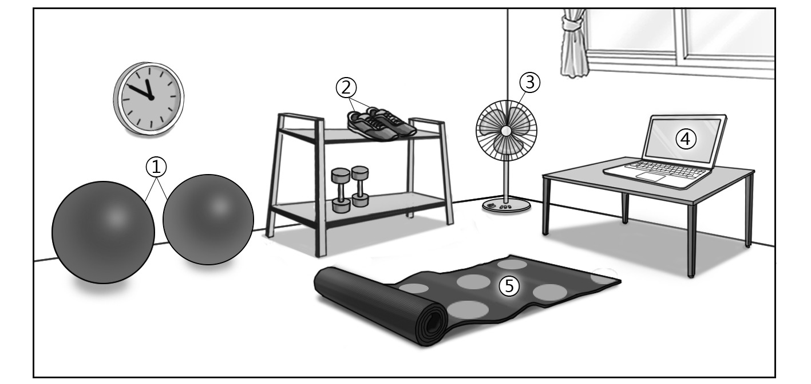
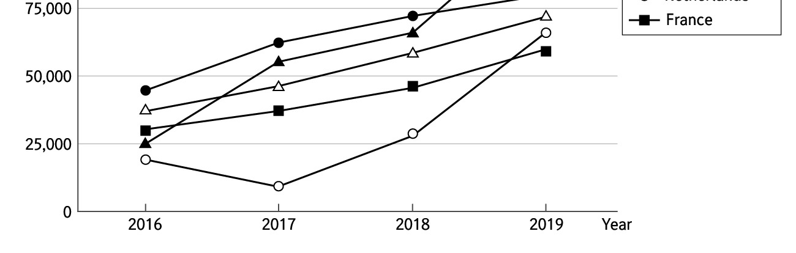

1. 다음을 듣고, 남자가 하는 말의 목적으로 가장 적절한 것을 고르시오.

① 학교 정원 관리 봉사자를 모집하려고
② 식물원 체험 학습 일정을 공지하려고
③ 봉사 활동 확인서 신청 방법을 안내하려고
④ 학교 정원에 심을 모종 기부를 부탁하려고
⑤ 정원의 잡초를 제거하는 요령을 설명하려고

2. 대화를 듣고, 여자의 의견으로 가장 적절한 것을 고르시오.

① 자신의 체력 수준에 맞게 운동 계획을 세우는 것이 좋다.
② 과도한 운동은 심리적 불안정을 초래할 수 있다.
③ 운동 일지 작성이 체력 관리에 도움이 된다.
④ 근력 운동과 유산소 운동을 병행하는 것이 유익하다.
⑤ 운동 중 부상 예방을 위해 적절한 장비를 착용해야 한다.

3. 대화를 듣고, 두 사람의 관계를 가장 잘 나타낸 것을 고르시오.

① 기자 - 농업 연구원
② 콜센터 직원 - 고객
③ 방송 연출가 - 작가
④ 홈 쇼핑 쇼 호스트 - 농부
⑤ 식료품 가게 직원 - 조리사

4. 대화를 듣고, 그림에서 대화의 내용과 일치하지 않는 것을 고르시오.

5. 대화를 듣고, 남자가 여자를 위해 할 일로 가장 적절한 것을 고르시오.

① 이미지 검색하기
② 발표 대본 검토하기
③ 면접 예상 질문 만들기
④ 포트폴리오 우편 발송하기
⑤ 발표 연습 영상 촬영하기

6. 대화를 듣고, 여자가 지불할 금액을 고르시오.

① $30
② $32
③ $35
④ $39
⑤ $40

7. 대화를 듣고, 남자가 연구 주제를 변경한 이유를 고르시오.

① 관련 데이터를 찾기 어려워서
② 지도 교수를 구하지 못해서
③ 희망하는 진로가 바뀌어서
④ 연구 지원금을 확보하지 못해서
⑤ 다른 학생과 연구 주제가 겹쳐서

8. 대화를 듣고, Mobile Throwing Championship에 관해 언급되지 않은 것을 고르시오.

① 최초 개최 연도
② 개최 목적
③ 참가비
④ 우승 상품
⑤ 심사 기준

9. 다음 표를 보면서 대화를 듣고, 두 사람이 주문할 휴대용 사진 인화기를 고르시오.

① A $139 plug-in ☓ 20
② B $149 built-in battery ◯ 20
③ C $169 built-in battery ◯ 40
④ D $189 built-in battery ☓ 40
⑤ E $219 plug-in ◯ 30

10. 2021 International Violin Making Competition에 관한 다음 내용을 듣고, 일치하지 않는 것을 고르시오.

① 참가 신청서에 바이올린 사진을 첨부하여 제출해야 한다.
② 5월 1일까지 등록하면 등록비가 할인된다.
③ 바이올린을 우편으로 제출할 수 있다.
④ 유명 바이올린 연주자가 심사 위원에 포함된다.
⑤ 우승자는 10,000유로를 받는다.

11. 대화를 듣고, 남자의 마지막 말에 대한 여자의 응답으로 가장 적절한 것을 고르시오.

① Why don’t you put off visiting the doctor?
② Let’s ask David if we can reschedule.
③ How about inviting David to our club?
④ I’ll go to the bookstore without you both.
⑤ We should find a place for today’s meeting.

12. 대화를 듣고, 여자의 마지막 말에 대한 남자의 응답으로 가장 적절한 것을 고르시오.

① No worries. I’ve already got your file.
② Right. There’s no assignment today.
③ Sorry. Your file has been deleted.
④ Yes. You can send it to me by email.
⑤ Sure. Try downloading it from our website.

13. 대화를 듣고, 남자의 마지막 말에 대한 여자의 응답으로 가장 적절한 것을 고르시오. [3점]

Woman:
① I’ll find out who directed them for you.
② I’ll give you a list of his best films then.
③ That’s why I prefer watching popular movies.
④ They didn’t leave a lasting impression on me.
⑤ You shouldn’t worry about getting bad reviews.

14. 대화를 듣고, 여자의 마지막 말에 대한 남자의 응답으로 가장 적절한 것을 고르시오. [3점]

Man:
① I see. I’ll take a break more often to increase concentration.
② Okay. I should avoid playing games during study breaks.
③ Certainly. You’ll enjoy playing mobile games, too.
④ All right. I’d rather study alone to prepare for my exam.
⑤ Interesting. I thought mobile games do more harm than good.

15. 다음 상황 설명을 듣고, Nancy가 Jake에게 할 말로 가장 적절한 것을 고르시오. [3점]

Nancy:
① We’d rather stay with our original design.
② Why don’t we design the poster by ourselves?
③ Don’t forget to apply for the contest this time.
④ How about going outdoors to take photos for a change?
⑤ We should ask your friends if it’s okay to use their photo.

16. 여자가 하는 말의 주제로 가장 적절한 것은?

① natural materials traditionally used for skincare
② how to store natural skincare products properly
③ differences in the cultural perception of skincare
④ ways to prevent skin troubles caused by facial masks
⑤ examples of natural substances with harmful properties

17. 언급된 나라가 아닌 것은?

따라 답을 하시기 바랍니다.

① India
② Iran
③ Poland
④ China
⑤ Greece

18. 다음 글의 목적으로 가장 적절한 것은?

I’m Maggie Morgan, a long-time fan of the Wakefield Community Theatre. I’m well aware that in this difficult economy, organisations such as the Wakefield Community Theatre are facing financial difficulties and therefore an increase in ticket prices is inevitable. But in my opinion, a 50 percent increase to the price of individual tickets seems totally unreasonable. It would mean that ordinary residents like myself will have fewer opportunities to enjoy a quality drama performance. Pricing tickets out of the range of local residents is not a good option, because it’ll hurt your organisation in years to come. I’m sure there will be other ways to get financial support instead of raising ticket prices so much. I hope to hear from you soon on this matter.

19. 다음 글에 드러난 Tavil의 심경으로 가장 적절한 것은?

Tavil feels he understands this buried world and he is ready to leave. But when he turns, the hole he’d climbed through no longer exists. In its place is a smooth wall of white tile, a continuation of the unending pattern throughout the tunnel. The broken scraps of debris that had littered the base of the hole are gone as well. And this is when he feels the horrifying truth of where he is: so deep underground that the climb down made the muscles in his legs and arms tremble. He is trapped. Brutally so. As if in a grave, in a tomb. Frightened, he claws at the tiles. He screams, not caring if someone hears; hoping they do and will cast him out.

20. 다음 글에서 필자가 주장하는 바로 가장 적절한 것은?

Your brain doesn’t recognize don’t. No matter what I say, don’t think of a giraffe with brown spots on it. No matter what I say, don’t think of a clear glass vase with fresh red roses in it. What happens? It’s automatic, isn’t it? Your brain goes ahead and creates the picture all by itself. Your words ― whether you think, say, read, or hear them ― are a direct command to create. The more direct the order, the more diligent the response. Trickily, if you say you don’t want to lose your temper, your brain doesn’t recognize don’t and sees it as a royal command to get you to lose your temper. If say you don’t want to spill your drink, it’s as good as an instruction to tip the contents. Change your words to support you. Create affirmations that suit you. Think and say precisely what you desire rather than what you don’t want.

21. 밑줄 친 innovation is a delicate and vulnerable flower, easily crushed underfoot이 다음 글에서 의미하는 바로 가장 적절한 것은?

Perhaps the most puzzling aspect of innovation is how unpopular it is, for all the lip service we pay to it. Despite the abundant evidence that it has transformed almost everybody’s lives for the better in innumerable ways, the kneejerk reaction of most people to something new is often worry, sometimes even disgust. Unless it is of obvious use to ourselves, we tend to imagine the bad consequences that might occur far more than the good ones. And we throw obstacles in the way of innovators, on behalf of those with a vested interest in the status quo: investors, managers and employees alike. History shows that innovation is a delicate and vulnerable flower, easily crushed underfoot, but quick to regrow if conditions allow.

22. 다음 글의 요지로 가장 적절한 것은?

The immense improvement in the yield of farming during the twentieth century, as a result of innovations in mechanization, fertilizer, new varieties, pesticides and genetic engineering, has banished famine from the face of the planet almost entirely, and drastically reduced malnutrition, even while the human population has continued to expand. Few predicted this, yet many are concerned that this improvement has come at the expense of nature. In fact the evidence is strong that the opposite is the case. Innovation in food production has spared land and forest from the plough, the cow and the axe on a grand scale by increasing the productivity of the land we do farm. It turns out that this ‘land sparing’ has been much better for biodiversity than land sharing would have been ― by which is meant growing crops at low yields in the hope that abundant wildlife lives in fields alongside crops.

23. 다음 글의 주제로 가장 적절한 것은? [3점]

More recently there have been attempts to argue that unpaid work is work because ‘it is an activity that combines labour with raw materials to produce goods and services with enhanced economic value’. Economists such as Duncan Ironmonger have attempted to impute a dollar value on volunteering to enable its ‘economic’ value to be counted. Yet despite this, unpaid work and volunteering still remain outside the defined economic framework of our capitalist system because capitalism has competition and financial reward as its cornerstones and volunteering does not. Having said that, it has been estimated that volunteering contributes about $42 billion a year to the Australian economy. Although attempts to quantify and qualify the financial importance of volunteering in supporting our economic structures and enhancing our social capital continue to be made, it is slow going. And while volunteering remains outside the GDP, its true value and importance is neglected. Governments continue to pay lip service to the importance of volunteering but ultimately deny it official recognition.

24. 다음 글의 제목으로 가장 적절한 것은?

Amazingly, many businesses evaluate their customer service strategy by the number of complaints they get. ‘We have very few complaints from our customers, so we don’t need customer service training at the moment.’ I am told this regularly when prospecting for new clients. Either that or, ‘The number of complaints has dramatically decreased this year and we are very pleased, it seems our customer service initiatives are working’. Companies using this type of measure are in denial. Although it is tempting to bury your head in the sand and believe no news is good news, trust me, if customers are not complaining to you, then they are complaining to other people or they are just never using your business again. The concerning thing is that customers who don’t complain there and then increasingly post their views on the Internet and through the social networking sites; they are no longer telling nine or so people but are probably telling thousands!

25. 다음 도표의 내용과 일치하지 않는 것은?

26. Waldemar Haffkine에 관한 다음 글의 내용과 일치하지 않는 것은?

Waldemar Haffkine was born on the 16th of March 1860 at Odessa in Russia. He graduated in the Science Faculty of Odessa University in 1884. In 1889, Haffkine went to Paris to work at the Pasteur Institute, and did research to prepare a vaccine against cholera. His initial work on developing a cholera vaccine was successful. After a series of animal trials, in 1892 he tested the cholera vaccine on himself, risking his own life. During the Indian cholera epidemic of 1893, at the invitation of the Government of India he went to Calcutta and introduced his vaccine. After initial criticism by the local medical bodies, it was widely accepted. Haffkine was appointed as the director of the Plague Laboratory in Bombay (now called the Haffkine Institute). After his retirement in 1914, he returned to France and occasionally wrote for medical journals. He revisited Odessa in 1927, but could not adapt to the tremendous changes after the revolution in the country of his birth. He moved to Switzerland in 1928 and remained there for the last two years of his life.

27. 2021 Multicultural Festival에 관한 다음 안내문의 내용과 일치하지 않는 것은?

 2021 Multicultural Festival The 2021 Multicultural Festival is where you can enjoy different cultures of the world in one place and at one time. All profits from the festival will be donated to local charities. Dates & Time: July 17 – 18, 1 p.m. – 6 p.m. Place: St. Nicholas Park Events Day 1 (July 17) Day 2 (July 18)
Traditional Dress Fashion Show
Global Music Concert
Hands-on Craft Making 
Mini Olympics
Cooking Class (Thai, Jamaican,
Workshops on Cultural Nigerian and more) Diversity Notices - Parking fee: $5 per day - Some events may be canceled depending on weather conditions. For more information, visit our website www.multiculture.org.

28. The 5th Avila Yoga Summer Camp에 관한 다음 안내문의 내용과 일치하는 것은?

The 5th Avila Yoga Summer Camp Do you want to reduce stress, relax your body and enjoy the outdoors? Don’t hesitate to join us! Who: All ages When & Where - Friday, July 23, 2 p.m. – 10 p.m. - Avila Beach campsite Participation Fee - $40 per person (dinner included) - Group discount offered to groups of 10 or more (5%) This camp includes - 15 classes for beginners. - 20 classes for experienced practitioners. - a range of therapies and meditation practices. Preparations - Wear comfortable clothes. - Bring your own yoga mat.

29. 다음 글의 밑줄 친 부분 중, 어법상 틀린 것은? [3점]

The idea that people selectively expose themselves to news content has been around for a long time, but it is even more important today with the fragmentation of audiences and the proliferation of choices. Selective exposure is a psychological concept that says people seek out information that conforms to their existing belief systems and avoid information that challenges those beliefs. In the past when there were few sources of news, people could either expose themselves to mainstream news — where they would likely see beliefs expressed counter to their own — or they could avoid news altogether. Now with so many types of news constantly available to a full range of niche audiences, people can easily find a source of news that consistently confirms their own personal set of beliefs. This leads to the possibility of creating many different small groups of people with each strongly believing they are correct and everyone else is wrong about how the world works.

30. 다음 글의 밑줄 친 부분 중, 문맥상 낱말의 쓰임이 적절하지 않은 것은?

Prior to the Industrial Revolution, the quantity of freight transported between nations was negligible by contemporary standards. For instance, during the Middle Ages, the totality of French imports via the Saint-Gothard Passage would not fill a freight train. The amount of freight transported by the Venetian fleet, which dominated Mediterranean trade, would not fill a modern container ship. The volume, but not the speed, of trade improved under mercantilism, notably for maritime transportation. In spite of all, distribution capacities were very limited and speeds slow. For example, a stagecoach going through the English countryside in the sixteenth century had an average speed of 2 miles per hour; moving one ton of cargo 30 miles inland in the United States by the late eighteenth century was as costly as moving it across the Atlantic. The inland transportation system was thus very limited. By the late eighteenth century, canal systems started to emerge in Europe. They permitted the large movements of bulk freight inland and expanded regional trade. Maritime and riverine transportation were consequently the outdated modes of the pre-industrial era.

31. 다음 빈칸에 들어갈 말로 가장 적절한 것을 고르시오. [3점]

Relatively undeveloped languages have no single word for plants. The lack of a term doesn’t mean they don’t perceive differences, and it doesn’t mean they don’t know the difference between spinach and a cactus; they just lack an all-encompassing term with which to refer to plants. We see cases like this in our own language. For example, English lacks a single basic term to refer to edible mushrooms. We also lack a term for all the people you would have to notify if you were going into the hospital for three weeks. These might include close relatives, friends, your employer, the newspaper delivery person, and anyone you had appointments with during that period. The lack of a term doesn’t mean you don’t understand the concept; it simply means that the category isn’t reflected in our language. This could be because a need for it hasn’t been so pressing that a word needed to be coined.

32. 다음 빈칸에 들어갈 말로 가장 적절한 것을 고르시오. [3점]

Psychologists and neuroscientists warn that when we rely on technology to perform tasks such as navigation for us, our awareness of our physical environment fades as we become immersed instead in an abstract, computerized world. Studies show that we tend to place too much faith in the accuracy of information from computer monitors, and to ignore or discount information from our own eyes and ears, an effect that has caused pilots to crash planes and GPS-following tourists to drive into the sea. A team led by the British neuroscientist Hugo Spiers found in 2017 that areas of the brain normally involved in navigation just don’t engage when people use GPS. “When we have technology telling us which way to go,” said Spiers, “these parts of the brain simply don’t respond to the street network. In that sense our brain has switched off its interest in the streets around us.”

33. 다음 빈칸에 들어갈 말로 가장 적절한 것을 고르시오. [3점]

The conventional view of what the state should do to foster innovation is simple: it just needs to get out of the way. At best, governments merely facilitate the economic dynamism of the private sector; at worst, their lumbering, heavy-handed, and bureaucratic institutions actively inhibit it. The fast-moving, risk-loving, and pioneering private sector, by contrast, is what really drives the type of innovation that creates economic growth. According to this view, the secret behind Silicon Valley lies in its entrepreneurs and venture capitalists. The state can intervene in the economy ― but only to fix market failures or level the playing field. It can regulate the private sector in order to account for the external costs companies may impose on the public, such as pollution, and it can invest in public goods, such as basic scientific research or the development of drugs with little market potential. It should not, however, directly attempt to create and shape markets.

34. 다음 빈칸에 들어갈 말로 가장 적절한 것을 고르시오. [3점]

The designer in the Age of Algorithms poses a threat to American jurisprudence because the algorithm is only as good as the designer’s understanding of the intended use of the algorithm. The person designing the algorithm may be an excellent software engineer, but without the knowledge of all the factors that need to go into an algorithmic process, the engineer could unknowingly produce an algorithm whose decisions are at best incomplete and at worst discriminatory and unfair. Compounding the problem, an algorithm design firm might be under contract to design algorithms for a wide range of uses, from determining which patients awaiting transplants are chosen to receive organs, to which criminals facing sentencing should be given probation or the maximum sentence. That firm is not going to be staffed with subject matter experts who know what questions each algorithm needs to address, what databases the algorithm should use to collect its data, and what pitfalls the algorithm needs to avoid in churning out decisions.

35. 다음 글에서 전체 흐름과 관계 없는 문장은?

While we believe we hold the power to raise our children, the reality is that our children hold the power to raise us into the parents they need us to become.

36. 주어진 글 다음에 이어질 글의 순서로 가장 적절한 것을 고르시오.

Regression fallacy is a mistake of causal reasoning due to the failure to consider how things fluctuate randomly, typically around some average condition. Intense pain, exceptional sports performance, and high stock prices are likely to be followed by more subdued conditions eventually due to natural fluctuation. Failure to recognize this fact can lead to wrong conclusions about causation. For example, someone might suffer from back pain now and then but nothing seems to solve the problem completely. During a period of very intense pain, the patient decided to try alternative therapy like putting a magnetic patch on his back. He felt less pain afterward and concluded that the patch worked. But this could just be the result of regression. If he sought treatment when the pain was very intense, it is quite possible that the pain has already reached its peak and would lessen in any case as part of the natural cycle. Inferring that the patch was effective ignored a relevant alternative explanation.

37. 주어진 글 다음에 이어질 글의 순서로 가장 적절한 것을 고르시오. [3점]

There was a moment in research history when scientists wondered if the measure of choice ― total minutes of sleep ― was the wrong way of looking at the question of why sleep varies so considerably across species. Instead, they suspected that assessing sleep quality, rather than quantity (time), would shed some light on the mystery. That is, species with superior quality of sleep should be able to accomplish all they need in a shorter time, and vice versa. It was a great idea, with the exception that, if anything, we’ve discovered the opposite relationship: those that sleep more have deeper, “higher”-quality sleep. In truth, the way quality is commonly assessed in these investigations (degree of unresponsiveness to the outside world and the continuity of sleep) is probably a poor index of the real biological measure of sleep quality: one that we cannot yet obtain in all these species. When we can, our understanding of the relationship between sleep quantity and quality across the animal kingdom will likely explain what currently appears to be an incomprehensible map of sleep-time differences.

38. 글의 흐름으로 보아, 주어진 문장이 들어가기에 가장 적절한 곳을 고르시오.

Why does the skin on the extremities wrinkle after a bath? And why only the extremities? Despite its appearance, your skin isn’t shrinking after your bath. Actually, it is expanding. The skin on the fingers, palms, toes, and soles wrinkles only after it is soaked with water. The stratum corneum — the thick, dead, rough layer of the skin that protects us from the environment and that makes the skin on our hands and feet tougher and thicker than that on our stomachs or faces — expands when it soaks up water. This expansion causes the wrinkling effect. So why doesn’t the skin on other parts of the body also wrinkle when soaked? Actually, it does, but there is more room for the moisture to be absorbed in these less densely packed areas before it shows. One doctor we contacted said that soldiers whose feet are submerged in wet boots for a long period will exhibit wrinkling all over the covered area.

39. 글의 흐름으로 보아, 주어진 문장이 들어가기에 가장 적절한 곳을 고르시오.

Whenever you perform a specific action (say, throwing a ball) your brain fires off in a very specific pattern. Interestingly, whenever you imagine yourself performing this same action, your brain fires off in almost the same pattern. This is why mental rehearsal is such a prominent technique in sports training: the brain doesn’t draw a strict distinction between the real and the imagined. Here’s the best bit: whenever you hear a story about a person performing this same action (throwing a ball) your brain will fire off in almost the same pattern. This doesn’t happen when you encounter this action in isolation (‘The man threw the ball’). But as soon as it’s embedded within a narrative your brain will respond largely as though you were performing the action. This means we do not simply listen to stories ― we experience stories.

40. 다음 글의 내용을 한 문장으로 요약하고자 한다. 빈칸 (A), (B)에 들어갈 말로 가장 적절한 것은?

A basic principle in economics is that when the supply of something goes up, its price should go down. The puzzle was that in the twentieth century, there were prolonged periods where the reverse appeared to happen in the world of work. In some countries, there was huge growth in the number of high-skilled people pouring out of colleges and universities, yet their wages appeared to rise rather than fall compared to those without this education. How could this be? The supply of high-skilled workers did grow, pushing their wages downward, but new technologies were skill-biased and so caused the demand for high-skilled workers to soar. The latter effect was so great that it overcame the former, so even though there were more educated people looking for work, the demand for them was so strong that the amount they were paid still went up.

In the twentieth century, there were times where the wages of high-skilled workers escalated when the supply of them increased, and it was because new technologies favored them.

41. 윗글의 제목으로 가장 적절한 것은?

There is something about a printed photograph or newspaper headline that makes the event it describes more real than in any other form of news reporting. Perhaps this is because there is an undeniable reality to the newspaper itself: it is a real material object. That authenticity rubs off on the news. It can be pointed to, underlined, cut out, pinned on notice boards, stuck in a scrap-book, or archived in libraries. The news becomes an artifact, frozen in time; the event may be long gone, but it lives on as an indisputable fact because of its material presence ― even if it is untrue. In contrast, news websites seem short-lived. Although they too are archived, there is no unique physical component to point to as evidence of the information they convey. For this reason, there is a sense in which they can be more easily manipulated, and that history itself could be altered. At the same time, it is precisely this immediacy and rigidity of content that makes the digital media so exciting. The news website is in tune with an age that sees history as much less monolithic than previous eras once did. Digital news websites are potentially much more democratic, too, for while a physical newspaper requires huge printing presses and a distribution network linking trains, planes, trucks, shops, and ultimately newspaper sellers, in the digital world a single person can communicate with the whole world with the aid of a single computer and without requiring a single tree to be cut down.

42. 밑줄 친 낱말 중에서 문맥상 낱말의 쓰임이 적절하지 않은 것은?

There is something about a printed photograph or newspaper headline that makes the event it describes more real than in any other form of news reporting. Perhaps this is because there is an undeniable reality to the newspaper itself: it is a real material object. That authenticity rubs off on the news. It can be pointed to, underlined, cut out, pinned on notice boards, stuck in a scrap-book, or archived in libraries. The news becomes an artifact, frozen in time; the event may be long gone, but it lives on as an indisputable fact because of its material presence ― even if it is untrue. In contrast, news websites seem short-lived. Although they too are archived, there is no unique physical component to point to as evidence of the information they convey. For this reason, there is a sense in which they can be more easily manipulated, and that history itself could be altered. At the same time, it is precisely this immediacy and rigidity of content that makes the digital media so exciting. The news website is in tune with an age that sees history as much less monolithic than previous eras once did. Digital news websites are potentially much more democratic, too, for while a physical newspaper requires huge printing presses and a distribution network linking trains, planes, trucks, shops, and ultimately newspaper sellers, in the digital world a single person can communicate with the whole world with the aid of a single computer and without requiring a single tree to be cut down.

43. 주어진 글에 이어질 내용을 순서에 맞게 배열한 것으로 가장 적절한 것은?

Gayle Sayers was one of the best running backs the Chicago Bears ever had. He was black. In 1967, Sayers’ teammate in the backfield was another great running back by the name of Brian Piccolo. Piccolo was white. Blacks and whites often played on the same professional teams, but these two athletes were different. They were roommates on away games, which was a first for race relations in professional football. Sayers had never had a close relationship with any white man before, except with George Halas, the head coach of the Bears. And Piccolo admitted that he had never really known a black person during his lifetime. These two athletes became friends immediately and grew exceptionally close.

 During the 1969 season, Brian Piccolo was diagnosed as having cancer. Although he fought to play out the season, Piccolo was in the hospital more than he was on the playing field. It was during this time when Piccolo was battling his illness and fighting the daily depths of depression, that these two athletes shared a very special relationship. Frequently, Sayers flew to be at the bedside of his friend, as the cancer gripped Piccolo’s weakened body tighter and tighter. Sayers and Piccolo, and their wives, had made plans to sit together at the annual Professional Football Writers’ Banquet in New York, where Gayle Sayers was to receive the George S. Halas award as “the most courageous player in professional football.” By the time of the banquet, Piccolo was too sick to attend. When Sayers stood to receive his award at the banquet, tears began to flow. Sayers, choking through his tears, said, “You flatter me by giving me this award, but I tell you that I accept this award not for me, but for Brian Piccolo. However, Brian cannot be here tonight. He is too ill. But he is a man who has more courage than any of us here tonight.” Shortly after that memorable night, Brian Piccolo died. His memory will forever be etched in the heart of Gayle Sayers. Piccolo and Sayers had cultivated more than a superficial, tough-guy relationship. Although tough and competitive men to the core, a true and caring love had developed between these two strong athletes.

44. 밑줄 친 낱말 중에서 가리키는 대상이 나머지 넷과 다른 것은?

Gayle Sayers was one of the best running backs the Chicago Bears ever had. He was black. In 1967, Sayers’ teammate in the backfield was another great running back by the name of Brian Piccolo. Piccolo was white. Blacks and whites often played on the same professional teams, but these two athletes were different. They were roommates on away games, which was a first for race relations in professional football. Sayers had never had a close relationship with any white man before, except with George Halas, the head coach of the Bears. And Piccolo admitted that he had never really known a black person during his lifetime. These two athletes became friends immediately and grew exceptionally close.

 During the 1969 season, Brian Piccolo was diagnosed as having cancer. Although he fought to play out the season, Piccolo was in the hospital more than he was on the playing field. It was during this time when Piccolo was battling his illness and fighting the daily depths of depression, that these two athletes shared a very special relationship. Frequently, Sayers flew to be at the bedside of his friend, as the cancer gripped Piccolo’s weakened body tighter and tighter. Sayers and Piccolo, and their wives, had made plans to sit together at the annual Professional Football Writers’ Banquet in New York, where Gayle Sayers was to receive the George S. Halas award as “the most courageous player in professional football.” By the time of the banquet, Piccolo was too sick to attend. When Sayers stood to receive his award at the banquet, tears began to flow. Sayers, choking through his tears, said, “You flatter me by giving me this award, but I tell you that I accept this award not for me, but for Brian Piccolo. However, Brian cannot be here tonight. He is too ill. But he is a man who has more courage than any of us here tonight.” Shortly after that memorable night, Brian Piccolo died. His memory will forever be etched in the heart of Gayle Sayers. Piccolo and Sayers had cultivated more than a superficial, tough-guy relationship. Although tough and competitive men to the core, a true and caring love had developed between these two strong athletes.

45. 윗글에 관한 내용으로 적절하지 않은 것은?

Gayle Sayers was one of the best running backs the Chicago Bears ever had. He was black. In 1967, Sayers’ teammate in the backfield was another great running back by the name of Brian Piccolo. Piccolo was white. Blacks and whites often played on the same professional teams, but these two athletes were different. They were roommates on away games, which was a first for race relations in professional football. Sayers had never had a close relationship with any white man before, except with George Halas, the head coach of the Bears. And Piccolo admitted that he had never really known a black person during his lifetime. These two athletes became friends immediately and grew exceptionally close.

 During the 1969 season, Brian Piccolo was diagnosed as having cancer. Although he fought to play out the season, Piccolo was in the hospital more than he was on the playing field. It was during this time when Piccolo was battling his illness and fighting the daily depths of depression, that these two athletes shared a very special relationship. Frequently, Sayers flew to be at the bedside of his friend, as the cancer gripped Piccolo’s weakened body tighter and tighter. Sayers and Piccolo, and their wives, had made plans to sit together at the annual Professional Football Writers’ Banquet in New York, where Gayle Sayers was to receive the George S. Halas award as “the most courageous player in professional football.” By the time of the banquet, Piccolo was too sick to attend. When Sayers stood to receive his award at the banquet, tears began to flow. Sayers, choking through his tears, said, “You flatter me by giving me this award, but I tell you that I accept this award not for me, but for Brian Piccolo. However, Brian cannot be here tonight. He is too ill. But he is a man who has more courage than any of us here tonight.” Shortly after that memorable night, Brian Piccolo died. His memory will forever be etched in the heart of Gayle Sayers. Piccolo and Sayers had cultivated more than a superficial, tough-guy relationship. Although tough and competitive men to the core, a true and caring love had developed between these two strong athletes. 하시오.

