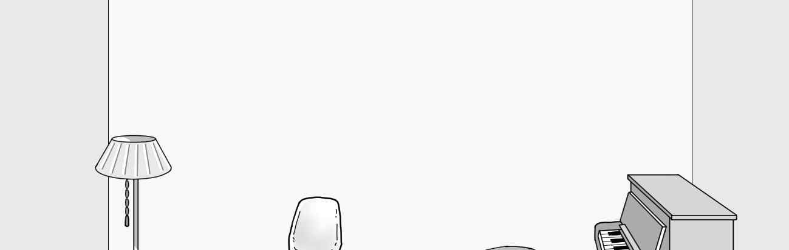
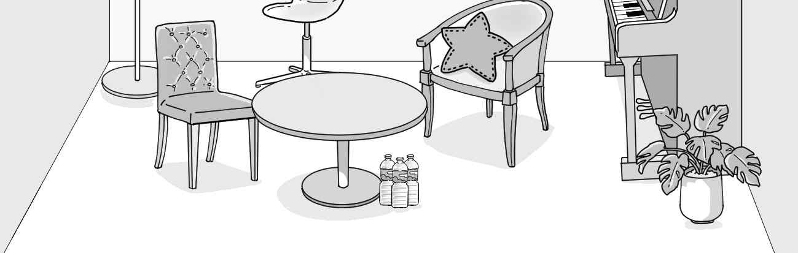
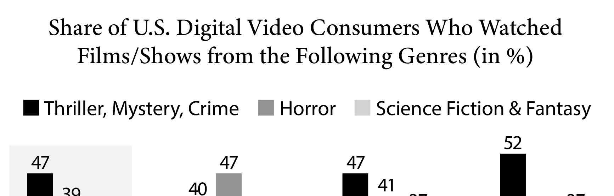
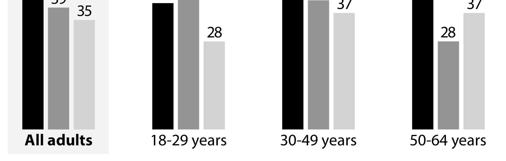
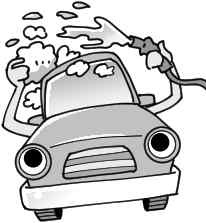

1. 다음을 듣고, 남자가 하는 말의 목적으로 가장 적절한 것을 고르시오.
① 동영상 편집 강좌를 홍보하려고
② 학교 홍보 영상 출연자를 모집하려고
③ 교내 댄스 동아리 가입을 권유하려고
④ 웹 사이트 제작 경연 대회를 안내하려고
⑤ 신입생 환영 행사 아이디어를 공모하려고

2. 대화를 듣고, 여자의 의견으로 가장 적절한 것을 고르시오.

① 장시간의 컴퓨터 작업은 위장 활동을 저해한다.
② 엎드려 자는 자세는 목에 통증을 유발할 수 있다.
③ 잠자기 전 가벼운 스트레칭은 숙면에 도움을 준다.
④ 올바른 자세를 위해 모니터 높이를 조절해야 한다.
⑤ 잠자는 자세를 보면 그 사람의 성격을 알 수 있다.

3. 대화를 듣고, 두 사람의 관계를 가장 잘 나타낸 것을 고르시오.

① 소설가 - 편집자
② 환경미화원 - 관광객
③ 기자 - 프로듀서
④ 방송 작가 - 환경 운동가
⑤ 사진작가 - 낚시꾼

4. 대화를 듣고, 그림에서 대화의 내용과 일치하지 않는 것을 고르시오.

5. 대화를 듣고, 남자가 할 일로 가장 적절한 것을 고르시오.

① 튜브에서 바람 빼기
② 수영복 챙기기
③ 숙박 시설 검색하기
④ 식당 예약하기
⑤ 퇴실 시간 문의하기

6. 대화를 듣고, 여자가 지불할 금액을 고르시오. [3점]

① $54
② $60
③ $63
④ $70
⑤ $75

7. 대화를 듣고, 남자가 학생회 자선 행사에 갈 수 없는 이유를 고르시오.

① 뮤지컬을 보러 가야 해서
② 병원 진료를 받아야 해서
③ 농구 시합에 출전해야 해서
④ 기말고사 준비를 해야 해서
⑤ 자원봉사를 하러 가야 해서

8. 대화를 듣고, Kimchi Dish Contest에 관해 언급되지 않은 것을 고르시오.

① 경연 과제
② 주최 기관
③ 우승 상금
④ 시작 연도
⑤ 참가 자격

9. Full Day City Tour에 관한 다음 내용을 듣고, 일치하지 않는 것을 고르시오.

① 호텔 투숙객에게 특가로 제공한다.
② 매일 오전 10시에 버스가 출발한다.
③ 여섯 곳의 주요 관광 명소에 들른다.
④ 전문 여행 가이드가 동행한다.
⑤ 점심 식사를 무료로 제공한다.

10. 다음 표를 보면서 대화를 듣고, 남자가 구입할 캔들 워머램프를 고르시오.

|  | Model | Price | Shade Color | Base Material | Timer |
| --- | --- | --- | --- | --- | --- |
| ① | A | $65 | gold | metal | ○ |
| ② | B | $52 | white | marble stone | ○ |
| ③ | C | $45 | black | marble stone | × |
| ④ | D | $40 | pink | marble stone | ○ |
| ⑤ | E | $37 | white | metal | × |

11. 대화를 듣고, 여자의 마지막 말에 대한 남자의 응답으로 가장 적절한 것을 고르시오.

① I’m glad to hear you enjoyed your food today.
② We’ve run out of ingredients to make the dish.
③ Thank you for bringing your home‑cooked food.
④ I’ll let you know when your seats are available.
⑤ I’ll recommend the special creamy salmon pasta.

12. 대화를 듣고, 남자의 마지막 말에 대한 여자의 응답으로 가장 적절한 것을 고르시오.

① I’m afraid that I can’t get this stain out.
② Sorry. I’ll take it to the dry cleaner’s now.
③ No way. You should organize the closet today.
④ You should have worn the suit at the presentation.
⑤ Don’t worry. I’m going to pick it up this afternoon.

13. 대화를 듣고, 여자의 마지막 말에 대한 남자의 응답으로 가장 적절한 것을 고르시오. [3점]

Man:
① Hurry up. Her birthday is coming soon.
② Sounds great. I’m sure it’ll make her feel better.
③ Sure. You should have bought her another model.
④ No worries. This keyboard is what I want to have.
⑤ A belated happy birthday to you. This gift is for you.

14. 대화를 듣고, 남자의 마지막 말에 대한 여자의 응답으로 가장 적절한 것을 고르시오. [3점]

Woman:
① Right. He’s been away from work for five days.
② No problem. I’ll send you an engineer right away.
③ Okay. He’ll call you before he makes the visit tomorrow.
④ Sure. You can use the Internet service anywhere at home.
⑤ Sorry. You need to change your Internet service provider.

15. 다음 상황 설명을 듣고, Sofia가 Hannah에게 할 말로 가장 적절한 것을 고르시오.

Sofia:
① I think our costume preparation is way behind schedule.
② Please put the leading actor in the middle of the poster.
③ Let’s pick a color that makes the main character noticeable.
④ I’ll recommend someone to take over my position next year.
⑤ More comfortable clothing will be better for the character.

16. 여자가 하는 말의 주제로 가장 적절한 것은?

① tools used to study animal behaviors
② animals that make clever use of tools
③ cooperation between humans and animals
④ types of communication between animals
⑤ disadvantages of animals living in the wild

17. 언급된 동물이 아닌 것은?

① crows
② monkeys
③ elephants
④ beavers
⑤ octopuses

18. 다음 글의 목적으로 가장 적절한 것은?

Dear Readers, As you’ve seen throughout my books, I’ve learned a great deal from people who have sent me their stories and advice. Let’s keep it going. If you would like to send me an email about your experiences with disasters and what you’ve learned about escaping them, please send it to nodisaster@smail.com. I want you to note that, by sending me your story, you are giving me permission to use it in the books that I write. But I promise not to use your name unless you give me explicit permission. Thank you. Very truly yours, Robert Brown

19. 다음 글에 나타난 ‘I’의 심경 변화로 가장 적절한 것은?

I was going to a conference and my plane was delayed, so by the time I got to my hotel everyone I was supposed to meet had already left for the conference. I walked to the bus stop, but to my dismay the last shuttle to the convention center had already gone. I was at a loss as to what to do! Then a young man standing on the sidewalk said, “The convention center isn’t very far. It’s only four blocks.” So I started walking. It wasn’t long before the convention center appeared in front of my eyes. My heart slowly calmed down! Fortunately, I was just in time for the conference!

20. 다음 글에서 필자가 주장하는 바로 가장 적절한 것은?

Bringing incredible creative projects to life demands much hard work down in the trenches of day‑to‑day idea execution. Genius truly is “1 percent inspiration and 99 percent perspiration.” But we cannot forget the flip side of that 99 percent — it’s impossible to solve every problem by sheer force of will. We must also make time for play, relaxation, and exploration, the essential ingredients of the creative insights that help us evolve existing ideas and set new projects in motion. Often this means creating a routine for breaking from your routine, working on exploratory side projects just for the hell of it, or finding new ways to hotwire your brain’s perspective on a problem. To stay creatively fit, we must keep our minds engaged and on the move — because the greatest enemy of creativity is nothing more than standing still.

21. 밑줄 친 do not have the ears to hear it이 다음 글에서 의미하는 바로 가장 적절한 것은? [3점]

Far from a synonym for capitalism, consumerism makes capitalism impossible over the long term, since it makes capital formation all but impossible. A consumer culture isn’t a saving culture, isn’t a thrift culture. It’s too fixated on buying the next toy to ever delay gratification, to ever save and invest for the future. The point is elementary: you can’t have sustainable capitalism without capital; you can’t have capital without savings; and you can’t save if you’re running around spending everything you’ve just earned. But the confusion has grown so deep that many people today do not have the ears to hear it. Indeed, the policies of our nation’s central bank seem to reinforce this habit by driving down interest rates to near zero and thereby denying people a material reward — in the form of interest on their banked savings — for foregoing consumption.

22. 다음 글의 요지로 가장 적절한 것은?

Many people say that we should take full advantage of the privileges of the Internet by forever learning more and more. They see no limit to how much information a person ought to consume and never acknowledge the emotional and psychological cost of cramming facts into our brains. If we aren’t using the wealth of available data to make ourselves more productive and useful to society, what’s the point of having it? While access to information is a privilege, it’s also a burden. This is especially true when we treat being well‑read as an obligation that can’t be escaped. Constant exposure to upsetting news can be traumatic. An unending flood of information makes it hard to pause and reflect on anything you’ve learned. At some point, even the most voracious of readers needs to pull the plug and stop the constant drip of facts, figures, and meaningless Internet fights. We’re living in an era of information overload ─ and the solution is not to learn more but to step back and consume a smaller amount of data in a more meaningful way.

23. 다음 글의 주제로 가장 적절한 것은?

Most of us make our career choices when we are about eighteen. At eighteen, you have limited experience, very limited skills and most of what you know comes from your parents, your environment and the structured school system you have gone through. You are usually slightly better at some skills because you have spent a bit more time on them. Maybe someone in your environment was good at something and passionate enough to get you interested in spending more time in that area. It is also possible that you might have a specific physical feature — such as being tall — that might make you better at certain activities, such as playing basketball. In any case, most people make a decision regarding their career and direction in life based on their limited experiences and biases in their childhood and teenage years. This decision will come to dominate their life for many years to come. No wonder so many get it wrong! It is easier to get it wrong than to get it right, because statistically, there are more wrong ways than right ways.

24. 다음 글의 제목으로 가장 적절한 것은?

In making sense of cave art, anthropologists have turned to surviving hunter‑gatherer societies that continue to paint inside caves, particularly the San peoples, who live in communities across a wide region of southern Africa. What began to fascinate anthropologists who studied the San was their detailed imitations of the animals they hunt. The hunters, in some sense, become animals in order to make inferences about how their prey might behave. This spills over into ritual. The San use hyperventilation and rhythmic movement to create states of altered consciousness as part of a shamanistic culture. In the final stage of a trance, Lewis‑Williams writes, ‘people sometimes feel themselves to be turning into animals and undergoing other frightening or exalting transformations’. For anthropologist Kim Hill, identifying and observing animals to eat and those to escape might merge into ‘a single process’ that sees animals as having humanlike intentions that ‘can influence and be influenced’.

25. 다음 도표의 내용과 일치하지 않는 것은?

Share of U.S. Digital Video Consumers Who Watched Films/Shows from the Following Genres (in %)

| Age Group | Thriller, Mystery, Crime | Horror | Science Fiction & Fantasy |
| --- | --- | --- | --- |
| All adults | 47 | 39 | 35 |
| 18-29 years | 40 | 47 | 28 |
| 30-49 years | 47 | 41 | 37 |
| 50-64 years | 52 | 28 | 37 |

26. Gilbert Stuart에 관한 다음 글의 내용과 일치하지 않는 것은?

Gilbert Stuart grew up in the American colony of Rhode Island before the United States was an independent nation. He traveled to Scotland, England, and Ireland to study art. He then returned to America about the time the war for independence broke out, but he returned to Europe once again because the war made his career as an artist difficult. Even so, he didn’t find much success until he came back to the United States in 1795, when he painted a portrait of George Washington. Stuart is called the “father of American portraiture” because he painted pictures of all the famous people of early America. One of his paintings of George Washington was hung in the White House. The image of Washington on the U.S. one‑dollar bill came from one of Stuart’s most famous paintings of Washington. In 1824, Stuart suffered a stroke which left him partially paralyzed, but he still continued to paint for two years until his death on July 9, 1828.

27. Glass Bottom Boat Adventure에 관한 다음 안내문의 내용과 일치하지 않는 것은?

Glass Bottom Boat Adventure Enjoy all day aquarium admission plus an exclusive glass bottom boat ride across our oceanarium. You’ll see how our team care for our marine species and see our animals from a different point of view. Cost:
Adult (16+): $80 / Child (4-15): $65
Activity Pack: $8 ‒ Includes Activity Trail Map, Magnifying Glass, Picture Puzzle and more! Please note:
Children ages 0-3 cannot participate in the boat tour.
Boat departs every hour from 10:00 a.m. - 4:00 p.m.
Please arrive AT LEAST 20 minutes prior to your boat departure.

28. Annual Car Wash Fundraiser에 관한 다음 안내문의 내용과 일치하는 것은?

Annual Car Wash Fundraiser Join us for our Annual Car Wash Fundraiser! Have your car washed and do your part to help homeless pets!
When: 8:30 a.m. - 10:30 a.m., Saturday, 5th November
Where: Cranberry College — Eastern Street Carpark
Cost: $10 per vehicle (A free beverage is offered in the waiting area.)
Car Wash Time Slots — 10 car wash bookings available per half‑hour time slot: 
8:30 a.m. - 9:00 a.m. 
9:00 a.m. - 9:30 a.m. 
9:30 a.m. - 10:00 a.m. 
10:00 a.m. - 10:30 a.m. Please select the most convenient time to have your car washed. You should collect your car in person 20 minutes after your selected time slot.

29. 다음 글의 밑줄 친 부분 중, 어법상 틀린 것은? [3점]

The idea that leaders inherently possess certain physical, intellectual, or personality traits that distinguish them from nonleaders was the foundational belief of the trait‑based approach to leadership. This approach dominated leadership research from the late 1800s until the mid‑1940s and has experienced a resurgence of interest in the last couple of decades. Early trait theorists believed that some individuals are born with the traits that allow them to become great leaders. Thus, early research in this area often presented the widely stated argument that “leaders are born, not made.” Also, some of the earliest leadership studies were grounded in what was referred to as the “great man” theory because researchers at the time focused on identifying traits of highly visible leaders in history who were typically male and associated with the aristocracy or political or military leadership. In more recent history, numerous authors have acknowledged that there are many enduring qualities, whether innate or learned, that contribute to leadership potential. These traits include such things as drive, self-confidence, cognitive ability, conscientiousness, determination, intelligence, and integrity.

30. 다음 글의 밑줄 친 부분 중, 문맥상 낱말의 쓰임이 적절하지 않은 것은?

Musical performers and their labor union did not perceive early recordings as a threat to their livelihoods because the recordings were mostly of poor quality. It was not long before musicians began to wonder whether recordings of popular artists or songs would undermine the demand for live music. For a time, however, recorded music was too scratchy to pose a serious threat, even though it played in commercial places and offered a few performers a way to supplement their income. Additionally, during the early days of recording, radio stations preferred using live musicians on their programs. Sound from live performances was better quality, and stations at this time rarely used recordings. Broadcasters rejected union demands for employment and decent wages, because the alterative use of recordings was even less attractive. They made efforts to employ orchestras, bands, and vocalists to perform on radio programs. There was relative balance between live music and technology in the early innovation stages. With increased improvements in electrical recording, however, this balance soon changed.

31. 다음 빈칸에 들어갈 말로 가장 적절한 것을 고르시오. [3점]

Much of what we call political risk is in fact uncertainty. This applies to all types of political risks, from civil strife to expropriations to regulatory changes. Political risk, unlike credit or market or operational risk, can be unsystematic and therefore more difficult to address in classic statistical terms. What is the probability that terrorists will attack the United States again? Unlike earthquakes or hurricanes, political actors constantly adapt to overcome the barriers created by risk managers. When corporations structure foreign investments to mitigate risks of expropriations, through international guarantees or legal contracts, host governments seek out new forms of obstruction, such as creeping expropriation or regulatory discrimination, that are very hard and legally costly to prove. Observation of a risk changes the risk itself. There are ways to mitigate high‑impact, low‑probability events. But analysis of these risks can be as much art as science.

32. 다음 빈칸에 들어갈 말로 가장 적절한 것을 고르시오.

Ecological health depends on keeping the surface of the earth rich in humus and minerals so that it can provide a foundation for healthy plant and animal life. The situation is disrupted if the soil loses these raw materials or if great quantities of contaminants are introduced into it __. When man goes beneath the surface of the earth and drags out minerals or other compounds that did not evolve as part of this system, then problems follow. The mining of lead and cadmium are examples of this. Petroleum is also a substance that has been dug out of the bowels of the earth and introduced into the surface ecology by man. Though it is formed from plant matter, the highly reduced carbon compounds that result are often toxic to living protoplasm. In some cases this is true of even very tiny amounts, as in the case of “polychlorinated biphenyls,” a petroleum product which can cause cancer.

33. 다음 빈칸에 들어갈 말로 가장 적절한 것을 고르시오. [3점]

Magical thinking, intellectual insecurity, and confirmation bias are all powerful barriers to scientific discovery; they blocked the eyes of generations of astronomers before Copernicus. But as twenty‑first‑century researchers have discovered, these three barriers can all be destroyed with a simple teaching trick: transporting our brain to an environment outside our own. That environment can be a nature preserve many miles from our home, or a computer‑simulated Mars, or any other space that our ego doesn’t associate directly with our health, social status, and material success. In that environment, our ego will be less inclined to take the failure of its predictions personally. Certainly, our ego may feel a little upset that its guesses about the nature preserve or Mars were wrong, but it was never really that invested in the guesses to begin with. Why should it care too much about things that have no bearing on its own fame or well‑being? So, in that happy state of apathy, our ego is less likely to get data manipulative, mentally threatened, or magically minded, leaving the rest of our brain free to abandon failed hypotheses and venture new ones.

34. 다음 빈칸에 들어갈 말로 가장 적절한 것을 고르시오. [3점]

If you are unconvinced that our beliefs influence how we interpret facts _, consider the example of the “flying horse.” Depictions of galloping horses from prehistoric times up until the mid‑1800s typically showed horses’ legs splayed while galloping, that is, the front legs reaching far ahead as the hind legs stretched far behind. People just “knew” that’s how horses galloped, and that is how they “saw” them galloping. Cavemen saw them this way, Aristotle saw them this way, and so did Victorian gentry. But all of that ended when, in 1878, Eadweard Muybridge published a set of twelve pictures he had taken of a galloping horse in the space of less than half a second using twelve cameras hooked to wire triggers. Muybridge’s photos showed clearly that a horse goes completely airborne in the third step of the gallop with its legs collected beneath it, not splayed. It is called the moment of suspension. Now even kids draw horses galloping this way.

35. 다음 글에서 전체 흐름과 관계 없는 문장은?

Except for grains and sugars, most foods humans eat are perishable. They deteriorate in palatability, spoil, or become unhealthy when stored for long periods.

36. 주어진 글 다음에 이어질 글의 순서로 가장 적절한 것을 고르시오.

Humans are unique in the realm of living beings in knowing there is a future. If people experience worry and hope, it is because they realize the future exists, that it can be better or worse, and that the outcome depends to some extent on them. But having this knowledge does not imply that they know what to do with it. People often repress their awareness of the future because thinking about it distorts the comfort of the now, which tends to be more powerful than the future because it is present and because it is certain. The future, on the other hand, must be imagined in advance and, for that very reason, is always uncertain. Getting along with the future is not an easy task, nor is it one in which instinct prevents us from blunders. That is why we so often have a poor relationship with the future and are either more fearful than we need to be or allow ourselves to hope against all evidence; we worry excessively or not enough; we fail to predict the future or to shape it as much as we are able.

37. 주어진 글 다음에 이어질 글의 순서로 가장 적절한 것을 고르시오. [3점]

Bipedalism, upright walking, started a chain of enormous evolutionary adjustments. It liberated hominin arms for carrying weapons and for taking food to group sites instead of consuming it on the spot. But bipedalism was necessary to trigger hand dexterity and tool use. Hashimoto and co‑workers concluded that adaptations underlying tool use evolved independently of those required for human bipedalism because in both humans and monkeys, each finger is represented separately in the primary sensorimotor cortex, just as the fingers are physically separated in the hand. This creates the ability to use each digit independently in the complex manipulations required for tool use. But without bipedalism it would be impossible to use the trunk for leverage in accelerating the hand during toolmaking and tool use. Bipedalism also freed the mouth and teeth to develop a more complex call system as the prerequisite of language. These developments required larger brains whose energy cost eventually reached three times the level for chimpanzees, accounting for up to one‑sixth of the total basal metabolic rate.

38. 글의 흐름으로 보아, 주어진 문장이 들어가기에 가장 적절한 곳을 고르시오.

Water molecules circulate through the atmosphere as a result of evaporation. As water molecules rise high up in the atmosphere, they may split up into their constituent chemical elements, hydrogen and oxygen, under the influence of sunlight. Whereas the much heavier oxygen either remains in the atmosphere or is captured on the Earth’s surface, the hydrogen tends to escape into space, because it is so light that Earth’s gravity cannot retain it. As long as there was little or no free oxygen in the atmosphere that could capture hydrogen before it escaped into the cosmos, this process would have continued unhindered. However, after all the available materials on the Earth’s surface, mostly iron, had combined with the free oxygen, it began to appear in the atmosphere in sizable quantities. As soon as this happened, the free oxygen would have captured most of the free hydrogen by forming water molecules again, thus slowing down the loss of hydrogen. Over the course of time, this process would have helped to retain water on Earth, while it also contributed to the emergence of oxygen in the atmosphere.

39. 글의 흐름으로 보아, 주어진 문장이 들어가기에 가장 적절한 곳을 고르시오. [3점]

The evolutionary history of a species or a disease is like any other kind of history. There is no experiment, in the usual sense, that we can do now to decide how long ago our ancestors first started to use fires for cooking or other purposes and what subsequent evolutionary effects that change may have had. History can be investigated only by examining the records it has left. Charred bones or even carbon deposits from an ancient campfire can be informative documents to people who know how to read them. Likewise, the chemical structure of proteins and DNA may be read to reveal relationships among now strikingly different organisms. Until a time machine is invented, we will not be able to go back and watch the evolution of major traits, but we can nonetheless reconstruct prehistoric events by the records they left in fossils, carbon traces, structures, and behavioral tendencies, as well as protein and DNA structures. Even when we cannot reconstruct the history of a trait, we can often still be confident that it was shaped by natural selection.

40. 다음 글의 내용을 한 문장으로 요약하고자 한다. 빈칸 (A), (B)에 들어갈 말로 가장 적절한 것은?

Put a hamster on a wheel, and it will start running. Give the hamster a treat, and it will run even longer. Stop dispensing the treats, and the hamster will stop running — completely. The original motivation has thereby become extinguished. The school system has been taking advantage of this psychological feature by replacing young children’s natural curiosity and joy of discovery with praise, grades, and other short‑term performance boosters. As the story goes, there once was an old man who enjoyed watching sunsets from his porch. One day, a bunch of kids came over and started playing loudly in front of his house. The man asked the kids to move over, but they ignored him. Next day, the children came again. The man called them over, gave each one a nickel, and asked them to make as much noise as they possibly could — to which they happily obliged. The man kept regularly handing out coins, until one day he told the kids that he was no longer paying them. “Then we aren’t going to make noise for you,” the children announced — and left.

It is possible to remove an individual’s willingness to do something by consistently providing rewards for the action for some time and then withholding them.

41. 윗글의 제목으로 가장 적절한 것은?

One basic way of thinking about emotions is as information‑selection devices. As such, they structure and coordinate our perceptual input by arranging and prioritizing relevant information. As selective constraints on input, emotions initially focus our attention on subjects important to our goals, wants, and interests. Then, reinforced by physiological changes, they move us towards action. Despite the habitual discursive distinction between intellect and affect, therefore, emotions can be considered rational in a narrower sense, since they constitute an effective response in a given set of circumstances by supplying information about reasonable action. Claiming that emotions are vital for intelligent action means adopting what Dylan Evans calls ‘the positive view of emotion’. Findings from evolutionary theory further substantiate the idea that ‘the benefits of having emotions outweigh the drawbacks’. The neuroscientist Antonio Damasio, who has studied the role of emotion in decision‑making and other tasks commonly considered ‘purely rational’, goes so far as to conclude that, in matters of social and personal importance, good decisions exclude an emotional component. Consequently, in addition to adopting rational strategies such as cost‑benefit analyses, people appear to deliberate, narrow down, and choose from a range of behavioural options through an initial emotional assessment of envisioned outcomes as either beneficial or harmful.

42. 밑줄 친 낱말 중에서 문맥상 낱말의 쓰임이 적절하지 않은 것은?

One basic way of thinking about emotions is as information‑selection devices. As such, they structure and coordinate our perceptual input by arranging and prioritizing relevant information. As selective constraints on input, emotions initially focus our attention on subjects important to our goals, wants, and interests. Then, reinforced by physiological changes, they move us towards action. Despite the habitual discursive distinction between intellect and affect, therefore, emotions can be considered rational in a narrower sense, since they constitute an effective response in a given set of circumstances by supplying information about reasonable action. Claiming that emotions are vital for intelligent action means adopting what Dylan Evans calls ‘the positive view of emotion’. Findings from evolutionary theory further substantiate the idea that ‘the benefits of having emotions outweigh the drawbacks’. The neuroscientist Antonio Damasio, who has studied the role of emotion in decision‑making and other tasks commonly considered ‘purely rational’, goes so far as to conclude that, in matters of social and personal importance, good decisions exclude an emotional component. Consequently, in addition to adopting rational strategies such as cost‑benefit analyses, people appear to deliberate, narrow down, and choose from a range of behavioural options through an initial emotional assessment of envisioned outcomes as either beneficial or harmful.

43. 주어진 글에 이어질 내용을 순서에 맞게 배열한 것으로 가장 적절한 것은?

As a twelve‑year‑old, Richard Feynman set up a little lab in his room, bought his first radio and, rather than listening to it, he took it apart. He soon became quite good at fixing radios. This was in the early 1930s, during the Great Depression, so a boy who could fix radios cheaply was useful. On one occasion, he was picked up by a client who seemed far from convinced that this boy wouldn’t be a waste of his time and money.

 The client kept on asking Feynman how a boy could know anything useful about radios until they arrived at the client’s poorhouse. Feeling pressured, Feynman turned the radio on. It started wobbling, then gave out a terrifically loud roar for a few minutes before quieting and playing correctly. He was confused. He had never encountered this before. He shut the radio off, began walking around in the room and thinking. The client was entirely unimpressed. He wanted action, and he wanted to see the boy working. He started protesting to Feynman, asking him to stop wasting his time and get on with fixing the radio, or leave. Despite the heckling, Feynman kept on thinking. He wondered how any radio could make such a noise. Most radios failed because of faulty equipment or loose wiring; he wasn’t convinced it would be either. After a while, Feynman came up with a theory: Radio sets in those days were made from a series of tubes. If he took them out and reversed the order, the vibration and noise might disappear. Now, at last, Feynman was ready to act. He changed the tubes and turned the radio on. It worked perfectly. The client was astonished. He became one of Feynman’s biggest advocates, telling everyone he knew of the boy who “fixes radios by thinking.”

44. 밑줄 친 낱말 중에서 가리키는 대상이 나머지 넷과 다른 것은?

As a twelve‑year‑old, Richard Feynman set up a little lab in his room, bought his first radio and, rather than listening to it, he took it apart. He soon became quite good at fixing radios. This was in the early 1930s, during the Great Depression, so a boy who could fix radios cheaply was useful. On one occasion, he was picked up by a client who seemed far from convinced that this boy wouldn’t be a waste of his time and money.

 The client kept on asking Feynman how a boy could know anything useful about radios until they arrived at the client’s poorhouse. Feeling pressured, Feynman turned the radio on. It started wobbling, then gave out a terrifically loud roar for a few minutes before quieting and playing correctly. He was confused. He had never encountered this before. He shut the radio off, began walking around in the room and thinking. The client was entirely unimpressed. He wanted action, and he wanted to see the boy working. He started protesting to Feynman, asking him to stop wasting his time and get on with fixing the radio, or leave. Despite the heckling, Feynman kept on thinking. He wondered how any radio could make such a noise. Most radios failed because of faulty equipment or loose wiring; he wasn’t convinced it would be either. After a while, Feynman came up with a theory: Radio sets in those days were made from a series of tubes. If he took them out and reversed the order, the vibration and noise might disappear. Now, at last, Feynman was ready to act. He changed the tubes and turned the radio on. It worked perfectly. The client was astonished. He became one of Feynman’s biggest advocates, telling everyone he knew of the boy who “fixes radios by thinking.”

45. 윗글에 관한 내용으로 적절하지 않은 것은?

As a twelve‑year‑old, Richard Feynman set up a little lab in his room, bought his first radio and, rather than listening to it, he took it apart. He soon became quite good at fixing radios. This was in the early 1930s, during the Great Depression, so a boy who could fix radios cheaply was useful. On one occasion, he was picked up by a client who seemed far from convinced that this boy wouldn’t be a waste of his time and money.

 The client kept on asking Feynman how a boy could know anything useful about radios until they arrived at the client’s poorhouse. Feeling pressured, Feynman turned the radio on. It started wobbling, then gave out a terrifically loud roar for a few minutes before quieting and playing correctly. He was confused. He had never encountered this before. He shut the radio off, began walking around in the room and thinking. The client was entirely unimpressed. He wanted action, and he wanted to see the boy working. He started protesting to Feynman, asking him to stop wasting his time and get on with fixing the radio, or leave. Despite the heckling, Feynman kept on thinking. He wondered how any radio could make such a noise. Most radios failed because of faulty equipment or loose wiring; he wasn’t convinced it would be either. After a while, Feynman came up with a theory: Radio sets in those days were made from a series of tubes. If he took them out and reversed the order, the vibration and noise might disappear. Now, at last, Feynman was ready to act. He changed the tubes and turned the radio on. It worked perfectly. The client was astonished. He became one of Feynman’s biggest advocates, telling everyone he knew of the boy who “fixes radios by thinking.”

