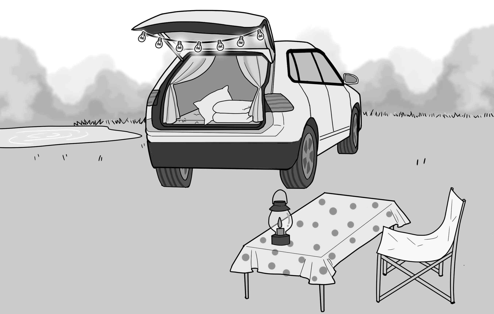
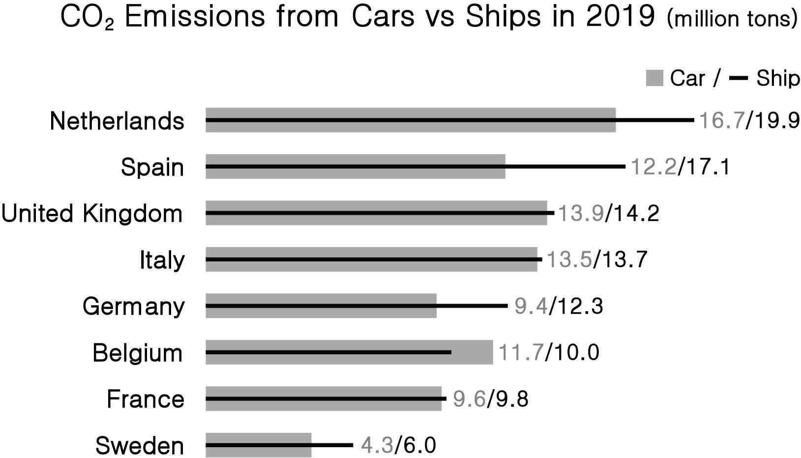
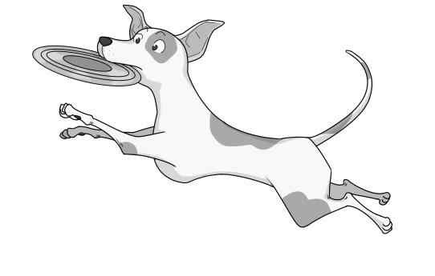

1. 다음을 듣고, 여자가 하는 말의 목적으로 가장 적절한 것을 고르시오.
① 전기 절약의 필요성을 강조하려고
② 엘리베이터 안전 수칙을 알려 주려고
③ 전문 기술자 초청 강연을 공지하려고
④ 컴퓨터 데이터 복원 방법을 설명하려고
⑤ 전기 점검 관련 유의 사항을 안내하려고

2. 대화를 듣고, 남자의 의견으로 가장 적절한 것을 고르시오.

① 설문 방식을 다양화해야 응답자의 수를 늘릴 수 있다.
② 설문 문항은 가능한 한 쉽고 간결하게 제작해야 한다.
③ 온라인 설문은 응답을 수집하는 가장 편리한 방식이다.
④ 응답자의 익명을 보장해야 솔직한 의견을 얻을 수 있다.
⑤ 설문 참여를 높이려면 응답자에게 보상을 제공해야 한다.

3. 대화를 듣고, 두 사람의 관계를 가장 잘 나타낸 것을 고르시오.

① 영화감독 - 만화가
② 촬영 감독 - 영화배우
③ 방송 진행자 - 소설가
④ 출판사 직원 - 삽화가
⑤ 신문 기자 - 시나리오 작가

4. 대화를 듣고, 그림에서 대화의 내용과 일치하지 않는 것을 고르시오.

5. 대화를 듣고, 여자가 할 일로 가장 적절한 것을 고르시오.

① 설거지하기
② 와인 주문하기
③ 친환경 비누 만들기
④ 주방 세제 사 오기
⑤ 웹 사이트 링크 보내기

6. 대화를 듣고, 남자가 지불할 금액을 고르시오.

① $30
② $40
③ $45
④ $55
⑤ $60

7. 대화를 듣고, 여자가 야외 좌석을 원하지 않는 이유를 고르시오. [3점]
① 대화하기에 너무 시끄러워서
② 햇빛이 너무 강해 눈이 부셔서
③ 미세 먼지 때문에 공기 질이 나빠서
④ 기온이 낮아 감기에 걸릴까 걱정되어서
⑤ 야외에서 보는 전망이 마음에 들지 않아서

8. 대화를 듣고, Galland perfume workshop에 관해 언급되지 않은 것을 고르시오.

① 참가 연령
② 사용 언어
③ 시간
④ 예약 방법
⑤ 장소

9. Flashlight Tour에 관한 다음 내용을 듣고, 일치하지 않는 것을 고르시오.

① 미술관 폐장 후에 시작된다.
② 한 시간 동안 진행된다.
③ 성인 입장료는 10달러이다.
④ 손전등이 기념품으로 제공된다.
⑤ 참가 인원에 제한이 있다.

10. 다음 표를 보면서 대화를 듣고, 남자가 주문할 휴대용 가습기를 고르시오.

|  | Model | Price | Color | Capacity | Mood Light |
| --- | --- | --- | --- | --- | --- |
| ① | A | $13 | Gray | 300 ml | × |
| ② | B | $18 | White | 400 ml | ○ |
| ③ | C | $20 | Orange | 500 ml | ○ |
| ④ | D | $28 | Black | 700 ml | × |
| ⑤ | E | $35 | White | 900 ml | ○ |

11. 대화를 듣고, 여자의 마지막 말에 대한 남자의 응답으로 가장 적절한 것을 고르시오.

① Thank you very much for picking me up.
② I’ll finish the laundry as soon as possible.
③ I’m sorry. I won’t be late for school again.
④ I’m not sure. I’ll call you when I’m finished.
⑤ Never mind. I’ll complete the project tomorrow.

12. 대화를 듣고, 남자의 마지막 말에 대한 여자의 응답으로 가장 적절한 것을 고르시오.

① I’m very satisfied. You should buy one.
② Right. The air quality today is not that bad.
③ Great. I want to buy an air purifier like yours.
④ Put it here near the window. It’s the best place.
⑤ Okay. Let’s open the window and get some fresh air.

13. 대화를 듣고, 여자의 마지막 말에 대한 남자의 응답으로 가장 적절한 것을 고르시오. [3점]

Man:
① No. We had no choice but to send it to you.
② Sorry. There are no other colors available now.
③ Yes. I’d like to get a refund for the yellow one.
④ Okay. You can send the large size one back to us.
⑤ Sure. We’ll send you a large size one immediately.

14. 대화를 듣고, 남자의 마지막 말에 대한 여자의 응답으로 가장 적절한 것을 고르시오. [3점]

Woman:
① Of course. I don’t need it any more.
② Don’t worry. You’ll get used to it soon.
③ Exactly! You need to buy a smartphone.
④ Right. I checked my text before sending it.
⑤ No way. Smartphones are not that expensive.

15. 다음 상황 설명을 듣고, Emily가 Randy에게 할 말로 가장 적절한 것을 고르시오.

① Do you know where the lost and found is?
② Can you tell me where you bought your watch?
③ Didn’t you take off your watch in the bathroom?
④ Do you know how to wash your hands properly?
⑤ Didn’t you visit the shop to have your watch fixed?

16. 남자가 하는 말의 주제로 가장 적절한 것은?

① steps in planning an efficient smart city
② pros and cons of developing smart cities
③ problems of smart cities and why they arise
④ successful smart cities and how they operate
⑤ interconnectedness of smart cities around the world

17. 언급된 도시가 아닌 것은?

① Singapore
② San Diego
③ London
④ Dubai
⑤ New York

18. 다음 글의 목적으로 가장 적절한 것은?

Dear Lorenzo Romano, I heard from Antonio Ricci of Rome that you are producing handmade gloves for export in a variety of natural leathers. I read about your business on your website. There is a steady demand in my country for high quality leather gloves, and I am able to charge good prices. Please let me know full details of the gloves you would recommend. It would also help if you could provide me with some samples of the gloves you produce. I hope to hear from you soon. Sincerely yours, Jonathan Turner

19. 다음 글에 드러난 ‘I’의 심경 변화로 가장 적절한 것은?

Finally, it came to my turn. I was supposed to walk backward off the cliff. Just looking down the cliff made my legs begin to shake. I knew there was a safety rope around me in case I should black out. I had an intellectual understanding of the whole situation and an intellectual sense of security. Nevertheless, my hair stood on end and I shivered all over. That first step off the cliff was the most difficult moment, but I made it ⸻ as did others. I arrived safely at the bottom, overjoyed by the success of meeting the challenge. I felt as though I was walking on air.

20. 다음 글에서 필자가 주장하는 바로 가장 적절한 것은?

Conflicts between the goals of science and the need to protect the rights and welfare of human research participants result in the central ethical tension of clinical research. The statement “Bad science is bad ethics” is true. Putting humans at risk if the study design does not permit a reasonable expectation of valid findings is never ethical. Even a study that presents no risk presents at least an inconvenience to participants and is in that sense disrespectful. The statement “Good science is good ethics,” however, is false. Study design may be scientifically valid, yet the risk of harming human participants is too great to accept. Although achieving the appropriate scientific ends is always the necessary goal of a study, protection of the rights and welfare of human participants must override scientific efficiency.

21. 밑줄 친 carries the stamp of this age가 다음 글에서 의미하는 바로 가장 적절한 것은? [3점]

Thomas Edison’s name is synonymous with invention, and his most famous invention, the electric light bulb, is a familiar symbol for that flash of inspired genius traditionally associated with the inventive act. Besides being the exemplar of the “bright idea,” however, Edison’s electric light is worthy of study for other reasons. The technical and economic importance of the light and of the electrical system that surrounded it matches that of any other invention we could name, at least from the last two hundred years. The introduction and spread of electric light and power was one of the key steps in the transformation of the world from an industrial age, characterized by iron and coal and steam, to a post‑industrial one, in which electricity was joined by petroleum, light metals and alloys, and internal combustion engines to give the twentieth century its distinctive form and character. Our own time still largely carries the stamp of this age, however dazzled we may be by the electronic, computerized, and media wonders of the twenty‑first century.

22. 다음 글의 요지로 가장 적절한 것은?

Just imagine that we have invented special glasses that give us the power to see the odorous world the way that other organisms perceive it. Put your pair on and walk outside for just a moment. As the bright sunlight hits our eyes, we would encounter a world far different from what we would normally expect. The air is full of molecules carried by breezes. Chemical signals would flood our eyes just as surely as sounds overwhelm our ears at a cocktail party. Stare at any plant and you would see compounds being released into the air from leaves, bark, and roots. A squirrel in a tree exudes carbon dioxide and other compounds with each breath. Glance along its brown body and notice that specific points (scent glands) appear to be slowly releasing chemical signals. If we could translate these signals into language, we would see phrases, sentences, statements, songs, and other messages waiting to be intercepted and interpreted.

23. 다음 글의 주제로 가장 적절한 것은?

Skills‑based approaches to teaching critical thinking now have a long history and literature, but what has become clear through more than 25 years of work on critical thinking theory and pedagogy is that teaching students a set of thinking skills does not seem to be enough. Students may learn to write an adequate article critique in one class, but fail to use those skills in another. They may learn how to evaluate research methodology in other students’ research designs, but completely miss the flaws in their own. They may learn to recognize thinking biases in the classroom, but still use badly flawed reasoning in their own decision making. Too often students think our courses are either about memorizing a great deal of material, or about learning the rules for and playing one more idiosyncratic academic game. Students regularly fail to understand what we are trying to teach them or they fail to transfer and generalize thinking skills across contexts and classes.

24. 다음 글의 제목으로 가장 적절한 것은?

As much as we like to think of ourselves as being different and special, humans are a part of Earth’s biosphere, created within and by it. Ultimately, it is the living, breathing elements of this world that we need more than inanimate supplies, such as coal, gas, or bauxite ore. We can live without cars or beer cans, but we cannot without food and oxygen. As nations around the globe try to band together to attack the problems of greenhouse gas emissions and the shrinking availability of fresh drinking water, in all corners of the world thousands of species quietly go extinct. E. O. Wilson, the renowned Harvard biologist, recently presented the problem our species faces in a succinct law: “If you save the living environment, the biodiversity that we have left, you will also automatically save the physical environment, too. But if you only save the physical environment, you will ultimately lose both.”

25. 다음 도표의 내용과 일치하지 않는 것은?

CO2 Emissions from Cars vs Ships in 2019 (million tons)

| Country | Car | Ship |
| --- | --- | --- |
| Netherlands | 16.7 | 19.9 |
| Spain | 12.2 | 17.1 |
| United Kingdom | 13.9 | 14.2 |
| Italy | 13.5 | 13.7 |
| Germany | 9.4 | 12.3 |
| Belgium | 11.7 | 10.0 |
| France | 9.6 | 9.8 |
| Sweden | 4.3 | 6.0 |

26. Josef Sudek에 관한 다음 글의 내용과 일치하지 않는 것은?

Josef Sudek was born in the Czech Republic. Originally a bookbinder, Sudek was badly injured during World War I, resulting in the loss of his right arm. After the injury, he spent three years in various hospitals, and began to take photographs out of boredom. In 1922, he enrolled at the State School of Graphic Arts in Prague, where he studied photography for two years. His army disability pension allowed him to make art without worrying about an income. He photographed many night‑scapes of Prague and the wooded landscapes of Bohemia. Sudek didn’t let his disability get in the way and, despite having only one arm, he used very heavy and bulky equipment. Often known as the ‘Poet of Prague,’ Sudek never married, and was a shy and retiring person. He never appeared at his exhibition openings. He died on 15 September 1976, when he was 80 years old.

27. Dogs at the Park에 관한 다음 안내문의 내용과 일치하지 않는 것은?

 Dogs at the Park Join us with your dogs. There will be dog races, a best trick contest, a dog fashion show, and vendor booths.
Time & Date: 9 a.m. — 1 p.m., on Sunday, April 3
Location: Jinohills Park Attention Dog Owners
You are not allowed to bring aggressive dogs.
Pre‑registration is required at www.Jinohills.org/Dogs. Vendor Booths Available
Vendor booth applications are available on our website.
Vendors must apply for their booth by March 25.

28. 2022 Spring Art Contest & Exhibition에 관한 다음 안내문의 내용과 일치하는 것은?

2022 Spring Art Contest & Exhibition If art is your hobby, share your creative ideas with our community at our gallery, the Art Jade.
This contest is open to everyone ages 12 years and older.
Contest categories include photography, painting, drawing, and collage.
Artwork must be gallery ready: framed and ready to hang.
Up to 3 entries per person may be submitted.
The submission deadline is March 26.
The exhibition will take place April 1 — April 30, 2022. We’ll handle your entries with every caution but cannot be held responsible for any damages during the exhibition! For more information, call Kevin Brown at 419‑938‑8546.

29. 다음 글의 밑줄 친 부분 중, 어법상 틀린 것은? [3점]

We don’t know what ancient Greek music sounded like, because there are no examples of it in written or notated form, nor has it survived in oral tradition. Much of it was probably improvised anyway, within certain rules and conventions. So we are forced largely to guess at its basis from the accounts of writers such as Plato and Aristotle, who were generally more concerned with writing about music as a philosophical and ethical exercise than with providing a technical primer on its practice. It seems Greek music was predominantly a vocal form, consisting of sung verse accompanied by instruments such as the lyre or the plucked kithara (the root of ‘guitar’). In fact, Plato considered music in which the lyre and flute played alone and not as the accompaniment of dance or song to be ‘exceedingly coarse and tasteless’. The melodies seem to have had a very limited pitch range, since the instruments generally span only an octave, from one E (as we’d now define it) to the next.

30. 다음 글의 밑줄 친 부분 중, 문맥상 낱말의 쓰임이 적절하지 않은 것은?

Just as there’s a tendency to glorify technological progress, there’s a countertendency to expect the worst of every new tool or machine. In Plato’s Phaedrus, Socrates bemoaned the development of writing. He feared that, as people came to rely on the written word as a substitute for the knowledge they used to carry inside their heads, they would, in the words of one of the dialogue’s characters, “cease to exercise their memory and become forgetful.” And because they would be able to “ receive a quantity of information without proper instruction,” they would “be thought very knowledgeable when they are for the most part quite ignorant.” They would be “filled with the conceit of wisdom instead of real wisdom.” Socrates wasn’t wrong ─ the new technology did often have the effects he feared ─ but he was shortsighted. He couldn’t foresee the many ways that writing and reading would serve to spread information, spark fresh ideas, and expand human knowledge (if not wisdom).

31. 다음 빈칸에 들어갈 말로 가장 적절한 것을 고르시오.

In the Indian language of pali, mettā means benevolence, kindness or tenderness. It is one of the most important ideas in Buddhism. Buddhism recommends a daily ritual meditation (known as mettā bhāvanā) to foster this attitude. The meditation begins with a call to think carefully every morning of an individual with whom one tends to get irritated or to whom one feels aggressive or cold and — in place of one’s normal hostile impulses — to rehearse kindly messages like ‘I hope you will find peace’ or ‘I wish you to be free from suffering’. This practice can be extended outwards ultimately to include pretty much everyone on Earth. The background assumption is that, with the right stimulus, our feelings towards people are not fixed and unalterable, but open to deliberate change and improvement. Compassion is a learnable skill, and we need to direct it as much towards those we are tempted to dismiss and detest as to those we love.

32. 다음 빈칸에 들어갈 말로 가장 적절한 것을 고르시오. [3점]

When trying to understand the role of the sun in ancient journeys, the sources become fewer and the journeys less well known. Herodotus writes about an exploratory voyage commissioned by the ancient Egyptian King Necho II in about 600 BC. Necho II reportedly ordered a Phoenician expedition to sail clockwise around Africa, starting at the Red Sea and returning to the mouth of the Nile. They were gone for three years. Herodotus writes that the Phoenicians, upon returning from their heroic expedition, reported that after sailing south and then turning west, they found the sun was on their right, the opposite direction to where they were used to seeing it or expecting it to be. Contemporary astronomical science was simply not strong enough to fabricate such an accurate, fundamental and yet prosaic detail of where the sun would be after sailing past the equator and into the southern hemisphere. It is this that leads many of today’s historians to conclude that the journey must have taken place.

33. 다음 빈칸에 들어갈 말로 가장 적절한 것을 고르시오. [3점]

Gordon Allport argued that history records many individuals who were not content with an existence that offered them little variety, a lack of psychic tension, and minimal challenge. Allport considers it normal to be pulled forward by a vision of the future that awakened within persons their drive to alter the course of their lives. He suggests that people possess a need to invent motives and purposes that would consume their inner energies. Similarly, Erich Fromm proposed a need on the part of humans to rise above the roles of passive creatures in an accidental if not random world. To him, humans are driven to transcend the state of merely having been created; instead, humans seek to become the creators, the active shapers of their own destiny. Rising above the passive and accidental nature of existence, humans generate their own purposes and thereby provide themselves with a true basis of freedom.

34. 다음 빈칸에 들어갈 말로 가장 적절한 것을 고르시오. [3점]

The history of perspective in Western painting matters because of what it reveals for the art of living. Just as most artists conform to the stylistic conventions of the era into which they are born, we similarly conform to prevailing social conventions about how to live. These unwritten rules typically include getting married and having children, owning your own home and having a mortgage, having a regular job and commuting to work, and flying abroad for holidays. For some people these are realities, for others they remain aspirations. It is common to feel social pressure to comply with them. At this point in Western history, they are amongst the dominant conventions that most of us have accepted with little questioning, much as Vermeer and other Dutch baroque painters of the seventeenth century accepted linear perspective without question. It is difficult to see beyond the limitations of the culture that has shaped our ways of looking at the world and at ourselves. We are trapped in the perspective of our own time.

35. 다음 글에서 전체 흐름과 관계 없는 문장은?

When approaching practical music making for the first time in the classroom, it is a good idea to avoid using instruments altogether.

36. 주어진 글 다음에 이어질 글의 순서로 가장 적절한 것을 고르시오.

Anger and empathy — like matter and antimatter — can’t exist in the same place at the same time. Let one in, and you have to let the other one go. So when you shift a blamer into empathy, you stop the person’s angry ranting dead in its tracks. And what about the person who’s on the defensive? Initially, this human punching bag is frustrated because no matter what he or she is trying to mirror outward the ignorant blamer is blind to it. As a result, the person who’s under attack is usually in a state of quiet, barely controlled rage. Suddenly and unexpectedly, however, the blamer knows just how sad, angry, scared, or lonely the defender feels and spontaneously turns into an ally. When the defender feels understood by the blamer and that they are on the same side, there’s nothing to defend against. The defender’s wall, and with it his unspoken rage and frustration, disappears. The relief from no longer feeling “fear or hatred” toward the blamer spontaneously triggers a tremendous rush of gratitude and — miraculously — the person’s quiet rage turns into forgiveness and, beyond that, a willingness to work toward solutions.

37. 주어진 글 다음에 이어질 글의 순서로 가장 적절한 것을 고르시오. [3점]

When a young child sees clouds moving across the sky, the clouds may seem alive and independent, perhaps dangerous. But if one sees clouds as fleecy lambs, a metaphorical chain begins to neutralize the fear. The cloud may still be thought of as alive, but it is no longer terrifying. Repression and neutralization through metaphor are possible strategies, but there is another. Faced with the moving clouds, the child can theorize about their movement in such a way that the clouds cease to be alive. “Cloud movement” becomes differentiated from the kind of movement that makes things alive, because the clouds move only if they are “pushed” by the wind, and what can’t move without a push from the outside is not alive. Children develop theoretical constructs that separate the motion of clouds from the motion of people and animals so that eventually the fear of living clouds disappears. If things seem uncomfortably on the border between the alive and the not‑alive, use logic to redefine the boundaries so that things fall more comfortably into place. If it scares you, make a theory.

38. 글의 흐름으로 보아, 주어진 문장이 들어가기에 가장 적절한 곳을 고르시오.

Many of the ritualized displays performed by animals look so bizarre to us that we wonder how they came about. Most of the various forms of signaling that are used by different species of animals have not arisen afresh in each separate species. As one species evolves into another, particular forms of signaling may be passed on, owing to the effects of both genes and learning or experience. Some signals have significance across many species, and so remain much the same over generations and in a number of species. But many signals, as they are passed from generation to generation by whatever means, go through changes that make them either more elaborate or simply different. If we examine closely related species, we can often see slight variations in a particular display and we can piece together an explanation for the spread of the display across species. Some very elaborate displays may have begun as simpler versions of the same behavioral pattern that became more elaborate as they developed and were passed on from generation to generation.

39. 글의 흐름으로 보아, 주어진 문장이 들어가기에 가장 적절한 곳을 고르시오. [3점]

Carole Ames, dean of the college of education at Michigan State University, points out that it isn’t “quantitative changes in behavior” (such as requiring students to spend more hours in front of books or worksheets) that help children to learn better. Rather, it’s “qualitative changes in the ways students view themselves in relation to the task, engage in the process of learning, and then respond to the learning activities and situation.” In turn, these attitudes and responses on the part of students emerge from the way teachers think about learning and, as a result, the ways they’ve organized their classrooms. If the goal is to figure out how best to cover a set curriculum — to fill students with facts — then it might seem appropriate to try to maximize time on task, such as by assigning homework. But that’s unlikely to have a positive effect on the critical variables that Ames identifies. Perhaps it makes sense to see education as being less about how much the teacher covers and more about what the students can be helped to discover. More time won’t do a thing to bring about that shift.

40. 다음 글의 내용을 한 문장으로 요약하고자 한다. 빈칸 (A), (B)에 들어갈 말로 가장 적절한 것은?

Why would languages and religions increase rapidly around the equator, and why is their frequency also related to ethnocentrism? The answer to these questions lies in the fact that pathogen density is much higher in the tropics than it is in temperate and cold climates. When you live in Sweden, chances are good that any group within five hundred miles has been exposed to the same few pathogens. In contrast, when you live in the Congo, the group on the other side of the valley may well have been exposed to a pathogen with which you’ve had no prior contact. For this reason, humans in the tropics learned that when they interacted with other groups they tended to get sick, so they would have stopped doing it. In a pre‑scientific world, it was logical to blame their neighbors for their illness, and therefore to dislike them. Dislike and fear kept neighbors apart, and once you don’t interact with others anymore, your languages and religions naturally divide as well.

High pathogen density can contribute to the diversification of languages and religions by discouraging people’s interactions with their neighboring groups, as was shown in the regions around the equator.

41. 윗글의 제목으로 가장 적절한 것은?

In What a Plant Knows, the biologist Daniel Chamovitz describes sophisticated information‑processing capacities that plants use to control their movements in response to stimulation. Plants not only “follow the sun” by bending their stems, they also align their leaves in such a way as to maximize exposure to light and thereby promote growth. Some plants actually anticipate sunrise from “memory,” and even when deprived of solar signals retain this information for several days. In Brilliant Green, Stefano Mancuso and Alessandra Viola argue that plants possess not only the senses of sight, touch, smell, and hearing, but more than a dozen other sensory capacities that humans lack. For example, the roots of plants sense the mineral and water content of the soil and alter their direction of growth accordingly. Some are reluctant to label plant movements as behaviors, since they lack nerves and muscles. But just as they are able to breathe without lungs and digest nutrients without a stomach, plants have the ability to move (behave). We should not dismiss the absence of behavioral capacities in an organism simply because it lacks the physiological mechanism that is responsible for the behavior in animals. Plants clearly sense the environment, learn, store information, and use that information to guide movements; they behave. One might say that there is certain “intelligence” to their behavior. This is true as long as intelligence is defined in terms of the ability to solve problems through behavioral interactions with the environment, rather than with respect to mental capacity.

42. 밑줄 친 낱말 중에서 문맥상 낱말의 쓰임이 적절하지 않은 것은?

In What a Plant Knows, the biologist Daniel Chamovitz describes sophisticated information‑processing capacities that plants use to control their movements in response to stimulation. Plants not only “follow the sun” by bending their stems, they also align their leaves in such a way as to maximize exposure to light and thereby promote growth. Some plants actually anticipate sunrise from “memory,” and even when deprived of solar signals retain this information for several days. In Brilliant Green, Stefano Mancuso and Alessandra Viola argue that plants possess not only the senses of sight, touch, smell, and hearing, but more than a dozen other sensory capacities that humans lack. For example, the roots of plants sense the mineral and water content of the soil and alter their direction of growth accordingly. Some are reluctant to label plant movements as behaviors, since they lack nerves and muscles. But just as they are able to breathe without lungs and digest nutrients without a stomach, plants have the ability to move (behave). We should not dismiss the absence of behavioral capacities in an organism simply because it lacks the physiological mechanism that is responsible for the behavior in animals. Plants clearly sense the environment, learn, store information, and use that information to guide movements; they behave. One might say that there is certain “intelligence” to their behavior. This is true as long as intelligence is defined in terms of the ability to solve problems through behavioral interactions with the environment, rather than with respect to mental capacity.

43. 주어진 글에 이어질 내용을 순서에 맞게 배열한 것으로 가장 적절한 것은?

Once there lived two friends named Amit and Kaanan. One day, Amit thought of buying a buffalo so that he could sell its milk for money. He also thought of buying another buffalo with the money he made from selling milk so that the earnings could get doubled. And some day, he would buy a third buffalo. He shared this plan with Kaanan, who also thought it was a great idea.

 Later on, Amit told his idea to his wife. “That’s a good idea!” she said in an excited voice. Amit’s wife handed over her jewelry to him. “Please sell it and buy a buffalo,” she said. Amit was very happy to hear these words from his wife. On the other hand, Kaanan’s wife wasn’t happy with the idea. “We don’t have anything left with us except jewelry. What if the buffalo dies? All our money spent will go to waste. And my jewelry....” said Kaanan’s wife. Kaanan took his wife’s words seriously. The next day, he shared his worries with Amit. “What? How will the buffalo die?” Amit asked. “Well, it won’t die the day I buy it, but what if it dies soon after?” Kaanan asked. “Kaanan, why are you looking at the worst side of the picture? Think positive....” Amit tried to convince his friend. But Kaanan decided not to buy a buffalo. Anyway, Amit bought a buffalo of his own. Amit took good care of the buffalo and started selling milk. Initially, it was difficult for him to find customers. However, he faced all of the problems on his own. Kaanan who saw his friend going through so many difficulties felt sorry for his situation. On the other hand, Amit saw his bright future in his black buffalo. The buffalo didn’t die. It lived on and helped Amit earn enough money to buy another buffalo. Amit earned more and more and became a successful businessman, whereas Kaanan remained a daily wage earner. He regretted his pessimistic approach towards life.

44. 밑줄 친 낱말 중에서 가리키는 대상이 나머지 넷과 다른 것은?

Once there lived two friends named Amit and Kaanan. One day, Amit thought of buying a buffalo so that he could sell its milk for money. He also thought of buying another buffalo with the money he made from selling milk so that the earnings could get doubled. And some day, he would buy a third buffalo. He shared this plan with Kaanan, who also thought it was a great idea.

 Later on, Amit told his idea to his wife. “That’s a good idea!” she said in an excited voice. Amit’s wife handed over her jewelry to him. “Please sell it and buy a buffalo,” she said. Amit was very happy to hear these words from his wife. On the other hand, Kaanan’s wife wasn’t happy with the idea. “We don’t have anything left with us except jewelry. What if the buffalo dies? All our money spent will go to waste. And my jewelry....” said Kaanan’s wife. Kaanan took his wife’s words seriously. The next day, he shared his worries with Amit. “What? How will the buffalo die?” Amit asked. “Well, it won’t die the day I buy it, but what if it dies soon after?” Kaanan asked. “Kaanan, why are you looking at the worst side of the picture? Think positive....” Amit tried to convince his friend. But Kaanan decided not to buy a buffalo. Anyway, Amit bought a buffalo of his own. Amit took good care of the buffalo and started selling milk. Initially, it was difficult for him to find customers. However, he faced all of the problems on his own. Kaanan who saw his friend going through so many difficulties felt sorry for his situation. On the other hand, Amit saw his bright future in his black buffalo. The buffalo didn’t die. It lived on and helped Amit earn enough money to buy another buffalo. Amit earned more and more and became a successful businessman, whereas Kaanan remained a daily wage earner. He regretted his pessimistic approach towards life.

45. 윗글에 관한 내용으로 적절하지 않은 것은?

Once there lived two friends named Amit and Kaanan. One day, Amit thought of buying a buffalo so that he could sell its milk for money. He also thought of buying another buffalo with the money he made from selling milk so that the earnings could get doubled. And some day, he would buy a third buffalo. He shared this plan with Kaanan, who also thought it was a great idea.

 Later on, Amit told his idea to his wife. “That’s a good idea!” she said in an excited voice. Amit’s wife handed over her jewelry to him. “Please sell it and buy a buffalo,” she said. Amit was very happy to hear these words from his wife. On the other hand, Kaanan’s wife wasn’t happy with the idea. “We don’t have anything left with us except jewelry. What if the buffalo dies? All our money spent will go to waste. And my jewelry....” said Kaanan’s wife. Kaanan took his wife’s words seriously. The next day, he shared his worries with Amit. “What? How will the buffalo die?” Amit asked. “Well, it won’t die the day I buy it, but what if it dies soon after?” Kaanan asked. “Kaanan, why are you looking at the worst side of the picture? Think positive....” Amit tried to convince his friend. But Kaanan decided not to buy a buffalo. Anyway, Amit bought a buffalo of his own. Amit took good care of the buffalo and started selling milk. Initially, it was difficult for him to find customers. However, he faced all of the problems on his own. Kaanan who saw his friend going through so many difficulties felt sorry for his situation. On the other hand, Amit saw his bright future in his black buffalo. The buffalo didn’t die. It lived on and helped Amit earn enough money to buy another buffalo. Amit earned more and more and became a successful businessman, whereas Kaanan remained a daily wage earner. He regretted his pessimistic approach towards life.

