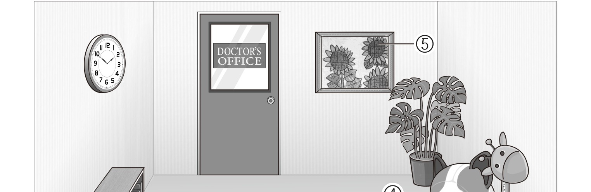
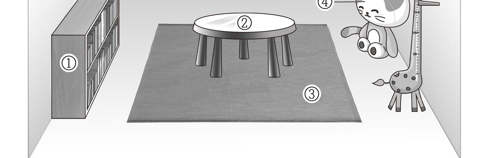
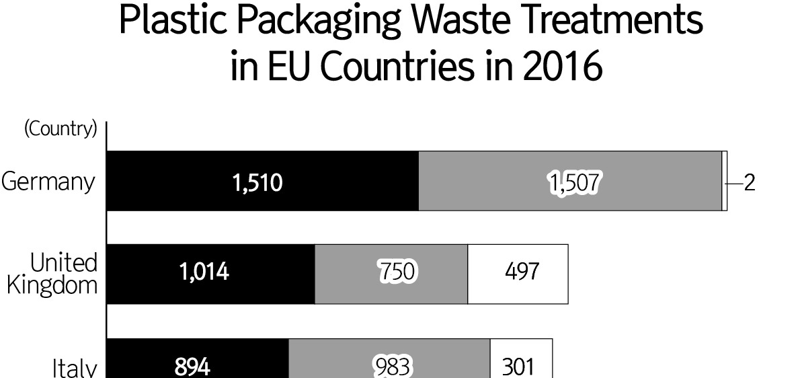
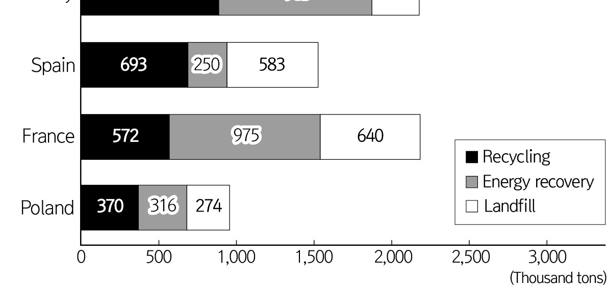

1. 다음을 듣고, 여자가 하는 말의 목적으로 가장 적절한 것을 고르시오.

① 환경보호 표어 대회 참여를 독려하려고
② 학교 생태정원 이름짓기 공모를 안내하려고
③ 학교 시설 보수공사 기간 연장을 공지하려고
④ 학생회장 선출을 위한 온라인 투표 방법을 알리려고
⑤ 생태정원 가꾸기 활동을 위한 자원봉사자를 모집하려고

2. 대화를 듣고, 남자의 의견으로 가장 적절한 것을 고르시오.

① 학생 간 동료 피드백은 온라인 수업에 효과적이다.
② 수업 전 학생들과의 대화로 친밀감을 형성할 수 있다.
③ 온라인 자료를 수업에 활용할 때 저작권에 유의해야 한다.
④ 긍정적인 격려로 학생들에게 자신감을 심어 주는 것이 좋다.
⑤ 학생의 다양한 수준을 고려하여 온라인 수업을 계획해야 한다.

3. 대화를 듣고, 두 사람의 관계를 가장 잘 나타낸 것을 고르시오.

① 사진작가 - 학생
② 화가 - 잡지사 기자
③ 미술 교사 - 학부모
④ 전시회 기획자 - 의뢰인
⑤ 큐레이터 - 인쇄물 제작업자

4. 대화를 듣고, 그림에서 대화의 내용과 일치하지 않는 것을 고르시오.

5. 대화를 듣고, 남자가 할 일로 가장 적절한 것을 고르시오.

① 영화 고르기
② 스피커 설치하기
③ 간식 만들기
④ 담요 가지고 오기
⑤ 쿠션 빌려오기

6. 대화를 듣고, 여자가 지불할 금액을 고르시오. [3점]

① $225
② $250
③ $255
④ $280
⑤ $315

7. 대화를 듣고, 여자가 벼룩시장 운영을 연기한 이유를 고르시오.

① 공원 긴급 보수 작업이 계획되어서
② 행사 당일 폭우가 예상되어서
③ 행사 물품 배송이 지연되어서
④ 다른 행사와 시간이 겹쳐서
⑤ 참가 인원이 적어서

8. 대화를 듣고, Young Edison Science Program에 관해 언급되지 않은 것을 고르시오.

① 장소
② 주제
③ 참여 가능 인원
④ 운영 시간
⑤ 준비물

9. Flash Fiction Contest에 관한 다음 내용을 듣고, 일치하지 않는 것을 고르시오.

① 출품작의 단어 수에 제한이 있다.
② 참가자는 다수의 작품을 제출할 수 있다.
③ 제출 마감일은 7월 15일이다.
④ 심사는 학년별로 이루어진다.
⑤ 입상작은 학교 신문에 게재된다.

10. 다음 표를 보면서 대화를 듣고, 남자가 주문할 아웃도어용 시계를 고르시오.

|  | Model | Price | GPS tracking | Material | Feature |
| --- | --- | --- | --- | --- | --- |
| ① | A | $200 | × | Plastic | Waterproof |
| ② | B | $240 | ○ | Plastic | Waterproof |
| ③ | C | $260 | ○ | Plastic | Solar charging |
| ④ | D | $290 | ○ | Metal | Waterproof |
| ⑤ | E | $320 | ○ | Metal | Solar charging |

11. 대화를 듣고, 여자의 마지막 말에 대한 남자의 응답으로 가장 적절한 것을 고르시오.

① Let’s ask where Monica’s classroom is.
② I’ll take her a bit earlier than usual then.
③ Okay. I’ll ask her teacher when they close.
④ No problem. My meeting ended successfully.
⑤ Thank you. I’ll take care of the client instead.

12. 대화를 듣고, 남자의 마지막 말에 대한 여자의 응답으로 가장 적절한 것을 고르시오.

① Sorry. I can’t remember my script at all.
② With your help, the repairman fixed the copier.
③ Let’s try a different copier on the second floor.
④ I was impressed by your presentation last time.
⑤ Don’t panic. You can finish your script next week.

13. 대화를 듣고, 여자의 마지막 말에 대한 남자의 응답으로 가장 적절한 것을 고르시오. [3점]

Man:
① It’s better to get dance training this time.
② Why don’t you try auditioning to join our team?
③ Okay. I’ll be sure to make the post by tomorrow.
④ Good job! The audition was tough, but we made it!
⑤ Offline performances are more fun than online ones.

14. 대화를 듣고, 남자의 마지막 말에 대한 여자의 응답으로 가장 적절한 것을 고르시오. [3점]

Woman:
① Of course. I’ll practice making Japanese dishes with you.
② Right. You’ll build confidence through continual practice.
③ Great! I’m so proud of you for passing the test.
④ Well, you need to be careful while cooking.
⑤ I agree. Empathy is the key to success.

15. 다음 상황 설명을 듣고, Clara가 Jacob에게 할 말로 가장 적절한 것을 고르시오.

Clara:
① You’ll have more followers soon, so don’t worry.
② Be more responsible when posting to social media.
③ It’s essential to actively interact with your followers.
④ How about putting away your smartphone at bedtime?
⑤ You should disable social media notifications during dinner.

16. 남자가 하는 말의 주제로 가장 적절한 것은?

① sounds and roles of string instruments in an orchestra
② ways to tune different types of string instruments
③ importance of playing in harmony in an orchestra
④ stage positions of various orchestral instruments
⑤ origins of the names of musical instruments

17. 언급된 악기가 아닌 것은?

따라 답을 하시기 바랍니다.

① violin
② viola
③ double bass
④ cello
⑤ harp

18. 다음 글의 목적으로 가장 적절한 것은?

To whom it may concern, Thank you very much for faithfully responding to our request six months ago and taking corresponding measures. Even after the installation of road traffic safety facilities, we still need more for the safety of our students. It is a problem with the school road, which students use on their way to and from school. The width of the current school road is barely wide enough for two people to walk side by side. So, there are risks of collision with vehicles on the road where students walk and accidents if many students flock to the narrow school road. Therefore, we ask you to expand the school road for students’ safety. I would appreciate it if you could respond as soon as possible. Sincerely, Alisha Lee

19. 다음 글에 나타난 ‘I’의 심경으로 가장 적절한 것은?

One night a buddy and I decided we were going to go find that Big Foot. We were in my old truck and we set off across the fields heading toward the tallest hill. The fields were rough, with only the slightest trail to follow. Along the way there were small trenches dug in the fields. I never figured out why. As we got closer and closer to the top of the hill, I was actually becoming scared, which was kind of rare, because at that age I was pretty fearless. As we got to the top of the hill, there was a loud thump! My truck sunk down like something heavy had just jumped in the bed. We were too terrified to look in the back. I panicked and decided to throw the truck into reverse and back down the hill. As I did so, there was another thump and a loud roar now came out like I’d never, ever heard before.

20. 다음 글에서 필자가 주장하는 바로 가장 적절한 것은?

Placing value on and investing in experiences provides us with a greater sense of vitality. Our experiences make us feel alive and give us greater opportunities to grow. Any time you consider purchasing a new possession, stop yourself and think about what kind of experience it will give you. Ask yourself: How much joy will this bring me? Will the joy be temporary or long-lasting? Will the purchase be something I can share with others? If it becomes clear the purchase will provide only short-term benefit to you, think about an experience you could purchase instead that would provide you with longer-term benefits. For instance, if you have your eye on a new pair of shoes for $150, ask yourself what kind of experience you could enjoy for that same amount. Maybe you’d enjoy a concert with friends or a dinner cruise during the summer. Once you think of an experience you’d enjoy, seriously consider diverting the money for the purchase from possession to experience.

21. 밑줄 친 this civilization of leisure was, in reality, a Trojan horse가 다음 글에서 의미하는 바로 가장 적절한 것은? [3점]

It seemed like a fair deal: we would accept new technologies, which would modify our habits and oblige us to adjust to certain changes, but in exchange we would be granted relief from the burden of work, more security, and above all, the freedom to pursue our desires. The sacrifice was worth the gain; there would be no regrets. Yet it has become apparent that this civilization of leisure was, in reality, a Trojan horse. Its swelling flanks hid the impositions of a new type of enslavement. The automatons are not as autonomous as advertised. They need us. Those computers that were supposed to do our calculations for us instead demand our attention: for ten hours a day, we are glued to their screens. Our communications monopolize our time. Time itself is accelerating. The complexity of the system overwhelms us. And leisure is often a costly distraction.

22. 다음 글의 요지로 가장 적절한 것은?

Giving honest information may be particularly relevant to integrity because honesty is so fundamental in discussions of trustworthiness. Unfortunately, leaders are often reluctant to tell the truth. During times of crisis and change, business leaders are often faced with the challenge of either telling an uncomfortable truth, remaining silent, or downplaying the severity of the situation. There are plenty of other situations in which, in the short term, it may be more comfortable not to tell the truth to followers. Ultimately, however, even dishonesty that was meant to protect employee morale will eventually be exposed, undermining trustworthiness at a time when commitment to the organization is most vital. Even concerted efforts at secrecy can backfire, as employees may simply “fill in the gaps” in their understanding with their own theories about the leader’s behavior. Therefore, leaders need to take steps to explain the true reasons for their decisions to those individuals affected by it, leaving less room for negative interpretations of leader behavior.

23. 다음 글의 주제로 가장 적절한 것은?

From your brain’s perspective, your body is just another source of sensory input. Sensations from your heart and lungs, your metabolism, your changing temperature, and so on, are like ambiguous blobs. These purely physical sensations inside your body have no objective psychological meaning. Once your concepts enter the picture, however, those sensations may take on additional meaning. If you feel an ache in your stomach while sitting at the dinner table, you might experience it as hunger. If flu season is just around the corner, you might experience that same ache as nausea. If you are a judge in a courtroom, you might experience the ache as a gut feeling that the defendant cannot be trusted. In a given moment, in a given context, your brain uses concepts to give meaning to internal sensations as well as to external sensations from the world, all simultaneously. From an aching stomach, your brain constructs an instance of hunger, nausea, or mistrust.

24. 다음 글의 제목으로 가장 적절한 것은?

On an antelope’s skull, the eye sockets are situated on the side of the head. This is because this animal spends a lot of its time with its head bent down to eat a low‑nutrient food: grass. While the animal is busy grazing, there will be predators out stalking for their food, so the antelope needs the greatest possible range of vision so that it has the maximum chance of seeing its predator and making an escape. With the eye sockets at the back of the head and on the side, it can see nearly 360° around itself. The eye of the antelope is also at the back of its head, giving it a long nose. If the eyes were at the front of the skull, vision would be obscured by long grass, so its long nose also gives an evolutionary advantage.

25. 다음 도표의 내용과 일치하지 않는 것은?

Plastic Packaging Waste Treatments in EU Countries in 2016 (Thousand tons)

| Country | Recycling | Energy recovery | Landfill |
| --- | --- | --- | --- |
| Germany | 1,510 | 1,507 | 2 |
| United Kingdom | 1,014 | 750 | 497 |
| Italy | 894 | 983 | 301 |
| Spain | 693 | 250 | 583 |
| France | 572 | 975 | 640 |
| Poland | 370 | 316 | 274 |

26. Eric Carle에 관한 다음 글의 내용과 일치하지 않는 것은?

Eric Carle was an American writer and illustrator of children’s literature. Born in Syracuse, New York, in 1929, he moved with his parents to Germany when he was six years old. He was educated there, and graduated from an art school in Stuttgart, Germany. He moved back to the United States and worked as a graphic designer at The New York Times. In the mid-1960s, children’s author Bill Martin Jr. asked Carle to illustrate a book he was writing. In 1967, they published their first collaboration: Brown Bear, Brown Bear, What Do You See? His best-known work, The Very Hungry Caterpillar, has been translated into more than 66 languages and sold over 50 million copies. In 2002, Carle and his wife opened the Eric Carle Museum of Picture Book Art, which collects and features the work of children’s book illustrators from around the world.

27. Black Box Short Play Festival에 관한 다음 안내문의 내용과 일치하지 않는 것은?

Black Box Short Play Festival The annual Black Box Short Play Festival is waiting for you. This festival aims to showcase new playwrights by allowing their works to be performed onstage. Come and enjoy! Date and Place - August 12 - 14, 2022 - The Black Box Theater, 530 Fifth Avenue, New York Performance Schedule Friday, Saturday, Sunday, August 12 August 13 August 14 The Midnight Salesmen 8 p.m. 2 p.m. Shrink to Fit 8 p.m. 2 p.m. Casting the Villain Aside 2 p.m. 8 p.m. Tickets - Early Bird: $10 per play (reserve before July 31, 2022) - Regular Price: $15 per play - Reserve tickets online at www.theblackboxtheater.com. Notes - No late entries will be permitted. - Children under 10 are not allowed.

28. Newport Hackathon 2022에 관한 다음 안내문의 내용과 일치하는 것은?

 Newport Hackathon 2022 Newport Hackathon 2022 is a website-coding marathon to promote creativity, collaboration, and innovative thinking. Event Information
Who: Newport University students
When: Friday, September 23, 1 p.m. -Saturday, September 24, 9 a.m.
Where: Newport University Student Center How to Participate
You can participate individually or as a team of up to 4.
You must register between August 23 and August 31. Requirements and Rules
Participants will have 20 hours to code a website according to the theme announced on the day of the event.
Submissions must include a video explaining the website. (Less than 5 minutes in length)
Participants may use open source code while developing their websites.

29. 다음 글의 밑줄 친 부분 중, 어법상 틀린 것은? [3점]

The spider chart, also called a radar chart, is a form of line graph. It helps the researcher to represent their data in a chart that shows the relative size of a response on one scale for interrelated variables. Like the bar chart, the data needs to have one scale which is common to all variables. The spider chart is drawn with the variables spanning the chart, creating a spider web. An example of this is seen in a research study looking at self-reported confidence in year 7 students across a range of subjects taught in their first term in secondary school. The researcher takes the responses from a sample group and calculates the mean to plot on the spider chart. The spider chart allows the researcher to easily compare and contrast the confidence level in different subjects for the sample group. The chart, like the pie chart, can then be broken down for different groups of students within the study to elicit further analysis of findings.

30. 다음 글의 밑줄 친 부분 중, 문맥상 낱말의 쓰임이 적절하지 않은 것은? [3점]

In poorer countries many years of fast growth may be necessary to bring living standards up to acceptable levels. But growth is the means to achieve desired goals, not the end in itself. In the richer world the whole idea of growth ─ at least as conventionally measured ─ may need to be maintained. In economies where services dominate, goods and services tailored to our individual needs will be what determine the advance of our societies. These could be anything from genome-specific medicines to personalized care or tailored suits. That is different from more and more stuff, an arms race of growth. Instead, it means improvements in quality, something that GDP is ill equipped to measure. Some fifty years ago one US economist contrasted what he called the “cowboy” economy, bent on production, exploitation of resources, and pollution, with the “spaceman” economy, in which quality and complexity replaced “throughput” as the measure of success. The move from manufacturing to services and from analog to digital is the shift from cowboy to spaceman. But we are still measuring the size of the lasso.

31. 다음 빈칸에 들어갈 말로 가장 적절한 것을 고르시오.

There is a difference between a newsworthy event and news. A newsworthy event will not necessarily become news, just as news is often about an event that is not, in itself, newsworthy. We can define news as an event that is recorded in the news media, regardless of whether it is about a newsworthy event. The very fact of its transmission means that it is regarded as news, even if we struggle to understand why that particular story has been selected from all the other events happening at the same time that have been ignored. News selection is subjective so not all events seen as newsworthy by some people will make it to the news. All journalists are familiar with the scenario where they are approached by someone with the words ‘I’ve got a great story for you’. For them, it is a major news event, but for the journalist it might be something to ignore.

32. 다음 빈칸에 들어갈 말로 가장 적절한 것을 고르시오.

Infants’ preference for looking at new things is so strong that psychologists began to realize that they could use it as a test of infants’ visual discrimination, and even their memory. Could an infant tell the difference between two similar images? Between two similar shades of the same color? Could an infant recall having seen something an hour, a day, a week ago? The inbuilt attraction to novel images held the answer. If the infant’s gaze lingered, it suggested that the infant could tell that a similar image was nonetheless different in some way. If the infant, after a week without seeing an image, didn’t look at it much when it was shown again, the infant must be able at some level to remember having seen it the week before. In most cases, the results revealed that infants were more cognitively capable earlier than had been previously assumed. The visual novelty drive became, indeed, one of the most powerful tools in psychologists’ toolkit, unlocking a host of deeper insights into the capacities of the infant mind.

33. 다음 빈칸에 들어갈 말로 가장 적절한 것을 고르시오.

Imagine there are two habitats, a rich one containing a lot of resources and a poor one containing few, and that there is no territoriality or fighting, so each individual is free to exploit the habitat in which it can achieve the higher pay-off, measured as rate of consumption of resource. With no competitors, an individual would simply go to the better of the two habitats and this is what we assume the first arrivals will do. But what about the later arrivals? As more competitors occupy the rich habitat, the resource will be depleted, and so less profitable for further newcomers. Eventually a point will be reached where the next arrivals will do better by occupying the poorer quality habitat where, although the resource is in shorter supply, there will be less competition. Thereafter, the two habitats should be filled so that the profitability for an individual is the same in each one. In other words, competitors should adjust their distribution in relation to habitat quality so that each individual enjoys the same rate of acquisition of resources.

34. 다음 빈칸에 들어갈 말로 가장 적절한 것을 고르시오. [3점]

Neither Einstein’s relativity nor Bach’s fugues are such stuff as survival is made on. Yet each is a perfect example of human capacities that were essential to our having prevailed. The link between scientific aptitude and solving real-world challenges may be more apparent, but minds that reason with analogy and metaphor, minds that represent with color and texture, minds that imagine with melody and rhythm are minds that cultivate a more flourishing cognitive landscape. Which is all just to say that the arts may well have been vital for developing the flexibility of thought and fluency of intuition that our relatives needed to fashion the spear, to invent cooking, to harness the wheel, and, later, to write the Mass in B Minor and, later still, to crack our rigid perspective on space and time. Across hundreds of thousands of years, artistic endeavors may have been the playground of human cognition, providing a safe arena for training our imaginative capacities and infusing them with a potent faculty for innovation.

35. 다음 글에서 전체 흐름과 관계 없는 문장은?

Some forms of energy are more versatile in their usefulness than others. For example, we can use electricity for a myriad of applications, whereas the heat from burning coal is currently used mostly for stationary applications like generating power.

36. 주어진 글 다음에 이어질 글의 순서로 가장 적절한 것을 고르시오. [3점]

It raises much less reactance to tell people what to do than to tell them what not to do. Therefore, advocating action should lead to higher compliance than prohibiting action. For example, researchers have a choice of how to debrief research participants in an experiment involving some deception or omission of information. Often researchers attempt to commit the participant to silence, saying “Please don’t tell other potential participants that feedback from the other person was false.” This is a prescription that is rife with danger, failing to provide an implementation rule and raising reactance. Much better is to say, “To help make sure that other people provide answers as useful as yours have been, when people ask you about this study, please tell them that you and another person answered some questions about each other.” Similarly, I once saw a delightful and unusual example of this principle at work in an art gallery. A fragile acrylic sculpture had a sign at the base saying, “Please touch with your eyes.” The command was clear, yet created much less reactance in me than “Don’t touch!” would have.

37. 주어진 글 다음에 이어질 글의 순서로 가장 적절한 것을 고르시오.

One common strategy and use of passive misdirection in the digital world comes through the use of repetition. This digital misdirection strategy relies on the fact that online users utilizing web browsers to visit websites have quickly learned that the most basic ubiquitous navigational action is to click on a link or button presented to them on a website. This action is repeated over and over to navigate their web browsers to the desired web page or action until it becomes an almost immediate, reflexive action. Malicious online actors take advantage of this behavior to distract the user from carefully examining the details of the web page that might tip off the user that there is something amiss about the website. The website is designed to focus the user’s attention on the action the malicious actor wants them to take (e.g., click a link) and to draw their attention away from any details that might suggest to the user that the website is not what it appears to be on the surface.

38. 글의 흐름으로 보아, 주어진 문장이 들어가기에 가장 적절한 곳을 고르시오.

Earliest indications of the need for inspiration for fashion direction are possibly evidenced by a number of British manufacturers visiting the United States in around 1825 where they were much inspired by lightweight wool blend fabrics produced for outerwear. The ready‑to‑wear sector was established much earlier in America than in Britain and with it came new challenges. Previously garments were custom‑made by skilled individuals who later became known as or recognized as being fashion designers. These handmade garments that are now accepted as being the fashion garments of that time were only made for those with the means to pay for them. The lesser‑privileged mass market wore homemade and handed down garments. Later, by the end of the industrial revolution, fashion was more readily available and affordable to all classes. By now designers worked predominately within factories and no longer designed for individuals but for mass markets. Thus the direct communication link between the designer and client no longer existed and designers had to rely on anticipating the needs and desires of the new fashion consumer.

39. 글의 흐름으로 보아, 주어진 문장이 들어가기에 가장 적절한 곳을 고르시오. [3점]

Most dreaming occurs during REM sleep. REM stands for Rapid Eye Movement, a stage of sleep discovered by Professor Nathaniel Kleitman at the University of Chicago in 1958. Along with a medical student, Eugene Aserinsky, he noted that when people are sleeping, they exhibit rapid eye movement, as if they were “looking” at something. Ongoing research by Kleitman and Aserinsky concluded that it was during this period of rapid eye movement that people dream, yet their minds are as active as someone who is awake. Interestingly enough, studies have found that along with rapid eye movement, our heart rates increase and our respiration is also elevated — yet our bodies do not move and are basically paralyzed due to a nerve center in the brain that keeps our bodies motionless besides some occasional twitches and jerks. This is why it is difficult to wake up from or scream out during a nightmare. To sum it up, during the REM dream state, your mind is busy but your body is at rest.

40. 다음 글의 내용을 한 문장으로 요약하고자 한다. 빈칸 (A), (B)에 들어갈 말로 가장 적절한 것은?

There is no question that losing weight is hard. According to one calculation, you must walk 35 miles or jog for seven hours to lose just one pound. One big problem with exercise is that we don’t track it very scrupulously. A study in America found that people overestimated the number of calories they burned in a workout by a factor of four. They also then consumed, on average, about twice as many calories as they had just burned off. As Daniel Lieberman noted in The Story of the Human Body, a worker on a factory floor will in a year expend about 175,000 more calories than a desk worker — equivalent to more than sixty marathons. That’s pretty impressive, but here’s a reasonable question: how many factory workers look as if they run a marathon every six days? To be cruelly blunt, not many. That’s because most of them, like most of the rest of us, replace all those burnt calories, and then some, when they are not working.

Losing weight is hard because people usually think they burned a larger number of calories than they actually did and undo exercise by eating a lot of food.

41. 윗글의 제목으로 가장 적절한 것은?

Posts that hold up signs, street lights, and utility lines need to be strong and durable enough to withstand winds, storms, tsunamis, and earthquakes. Every so often, though, these same posts are called upon to do something crucial but fundamentally at odds with their everyday function: they need to break easily on impact. If hit by a fast-moving vehicle, posts need to come apart in just the right way in order to reduce damage and save lives. Engineers have spent a lot of time attempting to resolve this apparent paradox. One of the ways to get robust posts to break properly is called a “slip base” system. Instead of using a single continuous post, a slip base approach joins two separate posts close to ground level using a connector plate. This joint allows the pair to break apart at an intended juncture. It works basically like this: a lower post is put in the ground, then an upper post is attached to it using breakaway bolts. These bolts are made to fracture or dislodge when the post gets hit hard enough, so the upper post gets knocked over while the lower post passes safely under the moving vehicle. When everything works as designed, such posts can also help slow down a vehicle and minimize damage. Subsequent infrastructure repair becomes easier as well — in many cases, a new upper post can simply be bolted onto the damaged base post below it, which requires less material and work. The critical plate-to-plate connections underpinning slip systems can be obvious to the naked eye or tucked away under plate covers.

42. 밑줄 친 낱말 중에서 문맥상 낱말의 쓰임이 적절하지 않은 것은? [3점]

Posts that hold up signs, street lights, and utility lines need to be strong and durable enough to withstand winds, storms, tsunamis, and earthquakes. Every so often, though, these same posts are called upon to do something crucial but fundamentally at odds with their everyday function: they need to break easily on impact. If hit by a fast-moving vehicle, posts need to come apart in just the right way in order to reduce damage and save lives. Engineers have spent a lot of time attempting to resolve this apparent paradox. One of the ways to get robust posts to break properly is called a “slip base” system. Instead of using a single continuous post, a slip base approach joins two separate posts close to ground level using a connector plate. This joint allows the pair to break apart at an intended juncture. It works basically like this: a lower post is put in the ground, then an upper post is attached to it using breakaway bolts. These bolts are made to fracture or dislodge when the post gets hit hard enough, so the upper post gets knocked over while the lower post passes safely under the moving vehicle. When everything works as designed, such posts can also help slow down a vehicle and minimize damage. Subsequent infrastructure repair becomes easier as well — in many cases, a new upper post can simply be bolted onto the damaged base post below it, which requires less material and work. The critical plate-to-plate connections underpinning slip systems can be obvious to the naked eye or tucked away under plate covers.

43. 주어진 글에 이어질 내용을 순서에 맞게 배열한 것으로 가장 적절한 것은?

As we cruised the tree‑canopied country road in our new car, my husband and I were savoring the unusual warmth of the early spring day until we passed an old farmhouse. “Did you see those ducks?” my husband asked. To which I replied, “Ducks? They were chickens!” “No, honey, I am talking about the mama duck with the three ducklings!” “You mean the mama hen and the three chicks?” He retorted, “Honey, they were waddling with orange beaks!” “Oh, come on,” I said doubtfully. “They had yellow beaks with red crests.”

 Believe it or not, this conversation continued for the next three miles and deteriorated to the point that I shouted, “I know the difference between a duck and a chicken!” “Then I am turning this car around because I can’t believe you think you saw chickens!” “Good! Because I can’t believe you think they were ducks,” I answered quickly. As we reached the top of the hill, the farmhouse came into view, and I quickly pointed up the hill to the yard of the farmhouse. “See, those are chickens!” At the same time, my husband was pointing to the roadside gully, saying, “See, those are ducks!” We could not believe our eyes! Indeed, in the same yard, a mama duck and three ducklings were playing in the water by the side of the road and, up near the farmhouse, there was a mama hen pecking the ground with her three baby chicks following suit. We immediately broke into uncontrollable laughter and pulled to the side of the road to gain our composure. Understandably, my husband’s perspective had been restricted to the road ahead while driving. My own perspective had narrowed to the sides of the road as I enjoyed the views of the horizon. Not every disagreement is as easy to solve as our ducks‑and‑chickens experience. But to this day, my husband and I end many conflicts by agreeing to disagree. I’ll say, “It’s a chicken,” to which he will reply, “It’s a duck.” Each of us is willing to compromise as we consider the different perspectives of the other and realize that both of us can be right. We even have a wooden chicken and duck displayed in our living room as a constant reminder of that day and to not take ourselves too seriously!

44. 밑줄 친 낱말 중에서 가리키는 대상이 나머지 넷과 다른 것은?

As we cruised the tree‑canopied country road in our new car, my husband and I were savoring the unusual warmth of the early spring day until we passed an old farmhouse. “Did you see those ducks?” my husband asked. To which I replied, “Ducks? They were chickens!” “No, honey, I am talking about the mama duck with the three ducklings!” “You mean the mama hen and the three chicks?” He retorted, “Honey, they were waddling with orange beaks!” “Oh, come on,” I said doubtfully. “They had yellow beaks with red crests.”

 Believe it or not, this conversation continued for the next three miles and deteriorated to the point that I shouted, “I know the difference between a duck and a chicken!” “Then I am turning this car around because I can’t believe you think you saw chickens!” “Good! Because I can’t believe you think they were ducks,” I answered quickly. As we reached the top of the hill, the farmhouse came into view, and I quickly pointed up the hill to the yard of the farmhouse. “See, those are chickens!” At the same time, my husband was pointing to the roadside gully, saying, “See, those are ducks!” We could not believe our eyes! Indeed, in the same yard, a mama duck and three ducklings were playing in the water by the side of the road and, up near the farmhouse, there was a mama hen pecking the ground with her three baby chicks following suit. We immediately broke into uncontrollable laughter and pulled to the side of the road to gain our composure. Understandably, my husband’s perspective had been restricted to the road ahead while driving. My own perspective had narrowed to the sides of the road as I enjoyed the views of the horizon. Not every disagreement is as easy to solve as our ducks‑and‑chickens experience. But to this day, my husband and I end many conflicts by agreeing to disagree. I’ll say, “It’s a chicken,” to which he will reply, “It’s a duck.” Each of us is willing to compromise as we consider the different perspectives of the other and realize that both of us can be right. We even have a wooden chicken and duck displayed in our living room as a constant reminder of that day and to not take ourselves too seriously!

45. 윗글에 관한 내용으로 적절하지 않은 것은?

As we cruised the tree‑canopied country road in our new car, my husband and I were savoring the unusual warmth of the early spring day until we passed an old farmhouse. “Did you see those ducks?” my husband asked. To which I replied, “Ducks? They were chickens!” “No, honey, I am talking about the mama duck with the three ducklings!” “You mean the mama hen and the three chicks?” He retorted, “Honey, they were waddling with orange beaks!” “Oh, come on,” I said doubtfully. “They had yellow beaks with red crests.”

 Believe it or not, this conversation continued for the next three miles and deteriorated to the point that I shouted, “I know the difference between a duck and a chicken!” “Then I am turning this car around because I can’t believe you think you saw chickens!” “Good! Because I can’t believe you think they were ducks,” I answered quickly. As we reached the top of the hill, the farmhouse came into view, and I quickly pointed up the hill to the yard of the farmhouse. “See, those are chickens!” At the same time, my husband was pointing to the roadside gully, saying, “See, those are ducks!” We could not believe our eyes! Indeed, in the same yard, a mama duck and three ducklings were playing in the water by the side of the road and, up near the farmhouse, there was a mama hen pecking the ground with her three baby chicks following suit. We immediately broke into uncontrollable laughter and pulled to the side of the road to gain our composure. Understandably, my husband’s perspective had been restricted to the road ahead while driving. My own perspective had narrowed to the sides of the road as I enjoyed the views of the horizon. Not every disagreement is as easy to solve as our ducks‑and‑chickens experience. But to this day, my husband and I end many conflicts by agreeing to disagree. I’ll say, “It’s a chicken,” to which he will reply, “It’s a duck.” Each of us is willing to compromise as we consider the different perspectives of the other and realize that both of us can be right. We even have a wooden chicken and duck displayed in our living room as a constant reminder of that day and to not take ourselves too seriously! 하시오.

