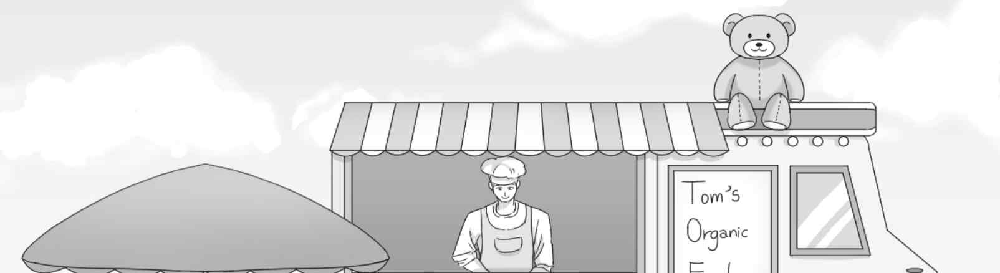
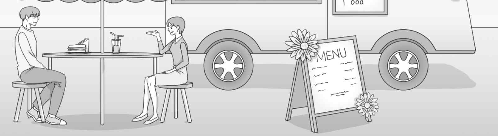
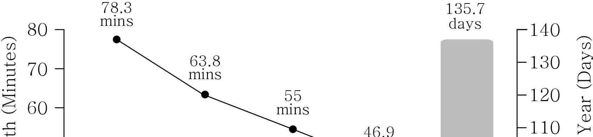
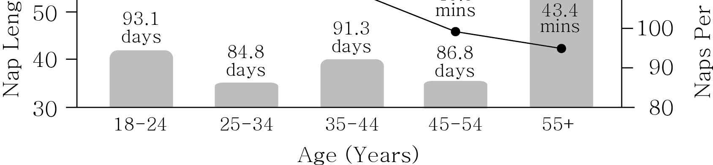

1. 다음을 듣고, 여자가 하는 말의 목적으로 가장 적절한 것을 고르시오.
① 놀이공원 운영 시간 연장을 공지하려고
② 새로 생긴 실내 놀이 기구를 홍보하려고
③ 놀이공원 내 공연 장소의 변경을 알리려고
④ 놀이 기구 탑승 시 안전 수칙 준수를 당부하려고
⑤ 야외 놀이 기구의 일시적 운행 중단을 안내하려고

2. 대화를 듣고, 남자의 의견으로 가장 적절한 것을 고르시오.

① 온라인 계정 비밀번호는 주기적으로 바꿔야 한다.
② 중요한 비밀번호는 메모해 두어야 한다.
③ 소셜 미디어 사용 시간을 줄여야 한다.
④ 보안 프로그램은 수시로 업데이트해야 한다.
⑤ 소셜 미디어에서 개인 정보 노출에 유의해야 한다.

3. 다음을 듣고, 여자가 하는 말의 요지로 가장 적절한 것을 고르시오.

① 상대방의 부탁을 거절할 때는 이유를 제시해야 한다.
② 무리한 부탁은 처음부터 거절하는 것이 바람직하다.
③ 부탁을 들어 준 상대방에게 감사 인사를 해야 한다.
④ 친한 사이일수록 예의를 지켜서 부탁하는 것이 좋다.
⑤ 부탁을 하기 전에 상대방의 상황을 확인하는 것이 필요하다.

4. 대화를 듣고, 그림에서 대화의 내용과 일치하지 않는 것을 고르시오.

5. 대화를 듣고, 남자가 할 일로 가장 적절한 것을 고르시오.

① 후원 업체 구하기
② 행사장 예약하기
③ 등록 현황 파악하기
④ 지역 예술가 섭외하기
⑤ 자원봉사자 모집하기

6. 대화를 듣고, 여자가 지불할 금액을 고르시오. [3점]

① $62
② $65
③ $70
④ $82
⑤ $85

7. 대화를 듣고, 남자가 학교 정원 음악회에 참가할 수 없는 이유를 고르시오.

① 아직 손목이 낫지 않아서
② 첼로 대회에 참가해야 해서
③ 첼로 연습을 오랫동안 쉬어서
④ 함께 연주할 사람을 찾지 못해서
⑤ 대학 입학 면접 준비를 해야 해서

8. 대화를 듣고, 컴퓨터 수업에 관해 언급되지 않은 것을 고르시오.

① 장소
② 내용
③ 기간
④ 준비물
⑤ 신청 방법

9. Sunnyville Coffee Expo에 관한 다음 내용을 듣고, 일치하지 않는 것을 고르시오.

① 11월 18일과 19일에 개최될 것이다.
② 티켓당 무료 머그잔을 하나씩 받게 된다.
③ 올해의 주제는 ‘From Bean to Brew’이다.
④ 커피를 생산하는 10개국의 커피를 맛볼 수 있다.
⑤ 일찍 예매하면 할인을 받을 수 있다.

10. 다음 표를 보면서 대화를 듣고, 여자가 구매할 SIM 카드를 고르시오.

|  | Plan | Data (GB) | Days | Free International Calls | Price |
| --- | --- | --- | --- | --- | --- |
| ① | A | 5 | 10 | ○ | $20 |
| ② | B | 10 | 15 | × | $25 |
| ③ | C | 15 | 20 | ○ | $30 |
| ④ | D | 20 | 30 | × | $35 |
| ⑤ | E | 30 | 50 | ○ | $50 |

11. 대화를 듣고, 남자의 마지막 말에 대한 여자의 응답으로 가장 적절한 것을 고르시오.

① I’m not sure where they are now.
② My aunt is expecting her baby soon.
③ My aunt and the baby are both in good health.
④ I’m on my way to the hospital for a health checkup.
⑤ I don’t know whether they’ll like the gift and flowers.

12. 대화를 듣고, 여자의 마지막 말에 대한 남자의 응답으로 가장 적절한 것을 고르시오.

① Exactly. That’s why I gave up swimming.
② Right. It’s cheaper to buy a monthly pass.
③ Not at all. The pool is warm enough to swim in.
④ I don’t think so. We’re not allowed to dive into the pool.
⑤ Good point. Swimming is an exercise for the whole body.

13. 대화를 듣고, 남자의 마지막 말에 대한 여자의 응답으로 가장 적절한 것을 고르시오. [3점]

Woman:
① I’m sorry. I can’t go to the lab with you now.
② I totally agree. We should wash vegetables thoroughly.
③ Sure. It’ll be nice to study for the biology exam together.
④ Yeah. Vegetables like broccoli are good for our health.
⑤ Indeed. I can’t wait to do the broccoli cell experiment.

14. 대화를 듣고, 여자의 마지막 말에 대한 남자의 응답으로 가장 적절한 것을 고르시오.

Man:
① Thanks. Donating books is a way to help those in need.
② My pleasure. My customers will love your books.
③ Me too. Joining the book club is worth it.
④ I’d love to. But we don’t buy old books anymore.
⑤ That’s right. So I’ve ordered those novels for you.

15. 다음 상황 설명을 듣고, Lydia가 Mr. Robinson에게 할 말로 가장 적절한 것을 고르시오. [3점]

Lydia:
① I’d like to enter the brochure competition next time.
② I’m afraid you forgot to put my name on the brochure.
③ I’m deeply disappointed that I didn’t win the competition.
④ You haven’t shown me the first draft of the brochure.
⑤ You should’ve informed me about the competition.

16. 남자가 하는 말의 주제로 가장 적절한 것은?

① the average life expectancy of animals
② similarities between humans and animals
③ animals that stay longer with their mothers
④ independent animals that travel and live alone
⑤ different roles of mothers and fathers in parenting

17. 언급된 동물이 아닌 것은?

① chimpanzees
② elephants
③ kangaroos
④ giraffes
⑤ polar bears

18. 다음 글의 목적으로 가장 적절한 것은?

We hope this notice finds you in good health and high spirits. We are writing to inform you that a package was delivered to the Rosehill Apartment Complex on October 9th, specifically addressed to your home. However, despite multiple attempts to deliver the package to you, it has remained unclaimed at our front desk for an extended period. As the management office, it is our responsibility to ensure the safekeeping of all delivered items and help deliver them quickly to the right residents. Therefore, we kindly request that you visit the management office during our office hours to claim your package. We genuinely appreciate your cooperation in this matter.

19. 다음 글에 드러난 ‘I’의 심경 변화로 가장 적절한 것은?

I hurried to the bus terminal to return home for Christmas. As soon as I arrived at the terminal, I saw my bus pulling away. I called out and ran after the bus, but it was too late. I felt a wave of disappointment wash over me as I realized that I would have to wait three hours for the next bus. I must have been visibly upset because a woman came over, took my arm, and led me to the street. She called a taxi and gave the driver a five-dollar bill. She told him to take me to the ferry terminal, because the bus made a stop there before heading out onto the highway. She also wished me a Merry Christmas, and all I could do was smile. I couldn’t believe what she had done for me, a complete stranger!

20. 다음 글에서 필자가 주장하는 바로 가장 적절한 것은?

The chemists Hans Ebel, Claus Bliefert, and William Russey note: “It goes without saying that scientists need to be skillful readers. Extensive reading is the principal key to expanding one’s knowledge and keeping up with developments in a discipline. However, what is often overlooked here is that scientists are also obliged to be skillful writers. Only the researcher who is competent in the art of written communication can play an active and effective role in contributing to science.” From the perspective of readability, moreover, scientists should always write with a reader-centered mentality; even in the act of writing they must be mindful of the act of reading. It would be beneficial for them to understand how readers read in order to improve their writing.

21. 밑줄 친 squeeze economies into a test tube가 다음 글에서 의미하는 바로 가장 적절한 것은?

Physicians and other natural scientists test their theories using controlled experiments. Macroeconomists, however, have no laboratories and little ability to run economy-wide experiments of any kind. Granted, they can study different economies around the world, but each economy is unique, so comparisons are tricky. Controlled experiments also provide the natural sciences with something seldom available to economists — the chance, or serendipitous, discovery (such as penicillin). Macroeconomists studying the U.S. economy have only one patient, so they can’t introduce particular policies in a variety of alternative settings. You can’t squeeze economies into a test tube. Cries of “Eureka!” are seldom heard from macroeconomists. An economy consisting of hundreds of millions of individual actors is a complicated thing. As Nobel Prize-winning physicist Murray Gell-Mann once observed, “Think how hard physics would be if particles could think.”

22. 다음 글의 요지로 가장 적절한 것은?

Imagine a movie where nothing but terrible things happen. But, in the end, everything works out. Everything is resolved. A sufficiently happy ending can change the meaning of all the previous events. They can all be viewed as worthwhile, given that ending. Now imagine another movie. A lot of things are happening. They’re all exciting and interesting. But there are a lot of them. Ninety minutes in, you start to worry. “This is a great movie,” you think, “but there are a lot of things going on. I sure hope the filmmaker can pull it all together.” But that doesn’t happen. Instead, the story ends, suddenly, unresolved, or something facile and clichéd occurs. You leave deeply annoyed and unsatisfied — failing to notice that you were fully engaged and enjoying the movie almost the whole time you were in the theatre. The present can change the past, and the future can change the present.

23. 다음 글의 주제로 가장 적절한 것은? [3점]

Just as today some jobs are better than others, so would they have been in early societies with their blossoming towns and eventually cities, with some roles more dangerous and some having more plentiful access to food or other resources. The archeological record shows that soon after the appearance of towns, agriculture, and surpluses, some burials start to look different from others. Some individuals are buried with more precious goods (metals, weapons, and maybe even art), some are in group graves and some by themselves, and still others don’t even seem to be buried at all. The bones from the burials start to show us differences as well — chemical and isotope analyses of teeth and long bones reveal that some members of groups were getting more protein or minerals than others; some have more evidence of diseases and greater physical injuries from their labors. Early on these differences are small, but by 5,000 to 7,000 years ago they are becoming quite pronounced.

24. 다음 글의 제목으로 가장 적절한 것은?

When you break up with a partner or close friend, the natural response (after having a good cry, obviously) is to blame yourself. You wonder what you did wrong and what you might have done differently. Bonds can help us reach a more balanced perspective; there are some bonds that were simply never meant to last, even if they played an essential role in your evolution to this point. Perhaps the most valuable thing is to know that seeing bonds break doesn’t have to break us. In chemistry, by definition, a change in the atomic bonding is not just the end of one state, but the beginning of another: creating the space for new bonding potential. The same is true for us as humans. It might take a cup of warm milk to reset us and give us comfort after a relationship has broken down. But however many bonds we see come apart, we will always retain one of our most human abilities: to connect afresh, find new friends and love again.

25. 다음 도표의 내용과 일치하지 않는 것은?

How Naps Change As We Age

| Age | Nap Length (Minutes) | Naps Per Year (Days) |
| --- | --- | --- |
| 18-24 | 78.3 | 93.1 |
| 25-34 | 63.8 | 84.8 |
| 35-44 | 55 | 91.3 |
| 45-54 | 46.9 | 86.8 |
| 55+ | 43.4 | 135.7 |

26. Ann Bancroft에 관한 다음 글의 내용과 일치하지 않는 것은?

Ann Bancroft was born in Minnesota, U.S. Bancroft grew up in rural Minnesota in what she described as a family of risk-takers. Although she struggled with a learning disability, she graduated from St. Paul Academy and became a physical education teacher. Bancroft resigned her teaching position in 1986 in order to participate in the Will Steger International Polar Expedition. The group departed from Ellesmere Island on March 6, and after 56 days, she and five other team members arrived at the North Pole by dogsled. She thus became the first woman to reach the North Pole by sled and on foot. In November 1992, she led three other women on the American Women’s Expedition to Antarctica. It took them 67 days to reach the South Pole on skis and Bancroft became the first woman to have stood at both poles.

27. 2023 Greenfield City Run에 관한 다음 안내문의 내용과 일치하지 않는 것은?

2023 Greenfield City Run Are you eager for the race that can awaken the running spirit within you? Maybe the Greenfield City Run is best for you.
When: Sunday, November 5 - Assembly time is 9:00 a.m. - Start time is 9:30 a.m.
Where: Riverside Park
Races: 2km, 5km, 10km (The 2km race is only for kids.)
Registration - Registration starts on October 16. - The registration fees depend on the date you sign up. $30: October 16 - November 4 / $40: November 5 - Register online at www.finishrace.com.
Activities - Coffee and Cookie Fair & Outdoor Charity Bazaar For more information, call (516) 703-1737.

28. Bluehill Apple Picking에 관한 다음 안내문의 내용과 일치하는 것은?

Bluehill Apple Picking Take home a bag full of apples fresh from the orchard. This year, unfortunately, apple pie eating contests will not be held due to time constraints.
Date: Saturday, October 21, 2023
Time - Departure: 8:15 a.m. for pre-trip meeting Buses leave at 8:30 a.m. SHARP! - Return: Approximately 7:00 p.m.
Price: $20 per person (transportation included, meals not included)
Pre-registration is required at www.blueapple.com. - 12 years and under must be accompanied by adults.

29. 다음 글의 밑줄 친 부분 중, 어법상 틀린 것은? [3점]

Dr. Joseph Bell was a professor of medicine at the University of Edinburgh. His students were amazed by his astonishing powers of observation. He seemed able to determine what patients did for a living, or what illness they might have, simply by glancing in their direction. One time he concluded that a patient had walked across a golf course on the way to the doctor, simply by looking at his shoes. One of Bell’s students was particularly impressed with his teacher’s abilities. He filled up notebooks with examples of what he called Bell’s “eerie trick of spotting details.” The student eventually went into practice himself outside London. When business was slow he filled his spare moments by writing stories. He took Dr. Bell’s powers of perception, and gave them to a character of his own making — a character who made the young doctor, Arthur Conan Doyle, famous around the world. And so the professor who made even the most complex diagnosis seem “elementary” became the inspiration for fiction’s greatest detective, Sherlock Holmes.

30. 다음 글의 밑줄 친 부분 중, 문맥상 낱말의 쓰임이 적절하지 않은 것은? [3점]

Technology has historically distinguished the way music is produced. In a live jazz concert a bass player can provide the audience with a ten-minute jam session but is unable to do so if making a record. Time and space limits on early discs made this liberalized performance style impossible. Often, pieces would be separated into a number of discs leading to a lack of continuity. In addition to length, musicians had to take into account how the machinery recorded and absorbed their sound. Especially in the early days of recording, human voices as well as instruments were often distorted once recorded. To prevent such distortion, it was up to the musician to alter the sound to accommodate the recording technology that was just coming into existence. Jazz musicians and orchestras almost molded their works around recording parameters. Many musicians were receptive to the limitations and benefits of technology and created their records accordingly. The recording limitations began to filter into stage performance. Musicians were restricted to three-minute songs in the recording studio and they soon kept their songs to that length on stage too.

31. 다음 빈칸에 들어갈 말로 가장 적절한 것을 고르시오.

There’s reason to worry that an eyes-on-the-prize mentality could be a mistake. Lots of research shows that we tend to be over-confident about how easy it is to be self-disciplined. This is why so many of us optimistically buy expensive gym memberships when paying per-visit fees would be cheaper, register for online classes we’ll never complete, and purchase family-size chips on discount to trim our monthly snack budget, only to consume every last crumb in a single sitting. We think “future me” will be able to make good choices, but too often “present me” gives in to temptation. People have a remarkable ability to ignore their own failures. Even when we flounder again and again, many of us manage to maintain a rosy optimism about our ability to do better next time rather than learning from our past mistakes. We cling to fresh starts and other reasons to stay upbeat, which may help us get out of bed in the morning but can prevent us from approaching change in the smartest possible way.

32. 다음 빈칸에 들어갈 말로 가장 적절한 것을 고르시오. [3점]

The way we perceive the colors of the rainbow, and the universe in general, is influenced by the words we use to describe them. This is not limited to visual perception but also applies to smell, taste, touch, our perception of time and countless other human experiences. A wine or Scotch connoisseur, for example, has a much richer vocabulary at their disposal to describe the fullness, finish, flavors and aroma of the drink, which in turn improves their ability to recognize and remember subtle differences of which a non-expert may be unaware. Similarly, a chef or perfumer has at their disposal labels for flavors and smells that allow them to perceive, differentiate among, prepare and remember subtle variations. The labels that we have at our disposal influence how we see the world around us. Regardless of where you place the limits of linguistic effects on cognition, there is evidence that at least some of the things that we perceive and remember differ depending on what labels we use.

33. 다음 빈칸에 들어갈 말로 가장 적절한 것을 고르시오.

A connection with ancestors, especially remote ones, is useful for getting a wide-angled, philosophical view of life. Whereas our immediate ancestors are notably skilled at helping us with the “little pictures,” namely the particular, the trees — say, a problem with a boss — our remote ones are best for seeing the “Big Picture,” namely the general, the forest — say, the meaning of our job. As modern people rush around blowing small problems out of proportion, thus contributing to a global anxiety epidemic, ancestral spirits have a broader perspective that can calm the disquieted soul. When it comes to a trivial problem, for example, they’ll just tell us, “This too will pass.” They appreciate how rapidly and often things change. According to American anthropologist Richard Katz, for instance, Fijians say that from the ancestral viewpoint whatever looks unfortunate may turn out to be fortunate after all: “What may seem to be a horrible outcome... is seen in another light by the ancestors.” The ancestors, it might be said, keep their heads when everyone around them is losing theirs.

34. 다음 빈칸에 들어갈 말로 가장 적절한 것을 고르시오. [3점]

One of the criticisms of Stoicism by modern translators and teachers is the amount of repetition. Marcus Aurelius, for example, has been dismissed by academics as not being original because his writing resembles that of other, earlier Stoics. This criticism misses the point. Even before Marcus’s time, Seneca was well aware that there was a lot of borrowing and overlap among the philosophers. That’s because real philosophers weren’t concerned with authorship, but only what worked. More important, they believed that what was said mattered less than what was done. And this is true now as it was then. You’re welcome to take all of the words of the great philosophers and use them to your own liking (they’re dead; they don’t mind). Feel free to make adjustments and improvements as you like. Adapt them to the real conditions of the real world. The way to prove that you truly understand what you speak and write, that you truly are original, is to put them into practice.

35. 다음 글에서 전체 흐름과 관계 없는 문장은?

Several common themes were found in the highly creative individuals regarding their early experiences and education. In early childhood their families accorded them a great deal of respect and allowed them to explore on their own and develop a strong sense of personal autonomy.

36. 주어진 글 다음에 이어질 글의 순서로 가장 적절한 것을 고르시오.

Shakespeare wrote, “What’s in a name? That which we call a rose by any other name would smell as sweet.” According to Stanford University psychology professor Lera Boroditsky, that’s not necessarily so. Focusing on the grammatical gender differences between German and Spanish, Boroditsky’s work indicates that the gender our language assigns to a given noun influences us to subconsciously give that noun characteristics of the grammatical gender. Take the word bridge. In German, bridge (die brücke) is a feminine noun; in Spanish, bridge (el puente) is a masculine noun. Boroditsky found that when asked to describe a bridge, native German speakers used words like beautiful, elegant, slender. When native Spanish speakers were asked the same question, they used words like strong, sturdy, towering. This worked the other way around as well. The word key is masculine in German and feminine in Spanish. When asked to describe a key, native German speakers used words like jagged, heavy, hard, metal. Spanish speakers used words like intricate, golden, lovely.

37. 주어진 글 다음에 이어질 글의 순서로 가장 적절한 것을 고르시오. [3점]

Our perception always involves some imagination. It is more similar to painting than to photography. And, according to the confirmation effect, we blindly trust the reality we construct. You will see that the majority of us are quite ignorant about what lies around us. This is not so puzzling. The most extraordinary fact is that we completely disregard this ignorance. This is best witnessed in visual illusions, which we perceive with full confidence, as if there were no doubt that we are portraying reality faithfully. One interesting way of discovering this — in a simple game that can be played at any moment — is the following. Whenever you are with another person, ask him or her to close their eyes, and start asking questions about what is nearby — not very particular details but the most striking elements of the scene. What is the color of the wall? Is there a table in the room? Does that man have a beard?

38. 글의 흐름으로 보아, 주어진 문장이 들어가기에 가장 적절한 곳을 고르시오. [3점]

How can we help students manage cognitive load as they learn to perform complex tasks? One method that has proved effective in research studies is to support some aspects of a complex task while students perform the entire task. For example, Swelter and Cooper demonstrated this with students learning to solve problems in a variety of quantitative fields from statistics to physics. They found that when students were given typical word problems, it was possible for them to solve the problems without actually learning much. This is because the problems themselves were sufficiently demanding that students had no cognitive resources available to learn from what they did. But when students were given “worked-examples” (such as pre-solved problems) placed between problems to solve, studying the worked-examples freed up cognitive resources that allowed students to see the key features of the problem and to analyze the steps and reasons behind problem-solving moves. The researchers found this improved students’ performance on subsequent problem solving. This result, called the worked-example effect, is one example of a process called scaffolding, by which instructors temporarily relieve some of the cognitive load so that students can focus on particular dimensions of learning.

39. 글의 흐름으로 보아, 주어진 문장이 들어가기에 가장 적절한 곳을 고르시오.

Utilitarian ethics argues that all action should be directed toward achieving the greatest total amount of happiness for the largest number of people. Utilitarian ethics assumes that all actions can be evaluated in terms of their moral worth, and so the desirability of an action is determined by its resulting hedonistic consequences. This is a consequentialist creed, assuming that the moral value and desirability of an action can be determined from its likely outcomes. Jeremy Bentham suggested that the value of hedonistic outcomes can be quantitatively assessed, so that the value of consequent pleasure can be derived by multiplying its intensity and its duration. In contrast, the other major advocate of utilitarianism, John Stuart Mill, argued for a more qualitative approach, assuming that there can be different subjective levels of pleasure. Higher-quality pleasures are more desirable than lower-quality pleasures. Less sophisticated creatures (like pigs!) have an easier access to the simpler pleasures, but more sophisticated creatures like humans have the capacity to access higher pleasures and should be motivated to seek those.

40. 다음 글의 내용을 한 문장으로 요약하고자 한다. 빈칸 (A), (B)에 들어갈 말로 가장 적절한 것은?

Music has no past; it exists only at the moment when it happens, and no two performances are identical. This is music’s greatest asset because it brings out the essential ‘now’ without implications of a past and a potential future. Thus, Stravinsky pointed out that only through music are we able to ‘realize the present.’ Musical ‘meaning’ cannot be separated from the act of presentation. However, the necessity of present-ing music — making it present here and now, without which it will not be music at all — does not sit easily with a concept of education that rests mainly upon received factual knowledge and which, by tradition, uses the past to make sense of the present. If we want music to have a role in general education, it would seem logical to acknowledge this difference and give prominence to activities that will involve all pupils working directly with music. Yet, in spite of numerous attempts to develop a more musical music curriculum for the majority of school pupils, the emphasis is still on pupils absorbing factual information about music.

Music’s quality of being in the present is overlooked in formal music education, where delivering factual knowledge is prioritized.

41. 윗글의 제목으로 가장 적절한 것은?

The domination of nature is a familiar trope in environmental ethics and environmental political theory. Its history is tied more broadly to the rise of modern science, philosophy, and politics. The effort to understand the causal relations that govern the physical world so as to intervene in these relations in ways that could, as Francis Bacon put it, “ameliorate the human condition,” marked the beginning of modernity in the West. For a long time, the “domination of nature” referred to this effort to understand and control the nonhuman environment, and it was seen as a clearly good thing. This effort made possible new technologies and rising economic prosperity, promised an end to many forms of human suffering, and demonstrated the triumph of reason over ignorance and superstition. Its costs began to be visible with industrialization in the nineteenth century, which generated obvious environmental damage and caused among many people a sense of alienation from the land and the more-than-human communities composing it. One sees a growing unease about these costs in novels of the era such as Mary Shelley’s Frankenstein (1818), in poems like Wordsworth’s “Michael” (1800) and later Whitman’s Leaves of Grass (1855), and in the early nature writing of Thoreau’s Walden (1854). Yet systematic, critical analysis of the domination of nature as a problem came into its own only with the environmental studies movement in the 1970s. Since then, the trope has come to have a broadly negative meaning, with the domination of nature being viewed as harmful and illegitimate, as well as dangerous to human interests.

42. 밑줄 친 낱말 중에서 문맥상 낱말의 쓰임이 적절하지 않은 것은?

The domination of nature is a familiar trope in environmental ethics and environmental political theory. Its history is tied more broadly to the rise of modern science, philosophy, and politics. The effort to understand the causal relations that govern the physical world so as to intervene in these relations in ways that could, as Francis Bacon put it, “ameliorate the human condition,” marked the beginning of modernity in the West. For a long time, the “domination of nature” referred to this effort to understand and control the nonhuman environment, and it was seen as a clearly good thing. This effort made possible new technologies and rising economic prosperity, promised an end to many forms of human suffering, and demonstrated the triumph of reason over ignorance and superstition. Its costs began to be visible with industrialization in the nineteenth century, which generated obvious environmental damage and caused among many people a sense of alienation from the land and the more-than-human communities composing it. One sees a growing unease about these costs in novels of the era such as Mary Shelley’s Frankenstein (1818), in poems like Wordsworth’s “Michael” (1800) and later Whitman’s Leaves of Grass (1855), and in the early nature writing of Thoreau’s Walden (1854). Yet systematic, critical analysis of the domination of nature as a problem came into its own only with the environmental studies movement in the 1970s. Since then, the trope has come to have a broadly negative meaning, with the domination of nature being viewed as harmful and illegitimate, as well as dangerous to human interests.

43. 주어진 글에 이어질 내용을 순서에 맞게 배열한 것으로 가장 적절한 것은?

In a peaceful town surrounded by rolling hills, there lived a kind-hearted young woman named Emily. She had a strong desire to make a difference in the world, yet often felt that her efforts were insignificant. One day, Emily crossed paths with Martha, an elderly lady known for her sour mood and tendency to keep to herself. Curiosity sparked within Emily, prompting her to initiate a conversation with Martha.

 Despite Martha’s initial resistance, Emily persistently reached out to her, sharing stories and expressing genuine interest in her life. Through their conversations, Emily discovered that Martha had once been a famous painter. However, she had lost her passion for art due to personal hardships. Deeply moved by her sorrow, Emily resolved to help revive Martha’s creative spirit. So, she organized an art exhibition in the town’s community center. The event showcased the great works of many local artists, with a special surprise awaiting Martha. Emily had carefully prepared a section dedicated to Martha’s paintings, hoping to unveil it to her and the community. The day of the exhibition arrived, and the townspeople eagerly gathered, excited to witness the artistic wonders of their community. Emily anxiously awaited Martha’s arrival, wondering how Martha would react to the surprise she had planned. Martha finally entered the exhibition hall, and her eyes filled with tears as she stood in front of her own artworks. Martha slowly made her way through the section dedicated to her paintings, examining each piece with a mix of nostalgia and longing. The crowd watched in silence, their hearts touched by Martha’s emotional response. As Martha reached the last painting, she turned to Emily with a bright smile, tears still shining in her eyes. “Emily, you’ve given me back a part of myself that I thought was lost forever,” Martha whispered, her voice shaking with gratitude. “I had forgotten the joy that art once brought me, but you’ve reminded me of its power.”

44. 밑줄 친 낱말 중에서 가리키는 대상이 나머지 넷과 다른 것은?

In a peaceful town surrounded by rolling hills, there lived a kind-hearted young woman named Emily. She had a strong desire to make a difference in the world, yet often felt that her efforts were insignificant. One day, Emily crossed paths with Martha, an elderly lady known for her sour mood and tendency to keep to herself. Curiosity sparked within Emily, prompting her to initiate a conversation with Martha.

 Despite Martha’s initial resistance, Emily persistently reached out to her, sharing stories and expressing genuine interest in her life. Through their conversations, Emily discovered that Martha had once been a famous painter. However, she had lost her passion for art due to personal hardships. Deeply moved by her sorrow, Emily resolved to help revive Martha’s creative spirit. So, she organized an art exhibition in the town’s community center. The event showcased the great works of many local artists, with a special surprise awaiting Martha. Emily had carefully prepared a section dedicated to Martha’s paintings, hoping to unveil it to her and the community. The day of the exhibition arrived, and the townspeople eagerly gathered, excited to witness the artistic wonders of their community. Emily anxiously awaited Martha’s arrival, wondering how Martha would react to the surprise she had planned. Martha finally entered the exhibition hall, and her eyes filled with tears as she stood in front of her own artworks. Martha slowly made her way through the section dedicated to her paintings, examining each piece with a mix of nostalgia and longing. The crowd watched in silence, their hearts touched by Martha’s emotional response. As Martha reached the last painting, she turned to Emily with a bright smile, tears still shining in her eyes. “Emily, you’ve given me back a part of myself that I thought was lost forever,” Martha whispered, her voice shaking with gratitude. “I had forgotten the joy that art once brought me, but you’ve reminded me of its power.”

45. 윗글에 관한 내용으로 적절하지 않은 것은?

In a peaceful town surrounded by rolling hills, there lived a kind-hearted young woman named Emily. She had a strong desire to make a difference in the world, yet often felt that her efforts were insignificant. One day, Emily crossed paths with Martha, an elderly lady known for her sour mood and tendency to keep to herself. Curiosity sparked within Emily, prompting her to initiate a conversation with Martha.

 Despite Martha’s initial resistance, Emily persistently reached out to her, sharing stories and expressing genuine interest in her life. Through their conversations, Emily discovered that Martha had once been a famous painter. However, she had lost her passion for art due to personal hardships. Deeply moved by her sorrow, Emily resolved to help revive Martha’s creative spirit. So, she organized an art exhibition in the town’s community center. The event showcased the great works of many local artists, with a special surprise awaiting Martha. Emily had carefully prepared a section dedicated to Martha’s paintings, hoping to unveil it to her and the community. The day of the exhibition arrived, and the townspeople eagerly gathered, excited to witness the artistic wonders of their community. Emily anxiously awaited Martha’s arrival, wondering how Martha would react to the surprise she had planned. Martha finally entered the exhibition hall, and her eyes filled with tears as she stood in front of her own artworks. Martha slowly made her way through the section dedicated to her paintings, examining each piece with a mix of nostalgia and longing. The crowd watched in silence, their hearts touched by Martha’s emotional response. As Martha reached the last painting, she turned to Emily with a bright smile, tears still shining in her eyes. “Emily, you’ve given me back a part of myself that I thought was lost forever,” Martha whispered, her voice shaking with gratitude. “I had forgotten the joy that art once brought me, but you’ve reminded me of its power.”

